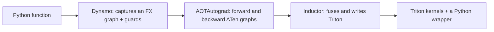
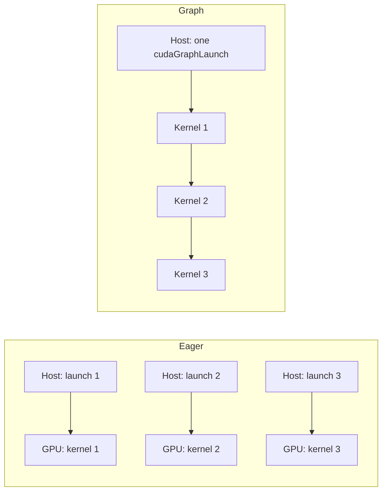

# Fusion, compilers, and launch overhead

> [!TLDR]
> - A PyTorch program is slow for one of three reasons: the GPU is busy computing, it is busy moving bytes, or it is
>   idle while the host works out what to launch next. The fixes differ, so you diagnose first.
> - Eager PyTorch runs each op as its own kernel. A chain of six pointwise ops on a 64 MiB float32 tensor moves 805.3
>   MB eagerly and 134.2 MB fused, so the roofline predicts a 6x speedup from fusion alone.
> - `torch.compile` fuses for you: Dynamo captures a graph of your Python, AOTAutograd splits it into forward and
>   backward, and Inductor writes Triton kernels for it. You read its output with `TORCH_LOGS=output_code`.
> - A CUDA graph records a whole sequence of kernel launches once and replays it with one call. It helps when kernels
>   are shorter than the 5 to 10 microseconds the host needs to launch each one, as in a small-batch decode step.
> - A kernel the compiler can't see through is a graph break. Register it with `torch.library.custom_op` and
>   `register_fake`, or with `triton_op` and `wrap_triton`, and `torch.compile(fullgraph=True)` accepts it.

Part 4 so far has taught you to write the kernels a model spends its time in: softmax and normalization in [chapter
15](/c/15-softmax-and-normalization), attention in [chapter 16](/c/16-flash-attention). A real model has hundreds of
other operations around them. Adds, multiplies, casts, activations, residuals, and masks each look cheap, and each
costs a kernel launch and a round trip through main memory. You can't hand-write all of them, and you shouldn't.

This chapter is about the machinery that does it for you, and about the limits of that machinery. You learn what the
compiler fuses and why fusion saves bytes. You also learn what a CUDA graph removes that fusion can't, and how to plug
your own kernel into the compiler so it stops being a wall. The lab has you do each by hand: fuse a chain of ops in
Triton, compare it with `torch.compile`, capture a launch-bound loop in a graph, and register a Triton kernel as a
custom op.

## Before you start

**Asynchronous launches.** A CUDA kernel launch returns to Python as soon as the work is queued ([chapter
0](/c/00-what-you-are-building)). The host runs ahead of the GPU, and the GPU drains a queue. Everything in this
chapter depends on that queue being empty or full.

**The roofline.** A kernel that does little arithmetic per byte is limited by memory bandwidth ([chapter
4](/c/04-roofline-and-latency)). This chapter uses the course's measured ceiling for the A100 80GB PCIe: 1275 GB/s for
a copy, measured in the companion course's chapter 10, against a rating of 1935 GB/s.

**Triton kernels.** You wrote one in [chapter 14](/c/14-triton): a function over a block of elements, with masked loads
and stores. The fused kernel in this chapter is the simplest case.

**Kernel launch cost.** The course's rule of thumb is that the host needs about 5 microseconds to queue a kernel on
the lab A100 (measured in the companion course's chapter 12), and 5 to 10 microseconds in general. The chapter uses 5
microseconds as its working number and tells you when the answer depends on it.

## Three ways to be slow

This section answers one question: when a PyTorch program is slower than you expect, what is the GPU doing?

Horace He's essay [Making Deep Learning Go Brrrr From First
Principles](https://horace.io/brrr_intro.html) gives the clearest answer. Picture the GPU as a factory. It has a
production line, a warehouse across a road, and a manager who sends it instructions. Each of the three can be the
reason output is low:

| Regime | What the GPU is doing | The factory | What fixes it |
|---|---|---|---|
| Compute bound | Arithmetic units are busy | The line runs flat out | Fewer FLOPs, lower precision, tensor cores |
| Memory bound | Waiting for bytes from HBM | Trucks can't keep up with the line | Move fewer bytes: fusion, smaller types |
| Overhead bound | Idle, waiting for the next launch | The manager is slow with orders | Fewer launches: fusion, CUDA graphs |

Chapters 10 to 16 lived in the first two rows. The third is new. In an overhead-bound program the GPU is not working
on anything at all, so a faster kernel changes nothing. The only way to speed it up is to give the GPU more work per
instruction.

You can tell the regimes apart with one experiment. Double the size of every tensor, for example by doubling the batch
size, and time the step again:

- If the time roughly doubles, bytes or FLOPs dominate, and you are compute or memory bound.
- If the time barely moves, you are overhead bound: the host was the bottleneck, and the GPU had spare capacity.

The profiler gives the same answer directly. A trace of an overhead-bound program shows a GPU timeline full of gaps
between short kernels, and a CPU timeline that is solid. You meet this view in [chapter
5](/c/05-profiling).

> [!KEY] Overhead is a third ceiling
> The roofline has two ceilings, bandwidth and arithmetic. A program also has a *launch rate* ceiling: if each kernel
> takes less time than the host needs to queue the next one, the host sets the speed, and neither roofline ceiling
> matters.

### Where the host's time goes

Each eager op is several layers of software before a kernel runs. Python calls into the `torch` function. The
dispatcher resolves which implementation to run, from the tensors' device, dtype, and whether autograd is recording.
The op infers its output shape, takes memory for the result from PyTorch's caching allocator, and finally calls
`cudaLaunchKernel`, which hands the kernel to the driver.

None of this is slow in isolation. Added up it costs microseconds, and He's essay measures roughly 280 thousand tiny
PyTorch ops per second, about 3.6 microseconds each, on a machine the essay doesn't name. That agrees in order of
magnitude with the course's 5 to 10 microseconds per launch. The exact figure depends on your CPU, the op, and whether
autograd is recording, and the lab measures it on the A100's host.

## What eager mode costs

This section answers one question: for a chain of small ops, how many bytes does eager PyTorch move, and how many
launches does it make?

Take the chain the lab uses. It is six pointwise ops on a tensor `x`:

```python
def chain_eager(x):
    t = x * 1.5
    t = t + 0.5
    t = torch.sin(t)
    t = t * t
    t = t - 0.25
    return torch.relu(t)
```

Eager PyTorch runs each line as its own kernel. Every kernel reads its whole input from HBM, computes an arithmetic
result that takes a few instructions, and writes a whole output back. The output of one kernel is the input of the
next, so the intermediate tensor takes a round trip through main memory for no reason: nothing else wants it.

### The byte count

Let $S$ be the size of one tensor in bytes. A pointwise op reads $S$ and writes $S$. The chain has $k$ ops, so:

$$
\boxed{B_{\text{eager}} = \hla{2kS} \qquad B_{\text{fused}} = \hlb{2S}}
$$

The eager chain moves $\hla{2kS}$ bytes because every op reads one tensor and writes one. A fused kernel reads the
input once, keeps every intermediate in registers, and writes the final result once, so it moves $\hlb{2S}$. The
ratio is $k$, the number of ops in the chain.

> [!EXAMPLE] Six ops on 2^24 float32 values
> The tensor has $N = 2^{24} = 16{,}777{,}216$ elements, so $S = 4N = 67{,}108{,}864$ bytes, which is 64 MiB or 67.1
> MB.
>
> - Eager: $2 \times 6 \times 67.1\ \text{MB} = 805.3$ MB.
> - Fused: $2 \times 67.1\ \text{MB} = 134.2$ MB.
>
> At the 1275 GB/s copy ceiling, the floors are $805.3 / 1275000 = 0.632$ ms eagerly and $134.2 / 1275000 =
> 0.105$ ms fused. The predicted speedup is $0.632 / 0.105 = 6.0$. Your lab measures the real figure.

The 64 MiB tensor is larger than the A100's 40 MiB L2 cache, so the intermediate can't stay in cache between kernels,
and the byte count is a fair prediction. That condition matters, as the next section shows.

### The launch count

Eager also launches six kernels where fusion launches one. At 5 microseconds each, that is 30 microseconds of host
time against a GPU time of 632 microseconds, so the host stays far ahead of the GPU. The first kernel runs for about
105 microseconds (its 134.2 MB moves in that time), and the host queues the other five while it runs. The launches are
free, because the queue never empties.

Shrink the tensor and that changes. Each eager op moves $2 \times 4N$ bytes in $8N / 1275\ \text{GB/s}$ seconds. Set
that equal to the 5 microsecond launch cost and solve for $N$:

$$
\frac{8N\ \text{bytes}}{1.275 \times 10^{12}\ \text{byte/s}} = 5 \times 10^{-6}\ \text{s}
\quad\Longrightarrow\quad
N = 796{,}875
$$

Below about 0.8 million float32 elements, which is 3.2 MB per tensor, a pointwise kernel finishes in less than the
host needs to launch the next one. The GPU idles between kernels, and the six-op chain is overhead bound. At $N =
2^{12}$ the arithmetic is 25.7 nanoseconds per op against a 5 microsecond launch.

The figure below lets you move across the crossover. At small sizes the speedup from fusion is still the number of ops,
$k$, but for a different reason: it is the launch count, not the byte count, that you cut.

```viz
17-fusion-bytes
```

In the overhead-bound region, no faster kernel helps and no cache helps. The only fixes are fewer launches, which is
fusion, or cheaper launches, which is a CUDA graph. The rest of the chapter covers both.

## Fusion: what it fuses and what it saves

This section answers one question: which ops can a compiler fuse, and what does each kind of fusion save?

*Operator fusion* merges several ops into one kernel so the values passed between them stay in registers or shared
memory. There are three patterns that cover most of a transformer.

### Pointwise fusion

A pointwise op computes each output element from the matching input elements and nothing else. A chain of them fuses
trivially: the fused kernel is the composition, applied to one element at a time. The six-op chain above is the pure
case. In a transformer, the activations (GELU, SiLU), the residual add, dropout, casts, and scalar scaling are all
pointwise.

The following kernel is the hand-fused version, and it is what your lab asks for:

```python
@triton.jit
def _chain_kernel(x_ptr, y_ptr, n, BLOCK: tl.constexpr):
    pid = tl.program_id(0)
    offs = pid * BLOCK + tl.arange(0, BLOCK)
    mask = offs < n
    x = tl.load(x_ptr + offs, mask=mask)          # the only read
    t = x * 1.5
    t = t + 0.5
    t = tl.sin(t)
    t = t * t
    t = t - 0.25
    t = tl.maximum(t, 0.0)
    tl.store(y_ptr + offs, t, mask=mask)          # the only write
```

Every intermediate `t` lives in registers. The kernel does one load and one store per element, and the six
operations cost a few dozen instructions on values already on chip. The load and the store are masked, because the
tests use sizes such as 1, 7, and 4097 that aren't multiples of `BLOCK`, as [chapter 14](/c/14-triton) explains.

### Reduction fusion

A reduction collapses a row to a scalar: a sum, a max, a mean. Fusing a pointwise op into a reduction removes the
intermediate between them. LayerNorm and RMSNorm are the standard cases: they read a row, reduce it to a mean and
variance, then read the row again to normalize it. [Chapter 15](/c/15-softmax-and-normalization) built those kernels.

What a compiler can fuse is a pointwise *producer* into the reduction that consumes it (square, then sum), and a
pointwise *consumer* onto the end of a reduction (the divide after the sum). Fusion across two reductions that need
each other's results, such as softmax's max followed by its sum, takes more work, and that is where hand-written
kernels still win.

### Epilogue fusion

The *epilogue* of a matrix multiplication is whatever happens to its output before it is stored: a bias add, an
activation, a cast, a residual add. Fusing the epilogue into the GEMM kernel means the output tile is transformed
while it is still in registers, before the single store.

> [!EXAMPLE] A bias and GELU after a 4096 x 4096 GEMM
> Take bf16 inputs with $M = N = K = 4096$. The output has $4096^2 = 16{,}777{,}216$ elements at 2 bytes, which is
> 33.6 MB. The GEMM does $2 \times 4096^3 = 137.4$ GFLOP, so at the 312 TFLOP/s bf16 peak its floor is 0.44 ms.
>
> Unfused, the bias add reads and writes the output (67.1 MB) and the GELU reads and writes it again (another 67.1
> MB). That is 134.2 MB of extra traffic, or $134.2 / 1275000 = 0.105$ ms at the copy ceiling: 24% on top of the GEMM
> floor. Fused into the epilogue, the extra traffic is the bias vector and nothing else.
>
> This is an upper bound. The output is smaller than the 40 MiB L2, so some of the traffic may stay in cache, which is
> the effect the companion course's chapter 13 measured. Your own profile settles it.

Epilogue fusion is why a compiler sometimes generates its own GEMM instead of calling cuBLAS. cuBLAS runs a fixed
set of epilogues. A Triton or CUTLASS template can run any pointwise code you give it. PyTorch 2.14's Inductor can also
emit CUTLASS kernels through the CuTe DSL, called NVGEMM, with epilogue fusion, and autotune them against Triton and
ATen choices.

### When fusion doesn't pay

The byte count is a prediction, and the companion course's chapter 13 measured where it fails. On the lab A100, fusing
RMSNorm with its residual add was predicted to run 1.25x faster at every size. The measurement was 0.92x on a 41.9 MB
tensor, slower than unfused, and 1.10x on a 167.8 MB tensor. The cause is the 40 MiB L2: a tensor that fits in cache
never made the trip to HBM that fusion removes.

That gives a rule for this chapter. ==Fusion saves bytes that reach HBM==, and a tensor that stays in L2 doesn't reach
it. Your six-op chain at 64 MiB sits just above the cache, which is why the prediction is a fair one there and not at
a quarter of the size. The lab times only the large case, so the crossover is something to measure yourself.

## How torch.compile works

This section answers one question: what does `torch.compile` do between your Python function and a fused kernel?

`torch.compile(fn)` returns a function that behaves like `fn`. The first time you call it, it compiles. The pipeline
has three stages, and knowing them is what lets you debug it.



### Dynamo: capture the graph

*TorchDynamo* reads your function's Python bytecode as it runs and records the PyTorch ops it executes into an FX
graph. It doesn't need you to rewrite anything or trace with an example input. When it meets Python it can't capture,
it stops, runs that part normally, and starts a new graph afterward.

What it records is a straight-line program: the loops are unrolled, the `if`s that depend on Python values are
resolved, and the function calls are inlined. The consequence is that the graph is valid only for the particular
values that took those branches. Dynamo therefore records *guards*, which are cheap checks on the inputs:

- a tensor's shape, dtype, device, and whether it requires gradients;
- the values of Python numbers and strings that the function branched on;
- the identity of objects, such as modules, the function read.

On every call, the guards run first. If they all hold, the compiled code runs. If one fails, Dynamo compiles again for
the new situation and keeps both versions in a cache. This is a *recompile*.

### Graph breaks

A *graph break* is where Dynamo gives up on a stretch of code. The common causes are:

- data-dependent control flow, such as `if x.sum() > 0:`, because the value exists only on the GPU at run time;
- `.item()`, `.tolist()`, and anything else that copies a value to the host;
- calls into code Dynamo can't read, such as a C extension, an opaque CUDA kernel, or an unsupported Python feature;
- `print` and other side effects.

A break splits the function into several compiled graphs with eager Python between them. That costs more than the
lost fusion across the seam. Each seam is a place where intermediates must be materialized, and each graph pays its
own guard and call overhead. Many breaks can make compiled code slower than eager code.

The lab's third part is about the case that surprises people most: your own kernel is a graph break unless you
register it, and the last section of this chapter shows how.

### AOTAutograd: the backward graph

Training needs the backward pass. *AOTAutograd* takes the forward graph Dynamo captured and traces the backward graph
ahead of time, so the compiler can optimize the two together. It lowers everything to a small set of ATen ops and
makes the graph functional, which means in-place mutations become explicit.

It also decides what the forward saves for the backward. A *min-cut partitioner* chooses between saving an activation,
which costs memory and the bytes to write and re-read it, and recomputing it in the backward pass. For a pointwise
activation, recomputing is usually the better trade: the arithmetic is nearly free and the bytes aren't. That is a
saving fusion alone can't make, and it is why `torch.compile` often reduces training memory.

### Inductor: fuse and generate code

*TorchInductor* takes the ATen graph and writes the kernels. It lowers each op into a loop-level description,
decides which nodes to fuse with a scheduler, and emits Triton source for GPU targets. A matrix multiplication is
usually left as a call into cuBLAS, unless you ask Inductor to autotune its own (see the modes section).

Fusion in the scheduler follows data dependencies. Two nodes fuse when one consumes the other's output over the same
iteration space, which is the pointwise-chain and pointwise-into-reduction pattern from the previous section. The
generated kernels carry names that say what they are:

| Name prefix | Kernel kind |
|---|---|
| `triton_poi_` | Pointwise: one program per block of elements |
| `triton_per_` | Persistent reduction: the whole row fits in one block |
| `triton_red_` | Looped reduction: the row is longer than one block |
| `triton_tem_` | A template, such as a matrix multiplication |

The name also lists the fused ops, so a kernel named `triton_poi_fused_add_mul_relu_sin_sub_0` tells you which ops it
swallowed.

### Reading the generated code

You see what Inductor wrote by setting an environment variable before you run:

```bash
TORCH_LOGS=output_code python train.py
```

It prints the Python wrapper and every Triton kernel to the log. A pointwise kernel has this shape. The listing is a
sketch of the pattern, written to show the structure, and not a captured log: the names, the decorators, and the index
arithmetic change between versions.

```python
@triton.jit
def triton_poi_fused_add_mul_relu_sin_sub_0(in_ptr0, out_ptr0, xnumel, XBLOCK: tl.constexpr):
    xoffset = tl.program_id(0) * XBLOCK
    xindex = xoffset + tl.arange(0, XBLOCK)[:]
    xmask = xindex < xnumel
    tmp0 = tl.load(in_ptr0 + xindex, xmask)
    tmp1 = tmp0 * 1.5
    tmp2 = tmp1 + 0.5
    tmp3 = tl.sin(tmp2)
    # ...the multiply, the subtract, and the relu...
    tl.store(out_ptr0 + xindex, tmp5, xmask)
```

It is the kernel you write by hand in the lab: one load, the whole chain in registers, one store. Your lab's
`inductor_code` function returns this source and the tests count the `@triton.jit` kernels in it. Six unfused ops
would give six. A fused chain gives one.

> [!TIP] Four logs to know
> - `TORCH_LOGS=output_code` prints Inductor's generated code.
> - `TORCH_LOGS=graph_breaks` prints each graph break with the line that caused it.
> - `TORCH_LOGS=recompiles` prints each recompile with the guard that failed.
> - `TORCH_LOGS=guards` prints every guard Dynamo installed.
>
> Combine them with commas. `TORCH_COMPILE_DEBUG=1` also writes the intermediate graphs to a directory.

## Graph breaks, guards, and dynamic shapes

This section answers one question: why does a compiled function sometimes run slowly or compile again and again?

The cost of `torch.compile` is not only compile time. It is the guard check on every call, the graph breaks that
split your function, and the recompiles when inputs change. All three are visible, and you can fail loudly instead of
silently.

### Make breaks an error

Pass `fullgraph=True`:

```python
compiled = torch.compile(model, fullgraph=True)
```

A graph break then raises an exception with the offending line, instead of falling back to eager Python. Use it in
the lab and in any code where you expect one graph. To list breaks without failing, `torch._dynamo.explain(fn)(x)`
returns an object with a `graph_break_count` and the reason for each.

### Recompiles and the cache limit

Every distinct set of guards needs its own compiled graph. Change an input's shape, dtype, or device and a guard
fails, and Dynamo compiles again. The cache of compiled versions per function is capped: the limit is 8 by default in
the version this chapter checked, and past it Dynamo stops compiling and runs that function eagerly, with a warning.
`TORCH_LOGS=recompiles` shows why each recompile happened.

The classic case is a decode loop where the sequence length grows by one token per step. If every length were a new
shape that triggered a recompile, you would compile on every token.

### Dynamic shapes

PyTorch avoids that with *automatic dynamic shapes*. The first compile specializes on the shapes it sees. When a later
call changes a dimension, Dynamo recompiles once with that dimension marked *dynamic*, which is a symbol instead of
a number, and the new graph accepts any value. The generated kernels take the size as an argument, as `xnumel` above.

The following rules are worth knowing:

- Sizes 0 and 1 are always specialized, so a batch of one compiles separately from a batch of many.
- A dynamic dimension gives the compiler less information. It can't prove a size is a multiple of the block size or
  that two sizes are equal unless a guard says so, so a few optimizations are lost.
- You can say what you want yourself. `torch._dynamo.mark_dynamic(x, 0)` marks dimension 0 dynamic from the first
  compile. `torch.compile(fn, dynamic=False)` forbids it, and `dynamic=True` asks for it up front.

If your shapes vary widely, the usual remedy is to pad or bucket them to a few sizes, so that you compile a handful of
graphs instead of one per length. A serving engine does this with batch sizes. The lab's tests call the compiled chain
at four sizes, so you see the one recompile that dynamic shapes cause.

### Compile time

The first call to a compiled function costs seconds to minutes, because Inductor autotunes and Triton compiles each
kernel. Inductor caches the compiled graph and Triton caches its kernels on disk, so a second process that runs the
same function starts faster. In a service, you compile during warmup, before you accept traffic, and you keep the
cache directory between deployments.

## Compile modes

This section answers one question: which `mode` do you pass to `torch.compile`?

The `mode` argument trades compile time and memory for run time. Three settings matter on the A100:

| Mode | What it adds | Costs | Use it for |
|---|---|---|---|
| default | Fusion, with cuBLAS for matrix multiplications | Shortest compile | The first thing to try |
| `reduce-overhead` | Default plus CUDA graphs | Extra memory for static buffers | Launch-bound code: small batches, decode |
| `max-autotune` | Benchmarks Triton templates for matrix multiplications and convolutions, and enables CUDA graphs | Longest compile | A stable shape you run for a long time |

`max-autotune-no-cudagraphs` is `max-autotune` without the graphs, for code that can't be captured. In 2.14, the
autotuner also tries the NVGEMM kernels, alongside Triton templates and the ATen library call, and keeps the
fastest.

The mode that changes the character of the program is `reduce-overhead`. It applies the technique of the next section
for you, and it comes with the same restrictions. If you call a `reduce-overhead` function twice and read the first
output after the second call, the first output may have been overwritten by the second replay, because both live in a
static buffer. Call `torch.compiler.cudagraph_mark_step_begin()` at the start of each step to tell the runtime that
earlier outputs are dead, or clone what you need to keep.

## CUDA graphs

This section answers one question: when fusion has removed every launch it can, how do you remove the rest?

Fusion cuts the number of kernels. A decode step still runs many: the matrix multiplications, the attention, the
norms, and the sampling are different kernels that can't merge. If each one runs for a few microseconds, the host
launch cost dominates. A *CUDA graph* attacks the launch cost directly.

### Capture and replay

A CUDA graph records the kernel launches made during a *capture*, along with their arguments, and stores them as a
graph of nodes with dependencies. *Replay* submits the whole graph to the GPU with one call. The host does the work
of launching once, at capture. Every replay after it pays for a single `cudaGraphLaunch`.



NVIDIA measured the effect on a V100 with a 500,000-element kernel that ran for 2.9 microseconds
([Getting Started with CUDA Graphs](https://developer.nvidia.com/blog/cuda-graphs/)). The times per kernel were:

| Launch method | Time per kernel (V100) | Overhead over 2.9 us |
|---|---|---|
| Launch, then synchronize after each | 9.6 us | about 6.7 us |
| Launch many, synchronize once | 3.8 us | about 0.9 us |
| A graph of 20 kernels | 3.4 us | about 0.5 us |

The overhead column is the difference from the kernel's own 2.9 microseconds, which this chapter computed from the
article's figures. The numbers come from a V100 and not an A100, so only the ratios transfer. Graph creation and
instantiation took about 400 microseconds, once, and the first launch was about 33% slower than later ones. The
capture cost is paid once and replays amortize it.

The figure below models the same thing. Put the kernel time below the 5 microsecond launch cost and the GPU idles
between eager kernels. Put it above and the eager lane catches up.

```viz
17-graph-timeline
```

### The API

The following code captures a function and replays it with new data. The three steps are warmup, capture, and replay:

```python
static_x = torch.zeros(1, 256, device="cuda")

# 1. Warm up on a side stream, so capture doesn't see one-time initialization.
side = torch.cuda.Stream()
side.wait_stream(torch.cuda.current_stream())
with torch.cuda.stream(side):
    for _ in range(3):
        decode_step(static_x, weights, biases)
torch.cuda.current_stream().wait_stream(side)

# 2. Capture. Every kernel launched inside the block is recorded, not run.
graph = torch.cuda.CUDAGraph()
with torch.cuda.graph(graph):
    static_out = decode_step(static_x, weights, biases)

# 3. Replay: copy new data into the static input, then launch the graph.
static_x.copy_(new_x)
graph.replay()
result = static_out.clone()
```

During capture, nothing runs. The kernels are recorded, and `static_out` is a tensor whose memory the graph owns.

### The rules

A graph replays *exactly* the launches it recorded. That one fact produces every rule.

- **Addresses are frozen.** A kernel's arguments include pointers, and the recording holds those pointers. Replay reads
  and writes the same memory every time. To feed new data you copy into the static input, and to keep an output you
  copy out of the static output before the next replay.
- **Allocations come from a private pool.** Memory allocated during capture stays reserved for the graph's lifetime.
  In 2.14 one `CUDAGraph` can use several memory pools.
- **Shapes are frozen.** The launch configuration is part of the recording. A different batch size needs a different
  graph. A serving engine captures a set of graphs for chosen batch sizes and pads each request up to the next one.
- **Nothing may synchronize with the host.** `.item()`, a copy to the CPU, and `torch.cuda.synchronize()` can't be
  recorded and raise an error during capture.
- **Scalar arguments are frozen too.** A Python number passed to a kernel is baked into the recording. See the
  mistakes section below.
- **Control flow is frozen.** A Python `if` runs once, during capture. Only the branch that ran is recorded.
  `torch.while_loop` can be captured in a graph in 2.14.

For training, `torch.cuda.make_graphed_callables` wraps a module so that its forward and backward are each a graph.

### When graphs help

The case for a graph is the ratio of GPU time per kernel to the launch cost. The following arithmetic is the lab's
second part. It is a loop of 64 layers, each running `torch.addmm` and then `torch.tanh` on a hidden state of 256
floats, which is 128 kernels per step:

- The weights are $64 \times 256 \times 256 \times 4 = 16{,}777{,}216$ bytes, plus biases, which is 16.8 MB in all.
  At the 1275 GB/s ceiling the bandwidth floor is 16.8 / 1275000 = 13 microseconds.
- The launch floor is $128 \times 5 = 640$ microseconds at 5 microseconds a launch, and 1.28 ms at 10.

The bytes predict 13 microseconds and the launches predict 640 to 1280. The step is far from bandwidth bound: ==it is
bound by the host, by a factor of 50==. The GPU's own time is not zero either. Each tiny kernel takes a few
microseconds on the device, so a graph won't reach the 13 microsecond floor. It removes the host's share and leaves
the GPU's. Your lab reports both times and the ratio, and the NVIDIA V100 figures say to expect the graph to run each
kernel in roughly the kernel's own time plus about half a microsecond.

Graphs help where kernels are short and numerous. A decode step at a small batch size is the standard case: the
matrices are small relative to the weights, and each kernel does little work. They help little where each kernel is
long. A single 0.5 ms GEMM is already longer than a launch, so saving 5 microseconds of launch changes it by 1%.

They also don't make a slow kernel fast. A graph removes launch gaps, nothing else. If the profile shows a GPU timeline
without gaps, a graph won't help. Look at the kernels themselves.

> [!WARNING] A graph hides a bug as a stale value
> A captured region that reads a Python variable reads its value at capture time, forever. A position counter, a
> learning rate, or a dropout probability passed as a Python number stays frozen after capture. Put changing values in
> a static *tensor* that you update with `copy_` before each replay, and read it inside the captured code.

## Custom ops: teaching the compiler your kernel

This section answers one question: how do you use your own kernel inside a compiled model without a graph break?

You now have a Triton kernel that does the work of six ops. Call it inside a `torch.compile`d function and one of two
things happens, depending on how the kernel is written. A CUDA C++ kernel that you built with `load_inline`, like the
ones in chapters 6 to 10, is opaque to Dynamo, and a call to it is a graph break. A Triton kernel launched directly
can work in recent releases, but with restrictions, and it doesn't carry a schema for export or for autograd. The
portable fix is the same for both: register the kernel as an operator.

### What the compiler needs

Compilation runs your function on *fake tensors*, which carry a shape, dtype, device, and strides but no data. Fake
tensors let the compiler work out every intermediate shape without running a kernel. For the compiler to pass fake
tensors through your op, it needs two things from you:

1. A *schema*: the op's name, its input and output types, and which inputs it mutates.
2. A *fake implementation*: a function that, given fake inputs, returns fake outputs of the right shape, dtype, device,
   and strides, without computing anything.

### custom_op with register_fake

`torch.library.custom_op` turns a typed Python function into an operator, and infers the schema from the type
annotations. `register_fake` supplies the fake implementation.

```python
from torch.library import custom_op

@custom_op("learn_gpu17::chain_opaque", mutates_args=())
def chain_opaque(x: torch.Tensor) -> torch.Tensor:
    return fused_chain(x)          # launches the Triton kernel

@chain_opaque.register_fake
def _(x):
    return torch.empty_like(x, memory_format=torch.contiguous_format)
```

The name is `namespace::name`. `mutates_args` is required, and it must be accurate: it lists the names of the inputs the
function writes. An op that mutates an input but declares `mutates_args=()` has undefined behavior, because the compiler
may reorder or drop the write. This kernel writes only a fresh output, so the empty tuple is right. A kernel that
writes into a buffer you pass in would declare `mutates_args=("out",)`.

The fake implementation has three rules:

- It runs on fake tensors, so it may only call PyTorch ops that allocate or reshape. No kernel launches and no
  `.item()`.
- Its output must match the real op's: shape, dtype, device, and *strides*. The real op here returns a contiguous
  tensor, so the fake says `contiguous_format`. Using plain `empty_like` would give a non-contiguous input's strides.
- If the output's size depends on the data, as in a filter that keeps matching rows, the fake can't know it. It asks
  the compiler for a symbolic size with `torch.library.get_ctx().new_dynamic_size()`.

The compiler treats the result as a black box. It can't fuse an op before or after the box into it, but it can run it
inside a graph, reorder around it, and capture it in a CUDA graph. This is the right choice for a kernel you don't
want the compiler to see inside, such as a CUDA C++ kernel.

### triton_op with wrap_triton

A kernel written in Triton can go one step further and let the compiler see it. `torch.library.triton_op` registers
an op whose body is made of PyTorch ops and Triton kernel launches, and the launch goes through `wrap_triton`:

```python
from torch.library import triton_op, wrap_triton

@triton_op("learn_gpu17::chain_traceable", mutates_args={})
def chain_traceable(x: torch.Tensor) -> torch.Tensor:
    x = x.contiguous()
    y = torch.empty_like(x)
    n = x.numel()

    def grid(meta):
        return (triton.cdiv(n, meta["BLOCK"]),)

    wrap_triton(_chain_kernel)[grid](x, y, n, BLOCK=1024)
    return y
```

There is no `register_fake`. The compiler traces the body, and the `wrap_triton` call records the launch in the
graph instead of running it, so the fake comes out of the trace. Because the compiler sees a Triton kernel launch and
not a black box, it can also handle the kernel's dependencies, and it works with `torch.export`. The body may call
only PyTorch ops and wrapped Triton kernels.

### Autograd and checking

An op with no autograd registration can't be differentiated. If you need gradients, register them with
`torch.library.register_autograd`, giving a backward function and a `setup_context` that saves what the backward
needs. [Chapter 19](/c/19-training-kernels) covers that in training. For the forward-only kernels in this chapter,
there is nothing to add.

To check a registration, call `torch.library.opcheck(op, args)` with example inputs. It checks that the schema is
accurate, that the fake agrees with the real op, and that autograd is registered if you need it. The lab runs it on
`chain_opaque`.

### Which one to use

| Situation | Use | Why |
|---|---|---|
| A CUDA C++ kernel, or any non-Triton code | `custom_op` plus `register_fake` | The compiler can't read it, and the fake makes it a clean black box |
| A Triton kernel that you want inside a graph or export | `triton_op` plus `wrap_triton` | The compiler traces the launch, and no fake is needed |
| A kernel that mutates an argument | Either, with `mutates_args` naming it | The compiler orders the write correctly |
| A pure PyTorch function | Neither: let the compiler fuse it | A wrapper hides the ops from the fuser |

The last row matters. Wrapping ordinary PyTorch code in an opaque op stops Inductor from fusing the ops inside, and
from fusing neighbors into them. Register an op for a kernel you wrote because the compiler can't beat it, not for a
chain the compiler could fuse itself.

### Compile it, or write it

You now have two ways to fuse the six-op chain: the one in registers you wrote, and the one Inductor writes. They
should produce nearly the same kernel. Use the compiler as the default, and write the kernel when you know something
the compiler doesn't.

- **The compiler is good at** chains of pointwise ops, reductions with pointwise neighbors, and epilogues. It also
  adapts to dtype and shape for free.
- **You are better at** changing the algorithm. Inductor won't turn the softmax in attention into the online softmax
  of [chapter 16](/c/16-flash-attention), and it won't pick a quantized layout. A new algorithm is a new kernel, which
  you then register as a custom op.

The lab compares the two on the chain and reports the speedups and the launches each saves.

## What goes wrong

- **Timing the compile.** The first call to a compiled function includes seconds of compilation, and the first call to
  a Triton kernel compiles it. Warm up before you time, as `cuda_time` does, and compare steady-state numbers only.
- **A host timer around a replay.** `graph.replay()` returns when the graph is queued, like any launch. Time with CUDA
  events, or synchronize first.
- **Reading a graph's output after the next replay.** The output tensor is static, and the next replay overwrites it.
  Clone what you keep, and call `torch.compiler.cudagraph_mark_step_begin()` between steps in `reduce-overhead` mode.
- **A frozen Python scalar.** The captured kernel keeps the value it had at capture. The test that exposes it replays
  with different inputs and compares against eager every time, which is why the lab's tests do.
- **Capturing without a warmup.** The first call of many ops allocates handles or workspaces, and a capture that sees
  it fails or records the setup. Run the function on a side stream first.
- **A synchronization inside capture.** `.item()`, `print` of a tensor, and a copy to the CPU all synchronize. Capture
  raises an error. Move them outside.
- **`mutates_args=()` on an op that writes an input.** The compiler may drop or reorder the write. List every mutated
  input.
- **A fake that disagrees with the real op.** If the fake returns different strides, dtype, or shape, the compiled code
  computes with the wrong metadata and the failure is silent or far from the cause. Run `opcheck`.
- **Calling `.contiguous()` in the fake.** The fake must not launch a kernel. Pass the strides through
  `empty_like(..., memory_format=...)` instead.
- **Compiling a function with many shapes and no plan.** Each new shape recompiles until the limit, then the function
  runs eagerly with a warning. Check `TORCH_LOGS=recompiles`, and bucket or mark dimensions dynamic.
- **Expecting fusion to win inside the L2.** A fused kernel at a size where the intermediate was already cached is
  predicted by the byte count to win and measures within a few percent, or loses. Size the benchmark above 40 MiB.

> [!RECAP]
> - A slow program is compute bound, memory bound, or overhead bound. Doubling every tensor size and watching whether
>   the time moves tells the third from the first two.
> - Fusing $k$ pointwise ops cuts the bytes from $2kS$ to $2S$ and the launches from $k$ to 1. On 2^24 float32 values
>   and six ops, that is 805.3 MB to 134.2 MB and a predicted 6x at the 1275 GB/s ceiling.
> - `torch.compile` is Dynamo (capture and guards), AOTAutograd (forward and backward), and Inductor (fusion and Triton
>   code). `TORCH_LOGS` shows its output, its graph breaks, and its recompiles.
> - A CUDA graph records the launches once and replays them with one call. It wins when kernels are shorter than the
>   5 to 10 microsecond launch, and it freezes addresses, shapes, scalars, and control flow.
> - A kernel the compiler can't read is a graph break. `custom_op` with `register_fake` makes it a black box, and
>   `triton_op` with `wrap_triton` makes it traceable.

## Check your understanding

> [!QUESTION] You fuse a chain of eight pointwise ops on a 4 MiB float32 tensor and the speedup is far below 8x. Why?
> A 4 MiB tensor has 1,048,576 elements, and one eager op moves 8.4 MB, which takes 8.4 / 1275000 = 6.6 microseconds at
> the copy ceiling. That is close to the 5 microsecond launch cost, so the eager kernels are barely longer than their
> launches. Parts of the chain may also sit in the 40 MiB L2, where the extra traffic fusion removes was never going
> to HBM. The byte count predicts 8x and both effects pull the measurement below it.

> [!QUESTION] A function compiled with `fullgraph=True` raises on an `if x.sum() > 0:` line. What is happening, and what are two fixes?
> The condition depends on a value that lives on the GPU, so Dynamo can't resolve the branch at trace time. That is a
> graph break, and `fullgraph=True` turns it into an error. Rewrite the condition with `torch.where`, so that both
> sides compute and the selection stays on the GPU. Or move the check outside the compiled function.

> [!QUESTION] A `reduce-overhead` model returns a tensor. You call it twice and the first result changes. Why?
> The outputs of a CUDA graph live in static memory. The second replay writes into the same buffers the first result
> points to. Clone the first result before the second call, or call `torch.compiler.cudagraph_mark_step_begin()` so the
> runtime knows the earlier outputs are dead.

> [!QUESTION] Would a CUDA graph speed up a single 4096 x 4096 x 4096 bf16 GEMM?
> Almost no. The GEMM has a floor of $2 \times 4096^3 / 312 \times 10^{12} = 0.44$ ms, so one 5 microsecond launch is
> about 1% of it, and the host is already ahead of the GPU. Graphs pay when many kernels each run for less than a
> launch. A graph can't make a kernel itself faster.

> [!QUESTION] You wrap a Triton kernel in `custom_op` and forget `register_fake`. What happens under `torch.compile`?
> The compiler needs the op's output shape, dtype, and device, and it has no way to compute them without running the
> kernel on real data. Compilation fails with an error that says the op has no fake implementation. Adding
> `register_fake` returns an empty tensor of the right metadata, and the op becomes a black box the compiler can plan
> around.

> [!QUESTION] What does a guard protect, and why does a decode loop that grows the sequence length by one each step compile only a few times?
> A guard checks that an input still has the properties the compiled graph assumed, such as a shape or dtype. When the
> length changes, the shape guard fails and Dynamo recompiles. After the first such failure it marks the dimension
> dynamic, so the second compile accepts any length and the later steps reuse it. Sizes 0 and 1 stay specialized.

> [!QUESTION] The lab's decode loop has 128 kernels and its weights are 16.8 MB. Which floor does the eager step sit on, and what does a graph remove?
> The bandwidth floor is 13 microseconds, and the launch floor is 640 to 1280 microseconds for 128 launches at 5 to
> 10 microseconds. The eager step sits on the launch floor, which is about 50 times higher than the bandwidth floor. A
> graph removes the host's share, the launches, and leaves the GPU's own time for each tiny kernel. It can't reach the
> 13 microsecond floor.

## Lab

> [!TRY] Compile, capture, and register
> Open the lab `17-compile-graphs`. It has three parts, and each one runs on the A100.
>
> 1. **Fuse a chain.** Write the Triton kernel for the six-op chain, then compile `chain_eager` with `torch.compile`
>    and read its output code with `inductor_code`. The tests check correctness at sizes 1, 7, 1000, 1024, 4097, and
>    2^20 + 3, and then time 2^24 floats. They report `speedup_triton` and `speedup_compile` against eager, and the
>    kernel launches each version makes. The roofline predicts up to 6x. A pass needs the fused kernel at 50% of the
>    1275 GB/s copy ceiling, counting one read and one write.
> 2. **Capture a decode loop.** Write `GraphedDecode`, which captures 128 tiny kernels in a CUDA graph. The tests check
>    that three replays with different inputs match eager, then report `decode_eager_ms`, `decode_graph_ms`, and
>    `speedup_graph`. A pass needs a 1.2x speedup, far below what the launch arithmetic allows.
> 3. **Register the kernel.** Write `chain_opaque` with `custom_op` and `register_fake`, and `chain_traceable` with
>    `triton_op` and `wrap_triton`. The tests run both inside `torch.compile(fullgraph=True)` at three sizes, run
>    `opcheck` on the first, and report `graph_breaks` for the second, which must be 0.
>
> The first Triton launch and each `torch.compile` take seconds. The lab's timeout is 900 seconds.

## Further reading

- Horace He, [Making Deep Learning Go Brrrr From First Principles](https://horace.io/brrr_intro.html), 2022. The
  three regimes and the factory analogy.
- Jason Ansel and others, [PyTorch 2: Faster Machine Learning Through Dynamic Python Bytecode Transformation and Graph
  Compilation](https://docs.pytorch.org/assets/pytorch2-2.pdf), 2024. How Dynamo and Inductor work, and what they
  measured.
- PyTorch, [torch.compile documentation](https://docs.pytorch.org/docs/stable/torch.compiler.html). Modes, graph breaks,
  recompilation, and debugging.
- Jason Ansel and others, [TorchInductor: a PyTorch-native Compiler with Define-by-Run IR and Symbolic
  Shapes](https://dev-discuss.pytorch.org/t/torchinductor-a-pytorch-native-compiler-with-define-by-run-ir-and-symbolic-shapes/747),
  2022. Inductor's lowering and Triton code generation.
- PyTorch, [Accelerating PyTorch with CUDA
  Graphs](https://pytorch.org/blog/accelerating-pytorch-with-cuda-graphs/), 2021. Capture, replay, and static
  buffers in PyTorch.
- NVIDIA, [Getting Started with CUDA Graphs](https://developer.nvidia.com/blog/cuda-graphs/), 2019. The V100
  launch-overhead measurements.
- NVIDIA, [CUDA graphs in the CUDA Programming
  Guide](https://docs.nvidia.com/cuda/cuda-programming-guide/04-special-topics/cuda-graphs.html). The graph model and
  capture rules.
- PyTorch, [Python custom operators
  tutorial](https://docs.pytorch.org/tutorials/advanced/python_custom_ops.html) and the
  [torch.library reference](https://docs.pytorch.org/docs/2.14/library.html). `custom_op`, `register_fake`,
  `register_autograd`, `triton_op`, `wrap_triton`, and `opcheck`.
- The companion course, [Fusion in Triton](https://qwen.ifkash.dev/c/13-fusion-in-triton), for the RMSNorm and
  SwiGLU measurements on this card.
