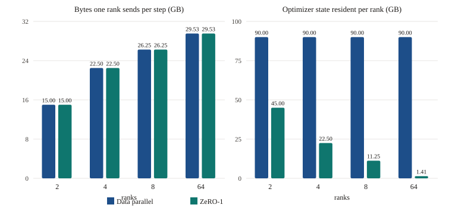

# Data parallel and ZeRO-1

> [!TLDR]
> - Data parallel gives every rank the same weights and a different slice of the batch. The ranks stay identical when each gradient is the mean across ranks, which is an all-reduce sum divided by the world size.
> - One all-reduce of the whole model starts only after backward finishes. One all-reduce per parameter starts early and pays the latency $\alpha$ once per parameter. A bucket is the size in between.
> - You fill buckets from the last parameter toward the first, and you launch each all-reduce with `async_op=True` from `register_post_accumulate_grad_hook` when that bucket's gradients are ready. PyTorch's constructor uses a default cap of 25 MiB.
> - ZeRO-1 stores Adam's optimizer state for $1/N$ of the parameters. A reduce-scatter of the gradients plus an all-gather of the updated parameters moves the same bytes as the data-parallel all-reduce when the two arrays have the same size.
> - The alpha-beta model predicts 3.589 ms for 1 GiB across two ranks on NVLink 3 at 300 GB/s per direction, and 34.097 ms on PCIe Gen4 at 31.5 GB/s. The lab measures the real bus bandwidth only on two GPUs. This chapter does not quote a measured one.

[Chapter 21](/c/21-collective-communication) gives you the ring, the alpha-beta model, and the rule that an all-reduce sends $2(p-1)/p$ of the array per rank. [Chapter 22](/c/22-overlap-and-parallelism) names gradient buckets and the ZeRO memory table, and it stops at the description. This chapter writes both. You leave with a wrapper that overlaps the all-reduce with backward, and with an Adam that keeps one rank's share of the moments.

The failure modes are quiet. An all-reduce that forgets to divide by the world size trains, and the gradient is $N$ times too large. A "sharded" Adam that still allocates the full moments on every rank matches the weights and saves no memory. The lab checks both.

The gloo checks run on CPU tensors, the same way lab 21 does, because the bucket logic and the shard logic do not depend on NCCL. The two-GPU sweep is separate. A machine without two GPUs skips it, and a deployment without `RUNPOD_ENDPOINT_2XA100` does not send that job to the single A100.

## Before you start

**World size.** A *rank* is one process, usually one GPU, numbered from 0 to $N-1$. The *world size* is $N$. [Chapter 21](/c/21-collective-communication) is the prerequisite for the collectives this chapter calls. You do not reimplement the ring here. You call `dist.all_reduce`, `dist.reduce_scatter_tensor`, and `dist.all_gather_into_tensor`.

**The mean, not the sum.** Each rank computes a gradient on its own batch. The replica that matches single-process training on the combined batch uses the mean of those gradients. `dist.all_reduce` sums. You divide by $N$ after the sum.

**A leaf and its hook.** A parameter is a leaf tensor. `register_post_accumulate_grad_hook` runs after autograd has written `.grad`, and the hook receives the parameter, not the gradient. The [hook documentation](https://docs.pytorch.org/docs/2.14/generated/torch.Tensor.register_post_accumulate_grad_hook.html) restricts it to leaves. Registering it on an activation raises an error. CS336's assignment 2 uses this hook to start the all-reduce during backward, and it waits on the returned handle in `finish_gradient_synchronization` before the optimizer step.

**What you are not rebuilding.** Chapter 21's ring, chapter 22's streams, and the ZeRO-3 or FSDP pattern of all-gathering weights before a layer are out of scope. ZeRO-1 keeps a full copy of the weights and of the gradients. It shards the optimizer state.

## A bucket is a latency decision

This section answers how the number of all-reduces changes the step time when the bytes do not change.

Picture four GPUs, each holding the same model. Backward walks the model from the loss toward the input, so the last layer's gradient exists while the first layer is still computing. A single all-reduce of every gradient waits until that walk finishes, and the link sits idle for the whole backward pass. An all-reduce on each parameter starts as soon as that parameter is ready, and every call pays the latency $\alpha$ from chapter 21 again.

A *bucket* is a group of parameters that share one all-reduce. The bucket is large enough that $\alpha$ is a small fraction of the transfer, and small enough that the last layers can send while the first layers are still in their backward kernels. Chapter 22 names this trade. The time comes from chapter 21's ring.

Say the gradient buffer is $n$ bytes and you split it into $\hla{N_b}$ buckets. Each bucket is one ring all-reduce, so you pay the latency term $\hla{N_b}$ times. The bytes a rank sends stay $2(p-1)/p$ of $n$, because the chunks still add up to the same array. The bandwidth $B$ is the per-direction rate from [docs/FACTS.md](../../docs/FACTS.md):

$$
T = \hla{N_b}\cdot 2(p-1)\hlb{\alpha} + 2\frac{p-1}{p}\frac{\hlc{n}}{B}
$$

$\hla{N_b}$ is the bucket count, $\hlb{\alpha}$ is the per-message latency, and $\hlc{n}$ is the whole gradient in bytes. Only the ==first term== grows when you cut the same buffer into more buckets.

> [!INTUITION]
> Bucketing does not move extra application data. It repeats the startup cost. A huge bucket is one startup and a long wait before the link turns on. A tiny bucket turns the link on early and pays startup on every piece.

> [!EXAMPLE] 16 MiB, eight ranks, one bucket or eight
> Take $p = 8$, $B = 300$ GB/s per direction, and the assumed $\alpha = 5$ µs from FACTS section 7.2. The buffer is 16 MiB, which is $16 \times 2^{20} = 16{,}777{,}216$ bytes. `scripts/figures/25-ddp-and-zero.py` prints the split.
>
> One bucket: the latency term is $2 \times 7 \times 5$ µs $= 70$ µs, and the bandwidth term is $1.75 \times 16{,}777{,}216 / 300 \times 10^{9} = 97.867$ µs. The total is 167.867 µs.
>
> Eight buckets of the same bytes: the latency term is $8 \times 70 = 560$ µs, the bandwidth term is still 97.867 µs, and the total is 657.867 µs. The extra 490 µs is seven more copies of the 70 µs startup. The link moves the same 1.75 times 16 MiB either way.

Set the latency term equal to the bandwidth term for one bucket and solve for $n$:

$$
2(p-1)\alpha = 2\frac{p-1}{p}\frac{n}{B} \implies n = \alpha\, p\, B
$$

At 8 ranks, 5 µs, and 300 GB/s, that size is $5 \times 10^{-6} \times 8 \times 300 \times 10^{9} = 12$ MB. A bucket much smaller than 12 MB is latency-bound on this link. A bucket much larger is bandwidth-bound, and splitting it further mostly adds startups.

The [DDP constructor](https://docs.pytorch.org/docs/2.14/generated/torch.nn.parallel.DistributedDataParallel.html) documents `bucket_cap_mb` as mebibytes, and it says a missing value uses 25 MiB. That is $25 \times 2^{20} = 26{,}214{,}400$ bytes, about twice the 12 MB crossover, so one such bucket on this link is mostly bandwidth: 70 µs of latency and $1.75 \times 26{,}214{,}400 / 300 \times 10^{9} = 152.9$ µs of transfer.

The same cap on a large model is many buckets. Chapter 22's 14 GB gradient, at 2 bytes times 7 billion parameters, needs $\lceil 14 \times 10^{9} / 26{,}214{,}400 \rceil = 535$ buckets. If those all-reduces run one after another, the latency term is $535 \times 70$ µs $= 37.45$ ms and the bandwidth term is $1.75 \times 14 / 300 = 81.67$ ms, which chapter 22 rounds to 82 ms. The serialized total is 119.12 ms. Overlap is what keeps you from paying the 37.45 ms on the critical path: the early buckets run while backward is still computing, and the exposed piece is about the last bucket, 70 µs plus 152.9 µs. These times are the alpha-beta prediction with the assumed 5 µs. They are not a measurement.

> [!KEY] The bucket cap trades startups against how early the first all-reduce can leave
> The bytes a rank sends do not depend on $\hla{N_b}$. The latency term does. 25 MiB is large enough to sit above the 12 MB crossover on NVLink 3, and small enough that a multi-gigabyte gradient becomes hundreds of collectives instead of one.

## Fill buckets from the last parameter

This section answers which parameters share a bucket, and why the order is the reverse of `parameters()`.

Backward produces gradients from the last parameter toward the first, approximately. The [DDP design notes](https://docs.pytorch.org/docs/2.14/notes/ddp.html) allocate buckets in roughly the reverse of `Model.parameters()` for that reason, and they fix the mapping at construction. You do the same with a byte cap.

Walk the indices from the last to the first. Add a parameter to the open bucket when `numel * dtype_bytes` still fits. When it does not, close the bucket and open a new one. A parameter larger than the cap is a bucket by itself, because the open bucket is empty and the parameter still does not fit. Indices inside a bucket stay in visit order, so they decrease. The first closed bucket holds the last parameters, and that is the bucket you launch first.

Take four float32 parameters with 16, 16, 16, and 48 elements. The sizes are 64, 64, 64, and 192 bytes. With a cap of 128 bytes the walk does this:

1. Index 3 is 192 bytes, larger than the cap, so it is bucket 0 by itself.
2. Index 2 is 64 bytes and opens bucket 1. Index 1 is another 64, and $64 + 64 = 128$, which fits. Bucket 1 is `[2, 1]`.
3. Index 0 is 64 bytes and does not fit in a full 128-byte bucket, so it is bucket 2.

The result is `[[3], [2, 1], [0]]`. Three all-reduces, not four and not one. The lab's first check is this list. A second check uses sizes 10, 100, and 10 elements at a 40-byte cap, which is `[[2], [1], [0]]`: the middle parameter is 400 bytes and stands alone.

```python
def assign_buckets(param_numels, bucket_cap_bytes, dtype_bytes=4):
    buckets, current, filled = [], [], 0
    for index in range(len(param_numels) - 1, -1, -1):
        nbytes = param_numels[index] * dtype_bytes
        if current and filled + nbytes > bucket_cap_bytes:
            buckets.append(current)
            current, filled = [], 0
        current.append(index)
        filled += nbytes
    if current:
        buckets.append(current)
    return buckets
```

Filling in forward order puts the last layer, whose gradient is ready first, into a bucket that also holds the first layer. That bucket cannot launch until the first layer finishes, which is the end of backward. You kept the byte count and lost the overlap.

## Launch the all-reduce when the bucket fills

This section answers how the hook, the asynchronous all-reduce, and the division fit together.

The design notes describe a `Reducer` that registers one autograd hook per parameter. When every gradient in a bucket is ready, the reducer starts an asynchronous all-reduce, and after the last bucket it waits and writes the averaged gradients back to `.grad`. You do that in Python.

`register_post_accumulate_grad_hook` is the hook that runs after `.grad` is accumulated. A hook on the gradient tensor itself can see a partial contribution. The post-accumulate hook sees the value the optimizer is about to read. CS336's handout shows `dist.all_reduce(..., async_op=True)` inside that hook, and `handle.wait()` later. `async_op=False` blocks the host until the collective is queued. `async_op=True` returns a work handle immediately, and the backward kernels keep running on the CPU side of gloo, or on the compute stream when the backend is NCCL.

Every rank has to issue the same collectives in the same order. The design notes say a mismatch produces wrong results or a hang, and they launch in bucket-index order rather than in whichever order the buckets happen to become ready. Mark a bucket ready when its last hook fires, then launch while the next index is ready. If bucket 1 fills before bucket 0, it waits. On this model every rank sees the same graph, so the wait is short, and the order is identical.

After `wait`, ==divide by the world size== and copy the reduced buffer back into each `.grad`. The collective summed the ranks. The mean is that sum divided by $N$.

```python
flat = torch.cat([params[i].grad.reshape(-1) for i in bucket]).clone()
handle = dist.all_reduce(flat, async_op=True)
# In finish_gradient_synchronization, after backward returns:
handle.wait()
flat.div_(dist.get_world_size())
```

The constructor also broadcasts rank 0's parameters before training, which the design notes do with `state_dict`, so the replicas start equal. The lab checks that broadcast, then checks that the gradient equals the mean of the per-rank gradients, then checks that one SGD step leaves the ranks equal. For the lab's two-rank toy, the local gradients are the constants 1 and 2, the mean is 1.5, and an all-reduce that skips the division leaves 3.

> [!WARNING] The collective order is part of the answer
> Launching as soon as a bucket is ready, with no index gate, is correct only when every rank becomes ready in the same order. The design notes do not rely on that. They launch in bucket-index order. A mismatch does not raise. The ranks wait for each other, and the lab reports a timeout.

On gloo and CPU tensors the all-reduce has no separate GPU stream, so you cannot see overlap on a timeline. You can still see the contract: the all-reduce calls happen during `backward`, each uses `async_op=True`, and the number of calls equals the number of buckets. The lab counts those calls. Three buckets and four all-reduces means you reduced per parameter. Three buckets and one all-reduce means you flattened the whole model and waited until the end.

## ZeRO-1 shards the moments, not the bytes

This section answers what you store on each rank, and which two collectives replace the all-reduce.

Picture the same four GPUs. Each one holds a full Adam state: an fp32 copy of every weight, a first moment, and a second moment. The [ZeRO paper](https://arxiv.org/abs/1910.02054) counts that optimizer state as $K = 12$ bytes per parameter in mixed precision, on top of 2 bytes of fp16 weights and 2 bytes of fp16 gradients, which is $16\Psi$ bytes for $\Psi$ parameters. Chapter 22 prints the resulting table. ZeRO-1, the paper's $P_{os}$, keeps the weights and the gradients replicated and partitions the optimizer state into $N$ equal pieces. The memory on one rank is $4\Psi + K\Psi/N$.

For the paper's $\Psi = 7.5 \times 10^{9}$ and $N = 64$:

$$
4 \times 7.5 + \frac{12 \times 7.5}{64} = 30 + 1.40625 = 31.40625\ \text{GB}
$$

The paper prints 31.4 GB. At large $N$ the optimizer term vanishes and you are left near $4\Psi$, a 4 times reduction from $16\Psi$, which is the paper's claim for $P_{os}$. The lab is the fp32 special case CS336 uses: Adam stores two float32 moments per parameter, twice the bytes of the float32 weights, and each rank stores those moments for $1/N$ of the parameters.

The communication is the part chapter 22 states and this chapter builds. The paper's section 7 says $P_{os}$ and gradient partitioning add no communication beyond data parallel. Data parallel's all-reduce is a reduce-scatter plus an all-gather, and the paper counts each as $\Psi$ elements, so $2\Psi$ per step in the large-$p$ limit.

The schedule that stays at $2\Psi$ is a reduce-scatter of the gradients, so each rank receives the sum for its own shard, then an all-gather of the parameters it updated. An all-reduce of the full gradient followed by a second all-gather of the parameters moves a third $\Psi$. That is the extra volume the paper avoids, and it is why the two strategies move the ==same bytes== when the arrays match.

Chapter 21's ring makes the same equality at finite $p$. When the gradient array and the parameter array have the same byte count $n$, one rank sends

$$
\boxed{C_{\mathrm{DP}} = C_{P_{os}} = 2\frac{p-1}{p}\, n}
$$

for both the all-reduce and the reduce-scatter plus all-gather. The factor $2(p-1)/p$ is 1, 1.5, 1.75, and 1.96875 at 2, 4, 8, and 64 ranks. It approaches 2, which is the paper's $2\Psi$ once you count elements rather than the ring's exact fraction.

Use the paper's fp16 arrays, $n = 7.5 \times 10^{9} \times 2 = 15$ GB, and the optimizer state $K\Psi = 90$ GB. The script prints one row per rank count:

| Ranks | Bytes one rank sends (GB) | Data-parallel state (GB) | ZeRO-1 state (GB) |
|---|---|---|---|
| 2 | 15 | 90 | 45 |
| 4 | 22.5 | 90 | 22.5 |
| 8 | 26.25 | 90 | 11.25 |
| 64 | 29.53125 | 90 | 1.40625 |

The send column is both strategies. The state column is the whole $90$ GB on every data-parallel rank, and $90/N$ for ZeRO-1. The figure is that table. The left pairs match. The right pairs fall as $1/N$.



> [!EXAMPLE] Ninety-six parameters, two ranks
> The lab flattens 16 + 16 + 16 + 48 float32 parameters, which is 96 elements. World size 2 divides 96, so each rank owns 48 elements. Two float32 moments are $2 \times 48 \times 4 = 384$ bytes on a rank, and $2 \times 96 \times 4 = 768$ bytes if every rank keeps the full state. 384 is $768 / 2$. The byte check counts `exp_avg` and `exp_avg_sq` and expects 384. A shard that keeps the full moments stores 768 and fails.

The step is three lines around the Adam update. `reduce_scatter_tensor` needs a flattened gradient whose length divides the world size, and it returns this rank's sum. Divide that shard by $N$, run Adam on it, and `all_gather_into_tensor` rebuilds the parameter vector:

```python
dist.reduce_scatter_tensor(shard_grad, full_grad)
shard_grad.div_(world_size)
# Adam writes the updated parameter shard from shard_grad.
dist.all_gather_into_tensor(full_param, updated_shard)
```

Rank $r$ owns elements `[r * shard, (r + 1) * shard)` of the concatenation, in parameter order. The first Adam step uses $t = 1$, betas $(0.9, 0.999)$, and $\epsilon = 10^{-8}$, which is what `torch.optim.Adam` does on a fresh state. Two steps are enough for the bias correction to matter. One step hides a missing correction, because the first-step correction cancels and the update equals a scaled gradient. The lab compares your weights with that Adam after two steps. The max absolute error of a matching implementation is on the order of $2 \times 10^{-7}$.

CS336's sharded optimizer broadcasts each updated parameter from the rank that owns it, instead of one all-gather of a flat buffer. The information is the same. The paper's volume argument is the flat reduce-scatter and the flat all-gather, which is what you write. You do not shard the weights. That is ZeRO-3, and chapter 22 already describes the extra all-gathers it adds.

> [!KEY] ZeRO-1 buys memory at the data-parallel byte count
> Each rank stores $K\Psi/N$ of optimizer state instead of $K\Psi$. The ring still sends $2(p-1)/p$ of the gradient bytes, because the reduce-scatter and the all-gather are the two halves of the all-reduce you used to call.

## What two GPUs would measure

This section answers which number the sweep is allowed to report, and which number this chapter refuses to invent.

nccl-tests, as chapter 21 uses it, reports algorithm bandwidth $S/t$ and bus bandwidth, which multiplies by $2(p-1)/p$ for an all-reduce so the number can be compared with the per-direction link rate. The bus-bandwidth ceiling is that link rate. FACTS section 7.2 records no confirmed NCCL measurement, and this chapter does not add one.

The prediction you can write down uses the same model as the buckets. For 1 GiB ($2^{30}$ bytes) and $p = 2$, the ring factor is 1, so a rank sends the whole buffer once. With $\alpha = 5$ µs:

- NVLink 3 at 300 GB/s per direction: $2^{30} / 300 \times 10^{9}$ is 3.579 ms of bandwidth, plus $2 \times 5$ µs, which is 3.589 ms.
- PCIe Gen4 at 31.5 GB/s per direction: the same buffer is 34.087 ms of bandwidth, plus 10 µs, which is 34.097 ms.

An A100 PCIe card can talk to one other card over a bridge at 300 GB/s per direction, or over PCIe at 31.5 GB/s when it has no bridge. FACTS marks it unconfirmed whether a two-GPU lab endpoint is bridged. The sweep's fitted bandwidth is how you tell. The fit is $t = \alpha + n/B$ on a few message sizes, the same least squares as lab 21. The lab reports `fit_alpha_us` and `fit_bandwidth_gbs` when that sweep runs.

It runs only when `torch.cuda.device_count()` is at least 2. On any other machine the check passes with a skip message, and it does not invent a bus bandwidth. The lab's `meta.json` sets `"gpus": 2` and `"gpu": "A100-80GB"`, so the app routes the job to `RUNPOD_ENDPOINT_2XA100`. A missing endpoint shows that two A100s are not configured. It does not fall through to the single-A100 endpoint. The gloo checks do not need those GPUs, and `device_agnostic` is what lets `scripts/check_labs.py` run them here.

> [!WARNING] A gloo timing is not a link timing
> The bucket and ZeRO checks use CPU tensors and the gloo backend, as lab 21 does. Their speed is this machine's inter-process copies. The 3.589 ms and 34.097 ms figures are predictions from the link rates. Only the skipped sweep, on two GPUs, measures a bus bandwidth.

## What goes wrong

- **Skipping the division.** `all_reduce` sums. On the lab's two ranks the local gradients are 1 and 2, the mean is 1.5, and the sum is 3. The gradient check fails the sum. The weights then step three times too far, and the replicas can still match each other, so an equality check alone does not catch it.
- **A full optimizer on every rank.** `full_state_on_every_rank` allocates both moments for all 96 parameters on every rank, which is 768 bytes instead of 384. The weights can still match. The byte check is what fails.
- **Buckets in parameter order.** The last layer's gradient shares a bucket with the first layer, the all-reduce starts at the end of backward, and you paid for overlap you do not get. The collective count can still equal the bucket count.
- **A different launch order on each rank.** Gloo waits for the matching call. The lab's timeout is that wait, not an exception from your code.
- **Dividing the buffer before `wait` returns.** The handle's buffer is still the local gradient until the sum lands. Divide after `wait`, then copy into `.grad`.
- **A flattened length that does not divide the world size.** `reduce_scatter_tensor` splits the input into equal shards. Raise when `numel % world` is not 0, which the constructor does, instead of silently dropping a tail.
- **Reading the skip message as a bandwidth.** Zero GPUs means the sweep did not run. The prediction stays 3.589 ms or 34.097 ms until a two-GPU run prints a fit.

> [!RECAP]
> - One all-reduce of $n$ bytes over $p$ ranks sends $2(p-1)/p \times n$ bytes per rank. Splitting it into $N_b$ buckets repeats the latency term $2(p-1)\alpha$ and does not change the bytes.
> - At 8 ranks, 300 GB/s, and an assumed 5 µs, a 16 MiB all-reduce is 167.867 µs in one bucket and 657.867 µs in eight. The difference is latency.
> - Fill buckets from the last parameter, launch in index order with `async_op=True` from the post-accumulate hook, and divide by the world size after `wait`. The default cap in the DDP constructor is 25 MiB.
> - ZeRO-1 stores $K\Psi/N$ of optimizer state, with $K = 12$ in the paper's mixed-precision Adam. Reduce-scatter the gradients, update the shard, and all-gather the parameters. The bytes match data parallel when the two arrays match.
> - For the 7.5 billion parameter model the send is 15, 22.5, 26.25, and 29.53125 GB per rank at 2, 4, 8, and 64 ranks, and the ZeRO-1 state is 45, 22.5, 11.25, and 1.40625 GB.
> - Two ranks and 1 GiB predict 3.589 ms on NVLink 3 and 34.097 ms on PCIe Gen4. The lab measures the bus bandwidth only when two GPUs are present.

## Check your understanding

> [!QUESTION] The two ranks compute local gradients 1 and 2. What does a correct all-reduce leave in `.grad`, and what does a missing division leave?
> The collective sums, so the buffer holds 3. Dividing by the world size leaves 1.5, the single-process mean. Skipping the division leaves 3, and the lab's gradient check fails that result.

> [!QUESTION] Eight ranks all-reduce 16 MiB at 300 GB/s with $\alpha = 5$ µs. What is the time with one bucket and with eight, and which term changed?
> One bucket is 70 µs plus 97.867 µs, or 167.867 µs. Eight buckets are 560 µs plus the same 97.867 µs, or 657.867 µs. The bandwidth term is fixed because the bytes are fixed. The latency term grew by 7 times 70 µs.

> [!QUESTION] Why does the first bucket hold the last parameters, not the first?
> Backward produces the last parameter's gradient first. A bucket of those parameters can launch while earlier layers are still computing. Building buckets in `parameters()` order ties the last layer to the first layer, and that bucket waits until backward ends.

> [!QUESTION] For the 7.5 billion parameter model, how many gigabytes does one rank send at 4 ranks, and how much optimizer state does ZeRO-1 store there?
> The fp16 array is 15 GB. The ring factor at 4 ranks is 1.5, so the rank sends 22.5 GB, whether the step is an all-reduce or ZeRO-1's reduce-scatter plus all-gather. The optimizer state is $90 / 4 = 22.5$ GB, against 90 GB if every rank keeps the full moments.

> [!QUESTION] Why is a full all-reduce, followed by an all-gather of the updated parameters, more communication than ZeRO-1?
> The all-reduce already moved $2(p-1)/p$ of the gradient. The extra all-gather moves another $(p-1)/p$ of the parameters. ZeRO-1's reduce-scatter moves only the first half of the all-reduce, and the all-gather of the parameters is the second half. The paper's count for that pair is $2\Psi$, the same as data parallel, not $3\Psi$.

> [!QUESTION] A two-GPU run is not available. Which times can you quote for a 1 GiB all-reduce across two ranks, and which number do you leave out?
> Quote 3.589 ms at 300 GB/s per direction and 34.097 ms at 31.5 GB/s, both with the assumed 5 µs latency. Leave out a bus bandwidth. The sweep prints `fit_alpha_us` and `fit_bandwidth_gbs` only when two GPUs run it, and a missing two-GPU endpoint does not substitute the single A100.

> [!QUESTION] Parameter sizes are 40, 400, and 40 bytes, and the cap is 40 bytes. What are the buckets?
> Walking from the end: the last 40 bytes fills a bucket, the 400-byte parameter is larger than the cap so it is alone, and the first 40 bytes is a third bucket. The list is `[[2], [1], [0]]`.

## Lab

> [!TRY] Bucketed DDP and a sharded Adam
> Implement `assign_buckets`, `BucketedDDP`, and `Zero1Adam` in `starter.py`. The tests spawn two gloo processes on CPU tensors.
>
> You pass the bucket checks when `[16, 16, 16, 48]` at a 128-byte cap returns `[[3], [2, 1], [0]]`, and when `[10, 100, 10]` at a 40-byte cap returns `[[2], [1], [0]]`. You pass the DDP checks when rank 0's parameters are broadcast, the gradient equals the mean 1.5 rather than the sum 3, backward issues exactly three `async_op=True` all-reduces, and an SGD step leaves the ranks equal. You pass ZeRO-1 when each rank's `exp_avg` and `exp_avg_sq` are 384 bytes, the step calls reduce-scatter and all-gather twice across two Adam steps, and the weights match `torch.optim.Adam` within $10^{-5}$.
>
> The NCCL sweep is a separate check. It runs when the machine has two GPUs and reports `fit_alpha_us` and `fit_bandwidth_gbs`. Otherwise it prints a skip and does not record a bandwidth. The gloo checks do not need a GPU. Allow about a minute for the process startup.

The slide deck is [Data parallel and ZeRO-1](/slides/25-ddp-and-zero).

## Further reading

- [Distributed data parallel](https://docs.pytorch.org/docs/2.14/notes/ddp.html): the reducer, reverse-order buckets, asynchronous all-reduce, and why every rank launches in bucket-index order. The note describes the implementation as of PyTorch 1.4. The `DistributedDataParallel` constructor page states the current cap.
- [`DistributedDataParallel`](https://docs.pytorch.org/docs/2.14/generated/torch.nn.parallel.DistributedDataParallel.html): `bucket_cap_mb` defaults to 25 MiB.
- [`register_post_accumulate_grad_hook`](https://docs.pytorch.org/docs/2.14/generated/torch.Tensor.register_post_accumulate_grad_hook.html): the hook that runs after `.grad` is written, on leaf tensors.
- [CS336 assignment 2, Systems and parallelism](https://github.com/stanford-cs336/assignment2-systems/blob/main/cs336_assignment2_systems.pdf): overlapped DDP from that hook, with `async_op=True` and `finish_gradient_synchronization`, and a sharded optimizer that keeps about $1/N$ of the state.
- [ZeRO: Memory optimizations toward training trillion parameter models](https://arxiv.org/abs/1910.02054): $K = 12$, the $P_{os}$ memory $4\Psi + K\Psi/N$, and the $2\Psi$ communication volume of reduce-scatter plus all-gather.
- [nccl-tests performance notes](https://github.com/NVIDIA/nccl-tests/blob/master/doc/PERFORMANCE.md): algbw, busbw, and the $2(n-1)/n$ factor for all-reduce.
- [GPU MODE, lecture 17: GPU collective communication (NCCL)](https://github.com/gpu-mode/lectures/tree/main/lecture_017): the lecture index's NCCL session, Dan Johnson. Chapter 21 is the cost model this chapter applies.
- [GPU MODE, lecture 67: NCCL and NVSHMEM](https://github.com/gpu-mode/lectures#lecture-67-nccl--nvshmem): the lecture index's later NCCL session, Jeff Hammond. This chapter stops at the collectives NCCL runs, and does not cover NVSHMEM.
- [GPU MODE, lecture 39: TorchTitan](https://github.com/gpu-mode/lectures#lecture-39-torchtitan): the lecture index lists TorchTitan, Mark Saroufim and Tianyu Liu, which is the production stack around the DDP and ZeRO-1 you write here.
- [Chapter 21](/c/21-collective-communication) and [chapter 22](/c/22-overlap-and-parallelism): the ring, the alpha-beta model, and the parallelism map this chapter builds on.
