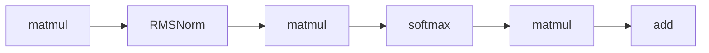
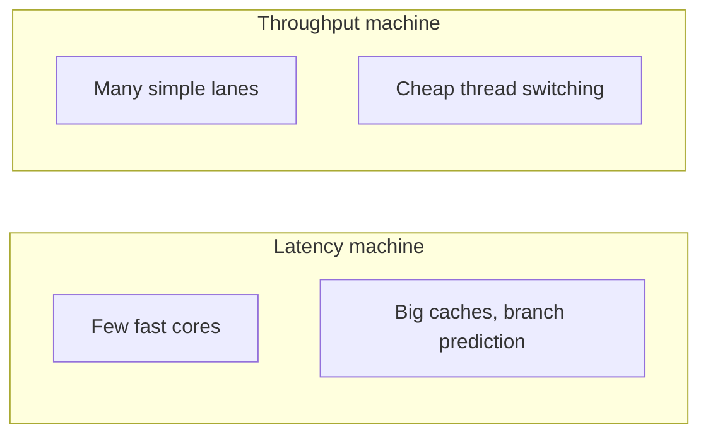
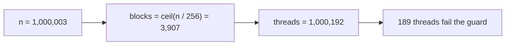
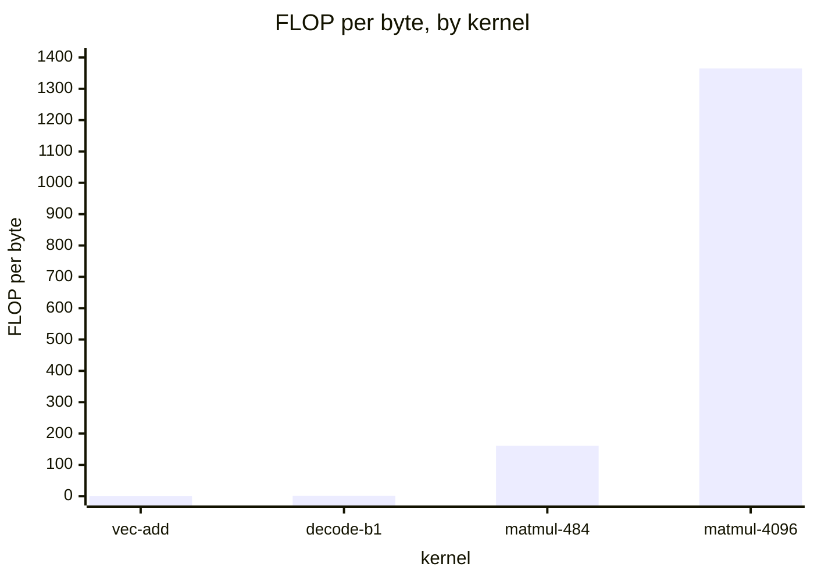
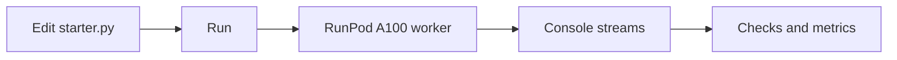

# Introduction

The question this chapter answers: what limits a GPU kernel, and how do you measure one honestly?

Note:
Open by saying that every kernel in the course is judged against two ceilings, and that by the end of the deck the audience can name both, compute where one gives way to the other, and time a kernel without fooling themselves.

### Why a course about the GPU {#why-gpu}

- Training and serving a model is a sequence of kernels
- Step time is the sum of their times plus the gaps
- Most kernels wait on memory, not on arithmetic

Note:
Ask the room who has profiled a PyTorch model and seen a long list of small kernels. That list is the subject. The skill we build is prediction: look at a kernel, say roughly how long it should take, and know what to change when the measurement disagrees. A kernel far slower than its prediction has a bug, and one far faster has a bug in the measurement.

### What you can do at the end {#end-state}

- Write reductions, a tiled GEMM, and a tensor core GEMM
- Write FlashAttention in Triton
- Predict a kernel's time from the machine's specs

> [!QUESTION] Do I need to know C++?
> You need to read it. Every lab gives you a starter file with the TODOs marked, and no background beyond reading C++ is assumed.

Note:
These are the milestones in the curriculum, from reductions in Part 2 through tensor cores in Part 3 to attention and training kernels in Part 4. Stress the last bullet: every lab reports a prediction next to the measurement, and the gap between them is where the learning happens.

### The route through this deck {#roadmap}


Note:
Six stops. First why kernels matter, then the mental model of the machine, then a first kernel and an honest timing, then the two rates and the ridge point, and finally how the course and its labs are organized. Leave this slide up for a few seconds so the audience knows where they are when the sections change.

# Where the time goes

A model is a list of kernels, and three families of kernel account for almost all of it.

Note:
Section divider. The point of this section is that the profile of a training step or a decode step is a list of kernels with durations, and that those kernels fall into families with different limits.

### A model is a list of kernels {#list-of-kernels}

- `x @ w` picks a kernel and launches it
- A forward pass launches hundreds, a training step thousands
- Step time is about the sum of the durations plus gaps



Note:
A PyTorch operation doesn't compute anything itself. It chooses a precompiled GPU function and queues it. Open a profiler trace in your head: a row of boxes of different widths. The width of each box is what this course teaches you to predict, and the gaps between the boxes are launch overhead, which chapter 17 attacks.

### Three families of kernel {#families}

| Family | Examples | Limited by |
|---|---|---|
| Matrix multiply | projections, MLP, attention scores | Arithmetic, when large |
| Elementwise and norms | add, activation, RMSNorm | Memory |
| Reductions and movement | softmax, loss, transpose | Memory, plus coordination |

Note:
The matmuls are the only kernels that can use the tensor cores, and the only ones that can be bound by arithmetic. Everything else is mostly reading and writing bytes. That is why a course about the GPU is mostly about memory.

### One matmul against four elementwise ops {#matmul-vs-elementwise}

A 4096 by 4096 bf16 activation: 33.6 MB.

- Matmul by a 4096 by 4096 weight: 137.4 GFLOP, floor 0.44 ms
- One elementwise op: 67.1 MB moved, floor 52.6 µs
- Four unfused elementwise ops: 210 µs, half the matmul

> [!QUESTION] Why does fusing them help if the arithmetic is the same?
> Each unfused op writes to memory and the next reads it back. Fused, the floor falls from 210 µs to 52.6 µs: bytes never move.

Note:
Walk the arithmetic. 2 times 4096 cubed is 137.4 GFLOP, divided by 312 TFLOP/s is 0.44 ms. An elementwise op reads and writes 33.6 MB each way, 67.1 MB, and at the measured 1275 GB/s copy ceiling that is 52.6 µs. Four of them in a row cost 210 µs for almost no arithmetic. These are floors from the specs, predictions and not measurements.

### Serving at batch size 1 {#serving}

A 7-billion-parameter bfloat16 model holds 14 GB of weights.

- One token reads every weight once: at least 7.2 ms at 1935 GB/s
- The arithmetic for that token: 14 GFLOP, 0.045 ms
- Memory floor over arithmetic floor: 161

Note:
This is the memory side at its starkest. The ratio of 161 is not a coincidence: at batch size 1 a bfloat16 model does 1 FLOP per byte of weights, and the machine's ridge point is 161 FLOP per byte. Say this and promise to return to it after we define the ridge point. At the 1275 GB/s copy ceiling the floor is 11.0 ms.

### Training: arithmetic first, then everything else {#training}

- A step costs about 6ND FLOP for N parameters and D tokens
- 7 billion parameters, 4096 tokens: 1.72e14 FLOP
- Floor at 312 TFLOP/s: 0.55 s

> [!QUESTION] Where does a slower step go?
> The profile shows it: elementwise kernels, small kernels dominated by launch cost, and matmuls below the tensor core rate. Those three are the course.

Note:
The 6ND rule comes from the scaling-laws literature: two FLOP per parameter per token for the forward pass and four for the backward. A step far above the floor is losing time to memory-bound kernels, launch gaps, or inefficient matmuls. Horace He's brrr essay names the same three: compute, bandwidth, overhead.

# Latency and throughput

A CPU and a GPU solve the same problem with opposite strategies.

Note:
Section divider. This is the mental model that explains why GPU code looks the way it does: a lot of threads, neighbors touching neighbors.

### Two machines {#two-machines}



Note:
A CPU core minimizes the time to finish one thread's work, spending transistors on caches and speculation. A GPU maximizes total work per second, spending transistors on arithmetic units and on switching between threads. The A100 holds up to 108 times 2048, which is 221,184 threads in flight on 6,912 FP32 cores. When one warp waits on memory, another runs.

### Why so many threads {#why-threads}

An HBM load takes about 466 cycles, 330.7 ns at 1.41 GHz.

$$
B_{\text{flight}} = \beta \times L \approx 640\ \text{KB}
$$

- 1935 GB/s times 330.7 ns
- 5.9 KB per SM, 160,000 loads of 4 bytes

> [!QUESTION] Is the 330.7 ns from the 80 GB card?
> No. The only source measured the 40 GB PCIe card. The 80 GB latency is expected to be close, and the figure uses it only for the curve's shape.

Note:
Latency measured on an A100 PCIe 40GB in the Luo et al. microbenchmark paper, and we use it for the shape of the argument. Little's law: to sustain the bandwidth, the data in flight equals the bandwidth times the latency. With one 4-byte load per thread that needs 160,000 threads waiting on memory at once, 1,481 per SM.

### Threads in flight and bandwidth {#threads-figure}

```viz
00-threads-in-flight
```

> [!QUESTION] Can 10,000 threads reach the rated bandwidth?
> No. With 4-byte loads they keep 40 KB in flight, about 6% of the 640 KB needed.

Note:
Let the audience drag the slider. With fewer threads the predicted bandwidth falls in proportion. Switch the load width from 4 to 16 bytes and the same bandwidth needs a quarter of the threads, which is why chapter 3 vectorizes with float4. This is a model from ratings, and the real ceiling on this card is the measured 1275 GB/s.

### Two habits for GPU code {#two-habits}

- Give the GPU a lot to do: one thread per element
- Think in warps: 32 neighbors read neighboring addresses

> [!WARNING] A small kernel can't use a big GPU
> A few thousand elements leave most SMs idle, and launch cost dominates the time.

Note:
Both habits follow from the throughput design. Chapters 2 and 3 explain warps and coalescing and measure what happens when you get them wrong. In learn-inference, a stride of 32 floats ran 6.9 times slower than the coalesced version of the same kernel.

# A first kernel and a first timing

Write a kernel in CUDA C++, compile it from Python, and measure it without fooling yourself.

Note:
Section divider. Everything in the course's CUDA labs follows this loop: source string, load_inline, call on tensors, time with events.

### The smallest complete kernel {#saxpy}

```cuda
__global__ void saxpy_kernel(const float* x, float* y, float a, int n) {
    int i = blockIdx.x * blockDim.x + threadIdx.x;
    if (i < n) y[i] = a * x[i] + y[i];
}
```

Note:
Three ideas on one slide. `__global__` means this runs on the GPU and is launched from the host. The index line is how a thread works out which element is its own: the launch creates many blocks of threads, every thread runs this body, and the formula turns block number and position into a global index. The guard handles the tail, because the grid rounds up.

### Launching it from Python {#load-inline}

```python
module = load_inline(
    name="saxpy",
    cpp_sources="void saxpy(torch::Tensor x, torch::Tensor y, double a);",
    cuda_sources=cuda_src,
    functions=["saxpy"],
)
module.saxpy(x, y, 2.0)
```

Note:
The cpp source declares the signature so the generated binding knows it, the cuda source is what nvcc compiles, and the functions list names what Python can call. The first call takes 30 to 60 seconds, and editing one character costs the full compile again. The host function rounds the block count up and launches with the triple-angle-bracket syntax.

### Grid geometry and the tail {#grid}



> [!QUESTION] Why 256 threads per block?
> It is a multiple of the 32-thread warp and small enough to leave room for several blocks per SM. Chapter 2 derives how block size affects occupancy.

Note:
Do the arithmetic aloud. 1,000,003 divided by 256 rounds up to 3,907 blocks, and 3,907 times 256 is 1,000,192 threads, so 189 threads have no element and must do nothing. That is the job of the guard. The lab's later chapters test sizes like this on purpose.

### How much should it cost? {#predict}

For 2^24 floats, SAXPY moves 201.3 MB and does 2 FLOP per element.

- Intensity: 0.17 FLOP/byte, far below the ridge
- Measured vector add in learn-inference: 1304 GB/s
- Prediction: about 154 µs

Note:
This is the habit: predict before you measure. 3 times 4 bytes times 2 to the 24 is 201.3 MB, and at 1304 GB/s, which is what a hand-written vector add measured on this card in learn-inference, that is 154 µs. The 154 µs is about 30 times the 5 µs a host spends queueing a launch, so launch cost doesn't matter for one big kernel and matters a lot for a thousand small ones.

### Launches are asynchronous {#async}

```viz
00-async-timeline
```

> [!QUESTION] Why not just call synchronize and use perf_counter?
> It works, but the reading includes the queue time and the host's wake-up delay. Events are recorded on the device, so they measure the kernel and nothing else.

Note:
Flip between the three clocks. A host timer with no synchronize reads the queueing, about 5 µs, whatever the kernel does. With a synchronize it reads queueing plus the kernel. CUDA events read the kernel alone, as the GPU saw it. The figure is a model using the 5 µs queue time measured in learn-inference and the 154 µs SAXPY estimate.

### The event timer {#events}

```python
start = torch.cuda.Event(enable_timing=True)
end = torch.cuda.Event(enable_timing=True)
start.record()
fn()
end.record()
end.synchronize()
ms = start.elapsed_time(end)
```

> [!WARNING] A host timer around a launch looks right
> It prints a clean, stable, plausible number: the queue time. A bandwidth above the card's rating is the symptom.

Note:
Walk the five steps. Warm up first and synchronize, because the first call loads the kernel and initializes allocators. Create events with timing enabled. Record, run, record. Then synchronize on the end event, because record only queues it and elapsed_time needs both to have happened. Repeat and take the median. The lab asks you to write exactly this.

### Errors arrive late too {#late-errors}

- A bad write surfaces at the next synchronize, on another line
- Most CUDA errors poison the context
- Debug with `CUDA_LAUNCH_BLOCKING=1`

Note:
The same asynchrony that fools your timer delays errors. The launch macro catches launch-time errors like a bad grid size, but an illegal memory access inside the kernel shows up later. Setting the environment variable makes every launch synchronous so the error lands on the right line. Use it while debugging and not while timing.

# The two rates

Every kernel moves bytes and does arithmetic, and the GPU has a ceiling for each.

Note:
Section divider. These are the only two numbers needed for the first half of the course, and both come from the A100 datasheet.

### The card in four numbers {#four-numbers}

| Quantity | Rated peak |
|---|---|
| SMs | 108 |
| HBM2e bandwidth | 1935 GB/s |
| bf16 tensor, dense | 312 TFLOP/s |
| fp32, CUDA cores | 19.5 TFLOP/s |

> [!QUESTION] Is the card I get always a PCIe A100?
> Not always. The 80 GB A100 also ships as an SXM4 module rated at 2039 GB/s, and the provider hands you whichever is free. The lab prints which one you got.

Note:
The A100 80GB PCIe. The 312 checks against the clock: 108 SMs times 1410 MHz times 2048 FLOP per SM per clock is 311.9 TFLOP/s. A rating is a ceiling no kernel reaches. In learn-inference a plain copy measured 1275 GB/s on this card, 66% of the rating, and that measured figure is the ceiling a memory-bound kernel is judged against.

### The ridge point {#ridge}

$$
I^{\ast} = \frac{C}{\beta} = \frac{312 \times 10^{12}}{1.935 \times 10^{12}} = 161.2\ \text{FLOP/byte}
$$

$$
t \ge \max\left(\frac{\text{FLOP}}{C},\ \frac{\text{bytes}}{\beta}\right)
$$

Note:
Divide the arithmetic rate by the memory rate and you have the arithmetic a kernel must do per byte to keep both sides busy. Below the ridge, memory limits the kernel, above it, arithmetic does. The floor on time is the larger of the two times, which is the roofline of chapter 4. Remind the audience of the decode ratio of 161 from earlier.

### Four kernels against the ridge {#kernels-vs-ridge}



Note:
Vector add is 1 FLOP per 12 bytes, 0.083. Decode at batch 1 in bfloat16 is 1. A square bfloat16 matmul of side n has n over 3 FLOP per byte, so side 484 sits at the ridge of 161, and side 4096 sits at 1365, more than eight times above it. The matmul is memory bound when it is small, which is decode's problem.

### Which precision, which peak {#precision}

- The 312 TFLOP/s is bf16 or fp16 on tensor cores
- fp32 on CUDA cores peaks at 19.5, a ratio of 16
- fp32 matmul floor, 4096 cubed: 7.0 ms against 0.44 ms

> [!QUESTION] Doesn't PyTorch use TF32 for fp32 matmuls?
> Not by default: `torch.backends.cuda.matmul.allow_tf32` is `False`, so an fp32 matmul runs on the CUDA cores at the 19.5 TFLOP/s peak.

Note:
The ridge point depends on which units run. The same matmul in fp32 has a floor of 137.4 GFLOP over 19.5 TFLOP/s, 7.0 ms. Chapters 9 and 11 take up the formats and the tensor cores. For now, always say which precision a peak belongs to.

# The course and the labs

Six parts, 23 labs, one GPU.

Note:
Section divider. We close with the map and with how a lab runs.

### The six parts {#six-parts}

| Part | Chapters | Labs build |
|---|---|---|
| 1. The machine | 0 to 5 | Occupancy, copy kernels, roofline, profiling |
| 2. CUDA patterns | 6 to 9 | Reductions, scan, transpose, numerics |
| 3. Matrix multiplication | 10 to 14 | SGEMM, tensor-core GEMM, Triton matmul |
| 4. Kernels for ML | 15 to 20 | Softmax, FlashAttention, W4A16, MoE |
| 5. Many GPUs | 21 and 22 | Ring all-reduce, stream overlap |
| 6. Beyond | 23 | Reading only |

Note:
Part 1 is the machine and everything else leans on it. Part 2 teaches the patterns most kernels reuse. Part 3 is the longest, because matmul is where a model spends its arithmetic. Part 4 applies it to transformer kernels, and Part 5 adds more than one GPU. Hopper and Blackwell features are taught in prose, with Ampere labs that exercise the same idea.

### How a lab runs {#lab-loop}



> [!QUESTION] Why is my first run so slow?
> nvcc needs 30 to 60 seconds the first time a source is built, and a serverless worker may need to start. The compiled result is cached, and editing the source costs the compile again.

Note:
You edit the starter file in the browser and press Run. The app sends it to a serverless endpoint with one A100, which imports your file and runs the lab's tests. Output streams to the Console tab, and the Checks tab lists each pass and fail with a detail line. Correctness is a hard check, and speed is a metric with a loose threshold, so a different card doesn't fail a correct kernel.

### Hello, GPU: the first lab {#lab-00}

- Query the device with `get_device_properties`
- Write `time_ms` with CUDA events
- Time a 512 MiB copy: count 2N bytes
- Report GB/s against the 1275 GB/s ceiling

Note:
Four small functions. The copy moves twice the tensor size, one read and one write, and forgetting the write halves your bandwidth. Passing needs the timer to wait for the GPU and the copy to reach half of the measured ceiling, 637.5 GB/s. The lab also prints what a host timer without a synchronize reads, so you see the asynchronous launch in your own output.

### The companion course {#companion}

- learn-inference builds an engine for one model
- This course goes deeper on every kernel topic it touches
- Shared numbers: 1275 GB/s copy, 1304 GB/s vector add, 5 µs launch

> [!QUESTION] Do I have to take learn-inference first?
> No. Take either one first. Together, one gives the end-to-end view of an engine and the other gives the tools to tune its parts.

Note:
The numbers quoted as measured in learn-inference came from that course's labs on the same A100 80GB PCIe. Where this course says a figure was measured elsewhere it names the source and the card. Point the audience at qwen.ifkash.dev for the roofline, first-kernel, fusion, and FlashAttention chapters.

# Summary

What to carry out of this chapter.

Note:
Close by returning to the opening promise: predict first, then measure, and treat the gap as the lesson.

### What to remember {#remember}

- A model's speed is the speed of its kernels
- Two ceilings: 1935 GB/s and 312 TFLOP/s rated, 1275 GB/s measured for copies
- Ridge point: 161 FLOP per byte, and most kernels sit below it
- A GPU hides latency with about 640 KB in flight
- Launches are asynchronous: time with events

Note:
Say each aloud and tie it to a slide. The rating is a ceiling, the measured copy is the target. The ridge point decides which side limits a kernel. Latency hiding is why we need many threads. And any time a result looks too good, check how it was timed first.

### Common mistakes {#mistakes}

| Mistake | Symptom | Fix |
|---|---|---|
| Timing the launch | A kernel that beats the rating | Events, or synchronize |
| No warmup | A number several times too slow | Warm up, then synchronize |
| Counting N bytes for a copy | Half the true bandwidth | Count 2N |
| GB versus GiB | A 7% error | Decimal for bandwidth |

Note:
These four are the ones the lab provokes, and they follow you through the course. A number that looks plausible and is wrong is the recurring theme, and the defense is the same each time: derive the expected value first.

### Next: the GPU at a glance {#next}

- Chapter 1 derives every peak from device properties and spec constants
- Chapter 2 builds the execution model: warps, blocks, occupancy
- Your lab reports the measured copy bandwidth

Note:
Chapter 1 takes the four numbers on the card slide and shows where each comes from, then compares the A100 with the H100 and the B200. Ask the audience to run the Hello lab before then, so they have their own copy bandwidth to compare against the ceiling.
