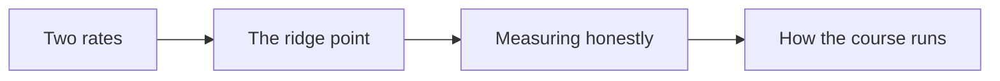
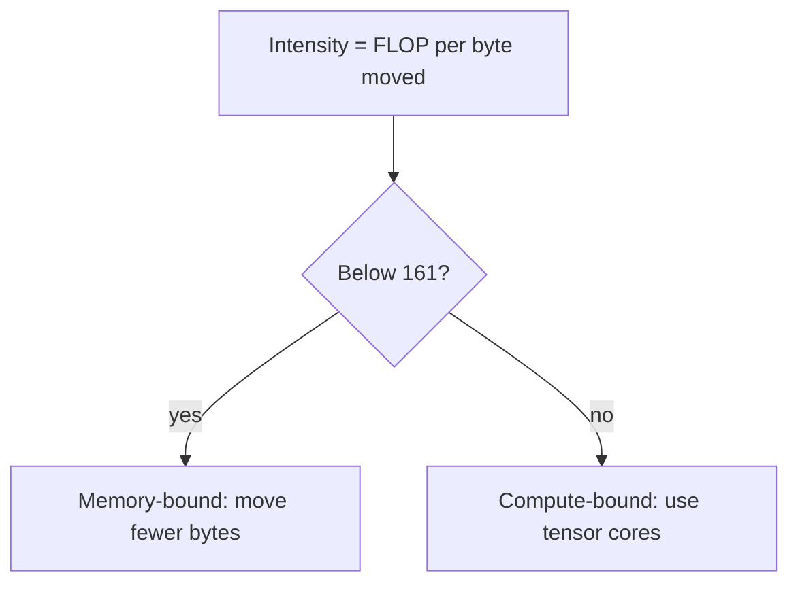

# Introduction

The question this chapter answers: what limits a GPU kernel?

Note:
Open by saying that every kernel in the course will be judged against two
ceilings. By the end of this deck the audience can name both and compute where
one gives way to the other.

### Why a course about the GPU {#why-gpu}

- Training and serving a model is a sequence of kernels
- Most of them wait on memory, not on arithmetic
- Knowing which, before you run, saves days of tuning

Note:
Ask the room who has profiled a PyTorch model and seen a long list of small
kernels. That list is the subject. The skill we are building is prediction: look
at a kernel, say roughly how long it should take, and know what to change when
the measurement disagrees. A kernel far slower than its prediction has a bug,
and one far faster has a bug in the measurement.

### What you can do at the end {#end-state}

- Write reductions, a tiled GEMM, and a tensor core GEMM
- Write a FlashAttention kernel in Triton
- Predict a kernel's time from the machine's specs

> [!QUESTION] Do I need to know C++?
> You need to read it. The labs give you a starter file, and no background
> beyond reading C++ is assumed.

Note:
These are the milestones in the curriculum, from reductions in Part 2 through
tensor cores in Part 3 to attention and training kernels in Part 4. Stress the
last bullet: every lab reports a prediction next to the measurement, and the gap
between them is where the learning happens.

### The route through this deck {#roadmap}



Note:
Four stops. First the two rates and the ridge point between them. Then how to
measure a kernel without fooling yourself. Last, how the course and its labs are
organized. Keep this slide up for a few seconds so the audience knows where they
are when the sections change.

# The two rates

Memory bandwidth, and arithmetic throughput.

Note:
Section divider. Say that these are the only two numbers needed for the first
half of the course, and that both come from the A100 datasheet.

## The A100 80GB PCIe

### The card in four numbers {#four-numbers}

| Quantity | Rated peak |
|---|---|
| SMs | 108 |
| HBM2e bandwidth | 1935 GB/s |
| bf16 tensor, dense | 312 TFLOP/s |
| fp32, CUDA cores | 19.5 TFLOP/s |

Note:
These come from the NVIDIA A100 datasheet. The SM count is the number of
independent processors; each kernel's blocks are spread across them. Bandwidth
is decimal, so 1935 GB/s is 1.935 times ten to the twelve bytes per second. The
tensor core figure is for dense matrices, without structured sparsity.

### A rating is a ceiling {#rating-ceiling}

> [!QUESTION] If it is rated at 1935 GB/s, why do we judge kernels against 1275?
> A plain copy measured 1275 GB/s on this card in the companion course,
> 66% of the rating. Nothing simpler than a copy exists, so that is the
> practical ceiling.

Note:
This is the first question in the deck, and a sharp one. The rating is what the
memory chips can do on paper. A real copy loses some to refresh, to read and
write turnaround, and to the memory controller. If your coalesced kernel reaches
the copy figure, it is finished. Hunting for the other third is wasted effort.

### Bytes and FLOPs {#bytes-flops}

$$t_{\text{mem}} = \frac{\text{bytes}}{\beta}, \qquad t_{\text{math}} = \frac{\text{FLOPs}}{C}$$

- The kernel takes at least the larger of the two
- Whichever is larger names the limit

Note:
Memory time is the bytes moved divided by bandwidth. Math time is the operations
divided by the arithmetic rate. The two can overlap, so the kernel cannot finish
faster than the slower of them. That single sentence is the roofline model, and
chapter 4 builds it properly.

### The ridge point {#ridge-point}

$$I^{\ast} = \frac{\hla{C}}{\hlb{\beta}} = \frac{312 \times 10^{12}}{1.935 \times 10^{12}} = 161.2\ \text{FLOP/byte}$$

Below it: waiting on memory. Above it: waiting on arithmetic.

Note:
Divide the two peaks and you get the arithmetic a kernel must do per byte to
keep both sides busy. On this card that is 161 FLOP per byte. Check the units
out loud: tera over giga leaves a factor of a thousand that the exponents already
absorbed. The usual slip is dividing 312 by 1935 and getting 0.16.

## Two kernels, two sides

### A vector add {#vector-add}

> [!KEY] 12 bytes for every FLOP
> Two float32 loads and one store per add: an intensity of 0.083 FLOP/byte.
> At 1935 GB/s that is at most 161 GFLOP/s, 0.052% of the tensor peak.

Note:
Work it through. Each element reads 4 bytes twice and writes 4 bytes once, for a
single addition. So 12 bytes per FLOP. Bandwidth divided by 12 gives 161
GFLOP/s. Compare with 312 TFLOP/s and the arithmetic units are idle for all but
a few parts in ten thousand. This is the typical shape of an elementwise kernel.

### A matrix multiply {#matmul-intensity}

$$I = \frac{2N^3}{6N^2} = \frac{N}{3}\ \text{FLOP/byte}$$

> [!QUESTION] Where does the 6N² come from?
> Three bf16 matrices, 2 bytes per element, each touched once: A and B read, C
> written.

Note:
For an N by N by N multiply in bf16 the arithmetic is two N cubed. The ideal
traffic reads A and B and writes C once each, three matrices of N squared
elements at two bytes. The ratio is N over three. It crosses 161 near N of 484,
so a 512 matrix is already past the ridge point on paper, and a 4096 matrix has
an intensity of about 1365.

### Which side is my kernel on? {#which-side}



Note:
This is the decision the rest of the course keeps asking. Memory-bound kernels
improve by moving fewer bytes: wider loads, better coalescing, fusing steps so
intermediates never reach HBM. Compute-bound kernels improve by keeping the
tensor cores fed. Mention that real kernels fall short of both ceilings, and
chapter 5 shows how to find out why.

### The other A100 {#other-card}

> [!QUESTION] Does the ridge point change on the SXM4 card?
> Yes. It is rated at 2039 GB/s, so $312 \times 10^{12} / 2.039 \times 10^{12} = 153.0$ FLOP/byte.

Note:
The 80 GB A100 ships as a PCIe card and as an SXM4 module. The provider gives
you whichever is free, so two runs of one lab can differ by a few percent for
that reason alone. Lab zero prints the name of the card so you always know. The
course quotes the PCIe numbers and says so when it matters.

# Measuring honestly

How to time a kernel without fooling yourself.

Note:
Divider. The point of this section: a wrong measurement looks exactly like a
right one, so the habits matter more than the tools.

### Why not time.time()? {#async-launch}

> [!QUESTION] Why does a host timer around a kernel launch give the wrong answer?
> The launch is asynchronous. The call returns when the work is queued, so the
> timer measures the queueing, not the kernel.

Note:
CUDA calls return immediately. A host-side timer without a synchronize reports
microseconds for a kernel that runs for milliseconds. Adding a synchronize fixes
the answer but includes the launch overhead and any host stalls. CUDA events are
recorded on the GPU's own timeline, which is why the labs use them.

### CUDA events {#cuda-events}

```python
start, end = torch.cuda.Event(enable_timing=True), torch.cuda.Event(enable_timing=True)
start.record()
fn()
end.record()
torch.cuda.synchronize()
ms = start.elapsed_time(end)
```

Note:
Record an event before and after the work, synchronize once, then read the
elapsed time in milliseconds. The lab helper cuda_time wraps this, runs warmup
calls first so compilation and cold caches do not count, and returns the median
of many runs. A median shrugs off the occasional slow outlier.

### Count the bytes both ways {#count-both}

$$\text{bandwidth} = \frac{2 \times \text{bytes copied}}{t}$$

> [!WARNING] A copy moves its bytes twice
> Counting only the read halves the number you report.

Note:
A copy reads every byte and writes it, so the memory system moves twice the
tensor size. Forgetting the write is the most common mistake in the first lab:
the result comes out near 640 GB/s and people conclude their kernel is slow. The
same discipline applies to every kernel: list every load and every store.

### The lab loop {#lab-loop}


Note:
Each lab opens beside its chapter. You edit the starter file, press run, and the
code goes to a real A100 on RunPod. The checks and the measured numbers stream
back as they finish. Compiling CUDA the first time takes 30 to 60 seconds; the
build is cached after that, so the second run is fast.

# How the course is organized

Six parts, and three artifacts for every chapter.

Note:
Divider. Show the shape of the course so people know where chapters they care
about live.

### Six parts {#six-parts}

| Part | Topic |
|---|---|
| 1 | The machine |
| 2 | CUDA patterns |
| 3 | Matrix multiplication |
| 4 | Kernels for ML |
| 5 | Many GPUs |
| 6 | Beyond CUDA |

Note:
Part one is the hardware and how to reason about it. Part two is the basic
patterns: reductions, scans, transposes, floating point. Part three climbs from
a naive GEMM to tensor cores and Triton. Part four applies it to softmax,
attention, fusion, quantization, training, and mixture of experts. Part five
leaves a single card, and part six looks at other hardware.

### Three artifacts per chapter {#three-artifacts}

- A chapter to read
- A lab to write, run on an A100
- A deck like this one

Note:
Every chapter has all three. The chapter is the full argument. The lab is where
you build it. The deck is the talk version: fewer words, more pictures, with the
questions a room tends to ask. They teach the same numbers, so you can move
between them freely.

### Where numbers come from {#accuracy}

> [!QUESTION] Why does a chapter predict a time instead of quoting a measurement?
> Chapter authors can't run the GPU. A number is arithmetic from the specs, cited
> with its hardware, or measured in the lab.

Note:
This is the course's accuracy rule. No invented benchmark numbers. When a value
would come from a measurement, the text derives a prediction from the specs and
the lab measures the real thing on the A100. When a figure comes from a published
source, it names the hardware it was measured on, so you never compare numbers
from different cards without noticing.

# Summary

The rates, the ridge point, and the measuring habit.

Note:
Close the loop to the opening question: what limits a kernel? The next slides
collect the answer.

### What to remember {#summary}

- Two ceilings: memory bandwidth and arithmetic throughput
- The ridge point is their ratio: 161 FLOP per byte on this card
- Most model kernels sit below it
- Judge against a measurement, not the rating
- Time with CUDA events, and count every byte

Note:
Read these out and pause on the third. The consequence of most kernels sitting
below the ridge point is that the interesting work is in moving fewer bytes, and
that is what Part two and Part four spend their time on.

### The numbers to remember {#numbers}

| Quantity | Value |
|---|---|
| Rated bandwidth | 1935 GB/s |
| Measured copy | 1275 GB/s |
| bf16 tensor peak | 312 TFLOP/s |
| Ridge point | 161 FLOP/byte |

Note:
Four numbers. If a kernel result in a later chapter surprises you, come back to
this table first. Each is either rated by NVIDIA or measured on this card, and
the chapter says which. The SXM4 variant changes the first and last.

### Next: the GPU at a glance {#next}

- Streaming multiprocessors and their pieces
- Peak FLOP/s and bandwidth, derived from the die
- A100, H100, and B200 side by side

Note:
The next chapter opens the machine up. We will derive the peaks from the
hardware instead of quoting them, which also explains where 312 comes from, and
compare the three recent generations. Then lab one has you compute it all from
device properties.
