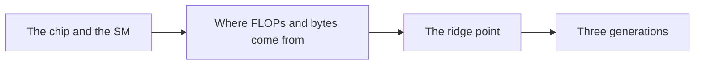
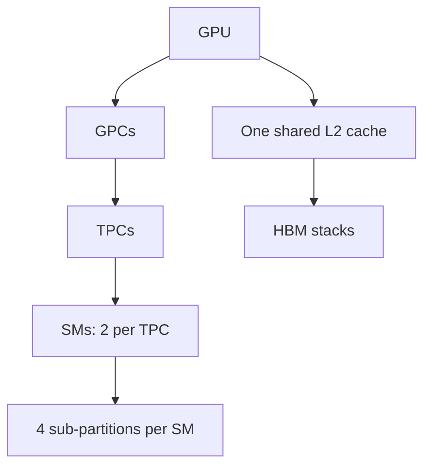
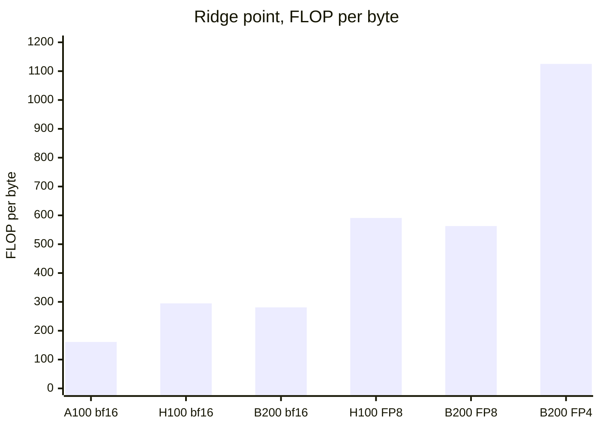

# Introduction

The question this chapter answers: where do a GPU's peak FLOP/s and bandwidth come from?

Note:
Open by saying that every kernel in the course is judged against two ceilings, and that those ceilings are not magic constants. They are products of things you can count. Today we count them on the A100, then repeat the exercise for the H100 and the B200.

### Why know the machine {#why-machine}

- A rating on a datasheet is a product of parts you can count
- Once you can rebuild it, you can spot a misleading one
- Every kernel you write is judged against these ceilings

Note:
Ask the room who has quoted "312 teraflops" without knowing where it came from. The skill we are building is prediction: before you run a kernel, say how fast it can go. That needs the machine's structure in your head. A rating you can rebuild from the hardware is a rating you can trust, and one that fails to rebuild is a warning sign, such as a sparse figure printed as if it were dense.

### What you can do at the end {#end-state}

- Name the parts, from the chip down to a sub-partition
- Derive the A100's peaks and check them against the datasheet
- Compute ridge points for the A100, H100, and B200
- Say what Hopper and Blackwell add

> [!QUESTION] Do I need to know the hardware to write PyTorch?
> No. You need it to write or tune a kernel, and to tell whether a slow one is
> slow because of your code or because of the machine's limits.

Note:
These are the chapter's objectives. Stress the last two: the ridge point is the first number you compute for any kernel in this course, and the generational tour tells you which features later chapters mention in prose because the lab card can't run them.

### The route through this deck {#roadmap}



Note:
Four stops. First the anatomy, top-down. Then the two derivations: arithmetic and bandwidth. Then the ratio of the two, the ridge point. Last, how the numbers move across Ampere, Hopper, and Blackwell. Leave this slide up briefly so the audience can see where we are going.

# The chip and the SM

Which parts does a GPU have, and what does each one do?

Note:
This section is vocabulary with numbers attached. We go top-down: the whole chip, then the memory around it, then one SM, then the pieces inside the SM.

## The whole chip

### A GPU is a hierarchy {#hierarchy}



Note:
The top levels, the GPC and TPC, are how the die is tiled. For programming, the SM is the unit that matters. Every SM shares one L2 cache, and L2 sits in front of the HBM. Notice that the SMs have no direct path to each other on Ampere: they communicate through memory.

### The A100 in counts {#a100-counts}

| Part | Count |
|---|---|
| GPCs, enabled | 7 |
| SMs, enabled of 128 | 108 |
| L2 cache | 40 MiB |
| HBM2e stacks | 5 (5120 bits) |
| Memory controllers | 10 |

Note:
Read the table row by row. The full GA100 die has 128 SMs and the A100 enables 108. Ten controllers of 512 bits match five stacks of 1024 bits, which is where the 5120-bit bus comes from. All of these are from NVIDIA's Ampere architecture blog and whitepaper.

### The chip, top-down {#chip-viz}

```viz
01-chip-anatomy
```

Note:
Flip between the three GPUs. The structure barely changes: more SMs, more stacks, a bigger L2, fatter units inside each SM. On the B200, point out the two dies and the 10 TB/s link between them, which presents the pair as one CUDA device.

### Links leave the chip {#links}

- PCIe Gen4 x16 to the host: 31.5 GB/s per direction
- NVLink bridge between two A100 PCIe cards: 300 GB/s per direction
- NVIDIA prints sums of both directions: 64 and 600 GB/s

> [!QUESTION] Why divide the printed NVLink figure by 2?
> The datasheet's 600 GB/s is the sum of both directions. A transfer in one
> direction gets 300, and that is the figure the collective-communication
> chapters use.

Note:
This is a trap that comes back in chapters 21 and 22. PCIe Gen4 x16 is 16 GT/s per lane, times 128 over 130 for the line code, times 16 lanes, over 8 bits per byte, which is 31.5 GB/s each way. Use per-direction numbers whenever you model a transfer.

## Inside one SM

### Four sub-partitions per SM {#sub-partitions}

| Unit | Per sub-partition | Per SM |
|---|---|---|
| Warp scheduler | 1 | 4 |
| Register file | 64 KB | 256 KB |
| FP32 lanes | 16 | 64 |
| Tensor core | 1 | 4 |

Note:
Each sub-partition has its own scheduler, registers, CUDA cores, and tensor core. The per-SM figures come from the A100 whitepaper, and the per-sub-partition column divides by four, assuming the four are identical. The SM also has INT32 and FP64 cores, load and store units, and special function units for transcendentals. We don't need their counts today.

### Registers are the biggest fast memory {#registers}

- 256 KB per SM, 27 MiB across the 108 SMs
- L1 and shared memory: 192 KB per SM, 20.25 MiB in all
- L2: 40 MiB, shared by everything

> [!QUESTION] Is the register file really larger than L1?
> Per SM, yes: 256 KB against 192 KB. That is why the fastest kernels keep their
> working data in registers.

Note:
Do the arithmetic aloud: 108 times 256 KB is 27,648 KB, which is exactly 27 MiB. It surprises people that the register files together hold more than all the L1 and shared memory. It is also memory the kernel controls most directly, which is the theme of the GEMM chapters.

### Shared memory and L1 share an array {#smem-l1}

- One 192 KB array per SM, split by the kernel
- Shared memory carveouts: 0 to 164 KB; one block gets at most 163 KB
- 32 banks of 4 bytes: 128 B per clock per SM

$$128 \times 108 \times 1.41 \times 10^{9} = 19.5\ \text{TB/s}$$

Note:
A kernel that declares no shared memory gets nearly all of the array as L1. The theoretical shared memory bandwidth of the whole chip is 19.5 terabytes per second, ten times the HBM rating. Chapter 8 shows how bank conflicts eat most of it.

### Ask the device {#ask-device}

```python
import torch

p = torch.cuda.get_device_properties(0)
print(p.name, p.major, p.minor)
print(p.multi_processor_count)    # SMs
print(p.L2_cache_size / 2**20)    # MiB
```

> [!QUESTION] Does it report the clock or the tensor-core width?
> No. The properties give the SM count and limits. Widths and clock come from the
> whitepaper, so a derivation needs both sources.

Note:
The lab starts here. describe_local_device wraps these calls. Point out that multi_processor_count is the SM count, 108 on this card, and not a core count. CUDA cores are that times 64.

# Where FLOPs and bytes come from

How does the A100 reach 312 TFLOP/s and 1935 GB/s?

Note:
Two derivations, one per rate. Each is a product of three or two things you can count, and the datasheet's number falls out of it.

## Arithmetic

### Peak FLOP/s is a product {#peak-product}

$$\boxed{\hla{C} = \hlc{N_{\text{SM}}} \times \hld{r} \times f}$$

- $\hlc{N_{\text{SM}}}$: SMs
- $\hld{r}$: FLOP per SM per clock
- $f$: clock in Hz

Note:
This is the equation the lab implements. Each factor is a lever that a new generation can pull: more SMs, a wider per-SM rate, or a higher clock. When you read a spec sheet, factor the headline into these three and check it.

### CUDA cores: FP32 {#fp32}

- 64 FP32 cores per SM, one FMA per clock, 2 FLOP each
- $r = 64 \times 2 = 128$

$$108 \times 128 \times 1.41 \times 10^{9} = 19.49\ \text{TFLOP/s}$$

Note:
The datasheet rates 19.5, so the derivation matches after rounding. The same method with 32 FP64 cores gives 9.75 against a rating of 9.7.

### Tensor cores: bf16 {#bf16}

- Each tensor core: 256 FMA per clock = 512 FLOP
- Four per SM: $r = 2048$

$$108 \times 2048 \times 1.41 \times 10^{9} = 311.9\ \text{TFLOP/s}$$

Note:
The whitepaper says each A100 tensor core executes 256 FP16 FMA per clock. The result matches the 312 rating. TF32 is half of this rate and INT8 is double.

### Every A100 peak, rebuilt {#rebuilt}

| Unit | $r$ | Derived | Rated |
|---|---|---|---|
| bf16 tensor | 2048 | 311.9 | 312 |
| TF32 tensor | 1024 | 155.9 | 156 |
| INT8 tensor | 4096 | 623.7 | 624 |
| FP32 cores | 128 | 19.49 | 19.5 |

Note:
Six ratings reproduced by one structure is evidence the structure is right: 108 SMs, four tensor cores each, 1410 MHz. The FP64 rows are in the chapter. The TF32 and INT8 per-clock rates are the datasheet's ratios applied to the bf16 rate.

### Tensor cores are 94% of the arithmetic {#tensor-share}

- bf16 tensor: 2048 FLOP per SM per clock
- FP32 cores: 128, a ratio of 16
- A CUDA-core kernel reaches at most $128/2048 = 6.25\%$ of the headline

> [!QUESTION] Does `a @ b` in float32 use the 156 TFLOP/s TF32 path?
> Not by default. `allow_tf32` is `False`, so it runs on the CUDA cores at
> 19.5 TFLOP/s.

Note:
This is the most common way people misread the peak. If you divide an fp32 kernel's throughput by 312, you conclude it is sixteen times worse than it is. The lab times an fp32 matmul with TF32 off to show you the lower ceiling.

### One tensor instruction in flight {#mma-inflight}

- `mma.sync.m16n8k16` = $16 \times 8 \times 16 = 2048$ FMA
- At 256 FMA per clock: 8 clocks per instruction
- Measured latency: 24.6 to 26.3 cycles (A100 PCIe 40GB)
- So about 3 in flight keep one tensor core full

Note:
This is Little's law previewed. The latency figure is from the Luo microbenchmark paper. The same argument applies to memory, and chapter 4 makes it precise. The factor of three is the latency divided by the issue interval, rounded.

### The clock is a factor too {#clock}

- Peaks assume the boost clock, 1410 MHz
- PCIe card: 300 W. SXM4 module: 400 W
- The datasheet prints the same compute peaks for both

> [!QUESTION] Will the PCIe card hit 312?
> The datasheet doesn't say how far its sustained clock falls under heavy
> tensor load. Treat 312 as a ceiling it may sit below.

Note:
Because the clock enters linearly, a card that can't hold its boost clock can't reach its rating. The lab prints the device name so you know which card ran. We don't have a quantified throttle figure, so we don't state one.

## Bandwidth

### Peak bytes: bus width times pin rate {#hbm-derivation}

$$\hlb{\beta} = \frac{W \times p}{8}, \quad W = 5 \times 1024 = 5120\ \text{bits}$$

$$p = \frac{8 \times 1935}{5120} = 3.02\ \text{Gb/s per pin}$$

Note:
NVIDIA doesn't print the per-pin rate for the 80GB card, so we solve for it. Each stack then delivers 387 GB/s, and each SM's share is 12.7 bytes per clock. Remember that last figure: an SM can do 2048 tensor FLOP per clock and gets 12.7 bytes per clock from HBM.

### The bandwidth ladder {#ladder}

| Level | Bandwidth | Latency |
|---|---|---|
| Shared memory | 19.5 TB/s theory | 29.0 cycles |
| L2 | 2.6 to 2.8 TB/s measured | 261.5 cycles |
| HBM | 1.935 TB/s rated | 466.3 cycles |
| NVLink bridge | 0.3 TB/s per direction | not measured here |
| PCIe Gen4 | 0.0315 TB/s per direction | not measured here |

Note:
Latencies and the L2 measurement are from Luo and colleagues on an A100 PCIe 40GB. The L2 figure has a source disagreement: the whitepaper's theoretical 7.2 terabytes per second, Luo's 2.6 to 2.8, and Chips and Cheese's 4.5 on an SXM part. Quote the one you used and name it.

### The measured copy is 66% of the rating {#copy-ceiling}

- Rated: 1935 GB/s
- A plain copy on the lab A100: 1275 GB/s (learn-inference, chapter 10)
- $1275/1935 = 66\%$

> [!QUESTION] Why the gap?
> No source this course read explains it. Chapter 3's lab sweeps sizes and reports
> the plateau.

Note:
The datasheet claims 95% DRAM utilization efficiency, yet a plain copy reaches two thirds of the rating. We are honest that the cause is open. For judging a memory-bound kernel, use 1275. Chapter 0's lab measured the same thing.

# The ridge point

When is a kernel waiting on memory, and when on arithmetic?

Note:
The ratio of the two peaks gives a single number per precision. This is the number you will compute first for every kernel.

### Divide the peaks {#ridge-definition}

$$\boxed{I^{\ast} = \frac{\hla{C}}{\hlb{\beta}}}$$

| A100 unit | Ridge, FLOP per byte |
|---|---|
| INT8 tensor | 322.5 |
| bf16 tensor | 161.2 |
| TF32 tensor | 80.6 |
| FP32 cores | 10.1 |

Note:
Each row divides the peak by 1.935 terabytes per second. The ridge depends on precision because the numerator does: lower precision raises the arithmetic rate and not the bandwidth. Moving from fp32 to bf16 moves the ridge from 10 to 161. The per-SM view agrees: 2048 FLOP per clock over 12.7 bytes per clock is 161.

### One token against a weight matrix {#one-token}

- $m$ tokens against a $d \times d$ bf16 weight: intensity about $m$
- Decode, $m = 1$: 1 FLOP per byte
- Attainable: $1 \times 1935$ GB/s = 1.935 TFLOP/s = 0.62% of 312

> [!QUESTION] How many tokens reach the ridge?
> About 161 sharing one read of the weights.

Note:
The weights, 2 d squared bytes, dominate the traffic, and the work is 2 m d squared FLOP, so the intensity is about m. This is the quantitative reason batching helps inference. It is a prediction from the specs, not a measurement; chapter 4 builds on it and the labs measure it.

### Rooflines across the generations {#ridge-viz}

```viz
01-peaks-ridge
```

Note:
Switch the precision and slide the intensity. At one FLOP per byte every GPU is a sliver of its peak. Watch the ridge move right as the precision drops, and watch the A100 disappear for FP8 and FP4 because it has no such tensor path.

# Three generations

What changed from Ampere to Hopper to Blackwell, and what do later chapters build on?

Note:
We keep the generational detail to what later chapters use, and point forward for the rest.

## Ampere, Hopper, Blackwell

### Same structure, bigger numbers {#generations-table}

| | A100 | H100 SXM5 | B200 (HGX) |
|---|---|---|---|
| SMs | 108 | 132 | 148 |
| bf16 per SM per clock | 2048 | 4096 | 8192 |
| bf16 dense, TFLOP/s | 312 | 989.4 | 2250 |
| Bandwidth, GB/s | 1935 | 3350 | 8000 |

Note:
The H100 is the SXM5 module and the B200 is the HGX part, per GPU. All figures are dense. The clocks for the H100 and B200 are implied by the rated throughput, not published in a document we read, and the B200's is unconfirmed.

### Where each gain came from {#gains}

- A100 to H100: $1.22 \times 2 \times 1.30 = 3.17\times$
- H100 to B200: $1.12 \times 2 \times 1.01 = 2.27\times$
- Memory: $1.73\times$, then $2.39\times$

> [!QUESTION] Why did bandwidth grow more slowly?
> Bandwidth is bus width times pin rate. The H100 kept the 5120-bit bus and
> raised the pin rate. The B200 widened to 8192 bits and raised it again.

Note:
Each generation doubles the per-SM tensor rate. SMs and clock contribute the rest. Memory gains of 1.73 and 2.39 trail arithmetic gains of 3.17 and 2.27 in the first step, so the ridge point rises from 161 to 295 and then eases to 281.

### Ridge points by precision {#ridge-bars}



Note:
Each halving of the element size doubles the ridge at the same bandwidth. A kernel that is comfortably compute bound in bf16 can be memory bound in FP8 on the same chip. The B200 values use the HGX bandwidth and peaks.

### What Hopper adds {#hopper}

- TMA: one thread copies a whole tile between global and shared memory
- `wgmma`: four warps issue an asynchronous matrix multiply, M = 64
- Clusters: up to 8 blocks portable, with distributed shared memory
- FP8: E4M3 and E5M2 at twice the bf16 rate

Note:
Luo and colleagues measured FP16 wgmma at 729.3 of 756.5 TFLOP/s on an H800 PCIe, 96 percent. On that part SM-to-SM latency was 180 cycles against 263 for L2. Chapter 12 covers TMA and wgmma in prose, since the lab card can't run them.

### What Blackwell adds {#blackwell}

- Tensor memory: 256 KB per SM, 128 rows by 512 columns
- `tcgen05.mma`: one thread issues it; the accumulator lives in tensor memory
- FP6, FP4, and block-scaled formats
- Two dies, 74 SMs each, joined at 10 TB/s

> [!QUESTION] Is the B200 two GPUs?
> It is two dies presented as one CUDA device. Crossing costs more: thread-pair
> latency was 90 to 100 ns inside a partition and 190 to 220 ns across.

Note:
Those latency figures are from the Chips and Cheese B200 article. Also mention the growing imbalance: per SM, tensor cores do 8192 operations per clock and shared memory moves 128 bytes, against 16 FLOP per byte on the A100. Hopper and Blackwell respond with TMA and tensor memory.

### Reading a spec sheet {#spec-traps}

- Dense or sparse: halve any figure "with sparsity"
- Preliminary or final: the H100 whitepaper said 1000 TFLOP/s and 3 TB/s
- One name, several SKUs: B200 at 1000 W or up to 1200 W
- Per GPU or per system: divide HGX totals by 8

> [!QUESTION] A post says an H100 does 1979 TFLOP/s in bf16. True?
> That is the sparse figure. The dense peak is 989.4.

Note:
Walk through each trap with its example. Preliminary versus final changes the H100 ridge from 333 to 295. The B200 at the higher power limit lists 5000 dense FP8, which would put the ridge at 625. We use the HGX values and name the other as the maximum-power part.

# Summary

The parts, the two derivations, and the ridge point that joins them.

Note:
Close the loop: we started from a datasheet number and ended with parts we can count. The summary slides collect the ideas and the numbers to carry into the next chapter.

### What to remember {#summary}

- A GPU is SMs sharing an L2 and HBM; the A100 has 108 SMs
- Peak FLOP/s = SMs $\times$ FLOP per SM per clock $\times$ clock
- Peak bandwidth = bus width $\times$ pin rate $\div$ 8
- The ridge point $C/\beta$ is per precision and rises as precision falls
- Judge against measured ceilings, not ratings

Note:
Recap in this order. The first three are the anatomy and the two derivations. The last two are how to use them. If the audience remembers one thing, it is that every rating factors into parts you can count.

### Numbers to remember {#numbers}

| Quantity | A100 | H100 | B200 |
|---|---|---|---|
| bf16 ridge, FLOP per byte | 161 | 295 | 281 |
| FP32 ridge | 10.1 | 20.0 | not tabulated |
| Measured copy | 1275 GB/s | not measured | not measured |

Note:
The A100 numbers are the ones the labs use. The measured copy is from learn-inference on this card. We have no measurement for the other two, and the course doesn't invent one.

### What the next chapter picks up {#next}

- This chapter counted what the SM can do per clock
- Chapter 2 asks how threads, warps, and blocks fill it
- Occupancy, divergence, and the wave quantization of a grid

Note:
We know the SM has four schedulers and can hold up to 64 resident warps. The execution model chapter explains how a launch becomes resident warps and what it costs when they don't fill the machine. The lab for chapter 2 is an occupancy calculator.
