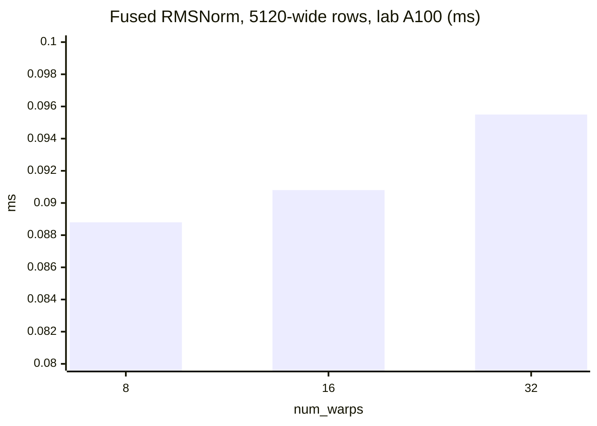

# Introduction

The question this chapter answers: when you launch a kernel, how many threads actually run at once, and what slows them down?

Note:
Open by reminding the room that chapter 1 listed the A100's resources: 108 SMs, a 256 KB register file per SM, 164 KB of shared memory per SM. Today is the rules for spending them. The punchline to promise is that a correct kernel can still be slow for reasons the arithmetic never shows, and that by the end of the hour they can name the reason in advance.

### Correct is not the same as fast {#why}

- You write one thread's code and launch millions of threads
- The hardware decides which run together and what happens when they disagree
- Divergence, registers, and tiny launches each cost time that the roofline hides

> [!QUESTION] Isn't the roofline enough to predict a kernel's time?
> The roofline gives a floor from bytes and FLOPs. It says nothing about divergent warps or an SM that holds only 8 of its 64 warps. Those push a kernel above its floor.

Note:
The roofline is the target. The execution model is why you miss it. Give one example for each bullet: a divergent branch doubles the instruction count, a register-hungry kernel leaves most warp slots empty, and a launch shorter than a few microseconds is all overhead. We will meet each of them with numbers.

### The route through this deck {#roadmap}


Note:
Four stops. First, how a grid becomes blocks on SMs and warps inside them. Second, what a branch costs when a warp's lanes disagree, including the Volta change that makes __syncwarp necessary. Third, occupancy: four limits, one formula, and why lower can be faster. Last, register caps and the cost of a launch. Leave this up for a few seconds.

# Blocks and warps

From a launch to the units the hardware schedules.

Note:
Section divider. The aim of this section is two facts: a block lives on one SM for its whole life, and the SM runs threads 32 at a time. Everything later, divergence and occupancy, follows from those two.

## The grid and the blocks

### Grid, block, warp, thread {#hierarchy}


- You choose the grid and block shape
- The hardware chooses which SM runs which block

Note:
Walk the arrows left to right. You choose how many blocks and how many threads per block. The hardware turns each block into warps, 32 threads each. A Triton program plays the role of a block, and num_warps sets how many warps run it, so everything here applies to Triton as well. Limits on the A100: 1024 threads per block, and a grid of up to 2^31 minus 1 blocks in x.

### Every kernel starts with the same index {#index}

```cuda
__global__ void scale(const float* x, float* y, float a, int n) {
    int i = blockIdx.x * blockDim.x + threadIdx.x;
    if (i < n) y[i] = a * x[i];
}
scale<<<(n + 255) / 256, 256>>>(x, y, 2.0f, n);
```

Note:
The global index is block number times block size plus thread number. Round the block count up so every element has a thread, and guard the tail with the if. The guard diverges in at most one warp per launch, so it costs almost nothing. If someone asks why 256: it is a multiple of 32 and divides 2048, so eight blocks fill an SM's thread slots. We justify block sizes properly in the occupancy section.

### Blocks are independent {#independent}

- A block runs on exactly one SM until it finishes
- Blocks run in any order, in parallel or in series
- Only threads of one block can share memory or call `__syncthreads()`

> [!QUESTION] Can block 3 wait for block 2 to finish?
> No. Nothing guarantees block 2 starts first. Cooperation across blocks needs a second kernel or atomics. That freedom lets one binary fill 108 SMs here and 132 on an H100.

Note:
This is the contract that makes GPU code portable across card sizes. It is also why reductions across blocks need a second pass or an atomic, which chapter 6 develops. If you have time, mention that Hopper adds clusters, groups of blocks guaranteed to run together on neighboring SMs, but the A100 does not, so our labs never use them.

### Waves of blocks {#waves}

Resident blocks per SM, with 256-thread blocks at 32 registers or fewer: $2048 / 256 = 8$.

$$
\text{wave} = 108 \times 8 = 864\ \text{blocks}, \qquad \frac{2^{24}/256}{864} = \frac{65536}{864} = 75.9
$$

- 76 waves, the last one 85% full

Note:
A vector add over 2^24 floats has 65,536 blocks. The GPU holds 864 at once, so the grid runs in 76 waves, and the last holds 736 blocks, 85 percent of a full wave. Those 864 blocks are 221,184 threads, which is 108 times 2048. Point out two failure modes: a grid with fewer blocks than SMs leaves SMs idle, and a grid just over a multiple of a wave leaves a nearly empty last wave. Chapter 4 calls this wave quantization.

## Warps

### A warp is 32 lanes in lockstep {#warp}

$$
\text{linear id} = x + y \cdot D_x + z \cdot D_x D_y
$$

- Warp 0 holds linear ids 0 to 31, warp 1 holds 32 to 63
- All 32 lanes run the same instruction on their own registers
- A block of 100 threads is 4 warps, the last one 4 lanes full

Note:
Threads are numbered with x fastest, and consecutive groups of 32 form a warp. One FFMA instruction is 32 fused multiply-adds, one per lane. The warp's instruction is the smallest thing the hardware issues. This is also why block sizes that are multiples of 32 waste nothing, and why a block of 100 threads still pays for four full warps of slots.

### One SM, four schedulers {#schedulers}

| Per SM | Value | Arithmetic |
|---|---|---|
| Warp schedulers | 4 | one per sub-core |
| FP32 cores per sub-core | 16 | 64 / 4 |
| Pipe cycles per FFMA | 2 | 32 / 16 |
| FP32 FLOP per cycle | 128 | 64 cores x 2 |

> [!QUESTION] The A100 has 6,912 cores but runs 221,184 threads. How?
> A core is one lane of an arithmetic pipe. A resident thread is registers and a program counter parked on the SM, so some warp is always ready while others wait on memory.

Note:
Each scheduler issues one warp instruction per cycle. Check the rated peak with the table: 108 SMs times 1.41 GHz times 128 FLOP per cycle is 19.5 TFLOP per second. A single warp can use a sub-partition's FP32 pipe at most half the time, because one FFMA occupies the 16 cores for two cycles. The question on the slide is the standard confusion between cores and threads, so give it a moment.

# Divergence

What a branch costs when the lanes of one warp disagree.

Note:
Section divider. The key sentence: divergence happens only inside a warp. Different warps may take different paths for free. Keep that in mind when the lab asks you to choose a branch by lane versus by warp.

## The cost of disagreeing

### A warp runs each path in turn {#divergence-cost}

```cuda
// Diverged: lanes split on parity, so each warp runs both paths.
if (threadIdx.x % 2 == 0) y = path_a(x); else y = path_b(x);

// Uniform per warp: whole warps split, so each runs one path.
if ((threadIdx.x / 32) % 2 == 0) y = path_a(x); else y = path_b(x);
```

Note:
Both statements split the block in half. The first costs t_a plus t_b for every warp, with half the lanes masked off on each pass. The second costs t_a for half the warps and t_b for the other half. This is exactly the experiment in your lab, with the number of branches as the dial. Ask the audience which line they would suspect in a profile, and why.

### Lane mode against warp mode {#divergence-viz}

```viz
02-divergence
```

Note:
Let people drag the slider. In lane mode, the number of passes equals the number of branches, and lane efficiency is one over that. In warp mode nothing changes as the branches grow, because every warp takes a single path. The initial state is four branches by lane: four passes, eight lanes active in each, a predicted slowdown of four.

### The prediction {#slowdown}

$$
\boxed{\text{slowdown} = k}\quad\text{for } k \text{ equal paths, issue-bound}
$$

- Lab kernel: $2 \times 2^{22} \times 1024 = 8.59$ GFLOP
- Floor at 19.5 TFLOP/s: 0.44 ms uniform, about 14 ms at 32 ways

Note:
State the prediction before the measurement, as always. The lab kernel runs 1024 dependent fused multiply-adds per element over 4 million elements, which is 8.59 billion FLOP. At the 19.5 TFLOP per second FP32 rating, that is 0.44 milliseconds, and 32 equal paths multiply it by 32. The lab reports the measured numbers and passes if each slowdown is at least half the prediction. A memory-bound kernel hides some of this, because the instruction stream is not the bottleneck.

### What is not divergence {#not-divergence}

- Predicated short branches: the compiler issues both sides, no branch
- Conditions that are uniform across the warp, such as `blockIdx.x`
- The tail guard `if (i < n)`: one warp per launch

> [!QUESTION] Is the `if (i < n)` guard a performance problem?
> No. It splits only the single warp that straddles `n`, and that warp does one partial pass. Every other warp agrees. The guard is cheap insurance against writing past the end of the array.

Note:
Real divergence comes from data. A loop whose trip count varies by lane runs as long as the slowest lane. A mixture-of-experts kernel that gives each lane a different expert runs one expert's code per distinct expert in the warp. The fix is to arrange the data so lanes of a warp agree: sort tokens by expert, bucket sequences by length, or give one row to a warp.

## Independent thread scheduling

### Volta gave every thread a program counter {#its}

- Before Volta: one program counter per warp, lockstep by construction
- Volta and later: a program counter and call stack per thread
- Convergence is now guaranteed only inside explicit warp primitives

> [!TIP] If old code breaks on Volta, rebuild it with `-arch=compute_60 -code=sm_70`. If the bug vanishes, it depended on lockstep.

Note:
The change lets the hardware interleave the paths of a divergent branch, and lets a thread that waits on a lock yield to the thread that holds it. Performance in the common case is unchanged, because a schedule optimizer regroups threads at the same instruction. What you lose is lockstep for free. The tip is from Lin and Grover's article on warp-level primitives, and it is the quickest way to find out whether your old warp-synchronous code is the culprit.

### The reduction that needs `__syncwarp` {#syncwarp}

```cuda
float v = smem[lane] + smem[lane + 32];
for (int k = 16; k > 0; k >>= 1) {
    __syncwarp();          // all reads done
    smem[lane] = v;
    __syncwarp();          // all writes visible
    v += smem[lane + k];
}
```

Note:
This sums 64 values with the first warp. The first barrier stops a fast lane from overwriting smem[lane] while a slower lane still needs the old value. The second makes every write visible before any lane reads a neighbor's. Without them the hardware may interleave the lanes arbitrarily, and the sum is wrong only sometimes, which is the worst kind of bug. Chapter 6 builds the full reduction.

### Masks must name lanes that arrive {#masks}

```cuda
v += __shfl_down_sync(0xffffffff, v, offset);
```

- Every named lane must execute it, with the same mask
- Breaking this is undefined behavior: a hang or garbage

> [!QUESTION] Why not build the mask with `__activemask()`?
> It reports which lanes happen to be converged right now, and with independent scheduling that set can be smaller than the lanes you meant. Compute the mask from the program's logic, or use the full mask when the whole warp reaches the call.

Note:
The rules come from the programming guide: each calling thread must have its own bit set, and every thread the mask names must execute the intrinsic with the same mask. The common trap is an early return for out-of-range indices that removes a lane before the shuffle. Keep every lane alive until the shuffles finish and mask the values, not the threads.

# Occupancy

How many warps an SM holds, and whether that number is the goal.

Note:
Section divider. Three parts: why the SM wants many warps at all, the four limits and the formula, and then Volkov's argument that more is not always better. The lab's calculator is the first part, so pay attention to the arithmetic.

## Hiding latency

### Warps are cheap to switch {#cheap-switch}

- A stalled warp is skipped, and a ready one issues
- Every resident warp keeps its registers, so a switch saves nothing
- Hiding latency needs work in flight, not threads as such

Note:
Contrast with a CPU thread switch, which saves and restores state. On the GPU the registers of every resident warp stay in the register file, so the scheduler simply picks a different warp the next cycle. That is why the SM keeps up to 64 warps resident, and why the next slide asks how many it actually needs.

### Little's law sets the need {#littles-law}

$$
\boxed{N_{\text{in flight}} = \hla{L} \times \hlb{\lambda}}
$$

- HBM: 466.3 cycles = 330.7 ns, measured by Luo et al. on an A100 PCIe 40GB
- $1935 \times 330.7\ \text{ns} = 640$ KB in flight, **5.9 KB per SM**
- Arithmetic, assuming 4 cycles: 2 warps per sub-partition, 12.5% occupancy

Note:
Latency times throughput is the work that must be in flight. For memory at the 1935 GB per second rating, that is 640 kilobytes across the GPU, 5.9 kilobytes per SM. For the copy ceiling of 1275 GB per second it is 3.9 kilobytes. For arithmetic, the four-cycle dependent FMA latency is a Volta microbenchmark figure that we assume carries over, and the FP32 pipe finishes half a warp instruction per cycle, so two warps per sub-partition cover it. Arithmetic needs few warps. Memory is the demanding one.

## The four limits

### Blocks per SM is a minimum {#limits}

| Limit per SM | A100 (CC 8.0) |
|---|---|
| Resident warps | 64 |
| Resident blocks | 32 |
| Registers | 65,536 |
| Shared memory | 164 KiB |

$$
\text{blocks} = \min\Big(\hla{\lfloor 64/w \rfloor},\ \hlb{32},\ \hlc{\lfloor W_{\text{reg}}/w \rfloor},\ \hld{\lfloor 164\,\text{KiB}/s \rfloor}\Big)
$$

Note:
Here w is warps per block, W_reg is the warps the register file can hold, and s is shared memory charged per block. The smallest term is the limiter, and it tells you what to change. Occupancy is resident warps over 64. The table values are confirmed from the CUDA Programming Guide. Stress that the next slides use allocation rules that are approximations the lab will cross-check.

### Registers are charged per warp {#regs-table}

| Regs per thread | Warps by registers | Blocks of 256 | Occupancy |
|---|---|---|---|
| 32 | 64 | 8 | 100% |
| 64 | 32 | 4 | 50% |
| 128 | 16 | 2 | 25% |
| 255 | 8 | 1 | 12.5% |

> [!QUESTION] Why is 255 registers charged as 256?
> A warp is charged $32r$ registers rounded up to a multiple of 256, so $255 \times 32 = 8160$ becomes 8192. That unit is the retired calculator's rule, so your lab checks it against the driver.

Note:
Registers per warp at 64 per thread is 2048, so the 65,536-register file holds 32 warps, half of 64. The same blocks of 256 threads are 8 warps each, so 4 blocks. At 255 registers the SM holds one block, 8 warps, 12.5 percent. The granularity rules, 256 registers per warp, grouped by sub-partition, are common knowledge from the retired spreadsheet but confirmed here only by a forum post, so treat them as approximation until the API agrees.

### Shared memory charges the block {#smem}

- A block asking for 48 KiB is charged $48 + 1 = 49$ KiB
- $164 / 49 = 3.35$, so **3 blocks**, 24 warps, 37.5%
- A 163 KiB block is charged 164 KiB: the only block on its SM

Note:
The 1 KiB is a reservation the runtime makes for each block, and requests round up to 128 bytes. Notice that shared memory can cap occupancy even when registers are plentiful. Tiled kernels in the coming chapters pick tile sizes with this in mind, since a bigger tile reuses more data but fits fewer blocks.

### The calculator in your hands {#calc}

```viz
02-occupancy-calculator
```

Note:
Let the audience move the three sliders. The outlined bar is the limiter. The initial state, 256 threads with 64 registers and 48 KiB of shared memory, is limited by shared memory at 3 blocks, 37.5 percent, even though registers alone would allow 4. Change the shared memory to zero to see registers take over at 4 blocks, 50 percent.

### Ask the driver {#api}

```cuda
int blocks = 0;
cudaOccupancyMaxActiveBlocksPerMultiprocessor(
    &blocks, my_kernel, 256, /*dynamic smem*/ 0);
```

> [!QUESTION] If I have the formula, why call the API?
> The granularity rules are an approximation. The driver is the ground truth, and so is Nsight Compute, which reports theoretical and achieved occupancy. Your lab compares your calculator with the API on 160 configurations and prints every disagreement.

Note:
Be direct about the status of the rules: the limits are confirmed from NVIDIA's tables, but the allocation units come from a retired calculator. The lab agrees to within a tolerance, and a mismatch tells you a rule is missing. The practical habit is to use the API or the profiler in real work, and use the formula to understand why the answer is what it is.

## Lower can be faster

### Volkov: ILP substitutes for threads {#volkov}

| Experiment | GPU | Result |
|---|---|---|
| CUFFT, 256 to 64 threads per block | G80 | 33% to 17% occupancy, 2x faster |
| CUBLAS, 512 to 64 threads per block | G80 | 67% to 33%, 1.6x faster |
| FMA chain, 1 / 2 / 4 chains per thread | GTX 480 | 576 / 320 / 192 threads to reach peak |
| Copy, 4 floats loaded per thread | GTX 480 | full bandwidth at 25% occupancy |

Note:
These are Volkov's 2010 numbers on older GPUs, so name the hardware every time and do not transfer the values to the A100. What transfers is the mechanism: by Little's law, work in flight can come from more threads or from more independent operations per thread. A thread with four independent loads outstanding has four times the bytes in flight, so a quarter as many threads match it.

### Bytes in flight on the A100, on paper {#bytes-in-flight}

| Per-thread load | Threads per SM for 5.9 KB | Occupancy |
|---|---|---|
| 1 float (4 B) | 1,482 | 72% |
| 1 `float4` (16 B) | 371 | 18% |
| 2 `float4` (32 B) | 186 | 9% |

Note:
Divide 5,925 bytes by the bytes one thread keeps in flight and round up. These are predictions from Little's law with the measured 466.3-cycle latency, not measurements. They assume every thread keeps its loads outstanding all the time, which real kernels do not. Chapter 3's lab measures what the card does, and chapter 4 develops the law fully.

### More warps ran slower {#rmsnorm}



Note:
This is measured on the course's lab A100 in the companion course's chapter 13. Going from 8 to 32 warps per block made the kernel 7.5 percent slower, because each extra warp had less of the row and added reduction cost. More occupancy was not hiding anything that was still exposed. Be careful about the claim: this shows more warps can hurt, not that fewer always helps.

### When to push occupancy, and when not {#decision}

| The profiler shows | Do this |
|---|---|
| Schedulers idle, stalls are latency | Raise occupancy or add ILP |
| Registers spent on a larger tile | Leave it low |
| Memory-bound, loads already in flight | Neither helps |

> [!QUESTION] Does this hold on an H100?
> The mechanism does: Little's law and ILP aren't architecture-specific. The numbers change. Compute capability 9.0 has the same 64 warps, 32 blocks, and 64K registers, with 228 KB of shared memory.

Note:
Occupancy is a floor you need, not a score you maximize. That is why the fastest GEMM kernels hold a large tile in registers and run few warps per SM, which chapter 10 builds. The H100 answer comes from the per-architecture table in the chapter: same register file and warp limits, more shared memory. Chapter 5 shows how to read the stall reasons that tell you which row you are in.

# Registers and launches

The compiler's register choice, and the cost of asking the GPU to do anything at all.

Note:
Section divider. Two practical topics: how to trade registers for occupancy, and why a tiny kernel is dominated by the launch, which sets up chapter 17 on CUDA graphs and compilers.

### `__launch_bounds__` and `-maxrregcount` {#launch-bounds}

```cuda
__global__ void __launch_bounds__(256, 2) my_kernel(float* x);
// 65536 / (2 x 256) = 128 registers per thread at most
```

- `-maxrregcount=N` caps every kernel in the file
- `-Xptxas -v` prints registers and spills

Note:
The first argument is the largest block you will launch and the second is the minimum blocks per SM you want. The compiler then caps registers so that many blocks fit. For 256 threads and 2 blocks that is 128 registers. The flag applies to the whole file, which is why launch bounds is usually the better tool. Triton exposes n_regs and n_spills on the compiled kernel.

### Spilling is a trade, not a fix {#spill}

- Spilled values go to local memory, which is physical global memory
- Each thread may use up to 512 KB of it
- Cap 128 to 64 registers: occupancy 25% to 50%

> [!WARNING] A cap helps only if the live values still fit. Compile both ways, read `n_spills`, and time both.

Note:
A spill is a store and a load that the unconstrained kernel did not have, and the load sits on the critical path. A cap that produces no spills is free. A few spills in a cold path is usually fine. Spills in the hot loop usually lose more than the extra warps return. Occupancy cannot tell you which, only a measurement can.

### The launch is not the kernel {#launch}

| Case | Time |
|---|---|
| Queue a kernel, lab A100 | about 5 microseconds |
| Elementwise op on $2^{24}$ floats | 154 microseconds |
| V100, 2.9 microsecond kernel, sync each launch | 9.6 microseconds |
| Same, inside a graph of 20 | 3.4 microseconds |

> [!WARNING] A host timer around a launch measures the queueing. Time with CUDA events, after a warmup.

Note:
The launch returns before the GPU runs, which is how the CPU queues the next layer while the GPU executes this one. Five microseconds is 3.2 percent of the 154 microsecond elementwise op, but larger than a 2.9 microsecond kernel. The V100 rows are NVIDIA's CUDA graphs measurement and show the shape, not A100 values. Chapter 17 shows how graphs and torch.compile remove the per-launch cost.

# Summary

The execution model in five sentences, and the numbers that carry forward.

Note:
Section divider. Use it to pause and check the room. The remaining slides restate the argument, collect the numbers the next chapters reuse, and point at chapter 3, where bytes in flight become the subject of the lab.

### What to remember {#summary}

- A block lives on one SM; blocks run in any order
- A warp is 32 lanes; $k$ equal paths in one warp cost $k\times$
- Volta and later: use `__syncwarp` and masked `*_sync` primitives
- Blocks per SM is the minimum of four limits
- Lower occupancy can be faster; read spills before capping registers

Note:
Walk through the bullets and ask the audience to restate the divergence rule in their own words: divergence is a property of one warp, so look at what the condition depends on. If time is short, the occupancy formula and the Volkov point are the two to leave on the whiteboard.

### Numbers to remember {#numbers}

| Quantity | Value |
|---|---|
| A100 SMs, resident threads, warps, blocks per SM | 108, 2048, 64, 32 |
| Registers, shared memory per SM | 65,536, 164 KiB |
| 256-thread blocks at 255 registers | 1 block, 12.5% |
| HBM bytes in flight for the rating | 5.9 KB per SM |
| Kernel queue time | about 5 microseconds |

Note:
These are the numbers the next chapters reuse. The first two rows are confirmed limits from the compute capability table, the third is arithmetic from the register rule, the fourth is Little's law with the measured latency, and the last is measured by the companion course on this card.

### Next: memory and bandwidth {#next}

- Chapter 3 asks how a warp's 32 addresses become memory transactions
- Bytes in flight, not occupancy, saturate HBM
- The lab reaches the 1275 GB/s copy ceiling

Note:
This chapter told you how many warps the SM runs. The next asks what those warps do to memory: coalescing, sectors, and the vectorized loads that put more bytes in flight per thread. The prediction from this chapter, that a float4 load per thread needs only about 18 percent occupancy, is what that lab measures.
