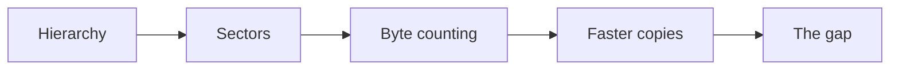
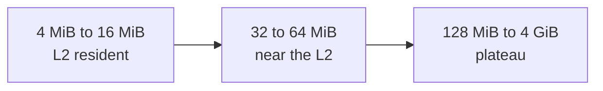
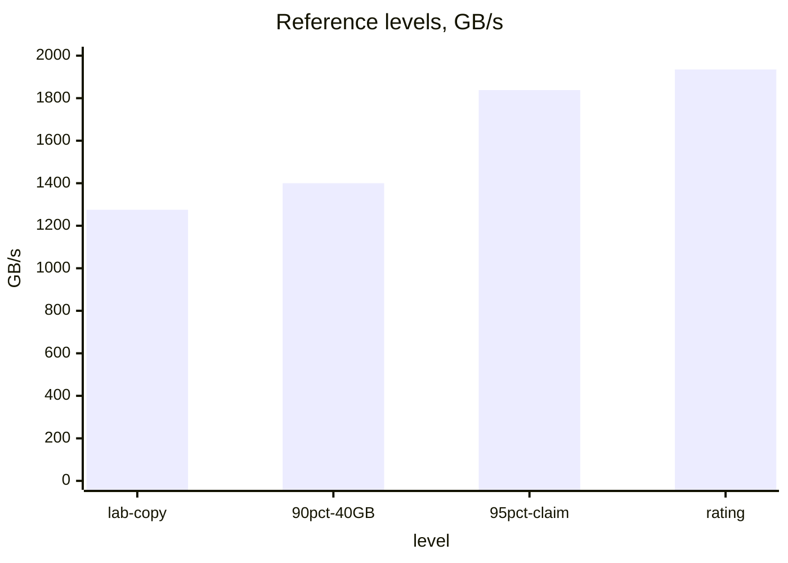

# Introduction

The question this chapter answers: how many bytes does a kernel really move, and how fast can an A100 move them?

Note:
Open with the ridge point from chapter 0: 161 FLOP per byte. Most model kernels sit far to the left of it, so their time is bytes divided by bandwidth. This chapter makes both of those numbers honest. We build the hierarchy, count sectors, write four copy kernels in the lab, and finish on a question the sources can't answer.

### Why bandwidth decides your kernel time {#why-bandwidth}

- A vector add does 1 FLOP per 12 bytes
- The ridge point is 161 FLOP per byte
- So time is bytes over bandwidth
- Both numbers need to be right

> [!QUESTION] Isn't 1935 GB/s the bandwidth?
> It is the rating. A plain copy on the lab card measured 1275 GB/s in the companion course, which is 66% of it. That measured figure is the target for a memory-bound kernel.

Note:
Remind the room of the arithmetic from chapter 0: 12 bytes per FLOP puts a vector add at 0.083 FLOP per byte. The question from the audience is usually about the rating. Say that the rating is a pin rate, a ceiling, and that the rest of the chapter is about what a real kernel reaches.

### The route through this deck {#roadmap}



Note:
Five stops. First where data lives and what it costs. Then how a warp's load becomes sectors. Then how to count bytes. Then the copy kernels the lab has you write. Last the gap between the datasheet and the measurement, which is the one open question.

# The memory hierarchy

Four levels, each bigger, slower, and shared by more threads.

Note:
Section divider. Say that the sizes come from the datasheet and whitepaper, and the latencies from a microbenchmark paper. Warn the audience that two sources disagree about latency and about L2 bandwidth, and that we will say so on the slides rather than pick one silently.

## The A100 80GB PCIe

### Four places to keep a value {#four-levels}

| Level | Size | Latency (cycles) |
|---|---|---|
| Registers | 256 KB per SM | part of the instruction |
| Shared and L1 | 192 KB per SM | 29.0 and 37.9 |
| L2 | 40 MB | 261.5 |
| HBM2e | 80 GB | 466.3 |

Note:
Latencies are from Luo and colleagues, measured on an A100 PCIe 40 GB at 1410 MHz. The 80 GB card was not measured in the sources we read, so treat them as close. The companion course rounds these to about 30, 200, and 400 for teaching. We use the measured values, and say roughly 30, 260, and 470 when we round.

### In nanoseconds {#latency-ns}

$$
\text{ns} = \frac{\text{cycles}}{1.41}
$$

- L1: 26.9 ns, shared: 20.6 ns
- L2: 185.5 ns
- HBM: 330.7 ns

Note:
Divide cycles by the 1.41 GHz boost clock. The point to land is the ratio: HBM is about 1.8 times the L2 latency and about 16 times the shared-memory latency. A value in a register costs nothing to reuse, and a value from HBM costs 330 nanoseconds each time a warp asks.

### Bandwidth by level {#bandwidth-levels}

- Shared memory: 128 B per clock per SM, 19.5 TB/s across 108 SMs
- L2: 7.2 TB/s theoretical (5,120 B per clock)
- HBM: 1935 GB/s rated

> [!WARNING] The L2 sources disagree
> Luo et al. measured 2.6 to 2.8 TB/s on an A100 PCIe. Chips and Cheese measured 4.5 TB/s on an A100 SXM. Different parts, different methods.

Note:
Walk through the shared-memory arithmetic once: 128 bytes times 108 SMs times 1.41 gigahertz is 19.5 terabytes per second. The L2 line is where the sources split. Don't pick a number. Quote the range and name the source, and tell the audience that a chapter that gives one L2 figure without a citation should be doubted.

### The fast levels are small {#small}

- Register file: 27,648 KB across the GPU
- Shared memory: 108 × 164 KB = 17,712 KB
- L2: 40 MB
- HBM: 80 GB, so the three fast levels are about 0.1% of it

> [!QUESTION] Does the data I read live in L2?
> Only if it was touched recently and fits. Data a kernel streams once passes through L2 and is evicted. That is why a benchmark on a small, reused buffer measures the cache and not HBM.

Note:
This is the setup for the lab's sweep. Any buffer that fits in 40 megabytes, including both source and destination, can be served from L2 on repeated runs. The sweep goes from 4 MiB to 4 GiB so that the audience sees both regimes in one table.

# Sectors and coalescing

A warp's 32 loads become 32-byte sectors, and the sector count decides the traffic.

Note:
Section divider. Everything in this section follows from one fact: the unit of traffic between the caches and DRAM is the 32-byte sector. A cache line is four of them, 128 bytes.

## From addresses to sectors

### The coalesced warp {#coalesced}

- 32 lanes, 4 bytes each, consecutive
- 128 bytes: 4 sectors, one cache line
- Every fetched byte is used

Note:
The base case. The 32 addresses span 128 contiguous bytes, so the memory system issues four sector requests. Efficiency is 100%. Mention the alignment assumption: the base is on a 128-byte boundary. The next slide breaks that.

### When the base is off by one float {#misaligned}

- The warp still needs 128 bytes
- They straddle 5 sectors: 160 bytes fetched
- Efficiency: 128 / 160 = 80%

> [!QUESTION] Is misalignment a disaster?
> No. Only the two ends of the span are partly wasted, so the cost is about 20% on one warp. The cliff is stride, not offset.

Note:
This is the Best Practices Guide's five-segment example. It also spans two cache lines instead of one. Contrast it with what comes next: a misaligned float costs a fifth, and a stride costs seven eighths. For float4 the story is different, and we get there in the vectorized section.

### Stride: where the waste grows {#stride}

| Stride (floats) | Sectors | Efficiency |
|---|---|---|
| 1 | 4 | 100% |
| 2 | 8 | 50% |
| 4 | 16 | 25% |
| 8 | 32 | 12.5% |
| 32 | 32 | 12.5% |

Note:
For a stride of s floats, a warp fetches 4s sectors until s reaches 8, and then every lane has its own sector and the count stops at 32. So a stride of 32 floats costs 8 times on the read, not 32 times. That is the sector model's central prediction.

### Try the strides yourself {#coalescing-figure}

```viz
03-coalescing
```

Note:
Let the audience drive. Set the stride to 32 and read 32 sectors, 1,024 bytes, 12.5%. Then switch to 16 bytes per lane at stride 1: 16 consecutive sectors, no waste. Then set an offset of 1 at 16 bytes per lane and show the flag: a float4 at a misaligned address is a fault, not a slowdown.

## The measured penalty

### The lab measured 6.9x {#measured}

- Coalesced vector add at $2^{24}$ floats: 1304 GB/s
- Strided copy at stride 32: 189 GB/s
- Ratio: 1304 / 189 = 6.9
- Measured in the companion course, on this card

Note:
Both numbers count the bytes the kernel logically needs, so they are comparable. The sector model predicts an 8 times read penalty. The measurement is 6.9 times end to end. The next slide reconciles them.

### Splitting the 6.9 {#split}

$$
6.9 = \hlc{4.5} \times \hld{1.53}
$$

- 4.5: bytes moved, 36 per element against 8 counted
- 1.53: the part bytes don't explain

> [!QUESTION] What is the 1.53?
> The companion course attributes it to sector requests: 32 per warp instead of 4. That is a model of the cost, not a measurement of the queues.

Note:
Walk the arithmetic. The strided copy reads a 32-byte sector and writes 4 bytes, so 36 bytes against 8 counted: 4.5. If only bytes mattered, the kernel would count 1304 over 4.5, which is 290 gigabytes per second. It measures 189, and 290 over 189 is 1.53. Be honest that the second factor has a plausible explanation and no direct measurement.

### The strided read fit in L2 {#strided-in-l2}

- Footprint: $2^{24} / 32 \times 32\ \text{B} = 16.8$ MB
- The L2 holds 40 MB, so reads can hit the cache
- A larger footprint should be worse than 6.9x
- The lab measures it at 64 MiB

> [!KEY] The 6.9x is a flattering number
> The strided kernel in the companion lab was helped by the cache. The lab's `strided_big_gbs` removes that help.

Note:
This is the caveat that matters. The index is i times 32 modulo n, so the kernel touches only 524,288 distinct elements, one sector each, 16.8 megabytes. In the lab you run the same kernel at 2 to the 26 floats, where the footprint is 64 MiB and does not fit. The chapter does not predict a number for it. Ask the audience to guess before the lab prints it.

# Counting bytes

Bandwidth is bytes over time, so the byte count must be right.

Note:
Section divider. This is short and it is where most wrong conclusions begin. A bandwidth number with the wrong byte count is worse than no number.

### Reads plus writes {#reads-writes}

$$
B = \hla{R} + \hlb{W}
$$

| Kernel | Bytes moved |
|---|---|
| Copy, $n$ floats | $8n$ |
| Vector add | $12n$ |
| Strided copy, counted | $8n$ |

Note:
A copy reads one array and writes one. A vector add reads two and writes one. The counted bytes are what the kernel logically needs; the sector traffic is what the hardware moved. Use counted bytes to compare kernels, and the sector model to explain why a strided one looks slow.

### A 256 MiB copy by hand {#worked-copy}

- $2^{26}$ floats = 268,435,456 bytes
- Moved: $2 \times 268{,}435{,}456 = 536{,}870{,}912$
- At 1275 GB/s: 0.421 ms
- At 1935 GB/s: 0.277 ms

> [!WARNING] Dividing only the bytes you copied
> 0.421 ms with 268 MB gives 638 GB/s. The kernel is at the ceiling, and you report half.

Note:
Do the arithmetic aloud: 536.87 million bytes over 1.275 trillion bytes per second is 0.421 milliseconds. The rating gives a floor of 0.277 milliseconds that no copy on this card reaches in the companion's measurements. The common mistake is to count the tensor once. It halves the result and invents a performance problem.

# Faster copies

Four kernels, one goal: keep enough bytes in flight.

Note:
Section divider. The lab asks for scalar, float4, grid-stride, and strided kernels. This section covers the three coalesced ones and the reason for each.

## Wider loads

### A float4 copy {#float4-code}

```cuda
__global__ void copy_vec4_kernel(
    const float4* __restrict__ src,
    float4* __restrict__ dst, long long n4) {
  long long i = (long long)blockIdx.x * blockDim.x + threadIdx.x;
  if (i < n4) dst[i] = src[i];
}
```

Note:
Same kernel, wider type. One thread moves 16 bytes with one load instruction, LDG.128, and a warp moves 512 bytes, which is four cache lines. The element count n4 is the number of float4 values, so the host divides n by 4.

### Alignment and the tail {#alignment-tail}

- Address must be a multiple of 16, or the kernel faults
- `x[1:]` starts 4 bytes off: use the scalar kernel
- The last $n \bmod 4$ floats need a scalar pass
- Tests at $n = 1, 3, 5$ and $1{,}000{,}003$

> [!QUESTION] Why not just handle it in the kernel?
> You can, by branching on the address, but the check is per launch and not per thread, so the host does it once and picks a kernel.

Note:
A cudaMalloc allocation is at least 256-byte aligned and PyTorch's allocator keeps that, so fresh tensors are fine. A slice breaks it. The lab passes a tensor sliced at offset 1 on purpose, and a misaligned float4 access crashes the whole process, which is why that check runs last.

## Little's law

### Bytes in flight {#littles-law}

$$
\text{in flight} = \hla{\beta} \times \hlb{L} = 1.935\times10^{12} \times 330.7\times10^{-9} \approx 640\ \text{KB}
$$

- About 5,925 B per SM across 108 SMs
- A prediction, using the 40 GB card's latency

Note:
Little's law: the requests in the system equal the rate times the time each stays. At 1935 gigabytes per second and 330.7 nanoseconds, 640 kilobytes must be outstanding across the card. That is a derived number, from the rating and a latency measured on the 40 gigabyte card. It is not a measurement of the 80 gigabyte card.

### Threads needed per SM {#threads-needed}

| Bytes per load | Threads with a load in flight | Share of 2,048 |
|---|---|---|
| 4 (float) | about 1,480 | 72% |
| 8 (float2) | about 740 | 36% |
| 16 (float4) | about 370 | 18% |

Note:
Divide 5,925 by the bytes each thread has in flight. A scalar copy needs almost three quarters of the SM's thread slots just to cover the latency. A float4 copy needs under a fifth, so it keeps slack when resources limit occupancy. The model says wide loads help a kernel short of bytes in flight, and says nothing for one that has plenty. The lab reports both.

### Move the sliders {#bytes-figure}

```viz
03-bytes-in-flight
```

> [!QUESTION] Should I always use float4?
> No. It raises register use per thread, which can cut occupancy, and it needs alignment. If a scalar copy already reaches the ceiling, the two match.

Note:
Set 1,024 threads at 4 bytes: the predicted ceiling is below the rating. Switch to 16 bytes and the same thread count clears the line. Remind the room that the figure is Little's law, a prediction, and that real kernels also pay for sector requests and queues.

## Grid-stride loops

### One grid, any size {#grid-stride}

```cuda
long long stride = (long long)blockDim.x * gridDim.x;
for (long long i = blockIdx.x * (long long)blockDim.x + threadIdx.x;
     i < n; i += stride)
  dst[i] = src[i];
```

- Grid sized to the machine: $108 \times 8$ blocks
- Warps stay coalesced in every pass

> [!QUESTION] Why 64-bit indices?
> A 4 GiB tensor has $2^{30}$ floats, and `i * stride` with a stride of 32 reaches $2^{35}$. A 32-bit int overflows, and signed overflow is undefined behavior.

Note:
The stride is the whole grid's width, so within a pass a warp is on 32 consecutive floats. Launch it with one block and it is a serial loop, which the lab uses as a correctness test. Be careful not to promise a speedup: for a copy, the prediction is that it matches the scalar kernel.

# Hints and the gap

What the hardware lets you say about your data, and the number the sources can't explain.

Note:
Section divider. First three hints you can give the hardware, none of which changes what a copy must move. Then the open question: why a copy reaches 66% when the datasheet claims 95%.

## Telling the hardware more

### Read-only, streaming, persisting {#hints}

| Hint | What it says |
|---|---|
| `const __restrict__`, `__ldg` | Not written during the kernel |
| `__ldcs`, `__stcs` | Streaming: evict first |
| L2 persistence window | Keep this range in L2 |

Note:
The read-only path is a promise that no one writes the data during the kernel. Cache operators attach a policy to one access. L2 persistence reserves part of L2 for a window you mark. A copy reads each byte once, so there is nothing to keep, and the lab does not measure any of these. They are what to try once the byte count says you are at the limit.

### L2 persistence in one slide {#l2-persist}

- Reserve with `cudaLimitPersistingL2CacheSize`
- Mark a window with `accessPolicyWindow` on a stream
- Use for a small hot array beside a large stream
- Not exposed by PyTorch

> [!QUESTION] What does it buy on an A100?
> The sources read for this course give no A100 figure for it, so this deck states none. Query the device limits before choosing a size.

Note:
Ampere added residency control; the whitepaper lists it and the Programming Guide documents the API. The honest answer to the question is that we have no measured speedup to quote. Point to chapter 14, where grouped tile ordering gets a similar effect for matmul without any API.

## The gap

### Four numbers, one card {#four-numbers}

| Figure | GB/s | Of 1935 |
|---|---|---|
| Rating | 1935 | 100% |
| Datasheet's 95% claim | 1,838 | 95% |
| Lab copy | 1275 | 65.9% |
| Lab vector add | 1304 | 67.4% |

Note:
Read the table left to right. The datasheet text claims 95 percent DRAM efficiency for the HBM2e. The lab's copy, measured in the companion course, reaches about two thirds of the rating, and the vector add is level with it. The gap between the claim and the copy is 563 gigabytes per second.

### What the sources say {#sources-gap}

- Luo et al.: about 90% of theoretical, on a 40 GB PCIe card
- Candidate causes: read-write mix, ECC, a 300 W limit, small test sizes
- None is confirmed
- The 1275 was taken at 42 MB per direction

> [!QUESTION] So what is the cause?
> No source in this course says. The 42 MB figure is also about twice the L2 in source plus destination, so it sits near where cache effects fade. The sweep tests whether it was on the plateau.

Note:
This is the slide to be most careful on. List the candidates as candidates. The companion course names DRAM refresh, row activation, and bus turnaround as general DRAM costs, and none of the sources ties the 66 percent to any of them. Say plainly: we are not going to give a cause, we are going to give you a measurement.

### What the lab sweep reports {#sweep}



- `l2_resident_gbs`, then `plateau_gbs`, then `rating_fraction`

Note:
The sweep copies from 4 MiB to 4 GiB per tensor with the float4 kernel. The plateau is the median over sizes at least twice the L2, which is 80 MiB and up. Ask for predictions: will the 8 MiB figure beat the rating? Will the plateau land at 1275? Every outcome teaches something, and the lab prints the table so the audience can see which.

> [!QUESTION] How would I tell read-write mix from the card?
> Time a read-only kernel, such as the chapter 6 reduction, and a write-only fill at the same size. A read-only kernel near 1838 would point at the mix. That is a hypothesis to test, not a conclusion.

### A bar chart of the ceilings {#ceilings-chart}



Note:
The four bars are reference levels, not a plot of a measurement on one card. The 1400 is 90 percent of the 40 gigabyte card's 1555, derived. Use the chart to show where the sweep's plateau will land relative to them. Only the first bar was measured on the 80 gigabyte card.

# Summary

What to carry out of the chapter.

Note:
Section divider. Recap in one minute, then point to chapter 4, which turns these numbers into the roofline and the latency-hiding rule.

### What to remember {#summary}

- Memory moves in 32-byte sectors; coalesced warps use all of them
- Count reads plus writes: copy $8n$, add $12n$
- Judge against the measured 1275 GB/s, not 1935
- Wider loads and grid-stride loops keep bytes in flight
- Report the plateau your sweep measures

Note:
Five lines. If the audience keeps only one, keep the byte count: reads plus writes, divided by event time, compared with the measured ceiling. The rest explains why a kernel is below it.

### The numbers to remember {#numbers}

| Quantity | Value |
|---|---|
| HBM latency | 466.3 cycles, 330.7 ns |
| L2 | 40 MB, 261.5 cycles |
| Sector, line | 32 B, 128 B |
| Bytes in flight for HBM | about 640 KB |
| Rating, copy ceiling | 1935, 1275 GB/s |

Note:
The latency is from a 40 gigabyte card. The 640 kilobytes is derived from it. The 1275 is measured on the lab card in the companion course. Say these out loud once so they stick.

### Decision guide {#decision}

| Symptom | First check |
|---|---|
| Far below 1275 GB/s | Coalescing, then grid size |
| Half the expected | Did you count $2N$? |
| Above the rating | Buffer fits in L2 |
| Crash on a slice | `float4` alignment |

Note:
This is the table to leave on screen during questions. Each row is a mistake the lab is likely to provoke. The first row has two causes in order: check the access pattern before the launch geometry, because the pattern costs seven times and the geometry costs a fraction.

### What chapter 4 picks up {#next}

- The roofline: compute ceiling, bandwidth ceiling, ridge point
- Little's law and latency hiding, developed in full
- Wave quantization on 108 SMs

Note:
Chapter 4 takes the two numbers from this chapter, the measured bandwidth and the bytes in flight, and builds the model that predicts a kernel's time before you run it. Its lab asks for the prediction first, then the measurement.
