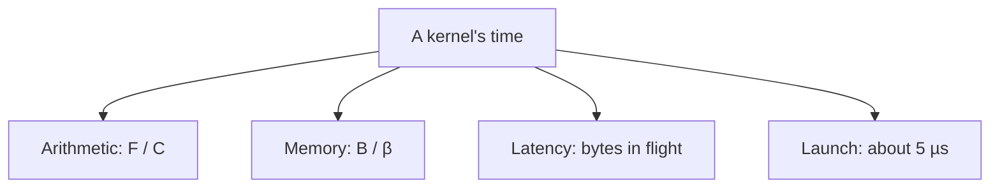
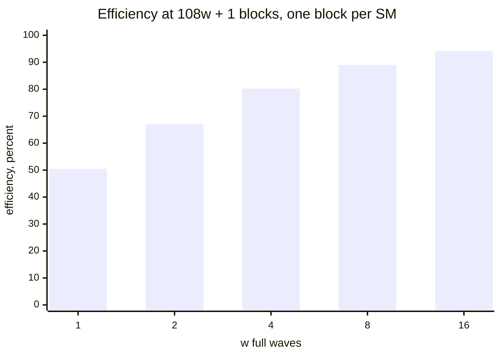
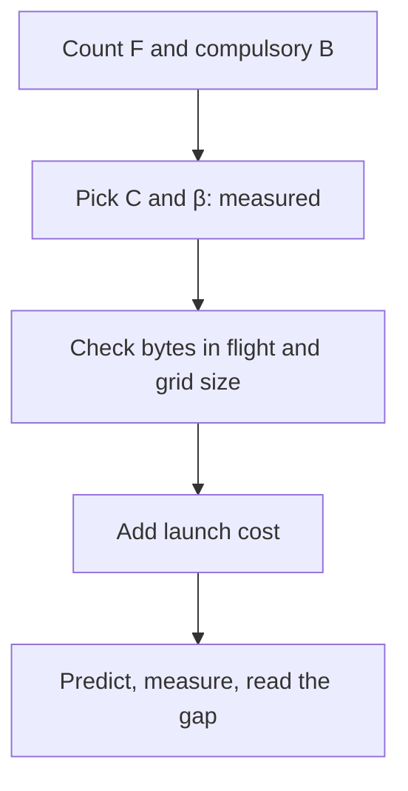

# Introduction

How long should this kernel take, and what stops it from going faster? That is the question the chapter answers for any kernel.

Note:
Open with the question you ask yourself every time a kernel is slower than you hoped. Chapter 0 gave the two rates and the ridge point. Today we turn that into a method, and we add three things the roofline picture leaves out: latency, whole waves, and launch cost. Tell the audience the lab makes them write the predictors and then measure.

### Why predict first {#why-predict}

- A prediction tells you when to stop optimizing
- A kernel far above its prediction has a bug or a wrong assumption
- A kernel far below its prediction has a bug in the measurement
- Most kernels in a model are small, varied, and not matrix multiplications

> [!QUESTION] Isn't the profiler enough?
> The profiler tells you what happened. A prediction tells you what should have happened, so the gap becomes a question you can answer, not a number you stare at.

Note:
The profiler shows a number. The prediction gives it a meaning. If you predicted 440 microseconds and measured 900, you know to look for something specific. If you had no prediction, 900 is just a number. The skill is the prediction, and the arithmetic is shallow.

### Four floors under every kernel {#four-floors}



Note:
These are the four floors. Arithmetic and memory are the roofline. Latency is Little's law, and it decides whether you can actually reach the memory number. Launch is the least time any kernel can take. A fifth effect, whole waves, adjusts the total. We take them in this order.

### The road ahead {#roadmap}

1. Count FLOPs and bytes, then draw the roofline
2. Choose the ceilings you believe
3. Latency and Little's law
4. Waves, the tail, and launch cost
5. One prediction from all of it

Note:
Quick roadmap. The first part is mostly counting. The second is about which numbers to trust. The third and fourth are the new material that most engineers have not seen written down. The last part combines them in a worked example that mirrors the lab.

# Counting and the roofline

The first two floors need two counts: the FLOPs a kernel does and the bytes it must move.

Note:
This section is the foundation. Everything later divides one of these two counts by a rate. Be strict about the bytes: compulsory DRAM traffic, which is each distinct byte read once and each byte written once.

### Intensity is FLOPs per byte {#intensity}

$$
I = \frac{F}{B}
$$

- $F$: FLOPs, with an FMA counted as 2
- $B$: compulsory DRAM bytes, reads plus writes
- The count is a lower bound on traffic

Note:
Define intensity. Count an FMA as two FLOPs, which is the convention behind the 19.5 teraflops fp32 rating. Count bytes the kernel must move, not the bytes it asks for. Warn that if a kernel reads an input twice from DRAM, this count understates its time.

### Count five kernels {#count-five}

| Kernel | FLOP/element | Bytes/element | FLOP/byte |
|---|---|---|---|
| Copy | 0 | 8 | 0 |
| Vector add | 1 | 12 | 0.083 |
| y = a*x + y | 2 | 12 | 0.167 |
| Sum | 1 | 4 | 0.25 |
| k FMAs (lab) | 2k | 8 | k/4 |

Note:
Walk the table row by row. The copy has no arithmetic. The vector add reads two floats and writes one, twelve bytes for one FLOP. The reduction only reads. The last row is the lab kernel: k is a dial that climbs the roofline without changing the memory traffic, which is why we use it.

### The roofline in one formula {#roofline-formula}

$$
t \ge \max\!\left(\frac{F}{C},\; \frac{B}{\beta}\right)
$$

$$
P = \min(C,\; \beta I)
$$

> [!KEY] The kernel can't finish before both its arithmetic and its bytes are done.

Note:
Two rates, each giving a floor on time, and the runtime floor is the larger. Dividing F by that floor gives the attainable throughput P, which is a flat roof at C and a slanted roof at beta times I. Williams, Waterman, and Patterson drew this in 2009. The ridge is where the two roofs meet.

### Slide the intensity {#roofline-figure}

```viz
04-roofline
```

Note:
Let the audience play. Start on fp32 with the measured bandwidth and intensity 16, just right of the ridge. Drag left and watch the throughput fall along the slanted roof. Switch to bf16 and the same kernel is memory bound. The point: which side of the ridge you are on depends on which arithmetic peak you chose.

### One ridge point per precision {#ridge-table}

| Peak | TFLOP/s | vs 1935 | vs 1275 |
|---|---|---|---|
| bf16 tensor | 312 | 161.2 | 244.7 |
| TF32 tensor | 156 | 80.6 | 122.4 |
| fp32 cores | 19.5 | 10.1 | 15.3 |

> [!QUESTION] Why is the fp32 ridge so much lower?
> The CUDA cores do 19.5 TFLOP/s against 312 for tensor cores, 16 times less, with the same memory. Less arithmetic per second needs less arithmetic per byte to keep up.

Note:
Divide each dense peak by each bandwidth. The tensor cores push the ridge right by sixteen times relative to fp32. So a kernel can become memory bound just by moving to tensor cores, without touching its memory access. Always say which peak you divided by.

### Vector add against the floors {#vector-add}

- $2^{24}$ floats: 16.8 MFLOP, 201.3 MB moved
- Arithmetic floor: 0.86 µs
- Memory at 1275 GB/s: 157.9 µs
- Memory at 1935 GB/s: 104.0 µs
- Measured in learn-inference: 154.4 µs

Note:
Do the arithmetic aloud. Arithmetic is under a microsecond, memory is about 158. The companion course measured 1304 gigabytes per second for its hand-written vector add, which is 154 microseconds, slightly under our floor because the copy ceiling is a target rather than a hard limit. The rated 104 microseconds is the hard floor. A kernel at 154 is done.

### A GEMM is the other extreme {#gemm-floors}

$$
I = \frac{2n^{3}}{3n^{2}b} = \frac{2n}{3b}
$$

- $4096^3$ in bf16: 137.4 GFLOP, 100.7 MB, intensity 1365
- Arithmetic floor: 0.441 ms. Memory floor: 0.079 ms

> [!QUESTION] Is every GEMM compute bound?
> No. The 8192 x 128 x 8192 GEMM has intensity 124.1, under the bf16 ridge of 161, so it's memory bound.

Note:
Reuse is what makes a matrix multiplication different. Each element is used many times, so intensity grows with n. But a thin GEMM, as in small-batch decode, has little reuse. NVIDIA's guide works the same 124.1 and 2,730 numbers. The 17-gigaflop thin GEMM is memory bound even though 17 gigaflops sounds large.

# Which ceiling to believe

A roofline is only as good as its two numbers. Neither is safe to use as printed.

Note:
This section is about calibration. The most common roofline mistake is dividing by the datasheet. Set up two lines: the rated one as a hard floor and the measured one as the target.

### Rated and measured bandwidth {#rated-measured}

- Rated HBM2e: 1935 GB/s
- Measured plain copy: 1275 GB/s, 66% of the rating
- No source we use explains the gap
- Rated roofline: a floor no kernel may beat
- Measured roofline: the target

Note:
State the numbers and be honest about the unknown. A copy on this card reaches 66 percent of the rating, measured in the companion course. The datasheet claims 95 percent DRAM efficiency and nothing explains the difference, so do not claim a cause. The use is what matters: a time under the rated floor means your count or your timer is wrong.

### Rated arithmetic is optimistic too {#rated-arith}

- 312 TFLOP/s assumes the 1410 MHz boost clock
- The PCIe card has a 300 W limit against 400 W on SXM
- NVIDIA doesn't quantify the sustained clock under load
- `mma.sync` alone reached 310.6 TFLOP/s on an A100 PCIe 40GB

> [!WARNING] A whole kernel does more than the instruction does, so plan for less than the rating.

Note:
Same story for arithmetic. The rating is a product of the SM count, the per-clock rate, and the boost clock. Luo and colleagues measured the instruction itself at 310 teraflops on the 40 gigabyte PCIe card. That is the instruction in isolation. A real kernel has loads, address arithmetic, and synchronization, so expect less.

### A roof for every memory level {#hierarchy}


Note:
The hierarchical roofline draws one bandwidth roof per level and counts the bytes crossing each. Shared memory is 128 bytes per clock per SM, 19.5 terabytes per second across the chip. The L2 is about 2.8 measured by Luo on a 40 gigabyte PCIe card, and 7.2 theoretical, and a third source measured 4.5 on an SXM part, so cite the method when you quote it.

### When the DRAM roofline misleads {#misleads}

- Count DRAM bytes, not requested bytes
- A working set under 40 MiB lives in the L2
- Fused RMSNorm on 41.9 MB ran at 0.92 to 0.95 times the unfused speed
- The byte count predicted 1.25 times faster

> [!QUESTION] Why did fusion lose?
> It's consistent with the unfused intermediate staying in the L2 below about 40 MiB, so the extra DRAM traffic the count charged mostly never happened.

Note:
This is a measured case from the companion course on this same card. The byte count says fusion removes a round trip through DRAM and should win by 1.25 times. Below the L2 size it did not. The hierarchical roofline is the tool that would have predicted it, and Nsight Compute draws it, which chapter 5 uses.

# Latency and Little's law

Why does a kernel with plenty to move still miss the bandwidth ceiling? It keeps too few bytes in flight.

Note:
Now the first of the two new ideas. The roofline says what bandwidth the chip can deliver. It does not say what bandwidth your launch will get. That depends on how many requests you keep outstanding.

### Memory takes 330 nanoseconds {#latency}

| Level | Cycles | ns at 1410 MHz |
|---|---|---|
| Shared memory | 29.0 | 20.6 |
| L1 | 37.9 | 26.9 |
| L2 | 261.5 | 185.5 |
| HBM | 466.3 | 330.7 |

Note:
Measured by Luo and colleagues on an A100 PCIe 40 gigabyte card. We have no 80 gigabyte measurement, so treat these as the right order of magnitude for the lab card. The HBM figure, 466 cycles, is what we use for Little's law. Convert with the 1.41 gigahertz clock: 330.7 nanoseconds.

### Little's law {#littles-law}

$$
\boxed{L = \lambda W}
$$


Bytes in flight = bandwidth × latency.

Note:
The average number of items in a system is the arrival rate times the time each one stays. For memory: bytes in flight equals bandwidth times latency. The law needs no assumption about the distribution of latencies, which is why it applies to a memory system you can't see inside. It needs a steady state, so very short kernels never reach it.

### How many bytes on the A100 {#bytes-in-flight}

- Rated: $1935 \times 330.7\ \text{ns} = 639.9$ KB
- That is 5.9 KB on each of 108 SMs
- Measured ceiling: 421.7 KB, or 3.9 KB per SM
- These are lower bounds: loaded latency is higher

> [!QUESTION] Why only a lower bound?
> The 330.7 ns is measured on idle memory. Under load the queues fill and latency rises, so a real kernel needs more than the formula says.

Note:
Do the multiplication on the board. 1935 gigabytes per second times 330.7 nanoseconds is 640 kilobytes. Divide by 108 for 5.9 kilobytes per SM. The lab measures where a read kernel really saturates, and you should expect it above the formula. NVIDIA doesn't publish the queue limits inside the memory system, so the formula is a requirement and not a promise.

### From bytes to threads and loads {#threads-loads}

| Threads per SM | Bytes per thread | As loads |
|---|---|---|
| 2048 | 2.9 | one float |
| 1024 | 5.8 | two floats |
| 512 | 11.6 | three floats or one float4 |
| 256 | 23.1 | two float4 |

Note:
Divide the 5,925 bytes per SM by the resident threads. At full occupancy each thread needs one 4-byte load outstanding. At a quarter occupancy it needs three independent loads or one 16-byte load. This is Volkov's 2010 point in numbers: occupancy is a means to bytes in flight, not a goal.

### TLP or ILP {#tlp-ilp}

- TLP: more resident warps, the scheduler switches when one waits
- ILP: more independent loads per thread
- Pointer chasing: ILP gives nothing, only TLP helps
- Streaming: a float4 load is cheap ILP

> [!QUESTION] Which should I raise first?
> Usually ILP. Registers holding in-flight data buy the same bytes as registers for extra warps, and a vector load or an unrolled loop costs little.

Note:
Both supply bytes in flight, at different costs. TLP needs few registers per block so many fit. ILP needs independent addresses and registers to hold values. A dependent chain defeats ILP. In Triton you pick neither directly: a program with a block of 4096 and 4 warps holds 32 elements per thread, which is ILP by construction.

### ILP in the lab's kernel {#ilp-code}

```cuda
float v[ILP];
#pragma unroll
for (int j = 0; j < ILP; ++j)
  v[j] = i_j < n ? x[i_j] : 0.f;   // independent loads
#pragma unroll
for (int j = 0; j < ILP; ++j) acc += v[j];
```

Note:
This is the core of the read kernel. All ILP loads are issued before any is used, so one thread has ILP requests outstanding. The lab sweeps blocks per SM and ILP so that bytes in flight per SM go from 512 bytes to 64 kilobytes and reports where bandwidth stops rising. Mention that the full code has the grid-stride loop and tail guard.

# Waves and launch cost

A GPU runs a grid in whole rounds of blocks. This section covers two costs of that granularity: the tail and the launch.

Note:
The second new idea. Everything so far treated the GPU as a smooth machine. It isn't. Blocks are discrete, and the 108 SMs take them in rounds. Then we deal with the floor under all of this, the launch.

### A wave is one full set of blocks {#wave-def}

$$
\eta = \frac{G}{\lceil G/108r \rceil \cdot 108r}
$$

- $G$ blocks, $r$ resident blocks per SM
- Time is waves times one block's time
- 109 blocks at $r=1$: 2 waves, 50.5%

Note:
Define a wave: one full set of resident blocks, 108 times r. A grid of equal blocks takes as many block-times as it has waves. At r equal to 1, 108 blocks is one wave at 100 percent. One more block needs a second wave, and efficiency drops to 109 over 216, half. The r comes from chapter 2: threads, registers, shared memory.

### The tail shrinks as the grid grows {#tail-chart}



Note:
These are the worst grids: one block past a whole number of waves. The loss is one block-time out of w plus one, so it fades as w grows. Elementwise kernels with hundreds of thousands of blocks never notice: 262,144 blocks with 864 resident gives 304 waves at 99.8 percent. Matrix multiplies, with big tiles and small grids, feel it.

### Drag the grid size {#waves-figure}

```viz
04-waves
```

Note:
Let the audience play. Start at 109 blocks with one resident block per SM, where one SM works in the last wave. Move to 216 and the efficiency is 100 percent. Move to 217 and it falls again. Then change to 2 or 4 resident blocks per SM and see the teeth move.

### The GEMM tile example {#gemm-tiles}

- $M = 2304$, $K = 4096$, 256 x 128 tiles
- $N = 1536$: $9 \times 12 = 108$ tiles, one wave
- $N = 1544$: $9 \times 13 = 117$ tiles, two waves
- Efficiency falls to $117/216 = 54.2\%$

> [!QUESTION] Eight more columns cost half the speed?
> Yes. NVIDIA's guide reports throughput roughly halving between these sizes, because 9 tiles run alone in a second wave.

Note:
NVIDIA's guide uses exactly this on the A100's 108 SMs. The 9 extra tiles use 8.3 percent of the machine in the second wave. This is why GEMM dimensions that are multiples of the tile and of 108 tiles matter. There is a second quantization from partial tiles: 130 rows with 128-row tiles computes 256 rows, and 50.8 percent is useful.

### Four ways to fix a tail {#tail-fixes}

- Smaller tiles: more waves, less reuse per tile
- Persistent kernel: one block per SM looping over tiles
- Split-K: divide the reduction among several blocks
- Stream-K: split total work evenly across SMs (Osama et al., 2023)

Note:
Brief on purpose. Chapters 10 to 14 build the tiled kernels these choices apply to. The trade in each case is more parallel work units against extra overhead or reuse. Stream-K is the most general: it ignores tile boundaries and gives every SM an equal share of the multiply-accumulate iterations.

### Small grids also break Little's law {#small-grids}

- 32 blocks keep at most 32 SMs busy
- 639.9 KB must be in flight across the GPU
- Each active SM now holds 20.0 KB, 3.4 times more

> [!WARNING] Small-batch decode kernels meet this: they can neither fill the SMs nor hold enough bytes in flight.

Note:
Link the two ideas. Bytes in flight is a whole-GPU requirement. If only 32 SMs are active, each must hold 3.4 times as much as when all 108 are. A kernel launched with too few blocks is slow for two reasons at once, and the companion course met this at batch size 1.

### Launch cost is a floor {#launch}

$$
B_{\text{launch}} = \beta\, t_{\text{launch}} = 1275 \times 10^{9} \times 5\ \mu\text{s} = 6.4\ \text{MB}
$$

- About 5 µs to queue a kernel on the lab A100
- Below roughly 6.4 MB of traffic, launch dominates
- Ten tiny kernels cost at least 50 µs of host time

Note:
Cite learn-inference chapter 12 for the 5 microseconds, with its 5 to 10 rule of thumb, which doubles the crossover to 12.8 megabytes. The one-line calculation is the bytes the memory system moves in one launch time. A sequence of kernels under that size is limited by the host's queueing speed. Fusion and CUDA graphs, chapter 17, are the cure. NVIDIA's CUDA graphs article shows the shape on a V100: a 2.9 microsecond kernel took 9.6 microseconds per launch with a sync each time and 3.4 inside a graph of 20. Those are V100 numbers, so only the ratios transfer.

# One prediction from four floors

Combine the floors, predict, then measure and read the gap.

Note:
Pull it together. The recipe is short. The value is in doing it before you run the kernel and writing the number down.

### The recipe {#recipe}



Note:
Five steps. Count, choose ceilings, check Little's law and the grid, add the launch, then compare. At each step you can name the assumption. If the measurement is far above the prediction, you walk back through the steps and ask which one failed.

### The lab kernel, predicted {#lab-prediction}

| k | FLOP/byte | Floor | Predicted |
|---|---|---|---|
| 1 | 0.25 | 421.1 µs memory | 421.1 µs |
| 16 | 4.0 | 421.1 µs memory | 421.1 µs |
| 64 | 16.0 | 440.5 µs compute | 440.5 µs |
| 512 | 128.0 | 3524.1 µs compute | 3524.1 µs |

> [!QUESTION] What if my time falls below the rated roofline?
> Your count or your timer is wrong, because no kernel beats the rated peaks.

Note:
All on 2 to the 26 elements, 536.9 megabytes moved, fp32 at 19.5 teraflops, and memory at 1275. The ridge falls at k of 61.2. These are predictions from specs, not measurements. Your lab prints the measured column and reports the measured ridge as the highest FLOP rate over the highest byte rate. Near the ridge, expect real kernels to fall below both floors.

### What goes wrong {#goes-wrong}

- Counting only reads or only writes
- Benchmarking data that fits in the L2
- A flat time as k grows: the compiler removed the FMAs
- Dividing an fp32 kernel by the tensor-core peak
- Wrong resident blocks per SM in the wave count

Note:
These are the failures the lab provokes. The flat time at large k is the most instructive: it means the loop did not reach a store, and the compiler deleted the work. Use the SASS reading from chapter 5 to confirm. For the waves, the lab forces one block per SM with a 100 kibibyte shared allocation so you can count waves exactly.

# Summary

Four floors, one prediction, and the numbers to keep.

Note:
Close by restating the method. The A100 numbers on the next slide are the ones you reuse in every later chapter.

### What to remember {#summary}

- Four floors: arithmetic, memory, latency, launch
- Ridge points against 1275 GB/s: 15.3 fp32, 244.7 bf16
- Bytes in flight: 3.9 KB per SM at the copy ceiling
- Waves: 109 blocks on 108 SMs run at 50.5%
- Under about 6.4 MB of traffic, launch dominates
- Next: profile slow kernels and read their machine code (chapter 5)

Note:
Read these five lines and stop. They are the numbers to carry out of the room. The first is the method, the rest are the A100 figures you will reuse in every later chapter.
