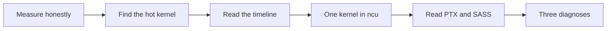
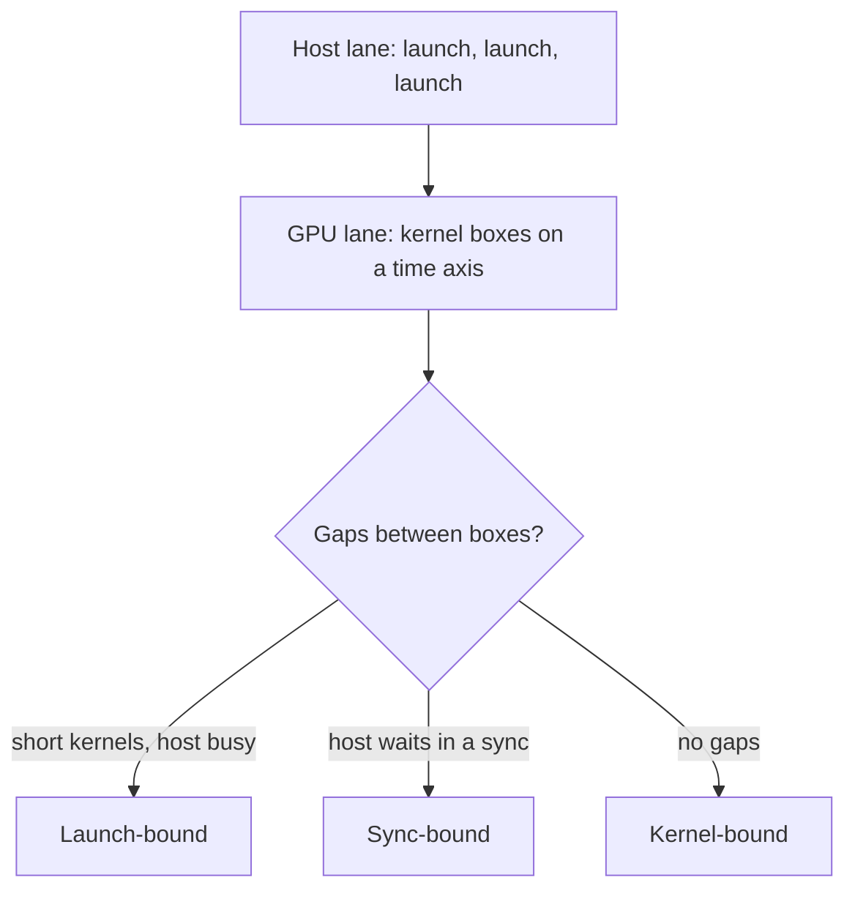
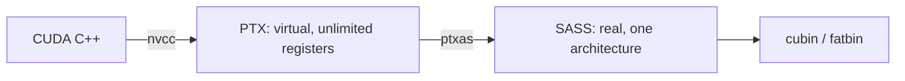

# Introduction

The question this chapter answers: why is this GPU program slower than the roofline says it should be, and how do you find out cheaply?

Note:
Open with the gap between prediction and measurement. A kernel at a third of its roofline is not a mystery, it is a saturated or an idle resource. The tools in this deck tell you which. We go coarse to fine, because starting at the finest tool is the most expensive way to be wrong.

### Why this matters for a model {#why-profile}

- A training step is hundreds of kernels, not one
- A 2x win on a kernel that is 5% of the step buys 2.6%
- The slowest part is often not a kernel at all

Note:
Ask who has opened a PyTorch trace and seen thousands of tiny boxes. That is the world we work in. The arithmetic on the second bullet is Amdahl's law: speeding up 5 percent of the step by 2x saves 2.5 percent of the time, which is a 2.6 percent speedup. So the first job is deciding where to look, and the second is the tool.

### The route through this deck {#roadmap}



Note:
Six stops. The first four are the funnel, from a stopwatch to a counter-level report. Then we read the machine code, and finally apply everything to the three slow pieces of code in the lab. Keep this slide up for a moment.

# The funnel

Note:
Section one is the measuring habit. We set up the four questions, then make a timer we can trust. Everything later compares against the number we get here.

## Measure first

### Four questions, four tools {#four-questions}

| Step | Question | Tool |
|---|---|---|
| 1 | How long, end to end? | Timer or CUDA events |
| 2 | Which kernel dominates? | `torch.profiler` |
| 3 | Is the GPU busy? | Chrome trace, Nsight Systems |
| 4 | Why is this kernel slow? | Nsight Compute |

> [!KEY] Rule out the cheap explanations first
> Each step is cheaper than the next and rules out a whole class of problems.

Note:
Walk down the table. Step 1 gives the number to beat. Step 2 gives a name. Step 3 asks whether the name matters, because a perfect kernel in an idle GPU is still a slow program. Step 4 is for the one kernel that survives. The point of the funnel is cost: a host sync found at step 3 explains a slowdown that step 4 would never find.

### A timer that tells the truth {#honest-timer}

```python
start = torch.cuda.Event(enable_timing=True)
end = torch.cuda.Event(enable_timing=True)
start.record()
fn()
end.record()
torch.cuda.synchronize()
ms = start.elapsed_time(end)
```

Note:
This is cuda_time in lab_common. The events are timestamps taken by the GPU on the stream, so the interval is GPU time including any gaps where it waited for the host. The synchronize is needed only so we can read the result. Remind the audience of chapter 0: a host timer without a sync times the launch, about 5 microseconds.

### Four habits that remove four lies {#hygiene}

- **Warm up:** the first call pays for compilation and context setup
- **Median:** a mean follows the outliers
- **Sync or events:** a launch returns before the kernel runs
- **Flush the L2:** 40 MiB of cache will hide your HBM

> [!QUESTION] How big a flush is enough?
> Write twice the L2 into a scratch buffer: 2 × 40 MiB = 80 MiB. `cuda_time(fn, flush_l2=True)` does it. A working set well above 40 MiB needs no flush.

Note:
Each habit maps to a specific wrong number. Skipping the warm-up inflates the first run. A mean lets one slow outlier drag the result. No sync times the queue. And an unflushed L2 times the cache: a 12 MiB copy can report more than the 1935 GB/s HBM rating. Mention clocks as the fifth, uncontrollable factor, so run twice and treat under 5 percent as noise.


# The hot kernel

Note:
Section two uses torch.profiler to put a name on the slow part. It is the cheapest tool that sees kernels, and it produces the Chrome trace we read in the next section.

## torch.profiler

### Turn it on {#profiler-on}

```python
with profile(activities=[ProfilerActivity.CPU,
                         ProfilerActivity.CUDA]) as prof:
    out = model(x)
    torch.cuda.synchronize()

print(prof.key_averages().table(
    sort_by="self_device_time_total", row_limit=10))
prof.export_chrome_trace("trace.json")
```

Note:
Three details. ProfilerActivity.CUDA is what records kernels, and the old use_cuda flag is gone in PyTorch 2.14. Synchronize inside the with block or the last kernels are missing. And the sort column is self device time, which was named self cuda time before PyTorch added other backends. Warm up before the window opens so compilation stays out.

### Reading the table {#reading-table}

- **Self device time** is the GPU time of that row's own kernels
- CPU operators have zero self device time
- The top row by self device time is the hot kernel
- Kernel names carry hints: `elementwise`, `gemm`, your own name

> [!QUESTION] Why sort by self and not total?
> A CPU operator's total includes every kernel it launched, so wrappers rank above the kernel that did the work. Self time points at the kernel.

Note:
Self versus total is the one confusing part. aten colon colon add has a CUDA total that includes its kernel, but only the kernel row has self device time. The kernel name is a free clue: vectorized in the name means wide loads of several elements per thread, gemm or cutlass is a matmul. If the top kernel is not the one you expected, you already learned something.

### The Chrome trace is the picture {#chrome-trace}



Note:
Open the JSON in chrome tracing or Perfetto. The host thread is on top and each stream is below. The three outcomes on the right are the three shapes you will see. We spend the next section on the first two, because a kernel-bound program is the only one where step 4 is the right next move.

# The timeline

Note:
Section three asks whether the GPU is busy at all. A perfect kernel in an idle GPU is still a slow program, and these gaps are the most common reason.

### Launches cost about 5 microseconds {#launch-cost}

$$
\frac{3 \times 64\ \text{MiB}}{1304\ \text{GB/s}} = 154\ \mu\text{s} \approx 30 \times 5\ \mu\text{s}
$$

- A big kernel hides the launch
- A 2 µs kernel leaves the GPU idle at least 60% of the time

Note:
The 154 microseconds is the elementwise kernel over 2 to the 24 floats from the companion course: 192 MiB at the measured 1304 GB/s. It is about thirty launches long, so launch cost is invisible. A 2 microsecond kernel queued at 5 microseconds per launch has the GPU busy at most 40 percent of the time, no matter how well it is written.

### Gaps between kernels {#launch-gaps}

```viz
05-launch-gaps
```

Note:
Start on the default: a 2.9 microsecond kernel with a sync after every launch. The GPU is busy 30 percent of the time. Flip to overlapped, then to a graph. Then slide the kernel time up and watch the gaps shrink in proportion. These are NVIDIA's V100 constants, so we read the shape, not the microseconds.


### Launch-bound or sync-bound? {#launch-or-sync}

- **Launch-bound:** host lane solid, GPU lane has gaps. Fuse, batch, or use a CUDA graph
- **Sync-bound:** host lane waits, GPU lane is empty right after. Remove the read-back

> [!WARNING] A sync hides in innocent code
> `.item()`, `.tolist()`, `bool(t)`, boolean-mask indexing, and printing a tensor all block the host.

Note:
The two look alike in a summary and different in the trace. Launch-bound means the host cannot queue fast enough. Sync-bound means the host stopped on purpose. In PyTorch, set sync debug mode to error and the framework raises on the first hidden sync, which is exactly what the lab's tests do to your clip function. When the Chrome trace is not enough, for a multi-process job or a question about which CPU thread blocks, Nsight Systems shows the CPU threads and API calls on the same axis. It answers step 3, never step 4.


# One kernel under Nsight Compute

Note:
Section four zooms in on one kernel. We teach Nsight Compute from described reports, because the lab container usually cannot read hardware counters.

### What ncu does, and what it needs {#ncu-needs}

- Replays one kernel many times, reading hardware counters
- Flushes caches and locks clocks by default, so durations differ from your benchmark
- Needs counter permission, which a managed container usually denies

```bash
ncu --set full -k regex:slow_scale -s 3 -c 1 -o report python lab.py
```

Note:
Be upfront: the lab does not run ncu, because a cloud container typically fails with a counter-permission error. The lab uses torch.profiler and events. We teach ncu from described reports, and you run it on a machine you control. Two surprises: it replays the kernel, and it locks clocks and flushes caches, so use ncu for ratios and causes, and your own timings for how long.

### Speed of Light: which ceiling? {#speed-of-light}

| Kernel type | Memory throughput | Compute throughput |
|---|---|---|
| Memory-bound | near its peak | low |
| Compute-bound | low | near its peak |
| Latency-bound | well below peak | well below peak |

> [!QUESTION] What does a latency-bound kernel need?
> More parallelism: more loads in flight per thread, fewer registers, or a grid that fills 108 SMs.

Note:
This is the first section to read in any report, and the three rows are the three diagnoses. Memory-bound is at the ceiling, so the only fix is fewer bytes. Compute-bound is the mirror image. Latency-bound means neither resource is saturated, and chapter 4's Little's law tells us how much memory must be in flight: about 640 KB across the GPU, 5.9 KB per SM.

### Memory workload: sectors per request {#sectors-per-request}

$$
\frac{\text{sectors}}{\text{request}}: \quad 4\ \text{(coalesced float load)} \quad \text{vs} \quad 32\ \text{(scattered)}
$$

- `l1tex__t_sectors_pipe_lsu_mem_global_op_ld.sum`
- `l1tex__t_requests_pipe_lsu_mem_global_op_ld.sum`

Note:
Divide the first counter by the second. A warp loading 32 contiguous floats is 128 bytes, four 32-byte sectors, so the ratio is 4. A warp with every thread in its own sector is 32. The report also prints a rule in plain words naming the uncoalesced access. Counter names change between versions, so run ncu query-metrics on your install.

### Warp state: why is the warp waiting? {#warp-state}

| Stall | Waiting for |
|---|---|
| Long Scoreboard | A global or local memory load |
| Short Scoreboard | Shared memory or another short unit |
| Barrier | Other warps at `__syncthreads()` |
| Math Pipe Throttle | A full arithmetic pipeline |

Note:
Read this as a diagnosis. Memory-bound kernels are dominated by long scoreboard. Lots of Barrier means uneven work between warps or too many syncs. Math pipe throttle means compute-bound. And a lot of Not Selected is healthy: the scheduler has more ready warps than it can issue. Pair this slide with the Speed of Light slide.

### Occupancy and the source view {#occupancy-source}

- **Theoretical occupancy:** limited by block size, registers, shared memory
- **Achieved occupancy:** averaged over the run
- At 255 registers, a 256-thread block gives 12.5%
- With `-lineinfo`, per-line counters sit beside SASS

> [!QUESTION] Is low occupancy always a problem?
> No. It matters only when the resident warps can't hide latency. Read it beside the stall reasons.

Note:
The 12.5 percent comes from chapter 2: 255 registers is charged as 256, so one 256-thread block of 8 warps fits against 64 possible. The source view needs lineinfo, which adds line information without disabling optimization. It also reports active lanes per instruction: near 32 when all lanes participate, near 16 for our divergent kernel.

# Reading the machine code

Note:
Section five goes below the profiler to what the compiler built. A small vocabulary of SASS instructions answers most of the questions a report raises.

### PTX, SASS, and what makes each {#ptx-sass}



Note:
Two stages. PTX is stable across GPU generations and has unlimited virtual registers. ptxas turns it into SASS for one architecture, with a real register file and real scheduling. A fatbin can carry SASS for several architectures plus PTX for the driver to compile later. Ask what the hardware did, read SASS. Ask what the compiler understood, read PTX.

### Getting them out {#getting-them-out}

```bash
nvcc -arch=sm_80 -ptx   k.cu -o k.ptx
nvcc -arch=sm_80 -cubin k.cu -o k.cubin
cuobjdump -sass k.cubin
nvcc -arch=sm_80 --ptxas-options=-v -c k.cu
```

> [!TIP] Registers and spills come from `ptxas -v`
> PTX registers are virtual. In `load_cuda`, pass `extra_cuda_cflags=("-Xptxas", "-v")` and `verbose=True`.

Note:
Four commands. The last one is the one to run first on any kernel you are worried about: it prints registers used and spill stores and loads in bytes. Do not read a register count off PTX. Compiler Explorer shows PTX and SASS beside your source with no GPU, which is the quickest way to see what a one-line change does.

### The instructions worth knowing {#instruction-table}

| SASS | Means |
|---|---|
| `LDG.E`, `LDG.E.128` | 4-byte or 16-byte global load per thread |
| `FFMA` | Fused multiply-add, 2 FLOP |
| `HMMA` | Tensor-core multiply-accumulate |
| `BAR.SYNC` | `__syncthreads()` |
| `LDL`, `STL` | Local memory: spills |
| `@P0 op` | Predicated: lanes where P0 is true |

Note:
Six families answer most questions. Count the loads and check their width. Count FFMA against loads for the intensity the machine sees. Look for HMMA in a matmul. Each BAR is a place where warps wait for the slowest. LDL and STL in a hot loop are spilled registers. A predicated instruction costs its issue slot with no branch. All fragments in the chapter are hand-written in this style, not output from a specific compile.

### Vectorized loads, spotted {#vector-load}

```text
LDG.E.128 R4, [R2.64] ;
FFMA R4, R4, 2, 1 ;
FFMA R5, R5, 2, 1 ;
FFMA R6, R6, 2, 1 ;
FFMA R7, R7, 2, 1 ;
STG.E.128 [R2.64], R4 ;
```

> [!QUESTION] I wrote `float4` but the SASS shows `LDG.E`. Why?
> The compiler couldn't prove 16-byte alignment, or the cast lost the type. A warp then asks for 128 bytes per instruction, not 512.

Note:
This is the signature of a vectorized load: one instruction fetches 16 bytes per thread, and four FFMAs consume it. Seeing LDG.E.128 in a memory-bound inner loop is the evidence that vectorization took. The lab's max load bits function is exactly this check, on text you pass it.

### Spills and registers {#spills}

- A thread gets at most 255 registers
- Overflow goes to local memory: device memory, cached in L1 and L2
- `__launch_bounds__` and `-maxrregcount` cap registers, and can create spills

> [!WARNING] A spill you accept for occupancy is a trade
> Re-run `ptxas -v`, then re-measure. Only the profile says whether it won.

Note:
Local memory is per-thread storage that lives in the same device memory as global data. A spill costs the latency of an L1 or L2 hit and competes for the memory pipeline. But a smaller register budget raises occupancy, so sometimes you want the spill. The honest process is change, ptxas dash v, measure.

# Three diagnoses

Note:
Section six applies the funnel to the three slow pieces of code in the lab: uncoalesced access, host synchronization, and divergence. Each fails at a different step.

## Uncoalesced access

### The slow mapping {#slow-mapping}

```cuda
int row = tid % rows;
int col = tid / rows;
int i = row * cols + col;
```

$$
\frac{32 \times 32\ \text{B}}{128\ \text{B}} = 8\times\ \text{read amplification}
$$

Note:
Thread tid and tid plus one differ in row, so their addresses differ by cols floats, 4096 bytes when cols is 1024. Every thread of the warp lands in its own 32-byte sector: 1024 bytes fetched for 128 needed. The writes are scattered the same way.

### Predicted versus measured {#predicted-scale}

$$
t_{\text{floor}} = \frac{2 \times 2^{24} \times 4\ \text{B}}{1.275 \times 10^{12}\ \text{B/s}} \approx 105\ \mu\text{s}
$$

- Bytes alone predict 4.5x more traffic
- The companion course measured 6.9x for a 32-float stride
- Your lab reports the real ratio

> [!QUESTION] Why 6.9x and not 4.5x?
> 4.5x is bytes; the other 1.53x is the extra cost of 32 separate requests per warp. The bytes are a floor on the loss.

Note:
The prediction for the fixed kernel is the copy floor, about 105 microseconds for 134 megabytes at 1275 GB/s. If 6.9 carried over, the slow kernel would be about 726 microseconds, but this lab's stride is different, so treat that as a ballpark and read your own metric. The test asks for 2x and half the copy ceiling.

## Host synchronization

### The trace shows gaps {#sync-gaps}

```python
for t in tensors:
    m = t.abs().max().item()      # blocks the host
    out.append(t * (thresh / m) if m > thresh else t.clone())
```

- 256 tensors × 3 launches × 5 µs = 3.84 ms of launches alone

Note:
Each item call copies one number to the host and waits for everything queued. In the trace you see a host wait, then an empty GPU lane while Python decides and queues the next group. The 3.84 milliseconds is just host launch time, before any waiting. Ask the audience how they would remove the read-back.

### Decide on the GPU {#decide-on-gpu}

```python
scale = (thresh / m).clamp(max=1.0)   # m stays on the GPU
out = t * scale
```

> [!QUESTION] What about a tensor whose maximum is zero?
> Dividing by zero gives infinity, and the clamp turns it into 1. No special case needed.

> [!QUESTION] Is a per-tensor loop enough?
> It removes the waits, but still launches several kernels per tensor. Stacking equal-size tensors does the job in a handful of launches.

Note:
The fix has two levels. Removing item keeps the work asynchronous, which the V100 numbers say is worth 2.5 times at least. Batching removes most of the launches too. The test runs your function under sync debug mode set to error, so a hidden sync fails loudly instead of quietly costing time. A tensor built from a Python float on the GPU counts as a sync, which surprises people.

## Divergence

### Same warp, two paths {#same-warp}

```viz
05-warp-divergence
```

Note:
Start on alternating lanes: two passes, half the lanes masked in each. Then try lanes 0 to 15 against 16 to 31: still two passes, because the 32 lanes are one unit. Only warp-uniform makes one pass. The lesson is that divergence is per warp, not per half warp, and the cost is the sum of every path any lane takes.

### The arithmetic of the loss {#divergence-arithmetic}

$$
t_{\text{compute}} = \frac{2^{22} \times 256 \times 2}{19.5 \times 10^{12}} \approx 110\ \mu\text{s}
$$

- Memory floor: 26 µs, so the kernel is compute-bound 4x over
- Divergent prediction: about 220 µs, fixed: about 110 µs

> [!QUESTION] Why not delete the branch?
> The two paths compute different things. The fix is to make the branch warp-uniform: each thread does an even element and the odd one beside it.

Note:
The useful work is 2.1 gigaFLOP against a 19.5 teraFLOP/s peak, about 110 microseconds. The divergent kernel issues the same instructions with half the lanes useful, so the roofline predicts twice that. The lab asks for 1.3x, well under the predicted 2x, and reports your real ratio. In ncu the evidence is lanes active per instruction rising from about 16 to about 32.

### Not every branch is a problem {#benign-branches}

- `if (i < n)` diverges only in the last warp
- A branch on `blockIdx` never diverges
- A one-instruction `if` is predicated, not serialized

> [!QUESTION] How do I know a branch costs anything?
> Count active lanes per instruction, or look for a real `BRA` with long bodies on both sides in the SASS.

Note:
Give the audience permission to leave branches alone. The tail guard is two instructions in nearly every kernel. Divergence is expensive only when the paths are long. Check the evidence first: active lanes per instruction in ncu, or the SASS, before restructuring anything.

# Summary

The funnel, the hygiene, the three causes, and the decision table.

Note:
Close Part 1 here. You can predict a kernel's time, measure it honestly, and diagnose a gap. Part 2 builds the patterns, starting with reductions, where the profile tells you how to make the first slow version fast.

### What to remember {#summary}

- Funnel: end to end, hot kernel, timeline, one kernel
- Time with events or a sync, warmed up, as a median, L2 flushed when data fits
- Slow means too many bytes, an idle GPU, or masked lanes
- PTX is virtual, SASS is real, `ptxas -v` gives registers and spills

Note:
Four takeaways. The funnel is the habit, because each step rules out a class of causes before you pay for the next. The hygiene list is what makes a number trustworthy. The three causes map to three pieces of evidence: sectors per request, gaps in the trace, active lanes. And the compiler output is ground truth when a summary is not enough.

### Decision guide {#decision-guide}

| Evidence | Cause | Fix |
|---|---|---|
| About 32 sectors per request | Uncoalesced access | Remap threads |
| Host wait, then idle GPU | Sync | Remove read-backs; batch |
| Short kernels, solid host lane | Launch-bound | Fuse; CUDA graph |
| About 16 active lanes | Divergence | Make the branch warp-uniform |
| Spills, low occupancy | Register pressure | Cut state; `__launch_bounds__` |

Note:
This is the table to photograph. Each row is a symptom you can observe, the cause it implies, and the first fix to try. In the lab you meet the first, second, and fourth rows. The third comes back in chapter 17, and the last in chapter 10 when we tile a GEMM.

### Next: patterns that use the machine well {#next-chapter}

- Part 2 starts with reductions
- Every lab now reports a speedup you can profile
- Chapter 6 asks you to reach the copy ceiling with a tree of warps

Note:
We close Part 1. You can now predict a kernel's time, measure it honestly, and diagnose a gap. Part 2 builds the patterns, beginning with reductions, where the first version of the kernel is slow and the profile tells you how to make it fast. Take the decision table with you.
