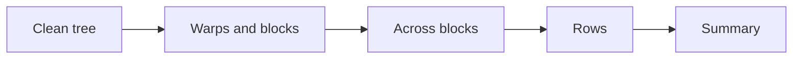
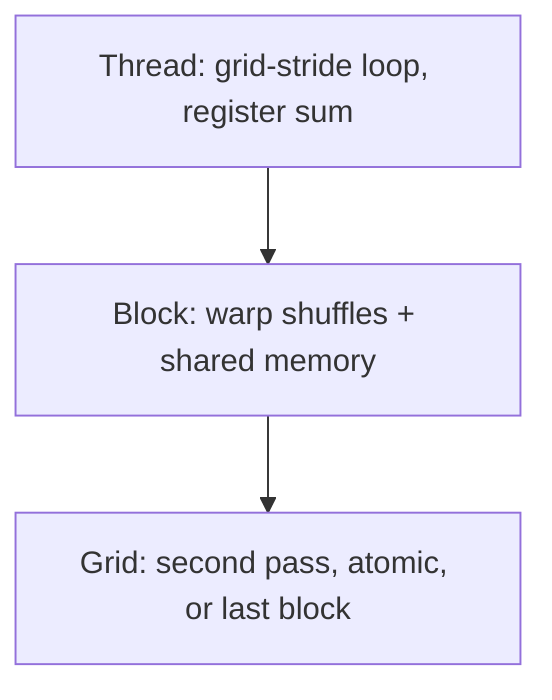
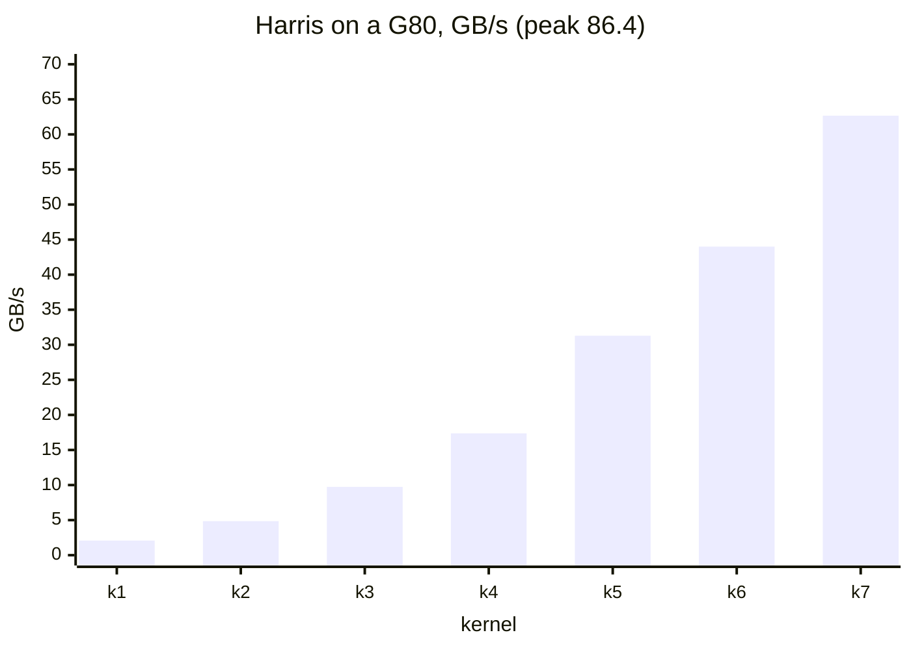
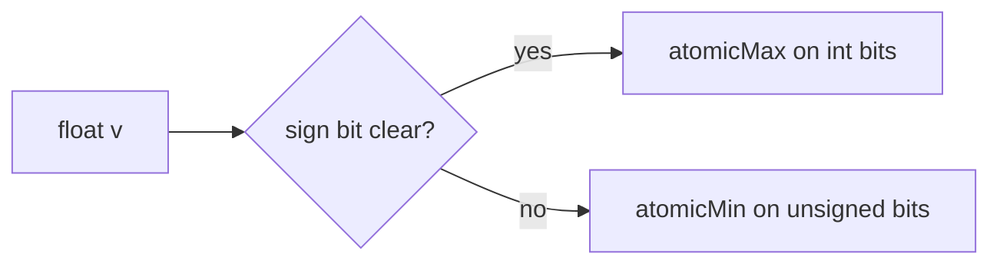
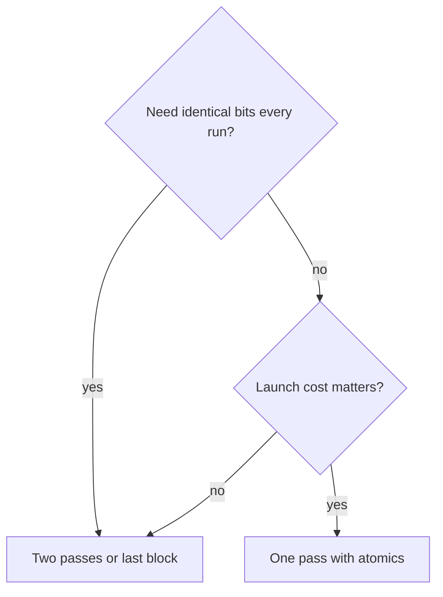

# Introduction

The question this chapter answers: how do you combine millions of values into one at the speed of memory?

Note:
Say that every softmax, every norm, and every loss ends in a reduction. It is
also the simplest memory-bound kernel, so it is a clean test of whether you
can drive the memory system. The deck follows Harris's 2007 progression and
then modernizes it.

### Reductions are everywhere in a model {#everywhere}

- LayerNorm and RMSNorm: a mean and a variance per row
- Softmax: a max, then a sum, per row
- Loss, gradient norm, argmax in sampling
- Each one is a reduction that the rest of the kernel waits on

Note:
Ask the room to name the reductions in one transformer block. They will get
the norms and softmax quickly. Point out that when these are slow, a training
step or a decoded token waits on them. The kernels are small, but they sit on
the critical path.

### What does a reduction cost at best? {#floor}

$$
t_{\min} = \frac{\hla{B}}{\hlb{\beta}} = \frac{4 \times 2^{26}\ \text{byte}}{1.275 \times 10^{12}\ \text{byte/s}} = 0.2105\ \text{ms}
$$

- $\hla{B}$: 256 MiB read once; $\hlb{\beta}$: the measured copy ceiling
- Intensity 0.25 FLOP/byte against a ridge of 161: pure bandwidth

Note:
Walk the arithmetic. 2 to the 26 floats is 268,435,456 bytes. Divided by 1275
gigabytes per second that is 0.2105 milliseconds. Against the rated 1935 it
would be 0.1387, but the rating is not a target. This floor is the yardstick
for the whole deck: a kernel ten times slower is not doing more work, it is
wasting memory time.

### The route through this deck {#roadmap}



Note:
Four stops. First a clean shared-memory tree and Harris's steps. Then warp
shuffles. Then how blocks combine, including atomics and why float sums vary.
Last, row-wise reductions as softmax and norms use them. Leave this slide up a
few seconds.

# A clean tree

Harris's seven kernels, and the lessons that survived.

Note:
This section is the history lesson, but every step names a hazard that comes
back in other kernels. Keep it moving: the point is the lessons, not the
G80.

### Three levels: thread, block, grid {#three-levels}



- 864 blocks of 256 threads: about 303 elements per thread

Note:
Every fast reduction has these three levels. Do as much as possible at the
lowest one. A thread adding in a register is free. Crossing blocks is the
expensive step. The lab launches 108 SMs times 8 blocks, which fills the 2048
resident threads of each SM, so each thread accumulates about 303 elements
before the tree starts.

### Why you may reorder at all {#associativity}

- Sum, max, min, and, or: associative and commutative
- Each has an identity: 0, $-\infty$, $+\infty$
- $n - 1$ dependent adds become a tree of depth $\lceil \log_2 n \rceil$

> [!QUESTION] Is float addition associative?
> No. Every add rounds, so a tree and a loop differ in the last bits. That is
> expected, and the Summary comes back to it.

Note:
The tree does the same n minus one adds, but each round's adds are independent.
Eight values take three rounds. Float addition is commutative but not
associative, which is why reordering changes the last bits. We accept that and
bound the error in the tests.

### Interleaved addressing: Harris kernel 1 {#interleaved}

```cuda
for (unsigned s = 1; s < blockDim.x; s *= 2) {
    if (t % (2 * s) == 0)
        s_data[t] += s_data[t + s];
    __syncthreads();
}
```

- Correct, and slow: the active threads are spread across every warp

Note:
This is the first tree most people write. Thread t adds its neighbor at
distance s if t is a multiple of 2s. The memory is fine, the barriers are
fine, and the speed is terrible. The problem is that in round one every other
thread works, so every warp has both active and idle lanes.

### Divergence in warp issues {#divergence}

```viz
06-tree-rounds
```

- 256 threads, 8 warps: 47 warp issues, against 12 for a compact tree

Note:
Open the figure with the first option. Move the round slider. In rounds with
stride 1 to 16 all 8 warps issue, which is 40 issues, then 4, 2, and 1: 47 in
all. A tree needs only 12. Divergence inside a warp costs whole-warp issue
slots, so a condition on threadIdx modulo a small number is almost always a
mistake.

### Bank conflicts: Harris kernel 2 {#bank-conflicts}

$$
\text{bank}(i) = i \bmod 32 \qquad t \mapsto 2st
$$

- $s = 4$: warp 0 reads words $0, 8, \dots, 248$
- Four banks, eight different words each: an 8-way conflict

> [!QUESTION] Does the figure show other conflict degrees?
> Yes. Pick the strided option and move the slider: the worst round is 8-way
> for a 256-thread block, and 2-way for a 64-thread one.

Note:
Kernel 2 compacts the active threads, which fixes divergence and brings the
issue count to 12. But thread t now touches word 2st, so the stride puts many
threads in the same bank. Eight different words in one bank means eight
serialized transactions. Same-word reads broadcast, but these are different
words.

### Sequential addressing: Harris kernel 3 {#sequential}

```cuda
for (unsigned s = blockDim.x / 2; s > 0; s >>= 1) {
    if (t < s) s_data[t] += s_data[t + s];
    __syncthreads();   // outside the if
}
```

> [!WARNING] A barrier inside the `if` deadlocks or races
> Guard the add, not the barrier.

Note:
Start at half the block and halve. Consecutive threads read consecutive words,
so there are no bank conflicts, and the active threads are always the low
ones, so whole warps go idle together. Both problems go away at once. Stress
the warning: every thread of the block must reach the barrier.

### Harris's seven kernels, measured on a G80 {#harris-table}



Note:
These are Harris's numbers for four million integers on a G80, from 8.054
milliseconds down to 0.268, a factor of 30. The peak of that card is 86.4
gigabytes per second, so the last kernel reaches 72.5 percent. Steps: divergence
fix, bank-conflict fix, first add during load, unroll the last warp, full
unroll, many elements per thread.

### Only the lessons transfer {#transfer}

- G80: 86.4 GB/s peak, one program counter per warp
- A100 80GB PCIe: 1935 GB/s rated, 1275 GB/s measured copy
- Avoid divergence, avoid bank conflicts, do more per thread

> [!QUESTION] Can I quote Harris's 30x for an A100?
> No. It is a G80 result. The ratios and the hazards transfer, the speedup of
> each step does not.

Note:
Be explicit about this. The numbers are from a 2006 GPU. The A100's bandwidth
is 22 times the G80's, and since Volta threads have their own program
counters, so the warp-synchronous unrolling of kernels 5 and 6 needs
syncwarp or, better, shuffles. What carries over is the list of hazards.

### More work per thread: kernels 4 and 7 {#more-work}

- Kernel 4: each thread adds two elements during the load
- Kernel 7: a grid-stride loop, so each thread adds hundreds
- The tree then amortizes over about 77,700 elements per block

Note:
Kernel 3 leaves half the threads idle in round one. Kernel 4 loads two per
thread. Kernel 7 goes all the way: loop over the input with a stride of the
whole grid. With 864 blocks, each block handles 2 to the 26 over 864, about
77,700 elements, so the tree is a rounding error in the total cost.

### Bytes in flight {#bytes-in-flight}

- Little's law: about 5.9 KB per SM must be in flight to saturate HBM
- 2048 threads with a scalar load each: 8 KB, a margin of 1.4
- 2048 threads with a float4 each: 32 KB, a margin of 5.5

Note:
This is the A100-specific reason for many elements per thread. From chapter 4,
saturating HBM needs about 640 kilobytes in flight across the card, 5.9 per
SM. One scalar load per resident thread barely clears that. A float4 per
thread clears it with room to spare, which is why the lab loops with float4.

### The load loop {#load-loop}

```cuda
int n4 = (((uintptr_t)x & 15) == 0) ? (n >> 2) : 0;
for (int i = tid; i < n4; i += stride) {
    float4 v = x4[i];
    acc += (v.x + v.y) + (v.z + v.w);
}
for (int i = n4 * 4 + tid; i < n; i += stride) acc += x[i];
```

- Scalar tail handles any $n$ and misaligned pointers

Note:
The vector loop runs only when the pointer is 16-byte aligned. The scalar loop
after it handles the one to three leftover elements and the whole input when
the pointer is misaligned. The lab tests a tensor that starts four bytes past
an aligned address to catch kernels that skip this.

# Warps and blocks

Reduce a warp with no shared memory at all.

Note:
Now the modern replacement for kernels 5 and 6. Shuffles move data between
lanes directly, with no shared memory and no barrier.

### The shuffle tree {#shuffle}

```viz
06-warp-shuffle
```

- Offset 16, 8, 4, 2, 1: five rounds, lane 0 holds the sum

Note:
Start with the 8-lane toy and press play. Each round every lane adds the value
of the lane offset places above. Lane 0 ends with the sum, 36 for eight lanes.
Switch to 32 lanes for the real warp: five rounds. Lanes that ran past the end
get their own value back and are never read.

### warp_sum {#warp-sum}

```cuda
__device__ float warp_sum(float v) {
    #pragma unroll
    for (int off = 16; off > 0; off >>= 1)
        v += __shfl_down_sync(0xffffffffu, v, off);
    return v;
}
```

Note:
This is the whole function. The mask names the participating lanes, here all
32. Five instructions plus five adds, no shared memory, no barrier. Replace
the plus with fmaxf and the same function is a warp max.

### From a warp to a block {#block-sum}

- Each warp reduces itself
- Lane 0 writes to an 8-word shared array
- One `__syncthreads()`, then warp 0 reduces the 8 values
- Pad unused lanes with the identity

> [!QUESTION] What if only some lanes reach the shuffle?
> With a full mask the result is undefined. Make the whole warp take the
> branch, or build the mask with `__ballot_sync`.

Note:
Compare with the shared-memory tree: eight rounds each with a read, an add, a
write, and a barrier. The shuffle version has one barrier and a 32-byte shared
array. The mask rule is why the lab's row kernel returns a whole warp at once
when it has no row, rather than letting some lanes exit.

### Hardware reduce and cooperative groups {#cg}

- `__reduce_add_sync`: one instruction for 32-bit integers on sm_80 and later
- Floats still use shuffles
- `cg::reduce(tile, v, cg::plus<float>())` picks the implementation

> [!QUESTION] Why write the loop by hand then?
> To see what the library does. In production, use CUB's `BlockReduce` or
> Triton.

Note:
Mention the newer APIs so nobody thinks the shuffle loop is the final word.
The integer reduce instructions exist on compute capability 8.0 and later, and
they do not take floats. Cooperative groups wraps the choice. The lab asks for
the loop so the mechanism is visible.

# Across blocks

Each block has one number. How do 864 of them become one?

Note:
The grid level. A kernel cannot wait for other blocks, so there are three
workarounds, and the choice is between launches, determinism, and complexity.

### Three ways to combine {#three-ways}

| Method | Launches | Zeroed output | Same bits every run |
|---|---|---|---|
| Two passes | 2 | No | Yes, fixed grid |
| One pass, `atomicAdd` | 1 | Yes | No |
| Last block | 1 | A counter | Yes, fixed grid |

Note:
Two passes: a second kernel with one block reduces the 864 partials, reading
3456 bytes. It costs a launch, about 5 microseconds to queue on this card
against a 210 microsecond main kernel. Atomics need a pre-zeroed output and
vary in the last bits. The last-block pattern gives one launch and a fixed order.

### One atomic per block, never per element {#atomic-per-block}

```cuda
float total = block_sum(load_sum(x, n));
if (threadIdx.x == 0) atomicAdd(out, total);
```

> [!QUESTION] Why not let every thread call `atomicAdd`?
> That is $2^{26} = 67{,}108{,}864$ updates to one address, all queuing at the
> L2. One per block is 864.

Note:
The one-pass kernel is three lines. Contended atomics serialize at the L2, so
the number of atomics to one address is the cost driver. 864 is nothing; 67
million is a disaster. The host must zero the output first, and the lab's
tests call the kernel twice to catch a missing zero.

### The last block does the final sum {#last-block}

```cuda
partial[blockIdx.x] = total;
__threadfence();                       // publish before counting
is_last = (atomicAdd(&blocks_done, 1u) == gridDim.x - 1);
__syncthreads();
if (is_last) { /* sum partial[], reset blocks_done */ }
```

- Forget the fence and the last block can read a stale partial

Note:
Each block writes its partial, fences, and increments a counter. The block that
sees the counter reach the grid size minus one knows every partial is written
and finishes the job. It is the pattern in NVIDIA's threadFenceReduction
sample. Two passes is simpler and about as fast for one big reduction.

### Max with atomics {#atomic-max}



- Target starts at $-\infty$; identity of max, not 0

Note:
CUDA has no float atomicMax. A non-negative float's bits order like a signed
integer. A negative float's bits order in reverse as an unsigned integer. So
use atomicMax for the first case and atomicMin for the second. The identity
matters: initialize to minus infinity, or an all-negative array returns 0.

### Why the atomic sum varies and the max does not {#nondeterminism}

$$
(2^{24} + 1) + 1 = 2^{24} \qquad 2^{24} + (1 + 1) = 16{,}777{,}218
$$

- Block arrival order at the L2 changes the grouping
- A max is one of the inputs, so any order gives the same bits

> [!QUESTION] How do I get repeatable sums?
> Use two passes or the last block with a fixed grid. Chapter 9 covers the
> rest, including PyTorch's deterministic mode.

Note:
Above 2 to the 24 float32 numbers are spaced by 2, so adding 1 rounds away.
Group the adds differently and you get a result that differs by 2. In an
atomic sum the grouping is set by which block arrives first. A max has no
rounding, so it repeats exactly. Forward-point to chapter 9.

# Rows

Softmax and normalization reduce each row of a matrix.

Note:
Last topic: many small reductions at once. This is the shape of softmax,
LayerNorm, and RMSNorm.

### Choose a mapping by row length {#row-mapping}

| Columns | Mapping | Why |
|---|---|---|
| A few dozen | Part of a warp per row | Rows share a warp |
| Hundreds to thousands | One warp per row | No barrier, no shared memory |
| Many thousands | One block per row | Needs more loads in flight |

Note:
The boundaries are rules of thumb, so tune them on your shapes. The lab uses
one warp per row with eight rows per 256-thread block. Each lane strides over
its row by 32 so a warp's load is a coalesced 128-byte slice.

### The small-batch trap {#small-batch}

- A100: $108 \times 64 = 6912$ resident warps
- One warp per row needs 6,912 rows to fill them
- 32 rows of 128,000 columns: 32 warps, the card sits idle

> [!QUESTION] What is the fix for a small batch?
> Split each row across many blocks, then combine the per-block max and sum
> with a second pass or atomics.

Note:
This is the decode-time softmax problem: few rows, long vocabulary. One warp
per row launches only a handful of warps, far below the bytes in flight the
memory system needs. The fix is the multi-block reduction from the previous
section applied once per row.

### The Triton version {#triton}

```python
acc = tl.zeros([BLOCK], dtype=tl.float32)
for start in range(0, cols, BLOCK):
    offs = start + tl.arange(0, BLOCK)
    acc += tl.load(x_ptr + row * cols + offs, mask=offs < cols, other=0.0)
tl.store(out_ptr + row, tl.sum(acc, axis=0))
```

- Loop: the thread level. `tl.sum`: warp and block levels

Note:
The compiler writes the shuffles and the shared memory. The other value for
masked loads is the identity of the reduction: zero for a sum, minus infinity
for a max. For a 1-D sum across a grid, end each program with tl.atomic_add,
with the same one-atomic-per-block rule.

# Summary

What to remember, and where to go next.

Note:
Wrap up with the numbers and a decision guide, then point to the next chapter.

### What to remember {#summary}

- A reduction is bandwidth-bound: the floor is bytes over bandwidth
- Thread, block, grid: accumulate in registers first
- Avoid divergence and bank conflicts; sequential addressing fixes both
- Shuffles replace the unrolled shared-memory tree
- One atomic per block; atomic float sums vary, max does not

Note:
Five sentences. If the audience remembers one, it is the three-level shape. The
rest are the hazards on the way. Offer the lab: four kernels, correctness on
awkward sizes, and bandwidth against 1275.

### Numbers to remember {#numbers}

| Quantity | Value |
|---|---|
| Floor, $2^{26}$ floats at 1275 GB/s | 0.2105 ms |
| Blocks in the lab | 864 ($108 \times 8$) |
| Warp issues, interleaved vs compact | 47 vs 12 |
| Shuffle rounds per warp | 5 |
| Worst bank conflict, strided, 256 threads | 8-way |

Note:
These are all derived in the chapter from the facts sheet. The lab prints the
measured bandwidth for every kernel next to the floor. Remind the audience that
Harris's 30x is a G80 number.

### Which combine step? {#decision}



Note:
A short decision guide. If you need repeatable sums, use a fixed-order method.
If a launch is expensive, for example inside a graph full of tiny reductions,
use atomics or the last-block pattern. Otherwise two passes is the simplest.

### Next: scan and histogram {#next}

- A scan keeps every partial sum, not only the last
- The same tree, run twice: up and down
- A histogram is a reduction into many bins, and atomics return

Note:
Chapter 7 generalizes the tree to prefix sums and uses atomics with privatization
for histograms. The warp shuffle and block structure from this chapter carry
over directly.
