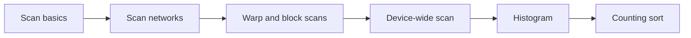
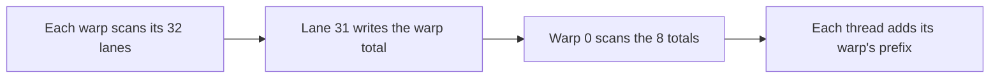
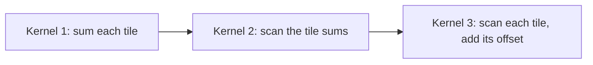
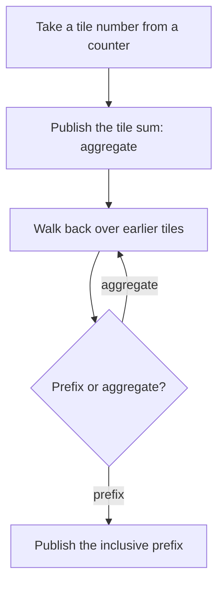

# Introduction

The question this chapter answers: how do you compute every prefix sum, and a count per bin, when each answer seems to depend on the one before it?

Note:
Open with the tension. A prefix sum looks like a loop, and a histogram looks like
a sea of conflicting writes. Both are the kind of problem a GPU seems bad at. The
answer is a small set of ideas, work against depth, privatization, and a flag
protocol between blocks, and each one reappears later in the course.

### Where model code needs them {#where-needed}

- Top-p sampling: a running sum of sorted probabilities
- Dropping tokens: compaction is a scan of 0/1 flags
- Mixture of experts: count tokens per expert, then scan the counts
- Variable-length attention: sequence starts are a scan of lengths
- Radix sort: a histogram, a scan, and a scatter per digit

Note:
Pick the one your audience meets most. Sampling and padding removal appear in
serving, expert offsets in mixture-of-experts training, and the sequence offsets
in every variable-length attention call. Point out that we will build a counting
sort at the end, which is two of these use cases in one.

### The route {#roadmap}



Note:
Six stops. We define scan and the two numbers, work and depth, that decide how to
parallelize it. Then two networks, then the warp and block versions that real
kernels use. Then the device-wide scan, the histogram, and a counting sort that
joins the last two.

# Scan basics

What a scan computes, why it resists parallelism, and what you measure it by.

Note:
Section divider. Keep this section short: it is definitions, and the interesting
part is the cost model at the end.

### Inclusive and exclusive {#incl-excl}

| Index | 0 | 1 | 2 | 3 | 4 | 5 | 6 | 7 |
|---|---|---|---|---|---|---|---|---|
| Input | 3 | 1 | 7 | 0 | 4 | 1 | 6 | 3 |
| Inclusive | 3 | 4 | 11 | 11 | 15 | 16 | 22 | 25 |
| Exclusive | 0 | 3 | 4 | 11 | 11 | 15 | 16 | 22 |

Exclusive is inclusive shifted right, with the identity in front.

Note:
Work down the columns. Index 3 is 0, so the inclusive value stays at 11 and the
exclusive value is also 11, which catches people out. The exclusive value at
index i is the number of items before item i, which is why it doubles as a
destination slot. Every scan in the lab is exclusive.

### Work and depth {#work-depth}

- **Work**: total operations over all threads
- **Depth**: the longest chain of dependent operations
- The serial loop has the least work, $n - 1$, and the most depth, $n - 1$
- A scan in $\log_2 n$ steps needs more than $n - 1$ adds

> [!QUESTION] Does the operator have to be addition?
> No. It has to be associative and have an identity. Max, min, products, and
> pairs for a linear recurrence all work, and the operator needn't be commutative.

Note:
These two numbers are the whole design space. Work says what you pay in
instructions, depth says how many sequential steps remain. The next two networks
sit at opposite ends. Floating-point addition is only approximately associative,
so a float scan differs from a serial loop in the last bits, and the lab tests
float scans with a tolerance as well as on exactly representable integers.

### Top-p is an exclusive scan {#top-p}

Sorted probabilities: 0.50, 0.20, 0.12, 0.08, 0.05, 0.03, 0.02

Exclusive scan: 0, 0.50, 0.70, 0.82, 0.90, 0.95, 0.98

With $p = 0.85$, keep tokens whose mass *before* them is below $p$: **four tokens**.

Note:
The exclusive version matters. A token is kept if the probability mass before it
is under p, so the token that crosses the threshold is still included. The
companion course derives the rule in its sampling chapter. If you used the
inclusive scan you would drop the crossing token and sometimes keep none.

### Compaction is a scan of flags {#compaction}

| Index | 0 | 1 | 2 | 3 | 4 | 5 | 6 | 7 |
|---|---|---|---|---|---|---|---|---|
| Value | 5 | 0 | 3 | 0 | 0 | 8 | 2 | 0 |
| Flag | 1 | 0 | 1 | 0 | 0 | 1 | 1 | 0 |
| Scan | 0 | 1 | 1 | 2 | 2 | 2 | 3 | 4 |

Survivors go to slots 0, 1, 2, 3. The count is $4 + 0 = 4$.

Note:
Each survivor writes itself to the slot its scan value names. Nobody collides,
and the order is preserved. This is how padding tokens and tokens that fail a
filter are removed from a batch without a loop. The same trick underlies
radix sort and expert routing later in the deck.

### Scan beyond addition {#recurrence}

A recurrence $h_t = a_t h_{t-1} + b_t$ is a scan over pairs:

$$(a_1, b_1) \circ (a_2, b_2) = (a_1 a_2,\ a_2 b_1 + b_2)$$

The network is the same. Only the operator changes.

Note:
This is why scan shows up in state-space and gated linear recurrent layers. The
operator on pairs is associative, so a parallel scan applies. Everything we build
today uses plus, but nothing in the networks depends on it. Only the order of the
operands matters.

# Scan networks

Two ways to wire the additions: shallow and wasteful, or deep and lean.

Note:
Section divider. Both networks run on an array held in shared memory. We count
additions first and then recount in the unit the GPU charges by.

### Kogge-Stone {#kogge-stone}

| Step | Distance | After the step |
|---|---|---|
| Input | | 3, 1, 7, 0, 4, 1, 6, 3 |
| 1 | 1 | 3, 4, 8, 7, 4, 5, 7, 9 |
| 2 | 2 | 3, 4, 11, 11, 12, 12, 11, 14 |
| 3 | 4 | 3, 4, 11, 11, 15, 16, 22, 25 |

Each element adds the one $d$ places to its left.

Note:
Every element works at every step, so depth is log2 n. Trace element 3: after
step 1 it holds 0 plus 7, after step 2 it adds element 1's pair sum 4 to get 11,
the sum of the first four inputs. After step 3 the whole row is the inclusive scan.

### Kogge-Stone does extra work {#ks-work}

$$\boxed{W_{\text{KS}} = n \log_2 n - n + 1}$$

- $n = 8$: 17 additions against 7 for the loop
- $n = 256$: 1793 additions against 255 for the loop
- Seven times the work, 8 steps instead of 255

Note:
At distance d the d leftmost elements have nothing to add, so n minus d elements
do work. Sum that over the log n distances and you get the formula. This is the
price of the minimum depth.

### The in-place hazard {#ks-hazard}

```cuda
int add = (tid >= d) ? buf[tid - d] : 0;  // read old
__syncthreads();
buf[tid] += add;                          // write new
__syncthreads();
```

> [!WARNING] One barrier is not enough
> Without the first barrier, a thread overwrites a value its neighbor hasn't read.

Note:
The table reads the old row and writes the new row. In place, you need the
register to hold the read across the barrier. This produces a bug that only
shows on some runs, which is the worst kind. The lab's hint repeats this.

### Blelloch: up-sweep, then down-sweep {#blelloch}

| Stage | Array |
|---|---|
| Up-sweep, strides 1, 2, 4 | 3, 4, 7, 11, 4, 5, 6, **25** |
| Clear the root | 3, 4, 7, 11, 4, 5, 6, **0** |
| Down-sweep, stride 4 | 3, 4, 7, 0, 4, 5, 6, 11 |
| Down-sweep, stride 2 | 3, 0, 7, 4, 4, 11, 6, 16 |
| Down-sweep, stride 1 | 0, 3, 4, 11, 11, 15, 16, 22 |

Note:
The up-sweep is a reduction that leaves partial sums in place. Clearing the root
seeds the exclusive scan with the identity. In the down-sweep, each left child
takes the parent's value and each right child takes the parent plus the old left
child. The last row is the exclusive scan from the earlier table.

### Blelloch's cost {#blelloch-cost}

$$\boxed{W_{\text{B}} = 2(n - 1), \qquad D_{\text{B}} = 2 \log_2 n}$$

- $n = 256$: 510 additions in 16 steps
- Twice the loop's work, 3.5 times fewer additions than Kogge-Stone
- The same network as Brent-Kung, with an exclusive output

Note:
Up-sweep does n minus 1 additions and down-sweep another n minus 1. Compare 510
with Kogge-Stone's 1793 for the same 256 elements. The cost is depth: 16 steps
instead of 8, and every step has a barrier in shared memory.

### Step through both {#networks-figure}

```viz
07-scan-networks
```

Note:
Use the segmented control to switch networks and the slider to change the size.
Press Play to watch it build. Kogge-Stone has long rows of arrows and few rows.
Blelloch has short rows that narrow toward the root and widen on the way down.
Dashed arrows are the copy half of the down-sweep swap.

### Recount in warp-steps {#warp-steps}

| Network | Steps | Warp-steps | Barriers |
|---|---|---|---|
| Kogge-Stone | 8 | 64 | 17 |
| Blelloch | 16 | 24 | 18 |

> [!QUESTION] If Blelloch has far fewer additions, why isn't it far faster?
> A step costs a warp-wide instruction, not an add per thread, and the barriers
> are about the same. The block waits on barriers and shared-memory round trips.

Note:
Warp-steps count the warps that have at least one active thread. With d equal to
128 the first 128 threads are active, which is four warps. Kogge-Stone has
more warp-steps but about the same number of barriers, so within a block of 256
threads the two cost about the same, and the lab measures both. Blelloch also
has power-of-two strides that collide in the banks, which padding fixes.

# Warp and block scans

Production kernels scan a warp with shuffles and combine warps through shared memory.

Note:
Section divider. This is the version the device-wide scan uses. It has no
networks in shared memory at all, only five shuffles and two barriers.

### A warp scan in five shuffles {#warp-scan}

```cuda
for (int d = 1; d < 32; d <<= 1) {
  T up = __shfl_up_sync(0xffffffffu, v, d);
  if (lane >= d) v += up;
}
```

- Kogge-Stone in registers: 5 steps for 32 lanes
- No shared memory and no barrier

> [!WARNING] The shuffle runs on every lane
> A full mask names all 32 lanes. Keep the shuffle outside the `if`.

Note:
This is Kogge-Stone with the lanes doing the work of the array. The 129 additions
are free because all 32 lanes issue together. The warning is the main bug in
warp-level code: if the shuffle sits inside the branch, lanes that skipped it
are named by the mask and the result is undefined.

### Three phases to a block scan {#block-scan}



Two barriers, and a 32-byte shared array.

Note:
Eight warps in a block of 256 threads, so eight totals. Warp 0 scans them with
the same shuffle routine, using zero for lanes 8 through 31. Compare two barriers
here with the seventeen or eighteen of a shared-memory network.

### Four items per thread {#coarsening}

- Serial scan of 4 items in registers: no barrier
- Parallel scan of 256 totals, not 1024 values
- 4 consecutive int32 or float32 values are one 128-bit load
- A tile is $256 \times 4 = 1024$ elements

> [!QUESTION] Is one block's load enough to hide memory latency?
> It puts $256 \times 16 = 4096$ bytes in flight. Little's law needs about
> 5.9 KB per SM, so two resident blocks are already enough.

Note:
Thread coarsening trades a few registers for fewer barriers and wider loads.
The figure of 5.9 KB per SM is from the roofline chapter's Little's-law
arithmetic. With 256-thread blocks, up to 8 blocks can be resident, so the load
side is comfortably covered.

# The device-wide scan

Blocks cannot wait for each other, so the dependency has to cross a kernel boundary or a flag.

Note:
Section divider. This is the part with the most novelty compared with a
reduction. A reduction can finish with an atomic. A scan needs every block to
know what the blocks before it hold.

### Reduce-then-scan {#reduce-then-scan}



- Kernel 1 reads $n$
- Kernel 3 reads $n$ and writes $n$

Note:
Consecutive kernels in a stream are ordered, so the second kernel sees every
tile sum. The middle step scans an array of one entry per tile, so it recurses
when that array needs more than one tile. Scan-then-propagate is the cousin that
scans first and then adds offsets in a third pass, for four n of traffic.

### What it costs for $2^{26}$ int32 {#traffic}

| Scheme | Traffic | Floor at 1275 GB/s |
|---|---|---|
| Single pass | $2n$ | 421.1 µs |
| Reduce-then-scan | $3n$ | 631.6 µs |
| Scan-then-propagate | $4n$ | 842.2 µs |

One array is 268,435,456 bytes, 256 MiB.

> [!QUESTION] Why 1275 GB/s and not the 1935 GB/s rating?
> The rating is a ceiling no kernel reaches. A plain copy measured 1275 GB/s on the lab
> card (learn-inference, chapter 10), so that is the number to divide by.

Note:
Show the arithmetic once. 3n times 4 bytes is 805,306,368 bytes, divided by
1.275 times ten to the twelve bytes per second, is 631.6 microseconds. The single
pass equals the time of a copy. The array is six times the L2 size, so each pass
really reads DRAM.

### Decoupled look-back {#look-back}



Note:
This is the single-pass protocol of Merrill and Garland. Each tile has a status
slot: invalid, aggregate, or prefix. A tile publishes its sum as an aggregate,
then walks back, waiting on invalid slots, adding aggregates, and stopping at the
first prefix, which already covers everything before it. Then it publishes its own
inclusive prefix. One read and one write of the data: 2n traffic.

### Why a counter and not blockIdx {#tile-counter}

> [!QUESTION] Why take tile numbers from an atomic counter?
> A block waits on earlier tiles. If tile numbers followed `blockIdx.x`, later
> tiles could occupy every SM slot while an earlier tile never starts. The counter
> numbers tiles in the order blocks begin, so every tile a block waits on is running.

Merrill and Garland report that the scan matches memcpy throughput on the hardware they tested.

Note:
This is the subtle point of the design. Without dynamic numbering there is a
deadlock: the waiting blocks hold the slots the awaited block needs. The protocol
packs value and status into one 64-bit word so a reader never sees a new flag
with an old value. CUB's DeviceScan is built on this algorithm, so in production
you call the library. The lab treats look-back as a stretch goal.

# Histogram

A reduction with many outputs, where the output address depends on the data.

Note:
Section divider. Scan was about order. Histogram is about collisions, and the
fix is to move them to a cheaper place.

### The update that collides {#collide}

```cuda
atomicAdd(&bins[in[i]], 1);
```

- Global atomics are applied in L2, one address at a time
- Uniform bytes: a spread of $n$ atomics over 256 addresses
- Skewed bytes: one hot bin serializes
- All bytes equal: the worst case

Note:
The address depends on the data, so two threads can hit the same bin at the same
instant and the update has to be atomic. The cost is therefore a property of the
data, not the code. Ask the room what a text file or an image with a black border
looks like to this kernel. The lab measures uniform and all-equal bytes.

### Collisions in a warp {#contention-figure}

```viz
07-histogram-contention
```

Note:
Slide the hot-byte share from zero to a hundred. At zero a warp's 32 lanes touch
about 30 different bins. At a hundred, one bin and a queue of 32. The counts come
from a seeded random draw in the browser, not from a GPU, so treat them as
statistics, and let the lab give the real timings.

### Privatize in shared memory {#privatize}

```cuda
__shared__ int local[256];
// zero local[], __syncthreads()
// stream input: atomicAdd(&local[byte], 1)
// __syncthreads(), then merge nonzero bins
```

864 blocks, at most 256 global atomics each: $2^{26} / 221{,}184 \approx 303$ times fewer.

Note:
Each block keeps a 1 KiB private copy. The baseline sends 67,108,864 global atomics; the privatized kernel sends at most 864 times 256, which is 221,184. Each thread also loads a 16-byte uint4, about 19 loads per thread. Updates stay on the SM, and the global
bins see only the merge. Two barriers matter: one after zeroing and one before the
merge. Forgetting the first is a classic bug that shows up as occasional garbage.

### Aggregate before the atomic {#aggregate}

```cuda
unsigned peers = __match_any_sync(0xffffffffu, key);
if (lane == __ffs(peers) - 1)
  atomicAdd(&local[key], __popc(peers));
```

- 32 equal bytes: 32 atomics become 1
- 32 distinct bytes: no saving, and the match costs extra

> [!QUESTION] When should I aggregate?
> On skewed data. On uniform data it loses, so which kernel to use depends on the data.

Note:
Lanes that hold the same byte elect the lowest lane as leader, and the leader
adds the group's population count. Per-warp copies of the bins are the other
option: eight warps times 1 KiB is 8 KiB per block, which removes cross-warp
collisions at the cost of shared memory. Run aggregation, counting equal
neighbors in registers, helps when values repeat within a thread's items.

### When the bins don't fit {#bins-fit}

> [!QUESTION] Why can't a 128,000-token vocabulary use the per-block array?
> 128,000 bins of 32 bits is 500 KiB, over the 163 KiB a block may use. The limit
> is $163 \times 1024 / 4 = 41{,}728$ bins. Privatize a slice per block, sort
> first, or fall back to global atomics.

Note:
A privatized array has to fit in shared memory, and a large one also cuts how many
blocks reside on an SM. Token-frequency histograms over large vocabularies are the
case to watch for. The right answer there depends on the data's skew and the bin
count, so measure.

# Putting them together

A histogram and a scan make a counting sort, and a counting sort routes tokens to experts.

Note:
Section divider. The last section ties the two halves together.

### A counting sort {#counting-sort}

| Digit | 0 | 1 | 2 | 3 |
|---|---|---|---|---|
| Histogram | 1 | 3 | 2 | 2 |
| Exclusive scan | 0 | 1 | 4 | 6 |

Keys: 3, 1, 2, 1, 0, 3, 2, 1. Digit 2 starts at slot 4.

Note:
Histogram the keys, scan the counts to get each digit's first output slot, and
scatter. Radix sort repeats this per digit. The scatter is stable if each key
takes slots in input order. GPU libraries build their radix sorts from exactly
these parts.

### Expert offsets in a mixture of experts {#moe-offsets}

- 8 token-to-expert assignments, 4 experts
- Counts: 3, 0, 2, 3
- Exclusive scan: 0, 3, 3, 5, total 8

Chapter 20 builds the permutation and the grouped GEMM that uses these offsets.

Note:
The scan output is where each expert's block of tokens starts in the permuted
buffer, and the total is the buffer length. An expert with zero tokens gets an
empty range, which is why the scan offsets for experts 1 and 2 are equal. The
next chapters build the kernels around this.

# Summary

The ideas and numbers to keep, and what the next chapter picks up: shared memory banks and the transpose.

Note:
Close the loop. Today we met banks twice, in the Blelloch strides and in the histogram's shared atomics, and the next chapter gives them a full treatment through the matrix transpose, with padding and swizzling. Summarize the five ideas, then leave the decision table up for questions.

### What to remember {#summary}

- Use exclusive scan for positions and "mass before me"
- Kogge-Stone: $n \log_2 n - n + 1$ adds, $\log_2 n$ steps. Blelloch: $2(n-1)$ adds, $2\log_2 n$ steps
- Warp: five shuffles. Block: warp scans plus a scan of warp totals
- Device scan: 3n traffic with reduce-then-scan, 2n with look-back
- Histogram: privatize in shared memory, aggregate when skewed

Note:
Recap in one breath. The scan is about trading depth against work and then about
crossing block boundaries. The histogram is about moving contention to the
cheapest level. If the audience keeps only one number, it is the traffic count,
because that is what you divide by the copy ceiling.

### Numbers to remember {#numbers}

| Quantity | Value |
|---|---|
| Copy ceiling, lab A100 | 1275 GB/s |
| Scan floor, $2^{26}$ int32, 3n | 631.6 µs |
| Scan floor, 2n | 421.1 µs |
| Global atomics saved by privatizing | about 303 times |
| Lab floors | 40% scan, 25% histogram |

Note:
These come from the arithmetic in the chapter. The lab floors are loose on
purpose, so they test for a correct and reasonable kernel, not a tuned one. Your
lab prints the real figures next to the predictions.

### Which technique when {#decision}

| Problem | Reach for |
|---|---|
| Positions within a warp | Shuffle scan |
| One block | Warp scans plus a warp-total scan |
| Large array, simple code | Reduce-then-scan |
| Large array, library | `cub::DeviceScan` |
| Few bins, uniform data | Shared-memory privatization |
| Skewed data | Warp aggregation |

Note:
Use this as a decision guide. In production, call the library for large scans and
use the chapter to understand what it does and to debug it. The two exceptions are
fused cases, where a scan sits inside a larger kernel and has to be written by hand.
