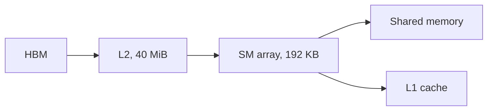
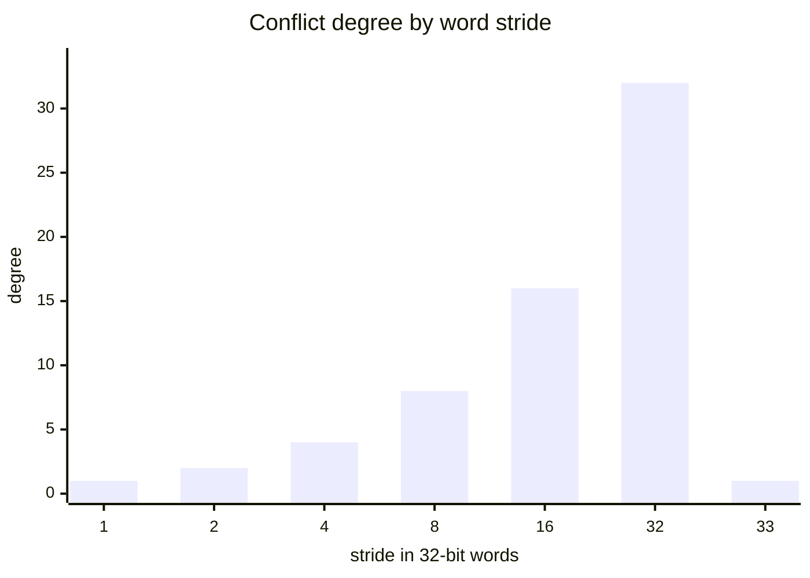

# Introduction

The question this chapter answers: how do you turn rows into columns at copy speed?

Note:
Open by saying that every layout change in a model is a transpose in disguise. The skill this hour is predicting, from
the hardware, how fast the transpose should run, and knowing what to change when a kernel falls short of the
prediction.

### Why a transpose matters {#why-transpose}

- The `K` in `Q @ K.T` and every weight in the layout the next kernel wants
- Channels-first to channels-last, and the permutation before a mixture-of-experts layer
- No arithmetic at all: the time is the bytes moved
- It is the smallest kernel that needs shared memory

Note:
Ask who has called `.contiguous()` after a `.t()` or a `.permute()`. That call launches a transpose kernel. The reason
to study it is not that you will write one often. It is that a tile in shared memory, a barrier, and a bank-conflict-free
layout are the same three ideas that the GEMM and FlashAttention chapters use at scale.

### What you already know {#prior}

- A warp's access reaches DRAM in 32-byte sectors, so contiguous lanes win
- A plain copy measured 1275 GB/s on this A100, against 1935 rated
- A block runs on one SM; its warps run at different times

> [!QUESTION] Why 1275 and not 1935?
> The 1935 GB/s is a rating of the HBM2e interface. A copy measured 1275 GB/s on the lab A100 in learn-inference,
> and a memory-bound kernel is judged against the measurement.

Note:
Remind the room of the two numbers from chapters 0 and 3. The copy ceiling is the target for everything today. A
transpose moves the same bytes as a copy, so a perfect transpose equals the copy, and that is the finish line.

### The route through this deck {#roadmap}


Note:
Six stops. First what shared memory is. Then the bank rule, which is the new hardware idea. Then the barrier. With
those three, we write the transpose, find its bank conflict, fix it two ways, and finish by measuring against the
copy. Keep this slide up briefly.

# Shared memory

The scratchpad each SM gives to a block, and what it costs to ask for it.

Note:
This section is the vocabulary: where shared memory lives, how fast it is, and how a kernel declares it. Nothing here is
hard, but the numbers come back in the transpose.

## What it is

### One SRAM array, two jobs {#one-array}

- Each A100 SM has one 192 KB array of on-chip SRAM
- Part is shared memory, the rest is the L1 cache: the carveout
- Shared memory options: 0, 8, 16, 32, 64, 100, 132, or 164 KB
- At most 163 KB per block; CUDA reserves 1 KB per block



Note:
The key fact is that shared memory and L1 are the same physical array, split by a setting. The driver picks a carveout
that fits the blocks it makes resident, and you can hint at one per kernel. At the largest setting, 164 KB is shared
memory and 28 KB is left for L1. The 1 KB reservation is why a 48 KB block is charged 49 KB.

### The numbers {#numbers}

| Quantity | A100 | Origin |
|---|---|---|
| Shared latency | 29 cycles | Measured, A100 PCIe 40GB |
| L2 latency | 261.5 cycles | Same source |
| HBM latency | 466.3 cycles | Same source |
| Bandwidth per SM | 128 B per clock | 32 banks x 4 B |

Note:
The latencies are from the Hopper-benchmarking paper by Luo and others, which measured an A100 PCIe 40GB card, not the
80GB one. They are expected to be close. The 128 bytes per clock is arithmetic from the bank structure, which the next
section derives. Across 108 SMs at 1.41 GHz it is 19.5 terabytes per second, about ten times the HBM rate.

> [!QUESTION] Is 19.5 TB/s a bandwidth I can actually get?
> It is a theoretical ceiling that needs every bank busy every clock. A conflict-free access reaches it. A bank
> conflict divides it by the conflict degree, which is the subject of the next section.

### Declaring shared memory {#declaring}

```cuda
__shared__ float tile[32][33];     // static: size at compile time

extern __shared__ float buf[];     // dynamic: size at launch
k<<<grid, block, bytes>>>(...);    // third argument
```

- Static is limited to 48 KB per block
- Past 48 KB you need dynamic plus an opt-in

Note:
Static allocations are simplest. Dynamic ones take their size from the third launch parameter. The opt-in is the part
people forget, and the next slide shows it.

### Asking for more than 48 KB {#opt-in}

```cuda
cudaFuncSetAttribute(k,
    cudaFuncAttributeMaxDynamicSharedMemorySize,
    100 * 1024);
k<<<grid, block, 100 * 1024>>>(...);
```

> [!WARNING] The failure looks like an indexing bug
> Without the opt-in, a launch over 48 KB fails with an invalid-argument error. The limit is 163 KB per block on the
> A100.

Note:
A tensor-core GEMM tile is far past 48 KB, so you meet this in chapter 11. The transpose tile is 4 KB, so the lab does
not need it. Say that the error message does not mention shared memory, which is why people lose an hour to it.

# Banks

Shared memory has 32 ports. A warp has 32 lanes. The trouble is who uses which port.

Note:
This is the core hardware idea of the chapter. The whole bank-conflict story comes from one formula and one rule.

## The rule

### 32 banks of 4 bytes {#banks}

$$\text{bank}(a) = \left\lfloor \frac{a}{4} \right\rfloor \bmod 32$$

- Address 0 is bank 0, address 4 is bank 1, address 124 is bank 31
- Address 128 wraps to bank 0
- Each bank serves one 32-bit word per clock

Note:
Successive 32-bit words go to successive banks. If every lane of a warp hits a different bank, the warp is served in a
single clock, which is the 128 bytes per clock. The formula follows from those two facts. Work one example aloud:
address 132 is word 33, and 33 mod 32 is bank 1.

### The conflict rule {#conflict-rule}

- Different words in the same bank queue up: the access takes N transactions
- The same word is a broadcast: one transaction
- Different halves of one word share a transaction

> [!QUESTION] What if two lanes write the same word?
> They do not conflict, but only one write wins, so you get one lane's value. Avoid writing one word from two lanes.

Note:
The degree is the largest number of distinct words in any one bank. Stress distinct words. Thirty-two lanes reading the
same float is the fastest access there is, not the slowest. Two bfloat16 values in one word cost nothing extra, which
matters later.

### Stride decides the degree {#stride}



Note:
Read the chart left to right. Stride 1 is conflict free. Stride 2 halves the banks in use, so degree 2, and the degree
doubles with each doubling of the stride up to 32, where every lane hits one bank. The last bar is stride 33, a column of a
padded tile, and it falls back to 1. Degree is the gcd of the stride and 32, so odd strides are conflict free and powers of
two are the worst.

### Odd strides are free {#odd-strides}

$$\text{degree} = \gcd(s, 32)$$

- Stride 1 or 33 or any odd number: degree 1
- Stride 2: degree 2; stride 32: degree 32
- A column of a 32-wide tile has stride 32

> [!QUESTION] Why gcd?
> Lanes $l$ and $l'$ share a bank when $s(l - l') \equiv 0 \pmod{32}$. That holds when $l - l'$ is a multiple of
> $32/g$ with $g = \gcd(s, 32)$, which puts $g$ lanes in each bank.

Note:
This formula is the whole reason padding works. An odd number shares no factor with 32, so the 32 lanes spread over all
32 banks. Do one example on the board: stride 6 has gcd 2, so a 2-way conflict.

### See it on a tile column {#bank-map}

```viz
08-bank-map
```

Note:
Start on the plain float32 tile, column 0. All 32 lanes land in one bank, a 32-way conflict. Switch to padded and the
stack flattens. Switch to bfloat16 and show that the plain tile is still 32-way. Leave swizzled for later in the deck
and come back to this figure then.

## Wider accesses

### 64-bit and 128-bit loads {#wide}

- A warp-wide 16-byte access moves 512 B
- Banks serve 128 B per clock, so the floor is 4 wavefronts
- Conflict free means "no more than the floor"
- Read wavefront counts in Nsight Compute

> [!QUESTION] Is a float4 shared load four-way conflicted?
> No. Four wavefronts is the minimum for 512 bytes. A conflict is anything above four, and how broadcasts count across
> lane groups varies by architecture, so confirm with the profiler.

Note:
Do not teach quarter-warp rules from old guides. The arithmetic is enough: 512 bytes over 128 bytes per clock is four. The
lab uses 4-byte and 2-byte elements, where the simple rule holds.

# Barriers

A block's warps run at different times. A barrier is how they agree on what has been written.

Note:
One slide of pattern, one of the two ways it goes wrong, one on reuse.

### The write, wait, read pattern {#barrier}

```cuda
tile[...] = in[...];   // every thread writes
__syncthreads();       // wait for all of them
out[...] = tile[...];  // any thread may read any piece
```

- No thread passes until the whole block arrives
- Writes before the barrier are visible after it

Note:
Without the barrier, thread 70 can read a word that thread 5 has not written yet. That is a race, and it gives wrong
numbers that change from run to run. The barrier fixes it and costs very little when the warps are balanced.

### Guard the work, not the barrier {#deadlock}

```cuda
// Wrong: edge threads return before the barrier
if (m >= M || n >= N) return;
tile[r][c] = in[m * N + n];
__syncthreads();
```

> [!WARNING] This deadlocks on ragged shapes
> Every thread must reach the same `__syncthreads()`. Put the guard on the load and the store, and the barrier outside.

Note:
The wrong version passes on every size that is a multiple of the tile, because no thread returns early. It hangs on the
first ragged shape. That is why the lab tests include sizes one off a multiple.

# The transpose

The operation, its speed limit, and four kernels.

Note:
The main body of the talk. We build the kernel in the order the lab does: naive, tiled, padded, swizzled.

## The speed limit

### A transpose is a copy with a twist {#limit}

$$\boxed{\text{bytes} = 2\,M N s}$$

- Each element is read once and written once
- That is exactly a copy's traffic, so a copy is the ceiling
- 8192 x 8192 float32: 536.9 MB, 421 $\mu$s at 1275 GB/s

> [!QUESTION] Can a transpose beat a copy?
> No. It moves the same bytes and does no useful extra work, so the best it can do is match a copy. At 1935 GB/s it would
> take 277 $\mu$s, a rating no kernel reaches.

Note:
The same matrix in bfloat16 is half the bytes, 210.5 microseconds at the copy ceiling. These are the predictions the lab
checks. The matrix is well above the 40 MiB L2, so every byte comes from HBM and the lab does not need to flush the cache.

## The naive kernel

### Read rows, write columns {#naive}

```cuda
out[(size_t)n * M + m] = in[(size_t)m * N + n];
```

- Read: lanes have consecutive $n$, so 128 contiguous bytes
- Write: lanes are $M \times 4$ bytes apart, 32 sectors per warp
- 1024 sector bytes for 128 useful: up to 8x

Note:
The read coalesces and the write does not. At the cache interface a warp's store touches 32 sectors for 128 useful
bytes. The L2 can merge partial sectors, so the traffic that reaches HBM is below 8x, and the roofline cannot say by
how much. The lab measures the naive kernel.

### What others measured {#naive-others}

| Card | Copy GB/s | Naive GB/s | Fraction |
|---|---|---|---|
| Tesla M2050 (Harris) | 105.2 | 18.8 | 18% |
| Tesla K20c (Harris) | 136.0 | 55.3 | 41% |
| H100 PCIe (Colfax) | 1783 | 424.1 | 24% |

Note:
Different cards, so compare the fractions and not the gigabytes per second. The pattern is the same everywhere: the
naive transpose gets between a fifth and two-fifths of a copy. The A100 will be somewhere of its own, and it is not close
to the ceiling.

## Staging through shared memory

### A tile turns rows into columns {#tile}

```viz
08-tile-path
```

Note:
Step through it. The global read moves a row, the global write moves a row, and the turn from rows to columns happens in
the shared tile. Point at the barrier step. Then drag the row slider to show that every row follows the same path.

### Two phases and one barrier {#phases}

```cuda
tile[smem_index(r, c)] = in[m * N + n];       // phase 1
__syncthreads();
out[n * M + m] = tile[smem_index(o_col, o_row)]; // phase 2
```

- Output tile sits at the swapped block coordinates
- Phase 2 swaps the roles of x and y

> [!QUESTION] Why does lane x vary the row in phase 2?
> The output row must be contiguous across lanes, and output columns are input rows. So lane $x$ walks the tile's rows,
> which is a column read.

Note:
This is the line of code to get right. In phase 2 the thread index that was a column in phase 1 becomes a row. That is
what makes the global write coalesce, and it is also what makes the shared read strided.

### The turn is a bank conflict {#conflict}

- Plain tile: row pitch 32 words
- Lane $x$ reads word $32x + c$: stride 32
- All 32 lanes in one bank: 32-way

> [!KEY] Correct, and slow
> The plain tiled kernel passes every correctness test. Its shared reads take 32 transactions each.

Note:
This is the moment to go back to the bank-map figure, plain float32, any column. The kernel is right and it is slower
than it needs to be. The next slides price the conflict.

## Pricing the conflict

### Does a shared-memory conflict matter for an HBM-bound kernel? {#price}

$$\frac{1275 \times 10^{9}}{108 \times 1.41 \times 10^{9}} = 8.37\ \text{B per clock per SM}$$

- 8 HBM bytes per float32 element: 1.05 elements per clock
- Conflicted shared array: $32/33 = 0.97$ elements per clock
- Ratio 0.93: the shared array is now on the critical path

Note:
The HBM-bound rate per SM is 8.37 bytes per clock. A float32 element costs 8 bytes of HBM traffic, so the SM must pass
about 1.05 elements per clock. With a 32-way conflict, 32 elements need 33 shared transactions, so the shared array
passes at most 0.97. Under perfect overlap that is 93 percent of the copy ceiling. Real kernels overlap less, so
expect lower. Published conflicted tiles agree in direction: Harris measured 51.3 against a 105.2 GB/s copy on a Tesla M2050, 49 percent, and Colfax measured 1255 against 1783 GB/s on an H100 PCIe, 70 percent.

> [!QUESTION] Why is bfloat16 worse?
> An element is 4 HBM bytes, so the SM must pass 2.09 elements per clock. The conflicted shared array still passes 0.97,
> so the unpadded bfloat16 tile caps at about 46% of the copy ceiling.

## Padding

### Pad the row to an odd pitch {#padding}

$$(33r + c) \bmod 32 = (r + c) \bmod 32$$

- `__shared__ float tile[32][33]`: 4224 B instead of 4096, 3.1% more
- A column read now hits 32 different banks
- Pitch in words must be odd

Note:
For a fixed column, the 32 rows give 32 different banks, because adding a constant to a full set of residues leaves it full.
Harris measured this fix on a Tesla M2050: 99.5 GB/s against a 105.2 GB/s copy, 95 percent, up from 49 percent.

> [!QUESTION] What does padding cost besides memory?
> It breaks 16-byte alignment of the rows. A pitch of 33 words puts row 1 at byte 132, so you can't use `float4` shared
> accesses along a row. That is one reason GEMM kernels swizzle instead.

### Padding bfloat16 by one is not enough {#bf16-pad}

- 64-wide tile, 128 B rows, 32 words: plain column read is 32-way
- Pad by one element: 32.5-word pitch, odd columns 2-way
- Pad by one word, 2 elements: 33-word pitch, conflict free

> [!WARNING] The kernel is correct and still slow
> One bfloat16 is half a word. Pad `4 / sizeof(T)` elements, and check with the Python bank model first.

Note:
This is the mistake the lab's Python model is built to catch. With one element of padding, even columns are clean and odd
columns have two different words in the same bank. In the transpose, which column a warp reads depends on the thread row,
so half the warps conflict.

## Swizzling

### XOR the column with the row {#swizzle}

$$c' = c \oplus (r \bmod 32)$$

- Same size as the plain tile: 4096 B
- Rows stay aligned to 128 bytes
- Row write: XOR with a constant permutes the columns
- Column read: XOR with a fixed $c$ gives 32 different columns

Note:
Do not move the rows apart. Rearrange the columns inside each row. A row write has a fixed row, so the XOR is a constant and
the 32 columns stay distinct. A column read has a fixed column, and XOR with a fixed value is a permutation of the rows, so
the 32 lanes land in 32 banks. Return to the bank-map figure, pick swizzled, and drag the column slider: the stack is
flat everywhere.

### The pattern on 8 banks {#swizzle-table}

| Row | Plain | Swizzled |
|---|---|---|
| 0 | 0 1 2 3 4 5 6 7 | 0 1 2 3 4 5 6 7 |
| 1 | 0 1 2 3 4 5 6 7 | 1 0 3 2 5 4 7 6 |
| 2 | 0 1 2 3 4 5 6 7 | 2 3 0 1 6 7 4 5 |
| 3 | 0 1 2 3 4 5 6 7 | 3 2 1 0 7 6 5 4 |

Note:
Each cell is the bank of that element. In the plain layout every column is one bank repeated. In the swizzled layout, every
row and every column holds each bank once. Read column 0 downward: 0 1 2 3. Read column 3: 3 2 1 0. No repeats.

> [!QUESTION] Why XOR and not add?
> XOR is invertible, costs one instruction, and keeps the result inside the row, so the tile is no larger. An addition
> needs a modulo to stay in the row.

### The same idea in CuTe and TMA {#cute}

- `Swizzle<B, M, S>`: XOR bits $[M+S, M+S+B)$ into bits $[M, M+B)$
- float32 tile: `Swizzle<5, 0, 5>`
- bfloat16 tile, pairs kept together: `Swizzle<5, 1, 5>`
- Colfax on H100 PCIe: 1779 GB/s against a 1783 GB/s copy

Note:
This is the notation chapter 13 builds on. For a float32 tile, the column is the low five bits and the row the next five,
so XORing row into column is Swizzle 5, 0, 5. The bfloat16 version leaves bit zero alone so each pair stays in a word. The
TMA hardware on Hopper can apply a fixed set of swizzle patterns as it writes a tile, which is chapter 12.

## Two byte elements

### 32 x 32 for float32, 64 x 64 for bfloat16 {#tiles}

| | float32 | bfloat16 |
|---|---|---|
| Tile | 32 x 32 | 64 x 64 |
| Plain bytes | 4096 | 8192 |
| Working pad | 1 element | 2 elements |
| Padded bytes | 4224 | 8448 |

Note:
Both tiles have 128-byte rows. A 32-wide bfloat16 row is 64 bytes, which still fills two sectors, so coalescing survives. The
reason to go to 64 columns is wider requests and more independent loads per thread. That is a design choice the lab lets you
vary.

### Shapes that are not multiples {#ragged}

- Grid is `ceil(N / TILE)` by `ceil(M / TILE)`
- Guard every global access; keep the barrier outside
- Cast to `size_t` before `n * M + m`
- A row not 32-byte aligned touches one extra sector

> [!QUESTION] How do I know the edge tiles are right?
> Test shapes one off a multiple of the tile, a single element, and single rows and columns. The lab uses 13 such shapes and
> checks every one bit for bit.

Note:
A transpose only moves bits, so the comparison is exact, with no tolerance. For float32 with N not a multiple of 8, a row
starts mid-sector and a 128-byte read touches five sectors instead of four, about a quarter more traffic on those rows.

## Measuring

### Judge against the copy {#measure}

| Variant | What limits it |
|---|---|
| Copy | HBM: 1275 GB/s |
| Naive | Scattered writes |
| Tiled, plain | 32-way shared conflict |
| Padded | Almost nothing |
| Swizzled | Almost nothing |

Note:
Time all five in one run, with CUDA events, counting 2 M N s bytes. The copy in the same run is the ceiling for that card, which
matters because the SXM4 card is rated higher. The lab's pass bars are 50 percent of 1275 for float32, 637.5 GB/s, and 40
percent for bfloat16, 510 GB/s.

> [!QUESTION] Do I need to write a transpose at all?
> Often not. `x.t()` is a view. A matrix multiply can read an operand transposed, and tensor cores can load a tile
> transposed from shared memory. Look at what your model launches before writing one.

# Summary

The four ideas to keep, the numbers behind them, and where the course goes next.

Note:
This is the closing section. Read the four ideas back, then the decision table, then point at the next chapter.

### What to remember {#summary}

- Shared memory is per-SM scratchpad sharing a 192 KB array with L1; 29-cycle latency, 128 B per clock
- 32 banks of 4 bytes: degree is distinct words per bank, and stride $s$ gives $\gcd(s, 32)$
- A transpose moves $2MNs$ bytes, so the copy ceiling is its limit
- Tile it for coalescing, then pad to an odd word pitch or XOR to remove the conflict

Note:
Four ideas. Each one maps to a function in the lab. If the room remembers only the gcd rule and the copy ceiling, they can
predict most of what the lab will show.

### Numbers and a decision guide {#numbers-recap}

| Situation | Reach for |
|---|---|
| Column read of a 32-word tile | Pad to 33, or swizzle |
| bfloat16 tile | Pad 2 elements, not 1 |
| 128-bit shared access | Swizzle in 16-byte chunks |
| Tile over 48 KB | Dynamic allocation plus opt-in |

Note:
The right column is a decision, and the left is the situation that triggers it. Padding is simplest and costs a few percent of
shared memory and the row alignment. Swizzling costs nothing in space and is what GEMM kernels use.

### What the next chapter picks up {#next}

- Chapter 9: floating point on the GPU, and why bfloat16 sums drift
- Chapter 10: the same tile, in a matrix multiply
- Chapter 13: Swizzle and layouts as algebra

Note:
Close by pointing forward. The shared tile and the barrier come back in the GEMM chapter, where the tile is for reuse instead
of for turning rows into columns. Swizzling returns with CuTe layouts in chapter 13.
