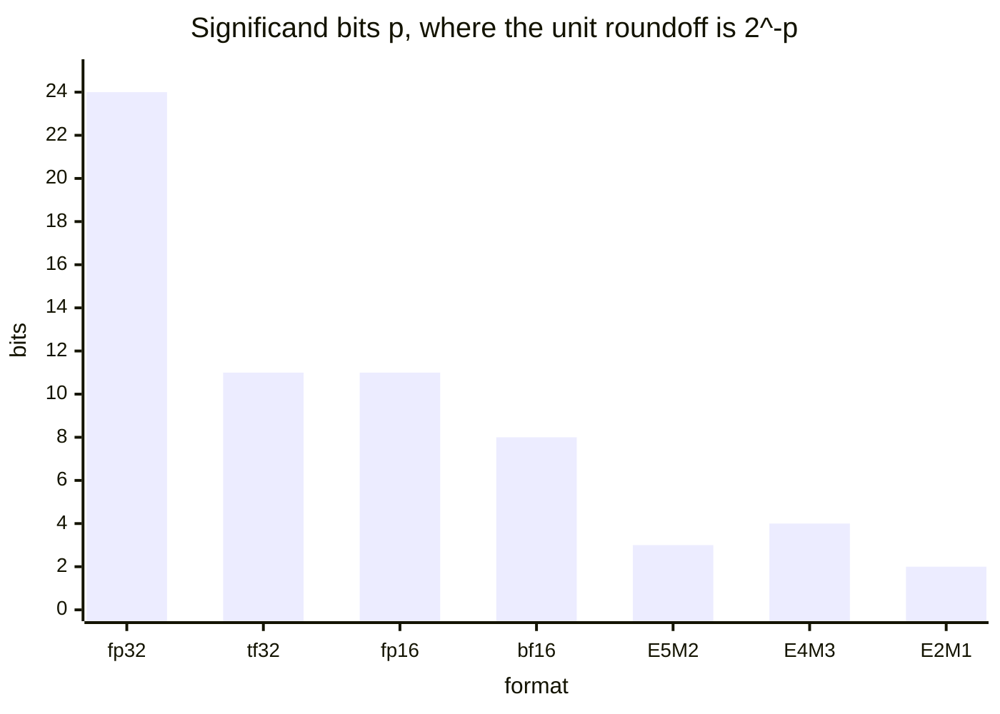
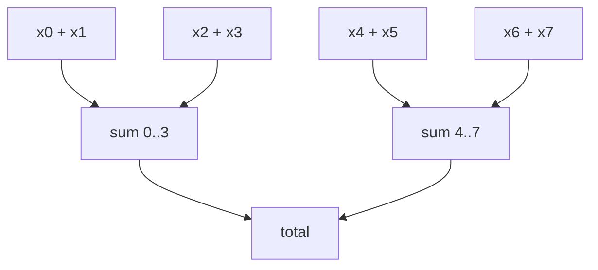
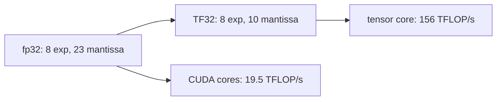
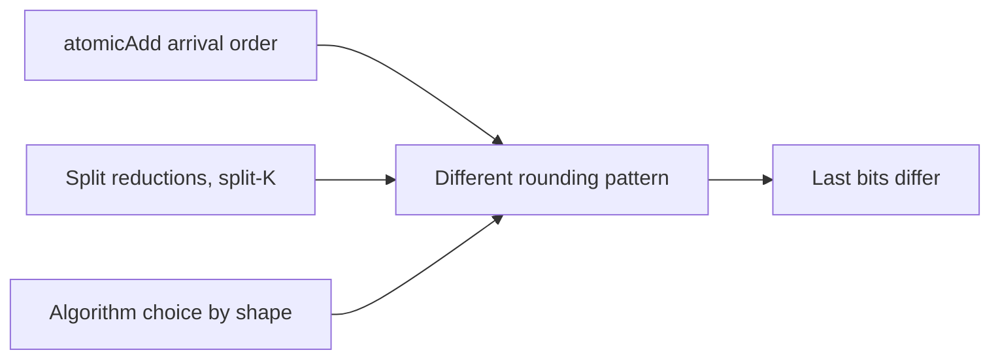

# Introduction

The question this chapter answers: why does the same sum give different answers,
and what do you do about it?

Note:
Open with the two symptoms the audience has seen. Two training runs with the
same seed drift apart in the fourth digit. A served model at temperature zero
returns different words for the same prompt. Neither is a bug in their code. By
the end they can say where the bits go and which of the two causes they have.

### Two symptoms {#symptoms}

- Same seed, same GPU, different loss in the fourth digit
- Temperature 0, same prompt, different completion under load
- A bf16 reduction that is 90% wrong with no error raised

Note:
Ask who has seen the first two. The third is the one nobody notices, because
nothing crashes. It is the stalled sum, and we will reproduce it with exactly 1024
ones. All three come from one fact: rounding happens after every add.

### The route {#roadmap}


Note:
Five stops. Formats first, because the unit roundoff drives everything. Then
rounding, then the sum, which is the heart of the chapter. Then what tensor cores
do, and last, repeatability.

# What a float is

The section answers how a handful of bits becomes a number.

Note:
Keep this short. Most of the room knows the idea; we need the exact value rule so
that the later arithmetic is precise.

### Sign, exponent, mantissa {#value-rule}

$$
x = (-1)^{S}\, 2^{E - \text{bias}} \left(1 + \frac{M}{2^{m}}\right)
$$

- bias is $2^{e-1} - 1$
- Exponent all zeros: subnormal, no implicit 1
- Exponent all ones: infinity or NaN (IEEE style)

Note:
Say the three parts out loud. The implicit leading 1 is why fp32 stores 23
mantissa bits but has 24 bits of precision. Subnormals fill the gap between zero
and the smallest normal. Exponent width sets range; mantissa width sets precision.

### Decode a bfloat16 {#decode}

- `0x4049` is `0 10000000 1001001`
- Exponent 128, bias 127: scale $2^1$
- Mantissa $73/128$: significand 1.5703125
- Value 3.140625, the nearest bf16 to $\pi$

> [!QUESTION] Why is bf16 just fp32 with the low 16 bits cut off?
> It has fp32's 8 exponent bits, so it has fp32's range. It keeps only 7 of the
> 23 mantissa bits, so a conversion is a truncation or a rounding of the bottom
> 16 bits.

Note:
Work the decode on the board. The error against pi is under a thousandth, which
is about what two decimal digits give you. Then take the question: because the
exponent matches fp32, bf16 never overflows where fp32 would not, which is why it
needs no loss scaling.

### The formats on one chart {#precision-bits}



Note:
This is the precision column of the table. fp32 has 24, TF32 and fp16 have 11,
bf16 has 8, and the FP8 formats have 4 and 3. The unit roundoff is two to the
minus that number. E4M3 is 0.0625, bf16 is 0.0039, fp32 is six times ten to the
minus eight. Range is a separate axis, set by exponent bits, and fp16 loses there.

### Range against precision {#range}

| Format | Largest finite | Unit roundoff |
|---|---|---|
| fp16 | 65,504 | $4.88 \times 10^{-4}$ |
| bf16 | $3.39 \times 10^{38}$ | $3.91 \times 10^{-3}$ |
| E4M3 | 448 | $6.25 \times 10^{-2}$ |
| E5M2 | 57,344 | 0.125 |

> [!QUESTION] Why does FP8 have two formats?
> Weights and activations need precision, so E4M3. Gradients span a wider range,
> so E5M2. The FP8 paper by Micikevicius and others recommends that split.

Note:
fp16 has more precision than bf16 but overflows at 65,504, which is why fp16
training needs loss scaling. E4M3 reuses its top exponent for finite numbers, so
its maximum is 448 and it has no infinity. Stress that the choice is where to
spend eight bits.

# Rounding and the format zoo

The section answers which float you get when a result lands between two.

Note:
We now move from what a format holds to what happens at the boundary. Rounding
mode, subnormals, and the compiler flags that change them.

### Round to nearest, ties to even {#rne}

- Take the closer float; on an exact tie take the even mantissa
- Error at most half an ulp: relative error at most $u = 2^{-(m+1)}$
- No bias: half the ties go up, half go down

Note:
Define ulp as the gap to the next float. Ties to even matters because a rule that
always rounded ties up would bias every long sum. That is a theme: the bias is
what hurts, not the noise.

### Ties in bfloat16 {#ties}

```viz
09-format-rounding
```

Note:
Use the figure live. Start on bf16 with exponent 8 and fraction 4 over 1024,
which is 257. The stored value is 256 and the readout says it is a tie. Then move
the fraction to 12 over 1024, which is 259, and the result is 260. Switch the
rounding to toward zero and show the error doubles in the worst case.

### Subnormals and flush to zero {#subnormals}

- fp32: smallest normal $2^{-126}$, smallest subnormal $2^{-149}$
- E4M3: smallest normal 0.015625, smallest subnormal 0.001953125
- Flush to zero treats a subnormal as zero

> [!WARNING] Tiny values are where FTZ bites
> A softmax denominator or a variance near zero can change when flush to zero is
> on.

Note:
Subnormals are evenly spaced, so their relative error grows toward zero. In E4M3
a value of two to the minus ten is a tie between zero and the smallest
subnormal, and ties to even sends it to zero; the lab checks that. Flush to zero
makes that happen for fp32 too.

### Block scaling in one slide {#block-scaling}

| Scheme | Block | Scale | Bits per element |
|---|---|---|---|
| MXFP4 | 32 | E8M0 | $4 + 8/32 = 4.25$ |
| NVFP4 | 16 | E4M3 | $4 + 8/16 = 4.5$ |
| int4, group 128 | 128 | fp16 | $4 + 16/128 = 4.125$ |

> [!QUESTION] How can 4 bits be enough?
> A shared scale per block moves E2M1's tiny range, 0 to 6, to where that block's
> values are. The scale costs the extra fraction of a bit.

Note:
E2M1 holds only 0, 0.5, 1, 1.5, 2, 3, 4, 6 and their negatives. Multiply a block
by a scale so its maximum lands near 6 and the grid becomes usable. The bits per
element include the scale. Chapter 18 builds a kernel around it.

### What the lab card runs {#hardware}

| Architecture | Adds to the tensor cores |
|---|---|
| Ampere A100 | TF32, bf16, fp16, int8 |
| Hopper | FP8 (E4M3, E5M2) |
| Blackwell | FP6, FP4, MX, NVFP4 |

> [!QUESTION] How do we study FP8 on an A100?
> By emulation. `torch.float8_e4m3fn` is a storage dtype: cast to it and back to
> see the round-trip error. There is no FP8 tensor-core speedup on this card.

Note:
Be clear that the A100 lab measures error, not throughput, for FP8. The cast
round trip is exactly what a Hopper kernel would see in its inputs. One practical
catch: casting past 448 gives NaN, so the lab clamps first.

### Fused multiply-add {#fma}

$$
\mathrm{fl}\bigl(\mathrm{fl}(a a) - c\bigr) = 0
\qquad
\mathrm{fl}(a a - c) = 2^{-24}
$$

- With $a = 1 + 2^{-12}$ and $c = 1 + 2^{-11}$ in fp32
- The product has an extra $2^{-24}$ bit that a separate multiply drops
- `nvcc` fuses `a * b + c` by default

Note:
Walk the arithmetic. The exact square is one plus two to the minus eleven plus
two to the minus twenty-four. The last term is half an ulp, a tie, and ties to
even drops it. The FMA keeps it. Neither is wrong; they are different programs,
which is why a CPU reference differs in the last bit.

### What --use_fast_math bundles {#fast-math}

| Call | Default | Fast math |
|---|---|---|
| `expf` | at most 2 ulp | `__expf`, $2 + \lfloor 1.173\,\lvert x\rvert \rfloor$ ulp |
| `x / y` | 0 ulp | documented at 2 ulp |
| subnormal | kept | flushed to zero |

> [!QUESTION] When is that trade worth it?
> When the output goes to bf16, where one ulp is $2^{-8}$ and 25 fp32 ulps are
> about $1.5 \times 10^{-6}$. Not when you compare to a reference to six digits.

Note:
The bounds are from the CUDA programming guide. At x equal to 20 the __expf
bound is 25 ulp. The lab compiles one kernel both ways and prints the measured
worst error over minus 20 to 20. The guide itself says to avoid the flag when
portability of results matters.

# The order of a sum

The section answers why adding the same numbers in two orders gives two answers.

Note:
This is the heart of the chapter. Everything so far was about one rounding. Now
we add up thousands of them.

### Addition is not associative {#nonassoc}

- fp32, $a = 10^8$, $b = 1$, $c = -10^8$
- $(a + b) + c$: the ulp at $10^8$ is 8, so $10^8 + 1 \mapsto 10^8$; the sum is 0
- $(a + c) + b$: the sum is 1

Note:
One answer is correct and the other is one hundred percent wrong. A GPU picks the
order from the schedule, so you do not get to choose unless you write the order
into the kernel. Ask the room: which of those would a left-to-right CPU loop give?

### The error of a sum {#error-bounds}

$$
\text{sequential: } (n-1)\,u
\qquad
\text{pairwise: } \lceil \log_2 n \rceil\, u
$$

- Relative to $\sum |x_i|$, for $n = 2^{20}$ in fp32
- Sequential bound 0.0625, pairwise bound $1.19 \times 10^{-6}$
- The random-walk estimate for sequential is about $1.3 \times 10^{-5}$

> [!QUESTION] Why is the sequential estimate so far below its bound?
> The bound assumes every rounding errs the same way by the maximum. Real errors
> have random signs and add like a random walk.

Note:
The 0.0625 is two to the minus four, twenty bits of terms times two to the minus
twenty-four. The random-walk figure sums ulp squared over twelve across the
terms for uniform data. Your lab measures the sequential, Kahan and tree sums on
exactly that input.

### The sum that stops {#stall}

$$
\frac{S}{a} \gtrsim 2^{p} \implies \mathrm{fl}(S + a) = S
$$

- bf16 ($p = 8$): stops near 256 addends
- fp16 ($p = 11$): near 2048
- fp32 ($p = 24$): near 16,777,216

Note:
This is the stall. Once the total is two to the p times the addend, the addend is
below half an ulp and vanishes. The failure is one sided: only ever too small. It
is a bias, so averaging over layers does not cancel it.

### A thousand ones in bfloat16 {#ones}

- Counting 1 to 256 is exact: every integer to 256 fits
- $256 + 1 = 257$ is a tie, and ties to even gives 256
- Every later add does the same: the answer is 256, not 1024

> [!QUESTION] Does PyTorch's `sum` do this?
> A PyTorch reduction accumulates in fp32 for bf16 inputs, and a tree adds in a
> different order. A hand-written loop with a bf16 accumulator does stall.

Note:
This is the exact input the lab asserts: a row of 1024 ones summed left to right
in a bf16 accumulator returns 256. The pairwise version returns 1024 because
every partial sum is a power of two and exact. The same trick works in fp32 at
two to the twenty-fourth.

### Watch it happen {#sum-figure}

```viz
09-summation-order
```

Note:
Select bf16 and n of 4096: the red running sum flattens near 256 while the exact
line keeps climbing. The readout shows the sequential error near 90 percent and
the tree and Kahan errors at a fraction of a percent. Switch to fp32 and the
curves coincide. Raise n at fp32 and the sequential error grows.

### Tree sums {#tree}



Note:
Every input passes through log base two of n additions instead of n. That is what
a block reduction does anyway, and it is why a GPU sum is usually better than the
naive CPU loop. For 5120 bf16 terms the bound is 13 times 2 to the minus 8, about
5 percent, against a stall at 90.

### Kahan summation {#kahan}

$$
y = x_i - c,\quad t = s + y,\quad c \leftarrow (t - s) - y,\quad s \leftarrow t
$$

| Step | $t$ | $c$ | $s$ |
|---|---|---|---|
| 1 | 256 | $-1$ | 256 |
| 2 | 258 | 0 | 258 |
| 3 | 260 | 1 | 260 |
| 4 | 260 | 0 | 260 |

Note:
Trace it in bf16 starting at 256 and adding 1 four times. The plain sum is stuck at
256. Kahan returns 260, which is correct. At step 3 it overshoots and c records the
overshoot, so step 4 adds nothing. The error bound is about 2u with no factor of n.

### When to use which {#which-sum}

> [!QUESTION] If Kahan is so accurate, why not use it everywhere?
> It costs four flops per element and it is serial. A tree in fp32 is nearly as
> accurate and it parallelizes. Reach for Kahan when you can't change the order.

> [!WARNING] The compiler can undo it
> `-ffast-math` on a CPU may reassociate the compensation to zero. Test the error,
> not the presence of the code.

Note:
A reduction is memory bound, so the extra flops are free, but a single-thread
Kahan loop is slow. In the lab you write both and compare. nvcc fuses
multiply-adds but does not reassociate additions by default, and the lab test
checks the result rather than trusting that.

# Tensor cores and TF32

The section answers how a tensor core adds, and what TF32 rounds.

Note:
Now the hardware. A GEMM is a sum of K products, so everything about the sum
applies to the accumulator inside the tensor core.

### Narrow in, wide out {#accumulate}

- A bf16 product has at most 16 bits, an fp16 product at most 22
- Both fit exactly in fp32's 24
- So the rounding is in the accumulator, not the products

> [!QUESTION] Why not accumulate in fp16 for speed?
> On an A100 PCIe, Luo and others measured 310.6 against 303.4 TFLOP/s for fp16
> against fp32 accumulate, 2.3% apart. That buys nothing for an accumulator that
> stalls near 2048 terms.

Note:
PTX says the accumulator is at least single precision and leaves the order and the
internal rounding unspecified. The Dissecting Tensor Cores paper probes it. Do not
assume a tensor core adds like your Python loop.

### TF32 on the A100 {#tf32}



Note:
TF32 keeps fp32's range and fp16's precision, in a 32-bit container. The rate is
108 SMs times 1024 times 1.41 gigahertz, 155.9 TFLOP/s, rated at 156. That is 8
times the 19.5 of the fp32 CUDA cores, and half the bf16 rate.

### PyTorch's defaults {#flags}

| Setting | Default | Effect |
|---|---|---|
| `matmul.allow_tf32` | `False` | fp32 matmul on CUDA cores |
| `cudnn.allow_tf32` | `True` | convolutions use TF32 |
| `float32_matmul_precision` | `"highest"` | full fp32 |

> [!QUESTION] What does "high" do?
> It uses TF32, or splits each fp32 number into two bf16 numbers when that is
> faster. "medium" uses bf16. The output dtype stays fp32 either way.

Note:
So by default an fp32 matmul on this card runs at 19.5, not 156 TFLOP/s. Turning on
TF32 buys up to 8 times the rate for about three decimal digits of input precision.
Chapter 10 compares SGEMM against cuBLAS with TF32 off.

### Two roundings of one format {#tf32-rounding}

- `cvt.rna.tf32.f32`: nearest, ties away from zero; error at most $2^{-11}$
- `wgmma` on raw fp32 inputs: truncates the low 13 bits; error up to $2^{-10}$
- Truncation always errs toward zero: a bias

> [!WARNING] Don't state one TF32 rule
> The rounding depends on the instruction. State which path you mean.

Note:
This is the PTX and NVIDIA-blog contradiction from the fact sheet. Each statement is
true of one path. The lab implements the first with integer arithmetic: view the
float as int32, add 0x1000, clear the low 13 bits. Without the add, you have the
truncating path.

# Determinism

The section answers why an unchanged program gives different numbers.

Note:
Last topic. We now know that the order of a sum changes its value. Who chooses the
order on a GPU?

### Three ways the order moves {#sources}



Note:
Atomics: blocks finish in an order set by the scheduler. Splits: a library picks how
many pieces and combines them in its own order. Algorithm choice: cuBLAS and cuDNN
choose by shape, workspace or benchmark. All three change the order, and so the
rounding.

### atomicAdd {#atomic}

```cuda
if (threadIdx.x == 0) {
    atomicAdd(out, block_total);
}
```

- The tree inside each block is deterministic
- The order of the block totals is not
- Correct to the error bound, not repeatable

> [!QUESTION] Will I always see different results?
> No. A quiet card can land on one order by luck. Passing ten runs proves nothing;
> the lab prints a note when all 50 agree.

Note:
In the lab the atomic kernel uses 256-thread blocks over 4 million values, which is
16,384 atomic adds into one float. The test counts distinct bit patterns and only
asserts accuracy for it. It asserts exact repeatability only for the tree.

### A fixed-order tree {#fixed-order}

- Write one partial per block, not an atomic
- Reduce the partials with another launch of the same kernel
- Every add has a fixed partner: bitwise repeatable

> [!QUESTION] What does determinism cost?
> A second launch or two, a few microseconds each, reading one float per block. The
> lab reports tree throughput against a floor of a quarter of the copy ceiling.

Note:
This is the lab design. Pass one reduces each slice of 1024 values to a partial;
pass two reduces the partials; repeat until one is left. Other fixed-order options:
sort before adding, or add scaled integers with atomics, since integer addition is
associative.

### Batch invariance {#batch-invariance}

- Forward passes are often deterministic run to run
- But a kernel may split its reduction by batch size
- Load changes batch size, so one request's answer changes

> [!QUESTION] Is that measured?
> Yes, by Thinking Machines on Qwen3-235B at temperature 0: 80 unique completions in
> 1000 samples, and 1000 identical with batch-invariant kernels. It is their setup,
> not the lab card.

Note:
Cite it as theirs. Their fix is a fixed reduction order per row for RMSNorm, one
matmul configuration for all shapes, and a fixed split size in attention. They
report a cost of about 20 percent on matmul. The kernel-writer lesson is to make the
order independent of batch, grid, and timing, on purpose.

# Summary

The numbers to keep, and which fix goes with which symptom.

Note:
Close the talk by collecting the numbers: the unit roundoffs, the stall point,
and the habits. Then a decision table that maps what you see to what to change.

### What to remember {#summary}

- Unit roundoff $2^{-(m+1)}$: fp32 $2^{-24}$, bf16 $2^{-8}$, E4M3 $2^{-4}$
- A sum in $p$ bits stalls near $2^p$ equal terms: 256 for bf16
- Accumulate in fp32; use a tree, or Kahan when order is fixed
- `atomicAdd` and shape-dependent splits break repeatability

Note:
Four lines. Read them aloud. The first is the format, the second the wall, the third
the habit, the fourth the cost of speed. If the room remembers one number, it is
256 for bf16.

### Which fix for which symptom {#decision}

| Symptom | Likely cause | Fix |
|---|---|---|
| Result too small, no error | Narrow accumulator stalled | Accumulate in fp32 |
| Last-bit GPU and CPU mismatch | FMA, thread count | Compare with a scaled tolerance |
| Run-to-run difference | `atomicAdd`, split | Fixed-order tree |
| Load-dependent output | Batch variance | Batch-invariant kernels |

Note:
A decision guide. Walk down the rows. The scaled tolerance is the error divided by
the sum of absolute values, as the lab computes it. The last row is the inference
case from the previous section.

### Next: GEMM from scratch {#next}

- Chapter 10 builds SGEMM, and compares it with cuBLAS with TF32 off
- Chapter 11 adds tensor cores, where the accumulator rules matter
- Your lab reports `kahan_rel_err`, `atomic_distinct`, and `tree_gbs`

Note:
Chapter 10 turns to the arithmetic side of the roofline: a matrix multiplication
that is a sum of K products per output. Everything here applies to the accumulator.
Close by pointing at the lab and its metrics.
