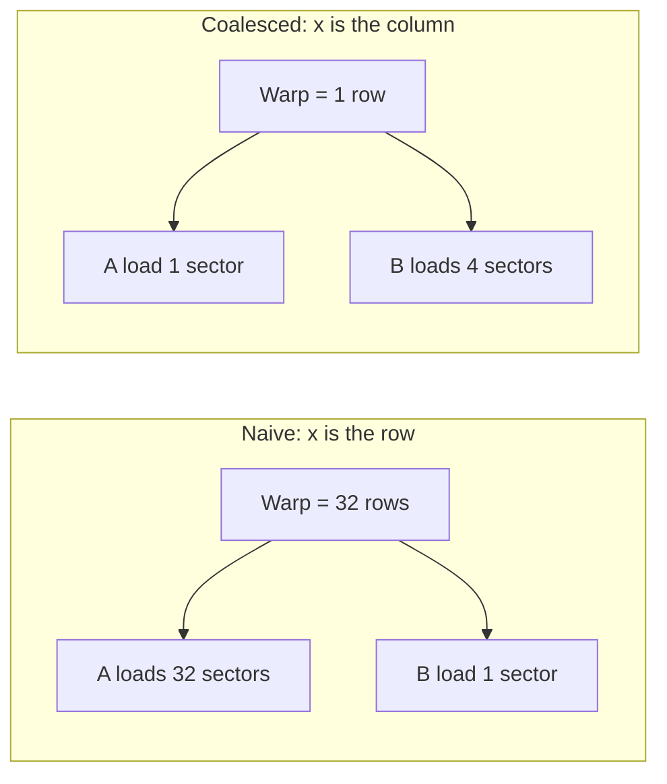
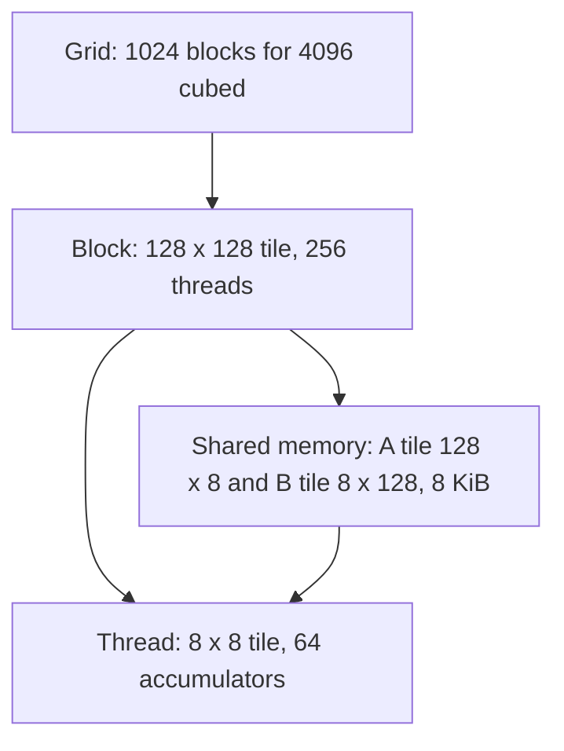
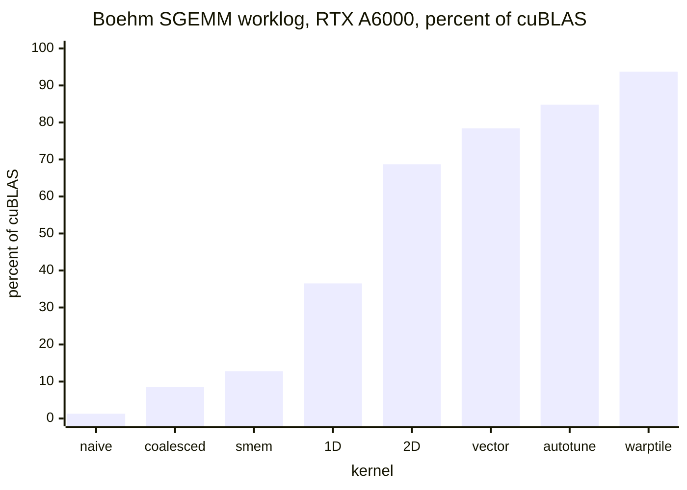

# Introduction

The question: how do you write a matrix-multiplication kernel that gets close to cuBLAS, and which limit do you remove at each step?

Note:
Open by saying that this is the most important kernel in the course. Every linear layer, every attention score, and most of the backward pass is a GEMM. We stay in fp32 on the CUDA cores on purpose, because it keeps the ideas visible. Tensor cores arrive in the next chapter, and they keep the structure we build today.

### Why GEMM is the kernel {#why-gemm}

- A linear layer is a GEMM: $M$ = tokens, $K$ = inputs, $N$ = outputs
- Attention scores and the value product are batches of GEMMs
- Training runs three GEMMs per linear layer: one forward, two backward
- 8192 tokens through a 4096 by 4096 layer is 274.9 GFLOP

Note:
The last bullet is 2 times 8192 times 4096 times 4096. In bf16 on the tensor cores at 312 TFLOP/s that is at least 0.88 ms. A model has dozens of these per layer, so a few percent off one kernel shows up directly in the step time. Ask the room how many GEMMs they think a single transformer layer launches in a forward pass, then move on.

### What you already know {#prereqs}

- Coalescing: a warp's load is a set of 32-byte sectors
- Shared memory: 32 banks, fast when a warp hits different banks or one address
- Roofline: ridge point $I^{\ast} = C / \beta$
- Registers: 65,536 per SM, at most 255 per thread

Note:
These four ideas from chapters 2, 3, 4, and 8 are the whole toolkit. Each kernel in the ladder is explained by one of them. If someone is unsure about banks, say the one-line version: a warp is fast when its 32 threads read different banks or the same word, and slow when they read different words in one bank.

### The route through this deck {#roadmap}


Note:
Six stops. We price the GEMM, then fix the access pattern, then add reuse in shared memory, then add reuse in registers, assemble the full kernel, and finally name the hierarchy and the ceiling. At every stop we name which resource limits the kernel, because that is what tells you what to change next.

# What a GEMM costs

FLOPs, bytes, and the intensity that says what a perfect kernel looks like.

Note:
This section sets the target. Before writing any kernel we compute the floor, so that every later measurement has something to be compared with.

### FLOPs and bytes {#flops-bytes}

$$\text{FLOPs} = 2MNK \qquad \text{bytes}_{\min} = 4\,(MK + KN + MN)$$

$$I = \frac{2N^3}{4 \cdot 3N^2} = \frac{N}{6}\ \text{FLOP/byte}$$

- Arithmetic is cubic, data is quadratic
- Intensity grows with the matrix

Note:
Each of the M times N outputs is a dot product of K pairs, one multiply and one add per pair. The least traffic reads A and B once and writes C once, four bytes per element in fp32. For a square matrix the intensity is N over 6. That growth is the property that makes GEMM special: you can reuse every loaded value many times, if you arrange the loops to do it.

### The 4096 cube on an A100 {#example-4096}

| Quantity | Value |
|---|---|
| FLOPs | 137.4 GFLOP |
| Minimum traffic | 201.3 MB |
| Intensity | 682.7 FLOP/byte |
| fp32 ridge point | 10.08 FLOP/byte |
| Arithmetic floor | 7.05 ms at 19.5 TFLOP/s |
| Memory floor | 0.104 ms at 1935 GB/s |

> [!QUESTION] Why 19.5 TFLOP/s and not 312?
> 312 is the bf16 tensor-core peak. fp32 on the CUDA cores peaks at 19.5, and `torch.matmul` uses them by default because `allow_tf32` is off.

Note:
The GEMM sits 68 times to the right of the ridge point, so a perfect kernel is bound by arithmetic and takes 7.05 ms. The memory floor is 45 times lower at the measured 1275 GB/s copy ceiling. The job of a good kernel is to use that margin: move each byte from DRAM once, then reuse it from faster memory. The lab prints both floors.

### A skinny GEMM is different {#skinny}

- $M = 1$, $K = N = 4096$: 33.6 MFLOP on 67.1 MB
- Intensity is 0.5 FLOP/byte, far below the ridge point
- The kernel reads the weights and nothing else matters
- Decoding a language model is this case

> [!WARNING] The $N/6$ result assumes a square problem
> Small $M$ makes the weights dominate the traffic.

Note:
Use this slide to mark the scope. Everything after it assumes large M, N, and K. When M is one, a matrix-matrix product degenerates into a matrix-vector product and the limit is the bandwidth for reading the weights. That is why batching requests matters in serving, which the companion course covers.

# Naive and coalesced

One thread per output, and the one-line swap that fixes its access pattern.

Note:
The first two kernels of the ladder. Both are correct for any shape. They differ in which thread owns which output, and that single choice moves the kernel from 1.3 percent to 8.5 percent of cuBLAS on Boehm's RTX A6000.

### The naive kernel {#naive}

```cuda
int row = blockIdx.x * blockDim.x + threadIdx.x;
int col = blockIdx.y * blockDim.y + threadIdx.y;
if (row < M && col < N) {
    float acc = 0.f;
    for (int k = 0; k < K; ++k)
        acc += A[row * K + k] * B[k * N + col];
    C[row * N + col] = acc;
}
```

- One thread, one element of $C$; the guard handles any size

Note:
This is the version most people write first. Walk the loop: two loads and one FMA per iteration. Point at the guard, which makes it correct for sizes that are not multiples of 32. Then ask what the warp is doing, because the next two slides answer that. The launch is a 32 by 32 block and a grid of ceiling M over 32 by ceiling N over 32.

### No planned reuse {#no-reuse}

- Two 4-byte loads per FMA: 0.25 FLOP/byte at the load instructions
- Total loads at $4096^3$: 549.8 GB, 2,731 times the minimum
- From DRAM alone that is at least 284 ms, 2.5% of peak

> [!QUESTION] Don't the caches fix that?
> They catch some reuse, because neighbors read the same rows and columns, but every load still passes through the load/store units. The kernel has only the reuse the caches happen to find, not reuse by design.

Note:
The arithmetic: 16,777,216 outputs times 8,192 floats of loads times 4 bytes is 549.8 gigabytes. Divide by 1935 gigabytes per second and you get 284 milliseconds, which is 484 GFLOP/s, 2.5 percent of the fp32 peak. The caches soften this, but the point is that nothing in the kernel plans for reuse.

### Which thread is which {#thread-mapping}



Note:
In the naive mapping the 32 threads of a warp are 32 different rows with the same column. Their A loads are K floats apart, so each lands in its own sector: 32 sectors for 32 floats, an eight times read amplification. B is one broadcast address. In the coalesced mapping the warp shares a row and covers 32 consecutive columns, so A is a broadcast and B is 128 contiguous bytes. That is 5 sectors instead of 33.

### Swap the roles {#swap}

```cuda
int col = blockIdx.x * blockDim.x + threadIdx.x;
int row = blockIdx.y * blockDim.y + threadIdx.y;
```

- 33 sectors per warp iteration become 5, a 6.6 times cut
- Boehm: 1.3% to 8.5% of cuBLAS on an RTX A6000
- Still no reuse: every thread loads $2K$ floats

Note:
Two lines change, and the grid dimensions swap with them. The measured gain, about 6.5 times, agrees with the sector count. Remind the audience that these percentages are from an RTX A6000 and describe the shape of the climb, not A100 numbers. The remaining problem is the one from two slides ago, no planned reuse, and that is what shared memory is for.

# Shared-memory tiling

Load a piece of $A$ and $B$ once, use it many times.

Note:
This section introduces reuse. The block becomes a cooperating unit with a scratchpad, and we find out that fixing global traffic moves the bottleneck rather than removing it.

### One load, many uses {#tile-idea}

- A 32 by 32 block owns a 32 by 32 tile of $C$
- It walks along $K$ in steps of 32
- Each step stages a tile of $A$ and a tile of $B$ in shared memory
- Each loaded value is used by 32 threads

> [!KEY] Global loads fall 32-fold
> From 549.8 GB to 17.2 GB at $4096^3$.

Note:
Contrast with the naive kernel, where each thread streams its own row and column. Here the block loads cooperatively: every thread loads one element of each tile, then every thread uses a row of the A tile and a column of the B tile. The thirty-two-fold cut is exact for the loads that reach the global memory system.

### The loop, with the tails {#tiled-code}

```cuda
As[ty][tx] = (row < M && t + tx < K) ? A[row*K + t + tx] : 0.f;
Bs[ty][tx] = (t + ty < K && col < N) ? B[(t+ty)*N + col] : 0.f;
__syncthreads();
for (int k = 0; k < TILE; ++k) acc += As[ty][k] * Bs[k][tx];
__syncthreads();
```

- Out of range loads 0.0, so tails add nothing
- Guard loads and the store, never the loop

> [!QUESTION] Why not return early from threads outside the matrix?
> `__syncthreads()` waits for the whole block. A thread that left would hang it or let it read half-loaded tiles.

Note:
Three rules. First, zero-fill every out-of-range element so the K tail and the edge blocks need no special code. Second, every thread runs every iteration. Third, two barriers: the first makes the writes visible before anyone reads, the second stops a fast thread from overwriting the tiles while a slow one is still reading. Delete the second and the result is wrong, and nondeterministically so.

### What limits it now {#tiled-limit}

- Per FMA, a thread reads two values from shared memory: 8 bytes
- The SM retires 64 FMA per clock and reads 128 bytes per clock
- The budget is 2 bytes per FMA
- Boehm: 12.8% of cuBLAS, stalled on the shared-memory queue

Note:
The bottleneck moved. Global traffic dropped 32-fold, and if the 17.2 gigabytes came from L2 at the measured 2.8 terabytes per second, the 32 by 32 tile would allow 22 TFLOP/s, above the peak. So global traffic is not the limit any more. The limit is the eight bytes per FMA against a budget of two. Boehm's profile shows MIO throttle, the queue in front of shared memory.

### How big a tile has to be {#tile-formula}

$$I_{\text{tile}} = \frac{B_M B_N}{2\,(B_M + B_N)} \quad\Rightarrow\quad I = \frac{B}{4}\ \text{for a square tile}$$

- $B \ge 40.3$ clears the rated ridge point
- $B \ge 61.2$ clears the measured one
- 64 by 64 is the smallest power of two that does

Note:
Derive it in one line: a tile does two times B_M times B_N times B_K FLOPs per step and loads four times B_M plus B_N times B_K bytes. B_K cancels. The ridge point is 10.08 at the rated bandwidth and 15.3 at the measured copy ceiling, which gives the two thresholds. This is a DRAM-level argument. The L2 cache catches reuse between blocks, so it is pessimistic, but it sets the scale.

### Drag the tile size {#tile-figure}

```viz
10-tile-intensity
```

Note:
Let the audience drag the sliders. At the measured bandwidth the 16 by 16 and 32 by 32 tiles are memory bound at 5.1 and 10.2 TFLOP/s. The 64 by 64 tile is capped by the arithmetic peak. Point out the readout for shared memory per K step: the cost of a big tile is small on that side, 8 KiB for 128 by 128, and large in registers.

# Register blocking

Make each shared-memory read feed many FMAs.

Note:
Shared memory is the limit, and registers are the way out. This is the biggest jump in the ladder, from 12.8 percent to 68.7 percent on Boehm's card.

### The outer product {#outer-product}

$$\text{acc}_{ij} \mathrel{+}= a_i\,b_j, \qquad i < T_M,\ j < T_N$$

$$\text{bytes per FMA} = \frac{4\,(T_M + T_N)}{T_M T_N}$$

- A thread owns a $T_M \times T_N$ tile in registers
- Per step it reads $T_M + T_N$ values, does $T_M T_N$ FMAs

Note:
Instead of one output per thread, each thread keeps a small tile of accumulators in registers. At each k it loads T_M values of A and T_N values of B, then does every pairing. That is an outer product of two small vectors. The bytes per FMA formula follows: reads times four, divided by FMAs.

### One thread, one outer product {#outer-figure}

```viz
10-outer-product
```

Note:
Step through the eight k values with the buttons. Switch the thread tile from one by one to eight by eight and watch the bytes-per-FMA readout fall from 8 to 1. The figure counts every thread's reads separately, which is conservative, since a warp broadcast counts once in hardware.

### Against the budget {#budget-table}

| Thread tile | Bytes per FMA | FMA peak allowed |
|---|---|---|
| 1 by 1 | 8 | 25% |
| 8 by 1 | 4.5 | 44% |
| 4 by 4 | 2 | 100% |
| 8 by 8 | 1 | 100%, half the bandwidth spare |

Note:
The budget is 128 bytes per clock over 64 FMA per clock, two bytes per FMA. The eight by one row is Boehm's 1D blocktiling, 36.5 percent of cuBLAS. The eight by eight row is his 2D kernel, 68.7 percent. The four by four row just meets the budget, which is why it is the smallest thread tile worth trying.

### What the registers cost {#register-cost}

- 64 accumulators + 8 + 8 in flight = 80 data registers
- Assume 128 per thread: 32,768 per 256-thread block
- Two blocks per SM: 16 warps, 25% occupancy

> [!QUESTION] Isn't 25% occupancy too low?
> Each thread has 64 independent FMAs between loads. That instruction-level parallelism hides latency in place of extra warps. Spilling to local memory is the real danger.

Note:
Read the real register count from nvcc with the ptxas verbose flag or cuobjdump, and check for spills. The 128 here is an assumption for the arithmetic, not a measurement. Chapter 4 showed that ILP can replace occupancy as the latency-hiding mechanism, and this kernel is the standard example.

# The full kernel

A 128 by 128 block tile, an 8 by 8 thread tile, and a plan for every tail.

Note:
Now we assemble the pieces. The configuration is the one in Boehm's later kernels, and the lab's reference solution uses it.

### Block tile to thread tile {#hierarchy-map}



Note:
There are 128 over 8 times 128 over 8 equals 256 threads, laid out 16 by 16. Thread tid owns rows threadRow times 8 and columns threadCol times 8 within the block tile. Shared memory holds one 128 by 8 piece of A and one 8 by 128 piece of B per step, 8 KiB, tiny against the 164 KiB per SM. The block's registers are the larger cost.

### Loads and the transposed tile {#loads}

- 1,024 floats per tile, four per thread
- Store $A$ transposed, `As[k*BM + m]`
- A thread's 8 values for one $k$ are contiguous: two 128-bit reads
- Out-of-range loads 0.0, the store is guarded

Note:
The transpose is the detail that makes the compute loop fast. With the A tile stored as k-major, the eight values a thread needs for a given k sit at eight consecutive words. The price is that the scalar stores into the transposed tile have some bank conflicts. Boehm's attempts to remove them made his kernel slower, so his final kernels keep them.

### Vectorized loads {#vectorized}

- `float4` loads: a quarter of the instructions for the same bytes
- Needs 16-byte aligned addresses, so $K \bmod 4 = 0$ and $N \bmod 4 = 0$
- Boehm: 68.7% to 78.4% of cuBLAS

> [!QUESTION] What happens at $K = 1021$?
> Rows start at unaligned addresses and a `float4` can straddle the row end. Take the scalar path, or pad. A misaligned `float4` raises an error on the GPU.

Note:
The reference solution compiles one template for both paths and picks on the host: vector path when K and N are multiples of four and the pointers are 16-byte aligned, scalar path otherwise. A fresh cudaMalloc is at least 256-byte aligned, but a view into a larger tensor can start anywhere, so check the pointer as well as the shape.

### The grid and the waves {#waves}

- $4096 / 128 = 32$, so 1024 blocks
- Two blocks per SM: 216 run at once
- $1024 / 216 = 4.74$ waves; the fifth wave is 74% full
- Wave efficiency: $1024 / (5 \times 216) = 94.8\%$

> [!QUESTION] Why not a 256 by 256 tile for more reuse?
> With 256 threads it needs 256 accumulators per thread, over the 255-register limit. Fewer threads or more registers means fewer blocks per SM and a coarser wave tail.

Note:
This assumes two blocks per SM, which depends on the register count. Chapter 4's wave quantization applies directly. A bigger tile has more reuse, but it needs more registers per thread or more work per thread, and it makes the last wave a larger fraction of the grid. The best tile is a trade-off, which is why autotuning exists.

# Hierarchy and ceiling

What each level of the tiling reuses, and where the road ends.

Note:
We close the technical content by naming the structure, reading the whole ladder, and asking what caps it.

### Four levels of tiling {#four-levels}

| Level | Tile | Operands live in |
|---|---|---|
| Thread block | 128 by 128 | Shared memory |
| Warp | for example 32 by 64 | Shared memory, read to registers |
| Thread | 8 by 8 | Registers |
| Instruction | Chapter 11 | Tensor-core fragments |

Note:
At each level a tile of the output is the unit of ownership and the operands it needs are the unit of data movement. One load at a level is reused many times at the level below. CUTLASS uses the same levels, and chapter 13 formalizes them. In chapter 11 the thread tile becomes an instruction tile.

### Why a warp tile {#warp-tile}

- Our warp covers a 16 by 128 slab: 18 groups of 8 values per step
- A 32 by 64 warp tile needs 12 groups for the same work
- A squarer tile reads fewer distinct addresses per FMA
- Boehm's warptiling: 93.7% of cuBLAS

Note:
Warp zero of our kernel holds threads zero to thirty-one, so threadRow is zero or one and threadCol runs from zero to fifteen. That is two groups of A and sixteen of B. A thirty-two by sixty-four warp tile is four thread tiles tall and eight wide: four plus eight, twelve groups for the same thirty-two thread tiles. It is the same argument as the block tile's.

### The whole ladder {#ladder}



Note:
Name the bottleneck at each bar. Naive: uncoalesced loads. Coalesced: no reuse. Shared memory: eight bytes per FMA against a budget of two. 1D: four and a half bytes per FMA. 2D: memory pipeline stalls. Vectorized: bank conflicts and no double buffering. Remind the audience that the card is an RTX A6000; read the shape of the climb, not the values.

### The ceiling {#ceiling}

- CUDA-core fp32 peak: 19.5 TFLOP/s, a 7.05 ms floor at $4096^3$
- TF32 tensor cores: 156 TFLOP/s, 8 times higher
- bf16 and fp16 tensor cores: 312 TFLOP/s, 16 times higher

> [!QUESTION] Can a hand-written kernel beat cuBLAS?
> Salykov reports 3 to 4% faster than cuBLAS on an RTX 3090 with unlocked clocks, at about 12% more power. Past 90% the gains are small and card-specific.

Note:
The ladder ends at the CUDA-core peak. The only way past it is the tensor cores, which is chapter 11. The tiling structure stays, and the inner loop changes from sixty-four scalar FMAs per thread to a matrix instruction per warp. Chapter 12 then overlaps the loads with it using asynchronous copies.

# Summary

What to remember, and what comes next.

Note:
Wrap up by repeating the one number that organizes the chapter, the budget of two bytes per FMA, and the one structure, the outer product on registers.

### What to remember {#remember}

- $2MNK$ FLOPs on at least $4(MK + KN + MN)$ bytes: large GEMMs are arithmetic bound
- Each rung removes one limit: access pattern, global loads, shared-memory reads
- The inner loop is an outer product on registers
- Zero-fill tails, guard loads and stores, never skip a barrier
- Hierarchy: block, warp, thread, registers

Note:
If the audience remembers one thing, it is the question to ask of any kernel: which resource is the limit now. The lab makes them answer it with a measurement.

### Numbers to remember {#numbers}

| Quantity | Value |
|---|---|
| $4096^3$ fp32 floor | 7.05 ms |
| Minimum traffic | 201.3 MB |
| Shared-memory budget | 2 B per FMA |
| 8 by 8 thread tile | 1 B per FMA |
| Tile clearing the ridge | 64 by 64 |
| Boehm, A6000 | 1.3% to 93.7% |

Note:
These are the numbers the lab refers to. The lab reports your GFLOP/s and your percentage of cuBLAS on the A100, and its thresholds are less than half of Boehm's percentages for the same rungs. The measured values, not the chapter's predictions, are what you should trust.

### Next: tensor cores {#next}

- Same tiling, new inner loop: a warp-wide matrix instruction
- The A100 raises the ceiling from 19.5 to 156 or 312 TFLOP/s
- Chapter 12 overlaps loads with the math using `cp.async`

Note:
Hand over to chapter 11. The block tile, the shared-memory staging, and the zero-filled tails all carry over. What changes is the thread tile, which becomes a fragment, and the arithmetic, which becomes one instruction over a 16 by 8 by 16 tile.
