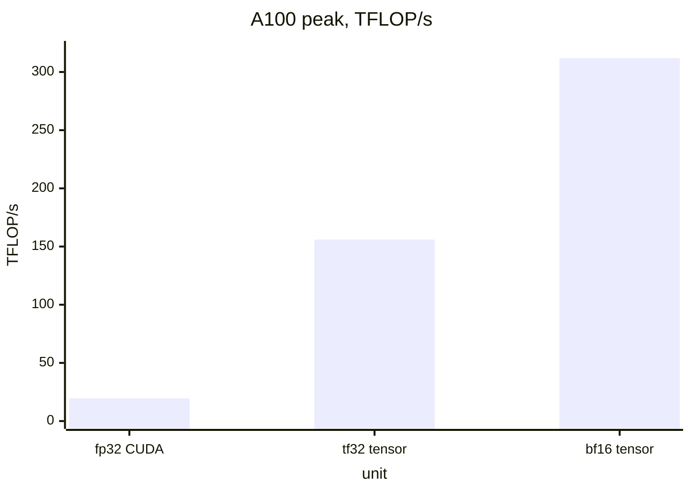
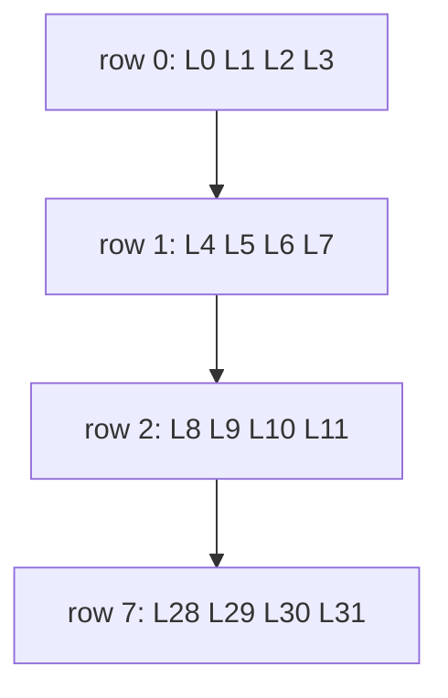
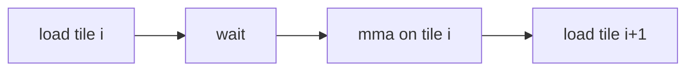

# Introduction

How do you feed a unit that does 4096 FLOP per instruction?

Note:
Frame the talk as a feeding problem. The multiplier is fast; the question is whether shared memory, registers, and global memory keep up. Chapter 10's SGEMM structure carries over; only the innermost update changes.

### Where the FLOPs are {#where-flops}

- A transformer is mostly matrix multiplies
- On an A100 they run on tensor cores, not CUDA cores
- Skip the tensor cores and 16x of the arithmetic is unused
- The lab: a bf16 GEMM with WMMA, then `mma.sync` with `ldmatrix`

> [!QUESTION] Don't I get tensor cores for free from PyTorch?
> For `torch.matmul` on bf16, yes: cuBLAS uses them. You write this yourself
> when you fuse something into the GEMM, as attention and quantized kernels do.

Note:
Set expectations. Most people never write mma.sync, but every fused kernel in the rest of the course (attention, quantized GEMM, grouped GEMM) is a tensor-core kernel, and Triton's tl.dot lowers to what we show today.

### Roadmap {#roadmap}


Note:
Walk the five stops. WMMA hides layouts, mma.sync exposes them, feeding is the performance part, and the last stop is where the hardware is heading. The lab covers the middle three.

# What a tensor core computes

One instruction, one small matrix product.

Note:
This section sets up the unit and its numbers. Keep the arithmetic on screen: 16 by 8 by 16, 2048 FMA.

### D = A·B + C on a tile {#dabc}

$$
D = A \cdot B + C, \quad A: 16 \times 16,\ B: 16 \times 8,\ C, D: 16 \times 8
$$

- One warp executes it, all 32 lanes together
- $16 \times 8 \times 16 = 2048$ FMA = 4096 FLOP
- The SGEMM micro-kernel does 32 FMA per warp instruction

Note:
This is mma.sync m16n8k16 on sm_80. One warp-wide instruction does 2048 FMA, which is 64 times what a warp does with one FFMA instruction. A big GEMM is a loop of these where D feeds C.

### Why 16-bit in and fp32 out {#mixed}

- bf16 product: 8 bit by 8 bit significands, 16 bits
- Fits exactly in fp32's 24-bit significand: **products are exact**
- All rounding happens in the adds, in fp32
- A bf16 accumulator would stall once the sum is 256x the term

> [!QUESTION] Does the tensor core accumulate in a fixed order?
> No. PTX says only "at least single precision" and fixes no order, so a result
> won't match an fp32 reference bit for bit. Compare with a tolerance.

Note:
The numerical argument is exactness of products. The hardware argument is that a 16-bit multiplier is small, so you pack many. The order of accumulation inside an instruction is unspecified, which is why the lab tests use a relative tolerance.

### The 16x gap {#gap}



Note:
These are the A100 datasheet dense peaks. The bf16 to fp32 ratio is 16. TF32 sits at half of bf16. No fp8 on this card; that starts on Ada and Hopper.

### Where 16x comes from {#sixteen}

| Unit | FLOP / clock / SM | Peak at 108 SMs, 1410 MHz |
|---|---|---|
| fp32 CUDA cores | 64 FMA = 128 | 19.5 TFLOP/s |
| bf16 tensor cores | 4 x 256 FMA = 2048 | 311.9 TFLOP/s |

- Same clock, same SMs: the ratio is $2048 / 128 = 16$

Note:
Do the multiplication aloud: 108 times 2048 times 1.41 giga is 311.9 tera. Each tensor core does 256 fp16 FMA per clock per the whitepaper, four per SM. The gap is per-SM rate, nothing else.

### The ridge point moves {#ridge}

$$
I^{\ast}_{\text{fp32}} = \frac{19.5}{1.935} = 10.1 \qquad I^{\ast}_{\text{bf16}} = \frac{312}{1.935} = 161.2\ \text{FLOP/B}
$$

- A $4096^3$ GEMM with fp32 output moves at least 134.2 MB for 137.4 GFLOP
- Intensity 1024 FLOP/B: compute-bound, if tiling reaches the minimum
- Floors: 0.44 ms on tensor cores, 7.05 ms on CUDA cores

> [!QUESTION] Why does the 1275 GB/s copy ceiling not matter here?
> At minimum traffic the GEMM needs 0.105 ms of memory time against 0.44 ms of
> math. Memory matters only if tiling fails to reach the minimum traffic.

Note:
Tensor cores make the kernel need 16 times more reuse per byte. At 4096 cubed the minimum traffic is 33.6 MB for each of A and B plus 67.1 MB for the fp32 C. All of this is a floor from the specs; the lab reports the real number.

# WMMA

The portable view: fragments and four calls.

Note:
WMMA is the on-ramp. It is correct and short, and it is the baseline you check the PTX kernel against.

### Four calls {#four-calls}

```cpp
wmma::fragment<wmma::matrix_a,16,16,16,bf16,wmma::row_major> a;
wmma::fragment<wmma::accumulator,16,16,16,float> acc;
wmma::fill_fragment(acc, 0.0f);
wmma::load_matrix_sync(a, A + k, K);
wmma::mma_sync(acc, a, b, acc);
wmma::store_matrix_sync(C, acc, N, wmma::mem_row_major);
```

Note:
Every call is warp-wide: all 32 lanes call with the same arguments. Fragments are opaque, spread across the warp's registers. The leading dimension is the row stride of the source in elements.

### What sm_80 allows {#wmma-shapes}

| Input | Accumulator | Shapes |
|---|---|---|
| fp16 | fp16 or fp32 | 16x16x16, 32x8x16, 8x32x16 |
| bf16 | fp32 | 16x16x16, 32x8x16, 8x32x16 |
| tf32 | fp32 | 16x16x8 |
| fp64 | fp64 | 8x8x4 |

- Pointers 32-byte aligned; leading dimension a multiple of 8 (16-bit)

> [!QUESTION] Why does the lab pad shared-memory rows to 40 and 136 elements?
> Both strides keep fragment pointers 32-byte aligned and spread `ldmatrix`
> rows over all 32 banks. We check the bank claim a few slides on.

Note:
The two alignment rules cause most first failures. A tf32 input also needs an explicit conversion. The padding question gets a full answer in the feeding section.

### What WMMA hides {#wmma-hides}

- Which lane holds which element: unspecified by design
- No register-level epilogue: store to shared memory first
- No control over how fragments load
- No `m16n8k16`: a 16x16x16 op typically becomes two instructions

> [!TIP] Write WMMA first
> It is about forty lines, correct, and the reference for the PTX version.

Note:
The cost of portability is that you cannot fuse an epilogue on the accumulator registers or tune the loads. That is exactly what the next section fixes by making the layout explicit.

# mma.sync and ldmatrix

Make the layout explicit.

Note:
Now the part where we draw which thread holds what. Keep the figure handy.

### The instruction {#instruction}

```text
mma.sync.aligned.m16n8k16.row.col.f32.bf16.bf16.f32
   {d0,d1,d2,d3}, {a0,a1,a2,a3}, {b0,b1}, {c0,c1,c2,c3};
```

- A: 4 registers per lane, 8 bf16
- B: 2 registers per lane, 4 bf16
- C, D: 4 fp32 registers per lane
- `.row.col`: A row-major, B column-major

Note:
Count the elements: A has 256, over 32 lanes is 8 per lane, four 32-bit registers. B has 128, so 4 per lane. C and D are 128 fp32 values, 4 per lane. Chained calls reuse the same d registers as c.

### The 8 x 8 building block {#block88}



Note:
Each row of an 8 by 8 block belongs to four lanes. Lane 4g plus t holds columns 2t and 2t plus 1, packed in one 32-bit register. Every fragment is built from these blocks.

### Lane to element {#lane-map}

$$
g = \lfloor \text{lane}/4 \rfloor, \quad t = \text{lane} \bmod 4
$$

- $a_0, a_1$: row $g$, columns $2t, 2t+1$
- $a_2, a_3$: row $g+8$, same columns
- $a_4$ to $a_7$: the same, columns $+8$
- $c_0, c_1$: row $g$; $c_2, c_3$: row $g+8$

Note:
Read the formula as: g picks the row, t picks a column pair. The A registers walk four 8 by 8 blocks in the order top-left, bottom-left, top-right, bottom-right.

### Pick a lane {#fragment-figure}

```viz
11-fragment-map
```

Note:
Start on lane 5 operand A: g is 1, t is 1, so it holds columns 2 and 3 of rows 1 and 9 and columns 10 and 11. Switch to B and C to show the same g and t rule applied differently.

### ldmatrix {#ldmatrix}

```text
ldmatrix.sync.aligned.m8n8.x4.shared.b16 {r0,r1,r2,r3}, [addr];
```

- One instruction loads four 8x8 matrices of 16-bit values
- Lane $\ell$ supplies the address of row $\ell \bmod 8$ of matrix $\lfloor \ell/8 \rfloor$
- Data lands in the lane-to-element layout above
- Replaces four 32-bit loads and the address arithmetic

> [!QUESTION] Why does lane address assignment differ from where the data lands?
> Each row is 16 contiguous bytes, but rows of a tile are a stride apart.
> Lanes provide the eight row pointers, and the hardware redistributes the 64
> elements to the fragment layout.

Note:
This is the key trick: the addresses come from lanes by one rule, the data goes to lanes by another. You never compute which lane holds which element in the kernel.

### An A fragment in one load {#a-frag}

$$
\text{row} = m_0 + (\ell \bmod 8) + 8\,(\lfloor \ell/8 \rfloor \bmod 2), \quad \text{col} = k_0 + 8\lfloor \ell/16 \rfloor
$$

- Matrix 0: rows 0-7, k 0-7
- Matrix 1: rows 8-15, k 0-7
- Matrix 2: rows 0-7, k 8-15
- Matrix 3: rows 8-15, k 8-15

Note:
Order the matrices as the fragment wants them and the four result registers are a0 through a3. The same formula works for B with row meaning k and column meaning n.

### B needs .trans {#trans}

- `mma` wants lane $(g,t)$ to hold $B[2t, g]$ and $B[2t+1, g]$
- Shared memory holds B as `[k][n]`, n contiguous
- Plain `ldmatrix` gives two consecutive n: the transpose
- `.trans` transposes each 8x8 on the way in

> [!QUESTION] Could I store B transposed in shared memory instead?
> Yes, but it costs a transposing copy or a strided store. `.trans` does it in
> the load, for free.

Note:
Test with the identity matrix: if C is not A, the layout is wrong. One x4 trans load gives the B fragments for two n8 tiles, so it feeds two mma instructions.

# Feeding the tensor cores

Operands, not multipliers, are the limit.

Note:
The tensor core takes 8 clocks per instruction. The problem is getting operands to it. Three constraints: shared-memory bandwidth, registers, and latency.

## Shared memory and registers

### Bank conflicts for ldmatrix {#banks}

```viz
11-ldmatrix-banks
```

Note:
Eight rows of 16 bytes make one wavefront if they cover 32 distinct banks. Stride 64 puts all rows on the same four banks: eight wavefronts. Stride 40 and 136 are conflict-free. Swizzling in chapter 13 gets the same effect with no padding.

### Shared-memory budget {#smem-budget}

| Warp tile | Math clocks per K step | Shared clocks (4 warps) | Load |
|---|---|---|---|
| 32 x 32 | 64 | 64 | 100% |
| 64 x 32 | 128 | 96 | 75% |
| 64 x 64 | 256 | 128 | 50% |

- 128 B per clock per SM, four tensor cores busy, no conflicts

> [!QUESTION] Why does a bigger warp tile help?
> Math grows with the area, loads with the perimeter.

Note:
Work 32 by 32: 8 mma of 2048 FMA is 16,384 FMA, 64 clocks at 256 per clock. Loads are 2048 bytes per warp, 8192 for four, 64 clocks at 128 per clock. No slack. These are upper bounds on throughput, not predictions.

### The register bill {#registers}

- 64 x 32 warp tile: 2048 fp32 accumulators over 32 lanes = 64 registers
- A fragments 16, B fragments 8, plus addresses
- 128 x 64 tile: 256 accumulators, over the 255 limit
- Low occupancy is fine: 16 `mma` of independent work per K step

> [!WARNING] Spills are silent
> Compile with `-Xptxas -v` and look for spill stores.

Note:
The warp tile trades shared-memory bandwidth against registers. At 256 threads per block and 128 registers per thread two blocks fit per SM, which is 16 warps, and that is enough for a tensor-core GEMM. The 128 is illustrative, not a measurement.

## Latency

### Why the lab kernels stop short {#serialized}



- Block iteration: 512 clocks of math, about 466 clocks of global latency (Luo et al., A100 40 GB PCIe)
- Serialized: 978 clocks, 52% of peak at best

Note:
This is arithmetic, not a measurement of the lab kernel. Two blocks per SM overlap some of it. The fix is to issue loads for iteration i plus 1 during iteration i, with cp.async, which is chapter 12.

### What the instruction alone reaches {#measured}

- `mma.sync` loop on A100 PCIe 40 GB: 310.6 TFLOP/s fp16 accumulate, 303.4 fp32 accumulate (97% of 312)
- Latency 24.6 to 26.3 cycles; issue takes 8, so three or more in flight
- Triton matmul tutorial on an A100: 220 to 245 TFLOP/s (71 to 79%)

> [!QUESTION] So what should my kernel be compared against?
> `torch.matmul` on the same card and shape. The lab reports the percentage.

Note:
Luo et al. is the source for the instruction numbers, the Triton tutorial for the full-GEMM range. Neither is the lab card measurement. The lab prints wmma_tflops, mma_tflops, and torch_tflops on the real card.

# Beyond Ampere

The tensor core grows; the warp shrinks out of the picture.

Note:
Short tour; the details are chapter 12 and 13. The point is the direction of travel.

### Three generations {#generations}

| | A100 | H100 | B200 |
|---|---|---|---|
| Instruction | `mma.sync` | `wgmma` | `tcgen05.mma` |
| Issued by | warp | warpgroup of 128 | one thread |
| Accumulator | registers | registers | tensor memory |
| bf16 dense | 312 | 989.4 | 2250 TFLOP/s |

Note:
H100 SXM and HGX B200 figures from the fact sheet. FLOP per clock per SM doubles each generation: 2048, 4096, 8192. B operands move to shared memory descriptors on Hopper, and the accumulator leaves the register file on Blackwell.

### Hopper: asynchronous matrix math {#hopper}

- `wgmma.mma_async`: 64 x N x 16, N up to 256
- B from shared memory through a descriptor, no `ldmatrix`
- `fence`, `mma_async`, `commit_group`, `wait_group`
- TMA feeds shared memory

> [!QUESTION] Can I run `wgmma` on the A100?
> No. It needs sm_90. The lab exercises the A100's version of the same idea.

Note:
Luo et al. measured 729 TFLOP/s for FP16 wgmma on an H800 PCIe, 96% of 756.5. We only teach it in prose here.

# Summary

The numbers and rules to carry into the lab.

Note:
Close the section by restating the chain: instruction, lane map, loads, budget, pipelining.

### What to remember {#summary}

- One `mma.sync.m16n8k16` = 2048 FMA, bf16 in, fp32 accumulate
- 312 vs 19.5 TFLOP/s: 16x, from 2048 vs 128 FLOP per clock per SM
- Lane $4g+t$: rows $g, g+8$, columns $2t, 2t+1$
- `ldmatrix` x4 and `.trans` load fragments; pad or swizzle to avoid conflicts
- 32 x 32 warp tile: 100% of shared bandwidth; 64 x 32: 75%
- Peak needs pipelined loads

Note:
Recap in order. Repeat the 16 and the lane rule, then the 100 versus 75 percent budget. The lab asks for both kernels to beat 19.5 TFLOP/s and reports the percentage of torch.matmul.

### Decision guide {#decision}

| You need | Use |
|---|---|
| A correct baseline fast | WMMA |
| Epilogue fused on registers, tile control | `mma.sync` + `ldmatrix` |
| Production GEMM | cuBLAS, CUTLASS, or Triton `tl.dot` |
| Hopper or Blackwell peak | `wgmma` or `tcgen05` through CUTLASS or Triton |

Note:
Most of the time you use a library. You reach for mma.sync when you fuse something the library cannot, or when you need to read what the compiler emitted and judge it.

### Next: pipelining {#next}

- The tensor core waits for operands
- `cp.async` loads global to shared without registers
- A multistage mainloop overlaps loads with `mma`
- Chapter 12 builds it, then 13 adds layouts and swizzles

Note:
Close by returning to the feeding question. This chapter fixed the compute side; chapter 12 fixes the delivery side, and chapter 13 gives the layout language that makes swizzles routine.
