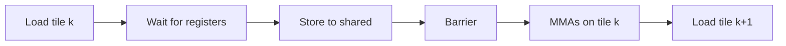
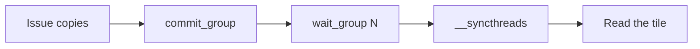
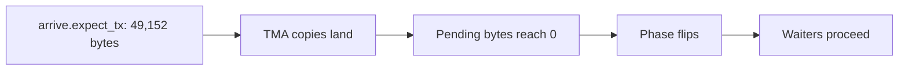
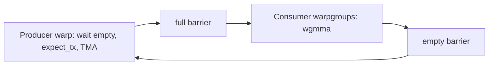

# Introduction

The question this chapter answers: how does a GEMM keep the tensor cores fed while the next tile is still in memory?

Note:
Frame the question. A tensor-core GEMM has two jobs, moving operands and computing on them, and the previous chapters made the second job fast. Every fast GEMM since Ampere overlaps the two, and so do Triton, CUTLASS, and FlashAttention. By the end the audience can derive the wait count of a multistage pipeline and say what Hopper and Blackwell took off the threads.

### Why a GEMM block idles {#why-idle}

- Nearly every large FLOP in a transformer is a GEMM
- A block that loads, waits, then computes leaves the tensor cores idle for the length of the load
- Overlap is how production kernels close that gap

Note:
Ask who has looked at a profile where the GEMM sat well below peak. The usual cause is not the arithmetic, it is the schedule. The loads are not slow. The block waits for them with nothing else to do. Pipelining does not shorten a load. It gives the block work to do while the load is in flight.

### The route through this deck {#roadmap}


Note:
Three parts. First the problem and the arithmetic of it. Then the Ampere solution, which is the lab: cp.async, the loop, and how to pick the stage count. Then Hopper and Blackwell in prose, where the same idea moves into hardware. Keep this slide up for a few seconds.

# The problem

Where the idle time comes from, in numbers.

Note:
This section is arithmetic. We take one k-tile of the lab kernel, count its FLOP and bytes, and compare the tensor time with the load latency. The conclusion drives everything else.

## One tile, in numbers

### One k-tile of the lab kernel {#one-ktile}

- Block tile 128 x 128, BK = 32
- Work: $2 \times 128 \times 128 \times 32 = 1{,}048{,}576$ FLOP
- Tensor time at 2048 FLOP per clock: 512 clocks
- Loads: $(128 \times 32 + 32 \times 128) \times 2 = 16{,}384$ bytes
- That is 32 bytes per clock per SM

Note:
Walk through each line once. 2048 FLOP per clock per SM is the A100 rate behind the 312 TFLOP/s rating: 108 SMs times 2048 times 1.41 GHz. So one tile is 512 clocks of tensor work and 16 KiB of loads. Hold on to 512 and 466. The next slide compares them.

### Load, wait, compute {#load-wait}



- The store can't issue until the load returns
- The tensor cores see nothing during the first four boxes

Note:
This is the chapter 11 loop. The global load returns into a register, and the store to shared memory depends on that register, so the warp stalls at the store. Then the barrier makes everyone wait for the slowest warp. Only then do the tensor cores get work. Everything to the left of the MMA box is idle time for them.

### How idle? {#how-idle}

| Tile comes from | Latency $L$ | Idle $L/(L+T)$, $T = 512$ |
|---|---|---|
| L2 | 261.5 cycles | 33.8% |
| HBM | 466.3 cycles | 47.7% |

Latencies: A100 PCIe 40GB, Luo et al. 2024.

> [!QUESTION] Doesn't a second resident block hide this?
> Partly. While one block waits, another computes, so occupancy covers some of the gap. The table is for one block alone and ignores queueing. The lab measures how much of it a second block hides.

Note:
Idle fraction is L over L plus T, with T the tensor time for a tile. The latencies come from the Luo microbenchmarks on a 40 GB PCIe A100, so call them close approximations for the 80 GB card. The point is that a third to a half of the time is idle for a block that serializes. The answer to the question is yes, partly, and that is exactly why the lab reports a measured speedup instead of promising one.

# Asynchronous copies

The Ampere instruction that lets a thread start a copy and keep going.

Note:
This section introduces cp.async: sizes, cache hints, zero-fill for tails, and the commit and wait groups that track completion. It is the vocabulary the lab loop is written in.

## cp.async on Ampere

### A copy with no register {#cp-async}

- Global to shared in one instruction, 4, 8, or 16 bytes
- Skips the register file; can skip L1 with `.cg`
- The thread issues it and keeps going
- SASS name: `LDGSTS`

Note:
cp.async is the Ampere instruction that makes pipelining possible. The old path needed a register for every in-flight byte and stalled at the store. This one moves the data in the memory system and leaves the thread free. You can find LDGSTS in the SASS with the tools from chapter 5, which is a good way to confirm the compiler emitted what you meant.

### The PTX forms {#ptx-forms}

```ptx
cp.async.ca.shared.global [dst], [src], 16;
cp.async.cg.shared.global [dst], [src], 16;
cp.async.cg.shared.global [dst], [src], 16, src_size;
```

- `.cg`: 16 bytes only, L2 only
- `src_size` zero-fills the rest

> [!QUESTION] Why does the lab use `.cg`?
> Each block reads a tile once, so keeping it in L1 only evicts something useful. `.cg` caches in L2 only, and it's allowed only with 16-byte copies.

Note:
Three forms. dot-ca caches at all levels and takes 4, 8, or 16 bytes. dot-cg skips L1 and requires 16. The third form has an optional source size: the instruction reads that many bytes and zero-fills the rest of the destination. Both addresses must be aligned to the copy size.

### Zero-fill handles the tails {#zero-fill}

```cuda
const bool ok = gm < M && gk < K;
cp_async16(dst, ok ? A + gm * K + gk : A, ok);
```

- `ok` false: `src_size = 0`, nothing is read, 16 zero bytes land
- Every thread issues the copy; no tail code

Note:
This is the line that lets the lab test M equal to 1 and K not a multiple of the tile. A thread past the matrix edge still issues the instruction, with a source size of zero, and gets a zero chunk. A zero chunk adds nothing to the accumulator, so the result is right. Note the pointer: pass any valid address, because nothing is read.

### Groups and waits {#groups}



- `commit_group` closes this thread's copies into a group
- `wait_group N`: at most N groups still pending

Note:
Completion is tracked per thread, in groups. commit_group closes everything the thread issued since the last commit. wait_group N blocks until at most N of the thread's most recent groups are pending and every older one is done. wait_all is a commit and a wait_group zero. The wait is per thread, so the barrier after it matters. That is the next slide.

### The wait is not enough {#barrier}

> [!WARNING] `wait_group` covers your copies only
> Other threads copied other chunks of the tile. Follow the wait with `__syncthreads()` before any thread reads.

- A missing barrier gives wrong results on some runs, right on others

> [!QUESTION] Why not `wait_all` everywhere?
> It waits for every copy, including the ones you meant to overlap. The pipeline needs a wait that leaves the newest groups in flight.

Note:
The classic bug. Each thread knows only that its own copies landed. The warp next to it may still be writing chunks of the same tile. The barrier turns many per-thread guarantees into a block-wide one. And wait_all would be correct but would also wait for the newest loads, which removes the overlap.

# The multistage pipeline

A loop that keeps S - 1 tile loads in flight while the tensor cores work on one.

Note:
The core of the lab. We derive the loop, the wait count, and the barrier placement, then pick the stage count from the shared-memory budget.

## The loop

### S slots, S - 1 copies in flight {#s-slots}

$$
\boxed{t_{\text{iter}} = \max\left(\hla{T},\ \frac{\hlb{L}}{S - 1}\right)}
$$

- A new tile lands every $L/(S-1)$ cycles
- $T = 512$: two stages cover $L \le 512$, three $L \le 1024$, four $L \le 1536$

Note:
With S slots the block computes on one tile and keeps S minus one copies in flight. In steady state a tile arrives every L over S minus one cycles, and the loop runs at the slower of that and the compute time. Once the first term wins, more stages buy nothing. The model uses the idle-memory latency, and a loaded memory system is slower, which is why kernels use three or four.

### Move the sliders {#timeline}

```viz
12-pipeline-timeline
```

Note:
Let the audience play. Start with one stage and see the tensor row full of gaps, then add stages until the gaps close. Raise the latency slider to see why two stages stop being enough. Say clearly that this is a model with no bandwidth limit. The shared-memory readout and the blocks-per-SM readout are the cost side, and the next section uses them.

### Prologue, steady state, drain {#loop}

```cuda
for (s = 0; s < STAGES - 1; ++s) {      // prologue
  if (s < k_tiles) load_tile(s, s);
  cp_async_commit();
}
for (kt = 0; kt < k_tiles; ++kt) {
  cp_async_wait<STAGES - 2>();
  __syncthreads();
  next = kt + STAGES - 1;
  if (next < k_tiles) load_tile(next % STAGES, next);
  cp_async_commit();
  compute_tile(kt % STAGES);
}
```

Note:
This is the lab loop for two or more stages. The prologue puts S minus one tiles in flight. Each iteration waits for tile kt, passes a barrier, starts the copy of tile kt plus S minus one into the slot that tile kt minus one used, commits, and computes. Drain is implicit: past the end the loop commits empty groups, and a final wait_group zero after the loop leaves nothing outstanding.

### Where $S - 2$ comes from {#wait-count}

- Top of iteration $k$: $k + S - 1$ groups committed
- Tile $k$ is group $k$
- Only tiles $k+1$ to $k+S-2$ may stay pending

$$
\boxed{N = (k + S - 1) - (k + 1) = \hla{S - 2}}
$$

> [!QUESTION] What if the loop skips the commit when no tile is left?
> The group count falls behind, and near the end of K the loop computes on a tile that hasn't landed.

Note:
Count groups. By the top of iteration k the thread has committed the prologue groups plus k loop groups, which is k plus S minus one. Tile k is the group at index k. wait_group N leaves the newest N pending, so tile k is safe when N covers only the groups after it: that is S minus two, independent of k. Two stages gives zero, which is double buffering. Four stages gives two.

### The ring, one iteration at a time {#ring}

```viz
12-ring-buffer
```

Note:
Step through two, three, and four stages. After the new load is issued, S slots hold one tile computing and S minus one in flight, so no slot is free. That is the entire cost of the pipeline, S tiles of shared memory, and the entire benefit, S minus one copies overlapped. Watch the readout: the wait argument never changes.

### Why one barrier is enough {#one-barrier}

- The barrier sits after the wait and before the new load
- Passing it means every warp finished tile $k - 1$
- So slot $(k-1) \bmod S$ is free to overwrite
- One stage needs two barriers: the slot is overwritten right after it is read

> [!QUESTION] What if I issue the load before the barrier?
> A fast warp overwrites the slot a slow warp is still reading. The result is wrong only sometimes, which is the worst kind.

Note:
The placement matters more than the count. Everything before the barrier in iteration k includes the previous compute, so passing it proves the slot of tile k minus one is no longer read. Move the load above the barrier and a fast warp races ahead into a slot a slow warp still reads. It passes small tests and fails at scale.

## Choosing the stage count

### What a stage costs {#stage-cost}

| Piece | Elements | Bytes |
|---|---|---|
| A tile, $128 \times 40$ | 5,120 | 10,240 |
| B tile, $32 \times 136$ | 4,352 | 8,704 |
| One stage | 9,472 | 18,944 |

- 8 extra elements per row (16 bytes) keep `ldmatrix` conflict-free

Note:
The padded layout: A rows are 80 bytes and B rows are 272 bytes, so eight consecutive rows land at eight different 16-byte positions of the 128-byte bank window. This is the padding trick from chapter 8; a swizzle would save the extra bytes. A stage is 18,944 bytes, and everything else in this section is division.

### Stages against blocks per SM {#stages-blocks}

| Blocks per SM | Bytes per block | Most stages |
|---|---|---|
| 1 | 166,912 | 8 |
| 2 | 82,944 | 4 |
| 3 | 54,954 | 2 |

A100: 164 KiB per SM, 163 KiB per block, 1 KB reserved per block.

> [!QUESTION] Why not use all 8 stages?
> Past the latency budget they add nothing, and every stage you add can cost a resident block. Five stages already limit the lab kernel to one block per SM.

Note:
Two ways to hide latency compete for the same shared memory. More stages hide it inside a block. More resident blocks hide it across blocks. The lab kernel caps registers at 128 per thread so that two blocks fit, and four stages is the most that leaves room for two. The tests check these three rows with your max_stages function.

### The same loop in Triton and libcu++ {#frameworks}

- Triton: `num_stages` in a `tl.dot` loop is this S, built on `cp.async` for sm_80
- libcu++: `cuda::pipeline` with `cuda::memcpy_async` hides the counting
- CUTLASS: the stage count is a template parameter

Note:
Nobody hand-counts commit groups in production, but they all build this loop. Triton's num_stages is the S from this chapter, and chapter 14 tunes it. The libcu++ pipeline hides the commit and wait bookkeeping and the ring index, at the cost of control over zero-fill and cache hints. The lab uses raw PTX so you see the counts once.

# Hopper

What changes when the copy moves from threads to hardware.

Note:
The lab card is an A100, so this section is prose and diagrams. The goal is to recognize each Hopper feature as the same pipeline with something removed from the threads.

## From threads to hardware

### Why Hopper changes the copy {#why-hopper}

- H100 SXM: 4,096 bf16 FLOP per SM per clock, twice the A100
- 989.4 TFLOP/s dense on 132 SMs
- Copies get half the time, and their instructions compete with the MMAs
- Answer: move the copy off the threads

Note:
Twice the tensor rate per SM means the same tile of data has half as long to arrive, and the address arithmetic and copy instructions of cp.async take issue slots the MMAs want. Hopper's answer is a hardware copy engine, TMA, driven by a single thread. All of this is prose and slides for us, because the lab card is an A100.

### TMA: one thread, one tile {#tma}

- A tensor map on the host: base, dims (1D to 5D), strides, box, swizzle
- `cp.async.bulk.tensor`: one thread copies a whole tile
- The engine zero-fills edges and writes a swizzled layout
- Shared to global can reduce on write: add, min, max

> [!QUESTION] What happens to the address arithmetic?
> It's gone from the threads. The map and the tile's coordinates replace 128 per-thread addresses and bounds checks.

Note:
The tile that took 256 threads two copies each in the lab is one instruction here. The descriptor carries the layout, so the engine handles strides, edges, and the shared-memory swizzle. The map lives in global memory and is created with the driver API on the host. The Hopper tuning guide notes that TMA avoids registers and SM instructions for data movement, which is what enables warp specialization.

### Completion by byte count {#mbarrier}



- Waiters use `try_wait.parity`
- The byte count must be exact

Note:
TMA does not use commit_group. It completes through an mbarrier in shared memory, which counts arrivals and bytes. A thread announces the bytes the copies will deliver, the engine decrements as they land, and when both counts are satisfied the phase flips and waiters proceed. The count is a 32-bit byte total. Expect too few and the barrier flips early. Expect too many and it never flips.

### wgmma: a warpgroup MMA {#wgmma}

- Four warps, 128 threads; M = 64, N up to 256, K = 16 for bf16
- B from shared memory, A from registers or shared memory
- Asynchronous: fence, mma_async, commit, wait
- $524{,}288 / 4096 = 128$ clocks for `m64n256k16`

Note:
One m64 n256 k16 instruction is 64 times 256 times 16 FMA, which is 524,288 FLOP. At 4,096 FLOP per SM per clock that is 128 clocks, and the Luo paper measured 128 cycles on an H800 PCIe, where it also reached 729 of 756.5 TFLOP/s. The accumulator stays in registers across the 128 threads, which is why the next idea, register rebalancing, exists.

### Producers and consumers {#warp-specialization}



- The producer needs few registers; consumers need many
- `setmaxnreg` rebalances at run time

Note:
With TMA a single thread feeds the pipeline and wgmma is asynchronous, so the block can split its roles. One producer warp waits for a free slot and issues the loads. One or two consumer warpgroups wait for a full slot, run wgmma, and release it. Two barriers per slot carry the handshake. This is the ring from earlier with the roles separated, so no consumer instruction goes to address math.

### Clusters and multicast {#clusters}

- Cluster: blocks scheduled together on one GPC; 8 portable, 16 on H100
- Blocks read each other's shared memory (DSMEM)
- 128 x 256 x 64 stage: 48 KiB, 48 B/clock from L2
- Two blocks multicast the B tile: 32 B/clock

> [!QUESTION] Why does multicast matter more on Hopper?
> The tensor rate doubled, so L2 traffic per clock doubled with it. Sharing one operand across two blocks cuts it by a third.

Note:
The arithmetic: a stage of 128 by 256 by 64 is 16 KiB of A and 32 KiB of B. The tile's FLOP take 1,024 clocks, so 49,152 bytes over 1,024 clocks is 48 bytes per clock per SM. Two blocks with neighboring M tiles use the same B columns, so each fetches half of B and multicasts it. Per block that is 16 KiB of A plus 16 KiB of B, or 32 bytes per clock.

### Persistent kernels and ping-pong {#persistent}

- Persistent: about one block per SM, looping over tiles
- The epilogue of one tile overlaps the loads of the next
- Ping-pong: two consumer warpgroups alternate tiles
- FlashAttention-3 on H100: up to about 740 TFLOP/s in FP16

> [!QUESTION] Does this run on our A100?
> No. TMA, wgmma, and clusters are sm_90 features. The A100 lab exercises the same overlap with cp.async.

Note:
A kernel with one block per tile pays launch, prologue, and epilogue every time. A persistent kernel keeps the pipeline full across tiles. Ping-pong lets one warpgroup run its epilogue while the other uses the tensor cores. FlashAttention-3 reports up to about 740 TFLOP/s in FP16 on an H100, roughly 75% of peak. That is an H100 result, not something the lab card reproduces.

# Blackwell

One more step: the accumulator leaves the register file.

Note:
A short section. Tensor memory and single-thread MMA issue finish the story that Hopper started.

## Tensor memory

### The accumulator leaves the registers {#tmem}

- TMEM: 128 lanes x 512 columns x 4 B = 256 KiB per SM
- One thread issues `tcgen05.mma`; completion by `commit` and mbarrier
- Accumulator in TMEM; A from shared memory or TMEM; B from shared memory
- `tcgen05.ld` moves results to registers for the epilogue

Note:
On Hopper the accumulator competes with everything else for the register file. Blackwell gives it its own memory. TMEM is 128 lanes by 512 columns of 32-bit cells, 256 KiB per SM. One warp allocates columns in powers of two from 32 to 512. One thread issues the MMA, and it runs asynchronously. NVIDIA reports 2x to 4x the throughput of wgmma depending on data type.

### Two accumulators fit {#double-accumulator}

- A $128 \times 256$ fp32 accumulator: 128 KiB
- On Hopper: half the register file
- On Blackwell: 256 of 512 TMEM columns, so two fit
- Epilogue reads one while the MMA fills the other

> [!QUESTION] Does sm_120 have tensor memory?
> No. Consumer Blackwell (12.x) lacks `tcgen05`, has 99 KB of shared memory per block, and uses block-scaled `mma.sync`.

Note:
This is the payoff. The epilogue warps read a finished tile from TMEM while the MMA warp accumulates the next one in the other half, with no register pressure from either side. Say clearly that tcgen05 is sm_100, data-center Blackwell. Consumer parts do something else, so a kernel tuned for B200 will not run there.

### 2-CTA MMA {#two-cta}

- A pair of CTAs on two SMs issues one MMA, M = 256
- $256 \times 256 \times 16$ bf16: 2,097,152 FLOP
- Two SMs at 8,192 FLOP per clock: 128 clocks
- Each CTA stages its own A rows and half of B

Note:
The pair computes a 256 by 256 by 16 tile in the same 128 clocks one CTA needs for 128 by 256 by 16, using two SMs. The saving is operand traffic: each CTA stages half the B tile. The rest of the Hopper machinery carries over: TMA, mbarrier transaction counts, specialized roles, clusters.

# Summary

The ideas to carry out of this chapter.

Note:
Close the loop. Recap the idle-time arithmetic, the wait count, and how each architecture moves the same idea into hardware.

### What to remember {#summary}

- Load, wait, compute idles the tensor cores: $L/(L+T)$, 34% to 48% here
- `cp.async` + commit and wait groups = a copy with no register
- S stages: S - 1 copies in flight, `wait_group S - 2`, one barrier
- Shared memory and occupancy set S; the lab tile is 18,944 B per stage
- Hopper: TMA, mbarriers, wgmma, specialization. Blackwell: TMEM, tcgen05
- Next: CUTLASS and CuTe describe layouts, swizzles included, as algebra

Note:
Five lines. If the audience keeps one, it is that pipelining overlaps latency it cannot shorten, and that the wait count is S minus two. The rest follows: the stage count is a shared-memory budget, and Hopper and Blackwell move the same idea into hardware.

### Which tool when {#decision}

| Target | Copy | MMA | Completion |
|---|---|---|---|
| A100 (sm_80) | `cp.async` | `mma.sync` | `wait_group` + barrier |
| H100 (sm_90) | TMA | `wgmma` | mbarrier byte count |
| B200 (sm_100) | TMA | `tcgen05.mma` | `commit` + mbarrier |

Note:
A compact decision guide. On the lab card you have the first row. The second and third rows are what libraries such as CUTLASS and Triton emit when they target those architectures, so you rarely write them by hand, but you should recognize them in a profile and know what each one removes from the threads.
