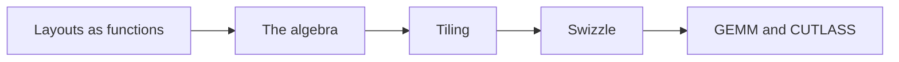
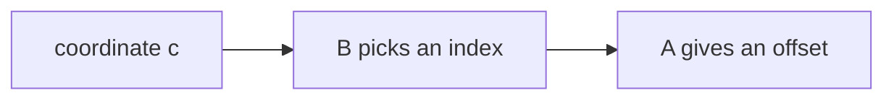
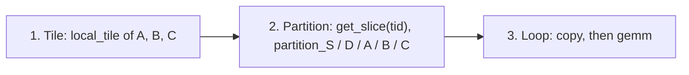
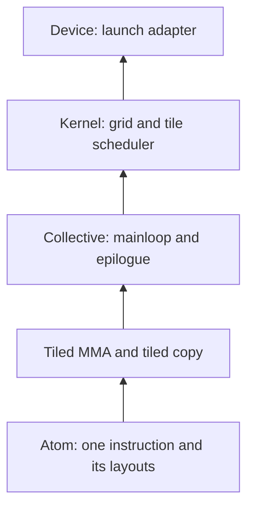

# Introduction

The question this chapter answers: how do you stop rewriting index arithmetic for every tile, type, and architecture?

Note:
Set the problem. Everyone in the room has now written a GEMM with lines like row times lda plus col, a pad of one word, and an ldmatrix address from the lane number. Each one was correct and each one had to change for the next tile shape. CuTe makes the mapping from a logical coordinate to a physical offset an object you can compose and print.

### Every kernel so far hand-coded a mapping {#why}

- Global tile load: block row times `lda`, plus thread row, plus a vector offset
- Shared store: an XOR or a pad against bank conflicts
- `ldmatrix`: lane number split into matrix and row
- `mma` operands: the PTX fragment table

Each is a function from *where I am* to *where the byte is*.

Note:
Walk down the list. Four different notations for the same kind of thing. When the tile shape changes, all four change, and each carries its own bugs. The claim of the chapter is that these are all instances of one object, a layout, and a handful of operations on it.

### The route through this deck {#roadmap}



Note:
Five stops. First what a layout is. Then coalesce, composition, and complement. Then divide and product, which are tiling. Then swizzle, the one operation that is not about shape and stride. Last, how the pieces become a tensor-core GEMM and where CUTLASS and Triton fit. Tell the audience that the lab implements all of the first four in Python.

# Layouts as functions

A layout is a shape and a stride, and it maps coordinates to offsets.

Note:
This section defines the one object. Keep it slow: everything later is an operation on it.

### Shape and stride {#shape-stride}

$$
L(c_0, \ldots, c_{n-1}) = \sum_i \hla{c_i}\,\hlb{d_i}
$$

- Shape $(s_0, \ldots)$: how many steps in each mode
- Stride $(d_0, \ldots)$: how far one step moves in memory
- Write it `shape:stride`

Note:
The whole definition is multiply and add. The coordinate in green is where you are along a mode, the stride in blue is how many elements a step along that mode skips. Nothing else is hidden in a layout. Ask the room what row-major and column-major are in this notation before the next slide.

### Row-major, column-major, and the cosize {#row-col}

| | `(4,3):(1,4)` | `(4,3):(3,1)` | `(4,3):(2,16)` |
|---|---|---|---|
| Offset of row 2, col 1 | 6 | 7 | 20 |
| size | 12 | 12 | 12 |
| cosize | 12 | 12 | 39 |

Cosize is $1 + \sum_i (s_i - 1)\,d_i$: the buffer the layout needs.

Note:
Same shape, three strides. The first is column-major, the second row-major, and the third is a padded layout. Size is the number of coordinates, cosize is one past the largest offset. For the third, a buffer of 39 words holds 12 elements, so 30.8 percent of it is data. A compact layout has cosize equal to size.

### A shape can be nested {#hierarchical}

`((2,2),3):((1,6),2)` is a 4 by 3 matrix whose rows are a pair $(i_0, i_1)$.

| | col 0 | col 1 | col 2 |
|---|---|---|---|
| row 0 | 0 | 2 | 4 |
| row 1 | 1 | 3 | 5 |
| row 2 | 6 | 8 | 10 |
| row 3 | 7 | 9 | 11 |

Two column-major blocks, 6 apart.

Note:
Rows 0 and 1 are one 2 by 3 block at offsets 0 to 5. Rows 2 and 3 are the next block, starting at 6. The nesting records that this matrix is two blocks stacked, and the stride of 6 is the distance between them. A flat shape cannot say that, and that is why CuTe nests.

### Try it: strides and collisions {#grid-figure}

```viz
13-layout-grid
```

Note:
Let the audience pick presets, click a cell to see its hierarchical coordinate, and then use Custom. Set both strides equal and show the collision: two coordinates map to one offset, the cells turn red, and the readout says the layout is not injective. The coalesced form in the readout previews the next section.

### Three kinds of coordinate {#coordinates}

- A tuple matching the nesting: `((1,0),2)`
- A tuple with an integer for a sub-tuple: `(2,2)`
- One integer, read **colexicographically**: first mode fastest

For shape $(4,3)$, the integer 5 is row $5 \bmod 4 = 1$, column $\lfloor 5/4 \rfloor = 1$.

> [!QUESTION] Why does the integer index run down the first mode?
> It makes the integer index of a column-major matrix equal its offset, and it lets any layout act as a one-dimensional sequence of offsets, which is what the algebra operates on.

Note:
All three name the same element. The integer form is the important one, because it turns every layout into a list: offsets equals L of i for i from 0 to size minus 1. Composition, divide, and product are statements about that list. The lab tests this on a hierarchical layout where the integers 0 to 11 map to themselves.

# The algebra

Coalesce simplifies, composition chains, and complement finds the gaps.

Note:
Three operations, each with a short definition and a divisibility condition. Divide and product in the next section are built from them.

### Coalesce {#coalesce}

Same offsets, fewer modes:

1. Drop modes of size 1
2. Merge $s_0{:}d_0$ and $s_1{:}d_1$ when $d_1 = s_0 d_0$

`(2,(1,6)):(1,(6,2))` becomes `12:1`.

`(8,4):(1,10)` stays: 10 is not 8.

> [!TIP] The coalesced form `8:1` for 16-bit data means a 16-byte vector access is legal.

Note:
Walk the example: flatten to 2,1,6 over 1,6,2, drop the size-1 mode, and the stride 2 equals 2 times 1, so the two merge into 12 colon 1. This is a contiguous run in disguise. Coalesce is how CuTe decides the widest vector copy a thread can use. A padded layout stays uncoalesced because the gap is real.

### Composition: A after B {#composition}



$R = A \circ B$ means $R(c) = A(B(c))$.

$B$ chooses which elements, as indices. $A$ says where each index lives.

Note:
Think of B as a selection and A as a map. The result has B's domain and A's codomain. This is how a thread's share of a tile is computed: B names the elements a thread owns, A is the tile's layout, and the composition is where those elements sit in memory.

### Two worked compositions {#comp-examples}

$$
\texttt{20:2} \circ \texttt{(5,4):(4,1)} = \texttt{(5,4):(8,2)}
$$

$B(i,j) = 4i + j$, and $A$ doubles it: $8i + 2j$.

$$
\texttt{(6,2):(8,2)} \circ \texttt{4:3} = \texttt{(2,2):(24,2)}
$$

$B$ picks indices 0, 3, 6, 9, at offsets 0, 24, 2, 26.

Note:
First one is just a doubling. Second one is the CuTe documentation's example. Read A as 12 indices where index k equals a0 plus 6 a1 sits at 8 a0 plus 2 a1. B takes every third: k equals 0, 3, 6, 9. Those are a0, a1 equal 0,0 then 3,0 then 0,1 then 3,1, so the offsets are 0, 24, 2, 26. The result steps by 24 and then by 2. Verify it on the board.

### When composition is not defined {#divisibility}

Walk $A$'s modes with a remaining stride $r$. For a mode of size $s$:

- $r$ a multiple of $s$: skip the mode, $r \leftarrow r / s$
- $s$ a multiple of $r$: take up to $s/r$ elements at stride $r$

> [!QUESTION] What happens for `(6,2):(8,2)` composed with `4:4`?
> Neither 4 is a multiple of 6 nor 6 a multiple of 4, so the composition is undefined. The lab's code raises an error. A guess would produce a wrong layout without any warning.

Note:
This is the condition the Colfax note on the algebra states precisely. Stress that composition is a partial operation. The lab's property test composes random pairs, skips the undefined ones, and checks R of i equals A of B of i on every i for the rest.

### Complement: the offsets a layout skips {#complement}

| $A$ | $A^{*}$ for $M = 24$ |
|---|---|
| `4:1` | `6:4` |
| `4:2` | `(2,3):(1,8)` |
| `(2,2):(1,6)` | `(3,2):(2,12)` |
| `(4,6):(1,4)` | `1:0` |

`4:2` covers $\{0,2,4,6\}$. Adding $\{0,1,8,9,16,17\}$ reaches every offset 0 to 23 once.

Note:
Complement gives the layout that steps over what A misses, with positive increasing strides. Its codomain is disjoint from A's, and together they cover M elements. Run the fourth row by hand: the even offsets plus the odd offset plus the next three blocks of eight. The last row shows a layout that already covers everything, so the complement is trivial. Complement is the second half of tiling.

# Tiling

Divide splits a layout into tiles, and product repeats one.

Note:
These are the two operations a GEMM needs: carve out the block's slice of a matrix, and replicate a thread's copy across a warp.

### Logical divide {#divide}

$$
A \oslash B = A \circ (B,\ B^{*})
$$

Mode 0 indexes inside a tile. Mode 1 indexes the tile.

| | Result |
|---|---|
| `16:1` by `4:1` | `(4,4):(1,4)` |
| `16:1` by `4:4` | `(4,4):(4,1)` |

Contiguous tiles, then interleaved tiles.

Note:
The tile B picks elements, and its complement enumerates the tiles. With B equal to 4 colon 1 the tiles are four contiguous runs. With B equal to 4 colon 4 the tile is strided and the four tiles interleave, which is the cyclic partition. One operation gives both blocked and cyclic partitions, and the choice is only the tile layout.

### Tiling a matrix {#zipped}

`(8,6):(1,8)` by a $4 \times 3$ tile, zipped:

`((4,3),(2,2)):((1,8),(4,24))`

- Mode 0: one 4 by 3 tile
- Mode 1: the 2 by 2 grid of tiles
- Tile $(1,1)$ starts at $4 + 24 = 28$

`local_tile(mA, tiler, coord)` is this, sliced by the block's coordinate.

Note:
The zipped divide regroups into tile modes and rest modes. Slicing the rest mode with blockIdx gives exactly the tile one thread block owns. The chapter has a second example: a 128 by 64 row-major slice divided by 8 by 16 gives offsets 512 for the tile below and 16 for the tile to the right, and the tile keeps the row stride of 64, so it is not contiguous. CuTe records that for free.

### Logical product: repeat a layout {#product}

$$
A \otimes B = \big(A,\ A^{*} \circ B\big)
$$

`(2,2):(1,2)` $\otimes$ `(3,2):(1,3)` `= ((2,2),(3,2)):((1,2),(4,12))`

A 2 by 2 block placed on a 3 by 2 grid. Block $(p,q)$ starts at $4p + 12q$.

> [!KEY] Divide to read a layout in tiles. Product to build a layout from a tile.

Note:
Product is divide seen from the other end. The documentation shows that 2,2 colon 4,1 times 6 colon 1 has the same result as dividing 4,2,3 colon 2,1,8 by 4 colon 2. Use product when you have a tile, such as a thread's 16-byte copy, and want to replicate it across a warp or a block.

# Swizzle

A swizzle permutes offsets so that reads in both directions miss the same banks.

Note:
Everything so far was about shape and stride. A swizzle is different: it is a function on the offset the layout produced. It answers the bank-conflict question from chapter 8 for tile shapes where padding does not fit.

### The bank-conflict problem {#conflict}

A 32 by 32 float tile: offset $32r + c$, bank $= \text{offset} \bmod 32$.

- A row read touches 32 banks: no conflict
- A column read touches **one bank**: 32-way conflict

Padding to 33 words fixes it, but a row starts at byte 132, which is not 16-byte aligned.

Note:
Recap chapter 8. The bank is the column, so a warp reading a column hits a single bank 32 times. Padding by one word works for floats but breaks 16-byte alignment, so 128-bit accesses and ldmatrix are lost. Padding by a whole 16-byte chunk keeps alignment but costs 12.5 percent more shared memory for rows of 64 halves.

### Swizzle<B, M, S> {#swizzle-def}

XOR the $B$-bit field at bit $M + S$ into the field at bit $M$:

$$
\text{offset} \oplus \big((\text{offset} \gg S) \,\&\, \text{mask}\big), \quad \text{mask} = (2^B - 1) \ll M
$$

- $B$: mask bits. $M$: low bits left alone. $S$: shift, with $|S| \ge B$
- A bijection on each aligned block, and its own inverse

Note:
For S positive the source field is above the target. The example from the Lei Mao post: Swizzle 5,0,6 on offset 65 takes bit 6, shifts it to bit 0, and XORs, so 65 becomes 64. Because the XOR uses other bits, applying the swizzle twice returns the original offset, which means no two elements ever collide.

### Swizzle<5,0,5> on the float tile {#float-swizzle}

Bits 5 to 9 are the row $r$. Bits 0 to 4 are the column $c$. The new column is $c \oplus r$.

Column 5, rows 0 to 5, lands in banks:

`5, 4, 7, 6, 1, 0`

The 32 values $5 \oplus r$ are all different: a 1-way access, down from 32-way. A row read stays 1-way.

> [!QUESTION] Why does the row read stay conflict-free?
> For a fixed row, XOR with the constant $r$ permutes the 32 columns, so the 32 words still fall in 32 distinct banks.

Note:
This is the number the lab checks: 32 conflicts before, 1 after, for the column read, and 1 for both for the row read. The figure on the next slide lets the audience change B, M, and S and see which settings fix the tile and which break the permutation.

### Try it: bank histograms {#swizzle-figure}

```viz
13-swizzle-banks
```

Note:
Start on the default: column 5, Swizzle 5,0,5, one-way against 32-way. Then set B to 0 to remove the swizzle and watch the bar chart collapse to one tall bar. Then set S below B and show that the readout reports a swizzle that is no longer a permutation. Finally switch to a row read and show it stays at one.

### The tile that `ldmatrix` reads {#ldmatrix}

8 rows of 64 halves: a row is 128 bytes, so every row starts at the same bank.

| Logical chunk | Physical chunk in rows 0, 1, 2, 3 |
|---|---|
| 0 | 0, 1, 2, 3 |
| 1 | 1, 0, 3, 2 |
| 2 | 2, 3, 0, 1 |

`Swizzle<3,3,3>`: chunk becomes chunk $\oplus$ ($r \bmod 8$).

Note:
An ldmatrix phase reads one 16-byte chunk from each of 8 rows. Unswizzled, all 8 addresses are 128 bytes apart, so they cover the same 4 banks: eight times 4 words in 4 banks, an 8-way conflict. Swizzled, the 8 rows read 8 different physical chunks, which cover all 32 banks once. The lab's bank_conflict_degree gives 8 and 1 on this access.

### Padding or swizzle? {#pad-or-swizzle}

| | Padding | Swizzle |
|---|---|---|
| Extra shared memory | 12.5% for 64-half rows, 16-byte pad | 0 |
| 16-byte alignment | Kept only with a 16-byte pad | Kept |
| Composes with layouts | No | Yes |

> [!QUESTION] Does a swizzle work for Hopper's TMA and `wgmma`?
> Yes. TMA can write a tile in a 128-byte swizzle pattern, and `wgmma` reads shared-memory operands in such layouts. The byte form `Swizzle<3,4,3>` equals `Swizzle<3,3,3>` for 2-byte elements. Chapter 12 introduces both.

Note:
The swizzle composes with any layout, so you can ask for the swizzled tile and then partition it among threads, and the partition respects the swizzle. That composability is the reason CuTe uses swizzles instead of padding. On Hopper the hardware engines expect specific swizzled layouts, so the same algebra carries over, with different atoms.

# From layouts to a GEMM

A copy and an MMA are thread-value layouts, and a GEMM is tile, partition, call.

Note:
Now apply the algebra. The idea is that who owns which element is also a layout, so partitioning a tile among threads is one more composition.

### A thread-value layout for a copy {#tv-copy}

32 threads copy an 8 by 32 half tile, 8 halves each:

`((4,8),8):((8,32),1)`

- Thread $t = t_0 + 4t_1$: $t_0$ picks the chunk, $t_1$ the row
- Value mode `8:1`: 16 contiguous bytes
- 32 threads times 8 values covers all 256 offsets once

Note:
The thread mode says who is asking and the value mode says which of that thread's elements. The value mode coalesces to 8 colon 1, which is the test from the coalesce slide, so a 128-bit access is legal. This is the thread-value layout of a TiledCopy with a 128-bit copy atom. The lab does not build it, but your Layout can evaluate it in two lines.

### The `mma` accumulator is a layout too {#tv-mma}

`((4,8),(2,2)):((32,1),(16,8))` over a 16 by 8 tile.

$$
m = \left\lfloor \frac{\ell}{4} \right\rfloor + 8 \left\lfloor \frac{v}{2} \right\rfloor, \qquad n = 2 (\ell \bmod 4) + (v \bmod 2)
$$

Lane $\ell$ holds rows $\lfloor \ell/4 \rfloor$ and $+8$, columns $2(\ell \bmod 4)$ and $+1$: the PTX fragment table.

Note:
Decode the layout: lane l is t0 plus 4 t1 and value v is v0 plus 2 v1, the offset is 32 t0 plus t1 plus 16 v0 plus 8 v1 into a column-major 16 by 8 tile. The resulting formulas are the accumulator fragment table of the PTX ISA for the m16n8k16 instruction. The layout is the table, and a different instruction is a different layout, not different code.

### A CuTe GEMM in three steps {#three-steps}



- Block tile $128 \times 128 \times 64$; 128 threads; 2 by 2 by 1 atoms of 16 by 8 by 16
- 16 KiB of shared memory per operand
- 128 fp32 accumulators per thread, 128 `mma.sync` per warp per K step

Note:
Tiling uses a zipped divide sliced by the block coordinate. Partitioning composes each tile with the thread-value layout of the copy or the MMA. The loop issues copy and gemm, which expand to cp.async, ldmatrix, and mma.sync. The numbers follow from the layouts: 128 times 64 times 2 bytes is 16 KiB, 128 times 128 divided by 128 threads is 128 accumulators, and each warp owns a 64 by 64 piece, which is 4 times 8 times 4 instructions per K step.

### The layers of CUTLASS 3 and 4 {#layers}



Orthogonal: swap the epilogue without touching the mainloop.

Note:
These are the five layers from NVIDIA's CUTLASS 3 design post. A user who needs a standard GEMM picks types at the top, with the collective builder. A user who needs something new reaches down to a collective or an atom. A new architecture swaps the atoms and the pipeline, and the layout algebra stays, which is why one repository spans Volta through Blackwell.

### CuTe in Python {#dsl}

```python
import cutlass.cute as cute

@cute.jit
def layouts():
    a = cute.make_layout((6, 2), stride=(8, 2))
    b = cute.make_layout((4, 3), stride=(3, 1))
    print(cute.composition(a, b))

layouts()  # prints while tracing
```

> [!QUESTION] Why write the lab's Layout in Python if the DSL has one?
> So you can derive what the DSL prints. When it shows `((2,2),3):((24,2),8)`, you know why.

Note:
The CuTe DSL is the Python front end in CUTLASS 4. It mirrors layouts, tensors, and atoms, and JIT-compiles kernels at runtime. The install is pip install nvidia-cutlass-dsl on Linux. The signatures follow the 4.x API reference; check them for your version. PyTorch 2.14 Inductor uses the DSL as the NVGEMM backend, which chapter 17 covers.

### CUTLASS, Triton, or hand-written CUDA {#choose}

| Tool | Choose it when | You pay |
|---|---|---|
| cuBLAS | Standard GEMM | Nothing |
| Triton | A fused kernel in a day | No control of instruction or layout |
| CUTLASS | Newest tensor cores, custom epilogue, pipeline control | Templates, learning curve |
| CUDA | Not a tile algorithm | Every index and barrier |

> [!QUESTION] When do I stop writing swizzles by hand?
> When you catch yourself deriving a fragment table or an XOR pattern. You are rebuilding CuTe.

Note:
This is the decision guide the chapter ends on. cuBLAS is the baseline every other choice has to beat. Triton for a fused or custom kernel when the compiler's tile decisions are acceptable. CUTLASS when the target is the newest hardware, where instruction layouts are complicated enough that deriving them costs more than learning the algebra. Hand CUDA when the kernel is not a tile algorithm.

# Summary

Layouts are functions, the algebra tiles and permutes them, and CUTLASS stacks a GEMM on top.

Note:
Recap, then point at the lab.

### What to remember {#summary}

- A layout is `shape:stride`: offset $= \sum c_i d_i$
- Coalesce simplifies, composition chains (with divisibility), complement finds gaps
- Divide tiles, product repeats, `local_tile` is a sliced zipped divide
- `Swizzle<5,0,5>`: 32-way to 1-way on a float tile column. `Swizzle<3,3,3>`: 8-way to 1-way for `ldmatrix`
- A GEMM is tile, partition, `copy`, `gemm`

Note:
Four numbers to carry: 32 to 1 for the float tile, 8 to 1 for the ldmatrix tile, 128 accumulators per thread, and 128 mma instructions per warp per K step for the tile on the earlier slide. The lab has the audience implement all of the algebra and check it against the documentation's own examples.

### Next: Triton {#next}

- The lab: implement `Layout`, `coalesce`, `composition`, `complement`, `logical_divide`, `swizzle`
- Then a gather in torch driven by your layout
- Chapter 14 writes the same matmul in Triton, with the layout decisions made by the compiler

Note:
Chapter 14 is the other side of the choice slide. In Triton you give up the control of instruction and shared-memory layout and get a kernel in a day, and the tile-level algebra from this chapter is what the compiler is doing for you. Point out that the lab runs on any machine, since the core is pure Python.
