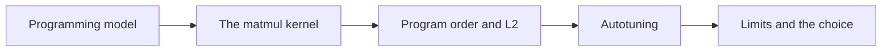
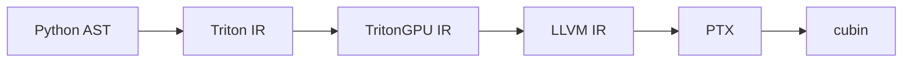
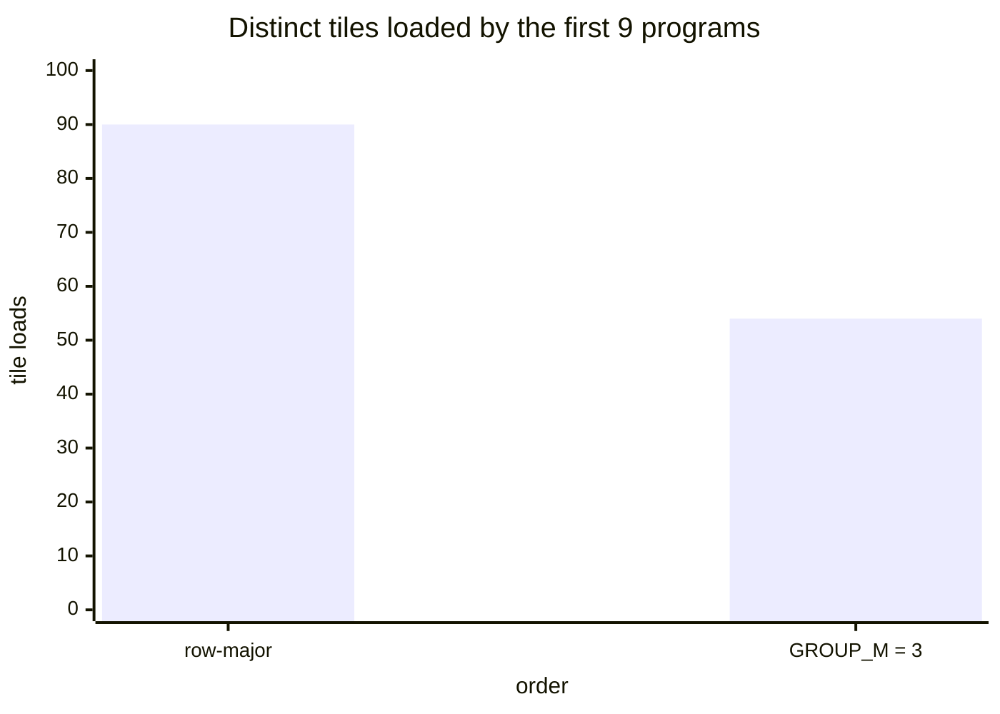
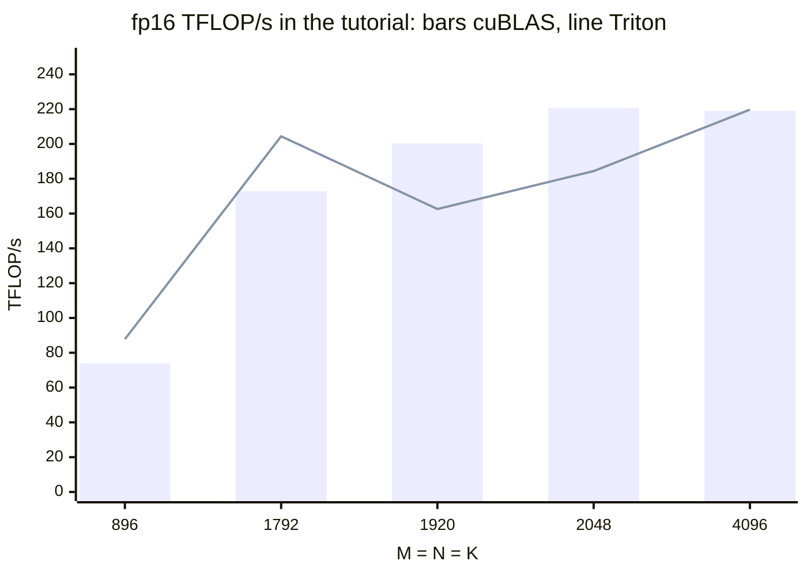
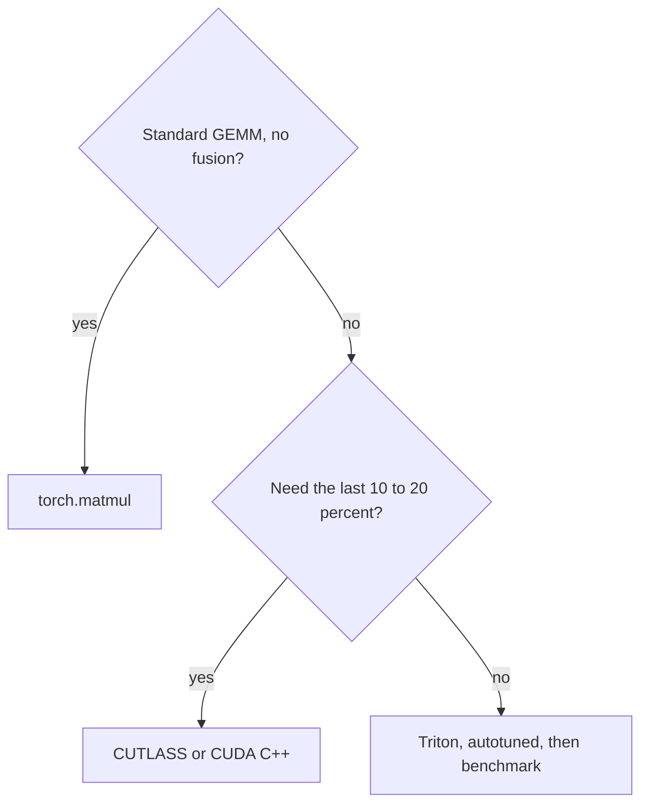

# Introduction

The question this chapter answers: what does Triton write for you in a GEMM, and what is still your job?

Note:
Open by reminding the room what the last three chapters cost: fragments, banks, barriers, cp.async stages. The
promise of Triton is that you keep the decisions that set performance at the tile level and give away the rest. By the
end of the deck the audience can say which is which, and can predict the cost of a tile before running it.

### Why a second way to write a GEMM {#why-triton}

- Chapters 10 to 12 took hundreds of lines of CUDA C++
- Every new fusion or shape means another hand-tuned kernel
- Most new ML kernels start in Triton instead

> [!QUESTION] If cuBLAS exists, why write a matmul at all?
> For a plain GEMM you don't: call `torch.matmul`. You write one when the matmul has a fused epilogue, an unusual
> layout, a quantized operand, or sits inside a larger kernel such as attention.

Note:
Be honest about the scope. cuBLAS is the default for a standard GEMM and the lab compares against it. The reason to
learn this is the neighbours of the GEMM: the epilogue, the dequantize step in chapter 18, the grouped GEMM in chapter
20, and attention in chapter 16. All of them are matmul loops with something extra, and Triton makes the something
extra cheap.

### What you write and what the compiler writes {#split}

| You write | The compiler writes |
|---|---|
| The tile shape | Thread assignment |
| The order of programs | Coalescing and vector width |
| Masks for ragged edges | Shared memory and swizzle |
| The K loop | The `mma` instruction |
| num_warps, num_stages | The cp.async pipeline |

Note:
This table is the whole deck in one slide. The left column is where performance is decided at the tile level, and the
right column is what chapters 8, 11, and 12 taught by hand. We return to this split at the end, when we ask what the
right column costs us.

### The route through this deck {#roadmap}



Note:
Five stops. First the model and what the compiler does with it. Then the kernel and what one tile costs. Then the order
in which the tiles run, which is where the L2 comes in. Then autotuning. Last, what Triton can't do and when to go back
to CUDA. Leave this slide up for a moment.

# The programming model

One program owns one tile. The threads are the compiler's business.

Note:
Section divider. The key shift is the unit of description: in CUDA you describe one thread, in Triton you describe one
block's worth of work as whole arrays.

## Programs, not threads

### One program, one tile {#one-program}

- A *program* is a CUDA thread block
- `tl.program_id(axis)` is the only index
- Every value is a scalar or an array of compile-time shape
- Array sizes must be powers of two

> [!KEY] You choose the tile and the order. The compiler maps them onto threads.

Note:
There is no threadIdx. When you write tl.arange(0, BLOCK_M) you get a whole vector, and pointer arithmetic on it
addresses a whole tile. The power-of-two rule is why every ragged size needs a mask. That rule comes back on the
masks slide. Ask the room who has written the CUDA version of a tile load and remind them of the index arithmetic.

### The compilation pipeline {#pipeline}



Note:
Each arrow is a set of passes. The interesting one is Triton IR to TritonGPU IR, where every tile gets a layout: a map
from elements to threads and registers. That is where coalescing, the shared-memory swizzle, and the choice of mma
instruction are decided. Below that it is ordinary LLVM and NVIDIA's assembler.

### Reading every stage from Python {#inspect}

```python
k = matmul_kernel[grid](a, b, c, c, M, N, K, ...,
                        BLOCK_M=128, BLOCK_N=128, BLOCK_K=32, GROUP_M=8,
                        HAS_BIAS=False, ACTIVATION="none",
                        num_warps=4, num_stages=4)
print(k.asm.keys())      # ttir, ttgir, llir, ptx, cubin
print(k.n_regs, k.n_spills, k.metadata.shared)
```

Note:
A launch returns the compiled kernel. The asm dictionary holds each stage as text. n_regs and n_spills tell you whether
the accumulator fits, and metadata.shared is the shared-memory bytes the pipeline needs. Mention the environment
variables MLIR_ENABLE_DUMP for every pass and TRITON_ALWAYS_COMPILE to bypass the cache. IR attribute names change
between releases, so grep for stable words.

### Four searches that tell you what happened {#searches}

- `mma.sync` in the PTX: `tl.dot` reached the tensor cores
- `cp.async` in the PTX: the loop was pipelined
- `ldmatrix`: operands came through shared memory
- `n_spills` above 0: the tile is too big for its warps

> [!QUESTION] Why read PTX when the profiler already shows the kernel's time?
> The profiler says the kernel is slow. The PTX says why: no `mma` means the dot product fell back to CUDA cores, and no
> `cp.async` means nothing overlaps the loads.

Note:
This is the debugging loop for a Triton kernel that is ten times too slow. First check mma.sync. If it is there and the
kernel is still slow, check cp.async and the spill count. Connect to chapter 5, where the same habit was used for CUDA
kernels.

# The matmul kernel

A K loop of masked loads and `tl.dot` into an fp32 accumulator.

Note:
Section divider. We build the kernel in four slides, then spend three slides on what one tile costs. Keep the lab file
open beside the slides if you can.

## Masks and `tl.dot`

### Three tails, three masks {#tails}

| Tail | Mask | Value for masked lanes |
|---|---|---|
| Rows of A past M | `offs_m < M` | 0, and skip the store |
| Columns of B past N | `offs_n < N` | 0, and skip the store |
| K in the last iteration | `offs_k < K - k * BLOCK_K` | 0 |

> [!WARNING] The K mask feeds the accumulator, so a missing one corrupts every output element.

Note:
M and N tails only produce garbage in lanes the store discards. The K tail adds a product of unrelated memory into
every output element. Zero is the identity for a dot product, so masking K loads to zero makes the extra positions
harmless. Test a K that BLOCK_K doesn't divide, for example 4097.

### `tl.dot` in three rules {#dot-rules}

- Every dimension is at least 16
- Pass an fp32 accumulator: `acc = tl.dot(a, b, acc)`
- fp32 inputs default to TF32, not full fp32

> [!QUESTION] Why is my fp32 matmul only accurate to three decimal places?
> The default input precision for fp32 is TF32, a 10-bit mantissa on the tensor cores. Use `input_precision="ieee"` for
> full fp32, and expect it to run on the CUDA cores.

Note:
The 16 minimum comes from the 16 by 8 by 16 shape of mma.sync. The fp32 accumulator is the same reason as chapter 9:
a 16-bit accumulator loses the tail of a long K. And TF32 is a silent default that bites people who compare against a
float32 reference.

## The kernel, step by step

### Steps 1 and 2: the tile and its pointers {#steps-1-2}

```python
pid_m, pid_n = ...   # grouped order, covered later
offs_m = pid_m * BLOCK_M + tl.arange(0, BLOCK_M)
offs_n = pid_n * BLOCK_N + tl.arange(0, BLOCK_N)
offs_k = tl.arange(0, BLOCK_K)
a_ptrs = a_ptr + offs_m[:, None] * stride_am + offs_k[None, :] * stride_ak
b_ptrs = b_ptr + offs_k[:, None] * stride_bk + offs_n[None, :] * stride_bn
```

Note:
The [:, None] and [None, :] indexing broadcasts two vectors into a 2D array of pointers, one pointer per element of the
tile. Passing strides in makes the kernel work for transposed inputs for free: a transposed B has stride_bk equal to 1.
There is no make_block_ptr here: it is deprecated since Triton 3.7, and plain pointer arithmetic is what the official
tutorial uses.

### Step 3: the K loop {#step-3}

```python
acc = tl.zeros((BLOCK_M, BLOCK_N), dtype=tl.float32)
for k in range(0, tl.cdiv(K, BLOCK_K)):
    k_left = K - k * BLOCK_K
    a = tl.load(a_ptrs, mask=(offs_m[:, None] < M) & (offs_k[None, :] < k_left), other=0.0)
    b = tl.load(b_ptrs, mask=(offs_k[:, None] < k_left) & (offs_n[None, :] < N), other=0.0)
    acc = tl.dot(a, b, acc)
    a_ptrs += BLOCK_K * stride_ak
    b_ptrs += BLOCK_K * stride_bk
```

Note:
This loop is what the compiler pipelines. Because it loads and then calls tl.dot, Triton prefetches num_stages minus
one iterations ahead with cp.async and multi-buffers the shared memory. In chapter 12 you wrote that by hand. Point at
the two masks: each load masks its own tail and the shared K tail.

### Steps 4 and 5: epilogue and store {#steps-4-5}

```python
if HAS_BIAS:
    acc += tl.load(bias_ptr + offs_n, mask=offs_n < N, other=0.0).to(tl.float32)[None, :]
if ACTIVATION == "relu":
    acc = tl.maximum(acc, 0.0)
tl.store(c_ptrs, acc.to(c_ptr.dtype.element_ty), mask=(offs_m[:, None] < M) & (offs_n[None, :] < N))
```

> [!QUESTION] Why apply the activation before the downcast?
> The accumulator is still fp32 in registers. The bias and activation then cost no memory traffic and round once, at
> the store.

Note:
This is fusion in its cheapest form. The unfused version writes C, reads it back, applies the activation, and writes
it again: two extra trips through memory. Here the epilogue runs on values already in registers. Link to the companion
course's fusion chapter, which measured when fusion pays off for memory-bound kernels.

## What one tile costs

### Shared memory and registers {#budget}

For a 128 x 256 x 64 tile, fp16, 3 stages, 8 warps:

- A tile 16 KiB plus B tile 32 KiB is 48 KiB per stage
- Three stages: 144 KiB, under the 163 KiB block limit
- Accumulator: 32768 values over 256 threads is 128 registers

> [!WARNING] A fourth stage needs 192 KiB, so the launch fails.

Note:
Do the arithmetic aloud. 128 times 64 times 2 bytes is 16 KiB. 64 times 256 times 2 is 32 KiB. Three stages is 144.
The accumulator is 128 times 256 fp32 values spread over eight warps of 32 threads: 128 registers per thread before
addressing and operand fragments. With four warps it would need 256 for the accumulator alone, past the 255 limit.

### Reuse: the tile's arithmetic intensity {#intensity}

$$
\boxed{I_{\text{tile}} = \frac{\hla{B_M} \hlb{B_N}}{\hla{B_M} + \hlb{B_N}}}
\quad\Rightarrow\quad \frac{128 \times 256}{384} = 85.3\ \text{FLOP/byte}
$$

The result is for fp16 and bf16, whatever `BLOCK_K` is.

Note:
Each K step loads (BM plus BN) times BK times 2 bytes and does 2 times BM times BN times BK FLOP. The BK and the 2s
cancel. Compare 85.3 with the ridge point of 161. The tile alone is below the ridge, so the kernel only stays compute
bound if the L2 supplies most of the bytes. That is why the next section is about the order of the programs.

### Explore a tile {#tile-budget-fig}

```viz
14-tile-budget
```

Note:
Let the audience move the controls. Switch to 128 by 128 by 32 and watch the intensity drop to 64 and the L2 hit rate
needed rise. Push num_stages up on the big tile and watch the shared-memory bar cross the limit. The wave line assumes
one program per SM.

# Program order and the L2

Every order computes the same C. The order decides which tiles share the cache.

Note:
Section divider. This is the one place the tile-level decision is purely a performance decision with no effect on
correctness. It is also the part of the tutorial that people skip.

## Why order matters

### Row-major order shares only the A side {#row-major}

- Consecutive program ids run at about the same time
- Row-major: they fill whole rows of C tiles
- They share the rows of A, but each needs a different column of B

Note:
With one program per SM and 16 tile columns in a row, 108 resident programs cover about seven rows of C. They share
seven rows of A, and every one of the sixteen columns of B is needed by someone. Nothing is shared on the B side except
by the programs in the same column.

### The 9 x 9 example: 90 loads or 54 {#nine-by-nine}



Note:
Nine tiles of C in a row need one row of A, which is nine tiles, and nine columns of B, which is eighty-one tiles: 90.
Nine tiles as a three by three block need three rows of A and three columns of B, twenty-seven each: 54. In general
r rows and c columns of C loads (r plus c) times k tiles for r times c programs, and r plus c is smallest when the block is
square. The numbers are from the Triton matmul tutorial.

### The remapping {#remap}

```python
num_pid_in_group = GROUP_M * num_pid_n
group_id = pid // num_pid_in_group
first_pid_m = group_id * GROUP_M
group_size_m = tl.minimum(num_pid_m - first_pid_m, GROUP_M)
pid_m = first_pid_m + (pid % group_size_m)
pid_n = (pid % num_pid_in_group) // group_size_m
```

Note:
Six lines. Walk a 9 by 9 grid with GROUP_M of 3: program ids 0, 1, 2 are tiles (0,0), (1,0), (2,0), and program 3 is
(0,1). The last group can be shorter, which is the min on the third line. With GROUP_M of 1 this reduces to row-major.
The lab's grouped_tile is this arithmetic in plain Python so you can test it without a GPU.

### Move the group size {#grouped-fig}

```viz
14-grouped-ordering
```

Note:
Start at GROUP_M of 8 and 108 resident programs. The readout shows 8 rows of A and 14 columns of B, 576 KiB distinct per
K step. Sweep GROUP_M down to 1: 624 KiB. Up to 16: 480 KiB. Past that it gets worse again, at 32 it is 640 KiB.
The minimum is near the square block.

## What the A100 says

### The 4096 matmul in numbers {#a100-numbers}

- Requested per K step: 108 x 48 KiB = 5184 KiB
- Row-major: 7 x 16 + 16 x 32 = 624 KiB (12.0%)
- `GROUP_M = 8`: 8 x 16 + 14 x 32 = 576 KiB (11.1%)
- `GROUP_M = 16`: 16 x 16 + 7 x 32 = 480 KiB (9.3%)

> [!QUESTION] If 12% reaches HBM, is row-major already fine at 4096?
> By the model, yes. 12% of 1.61 GB is 193 MB, which takes 0.15 ms at 1275 GB/s, under the 0.44 ms arithmetic floor.

Note:
This is an honest slide. The model says the grouping gain at 4096 on this tile is modest, between 8 and 23 percent fewer
distinct loads depending on GROUP_M, and that HBM isn't the bottleneck either way. The tutorial reports more than 10%
on an A100. Both can be true, because the model assumes lockstep programs and a perfect cache. The lab prints
group_speedup so you can see which is right on your card.

### The L2-to-SM bandwidth bound {#l2-bound}

$$
\frac{312 \times 10^{12}}{85.3} = 3.66\ \text{TB/s}
\qquad
2.6 \text{ to } 2.8\ \text{TB/s} \times 85.3 \approx 222 \text{ to } 239\ \text{TFLOP/s}
$$

- Tutorial on an A100: 220 to 245 TFLOP/s
- L2 measured on a 40GB PCIe card by Luo et al.

> [!WARNING] Two cards and two methods: an estimate, not a measurement.

Note:
At the peak tensor rate this tile needs 3.66 TB/s from the L2. Microbenchmarks measured about 2.6 to 2.8 TB/s on an A100
40 GB PCIe, against 7.2 TB/s in the whitepaper, and our fact sheet records that disagreement. At the measured L2
throughput the bound lands near the tutorial's 220 to 245. That suggests L2 bandwidth, not the tensor cores, is why real
kernels stop near 70 to 79 percent of peak. Say it is plausible, not proven.

# Autotuning

Measure instead of guess: configs, keys, and the costs.

Note:
Section divider. Everything so far had a free parameter: the tile, the stages, the warps, the group size. We don't
choose them by thought. We list candidates and let the hardware vote.

### A config list spans three regimes {#config-list}

| Tile (M x N x K) | Stages | Warps | Shared | Acc. regs |
|---|---|---|---|---|
| 128 x 256 x 64 | 3 | 8 | 144 KiB | 128 |
| 128 x 128 x 32 | 4 | 4 | 64 KiB | 128 |
| 128 x 64 x 32 | 4 | 4 | 48 KiB | 64 |
| 64 x 32 x 32 | 5 | 2 | 30 KiB | 32 |

Note:
Big tiles with many warps for big matrices, mid-size tiles for medium ones, and small tiles with deep pipelines and few
warps for small matrices, where there are too few tiles to fill 108 SMs. Every row passes the two budget checks from
before. The lab's tests check shared memory and register use for each of your configs without a GPU.

### The key decides how often you retune {#key}

```python
tuned = triton.autotune(configs=configs, key=["M", "N", "K"])(matmul_kernel)
```

- Every new `(M, N, K)` benchmarks every config again
- A serving system with a changing M retunes constantly
- Round M to a power of two or a bucket before it reaches the tuner

> [!QUESTION] Can I leave M out of the key?
> You can, and the tuner reuses one winner for every M. It's fast, and wrong when the best tile for M = 16 differs from the
> best for M = 4096.

Note:
The key lists the arguments whose values change the best config. For a matmul that is all three sizes, which is the
safest and the most expensive choice. In serving, M is the number of tokens in a batch, so a wrapper buckets it. Mention
prune_configs_by to drop configs that can't fit before benchmarking.

### Four ways autotuning misleads {#pitfalls}

- Cost: every config compiles, then every key benchmarks
- Explosion: configs x dtypes x epilogue variants
- Noise: configs within a few percent swap places
- Timing the first call: it includes the tuning

> [!KEY] Warm up, then time; and sweep shapes, never one size.

Note:
Eight configs and three epilogue variants is twenty-four compiles before any benchmark. The first call for each key
pays for all of it, so a timing that includes it is orders of magnitude wrong. And a few percent of run-to-run difference
means a winner chosen by a one percent margin isn't stable. The lab warms up before it times.

### Triton against cuBLAS across sizes {#tutorial-sweep}



Note:
These are the tutorial's own numbers; its table doesn't name the GPU, so read the shape, not the absolute values. Triton
matches cuBLAS at 4096, wins at 896 and 1792, and loses at 1920 and 2048. One benchmark size would have told you any
of three stories. This is why the lab reports the ragged size 4095 by 4097 by 4093 as well as 4096 cubed.

# Descriptors, debugging, and the limits

Where Triton is going, how to debug it, and when to leave.

Note:
Section divider. Three short topics: the replacement for block pointers, the interpreter for debugging, and the honest
comparison with CUDA C++.

### Block pointers are deprecated {#descriptors}

```python
a_desc = tl.make_tensor_descriptor(a_ptr, shape=[M, K], strides=[K, 1],
                                   block_shape=[BLOCK_M, BLOCK_K])
a = a_desc.load([pid_m * BLOCK_M, k * BLOCK_K])
```

- Replaces `tl.make_block_ptr`, deprecated in Triton 3.7
- Loads past the edge return zeros, so the masks go away
- Needs `triton.set_allocator(fn)` before launch
- TMA-backed on Hopper; on the A100 it's unconfirmed, so test it first

Note:
The descriptor is a tile described once and loaded by coordinate. The documentation requires a 16-byte aligned base, strides
that are multiples of 16 bytes, a contiguous last dimension, and two to five dimensions. Edge handling moves from your
masks into the descriptor. The lab doesn't use it, because the official matmul tutorial doesn't either.

### Debug on the CPU with `TRITON_INTERPRET=1` {#interpret}

```bash
TRITON_INTERPRET=1 python my_test.py
```

- Runs each program in Python and NumPy
- Use `print`, a debugger, and a tiny shape such as 33 x 17 x 20
- It checks logic, not layouts, spills, or races

> [!QUESTION] My kernel is right in the interpreter and wrong on the GPU. Now what?
> Look for something device-specific: a dtype that rounds differently, a 32-bit offset that overflows, or a race. The interpreter
> has no layouts or parallelism, so it can't see them.

Note:
The interpreter is for index bugs: a wrong mask, a missing stride, a tile below 16. A correct result there and a wrong
one on the device narrows the search. Pair it with the habit of testing sizes the block doesn't divide.

### What Triton costs you {#costs}

- On this A100, a Triton FlashAttention kernel was 0.63x of the vendor kernel at 8k tokens (companion course)
- On a B200, FlashAttention-4 reports up to 2.7x over Triton
- No handle on warp specialization, register allocation, or layouts

Note:
Three data points on the same theme. The first is measured on this card in the companion course's flash attention chapter.
The second is from the FlashAttention-4 paper on a B200: the newest hardware features reach hand-written kernels before the
compiler. The third is the structural reason. Triton's repository has a lower-level front end called Gluon that exposes
more, which we don't cover. Don't say more than that about it.

### Which tool when {#decision}



> [!QUESTION] Does the Triton kernel I wrote on the A100 run well on an H100?
> The source runs, and the compiler picks `wgmma` and can use TMA there. The tuned configs don't carry over: retune.

Note:
This is the decision guide in one picture. The last branch is the default for everything that isn't a plain GEMM: write it
in Triton, tune it, and measure it against the vendor. Retuning on new hardware is the cost of portability, because tile
shapes and stage counts that suit sm_80's 164 KiB of shared memory don't suit sm_90's 228 KiB.

# Summary

What to keep from Triton, and where the course goes next.

Note:
Section divider. We close with the five ideas, the numbers to remember, and a pointer to the next chapters: softmax and normalization, where reductions replace the dot product, then FlashAttention, which is this kernel with a running softmax between two matmuls, and then Inductor, which writes and autotunes Triton like this for you.

### What to remember {#summary}

- One program owns one tile; you choose tile, order, and masks
- A matmul is a K loop of masked loads and `tl.dot` into fp32
- Tile budgets: shared memory, registers, and intensity
- Grouped order shares rows of A and columns of B: 90 loads become 54
- Autotune per key, warm up, and sweep shapes

Note:
Five ideas. If the audience remembers only one, it is the first: Triton automates the layout, the pipeline, and the
tensor-core instruction, and leaves the tile and the order to you. Everything else follows from that split.

### Numbers to remember {#numbers}

| Quantity | Value |
|---|---|
| 128 x 256 x 64 tile, 3 stages | 144 KiB, 128 acc. registers |
| Tile intensity | 85.3 FLOP/byte |
| 4096 matmul FLOP and floor | 137.4 GFLOP, 0.44 ms |
| Wave fill, 512 tiles | 94.8% |
| Grouping example | 90 to 54 loads |
| Tutorial A100 range | 220 to 245 TFLOP/s |

Note:
These are all arithmetic from the fact sheet or from the cited tutorial. The tutorial range is 71 to 79 percent of the 312
TFLOP/s peak. Your lab reports what your kernel measures against torch.matmul. Remind everyone that a prediction that
disagrees with the measurement is the interesting case.

