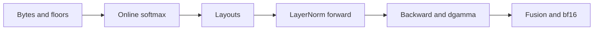
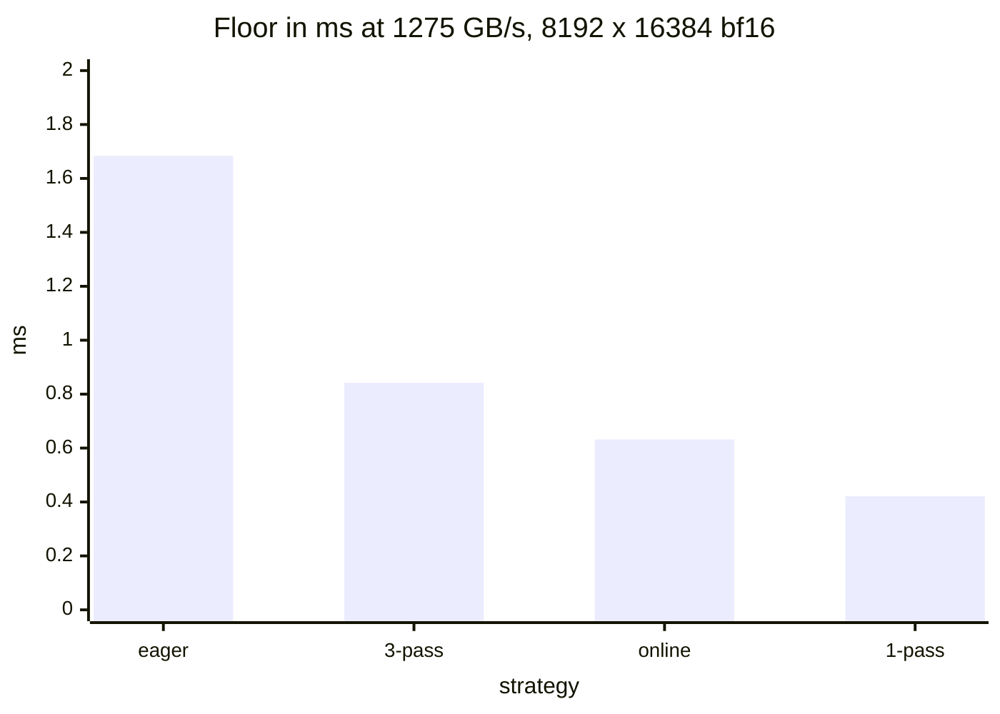
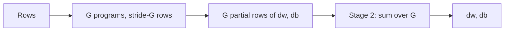
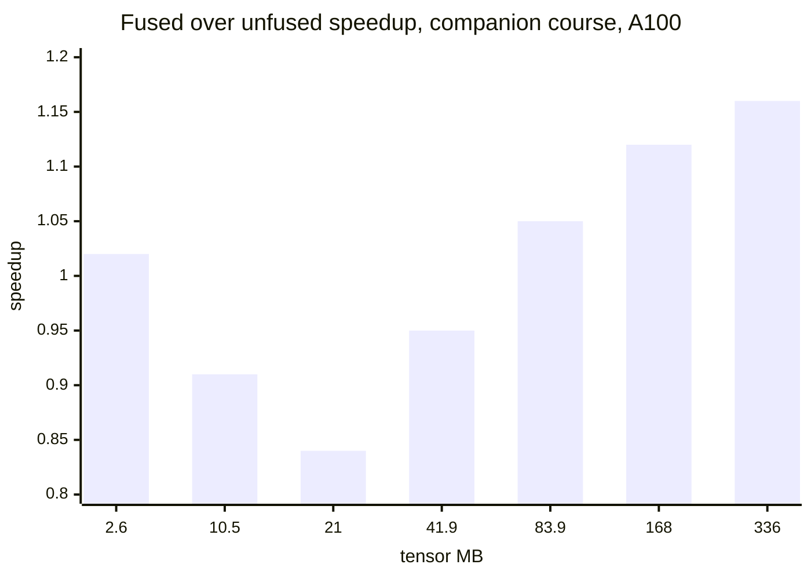

# Introduction

The question this chapter answers: how fast can a softmax or a normalization run, and what does it take to get there?

Note:
Open with the claim that these kernels are bandwidth-bound, so the whole chapter
is about moving fewer bytes in fewer passes. Mention the lab: online softmax and
LayerNorm forward and backward in Triton, checked against torch.autograd.

### Why these kernels matter {#why}

- Every layer runs two norms, every head runs a softmax
- Each does a few FLOP per element
- In eager PyTorch a softmax launches five or more kernels

Note:
Ask who has seen softmax or layer_norm near the top of a profile. They are small
per call and run thousands of times per step. Eager PyTorch decomposes a naive
softmax into max, subtract, exp, sum, divide. Each one reads and writes the whole
tensor. That is the cost we remove.

### The route through this deck {#roadmap}



Note:
Six stops. First the byte count that fixes the target. Then the one-pass softmax
recurrence, how to lay a row out on the machine, LayerNorm statistics, the
backward pass with its awkward weight gradient, and finally fusion and bf16
precision. Leave this up a few seconds.

# Bytes and floors

How long should a softmax take before you write a line of code?

Note:
This section turns a kernel into a number. The method is one line: bytes moved
divided by bandwidth. Everything later is a way to shrink the numerator.

### These kernels sit far below the ridge point {#ridge}

- LayerNorm: about 10 FLOP per element, 4 bytes in bf16 in and out
- Intensity of about 2.5 FLOP per byte
- fp32 ridge: 19.5 TFLOP/s over 1935 GB/s is 10.1

> [!KEY] Memory bandwidth sets the time
> Below the ridge point, the floor is bytes divided by bandwidth.

Note:
These kernels use the CUDA cores, not tensor cores, so compare against the fp32
peak of 19.5 TFLOP/s. The ridge is 10.1 FLOP per byte against the rating and 15.3
against the measured copy. A 10 FLOP per element estimate is generous. Even so we
are at 2.5, so bandwidth wins.

### The time floor {#floor}

$$
t_{\min} = \frac{\text{bytes moved}}{\beta}, \qquad \beta = 1275\ \text{GB/s}
$$

- Count every byte read from and written to HBM
- One volume is one full pass over the tensor
- bf16, 8192 x 16384: one volume is 268.4 MB

Note:
Define a volume once: one read or one write of the whole tensor. The tensor of
8192 by 16384 bf16 values has 134 million elements, 268.4 MB. We use this
tensor for the whole softmax half of the talk, so write the number on the board.

### Four ways to run one softmax {#four-ways}



> [!QUESTION] Why not compare against the 1935 GB/s rating?
> The measured plain copy on this card reaches 1275 GB/s, 66% of the rating, in the
> companion course. A kernel at 1275 GB/s is done. Comparing with 1935 sends you hunting
> for a speedup that isn't there.

Note:
Eager moves 8 volumes: five reads and three writes across five kernels, floor
1.684 ms. A fused three-pass kernel moves 4 volumes, 0.842 ms. Online softmax
moves 3, 0.632 ms. A row held entirely in registers moves 2, 0.421 ms. These are
floors derived from byte counts. The lab measures the real times.


### The measured anchor {#anchor}

- Fused RMSNorm, 4096 x 5120 bf16, 41.9 MB
- 0.089 ms, 945 GB/s counting one read and one write
- 74% of the copy ceiling, 49% of the rating

Note:
This is a measurement from the companion course on this same card. It tells you
what a tuned row-wise kernel reaches: about three quarters of the copy ceiling.
Caveat for the sharp: 41.9 MB is close to the 40 MiB L2, so part of that tensor can
live in cache. The lab uses tensors well above L2.

# Online softmax

The safe softmax needs the maximum before anything else. Can one pass get both?

Note:
First the numerics, then the trick. Keep the story: the maximum is the obstacle
and the rescaling factor is the fix.

### Why softmax subtracts the maximum {#max}

$$
\text{softmax}(x)_i = \frac{e^{x_i - m}}{\sum_j e^{x_j - m}}, \qquad m = \max_j x_j
$$

- fp32 and bf16 overflow at $x > 88.7$, fp16 at $x > 11.09$
- After the shift every term is in $(0, 1]$

> [!QUESTION] Does subtracting the max change the result?
> No. Multiplying numerator and denominator by $e^{-m}$ gives the same ratio, so
> softmax is invariant to a constant shift.

Note:
The shift cancels between numerator and denominator, so the answer is unchanged.
It makes the largest term exactly one, so the denominator is at least one. Warn that
this bug hides: standard normal logits max out near 4, and production logits reach 89.


### Three passes, three reads {#three-pass}


- Each pass reads the whole row
- 3 reads and 1 write is 4 volumes

Note:
Each pass depends on the one before: you need the max to get the sum and the sum
to write. That is why a straightforward fused kernel reads the row three times.
For long rows that do not stay in L2, all three reads come from HBM.

### The recurrence {#recurrence}

$$
\hlb{d_j} = \hlb{d_{j-1}}\, e^{\hla{m_{j-1}} - \hla{m_j}} + e^{x_j - \hla{m_j}}
$$

- $\hla{m}$ is the running maximum, $\hlb{d}$ the running denominator
- New maximum: shrink the old sum
- Same maximum: the factor is 1

Note:
Derive it in two lines. Split off the new term, then multiply and divide the old
sum by e to the m-sub-j-minus-one, which turns it into d-sub-j-minus-one times the
correction. When the maximum does not move the factor is e to the zero, one. When
it grows the factor is below one and brings the old sum to the new scale.

### Merging blocks {#merge}

$$
(m, d) = (m_a, d_a) \oplus (m_b, d_b): \quad m = \max(m_a, m_b), \; d = d_a e^{m_a - m} + d_b e^{m_b - m}
$$

- The merge is associative
- Lanes, warps, and programs can combine in any order

Note:
A GPU reads blocks, not elements, so we need a block merge. This is it. Because
it computes the denominator of a union of sets, it is associative. That one fact
lets Triton reduce across lanes in a tree and lets us split a row across programs.
FlashAttention uses the same operator for tiles of keys.

### Step through a row {#viz-online}

```viz
15-online-softmax
```

> [!QUESTION] What if the maximum is in the last block?
> The earlier terms were summed at a smaller maximum. The last block's factor
> $e^{m_{\text{old}} - m_{\text{new}}}$ rescales all of them at once. The lab tests
> exactly this case.

Note:
Walk the figure. With the default block size of four, step to the second block:
the maximum jumps from 2.0 to 4.3 and the denominator shrinks by 0.100 before the new
terms are added. Change the block size to see that the final denominator does not
depend on how you chunk the row.


### The kernel in nine lines {#kernel}

```python
m = float("-inf"); d = 0.0
for start in range(0, n_cols, BLOCK):
    cols = start + tl.arange(0, BLOCK)
    x = tl.load(x_row + cols, mask=cols < n_cols,
                other=float("-inf")).to(tl.float32)
    m_new = tl.maximum(m, tl.max(x, axis=0))
    d = d * tl.exp(m - m_new) + tl.sum(tl.exp(x - m_new), axis=0)
    m = m_new
```

> [!QUESTION] Why `other=-inf` and not 0.0?
> A padded lane loaded as 0.0 would add $e^{0 - m}$ to the denominator. With
> $-\infty$ it adds exactly zero.

Note:
Three details. Padded lanes load minus infinity, so they never win the max and add
exp of minus infinity, zero, to the sum. On the first block m is minus infinity,
the factor is zero, and the zero initial d stays zero. The conversion to float32
comes right after the load, so a bf16 tensor still accumulates in fp32.


# Layouts for rows

How many rows, and how many columns at a time, should one program handle?

Note:
This is the tuning section. The answer depends on row length and on the register
file, so we do the arithmetic.

### Choose the layout by row length {#layout-table}

| Row length N | Layout |
|---|---|
| up to 256 | 2D tile, several rows per program |
| 256 to 4096 | One row per program, in registers |
| above 4096 | One row per program, loop over chunks of 4096 (the lab's cap) |
| few rows, very long | Several programs per row, merged |

Note:
A starting point, not a law: autotune from here. Short rows waste lanes if one
program takes one row. Mid rows fit in registers. Long rows spill, so loop. When
there are only a few long rows, the grid is too small and you split each row.

### The register budget {#register-budget}

```viz
15-row-per-program
```

> [!QUESTION] Does the chunk loop cost an extra read?
> Yes, a second pass reads the row again, but it often hits L2. In the companion
> course a tiled RMSNorm ran within 1% of the single-block one, 929 versus 945 GB/s.

Note:
Slide the row length up to 131072 with 8 warps. Each thread would hold 512 values,
over the 255 register limit. At 16384, each thread holds 64 and the SM fits 4
programs by registers. A loop over 4096-element chunks holds 16 per thread and
allows 8 programs. The figure gives lower bounds, since addresses and temporaries
also need registers. On warp count: the companion course swept 5120-wide rows on this card and got 945 GB/s at 8 warps, 924 at 16, and 878 at 32, so for rows of a few thousand elements 4 to 8 warps is right.


### Few rows, long rows {#few-rows}

- 32 rows of 131072 columns: 32 programs
- 32 / 108 SMs is about 30% of the GPU
- Split each row across programs, then merge with $\oplus$

> [!QUESTION] Where does this show up in practice?
> Decode attention: few queries, a very long key sequence. Flash-decoding splits the
> sequence across programs and merges the partial states, as in chapter 16.

Note:
A grid smaller than the SM count leaves SMs idle no matter how good each program
is. The fix uses the associativity we proved earlier. This is the same idea as
split-K in GEMM and as flash-decoding.

# LayerNorm forward

How does one program get a row's mean and variance in a single trip?

Note:
Now the second kernel family. Same method: define the operation, find the
numerical trap, build the one-pass statistic.

### LayerNorm and RMSNorm {#definitions}

$$
y_i = w_i \hat{x}_i + b_i, \qquad \hat{x}_i = (x_i - \mu)\, r, \qquad r = \frac{1}{\sqrt{\sigma^2 + \varepsilon}}
$$

- RMSNorm: no mean, no shift, $r = (\overline{x^2} + \varepsilon)^{-1/2}$
- The kernel saves $\mu$ and $r$: 8 bytes per row

Note:
LayerNorm needs two moments and RMSNorm one. The forward saves mean and rstd in
fp32 for the backward pass, 8 bytes per row, about 0.1% of a 4096-column bf16 row.
Forward traffic is two volumes: read x, write y.

### Why $E[x^2] - E[x]^2$ fails {#cancel}

- Row with mean 1000 and variance 1, in fp32
- $E[x^2] \approx 10^6$, fp32 spacing there is 0.0625
- One rounding moves it by about 0.03
- True variance: 1

> [!WARNING] Cancellation
> The subtraction keeps the rounding error and loses the digits.

Note:
fp32 has 23 mantissa bits, so near one million, between two to the 19 and two to the
20, the gap between numbers is two to the minus four. Rounding the second moment
moves it by up to half that. The variance is the small difference of two huge
numbers, so the error is a few percent of the answer or more.

### Welford, then Chan {#welford}

$$
\mu = \mu_a + \delta \frac{n_b}{n}, \qquad M_2 = M_{2a} + M_{2b} + \delta^2 \frac{n_a n_b}{n}
$$

- $\delta = \mu_b - \mu_a$, $n = n_a + n_b$
- $M_2$ is the sum of squared deviations
- Chunks $[1,2,3]$ and $[10,12]$ merge to mean 5.6, $M_2 = 101.2$

Note:
Welford keeps count, mean, and M2, and only ever adds non-negative terms. Chan's
formula is the block version: the cross term accounts for the two groups having
different means. Check the example on the slide: five values, mean 5.6, squared
deviations sum to 101.2.

### The forward kernel's loop {#fwd-kernel}

```python
x = tl.load(x_row + cols, mask=mask, other=0.0).to(tl.float32)
n_b = tl.minimum(n_cols - start, BLOCK).to(tl.float32)
mean_b = tl.sum(x, axis=0) / n_b
c = tl.where(mask, x - mean_b, 0.0)
m2_b = tl.sum(c * c, axis=0)
```

> [!WARNING] Mask after the subtraction
> A lane loaded as 0.0 becomes $-\text{mean}_b$, which isn't zero.

> [!QUESTION] If the row fits in one block, do I need the merge?
> No. Compute the mean with one reduction, then the variance from the centered
> values in registers. It's stable because the exact mean is subtracted first.

Note:
This is the per-chunk half; the merge lines follow. The where after the subtraction
is the line people forget. It only bites when the row length is not a multiple of
the block, which is why the lab tests a row of 4097.


# The backward pass

Given $dy$, what are $dx$, $dw$, and $db$, and how do we sum over rows?

Note:
This is where normalization kernels get hard. The input gradient is a row
computation, but the weight gradient is a sum over the whole batch.

### The input gradient {#dx}

$$
dx_i = \hla{r}\left(g_i - \hlb{\overline{g}} - \hat{x}_i\, \hlc{\overline{g\hat{x}}}\right), \qquad g = dy \cdot w
$$

- Direct path, mean correction, variance correction
- Two extra row means, over registers already loaded

> [!QUESTION] How do I sanity-check a derived $dx$?
> Two identities: $\sum_i dx_i = 0$ and $\sum_i dx_i \hat{x}_i = 0$, because
> shifting or scaling a row leaves the output unchanged.

Note:
Read the three terms aloud: the gradient that flows straight through, a
correction because the mean moved, and a correction because the scale moved. The
derivation is in the chapter: differentiate x-hat by the product rule, using that
the derivative of r is minus r squared over N times x-hat.


### The parameter gradients {#dwdb}

$$
db_j = \sum_{\text{rows}} dy_{\cdot j}, \qquad dw_j = \sum_{\text{rows}} dy_{\cdot j}\,\hat{x}_{\cdot j}
$$

- Column sums over all $M$ rows
- $M$ is 16384 for a modest batch, a million for long context
- RMSNorm: same $dw$, no $db$, no mean term in $dx$

Note:
The same weight vector applies to every row, so its gradient adds across rows. That
is an M-way reduction into N outputs. The row kernels are embarrassingly parallel;
this is the one place programs must combine.

### Recompute, don't save {#recompute}

- Save $\mu$ and $r$: 8 bytes per row
- Recompute $\hat{x} = (x - \mu) r$ from the x you read anyway
- Backward moves 3 volumes: read x, read dy, write dx
- Floor, $16384 \times 4096$ bf16: 0.316 ms

Note:
Saving x-hat would cost a full volume. Recomputing costs two FLOPs per element. The
byte count for the backward is three volumes, 402.7 MB on the 134 MB test tensor,
so 0.316 ms at the copy ceiling. Forward is two volumes, 0.211 ms.

### Three ways to reduce $dw$ and $db$ {#reduce-options}

| Scheme | Deterministic | Extra memory |
|---|---|---|
| `tl.atomic_add` | No | None |
| Locks and partial buffers | No | $G \times N$ |
| Two stages | Yes | $G \times N$ |

Note:
Atomics contend: every row adds into the same N addresses. The Triton tutorial uses
partial buffers guarded by a spin lock, which is fast but intricate and still
orders the additions by who gets the lock. The two-stage scheme avoids both. That is
what the lab uses.

### The two-stage reduction {#two-stage}



- Stage 1 also writes $dx$
- Stage 2 adds the $G$ partial rows in a fixed order

> [!QUESTION] What does the extra buffer cost?
> With $G = 432$ and $N = 4096$, two fp32 buffers are 14.2 MB, about 3.5% of the
> 403 MB the backward moves. They fit in L2, so the re-read may stay on chip.

Note:
Each stage-one program owns rows pid, pid plus G, and so on, keeps dw and db
partial sums in registers, and writes one partial row at the end. No atomics, no
locks. Stage two launches one program per block of columns and sums the G rows.


# Fusion and precision

What else can a normalization kernel absorb, and which values must stay in fp32?

Note:
The last section. Fusion is the reason people write these kernels at all, and
precision is the reason fused kernels sometimes disagree with PyTorch.

### Fusing the residual add {#fuse-add}

- Unfused: add (3 volumes) then norm (2): 5 volumes
- Fused: read x and f, write s and y: 4 volumes
- Byte prediction: 1.25x

Note:
The add reads the stream and the sublayer output and writes the sum; the norm reads
the sum and writes the result. Fusing keeps the sum in registers for the norm, but
you still write it because it is the next residual. Four volumes instead of five.

### The prediction meets the cache {#l2-crossover}



> [!QUESTION] Does this mean fusion is pointless on small tensors?
> Not always: it still removes launches and saves memory capacity. But don't expect
> the byte-count speedup when the intermediate fits in L2.

Note:
Measured in the companion course on the lab card. Below the 40 MiB L2, fusion loses:
the intermediate never left the cache. Above it, fusion wins and approaches the
1.25 the byte count predicts. Moral: count bytes that reach HBM, and measure above
cache size. Run-to-run noise is a few percent.


### Fusing dropout {#fuse-dropout}

- Unfused: write a bool mask, 1 byte per element, read it back
- Fused: generate the mask in registers with `tl.rand(seed, offsets)`
- Store the seed, regenerate in the backward pass

Note:
A counter-based generator such as Philox turns a seed and an offset into a random
number with no memory traffic. The backward pass regenerates the same numbers from
the same offsets, so the mask tensor, half a bf16 volume, is never written or read.

### The bf16 rule {#bf16-rule}

- Convert to fp32 right after the load
- Reduce in fp32: max, sums, Welford state, backward row sums
- Keep $\mu$ and $r$ in fp32
- Accumulate $dw$, $db$ in fp32 across rows
- Round once, at the final store

> [!QUESTION] Is fp32 accumulation free?
> Almost. The extra registers are small, and the bytes read and written are unchanged
> because only the stored tensors are bf16.

Note:
Why: a bf16 sum of ones stalls at 256, because 257 is not representable and rounds
back to 256. Rounding rstd to bf16 would scale a whole row by up to two to the minus
eight. The weight gradient is the case that matters most: sum in fp32 across all the
rows and cast once.


### The lab {#lab}

- Online softmax for rows up to 70000 columns
- LayerNorm forward with a Welford merge
- Backward with a two-stage dw and db reduction
- Tests compare against float64 and `torch.autograd`

Note:
Metrics reported: softmax GB/s, softmax speed against torch.softmax, LayerNorm
forward and backward GB/s. Floors at the copy ceiling are 0.421, 0.211, and 0.316
ms. Thresholds are 40%, 40%, and 30% of 1275 GB/s. The first call compiles, so it
is slow.

# Summary

What to carry out of the room.

Note:
Recap, then the next chapter. Pause for questions before moving on. Chapter 16 takes the merge operator into attention: the same running maximum and denominator, plus a running weighted sum of values.

### What to remember {#summary}

- Floor = bytes moved / 1275 GB/s
- Subtract the max; online softmax uses a rescale factor and two passes
- Variance by Welford and Chan, not $E[x^2] - E[x]^2$
- $dx = r(g - \overline{g} - \hat{x}\,\overline{g\hat{x}})$
- $dw$, $db$: two-stage reduction, fp32 accumulation

Note:
Five lines. If the audience remembers one thing, it should be that the byte count
is the performance model for this whole family of kernels, and that the two
algorithmic tricks, online softmax and Welford, exist to make the byte count
achievable in one or two passes.

