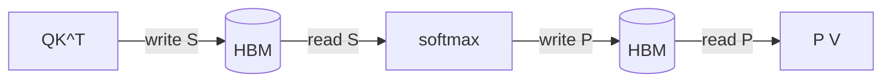
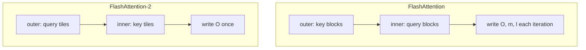
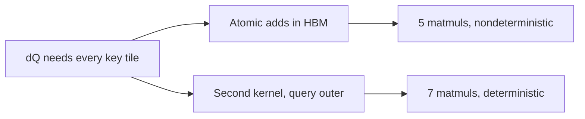

# Introduction

The question this chapter answers: how do you compute attention, and its gradient, without storing the N x N score matrix?

Note:
Open by asking who has hit an out-of-memory error at long context. That error is the score matrix. By the end of the deck the audience can derive the backward pass on a whiteboard and say what changed between FlashAttention-2, -3, and -4. The lab is Triton FlashAttention-2, forward and backward, so everything here is something they will write.

### The route through this deck {#roadmap}


Note:
Six stops. The backward pass is the longest and the part to follow closely. Causal masking and grouped heads are small changes with real consequences. The last stop is prose and numbers from the papers, because the lab card is an A100 with none of the Hopper or Blackwell features.

# What standard attention costs

Count the bytes before you count the FLOPs.

Note:
Divider. The point of this section is that attention at long sequence length is slow because of memory traffic, and the argument is one worked example.

### Four passes over the matrix {#four-passes}



Note:
Walk the diagram left to right. Scores are written, read for the softmax, written again as probabilities, and read for the multiply by V. Four trips over an N by N matrix. A real framework does more, because the scale, mask, and softmax are separate kernels and the softmax often runs in float32. We count the minimum so the argument survives any objection.

### One head at N = 8192 {#one-head}

| Quantity | Value |
|---|---|
| Score matrix, bf16 | 134.2 MB |
| Four passes | 536.9 MB |
| Q, K, V, O, d = 128 | 8.4 MB |
| FLOPs, 4 N² d | 34.36 GFLOP |

Note:
Arithmetic: 8192 squared is 67.1 million entries, times two bytes is 134.2 megabytes. Four passes is 536.9. The four d-wide tensors are 8.4 megabytes. The score matrix is 98.5 percent of the traffic. The FLOP count is 4 N squared d, 34.36 billion, from two matmuls of 2 N squared d each.

### Bound by bandwidth {#bound-by-bandwidth}

$$
\frac{34.36 \times 10^{9}\ \text{FLOP}}{545.3 \times 10^{6}\ \text{B}} = 63.0\ \text{FLOP/B} < 161
$$

- Memory floor at 1275 GB/s: 0.428 ms
- Compute floor at 312 TFLOP/s: 0.110 ms

> [!QUESTION] Why use 1275 GB/s and not the rated 1935?
> The lab card's measured device-to-device copy reached 1275 GB/s in learn-inference. That measured figure is the ceiling a memory-bound kernel is judged against.

Note:
The intensity is 63 FLOP per byte against a ridge point of 161, so the kernel waits on memory. The memory floor is 3.9 times the compute floor. The tensor cores sit idle. This is the whole motivation: the useful matmuls would run at tensor-core speed if the data were on chip.

# The tiled forward pass

Process keys in blocks, and carry a small running state.

Note:
Divider. This builds on chapter 15's online softmax. If the room did not take chapter 15, give them the one-line version: a running max and a running sum, with one multiply to repair the sum when the max rises.

### The running state {#running-state}

- Running maximum $\hla{m}$ per query row
- Running sum $\hlb{\ell}$ of $e^{s-m}$
- Running output $\hlc{o}$, a vector of length d
- Correction $\hld{\alpha} = e^{m_{\text{old}} - m_{\text{new}}}$

$$
\hlb{\ell} \leftarrow \hld{\alpha}\,\hlb{\ell} + \operatorname{rowsum}(P_j), \quad \hlc{o} \leftarrow \hld{\alpha}\,\hlc{o} + P_j V_j
$$

Note:
Three numbers per row, one correction factor shared by the last two. The output accumulator is a vector, so the update is a scalar times a vector plus a small matmul. The answer is exact, not approximate: only the order of floating-point additions changes. Divide by the sum once, at the end.

### One program, one query tile {#one-program}

```python
for start_n in range(0, hi, BLOCK_N):
    s = tl.dot(q, k) * qk_scale
    m_new = tl.maximum(m_i, tl.max(s, axis=1))
    alpha = tl.exp2(m_i - m_new)
    p = tl.exp2(s - m_new[:, None])
    l_i = l_i * alpha + tl.sum(p, axis=1)
    acc = acc * alpha[:, None] + tl.dot(p.to(v.dtype), v)
    m_i = m_new
```

Note:
This is the lab's loop, trimmed. Q stays in registers for the whole pass. S and P are tiles in registers and never get an address. We work in base two: the scale folds in log2 of e, and exp2 is one fast instruction. The accumulator stays float32 even for bfloat16 inputs.

> [!QUESTION] Why float32 for the accumulator?
> A bfloat16 running sum stops growing once it is 256 times larger than the next term. Chapter 9 shows the format arithmetic.

### What the forward pass saves {#saves-lse}

$$
\hla{L_i} = \hla{m_i} + \log \hlb{\ell_i}, \qquad P_{ij} = e^{S_{ij} - L_i}
$$

- One float32 per row: 32 KiB per head at N = 8192
- Replaces a 134.2 MB matrix
- This is all the backward pass needs

Note:
The logsumexp is the normalizer in log form. Given L, any tile of P is one matmul and one exponential away. That is the trade at the heart of the algorithm: spend cheap tensor-core FLOPs to avoid expensive bytes. FlashAttention-2 saves L alone, where the first version saved both the max and the sum.

### Which tiles a pass computes {#tile-grid-slide}

```viz
16-tile-grid
```

Note:
Use the figure live. Each row of tiles is one program. Toggle causal and watch the tiles above the diagonal go grey: they are never launched. Drag the slider to show the longest row against the average, which we return to in the causal section. Step through to show programs walking along their rows.

### Traffic that remains {#traffic-remains}

$$
2Nd + \frac{N}{B_M}\cdot 2Nd = 272.6\ \text{MB}\quad (N = 8192,\ d = 128,\ B_M = 128)
$$

- Half of standard attention's 545.3 MB
- Still quadratic in N
- The L2 absorbs most re-reads: toward 8.4 MB

> [!QUESTION] If it is still quadratic, why is it faster?
> The quadratic term is smaller by a factor of about B_M over d squared per element, and K and V for one head are 4.2 MB, which fits the 40 MiB L2. Programs running together hit the cache after the first read.

Note:
Be honest here: the tiled kernel is not linear in traffic. Peak allocation is linear, traffic is not. The factor is modest if every read reaches HBM. The cache closes the gap, and it stops working when a head's K and V exceed the L2, around 131072 tokens at d = 128, where they are 67 MB.

### Where it lands {#roofline-landing}

```viz
16-io-traffic
```

Note:
Use the figure live. Slide N and watch the three bars: standard attention, the tiled kernel when every read of K and V reaches HBM, and the tiled kernel when the L2 absorbs the repeats. At N = 8192 and d = 128 the numbers are 545.3, 272.6, and 8.4 megabytes. Only the last case is far above the ridge point of 161, at an intensity of 4096. The lab measures how close the Triton kernel gets.

# FlashAttention-2

Same algorithm, four changes, about twice as fast.

Note:
Divider. FlashAttention-2 did not change the idea. It changed how the loops and warps are arranged so the hardware stays busy. Cite the paper's numbers with their hardware: 50 to 73 percent of the A100's peak in the forward pass, up to 225 TFLOP/s end to end.

### Loop order {#loop-order}



Note:
In the first version every outer iteration touched every row, so the running state went out to HBM and back. Swapping the loops keeps one tile's state in registers for its whole pass and writes the output once. The swap also makes the outer loop parallel, which is the next slide.

### Parallelize over the sequence {#parallel-seq}

- FlashAttention: grid = batch x heads
- B = 1, H = 8 gives 8 programs on 108 SMs
- FlashAttention-2: grid = N / B_M x batch x heads
- N = 8192, B_M = 128: 64 x 8 = 512 programs

> [!QUESTION] Why did long sequences with small batches suffer most?
> Training long contexts uses small batches. With few batch-and-head pairs, a grid of one program per pair leaves most SMs idle, while query tiles are independent and fill the machine.

Note:
This is the change that matters most for long-context training. Eight programs on 108 SMs is 7 percent of the machine. Making query tiles the outer loop gives 512 programs. Each is independent because each owns different output rows.

### Fewer non-matmul FLOPs {#fewer-flops}

$$
\frac{312\ \text{TFLOP/s (tensor)}}{19.5\ \text{TFLOP/s (fp32 cores)}} = 16
$$

- Defer the division by $\hlb{\ell}$ to the end
- Save one logsumexp, not max and sum
- Skip fully masked tiles
- Split Q, not K, across warps (the compiler does this in Triton)

Note:
On the A100 a non-matmul FLOP is sixteen times more expensive than a matmul FLOP. So every rescale and divide in the inner loop is worth removing. The deferred division is the cleanest example: the unnormalized output is rescaled by alpha each step, but divided by the sum only once per tile.

# The backward pass

Five matmuls, one saved vector, and one preprocessing step.

Note:
Divider. This is the core of the chapter. Slow down. Everything on the next slides is a lab TODO.

### Differentiate in reverse {#reverse-chain}

$$
S = \sigma QK^{\top},\quad P = \operatorname{softmax}(S),\quad O = PV
$$

$$
dV = P^{\top} dO, \qquad dP = dO\,V^{\top}
$$

Note:
Three steps forward, so three steps back. Start at the output. The gradient to V is P transpose times dO, and the gradient to P is dO times V transpose. Both are matmuls. dV is a sum over query rows, so each key tile collects a contribution from every query tile. Sigma is one over root d.

### The softmax step and the delta identity {#delta-identity}

$$
dS_{ij} = P_{ij}\big(dP_{ij} - \hld{\delta_i}\big), \qquad \hld{\delta_i} = \sum_k P_{ik}\,dP_{ik}
$$

$$
\hld{\delta_i} = \sum_k P_{ik}\,(dO_i \cdot V_k) = dO_i \cdot \sum_k P_{ik}V_k = \boxed{dO_i \cdot O_i}
$$

> [!KEY] A row sum becomes a dot product
> delta is rowsum(dO o O): one float32 per row.

Note:
The softmax Jacobian gives dS, but delta is a sum over the entire row of P, which a tiled kernel never holds. Substitute dP as dO dot V, move dO out of the sum, and what is left inside is P times V, which is O. So delta is a dot product of two rows. A small preprocessing kernel computes it for every row before the main loop. It reads O and dO once and saves a full pass over K and V.

### Check it on one row {#delta-check}

| | Value |
|---|---|
| P | 0.25, 0.75 |
| V | 1, 3 |
| dO | 2 |
| Direct delta | 0.25 x 2 + 0.75 x 6 = 5.0 |
| dO x O | 2 x 2.5 = 5.0 |

Note:
Walk the numbers. O is 0.25 times 1 plus 0.75 times 3, which is 2.5. dP is dO times each V: 2 and 6. The direct sum is 5.0, and dO times O is 5.0. Then dS is P times dP minus delta: negative 0.75 and positive 0.75. They sum to zero, as the gradient of a softmax must.

### Recompute P from the logsumexp {#recompute-p}

$$
P_{ij} = e^{\,\sigma\,Q_i\cdot K_j - \hla{L_i}}
$$

- One matmul repeats from the forward pass
- No running maximum needed: L holds the normalizer
- Tensor-core FLOPs spent to avoid N² bytes

> [!QUESTION] Why not just save P?
> P has N² entries. L has N. Saving P puts the matrix back in memory, which is the thing we removed.

Note:
This is activation recomputation at the finest grain. The backward pass spends a matmul it already did once to avoid storing or reading the matrix. Because L already includes the normalizer, the backward pass needs no running statistics and no second softmax pass.

### The last two gradients {#dq-dk}

$$
\boxed{dQ = \sigma\,dS\,K}, \qquad \boxed{dK = \sigma\,dS^{\top}Q}
$$

- Five matmuls in all: S again, dP, dV, dQ, dK
- Backward FLOPs: 10 N² d, 2.5 times the forward

Note:
The scale appears here because S is sigma Q K transpose. dV has no sigma since it has no score in it. Missing the scale is a classic bug. Count the matmuls: recomputing S, then dP, dV, dQ, dK. Forward has two. So backward costs 2.5 times the forward in FLOPs.

### Who is the outer loop? {#outer-loop}

| Outer loop | In registers | Reduced through HBM |
|---|---|---|
| Key tile | dK, dV | dQ |
| Query tile | dQ | dK, dV |

Note:
dK and dV are sums over query tiles. dQ is a sum over key tiles. You can keep one family in registers, not both. FlashAttention-2 picks the key tile as the outer loop, so dK and dV stay in registers. That leaves dQ, which every program touches. Two fixes follow.

### Two ways to build dQ {#dq-options}



> [!QUESTION] Which does the lab use?
> The second kernel. It recomputes S and dP, so it does seven matmuls, and gives bit-identical gradients between runs.

Note:
The reference FlashAttention-2 uses atomic adds into a float32 buffer: five matmuls, but the add order depends on the scheduler, so results differ in the last bits. A second kernel recomputes two matmuls and writes dQ once. The lab does the second and tests determinism. FlashAttention-4 attacks the same cost with a different tool, covered later.

### The key-tile kernel {#dkdv-kernel}

```python
st  = tl.dot(k, tl.trans(q)) * qk_scale
pt  = tl.exp2(st - lse[None, :] * 1.4426950408889634)
pt  = tl.where(keep, pt, 0.0)
dv += tl.dot(pt.to(do.dtype), do)
dpt = tl.dot(v, tl.trans(do))
dst = pt * (dpt - delta[None, :])
dk += tl.dot(dst.to(q.dtype), q)
```

Note:
These seven lines are the five matmuls. The tiles are transposed, keys as rows, so dV and dK are plain dots. Mask P after the exponential, not S before it: an out-of-range key loads zeros, so its score is zero and its P is not. Both accumulators stay in float32 registers until the loop ends.

# Causal masking and grouped heads

Two small changes with large effects.

Note:
Divider. Both changes are a few lines in the kernel, and both have a backward-pass consequence that is easy to miss.

### Skip the tiles, not just the scores {#block-skipping}

```python
hi = N
if CAUSAL:
    hi = tl.minimum(N, (pid_m + 1) * BLOCK_M)
for start_n in range(0, hi, BLOCK_N):
    ...
```

- B_M = 128, B_N = 64, N = 8192: 4160 of 8192 tile pairs
- 50.8% of a full pass
- Rows have unequal length: launch the long ones first

> [!QUESTION] How does the backward pass change?
> It inverts. Key tile j is seen only by query tiles from j onward, so the loop starts at lo instead of 0, and early key tiles have the most work.

Note:
Masking after the matmul saves nothing. Bounding the loop saves half the work. Query tile i runs 2 times i plus 1 key tiles, and the sum over 64 tiles is 4160. The extra 0.8 percent is the diagonal tiles, which need the element-wise mask. Tiles below the diagonal need none, and a tuned kernel runs them in a loop without the mask. Programs also have unequal lengths: if the longest start last, the GPU is half empty at the tail, so a tuned kernel launches long rows first.

### Grouped-query attention {#gqa}

- Group size g = H / H_KV, query head h reads KV head h // g
- 32 query heads, 8 KV heads: 4096 B per token per layer, not 16,384
- Forward: one line of indexing
- Backward: dK and dV sum over the g heads in the group

Note:
The forward change is one line. Do not repeat_interleave K and V: that writes g copies to HBM and gives away the bandwidth saving. The backward needs care because dK and dV for a shared head are sums over all g query heads. The lab launches the key-tile kernel over batch times KV heads and loops over the group inside, in float32 registers, so no atomics.

# Hopper and Blackwell

What changed when the matmul got faster than everything around it.

Note:
Divider. These are prose and cited numbers only. The lab A100 has no TMA, no wgmma, no FP8 tensor cores, and no tensor memory. Name the hardware every time a number appears.

### FlashAttention-3 on H100 {#fa3}

- FlashAttention-2 reached about 35% of H100 peak
- FlashAttention-3: 1.5 to 2.0 times faster on H100
- Up to about 740 TFLOP/s FP16 (75%), near 1.2 PFLOP/s FP8
- Warp specialization, ping-pong, intra-warpgroup overlap

Note:
Source is the FlashAttention-3 paper, measured on the H100. The H100 SXM5 peak is 989.4 TFLOP/s dense in bfloat16, and 740 is about 75 percent of it. The three ideas are on the next slides. FP8 adds block quantization and incoherent processing.

### Why the softmax must hide {#hide-softmax}

$$
\frac{512\ \text{FLOP}}{989.4\ \text{TFLOP/s}} = 0.52\ \text{ps}, \qquad \frac{1}{4.5\ \text{T exp/s}} = 0.22\ \text{ps}
$$

- Per score element on an H100, d = 128
- Unhidden exponentials add 43% to the matmul time

> [!QUESTION] Where does 512 come from?
> Two matmuls per element, each 2d FLOPs: 4d = 512 at d = 128.

Note:
This arithmetic is ours, from the H100 SXM5 dense bfloat16 peak and NVIDIA's 4.5 trillion exponentials per second for Hopper. It shows why overlapping softmax with matmul is worth engineering. Ping-pong lets two warpgroups alternate. Intra-warpgroup pipelining issues the next matmul asynchronously and does softmax behind it.

### FlashAttention-4 on B200 {#fa4}

| Per SM, 128 x 128 x 128 tile | Forward | Backward, 1-CTA |
|---|---|---|
| Tensor cores | 1024 cycles | 2560 |
| Exponentials | 1024 | 1024 |
| Shared memory | 768 | 3328 |

Note:
From the FlashAttention-4 blog. On Blackwell the tensor cores and the exponential unit tie in the forward pass, so unoverlapped exponentials are pure loss. In the backward pass shared memory is the longest at 3328 cycles. The paper reports up to 1613 TFLOP per second in bfloat16 on a B200, about 71 percent of peak, and up to 1.3 times cuDNN 9.13.

### What FlashAttention-4 changes {#fa4-changes}

- Asynchronous MMA, 128 x 256 tiles, tensor memory
- Part of the exponential on FMA units, by polynomial
- Rescale only when the row max jumps past a threshold
- 2-CTA backward: half the shared-memory traffic, half the dQ atomics

> [!QUESTION] Does this change the algorithm?
> No. It is the same exact attention. The changes reschedule the same arithmetic around a new resource balance.

Note:
Each bullet answers one bar on the previous table. Software exponentials relieve the exponential unit. Conditional rescaling removes work from the critical path. The 2-CTA mode attacks shared memory and the dQ atomic adds, the same dQ problem we met. A deterministic mode costs 10 to 15 percent, per the blog.

### Decoding: one query {#decoding}

$$
L = \log\sum_s e^{L_s}, \qquad O = \sum_s e^{L_s - L}\,O_s
$$

- One query tile means a grid of batch x heads
- Split the keys across programs, merge with the saved logsumexp

Note:
Decode has one query, so query tiles give no parallelism: 32 heads is 32 programs on 108 SMs. Flash-decoding splits the key axis across programs. Each returns a normalized partial output and its logsumexp, and a small kernel merges them. The merge is exact. This is the same logsumexp the training backward pass uses, which is why the forward saves it.

# Summary

What to remember, and what the lab asks.

Note:
Divider for the close. Spend about two minutes here.

### The key ideas {#key-ideas}

- Standard attention is bound by the N² matrix: 63 FLOP/B against 161
- The tiled forward saves one vector, the logsumexp
- Backward: recompute P, five matmuls, delta = rowsum(dO o O)
- dQ: atomics for speed, a second kernel for determinism

Note:
Four sentences the audience should be able to repeat. If someone remembers only one thing, it is that the forward pass trades a matrix for a vector and the backward pass spends a matmul to rebuild what it needs.

### Numbers to remember {#numbers}

| Quantity | Value |
|---|---|
| Score matrix, N = 8192, bf16 | 134.2 MB |
| Causal tile fraction | 50.8% |
| Backward / forward FLOPs | 2.5x |
| FlashAttention-2 on A100 | 50 to 73% of peak forward |
| FlashAttention-3 on H100 | up to 740 TFLOP/s FP16 |
| FlashAttention-4 on B200 | up to 1613 TFLOP/s BF16 |

Note:
The last three rows come from the papers and name their hardware. The first three are arithmetic from the chapter. Your lab reports the A100 numbers for your own kernel, next to the vendor kernel, so you can see where a teaching kernel sits.

### Next: fusion and compilers {#next}

- The lab: forward, backward, causal, GQA, TFLOP/s
- Chapter 17: how torch.compile fuses what you wrote by hand
- FlexAttention compiles a mask function into this loop

> [!QUESTION] When should I write attention myself?
> Rarely. Use scaled_dot_product_attention or FlexAttention. Write it to understand the kernel, or when a variant needs a score modification no backend supports.

Note:
Close by pointing at the lab and at the next chapter, which covers the compiler machinery behind FlexAttention. The honest answer to the last question: in production you almost always use the library kernel. The reason to write it is that every Triton kernel you read afterwards looks familiar.
