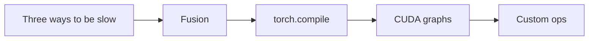
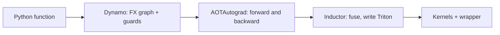
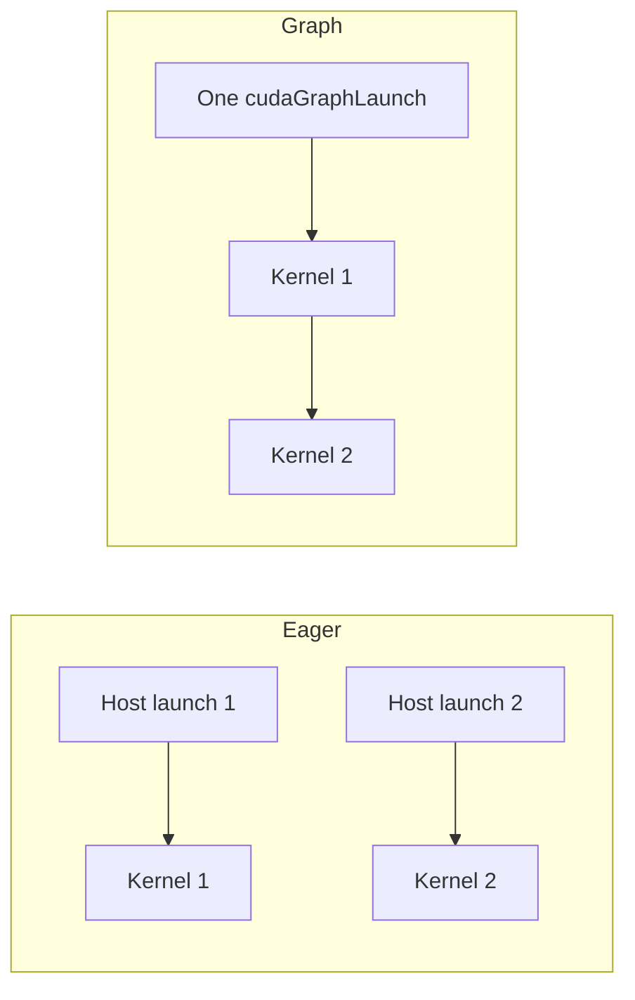

# Introduction

The question this chapter answers: when a PyTorch model is slower than its kernels suggest, what is the GPU waiting for?

Note:
Open with the observation that a model is hundreds of small ops around a few big
kernels. Each small op costs a launch and a round trip to HBM. The audience
already knows the roofline from earlier chapters. Today we add a third limit,
the launch rate, and the tools that attack each of the three.

### Six ops, six kernels {#six-ops}

```python
def chain_eager(x):
    t = x * 1.5
    t = t + 0.5
    t = torch.sin(t)
    t = t * t
    t = t - 0.25
    return torch.relu(t)
```

- Eager PyTorch runs six kernels
- Each one reads and writes a whole tensor

Note:
This is the lab's chain. Ask the room how many kernels it launches. Six, one per
line. Then ask how many times the tensor crosses the memory bus. Twelve: six
reads and six writes. The rest of the deck is about why that is wasteful, what a
compiler does about it, and where the compiler stops.

### The route through this deck {#roadmap}



Note:
Walk the five boxes. First we separate compute, memory, and overhead. Fusion
fixes the bytes and some launches. torch.compile does the fusion for you. CUDA
graphs remove the launches fusion can't. Custom ops let your own kernel live
inside the compiled program. The lab has one part for each of the last three.

# Three ways to be slow

Compute bound, memory bound, or overhead bound: the fix depends on which.

Note:
This section is diagnosis. A fast kernel does nothing for a program that is
slow for another reason. Horace He's essay, Making Deep Learning Go Brrrr, is
the framing, and it is worth giving the audience the link.

### Three regimes {#regimes}

| Regime | The GPU is | Fix |
|---|---|---|
| Compute bound | Busy with arithmetic | Fewer FLOPs, tensor cores |
| Memory bound | Waiting for HBM | Move fewer bytes |
| Overhead bound | Idle, waiting for a launch | Fewer launches |

Note:
Use the factory picture. Compute is the production line, memory is the trucks
from the warehouse, overhead is the manager sending instructions. In the first
two rows the GPU is working. In the third it is not working at all, so a faster
kernel changes nothing. Chapters 10 to 16 lived in the first two rows. The third
row is new.

### The doubling test {#doubling}

- Double every tensor, for example the batch size
- Time roughly doubles: bytes or FLOPs dominate
- Time barely moves: you are overhead bound

> [!QUESTION] Why does the time stay flat when overhead dominates?
> The host was the bottleneck, so the GPU had spare capacity. Twice the work per
> kernel fits in time the GPU spent idle. A profiler shows the same thing as
> gaps between short kernels on the GPU timeline.

Note:
This is the cheapest diagnostic there is and it needs no profiler. The reason it
works is that an overhead-bound GPU is idle for much of each step, so extra work
per kernel fills idle time. The profiler view from chapter 5 gives the same
answer with more detail: a solid CPU timeline and a gappy GPU timeline.

### Where the host's time goes {#host-time}

- Python calls into `torch`
- The dispatcher picks the implementation
- Shape inference and an output allocation
- `cudaLaunchKernel` hands it to the driver
- The course's rule: 5 to 10 microseconds per launch

Note:
None of the layers is slow alone. Together they cost microseconds. He's essay
measured about 280 thousand tiny ops per second, roughly 3.6 microseconds each,
on a machine the essay does not name, which agrees in order of magnitude. The
lab measures it on the A100's host. We use 5 microseconds as the working number
and say when the answer depends on it.

### Where a pointwise kernel becomes launch bound {#crossover}

One eager op on $N$ float32 values moves $8N$ bytes. Set its time equal to the launch cost:

$$
\frac{8N}{1.275 \times 10^{12}\ \text{byte/s}} = 5\ \mu\text{s} \implies N = 796{,}875
$$

Below about 0.8 million elements, which is 3.2 MB per tensor, the GPU finishes before the next launch arrives.

Note:
The 1275 GB/s is the measured copy ceiling from the companion course, not the
1935 rating. Below this size a pointwise op is overhead bound, and the host sets
the speed. At N equal to 2 to the 12, the arithmetic is 25.7 nanoseconds per op
against a 5 microsecond launch. This is why small tensors and small batches are
where graphs matter.

### Fusion across the crossover {#fusion-figure}

```viz
17-fusion-bytes
```

Note:
Let the audience drag the size slider. At 2 to the 24 each op is bandwidth bound
and the speedup is the byte ratio. Below the crossover each op is launch bound
and the speedup is the launch ratio. The number is the chain length in both
cases, but the reason differs, and so does the fix. Remind them this is a
prediction: it ignores the L2 and the GPU's minimum kernel time.

# Fusion

Merge ops into one kernel so intermediates stay on chip.

Note:
Fusion attacks bytes and launches together, which is why it is the first tool to
reach for.

### The byte count {#bytes}

$$
\boxed{B_{\text{eager}} = \hla{2kS} \qquad B_{\text{fused}} = \hlb{2S}}
$$

- $S = 4N = 67.1$ MB for $N = 2^{24}$, and $k = 6$
- Eager: 805.3 MB, a floor of 0.632 ms at 1275 GB/s
- Fused: 134.2 MB, a floor of 0.105 ms
- Predicted speedup: 6.0

Note:
Show the arithmetic once. 2 times 6 times 67.1 is 805.3. 2 times 67.1 is 134.2.
Divide by 1275000 to get milliseconds. The 64 MiB tensor is above the 40 MiB L2,
so the intermediates really do go to HBM and the prediction is fair. The lab
measures the real speedup. Do not present 6x as a result.

### The hand-fused kernel {#hand-fused}

```python
x = tl.load(x_ptr + offs, mask=mask)   # the only read
t = x * 1.5 + 0.5
t = tl.sin(t)
t = t * t - 0.25
t = tl.maximum(t, 0.0)
tl.store(y_ptr + offs, t, mask=mask)   # the only write
```

Every intermediate lives in a register.

Note:
This is the core of the lab kernel. One load, one store, the whole chain in
registers. Remind them the masks matter because the tests use sizes such as 1,
7, and 4097. A missing mask never faults. It reads the next row or corrupts it.
The lab asks for 50 percent of the 1275 copy ceiling counting one read and one
write.

### Three patterns a compiler fuses {#patterns}

| Pattern | What fuses | Saves |
|---|---|---|
| Pointwise | A chain of elementwise ops | $2(k-1)$ tensors of traffic |
| Reduction | A producer into the reduce, a consumer after it | One pass over the row |
| Epilogue | Bias, activation, cast onto a GEMM | The output's round trips |

Note:
Pointwise is the six-op chain. Reduction is RMSNorm and LayerNorm from chapter
15: square then sum is one pass. Epilogue is the GEMM output. For a 4096 cubed
bf16 GEMM the output is 33.6 MB, an unfused bias and GELU add 134.2 MB of
traffic, which is 0.105 ms, 24 percent on top of the 0.44 ms GEMM floor. That is
an upper bound, because the output fits in L2.

### When fusion does not pay {#no-pay}

> [!KEY] Fusion saves bytes that reach HBM
> A tensor that stays in the 40 MiB L2 never made the trip fusion removes.

- Companion course, RMSNorm plus residual, lab A100
- Predicted 1.25x; measured 0.92x at 41.9 MB, 1.10x at 167.8 MB

> [!QUESTION] Does fusion always win at least a little?
> No. At 41.9 MB it measured 0.92x, slower than unfused: the cache already
> absorbed the traffic.

Note:
These measurements come from the companion course's chapter 13 on this same
card. The byte count assumes every touched byte reaches HBM. With a 40 MiB
write-back L2 that assumption fails for tensors that fit. So size benchmarks
above 40 MiB, and measure at several sizes. Our 64 MiB chain sits just above the
cache.

# How torch.compile works

Three stages turn Python into Triton kernels.

Note:
We will take the three stages in order and then learn to read the output. The
goal is for the audience to debug a compiled model, not just call it.

### The pipeline {#pipeline}



Note:
Dynamo captures, AOTAutograd splits into forward and backward and lowers to
ATen, Inductor fuses and emits Triton. Each stage can be the reason something is
slow, which is why we look at each.

### Dynamo captures a graph, with guards {#dynamo}

- Reads Python bytecode as it runs
- Records PyTorch ops into an FX graph
- Records guards: shape, dtype, device, Python values it branched on
- Guards fail: it compiles again and keeps both versions

> [!QUESTION] Why does the graph need guards at all?
> The graph is straight-line code valid only for the values that took each
> branch. A guard is a cheap check that those values still hold. Without it, a
> new shape would silently run the wrong graph.

Note:
Dynamo needs no example input and no rewriting. The cost is that the captured
program is specialized to what it saw. Guards run on every call before the
compiled code, so they are also a small per-call cost.

### Graph breaks {#breaks}

- Data-dependent `if` on a GPU value
- `.item()` and `.tolist()`
- Code Dynamo cannot read: C extensions, opaque CUDA kernels
- `print` and other side effects

Use `fullgraph=True` to make a break an error.

Note:
A break splits the function into several graphs with eager Python between them.
Each seam materializes intermediates and pays its own guard cost, so many breaks
can make the compiled code slower than eager. TORCH_LOGS equals graph_breaks
names the line. torch._dynamo.explain counts them without failing. Your own
kernel is a break unless you register it, which is the last section.

### AOTAutograd and the min-cut {#aot}

- Traces the backward graph ahead of time
- Lowers to ATen and makes mutation explicit
- The partitioner chooses: save an activation, or recompute it

> [!QUESTION] Why would you recompute an activation in the backward pass?
> A pointwise activation costs almost no arithmetic but saving it costs memory
> and bytes to write and re-read. Recomputing trades free FLOPs for scarce bytes,
> which is why compile often lowers training memory.

Note:
This is a saving fusion alone cannot make. The partitioner is a min-cut on the
joint graph. The training chapter, chapter 19, returns to what the backward pass
costs.

### Inductor writes Triton {#inductor}

| Name prefix | Kernel |
|---|---|
| `triton_poi_` | Pointwise |
| `triton_per_` | Persistent reduction, row in one block |
| `triton_red_` | Looped reduction |
| `triton_tem_` | Template, such as a GEMM |

Read it with `TORCH_LOGS=output_code`.

Note:
The scheduler fuses nodes that consume each other's output over the same
iteration space. The kernel name lists the fused ops, so you can see what it
swallowed. Show the sketch in the chapter: one load, the chain in registers, one
store, the same kernel as the hand-written one. The lab's inductor_code function
returns this source and the tests count the @triton.jit kernels in it.

### Recompiles and dynamic shapes {#dynamic}

- A new shape fails a guard and recompiles
- The cache holds 8 versions by default, then runs eager
- The second distinct size recompiles once with a dynamic dimension
- Sizes 0 and 1 stay specialized
- `TORCH_LOGS=recompiles` names the failed guard

> [!QUESTION] A decode loop grows the length by one each step. Does it compile every step?
> No. The first change recompiles once with the length marked dynamic, and later
> steps reuse that graph. For widely varying shapes, bucket them to a few sizes.

Note:
The 8 is the default in the version the chapter checked. mark_dynamic forces a
dimension dynamic from the first compile, and dynamic equals False forbids it. A
dynamic dimension gives the compiler less to prove, so a few optimizations are
lost. The lab's tests call the compiled chain at four sizes, so you see the
recompile happen.

### The modes {#modes}

| Mode | Adds | Costs |
|---|---|---|
| default | Fusion, cuBLAS GEMMs | Shortest compile |
| `reduce-overhead` | CUDA graphs | Static buffers |
| `max-autotune` | Triton and NVGEMM templates, graphs | Longest compile |

Note:
In 2.14 the autotuner also tries NVGEMM, which is CuTe DSL generated CUTLASS
with epilogue fusion, and keeps the fastest. The mode that changes the
character of the program is reduce-overhead, because it brings CUDA graphs and
their restrictions. That is the next section. There is also max-autotune-no-
cudagraphs for code that cannot be captured.

# CUDA graphs

Fusion cannot merge a decode step's many different kernels. A graph removes the launches that remain.

Note:
Attention, norms, GEMMs, and sampling are different kernels, so fusion has a
floor. If each runs for a few microseconds, the host launch dominates. A graph
attacks the launch directly.

### Capture once, replay with one call {#capture-replay}



Note:
Capture records the kernel launches and their arguments as a graph of nodes.
Replay submits the whole thing with one call. The host pays for launching once,
at capture. The GPU still runs every kernel. What goes away is the per-kernel
host work.

### Measured on a V100 {#v100}

| Launch method | Per kernel | Over 2.9 us |
|---|---|---|
| Launch, sync each | 9.6 us | about 6.7 us |
| Launch many, sync once | 3.8 us | about 0.9 us |
| Graph of 20 kernels | 3.4 us | about 0.5 us |

NVIDIA, a V100, a 2.9 us kernel. Only the ratios transfer to an A100.

Note:
This is NVIDIA's measurement from the Getting Started with CUDA Graphs article,
and the overhead column is our subtraction. Capture and instantiation took about
400 microseconds once, and the first launch was about 33 percent slower. We use
this as the shape of the effect and the lab measures it on the A100.

### The three steps {#api}

```python
side = torch.cuda.Stream()                    # 1. warm up
side.wait_stream(torch.cuda.current_stream())
with torch.cuda.stream(side):
    decode_step(static_x, weights, biases)
torch.cuda.current_stream().wait_stream(side)
graph = torch.cuda.CUDAGraph()                # 2. capture
with torch.cuda.graph(graph):
    static_out = decode_step(static_x, weights, biases)
static_x.copy_(new_x); graph.replay()         # 3. replay
```

Note:
Warmup on a side stream keeps one-time initialization out of the recording. In
capture nothing runs: kernels are recorded, and static_out is memory the graph
owns. Replay is a copy into the static input and one call. This is exactly the
shape of the lab's GraphedDecode class.

### The rules {#rules}

A graph replays exactly what it recorded:

- Addresses are frozen: copy in and out of static tensors
- Shapes are frozen: one graph per batch size
- No host synchronization during capture
- Scalar arguments and Python control flow are frozen

> [!QUESTION] How does a serving engine handle many batch sizes?
> It captures a set of graphs for chosen batch sizes and pads each request up to
> the next captured size. Each new shape would otherwise need its own capture.

Note:
One fact generates every rule: the recording holds pointers, launch
configurations, and argument values. Memory allocated during capture comes from
a private pool for the graph's lifetime, and in 2.14 one CUDAGraph can use
several pools. torch.while_loop can be captured in 2.14. For training,
make_graphed_callables wraps a module's forward and backward.

### When a graph pays {#graph-pays}

The lab's decode loop: 64 layers, `addmm` then `tanh`, 128 kernels.

- Weights: 16.8 MB, a bandwidth floor of 13 us at 1275 GB/s
- Launches: $128 \times 5 = 640\ \mu$s, up to 1.28 ms at 10 us
- Launch floor over bandwidth floor: about 50

Note:
The bytes predict 13 microseconds and the launches predict 640 to 1280. The step
is bound by the host by a factor near 50. A graph removes the host's share and
leaves the GPU's own per-kernel time, so it will not reach 13. A single 0.5 ms
GEMM would gain about 1 percent, because 5 microseconds of launch is already
hidden. Graphs pay where kernels are short and many.

### Eager against graph, modelled {#graph-figure}

```viz
17-graph-timeline
```

Note:
Put the kernel time below 5 microseconds and the eager GPU lane idles between
kernels. Raise it past 5 and the eager lane catches up. The model uses the 5
microsecond launch cost and the 0.5 microsecond gap from the V100 numbers. It is
a prediction for intuition. The lab reports the real times and the ratio.

### A frozen scalar {#frozen}

> [!WARNING] Python values are read once, at capture
> A position counter, a learning rate, or a dropout probability passed as a Python
> number stays at its capture-time value forever. Keep changing values in a static
> tensor and update it with `copy_` before each replay.

> [!QUESTION] How does a test catch this bug?
> Replay with different inputs and compare against eager every time. A frozen
> value gives the right answer on the first replay and the wrong one after.

Note:
This is the most expensive silent failure in the chapter. The graph reproduces
the first call perfectly, so a single comparison passes. The lab's tests replay
three times with different inputs for exactly this reason. Also remind them that
reading a graph's output after the next replay returns the new data, because the
output tensor is static.

# Custom ops

Your kernel must not be a wall for the compiler.

Note:
You have a fused Triton kernel and CUDA C++ kernels from earlier chapters. This
section is how they live inside a compiled model.

### Why the compiler needs a fake {#fake}

- Compilation runs on fake tensors: shape, dtype, device, strides, no data
- A schema names the inputs, outputs, and what is mutated
- A fake implementation returns the output's metadata without computing it

> [!QUESTION] What happens to an unregistered CUDA C++ kernel under `torch.compile`?
> It is a graph break: Dynamo can't read it. With `fullgraph=True` it raises. A
> registered op with a fake lets the compiler plan around it.

Note:
Fake tensors are how the compiler learns every intermediate shape without
running a kernel. An op it cannot run on fakes is a wall. Dynamo can trace some
direct Triton kernel launches in recent releases, but a registered op also gives
you a schema for export and a place to hang autograd, so it is the portable
route for any kernel.

### custom_op with register_fake {#custom-op}

```python
@custom_op("learn_gpu17::chain_opaque", mutates_args=())
def chain_opaque(x: torch.Tensor) -> torch.Tensor:
    return fused_chain(x)

@chain_opaque.register_fake
def _(x):
    return torch.empty_like(x, memory_format=torch.contiguous_format)
```

The compiler sees a black box with a known output.

Note:
mutates_args is required and must be accurate: it names inputs the function
writes. An op that mutates and declares the empty tuple has undefined behavior.
The fake must match the real op's shape, dtype, device, and strides. Here the
real op returns a contiguous tensor, so the fake says contiguous_format. The fake
must never launch a kernel. opcheck verifies all of this, and the lab runs it.

### triton_op with wrap_triton {#triton-op}

```python
@triton_op("learn_gpu17::chain_traceable", mutates_args={})
def chain_traceable(x: torch.Tensor) -> torch.Tensor:
    y = torch.empty_like(x)
    grid = lambda meta: (triton.cdiv(x.numel(), meta["BLOCK"]),)
    wrap_triton(_chain_kernel)[grid](x, y, x.numel(), BLOCK=1024)
    return y
```

No `register_fake`: the fake comes from the trace.

Note:
The compiler traces the body, and wrap_triton records the launch in the graph
instead of running it. The compiler sees a Triton kernel and not a box, and the
op works with torch.export. The slide shortens the lab code: the lab version also
calls contiguous and skips the launch for an empty tensor. The body may call only
PyTorch ops and wrapped Triton kernels.

### Which one to use {#which-op}

| Situation | Use |
|---|---|
| CUDA C++ or non-Triton code | `custom_op` plus `register_fake` |
| Triton kernel inside a graph or export | `triton_op` plus `wrap_triton` |
| Kernel that writes an argument | Either, with `mutates_args` naming it |
| Plain PyTorch you could fuse | Neither |

> [!QUESTION] Why not wrap everything in a custom op?
> An opaque op hides its insides from the fuser. Ops inside it can't fuse with
> each other or with their neighbors. Register what the compiler can't beat.

Note:
The last row is the one people miss. Wrapping ordinary PyTorch in a custom op
stops Inductor from fusing across it. The rule: let the compiler fuse chains,
and write a kernel when you change the algorithm, as with the online softmax in
FlashAttention, then register it.

# Summary

Three limits, three tools, and one rule for choosing.

Note:
Wrap up. The point of the chapter is that a slow program has a specific reason,
and each of fusion, compilation, graphs, and custom ops addresses one of them.
Close by asking the room which regime their own model sits in.

### What to remember {#summary}

- Diagnose first: compute, memory, or overhead
- Fusing $k$ pointwise ops: bytes $2kS \to 2S$, launches $k \to 1$
- For six ops on 2^24 float32: 805.3 MB to 134.2 MB, predicted 6x
- Fusion saves bytes that reach HBM, not bytes that sit in L2
- Graphs help when kernels are shorter than a launch

Note:
Say the five bullets aloud. The 6x is a prediction from the 1275 GB/s ceiling.
The lab measures it, and the L2 caveat explains why a smaller tensor might not
reach it. The launch ceiling is the third limit, next to the two rooflines.

### Which tool for which problem {#decision}

| Symptom | Reach for |
|---|---|
| Chain of pointwise ops, big tensors | `torch.compile`, default mode |
| GPU timeline full of gaps | `reduce-overhead` or a CUDA graph |
| A kernel the compiler can't read | `custom_op` or `triton_op` |
| New algorithm | Write the kernel, then register it |

Next, chapter 18 writes a fused dequantize-GEMM, which is an epilogue and a prologue fusion by hand.

Note:
Close with the decision table. The compiler is the default. Hand-written kernels
are for algorithm changes. Graphs are for launch-bound loops. Then the bridge:
chapter 18 fuses the dequantize step into a GEMM, the same idea of keeping an
intermediate on chip, applied to int4 weights.
