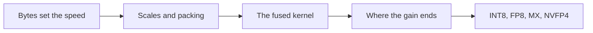
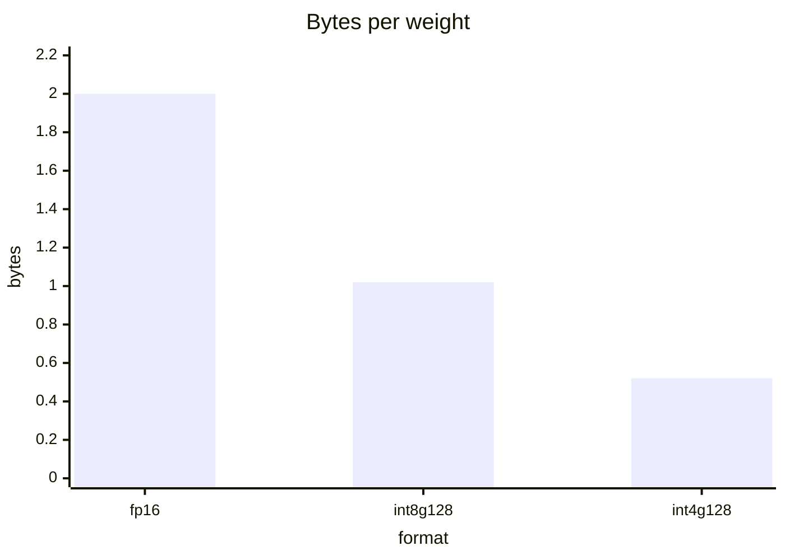
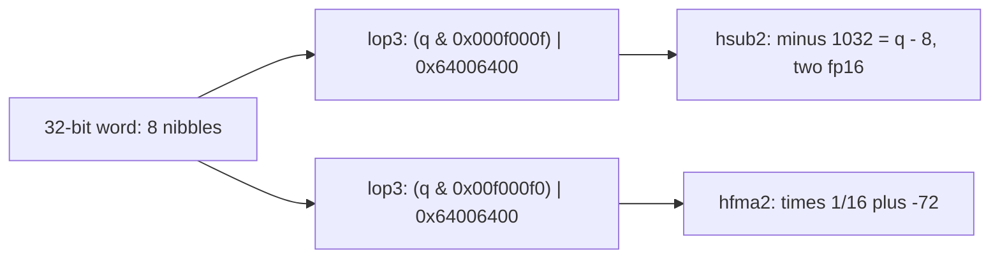
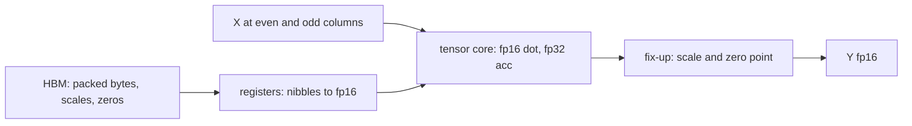
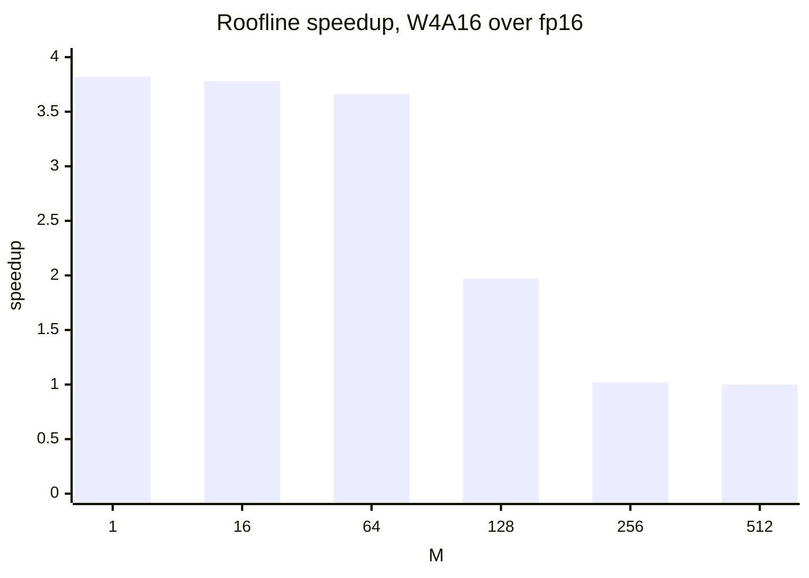

# Introduction

The question this chapter answers: how do you turn a 3.8x byte saving into a 3.8x time saving?

Note:
Open with the claim that decode is a memory problem. Every later slide is a
consequence. By the end the audience can predict a W4A16 kernel's time, write
the loop, and say at which batch size it stops helping. Mention that the lab
runs on the A100, which has INT8 tensor cores but no FP8 or FP4, so Hopper and
Blackwell appear as maps, not labs.

### What the audience already knows {#prior}

- Decode reads every weight once and does 2 FLOPs on it
- The A100 ridge point is 161 FLOP per byte rated, 245 against the measured copy
- A Triton program computes one tile and accumulates with `tl.dot`

Note:
Check these three before going on. If the room has done the roofline and Triton
chapters, none of this is new. The point is to connect them: the roofline says
bytes are the cost, and Triton gives us the tool to change which bytes we read.
The companion course covers the quantization numerics, so we treat the error
bound as known and spend the time on the kernel.

### The route through this deck {#roadmap}



Note:
Five stops. First the byte arithmetic that predicts the speedup. Then the format:
scales, zero points, and packing. Third the Triton kernel. Fourth the batch size
where the gain fades. Last, the low-precision tensor cores that fix prefill, in
prose, because the lab card can't run them.

# Bytes set the speed

The roofline says a decode kernel costs its weight bytes, so fewer bytes buy speed.

Note:
Move into the byte arithmetic. The goal of this section is one number, the ratio of bytes, that predicts the speedup. Everything in the kernel sections is about collecting that ratio without losing it to overhead.

## The decode arithmetic

### One matrix, two formats {#one-matrix}

| Format | Bytes for 8192 x 8192 | Time at 1275 GB/s |
|---|---|---|
| fp16 | 134,217,728 | 105.3 us |
| int4, g = 128, fp16 scale, uint8 zero | 35,127,296 | 27.6 us |

Ratio: 134.2 / 35.1 = **3.82**

Note:
Walk through the table. The matrix has 67.1 million weights. fp16 is two bytes
each. The int4 format is half a byte of code plus a scale and a zero point per
128 weights, so 4.1875 bits per weight. Time is bytes over the 1275 GB/s that
the companion course measured for a copy. The arithmetic per row of activations
is 0.43 microseconds at 312 TFLOP/s, so the bytes dominate by a factor of
hundreds.

### Where the 4x goes {#where-4x-goes}

$$
\frac{16}{4 + 24/128} = \frac{16}{4.1875} = 3.82
$$

- Scale: 16 bits per 128 weights = 0.125 bits per weight
- Zero point: 8 bits per 128 weights = 0.0625 bits per weight
- A symmetric format drops the zero point: 3.88

> [!QUESTION] Why keep a zero point if it costs bits?
> A symmetric format wastes a level when a group isn't centered on zero, and the
> zero point is the interesting part of the kernel's loop.

Note:
The gap from 4x is all metadata. Marlin's README quotes 3.87 as its ceiling,
which is the symmetric figure with an fp16 scale per 128 weights, and its peak
benchmark ran on an A10. That is a published number with its hardware, not an A100 result.
We keep the zero point because the factored loop later depends on it.

### Memory bound, with margin {#memory-bound}



Note:
The bars are the bytes per weight: 2, about 1.02 for int8 with a group scale,
and 0.52 for the lab's int4 layout. A decode kernel's time follows these bars
because nothing else is the bottleneck. The companion course turns the same
arithmetic into 42.2 ms per token for a 27B model in bfloat16 and 10.9 ms in
int4 with an fp16 scale.

## Weight-only against weight-and-activation

### Two ways to quantize a GEMM {#two-ways}

- **W4A16.** Weights int4, activations fp16, fp16 tensor-core multiply
- **W8A8.** Both int8, INT8 tensor core, int32 accumulator
- W4A16 wins only where memory is the bottleneck
- W8A8 also wins where arithmetic is, but activations have outliers

> [!QUESTION] Why not quantize activations in decode too?
> At decode the activations are a few kilobytes against gigabytes of weights, so
> quantizing them saves nothing. They only matter when the arithmetic rate is the
> limit, which means prefill and large batches.

Note:
The names read weight bits then activation bits. In decode the activation is one
row, so activation quantization buys no bytes. That is why weight-only is the
decode tool. Prefill is where activations are large and the tensor-core rate is
the limit, and that is where W8A8 and the FP8 and FP4 formats earn their keep.

# Scales and packing

How a 4-bit weight is stored: its scale, its zero point, and its place in a byte.

Note:
This section is the format. Once the audience knows where the scale enters the product and how two codes share a byte, the kernel is a small step. Keep the factored equation on screen for a moment, because the whole loop follows from it.

## Scales and zero points

### The affine map {#affine}

$$
\hat{w} = \hla{s}\,(q - \hlb{z}), \quad
\hla{s} = \frac{\beta_{\max} - \beta_{\min}}{15}, \quad
\hlb{z} = \operatorname{round}\!\left(\frac{-\beta_{\min}}{\hla{s}}\right)
$$

- $q$ is a code 0 to 15, $\hla{s}$ the step, $\hlb{z}$ the code for 0.0
- The range includes 0, so $\hlb{z}$ stays in 0 to 15

Note:
This is the whole format. One scale and one zero point per row and per group of
128 weights along K. Including zero in the range guarantees the zero point is a
valid code and that 0.0 round-trips exactly, which the lab tests. A symmetric
format fixes the zero point at the middle of the code range and drops it.

### One scale per group {#group-scales}

```viz
18-group-scales
```

Note:
Switch the outlier on with the group size at 256 and watch every step stretch.
Drop to 128 and only the group that holds the outlier suffers. The readout shows
bits per weight in the lab's layout. This figure uses synthetic normal weights,
so the exact percentages are illustrative. Round-to-nearest at 4 bits is
around 10 percent relative error for a group of 128 normal weights, which is why GPTQ and AWQ exist.

### Granularities and their cost {#granularity}

| Granularity | Weights per scale | Bits per weight |
|---|---|---|
| Per channel | K | 4 + 16/K |
| Group (lab) | 128 | 4.1875 |
| MX block | 32 | 4.25 |
| NVFP4 block | 16 | 4.5 |

Note:
Finer scales track the data better and cost more metadata. The last two rows
are the hardware block formats on Blackwell, which we reach near the end. The
cost column counts the scale and, for the lab's layout, the zero point. NVFP4 also carries one fp32 per tensor,
which is not counted here.

### The scale leaves the inner sum {#factoring}

$$
Y_{mn} = \sum_{g} \hla{s_{ng}} \Big( \underbrace{\sum_{k \in g} X_{mk} q_{nk}}_{\text{tensor core}} - \hlb{z_{ng}} \sum_{k \in g} X_{mk} \Big)
$$

> [!KEY] Feed codes to the tensor core, fix up per group
> The dot product runs on raw codes. One multiply-add per output element and
> group applies the zero point and the scale.

> [!QUESTION] Does this change the answer compared with dequantizing first?
> No. It is the same real number, and the code is exact in fp16 and the
> accumulator is fp32. It is slightly more accurate than rounding each dequantized weight to fp16.

Note:
This is the equation behind the kernel. Inside a group, the scale and zero point
are constants, so they come out of the sum. The tensor core never sees a
dequantized weight. The fix-up costs per output element per group, not per
weight, which is small when a tile has many weights per column.

## Packing

### Two codes per byte, along K {#packing}

```python
packed = codes[:, 0::2] | (codes[:, 1::2] << 4)   # (N, K // 2)
low = packed & 0xF      # codes 0, 2, 4, ...
high = packed >> 4      # codes 1, 3, 5, ...
```

- A row of 8192 weights is 4096 contiguous bytes
- Each thread's 16-byte load brings 32 weights

> [!QUESTION] Why not pack pairs along N instead?
> One byte would hold weights from two different output columns, so a thread would
> need two accumulators for data that is naturally one stream along K, and the
> activation reuse would break.

Note:
Packing along K keeps the weight loads coalesced. The catch is order. After the
unpack, the low nibbles are the even-indexed weights, so they must multiply the
even-indexed activations. The lab loads X at even and odd columns. Production
kernels permute the weights offline so the unpacked order is the order the
tensor core wants.

### The instruction budget {#budget}

$$
\frac{4 \times 32 \times 108 \times 1.41 \times 10^{9}}{1275 \times 10^{9} / 0.5234} = 8.0 \text{ instructions per weight}
$$

- 4.0 per weight if every instruction uses the 64 FP32 lanes per SM
- A plain dequantize is about 5: mask, convert, subtract, multiply, convert

Note:
Weights arrive at 2.44 trillion per second. The four schedulers per SM issue
19.5 trillion thread instructions per second across the card, so 8 per weight,
or 4 if you are limited to the FP32 lanes. A naive dequantize spends most of
that before the tensor core even starts. This is why kernels count instructions
per weight, and why the factored form matters.

## Fast unpacking

### The magic number {#magic}

$$
\texttt{0x6400} \mid q \;=\; 1024 + q \quad (q < 1024, \text{ as fp16 bits})
$$

```python
bits = codes.to(torch.int16) | 0x6400
fp16 = bits.view(torch.float16) - 1024.0
```

Note:
0x6400 is the fp16 value 1024. At that magnitude one unit in the last place is
exactly 1, so OR-ing a small integer into the mantissa adds that integer. One
OR and one subtract replace an int-to-float convert, and the subtract can fold
in the zero point. The lab has you write this in torch and test that all 16
codes convert exactly.

### lop3 and two weights at a time {#lop3}



> [!QUESTION] Can I write lop3 in Triton?
> Not directly. Triton lowers tile operations itself. You can write the OR and
> bitcast, and the compiler may emit a lop3, or you can use inline PTX with
> `tl.inline_asm_elementwise`. The lab's solution uses a plain convert.

Note:
This is Marlin's dequantization routine, which we read from its source. One lop3
computes mask-and-OR on a register holding two fp16 lanes. The low nibbles then
need one half2 subtract. The high nibbles sit four bits higher, so they come out
as 1024 plus 16 q, and one half2 fused multiply-add by 1/16 and minus 72 fixes
them. About one instruction per weight.

# The fused kernel

One Triton kernel that reads packed bytes and never writes fp16 weights.

Note:
Now the kernel. We show why fusion matters with a traffic count, then the loop, the grid, and what a production kernel such as Marlin adds. Remind the audience that the lab has them write this loop.

## Why fuse

### Dequantize first, and you lose {#why-fuse}

| Plan | Traffic for 8192 x 8192 |
|---|---|
| fp16 GEMM | 134.2 MB |
| Dequantize to fp16, then GEMM | 35.1 + 134.2 + 134.2 = 303.5 MB |
| Fused W4A16 | 35.1 MB |

> [!QUESTION] So the unfused version is slower than not quantizing?
> Yes, by 303.5 / 134.2 = 2.26x at the same bandwidth. Fusing keeps the
> dequantized values in registers, so they never touch HBM.

Note:
The tempting design is a dequantize kernel followed by cuBLAS. It reads the
codes, writes the full fp16 matrix, and reads it back. Three passes. The whole
saving comes from never materializing the fp16 weights.

## The Triton kernel

### The loop, one group per step {#loop}

```python
part = tl.dot(x_e, q_lo)                # even columns
part = tl.dot(x_o, q_hi, part)          # odd columns
x_sum = tl.sum(x_e.to(tl.float32), axis=1) + tl.sum(x_o.to(tl.float32), axis=1)
acc += (part - x_sum[:, None] * zero[None, :]) * scale[None, :]
```

Note:
This is the core of the lab's solution. x_e and x_o are the activations at even
and odd columns of the group. q_lo and q_hi are the unpacked nibbles converted to
fp16, exact for 0 to 15. Two dots accumulate in fp32. Then the group's fix-up.
Every load in the loop is masked, so M and N can be anything. K must be a
multiple of 128 because a group is the unit of the loop.

### The data path {#data-path}



> [!QUESTION] At M = 1 the tile has 16 rows. Isn't that wasteful?
> It is, and it doesn't matter. The padded tensor-core work for this matrix is
> 6.9 microseconds against a 27.6 microsecond memory time, so it hides behind the loads.

Note:
Follow a byte from HBM. It is loaded, split into two nibbles, converted to fp16
in registers, multiplied on the tensor core, and folded into the accumulator by
the group fix-up. Nothing in between is written back to memory, which is the
difference from the unfused plan.

### Enough programs, enough bytes in flight {#parallelism}

- Grid: N / BLOCK_N programs at M up to 16
- BLOCK_N = 16 gives 512 programs, about 4.7 per SM
- BLOCK_N = 128 gives 64, fewer than the 108 SMs
- Little's law: 1275 GB/s x 330.7 ns = 422 KB in flight
- `num_stages` keeps later tiles loading while this one computes

> [!QUESTION] How do I know the config is sane?
> Compare weight_gbs_m1 with the 1275 GB/s copy ceiling. Far below it means too
> few programs or too much unpack work.

Note:
A big tile is great for a big GEMM and bad here. At M of 1 the grid is one row
of programs, so a wide BLOCK_N leaves SMs idle. That is why the config list has
small BLOCK_N values, and why production kernels also split K across programs.
The 330.7 ns is the HBM latency measured on an A100 PCIe 40GB in the Luo
microbenchmark paper, converted at 1410 MHz.

### What Marlin adds {#marlin}

- Async weight loads with a hint that the data is evictable
- Double-buffered shared memory, activations reused from registers
- Weights and scales reshuffled offline for the tensor core
- Striped partition and global reduction for tiny M
- Reported: close to 4x up to batch 16 to 32, 2.8x end to end in vLLM

Note:
These numbers are as reported by the authors. The abstract does not name the
GPU, and the README reports its peak benchmark on an A10 and says the kernel
targets compute capability 8.0 and later. Each technique answers something from
this chapter: bytes in flight, the instruction budget, and the grid size at
tiny M.

# Where the gain ends

A memory-bound saving lasts only while the kernel stays memory bound.

Note:
Here we put a number on the end of the plateau. The same roofline arithmetic that predicted 3.8x also predicts the batch size where it fades, and that tells you when to switch kernels.

## The batch crossover

### Intensity grows with M {#intensity}

$$
\boxed{M^{\ast} = \frac{\hla{I^{\ast}}\, \hlb{b}}{2}}, \qquad
M^{\ast}_{\text{fp16}} = 244.7, \quad
M^{\ast}_{\text{W4A16}} = \frac{244.7 \times 0.5234}{2} = 64
$$

Note:
The intensity is 2M over b FLOP per byte, where b is bytes per weight. Set it
equal to the 244.7 ridge point from the measured copy. fp16 is memory bound up
to M of 245. The 4-bit kernel carries 3.8 times more arithmetic per byte, so it
turns compute bound at 64.

### The predicted curve {#curve}

```viz
18-w4a16-roofline
```

> [!QUESTION] Marlin says near 4x up to 16 to 32, not 64. Which is right?
> Both can be. The roofline is an upper bound that ignores unpack work and
> scheduling overhead. A real kernel leaves the plateau earlier. The two
> agree on the shape: flat, then a gradual decline.

Note:
Slide the batch size. The speedup holds near 3.8 through M of 64, falls to 1.97
at 128, and reaches 1.02 at 256. This is a roofline prediction, and it ignores
the unpack instructions and the tensor-core padding. The lab measures the real
curve at M of 1, 16, and 1024.

### Predicted speedup by batch size {#speedup-bars}



Note:
The same data as the figure, as bars, from the example in the chapter. At 512
rows both kernels are compute bound and the quantized one is no faster. Prefill
has thousands of rows, so a weight-only kernel does nothing for it. A serving
stack picks the kernel by batch size.

# Beyond the A100

INT8, FP8, MX, and NVFP4 tensor cores: lower-precision arithmetic for prefill.

Note:
These formats are prose and figures, not labs, because the lab card has INT8 tensor cores but no FP8 or FP4. Stress the continuity: the same scale-and-accumulate structure appears in each, and the newer hardware applies the scale for you.

## INT8 tensor cores

### The dequantize epilogue {#int8-epilogue}

$$
Y_{mn} = \hla{s_x}\,\hlb{s_{w,n}} \sum_{k} q_{x,mk}\, q_{w,nk}
$$

- A100: 108 x 4096 x 1.41 GHz = 623.7 TOPS, rated 624
- INT8 ridge point: 624 / 1.935 = 322.5 per byte
- int32 headroom at K = 8192: 16.3x

> [!QUESTION] Why can't W8A8 use per-group scales?
> A group scale depends on k, so it can't leave the integer sum. The kernel would
> convert the partial sum to float every 128 steps, which puts float work in an
> integer loop. W8A8 uses per-tensor or per-channel scales.

Note:
Both scales are independent of k, so they leave the sum, and the tensor core
computes a pure integer product into int32. One float multiply per output
element converts it back, which is the epilogue. The worst-case accumulator is
8192 times 127 squared, about 1.3 times ten to the eighth, against 2.1 times ten
to the ninth. The Luo paper measured 607.6 TOPS for the instruction on an A100 PCIe 40GB.

## FP8, MX, and NVFP4

### FP8 on Hopper {#fp8}

- E4M3: max 448, 8 steps per octave. E5M2: max 57,344
- H100 SXM: 1978.9 TFLOP/s dense, twice bf16; ridge 590.7
- A100: no FP8 tensor core. `torch._scaled_mm` fails there
- DeepSeek-V3 (H800): 1 x 128 activation tiles, 128 x 128 weight blocks

> [!QUESTION] Can an FP8 weight-only kernel help on an A100?
> It saves bytes, one per weight, but the multiply still runs in fp16 after a
> software unpack. int8 gives the same saving with a cheaper unpack.

Note:
FP8 is floating point, so an outlier costs an exponent increment instead of the
precision of its neighbors. A per-tensor scale is amax over 448. DeepSeek-V3
uses finer scales and copies partial sums to CUDA cores for fp32 accumulation
every 128 elements, which the authors say is four wgmma instructions, because FP8
accumulation on the H800 retains about 14 bits. The shape is the same as our
W4A16 loop: a low-precision dot per group, then scaled fp32 accumulate.

### Block-scaled formats on Blackwell {#mx}

| Format | Block | Scale | Bits per element |
|---|---|---|---|
| MXFP8 | 32 | E8M0 | 8.25 |
| MXFP4 | 32 | E8M0 | 4.25 |
| NVFP4 | 16 | E4M3 | 4.5 |

> [!QUESTION] What does the ridge point look like for FP4 on a B200?
> 9000 TFLOP/s over 8 TB/s is 1125 FLOP per byte, against 562.5 for FP8 and 281.3
> for bf16. Lower precision raises the bar for staying compute bound.

Note:
Blackwell's tcgen05.mma has block-scaled kinds, so the group-scale fix-up that
our loop does with fp32 FMAs is part of the instruction. FP4 is E2M1, with
positive values 0, 0.5, 1, 1.5, 2, 3, 4, and 6, so the block scale does most of
the fitting. NVFP4 also has one fp32 scale per tensor, not counted in the table.
The HGX B200 rates 9000 TFLOP/s dense for FP4 and 4500 for FP8.

# Summary

Note:
Close with the five ideas and the decision table. Then point to the lab and to the next chapter.

### What to remember {#summary}

- Decode time is weight bytes over bandwidth: 3.82x fewer bytes, 3.82x faster
- Scales leave the sum inside a group: tensor core on codes, fix-up per group
- Pack along K, unpack in about 1 to 2 instructions per weight
- Fuse, or the dequantized weights cost 303.5 MB of traffic
- W4A16 stays memory bound to M of about 64, fp16 to 245

Note:
Say each of these in one sentence. The first is the whole motivation, the second
is the kernel's structure, the third is why bit tricks exist, the fourth is why
fusion matters, and the fifth is where to stop using the kernel. The lab turns
the first and fifth into measurements.

### The decision guide {#decision}

| Situation | Kernel |
|---|---|
| Decode or batch up to about 64, A100 | W4A16 fused |
| Prefill on A100 | fp16, or W8A8 with INT8 cores |
| Prefill on Hopper | FP8 with fine-grained scales |
| Blackwell | MXFP8, MXFP4, or NVFP4 |

Note:
This is the table to leave on screen. The next chapter moves to training kernels:
custom autograd functions and a fused linear plus cross-entropy that never
materializes the logits. The memory arguments carry over, with the same habit of
counting bytes before you write the kernel.
