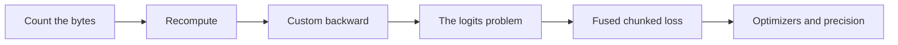
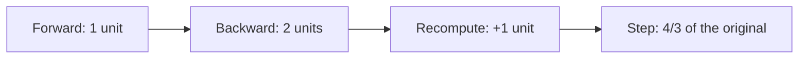
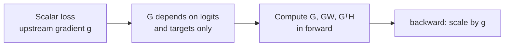
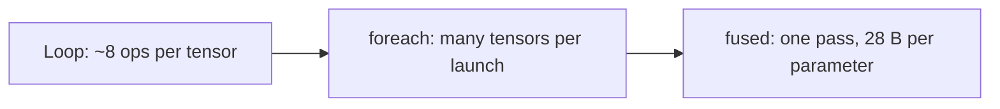

# Introduction

The question this chapter answers: what limits a training step, and which kernels remove the limit?

Note:
Say the answer up front: memory limits a training step more often than arithmetic
does. By the end the audience can count the bytes a step holds, write a custom
backward, and explain how a chunked loss removes the largest tensor in a language-model step.

### Training is not inference with a second pass {#why-different}

- Three GEMMs per linear layer, not one
- Every layer keeps its inputs until backward needs them
- The peak is where forward ends and backward begins

> [!QUESTION] Why not just buy a bigger GPU?
> The 80 GB A100 is already the large one, and the logits grow with batch and
> vocabulary, not with the model. Buying memory defers the problem and doesn't remove it.

Note:
Ask who has seen a CUDA out-of-memory error at a batch size that worked for
inference. That is today's subject. The forward pass writes tensors the backward
pass reads later, so they must stay alive. Memory rises through forward, peaks at
the turn, and falls through backward.

### The route through this deck {#roadmap}



Note:
Six stops. We count the bytes first, then the two tools that trade arithmetic
for bytes, recomputation and fusion. The lab builds the fused loss, so
the middle of the deck is the part to follow closely. The optimizer and precision
material at the end is the same lesson at smaller scale.

# Counting the bytes

Parameters, gradients, optimizer state, and the activations of each layer.

Note:
Section divider. The first three are fixed by the model size. The activations are
the part kernels can change, so they get the most time.

## The fixed costs

### Sixteen bytes per parameter {#sixteen}

| Item | Bytes |
|---|---|
| bf16 weight | 2 |
| bf16 gradient | 2 |
| fp32 master weight | 4 |
| Adam $m$ and $v$, fp32 | 8 |
| **Total** | **16** |

Note:
This is the figure the ZeRO paper uses for mixed-precision Adam. A 1 billion
parameter model holds 16 GB and a 7 billion parameter model 112 GB, which is more
than one 80 GB card before an activation exists. That is why chapter 22 shards
the state. On one card the ceiling is 80 over 16, five billion parameters at most.

### Three GEMMs per linear layer {#three-gemms}

$$
\hla{\frac{\partial L}{\partial X}} = \frac{\partial L}{\partial Y}\, W
\qquad
\hlb{\frac{\partial L}{\partial W}} = \left(\frac{\partial L}{\partial Y}\right)^{\!\top} X
$$

- Forward: $2MNK$ FLOP
- Each gradient: the same $2MNK$ FLOP

Note:
The weight gradient needs the layer's input X, and the input gradient needs W.
X was produced during forward, so autograd saves it. That is the whole origin of
activation memory: every layer's inputs, kept until the backward pass reaches that layer.

## Activations of one layer

### What a GPT-style layer saves {#saves}

$$
\boxed{\text{bytes per layer} = \hla{34\,sbh} + \hlb{5\,a\,s^{2}\,b}}
$$

- $34sbh$: LayerNorm, projection, and MLP inputs
- $5as^{2}b$: the attention score matrix and its dropout

Note:
Korthikanti and colleagues count this tensor by tensor in 16-bit formats. The first
term is linear in sequence length and the second is quadratic. The quadratic term is
the score matrix that FlashAttention never writes, so with chapter 16's kernel only
the first term remains. The constant 34 is for a GPT-style layer with a 4h MLP and
dropout; count your own layer the same way.

### One layer at 4096 tokens, 4096 wide {#one-layer}

| | Per layer | 32 layers |
|---|---|---|
| Without fused attention | 3104 MiB | 97 GiB |
| With fused attention | 544 MiB | 17 GiB |
| Checkpointed, input only | 32 MiB | 1 GiB |

Note:
Here s is 4096, b is 1, h is 4096, a is 32. The linear term is 34 times 16.8 million
bytes, 544 MiB. The score term is 2560 MiB. Without fused attention 32 layers do not fit
on any card in the course. The last row is the next idea: keep only the input and
rebuild the rest.

# Spending arithmetic to save bytes

Recomputation is the first tool, and it works at the level of the framework.

Note:
Section divider. Hold the phrase trading FLOPs for bytes. We use it twice: for
recomputation and again for the fused loss.

### Recomputation, in one wrapper {#checkpoint}

```python
from torch.utils.checkpoint import checkpoint

for layer in self.layers:
    x = checkpoint(layer, x, use_reentrant=False)
```

- Forward saves only each layer's input
- Backward reruns the layer's forward, then differentiates

Note:
The idea is from Chen and colleagues, 2016. With a checkpoint on every layer the
forward pass saves 2sbh bytes a layer instead of 34sbh. During backward one layer at
a time is rebuilt, so the peak adds one layer's worth: 1.53 GiB against 17 GiB in the example.

### The bill: one more forward pass {#recompute-cost}



> [!QUESTION] Can you pay less than a full extra forward pass?
> Yes. Selective recomputation drops only tensors that are cheap to rebuild and
> costly to store, such as the attention scores, and keeps the rest.

Note:
A step is one unit of forward and two of backward. Full recomputation adds a unit,
so 4/3 of the arithmetic, a third more. FlashAttention is the selective version done
inside a kernel: it rebuilds score tiles from Q, K, and the saved logsumexp in SRAM
instead of reading a stored matrix, and the rebuilt tiles never touch HBM.

# Writing a backward

A custom autograd Function is how you hand PyTorch a forward and backward you wrote.

Note:
Section divider. The lab's fused loss is a Function, so this is the mechanics
we need before the loss.

### The anatomy of a Function {#anatomy}

```python
class Square(torch.autograd.Function):
    @staticmethod
    def forward(ctx, x):
        ctx.save_for_backward(x)
        return x * x

    @staticmethod
    def backward(ctx, grad_out):
        (x,) = ctx.saved_tensors
        return 2 * x * grad_out
```

Note:
Forward runs with recording off, so autograd sees one opaque operation. You choose
what to save. Backward gets one gradient per output and returns one value per
input of forward. Save tensors with save_for_backward so in-place edits are
detected. Non-tensor values such as a chunk size go on ctx directly.

### Four rules that fail silently {#rules}

- Return one value per forward argument; `None` for integers
- Multiply by the incoming `grad_out`, even though it is usually 1
- Save tensors with `save_for_backward`
- Add `@once_differentiable` when your backward isn't differentiable

> [!QUESTION] What does `once_differentiable` protect against?
> A second derivative. Without it autograd may silently return a wrong
> answer through your backward; with it, a request for one raises an error.

Note:
The second rule bites: a Function that ignores grad_out works until someone writes
two times the loss and gets half the gradient. Test with a scale other than one.
For custom ops registered through torch.library, chapter 17, the same
pair is split into forward and setup_context.

### Check it in float64 {#gradcheck}

```python
torch.autograd.gradcheck(
    lambda a, b: fused_linear_xent(a, b, t, chunk_size=2),
    (h, w), eps=1e-6, atol=1e-6)
```

- Float64, because a finite difference subtracts nearly equal numbers
- Tiny shapes: it runs once per input element

Note:
A wrong gradient never crashes. It trains badly and slowly. So every custom
backward gets a numerical check. In float32 gradcheck fails on correct code
because the difference has only a few good digits. The lab runs exactly this
check on your Function, with an ignored token and a chunk that doesn't divide the batch.

# The logits problem

The output layer makes the biggest tensor in the step.

Note:
Section divider. Everything so far was general. This is the one place where a single
tensor dominates, and where a kernel pays off most.

### Tokens times vocabulary {#nv}

$$
\hla{N} \times \hlb{V} \times 4\ \text{B} = 8192 \times 151{,}936 \times 4 = 4.64\ \text{GiB}
$$

- bf16: 2.32 GiB
- The hidden states they came from: 64 MiB at $d = 4096$

Note:
N is eight thousand tokens, two sequences of 4096. V is the Qwen2.5 vocabulary,
151,936. Llama 3 uses 128,256 and Gemma 2 uses 256,000. In float32 that is 4.64 GiB,
74 times the activations it was computed from. Checkpointing layers does nothing
about it, because the logits are in no layer.

### How big, for your settings {#logits-figure}

```viz
19-logits-memory
```

Note:
Let the audience move the sliders. Push tokens to 32,768 and the full logits reach
18.5 GiB in float32. The unfused bar counts the logits and a softmax of the same
size, a floor, since the backward pass allocates more of the same shape. The fused bar is one chunk.

> [!QUESTION] Isn't the logits tensor needed to compute the loss?
> Only a row at a time. The loss needs each row's logsumexp and one target logit,
> and the gradient needs each row's softmax. No computation needs two rows together.

### Where the traffic goes {#traffic}

| Step | Unfused | Fused |
|---|---|---|
| Elementwise passes over the logits | $5u + 8f$ = 22.5 GB | $6u$ = 6.4 GB |
| At 1275 GB/s | 17.7 ms | 5.05 ms |

- $u$ = bf16 $N \times V$ tensor, $f$ = fp32 one
- Lab geometry: $N = 8192$, $V = 65{,}536$

Note:
These are predictions from byte counting, not measurements. u is 1.07 GB and f
is 2.15 GB at the lab's geometry. The unfused path writes, casts, softmaxes, and
differentiates in float32, then casts back. The fused path writes the logits once, reads them twice in the row kernel,
writes once, and reads them in two GEMMs. Remember chapter 13: byte counts can over-promise, which is why the lab measures.

# Fusing the head

Chunk the tokens, and finish the backward inside the forward.

Note:
Section divider. Two ideas: the gradient of the loss is simple, and a scalar loss lets
us compute it early.

### The gradient is softmax minus one-hot {#grad}

$$
\boxed{\frac{\partial \ell}{\partial z_j} = \hla{p_j} - \hlb{[j = y]}, \qquad p_j = e^{z_j - \operatorname{lse}(z)}}
$$

- For a mean over $n$ valid tokens, scale every row by $1/n$
- Then $\partial L/\partial H = G\,W$ and $\partial L/\partial W = G^{\top}H$

Note:
Differentiate lse of z minus the target logit. The first term gives the softmax probability, the second
gives minus one at the target. Call the whole matrix of these gradients G. The two
gradients we need are exactly the two GEMMs from the start of the deck, with G as the incoming gradient.

### Why backward can run inside forward {#early}



> [!KEY] A scalar loss lets you finish the backward early
> The upstream gradient is one number that scales every element of G equally.

Note:
The loss ends the graph. Nothing downstream changes G except a scalar. So we compute
G, then GW and G transpose H, in the forward pass, free the logits as we go, and
backward only multiplies two saved tensors by g.

### One chunk at a time {#chunk-figure}

```viz
19-chunked-xent
```

Note:
Step through it. Each step builds a chunk of logits, overwrites it with its
gradient, writes that chunk's rows of the hidden-state gradient, and adds into the
weight gradient. Only the highlighted block of logits has storage. The loss is the
same sum in a different association, so it doesn't depend on the chunk size.

### The loop in PyTorch {#loop}

```python
for start in range(0, N, c):
    h_c = h[start:start + c]
    logits = h_c @ w.t()
    loss += row_loss_and_grad_(logits, t_c, scale).sum()
    grad_h[start:start + c] = logits @ w
    grad_w += logits.t() @ h_c
```

- `logits` holds $G$ for this chunk after the third line

Note:
This is the heart of the lab. The third line is the kernel we write next. After it
the logits tensor holds the gradient, not the logits. The two lines after it are the
two GEMMs. Nothing from this iteration except grad_h's rows and the grad_w running
sum outlives it.

### What the chunk size trades {#chunk-trade}

| Chunk | Logits (bf16, lab) | Accumulator passes |
|---|---|---|
| 512 rows | 64 MiB | 16 |
| 64 rows | 8 MiB | 128 |

> [!QUESTION] Why not the smallest chunk possible?
> Each chunk adds a $V \times d$ matrix into the weight-gradient accumulator, so
> traffic grows with the chunk count while the GEMMs shrink.

Note:
The GEMM FLOPs are unchanged at six N d V. The cost is the accumulator: V times d,
read and written once per chunk. At the lab's geometry that is 134 MB per pass in
float32. PyTorch and Liger both pick the chunk size by a heuristic that balances the two.

# The softmax-gradient kernel

One Triton program per row, two passes, no float32 copy.

Note:
Section divider. The torch version of the row step is five or six kernels. One
Triton program per row does it in two sweeps.

### Pass 1: online logsumexp {#pass1}

$$
m' = \max(\hla{m},\ \max_{\text{block}} z), \quad
s' = \hlb{s}\, e^{m - m'} + \sum_{\text{block}} e^{z_j - m'}
$$

- Scalars $m$ and $s$, one block of 1024 at a time
- Then $\operatorname{lse} = m + \log s$

Note:
The row is far longer than registers, so the program walks it in blocks and keeps a
running max and a running sum, rescaling the sum when the max grows. It is
chapter 15's online softmax. The target's logit is read and the loss written before pass
two, because pass two destroys the logits.

### Pass 2: overwrite with the gradient {#pass2}

```python
for start in range(0, V, BLOCK):
    cols = start + offs
    x = tl.load(base + cols, mask=cols < V, other=float("-inf")).to(tl.float32)
    p = tl.exp(x - lse)
    p = tl.where(cols == safe, p - 1.0, p) * scale
    p = tl.where(valid, p, 0.0)
    tl.store(base + cols, p.to(logits_ptr.dtype.element_ty), mask=cols < V)
```

Note:
Recompute the probability from the stored lse, subtract one at the target column,
scale, zero the ignored rows, and store in the logits' own dtype. The masks handle a vocabulary that is
not a multiple of 1024. Use int64 for the row offset: a 32-bit offset overflows
after 2 to the 31 elements, which is 14,134 rows at this vocabulary. The kernel is memory bound: it reads the
row twice and writes it once.

> [!QUESTION] Why is the target's logit read before pass 2?
> Pass 2 overwrites the logits in place. Afterwards the original value is gone and the loss is wrong.

# Production versions

Where the lab's version sits relative to Liger, Cut Cross-Entropy, and PyTorch.

Note:
Section divider. We built the mechanism. Three implementations ship it, and each draws
the line in a different place.

### Three implementations {#three}

| Implementation | Idea | Reported by |
|---|---|---|
| Liger Kernel | Fusion and input chunking in Triton | About 20% throughput, 60% less memory; hardware not named |
| Cut Cross-Entropy | No logits in HBM at all; skip negligible gradient | 24 GB to 1 MB of loss memory, Gemma 2 (2B); hardware not named |
| `linear_cross_entropy` | Chunking over rows, in PyTorch 2.14 | The documentation gives no memory figures |

Note:
The Liger and CCE numbers are the authors' reports and the abstracts do not name the GPU,
so quote them as reported. Cut Cross-Entropy goes furthest: one kernel does the matmul
and the reduction in on-chip memory, so not even a chunk of logits reaches HBM. The
PyTorch op documents its limits too: no higher-order derivatives and no torch.func.grad, with compile falling back to eager.

### PyTorch's options map onto the lab {#options}

| Option | Lab counterpart |
|---|---|
| `batch_chunk_size` | `chunk_size` |
| `acc_dtype` | float32 `grad_w` accumulator |
| `allow_retain_graph=False` | gradients precomputed, consumed once |
| `chunking_method='auto'` | `next_pow2(ceil(N / ceil(V/d)))`, 256 for the Qwen2.5 example |

Note:
Pass options=LinearCrossEntropyOptions to opt in to chunking, and options=None
runs the reference path with full logits. The lab version is the mechanism and this API is the production
equivalent. The lab's tests compare against it when it exists, and skip the comparison when it doesn't.

# Optimizers and precision

The same lesson at a smaller scale: fewer passes, and numbers wide enough to survive the sum.

Note:
Section divider. The optimizer is where a step spends bandwidth on many small tensors,
and precision is what makes the sums safe.

### Fused AdamW is a bandwidth floor {#fused}



- 1B parameters: 28 GB, at least 22 ms at 1275 GB/s

Note:
An Adam update reads p, g, m, v and writes p, m, v: 28 bytes per float32 parameter and a handful
of FLOPs. A loop issues about eight elementwise ops per tensor, an estimate, and each pass
reads and writes the whole tensor. foreach batches many tensors per launch. fused does the whole update in one
read and one write per element. Set fused=True on AdamW.

### Accumulate in float32 {#accum}

- bf16 has 8 significant bits
- A contribution smaller than about 1/256 of the running sum rounds away
- fp32 accumulators cost 4 bytes per parameter

> [!QUESTION] Does this apply to the lab's weight gradient?
> Yes. It sums $K$ chunk products, so it accumulates in float32, as PyTorch's `acc_dtype` does.

Note:
Chapter 9's rule: addends vanish once the sum is 256 times the addend in bf16. Gradient
accumulation across micro-batches and the chunk loop's weight gradient both add many
similar terms into one buffer. Keep that buffer float32. The matrix multiply already accumulates in float32
inside the tensor core; the question is where you round the running sum.

### fp16 needs a loss scale, bf16 doesn't {#scale}

| Format | Smallest subnormal | Largest finite |
|---|---|---|
| float16 | $6.0 \times 10^{-8}$ | 65,504 |
| bfloat16 | $9.2 \times 10^{-41}$ | $3.4 \times 10^{38}$ |

- A gradient of $10^{-8}$ becomes 0 in float16
- Scale the loss by $2^{16}$: it becomes $6.6 \times 10^{-4}$

> [!QUESTION] Why not always scale by the largest number that fits?
> Above 65,504 gradients overflow to infinity, so `GradScaler` halves the scale
> and skips the step when it sees one, and doubles it after a clean run.

Note:
The chain rule multiplies every gradient by the scale, and the optimizer divides it out
in float32. bfloat16 has float32's exponent so it needs none, at the price of 7 stored mantissa bits against 10. On the A100 both run on
tensor cores at 312 TFLOP/s, so bfloat16 wins by removing the scaler, not by speed.

# Summary

The bytes, the tools, and what the lab measures.

Note:
Section divider. Three slides: what to remember, which tool fits which memory problem, and what the lab
reports. Keep it short and leave time for questions about the lab.

### What to remember {#summary}

- Training: three GEMMs per linear layer, and every layer's saved inputs stay alive
- 16 bytes per parameter; $34sbh + 5as^{2}b$ activation bytes per layer
- Recompute costs 4/3 of the arithmetic; fusion costs nothing extra
- Logits: $N \times V \times 4$ bytes, 4.64 GiB at 8192 tokens
- Chunk, finish the backward early, and keep accumulators in float32

Note:
Walk the list top to bottom. The thread is: count the bytes, then spend arithmetic or
fusion to remove the biggest tensor. The fused loss removes it without
extra arithmetic because a scalar loss lets the backward finish early.

### Which tool for which memory {#decision}

| Memory problem | Tool |
|---|---|
| Activations of many layers | Recomputation, FlashAttention |
| Logits of a large vocabulary | Fused chunked linear cross-entropy |
| Optimizer step bandwidth | `AdamW(fused=True)` |
| fp16 gradients underflow | Loss scaling, or switch to bf16 |

Note:
A decision guide. Match the tensor that is too big to the tool that removes it. The
lab measures the logits row of this table: peak memory and time against the unfused reference.

### What the lab measures, and what comes next {#next}

- Correctness against float64, over awkward shapes
- `torch.autograd.gradcheck`
- Peak memory with `torch.cuda.max_memory_allocated`

> [!QUESTION] What if my vocabulary is small?
> Chunking helps when $N \ge d$ and $V > d$; with a small $V$ the logits are not the large tensor
> and the reference path is cheaper.

Note:
Chapter 20 turns to mixture-of-experts, where a different large tensor appears: tokens
routed to experts, and a grouped GEMM instead of one big one. The idea carries over:
find the tensor that dominates the step and ask whether it needs to exist at full size.
