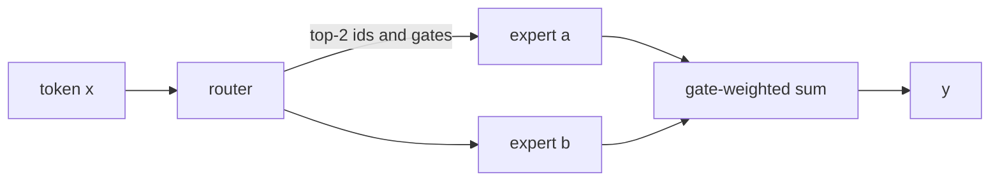
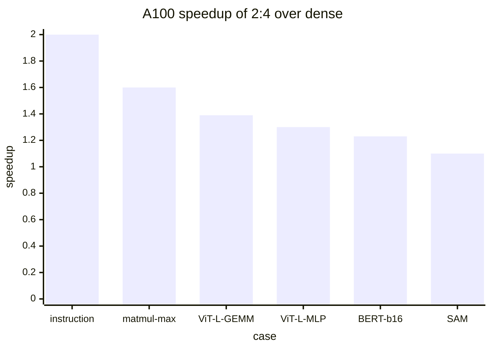

# Introduction

The question this chapter answers: how do you run many small, uneven matmuls at the speed of one big one?

Note:
Open with the contrast. A dense layer is one matmul over all tokens. An MoE layer is a few dozen matmuls whose sizes change on every batch. By the end of the deck the audience can name the three pieces of the fix and say when sparsity in the weights helps.

### Why MoE changes the kernel problem {#why-moe}

- Each token runs only the top few experts
- Mixtral 8x7B: about 47B parameters, about 13B active per token
- The FLOP per token drop, but the matmuls get small and uneven

Note:
The Mixtral numbers come from the paper's abstract. The point is that the saving in arithmetic is paid for in kernel complexity. Ask the room who has seen an MoE model run slower than its active parameter count suggests. That gap is the subject.

### The route through this deck {#roadmap}


Note:
Seven stops. The anatomy and the failure of the loop come first, because the fix only makes sense once you have seen the problem. Then the permutation, the kernel, the fusion, the multi-GPU view, and finally sparsity in the weights. Leave the slide up for a few seconds.

# The MoE layer and the loop

A router picks experts, each expert is an MLP, and the naive way to run them is a Python loop.

Note:
Section divider. We need two things from this section: how many tokens an expert needs before its matmul is efficient, and four separate reasons the loop is slow.

## Anatomy

### Router, top-k, experts {#anatomy}



Note:
The router is one linear layer from the hidden size to E logits. Keep the top k, softmax over those k, and the result is the gate weights. The output is the gate-weighted sum of k expert outputs. Mixtral uses k equals 2 of 8. The lab uses one weight matrix per expert, where a real model has three, because the kernel is the same.

### The layer in one formula {#formula}

$$
y = \sum_{j=1}^{k} \hla{g_j} \cdot \hlb{\text{FFN}_{e_j}}(x)
$$

- $\hla{g_j}$: gate weight of the $j$-th chosen expert
- $\hlb{\text{FFN}_{e_j}}$: that expert's MLP
- The token's work is $k$ expert MLPs, not $E$

Note:
Colors match the chapter. Stress that the sum is over only k terms, so most experts do nothing for a given token. The kernel challenge is the other side of that coin: for a given expert, a different and unpredictable set of tokens shows up each batch.

### What one expert costs {#expert-cost}

- Mixtral shapes: $d = 4096$, $f = 14336$
- Three weight matrices: 176,160,768 parameters
- bfloat16 weights: 352.3 MB
- Per token: 352.3 MFLOP

> [!QUESTION] Where do the three matrices come from?
> A gated MLP has a gate projection and an up projection, each $d \times f$, and a down projection, $f \times d$. The lab uses one matrix to keep the kernel readable.

Note:
Do the multiplication on the board: 3 times 4096 times 14336. The weight bytes are twice the parameter count because bfloat16 is two bytes. The FLOP per token are twice the parameter count, one multiply and one add per weight. These two numbers give the intensity on the next slide.

### How many tokens make an expert busy {#intensity}

$$
I = \frac{2 n P \ \text{FLOP}}{2 P \ \text{bytes}} = \boxed{n \ \text{FLOP per byte}}
$$

> [!KEY] The ridge point is 161 FLOP/byte
> An expert needs about 161 tokens to be compute bound on the A100.

Note:
The weights are read once whatever n is, so intensity grows with the token count. Divide 312 TFLOP/s by 1935 GB/s and you get 161. Below that, the expert's matmul waits on memory. This is the same roofline as chapter 4, applied to one expert.

### Batch size for 161 tokens per expert {#batch-needed}

| Layout | Tokens per expert | Batch needed |
|---|---|---|
| 8 experts, top-2 | $B/4$ | 644 |
| 64 experts, top-8 | $B/8$ | 1288 |
| 256 experts, top-8 | $B/32$ | 5152 |

> [!QUESTION] Is the last row DeepSeek-V3?
> No. It's an example layout in the style of fine-grained designs. DeepSeek-V3 activates 37B of 671B parameters per token, and the table doesn't claim its exact expert count.

Note:
Each expert gets k times B over E tokens under perfect balance. Finer experts need bigger batches. In decode, with a few dozen sequences, nearly every expert matmul is memory bound, so the goal is reading each active expert's weights once at full bandwidth.

## Why the loop fails

### The loop {#the-loop}

```python
for e in range(E):
    rows, slot = torch.where(ids == e)   # host sync
    if rows.numel() == 0:
        continue
    y = (x[rows] @ w[e]) * gates[rows, slot, None]
    out.index_add_(0, rows, y)
```

Note:
This is correct and it is what many first implementations look like. Walk the room through what happens on the GPU. The where call has a data-dependent output size, so PyTorch copies a count to the host and waits. Then several small kernels launch. Then the next expert. Four problems follow, and the next slides give a number for each.

### Launch overhead and tiny grids {#launch-grid}

- 64 experts, 8192 rows: about 128 rows each
- One expert's matmul: 268 MFLOP, 0.86 µs at the 312 TFLOP/s peak
- A launch costs about 5 µs
- A $128 \times 1024$ output is 8 tiles of $128 \times 128$: 8 of 108 SMs

> [!QUESTION] Can't the GPU overlap the launches?
> The host's launch rate is the limit, and the `where` call forces a host wait anyway. Even without the wait, 8 tiles keep 7.4% of the SMs busy.

Note:
The 0.86 microseconds is 268 million divided by 312 trillion. The 5 microsecond launch figure is from chapter 0. So the matmul is launch bound by nearly six times before the SMs even matter. Streams could overlap kernels, but the data-dependent where defeats that.

### Imbalance and tile waste {#imbalance}

```viz
20-routing-load
```

Note:
Drag the skew slider up. The mean load does not change, but the busiest expert grows and more experts fall below the 161 row line. Then drag the block size slider and watch the padding percentage. The load here is a model, a power-law share, not a measurement. Capacity factors and token dropping were invented to cope with exactly this.


# Sorting tokens by expert

A counting sort, built from the histogram and the scan of chapter 7.

Note:
Section divider. The audience has already seen the histogram and the exclusive scan. Here they are used for the second time in the course, on routing ids instead of pixel values.

### Histogram, scan, placement {#sort-steps}


- `offsets` has $E + 1$ entries and `offsets[E]` is $A = Tk$

Note:
Flatten the T by k id matrix into A assignments. Count per expert, scan the counts into start offsets, then each assignment goes to its expert's start plus its rank among the same-expert assignments. Experts with no tokens simply have an empty range, which the kernel handles with zero tiles.

### In PyTorch {#sort-code}

```python
counts = torch.bincount(ids.reshape(-1), minlength=E)
offsets = torch.zeros(E + 1, dtype=torch.int32, device=ids.device)
offsets[1:] = torch.cumsum(counts, 0).to(torch.int32)
order = torch.argsort(ids.reshape(-1), stable=True)
x_sorted = x.index_select(0, order // k)
```

> [!QUESTION] Why a stable sort and not an atomic cursor per expert?
> An atomic cursor orders rows by thread timing, so the order inside an expert, and the float sum, can change between runs. A stable sort keeps token order and makes the layer deterministic.

Note:
Point at the last line: order divided by k recovers the token index, because assignment a equals t times k plus j. The stable sort is slower than a counting scatter in principle, but it is a small cost next to the matmul and it makes the whole layer reproducible. The lab's test checks two runs bit for bit.

### What moving rows costs {#move-cost}

| Step | Bytes | Floor at 1275 GB/s |
|---|---|---|
| Gather $X_s$ | 67.1 MB | 52.6 µs |
| Scatter back | 134.2 MB | 105.3 µs |
| Combine | 100.7 MB | 78.9 µs |
| Total | 302 MB | 236.8 µs |

Note:
This is the lab's large case: 8192 rows, D of 2048, N of 4096, bfloat16. Every number is read plus write bytes divided by the 1275 GB/s copy ceiling measured in learn-inference. They are floors, not measurements. The total is 54 percent of the matmul's own floor of 440 microseconds, which is why production kernels fuse the gather and the scatter.


# Grouped GEMM

One launch, many problems: each program finds its expert, then runs an ordinary tiled matmul.

Note:
Section divider. This is the core of the chapter and of the lab. The tile computation is chapter 14's matmul. The new part is the scheduler: a map from program id to expert and rows.

## The scheduler

### Sizing the grid without the counts {#grid-bound}

$$
\sum_e \left\lceil \frac{c_e}{B_M} \right\rceil \le \boxed{\left\lceil \frac{R}{B_M} \right\rceil + E}
$$

- Launch that many programs along the row axis
- Extra programs find no expert and exit

> [!QUESTION] Why not read the counts back and launch exactly?
> That's a device-to-host copy and a wait, the same stall the loop paid. The bound costs at most $E$ idle programs.

Note:
Each expert wastes at most B_M minus 1 rows in its last tile, and summing gives the bound. The grid has to be fixed before the kernel runs, and the counts live on the device. So the launch is a little too big and the surplus programs leave immediately. The chapter has the short proof in a deep dive.

### A worked schedule {#worked-schedule}

- Counts `[0, 5, 64, 1, 130]`, $B_M = 64$
- Tiles per expert: 0, 1, 1, 1, 3, so 6 real tiles
- Bound: $\lceil 200/64 \rceil + 5 = 9$ programs, 3 exit
- Capacity $6 \times 64 = 384$ rows for 200 real: 47.9% padding

Note:
This is the same example the lab tests use. Work it on the board. Expert 4 has 130 rows, which is two full tiles and a tile of 2 rows. Notice how much padding a few tiny experts create. Smaller tiles waste fewer rows but reuse each loaded weight tile for fewer rows, so the tile height is a tuning knob.

### From program id to expert and rows {#scheduler-figure}

```viz
20-tile-scheduler
```

Note:
Pick the ragged preset and step through program ids. Programs 0 to 5 map to real tiles, and 6 to 8 are the grey idle squares. Change the block size and watch the real tile count and the padding move. Then try the balanced preset, where padding almost vanishes at a block size that divides 40.

### The scheduler in Triton {#scheduler-code}

```python
expert = pid_m * 0 - 1
first_tile = pid_m * 0
running = pid_m * 0
for e in range(0, E):
    lo = tl.load(offsets_ptr + e)
    hi = tl.load(offsets_ptr + e + 1)
    tiles = tl.cdiv(hi - lo, BLOCK_M)
    mine = (pid_m >= running) & (pid_m < running + tiles)
    expert = tl.where(mine, e, expert)
    first_tile = tl.where(mine, running, first_tile)
    running += tiles
```

Note:
Initialize with pid_m times zero, not a Python minus one, or Triton rejects the loop because the carried variable changes type. Each program scans all experts, 16 to 128 cached scalar loads for 8 or 64 experts. For hundreds of experts, precompute a tile to expert table or binary search the running totals.

## The tile

### Masks that keep experts apart {#masks}

```python
row_end = tl.load(offsets_ptr + expert + 1)
mask_m = (offs_m < row_end) & valid
k_iters = tl.where(valid, tl.cdiv(K, BLOCK_K), 0)
```

> [!WARNING] Mask on the expert's end, not the total rows
> A mask on the total row count lets a short tile read the next expert's rows. The output is wrong only when a count isn't a multiple of $B_M$.

Note:
This is the bug the lab provokes most. The tests use counts like 1, 5 and 130 for this reason. The valid flag folds the idle-program case into the same masks, and the zero trip count means an idle program does no tensor core work at all. Avoid an early return on a data-dependent condition.


# Fusing and scaling out

The epilogue, the combine, the block-sparse view, and the all-to-all.

Note:
Section divider. We have the kernel. Now we look at what to fuse into it, how MegaBlocks sees the same computation, and what changes when experts live on different GPUs.

### Gate weights in the epilogue {#epilogue}

```python
if HAS_GATE:
    gate = tl.load(gate_ptr + offs_m, mask=mask_m, other=0.0)
    acc = acc * gate[:, None]
tl.store(out_ptrs, acc.to(out_ptr.dtype.element_ty), mask=...)
```

> [!KEY] Scale in float32 before the rounding
> One extra load per tile replaces a 134.2 MB elementwise pass.

Note:
The gate load is block M floats per tile against a K loop that reads thousands. Without the fusion, the gate multiply is its own kernel that reads and writes every output element, 134.2 MB on the lab's large case. In a full gated MLP, the first projection's epilogue also fits the activation and the elementwise product.

### Unpermute and combine {#combine}

```python
out_flat[order] = out_sorted
y = out_flat.view(T, k, -1).float().sum(dim=1)
```

> [!WARNING] An atomic combine is not reproducible
> `index_add_` adds in thread-timing order, and float addition isn't associative. Store rows at their final position and sum in a fixed order.

Note:
The scatter writes each row exactly once because order is a permutation, so it is deterministic. The sum over the k axis of a contiguous tensor has a fixed order. This matters for training runs you need to reproduce, and for debugging a loss spike you want to replay.

### MegaBlocks: the block-sparse view {#megablocks}


Note:
Early systems fixed a capacity per expert, so a full expert dropped tokens and an underfull one padded with zeros. MegaBlocks writes the layer as one block-sparse matmul, so any split is representable and nothing is dropped. The abstract reports up to 40 percent over Tutel and 2.4 times over Megatron-LM, hardware unnamed. A grouped GEMM is the same product with the pattern stored as row ranges.

### Expert parallelism and the all-to-all {#all-to-all}


> [!QUESTION] How big is the all-to-all next to the compute?
> For 4096 tokens per rank on 8 A100 SXM GPUs, the bandwidth floor is about 391 µs for both exchanges, against 9.25 ms of Mixtral-sized expert compute. The estimate ignores imbalance.

Note:
The permutation is the local half of dispatch, and the histogram counts become the send sizes. The 391 microseconds is two exchanges of 58.7 MB at 300 GB per second per direction, which is half the 600 GB per second NVLink rating. The general test is 1.5 f FLOP per communicated byte against the machine's balance of 1040. Chapters 21 and 22 cover the collectives and the overlap.

# Sparsity in the weights

Pruning only helps if the hardware can use the zeros.

Note:
Section divider. MoE skips whole experts. Now we look at skipping individual weights, which is a different axis. The answer depends on whether the pattern is one that a tensor core can use.

### Why unstructured sparsity rarely pays {#unstructured}

- Tensor cores: 312 TFLOP/s. Float32 CUDA cores: 19.5 TFLOP/s
- Ratio: $312 / 19.5 = 16$
- Break-even on arithmetic: skip $15/16$ of the work, 93.75% sparsity
- Indexed loads are scattered and uncoalesced

> [!QUESTION] But pruning removes FLOP. Why isn't it faster?
> An irregular kernel can't use the tensor cores, so it runs 16 times slower per FLOP before indexing costs.

Note:
This is first-principles arithmetic from the datasheet. Trained networks keep their accuracy at sparsity levels well below 94 percent, so random pruning at 50 or 80 percent loses to the dense tensor core matmul. The way out is a pattern regular enough for the hardware.

### The 2:4 format {#format-24}


- Metadata overhead: 12.5% of the kept 16-bit values
- Compressed size: $36/64 = 0.5625$ of dense

Note:
In every group of four consecutive values along the reduction dimension, at most two are non-zero. Store the two values and, for each, two bits that say its position in the group. For sixteen-bit data that is 2 times 16 plus 2 times 2, which is 36 bits against 64. TF32 uses a 1:2 pattern, and int8 also supports 2:4.

### The rated peak and the instruction {#peak-24}

- Rated: 624 TFLOP/s fp16 and bf16, twice the dense 312
- Measured `mma.sp` m16n8k16 fp16 on an A100: 622.8 against 310.6 TFLOP/s
- Source: Luo et al., on the instruction alone

> [!QUESTION] Is the sparse tensor core a different unit?
> It's the same tensor core with an instruction, `mma.sp`, that reads the metadata and selects the matching operand entries, so half the multiplications are skipped.

Note:
The measured number shows the instruction really does run at twice the rate. But an instruction rate is not a GEMM rate. The next slide shows what happens when you wrap it in a whole kernel.

### What the whole GEMM gets {#real-speedup}



Note:
All except the first bar are PyTorch-team or tutorial numbers, measured on an A100. The instruction is the rated 2 times. A matmul reaches up to 1.6 with cuSPARSELt. The ViT-L GEMM is 538 microseconds dense and 387 sparse, which is 1.39. The MLP layers get 1.3, BERT-base at batch 16 gets about 1.2, and Segment Anything inference gets about 10 percent end to end.

### Where the rest of the 2x goes {#gap-24}

- ViT-L GEMM: $2 \times 13008 \times 4096 \times 1024 = 109.1$ GFLOP
- Dense: 203 TFLOP/s. Sparse: 282 TFLOP/s dense-equivalent
- That's 45% of the 624 TFLOP/s sparse peak

> [!QUESTION] Is 2:4 worth it at small batch?
> Not always. The PyTorch tutorial's table shows BERT-base slower with 2:4 at batch 4 (about 0.7x). The dense operand's loads and the launch don't shrink.

Note:
Divide 109.1 billion FLOP by 538 and by 387 microseconds. The sparse kernel is still well below its own peak because the dense operand loads, the epilogue, and the launch cost the same. Compression is a separate cost: 380 microseconds with cuSPARSELt against 36 with PyTorch's kernel, so for training you want the fast one.

### Using it from PyTorch {#api-24}

```python
from torch.sparse import to_sparse_semi_structured

w_sparse = to_sparse_semi_structured(prune_2_4(w))
y = torch.nn.functional.linear(x, w_sparse)
```

> [!WARNING] Prune, then fine-tune
> Magnitude pruning to 2:4 loses accuracy unless you retrain with the pattern fixed.

Note:
The weight must be a 2D CUDA tensor in fp16, bf16, or int8 with sizes that are multiples of 64 for 16-bit data. The feature is a prototype. The lab wraps the call in a try block and reports 0.0 if it is unsupported, so your lab never fails because of this part. Sparsity and MoE are different axes and could compose, but the lab doesn't build that.

# Summary

The numbers to carry out of the chapter, and when each kernel is the right choice.

Note:
Section divider. Recap the five numbers, then give the decision guide, and point at the next chapter on collectives.

### What to remember {#summary}

- An expert is compute bound only at about 161 tokens
- A loop over experts is launch, sync, and grid bound
- Sort, then one grouped GEMM with grid $\lceil R/B_M \rceil + E$
- Fuse gates in the epilogue. Moving rows is about 54% of the matmul floor
- Unstructured sparsity needs about 94% to break even; 2:4 gets 1.3x to 1.6x

Note:
Recap the five numbers: 161, the bound formula, the 54 percent floor, 93.75 percent, and the 1.3 to 1.6 range. The key habit is the same as in every chapter: write down the bytes and the FLOP, predict, then measure with the lab.

### Decision guide {#decision}

| Situation | Choose |
|---|---|
| Few large experts, balanced | Loop of cuBLAS can be enough |
| Many small or skewed experts | Grouped GEMM |
| Experts on many GPUs | Grouped GEMM plus all-to-all |
| Static weights, 16-bit, A100 or later | Try 2:4, measure first |

Note:
This is a guide, not a rule: the lab reports both the loop and the grouped speedups so you see where the crossover is on your card. With a few big experts, cuBLAS per expert is very efficient, so the gap closes. For sparsity, always time the dense and sparse paths on your own shapes, because the batch size changes the answer.

