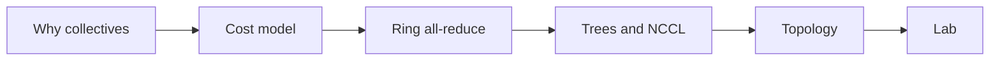
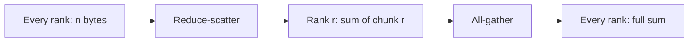
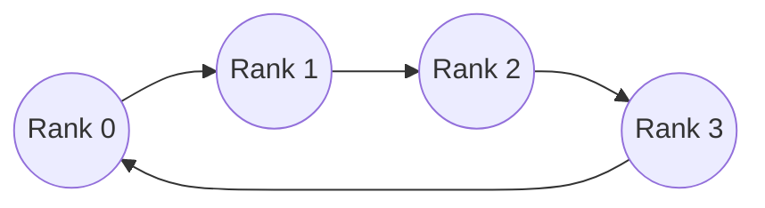
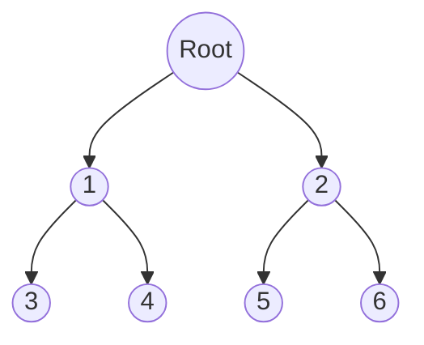
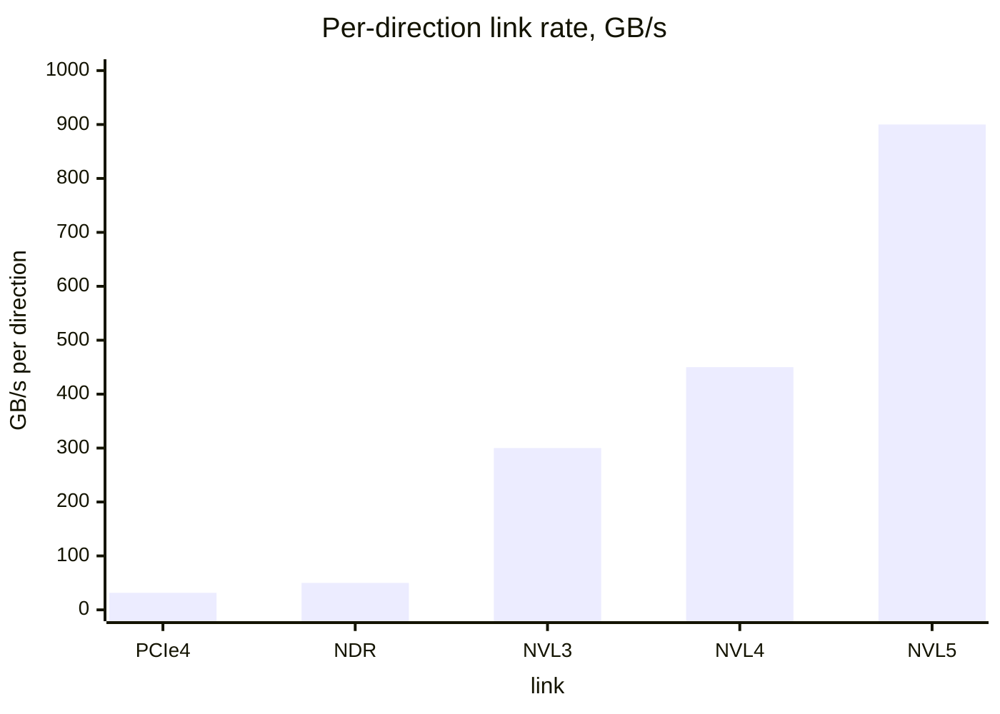
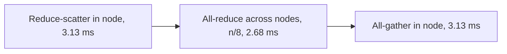

# Introduction

The question this chapter answers: how long does it take many GPUs to combine their data, and what sets that time?

Note:
Open by saying that the moment you have two GPUs, a model's speed depends on a transfer, and the transfer has a cost you can predict from two numbers. By the end the audience can compute the time of a gradient all-reduce on NVLink and on PCIe, and say which algorithm NCCL should pick.

### Why a second GPU changes the question {#why-second-gpu}

- One GPU runs out of memory and of memory bandwidth
- Two GPUs add a new cost: moving data between them
- That cost is a link rate, not a kernel rate
- The lab A100 PCIe link moves 31.5 GB/s each way

Note:
Remind the room that the A100's HBM delivers 1935 GB/s rated. The PCIe link between cards is about sixty times slower. So the same gradients that take milliseconds to read take far longer to ship, and the engineer's job becomes avoiding or hiding the shipment.

### What you already know {#prior}

- Bandwidth against arithmetic: the roofline from Part 1
- Asynchronous launches and CUDA events
- Reductions inside one GPU, from chapter 6

Note:
A cross-GPU all-reduce is a reduction, just across devices. The tree and the ring you will see today are cousins of the shared memory tree from the reduction chapter. The difference is that every step now crosses a wire with its own latency and rate.

### The route through this deck {#roadmap}



Note:
Six stops. First which collective each parallelism strategy calls, then the alpha-beta cost model, then the ring derived step by step, then trees and how NCCL chooses, then the physical links, and finally what the lab asks you to build. Leave the diagram up for a few seconds.

# Why collectives

Every way of splitting a model across GPUs leaves a tensor everyone needs or a sum that everyone holds a part of.

Note:
This section matches each strategy to its collective. The point to land is that all of them are built from a handful of operations, and that the cost of each is a count of bytes over a rate.

### Four strategies, four collectives {#strategies}

| Strategy | What is split | Collective |
|---|---|---|
| Data parallel | The batch | All-reduce on gradients |
| Tensor parallel | Each weight matrix | All-reduce on activations |
| FSDP | Weights and optimizer | All-gather and reduce-scatter |
| Expert parallel | The experts | All-to-all on tokens |

Note:
Walk the rows. Data parallel: every rank has gradients from its own batch slice and needs the average. Tensor parallel: row-parallel matmuls leave partial sums. FSDP: weights live in shards, so gather before use and scatter gradients after. Experts: tokens travel to the rank that owns their expert.

### The six primitives {#six}

| Collective | Result |
|---|---|
| Broadcast | One rank's array on every rank |
| Reduce | The sum, on one rank |
| All-reduce | The sum, on every rank |
| Reduce-scatter | Rank r holds chunk r of the sum |
| All-gather | Every rank holds every chunk |
| All-to-all | Rank r gets chunk r from every rank |

Note:
These six cover nearly everything. In PyTorch they are dist.broadcast, reduce, all_reduce, reduce_scatter_tensor, all_gather_into_tensor, and all_to_all_single. Each is a kernel on a CUDA stream under NCCL, so it is asynchronous like any other kernel.

### All-reduce is two collectives {#identity}



> [!QUESTION] Does FSDP move less data than data parallelism?
> Not for gradients. It runs the two halves of the all-reduce at different times: reduce-scatter on gradients, all-gather on weights. It saves memory, not gradient bytes, and it adds an all-gather of weights before the forward and backward passes.

Note:
This identity does the work of the chapter. It gives the cost: each half sends (p minus 1) over p of the array. It explains why FSDP's traffic is comparable with data parallelism. And it is exactly the plan for the ring we derive next.

### What one data parallel step costs {#dp-cost}

A 7B model has 14 GB of bfloat16 gradients.

- Each rank sends 1.75 × 14 GB = 24.5 GB on 8 ranks
- NVLink 3 at 300 GB/s: 81.7 ms
- PCIe Gen4 at 31.5 GB/s: 778 ms
- A factor of 9.5, set by the link alone

Note:
We have not derived the 1.75 yet; hold it for two sections. The point is the ratio: the same bytes, a factor of nearly ten apart. Chapter 22 shows how to start the all-reduce while the backward pass is still computing, so this time is partly hidden.

# The cost model

One formula with two parameters predicts most of what you will measure.

Note:
Introduce Hockney's alpha-beta model. Tell the audience to keep two things apart: a fixed cost per message, and a cost per byte. Almost every surprising number in the rest of the talk is one of these two winning.

### One message: latency plus size over bandwidth {#alpha-beta}

$$
T(n) = \alpha + \frac{n}{B}
$$

- $\alpha$ is the fixed cost of a message
- $B$ is the rate of one link, **per direction**
- Small messages pay $\alpha$, large ones pay $n/B$

Note:
Alpha covers software, wire, and handshake. B is the rate at which one rank can send. Stress per direction now, because the next two slides and the datasheet trap depend on it.

### The half-bandwidth size {#half-bandwidth}

At $n = \alpha B$ the terms are equal ($\alpha = 5\ \mu\text{s}$, assumed):

| Link | $B$ per direction | $\alpha B$ |
|---|---|---|
| PCIe Gen4 x16 | 31.5 GB/s | 157.5 KB |
| InfiniBand NDR | 50 GB/s | 250 KB |
| NVLink 3 | 300 GB/s | 1.5 MB |
| NVLink 4 | 450 GB/s | 2.25 MB |

> [!QUESTION] Where does the 5 µs come from?
> An assumed planning value, not a measurement. NCCL's paper lists about 1 to 6 µs per hop across its protocols. The lab fits your machine's value.

Note:
The 5 microseconds is an assumption: the fact sheet marks it unconfirmed and the lab fits a real value. The lesson is that a faster link needs a bigger message to be efficient, so latency that is harmless on PCIe dominates on NVLink.

### Per direction, not the datasheet total {#per-direction}

- A100 datasheet: NVLink 600 GB/s, PCIe Gen4 64 GB/s
- Both are the **sum of both directions**
- A ring sends on one link while receiving on another
- Use 300 GB/s and 31.5 GB/s

> [!WARNING] Dividing by the total halves the time
> The companion course's chapter 19 divides by the quoted totals. Its communication times are about half of the per-direction figures.

Note:
This is the correction the fact sheet asks for. PCIe Gen4 x16 is 16 gigatransfers per second, times 128 over 130, times 16 lanes, over 8 bits, which is 31.5 gigabytes per second each way. The ring formula needs the rate one rank can send, so it needs the half.

# The ring

The ring is the all-reduce that makes the bandwidth term optimal.

Note:
Now the main derivation. Tell the room we will count steps, and that the count gives both terms of the formula. Then we implement it in the lab with sends and receives.

### Arrange ranks in a ring and cut into chunks {#ring-setup}



Each rank cuts its array into $p$ chunks of $n/p$ bytes.

Note:
Rank r sends to r plus one and receives from r minus one, modulo p. Every rank sends and receives at the same time, so both directions of every link are busy, and each carries one chunk per step. Chunk size is n over p, which is what keeps each message small enough to pipeline.

### Phase one: reduce-scatter {#phase-one}

Step $s$ of $p-1$:

- Send chunk $(r - s) \bmod p$
- Receive chunk $(r - s - 1) \bmod p$ and **add** it
- After the last step, rank $r$ owns the finished chunk $(r+1) \bmod p$

Note:
The chunk you send is the one you just finished accumulating. Partial sums travel around the ring and gain one rank's data per hop. After p minus 1 hops, each chunk has visited every rank. This is the part of the chapter to draw on a whiteboard if there is one.

### Phase two: all-gather {#phase-two}

Step $s$ of $p-1$:

- Send chunk $(r + 1 - s) \bmod p$
- Receive chunk $(r - s) \bmod p$ and **overwrite**
- After the last step, every rank has every finished chunk

Note:
The same ring, now copying instead of adding. Rank r starts by sending the chunk it owns, then forwards what it receives. No arithmetic in this phase, just data movement, which is why NCCL fuses the phases into primitives like recvReduceSend and recvCopySend.

### Watch it run {#ring-figure}

```viz
21-ring-steps
```

Note:
Pick four ranks and step through. A cell counts how many ranks have contributed to that chunk on that rank. After three steps each rank has one cell reading all. After six steps the grid is full. Ask the audience to predict the count in a given cell before you press the arrow.

### Counting the cost {#ring-cost}

$$
T_{\text{ring}} = 2(p-1)\,\alpha + 2\,\frac{p-1}{p}\,\frac{n}{B}
$$

- $2(p-1)$ steps, each one chunk of $n/p$ bytes
- Latency grows with $p$
- Bandwidth factor $2(p-1)/p$: 1, 1.5, 1.75, 1.875 for $p = 2, 4, 8, 16$

> [!QUESTION] Why can't any algorithm beat $2(p-1)/p$?
> Each element needs about $2(p-1)$ transfers: $p-1$ to sum and $p-1$ to spread. With $p$ links working in parallel, the best time is $2(p-1)n/(pB)$. Patarasuk and Yuan prove the bound for clusters where each rank has its own link.

Note:
Each step is one message of n over p bytes, so it costs alpha plus n over p B, and there are two times p minus one steps. Going from 8 to 16 ranks raises the bandwidth term by 7 percent. The ring scales in bandwidth almost for free, and pays in latency.

### Worked numbers for 1 GiB {#ring-numbers}

| Case | $p$ | $B$ | Total |
|---|---|---|---|
| A100 NVLink 3 | 8 | 300 GB/s | 6.33 ms |
| H100 NVLink 4 | 8 | 450 GB/s | 4.25 ms |
| A100 over PCIe Gen4 | 8 | 31.5 GB/s | 59.72 ms |
| NDR port, one per ring link | 16 | 50 GB/s | 40.42 ms |

Note:
These are the lab's predictions with alpha at 5 microseconds. The 6.26 millisecond bandwidth term plus 70 microseconds of latency is the first row. The latency is about one percent of the total at this size. Only B matters for a gigabyte. The lab reports all four plus a two-GPU bridge case.

### A ring in twenty lines {#ring-code}

```python
for step in range(p - 1):
    s_lo, s_hi = bounds[(rank - step) % p]
    r_lo, r_hi = bounds[(rank - step - 1) % p]
    send = dist.isend(x[s_lo:s_hi], nxt)
    tmp = torch.empty(r_hi - r_lo)
    recv = dist.irecv(tmp, prv)
    send.wait(); recv.wait()
    x[r_lo:r_hi] += tmp
```

> [!QUESTION] What if the array has fewer elements than ranks?
> Some chunks are empty. Compute chunk bounds with divmod so sizes differ by at most one, and skip the send and receive for an empty chunk on both ends. Both sides can tell from the sizes, so they never disagree.

Note:
This is the reduce-scatter, simplified: the lab version also skips empty chunks. Point at isend and irecv. Post both, then wait. A blocking send in every rank deadlocks because nobody is receiving. The receive lands in a scratch buffer because the chunk must be added, not overwritten.

# Trees and NCCL

A ring is the wrong tool when the message is small.

Note:
The ring's latency term is linear in the number of ranks. This section shows what replaces it for small messages and how NCCL decides. Remind the room that a transformer layer sends an all-reduce per sub-block, and decode makes them tiny.

### Small messages pay only latency {#small-messages}

An 8 KiB all-reduce on 8 ranks, NVLink 3:

- Bandwidth term: $1.75 \times 8192 / 300\ \text{GB/s} = 48$ ns
- Latency term: $14 \times 5\ \mu\text{s} = 70\ \mu\text{s}$
- 99.9% of the time is $\alpha$

Note:
This is the decode case: one token of 4096 bfloat16 values. A model with alpha equal to zero would predict a time 1500 times too small. For these sizes the question is how few messages you can send, not how fast the link is.

### A tree has logarithmic latency {#tree}



$$
T_{\text{tree}} \approx 2\lceil\log_2 p\rceil\,\alpha + \frac{2n}{B}
$$

Note:
Reduce up the tree, broadcast down. The depth is log base two of p, so 6 messages at 8 ranks against the ring's 14. The idealized bandwidth term is 2n over B, slightly worse than the ring's. NCCL uses two trees at once, the double binary tree, so that no rank is an interior node in both and every link stays busy.

### Where the tree stops winning {#crossover}

$$
n^{\ast} = \alpha\,B\,p\,\bigl(p - 1 - \lceil\log_2 p\rceil\bigr)
$$

- 8 ranks, NVLink 3: 48 MB
- 8 ranks, PCIe Gen4: 5.04 MB
- 16 ranks, NVLink 3: 264 MB

Note:
Set the ring and the tree equal and solve for n. Below n star the tree is faster in the model. This is an idealized model and not NCCL's tuning table, so use it for direction: slower links and fewer ranks put the crossover lower. The lab has you code this function.

### Move the sliders {#cost-figure}

```viz
21-allreduce-cost
```

> [!QUESTION] Is this how NCCL decides?
> No. NCCL picks the algorithm and protocol from the message size, the topology, and its own tuning tables. You can force a choice with `NCCL_ALGO` and `NCCL_PROTO`. The formula shows the direction of the trade, not NCCL's thresholds.

Note:
Let the audience choose the link and the number of ranks and predict where the lines cross before moving the size slider. Raise alpha and watch the tree gain. Switch to PCIe and watch the crossover fall by an order of magnitude.

### Three protocols trade latency for bandwidth {#protocols}

| Protocol | Payload | Bandwidth | Per hop |
|---|---|---|---|
| Simple | Whole chunks, fences | Near peak | about 6 µs |
| LL | 4 B data, 4 B flag | 25% to 50% | about 1 µs |
| LL128 | 120 B data, 8 B flag | about 95% | about 2 µs |

Note:
These are the Demystifying NCCL paper's Table I figures, with the hardware not named, so quote them as orders of magnitude. LL spins on a flag instead of using a memory fence, so it starts fast and carries half the payload. LL128 keeps 120 of every 128 bytes as data, which suits NVLink.

### A collective is a kernel {#collective-kernel}

- One CUDA block per channel
- It runs on SMs your matmul also wants
- Ring steps fuse into primitives such as recvReduceSend
- Chunks pipeline through slots

Note:
The paper describes the NCCL kernel grid as one block per channel. So communication is not free of compute: it takes streaming multiprocessors while it runs. Chapter 22 returns to this when it overlaps the two. The primitives are the lab's two phases, fused.

# Topology and bus bandwidth

The model needs a number for B, and the number comes from the wires.

Note:
Switch from algorithm to hardware. Two ideas: the ranking of links, and how to turn a measured time into a number you can compare with a link.

### The links, per direction {#links}



Note:
From the fact sheet, halved from the quoted totals where NVIDIA quotes both directions. PCIe Gen4 is 31.5, an InfiniBand NDR port is 50, then NVLink 3, 4, and 5 at 300, 450, and 900. The jump from network to NVLink is a factor of six on A100 and eighteen on B200.

### NVSwitch, PCIe, and the network {#fabrics}

- **NVSwitch** gives any GPU full NVLink rate to any other in a node
- **PCIe** is shared with everything else on the bus
- **InfiniBand or RoCE** crosses nodes, with GPUDirect RDMA
- **Rail-optimized** wiring gives each GPU its own network path

> [!QUESTION] Does the lab's A100 have NVLink?
> Not one it can use: the lab has one A100 80GB PCIe. So the ring runs on CPU processes with gloo, and the cost model is checked against arithmetic.

Note:
Without a switch, NVLink is point to point: the lab's PCIe A100 can bridge to one other card. In a node, NVSwitch makes it all-to-all. Between nodes, each GPU's index connects to the same leaf switch, a rail, so eight GPUs have eight independent paths.

### A flat ring across two nodes is slow {#flat-ring}

- Each step lasts as long as the slowest edge
- Cross-node edges run at 50 GB/s
- 1 GiB over 16 ranks: 40.27 ms of bandwidth
- The same ring on NVLink alone, 8 ranks: 6.26 ms

Note:
The ring is paced by its slowest link, so a few network edges set the whole ring's speed. This is not a flaw in the ring so much as a reason to use the topology: the next slide shows the fix.

### Hierarchical all-reduce {#hierarchical}



Total about 8.94 ms against 40.27 ms.

Note:
A hypothetical pair of nodes with 8 GPUs on NVLink 3 and one NDR port per GPU. Only a eighth of the data crosses the slow link, and all eight rails work at once. The sum ignores latency and phase overlap, so it is a model, but it shows the principle: do the heavy movement on the fast level.

### Algorithm bandwidth and bus bandwidth {#busbw}

$$
\text{algbw} = \frac{S}{t}, \qquad \text{busbw} = \text{algbw} \times \frac{2(p-1)}{p}
$$

- Factors: reduce-scatter, all-gather, all-to-all $(p-1)/p$; broadcast, reduce 1
- busbw is comparable with the link's rate
- The ceiling for an all-reduce is $B$

> [!QUESTION] What busbw does NCCL reach on 8 A100s?
> This course doesn't quote one. The fact sheet has no confirmed measurement from a primary source, and forum figures are unverified. Compute the ceiling, 300 GB/s per direction, and measure with nccl-tests for your machine.

Note:
Nccl-tests defines both. Algbw is size over time and falls with more ranks even on identical hardware. Bus bandwidth corrects for that. Example: 8 ranks, 1 GB in 10 ms is 100 algbw and 175 busbw, which is 58 percent of an A100 node's 300 per direction.

# Summary

The chapter's argument in five lines, and the numbers to keep.

Note:
Close by saying the audience can now predict a collective's time from two numbers and a link table. The summary slides restate the formulas, give a rough guide to choosing an algorithm, and point at the lab and at the next chapter on overlap.

### What to remember {#summary}

- Every parallelism strategy ends in a collective, and all-reduce is a reduce-scatter plus an all-gather
- One message costs $\alpha + n/B$, with $B$ per direction
- Ring: $2(p-1)\alpha + 2\frac{p-1}{p}\frac{n}{B}$, bandwidth-optimal
- Tree: logarithmic latency, so small messages
- busbw is algbw times $2(p-1)/p$, bounded by $B$

Note:
Read the five bullets and tie each to a number: 6.33 milliseconds for 1 GiB on eight A100s over NVLink 3, 59.72 over PCIe, 48 megabytes for the crossover, and 300 against the datasheet's 600. If the audience keeps one number, it is the per-direction rule.

### Choosing by size and link {#decision}

| Situation | Reach for |
|---|---|
| Large message, one level of fast links | Ring |
| Small message, many ranks | Tree, low-latency protocol |
| Fast links in a node, slow between | Hierarchical |
| Gradients behind compute | Overlap, next chapter |

Note:
A rough guide, not NCCL's tuning table: the library picks for you, and the table tells you what to expect and which environment variable to change in an experiment. The last row is where the next chapter picks up.

### In the lab and what comes next {#next}

- Implement the ring with `isend` and `irecv` on gloo
- Match `dist.all_reduce`, including $n < p$
- Code the cost model and report five predictions
- Next: overlap communication with compute

Note:
The lab runs on CPU processes, because the lab machine has one GPU and the ring's logic doesn't care. The tests count bytes sent to check the 2(p minus 1) over p factor. Chapter 22 takes the cost we computed and hides it behind computation with streams and events.
