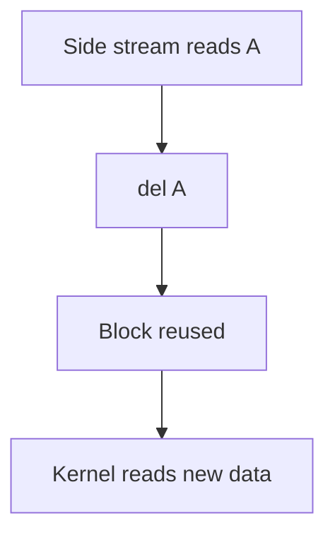
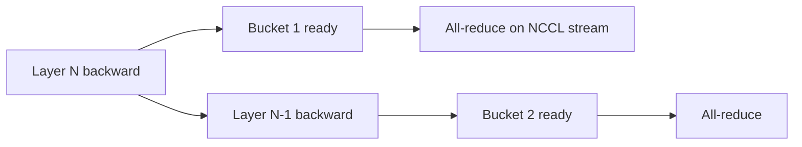

# Introduction

The question this chapter answers: when two pieces of work don't depend on each other, how do you make the GPU run them at the same time?

Note:
Open with the idea that a launch is only a queue entry, from chapter 0. Because it's a queue entry, you can fill several queues before any work runs. The first half of the talk is one GPU and one lab. The second half is the same idea applied to a cluster, where the "copies" are collectives and the "kernel" is a transformer layer.

### Idle hardware is the cost {#idle-hardware}

- Copy, kernel, copy in sequence uses one engine at a time
- The GPU has SMs and DMA engines for PCIe and NVLink
- The ideal step takes the time of the slowest engine

> [!QUESTION] Isn't this what the GPU's scheduler already does?
> Only for work it may reorder. Within one stream the order is a promise. You grant freedom by putting independent work in different streams.

Note:
Say that the GPU never guesses about dependencies. One stream means one order, and the hardware obeys it. Overlap is something you ask for, by saying what's independent. That's the whole contract, and the rest of the talk is the details of asking.

### The road through this deck {#roadmap}


Note:
Six stops. Streams and events are the vocabulary. Pinned memory is the condition for copies. The chunked pipeline is the lab. Then the parallelism strategies, in the order they add communication to the timeline, and last, overlap pushed down inside a single kernel.

# Streams and events

A stream orders work within itself and nothing across streams. An event lets one stream wait on another without the host.

Note:
Section divider. Everything in the chapter rests on these two objects. Keep this section short and move to hardware.

### A stream is an ordered queue {#stream-queue}

- One stream runs in the order issued
- Two streams have no guaranteed order
- The legacy default stream is a barrier for blocking streams
- PyTorch side streams skip that barrier: you order them

> [!QUESTION] Why does the default stream cost so much?
> It's a barrier, so a default-stream-only program is correct and has no overlap. Side streams lift the barrier.

Note:
The NVIDIA overlap article states the default-stream rule. The PyTorch notes then say that on a side stream you are responsible for synchronization, and show an example where a sum starts before the normal_ that feeds it finishes. That's the failure to remember: it reads garbage and raises no error.

### Fork, work, join {#fork-join}

```python
s = torch.cuda.Stream()
s.wait_stream(torch.cuda.default_stream())  # fork
with torch.cuda.stream(s):
    B = torch.sum(A)
A.record_stream(s)
torch.cuda.default_stream().wait_stream(s)  # join
```

Note:
The fork makes the side stream wait for whatever produced A. The join makes the default stream wait before it reads B. Both are GPU-side waits, so the host keeps queueing. Point at record_stream and say we'll come back to it in the allocator slide. Warn that joining straight after the fork gives you no parallelism, because the waits put the two streams back in a line.

### Events order streams without the host {#events}

```python
copied = torch.cuda.Event()
with torch.cuda.stream(copy_stream):
    x_dev.copy_(x_host, non_blocking=True)
    copied.record(copy_stream)
compute_stream.wait_event(copied)
```

- `wait_event` is GPU-side: it queues a dependency and returns
- `event.synchronize()` stops the host

> [!QUESTION] Does `wait_event` block Python?
> No. It enqueues a wait on the GPU and returns. Only `synchronize()` calls, `.item()`, and `.cpu()` stop the host.


Note:
An event is a flag in a stream's queue. Another stream can wait for the flag. This is how you say that this kernel needs that copy when they're in different streams. Contrast the two waits: the GPU-side one keeps the host running ahead, which is what you want. The host-side one is a synchronize, and one in a loop destroys the overlap.

# Copy engines and pinned memory

When does a host-to-device copy run at the same time as a kernel? Three conditions, and the third is the one people miss.

Note:
Section divider. The first two conditions, a capable device and separate non-default streams, are easy. The third, pinned memory, is where code that looks overlapped isn't.

### Three conditions for copy-compute overlap {#three-conditions}

- The device has a copy engine, so it can copy and run kernels at once
- The copy and the kernel are in different non-default streams
- The host memory is pinned (page-locked)

> [!QUESTION] What if I forget the third one?
> The code still runs and still gives the right answer. The copy just behaves like a synchronous one, so nothing overlaps. Check `tensor.is_pinned()`.

Note:
These are the three conditions in Harris's NVIDIA article. The failure mode of the third is silent, which is why the lab tests it. It compares pinned and pageable on the same pipeline and reports the ratio.

### Why pageable memory can't overlap {#pageable}


Note:
A DMA engine reads physical addresses, and the operating system can move a pageable page at any time. So the driver copies your data into a pinned staging buffer first, then the engine copies from there. The CUDA documentation says a copy from pageable memory can be synchronous with respect to the host. Two passes over the data, a stalled host, and a drained stream. Pinned memory skips the staging, at the cost of memory the operating system can't reclaim, so allocate it once.

### What a copy costs on this card {#pcie-numbers}

| Link | Rated | Per direction |
|---|---|---|
| PCIe Gen4 x16 | 64 GB/s | 31.5 GB/s |
| NVLink 3 | 600 GB/s | 300 GB/s |
| HBM2e | 1935 GB/s | one way |

$$
\frac{268.4\ \text{MB}}{31.5\ \text{GB/s}} = 8.52\ \text{ms}
$$

> [!QUESTION] Why is 21 GB/s a planning number when the link says 31.5?
> A real transfer pays for protocol overhead and the host's memory system, so it lands under the ceiling. The 31.5 is a floor on time, and the lab measures the actual figure.


Note:
The datasheet prints PCIe and NVLink as sums of both directions, so divide by two before you divide a transfer by a link. The lab tensor is 2 to the 26 float32 values, 256 MiB, and 8.52 ms is the floor for its copy. The host link is about 61 times slower than rated HBM. The companion course used about 21 GB/s as a planning number for host copies, which is 12.8 ms. Your lab reports the real one.

# The chunked pipeline

Cut the job into chunks and the three stages run on different engines at once. The time falls from the sum of the stages toward the longest one.

Note:
Section divider. This is the lab. Derive the formula on the board, then show it in the figure, then show the code.

### The time model {#time-model}

$$
T_n = \hla{s_1 + s_2 + s_3} + \hlb{(n-1)\max(s_1, s_2, s_3)}
$$

- Green: the first chunk crosses all three stages alone
- Blue: each later chunk leaves one longest stage after the last
- The limit as $n$ grows is $\max(t)$, the bound

Note:
The stage times s are the stage totals divided by n. The first chunk has to fill the pipe, and after that one chunk comes out per slowest-stage time. In the limit the fill cost is a vanishing share and you're left with the longest stage's total. Ask the audience what the bound is when the kernel is much shorter than the copies. It's the copy time, and there's little to hide.

### Eight chunks recover most of the gap {#chunk-table}

| Chunks | Time (ms) | Speedup | Efficiency |
|---|---|---|---|
| 1 | 25.57 | 1.00x | 33% |
| 2 | 17.04 | 1.50x | 50% |
| 4 | 12.78 | 2.00x | 67% |
| 8 | 10.65 | 2.40x | 80% |
| 16 | 9.59 | 2.67x | 89% |

Note:
Three stages of 8.52 ms each. For equal stages the formula is t times n plus two over n. These are model values, with no launch overhead and no contention. The lab measures the real column. Say that the ceiling is 3x, and that real chunks cost a launch each, so very small chunks give some of it back.

### Play with the pipeline {#timeline}

```viz
22-stream-timeline
```

> [!QUESTION] What happens with 32 chunks and one stream?
> Nothing good. The chunks run in order, so the time is the sequential time plus launch overhead. Chunking only helps when the chunks can run in different streams.


Note:
Start with one stream and watch nothing overlap, however many chunks you choose. Switch to a stream per chunk and the three lanes fill. Then slide the kernel time up to 30 ms and show that the pipeline is bound by the kernel, so the copies are the ones hidden. The readout shows the sum, the bound, and the pipeline time.

### Two ways to issue the work {#two-shapes}

```python
for i, (a, b) in enumerate(chunk_bounds(n, n_chunks)):
    with torch.cuda.stream(streams[i % S]):
        d_in[a:b].copy_(h_in[a:b], non_blocking=True)
        launch_kernel(d_in[a:b], d_out[a:b], iters)
        h_out[a:b].copy_(d_out[a:b], non_blocking=True)
```

- A stream per chunk: order inside a stream is the dependency
- A stream per stage: events carry the dependency across streams

Note:
The first form gets its dependencies for free from stream order. The second mirrors the hardware engines and needs an event per hand-off. Harris compares issue orders and found the winner differed between a GPU with one copy engine and one with two, so the lab has you build both and measure. The tests fill the outputs with NaN, so a missing wait is a visible NaN.

### A tensor freed under a running kernel {#allocator}



> [!WARNING] No error is raised
> The allocator assumes every use is in the tensor's own stream.

> [!QUESTION] When is a join enough?
> When you hold the reference until after the join. Otherwise call `record_stream`.

Note:
This is the allocator hazard. The allocator returns the block to the pool without waiting for the GPU. Another stream's use of the block isn't tracked unless you call record_stream, which adds an event the allocator checks before it reuses the block. The lab allocates its buffers once and reuses them, which sidesteps the problem, and that's also the practical advice.

# Parallelism from the kernel's view

Each strategy adds specific kernels and collectives to the timeline. The question for each: is it on the critical path, and what runs beside it?

Note:
Section divider. Everything from here uses the same idea as the pipeline: find work that's independent of the communication and run it beside. The difference between strategies is how much independent work exists.

## Data parallelism and sharding

### DDP starts the all-reduce while backward runs {#ddp}



- One autograd hook per parameter
- Buckets fill in reverse parameter order, 25 MiB by default
- Every rank launches in bucket order

Note:
Backward produces gradients from the last layer to the first, so the last layers' gradients are final early. A hook per parameter marks it ready, and when a bucket is full the reducer launches an asynchronous all-reduce. The compute stream keeps running backward. Every rank must launch the same buckets in the same order, or the job hangs, which is why assignment is fixed at construction. Mention that compiling the whole backward as one graph delays the hooks.

### Is the all-reduce hidden? {#ddp-arithmetic}

$$
\frac{2(p-1)}{p} \times 14\ \text{GB} = 24.5\ \text{GB per rank}
$$

| Link | All-reduce | Backward floor |
|---|---|---|
| NVLink, 300 GB/s | 82 ms | 735 ms |
| PCIe, 31.5 GB/s | 778 ms | 735 ms |

> [!QUESTION] Why not use bigger buckets to cut latency?
> A larger bucket pays the collective's start-up cost less often, but it starts later and leaves a long last all-reduce exposed after the final kernel. Chapter 21's alpha-beta model gives the trade.


Note:
A 7-billion-parameter model with bf16 gradients is 14 GB, and p is 8. The backward floor is four times parameters times 8192 tokens, divided by 312 TFLOP/s: 0.735 seconds at peak, longer in practice. Over NVLink the all-reduce is about an eighth of it and hides. Over PCIe it's as long as the whole backward and can't. These are predictions from ratings. Overlap makes the first case free and can't rescue the second.

### FSDP adds three collectives per unit {#fsdp}

1. All-gather the unit's parameters, run forward, free them
2. All-gather again for backward
3. Reduce-scatter its gradients

- All-gathers run on a separate stream, so they can overlap compute
- Prefetching issues the next all-gather early
- A rate limiter allows two all-gathers in flight

Note:
This is the price of a one-over-N memory footprint. Without a separate stream NCCL would wait for the default stream's compute, and nothing would overlap. Backward prefetching issues the next unit's all-gather before the current reduce-scatter, and the FSDP paper reports about 18 percent speedup from it on GPT-175B. The rate limiter exists because the all-gather stream can over-reserve memory in the caching allocator.

### ZeRO trades memory for communication {#zero}

| Stage | Bytes per GPU | At 7.5B params, 64 GPUs |
|---|---|---|
| DDP | $16\Psi$ | 120 GB |
| ZeRO-1 | $4\Psi + 12\Psi/N$ | 31.4 GB |
| ZeRO-2 | $2\Psi + 14\Psi/N$ | 16.6 GB |
| ZeRO-3 | $16\Psi/N$ | 1.9 GB |

> [!QUESTION] Why is ZeRO-3 1.5 times the communication of DDP?
> DDP's all-reduce is a reduce-scatter plus an all-gather, which is two units of $\Psi$. ZeRO-3 gathers the parameters twice, for forward and backward, and reduce-scatters the gradients once: three units.


Note:
The 16 bytes per parameter are 2 for the fp16 weight, 2 for its gradient, and 12 for the fp32 weight copy and the two Adam moments. These are the ZeRO paper's example figures. Stage 3 moves three psi per step against DDP's two psi, so it costs half again as much communication.

## Tensor, pipeline, and expert parallelism

### Tensor parallelism: two all-reduces per layer {#tp}

- Column-parallel: split $W$ by output columns, no communication
- Row-parallel: split $W$ by input rows, partial sums need an all-reduce
- MLP: column then row, one all-reduce
- Forward 2 per layer, backward 2 per layer

Note:
Megatron pairs a column-parallel layer with a row-parallel one, so the activation between them stays local. The same goes for attention, split by head. The companion course's chapter 19 derives this for inference. The key difference from DDP is where the all-reduce sits: the next layer needs its result, so it's on the critical path.

### How big is it, and can it hide? {#tp-arithmetic}

$$
\frac{2 \times 7}{8} \times 134.2\ \text{MB} = 234.9\ \text{MB}
$$

- NVLink, 300 GB/s: 0.78 ms
- PCIe, 31.5 GB/s: 7.5 ms
- MLP compute on that rank: at least 3.5 ms

> [!QUESTION] Why can't a second stream hide it, as in DDP?
> The next layer's matmul needs the all-reduce's result, so there's no independent compute to run beside it. You have to cut the matmul and the communication into tiles.


Note:
Eight ranks, 8192 tokens, hidden size 8192, bf16. An exposed NVLink all-reduce adds about 22 percent to the MLP's compute floor. Over PCIe the transfer is longer than the compute. That's why tensor parallelism stays inside a node. Sequence parallelism replaces the all-reduce with a reduce-scatter and an all-gather, which moves the same bytes and shards the LayerNorm and dropout activations.

### The pipeline bubble {#bubble}

$$
\boxed{\frac{t_{\text{bubble}}}{t_{\text{ideal}}} = \frac{p-1}{m}}
$$

- p stages, m microbatches
- $p = 8$, $m = 8$: 87.5% of ideal, 46.7% of wall-clock
- $p = 8$, $m = 32$: 21.9% of ideal, 17.9% of wall-clock

Note:
The bubble is idle time at the start and end of a batch, because a stage has to wait for its input. The Megatron paper gives this fraction of ideal compute time. Convert it for wall-clock by dividing by m plus p minus one over m. More microbatches shrink it. The cost of more microbatches is memory in GPipe, which 1F1B fixes.

### Simulate GPipe and 1F1B {#bubble-figure}

```viz
22-pipeline-bubble
```

> [!QUESTION] If 1F1B has the same bubble, why use it?
> Memory. A stage under 1F1B holds activations for at most p microbatches, not m, so you can raise m to shrink the bubble without running out of memory.


Note:
Set eight stages and 32 microbatches and compare the two schedules. The idle share is the same, and the readout says 1F1B stashes at most p microbatches where GPipe stashes m. Then raise the interleave factor to 4 and show the formula's bubble dropping to a quarter. That readout is the paper's formula, and the picture doesn't draw it.

### Interleaving trades communication for bubble {#interleave}

- Each GPU holds $v$ small chunks of layers instead of one large one
- Bubble: $\frac{1}{v}\frac{p-1}{m}$, so $7/128 = 5.5\%$ at $p = 8$, $m = 32$, $v = 4$
- Communication rises by a factor of $v$
- $m$ must be a multiple of $p$

Note:
Layers one and two plus nine and ten on one GPU instead of one to four. The pipeline is v times deeper with steps v times shorter, so the fill is shorter. The price is that activations cross a GPU boundary v times as often. The Megatron paper also describes a scatter-gather trick for the sends between nodes, which cuts the cross-node bytes by the tensor-parallel degree.

### Expert parallelism: all-to-all, twice {#ep}

- Dispatch, grouped GEMM, combine
- Two all-to-alls per layer forward, two backward
- 16,384 tokens, top-2, hidden 4096, bf16: 268.4 MB per rank
- $7/8$ leaves: 234.9 MB, 0.78 ms at 300 GB/s

> [!QUESTION] Does the all-to-all really use the full 300 GB/s?
> It's the ceiling. Uneven message sizes and router imbalance make the measured time longer.


Note:
The all-to-all is on the critical path like tensor parallelism's all-reduce, and the middle step is the grouped GEMM from chapter 20, uneven because the router is. The busiest expert's rank sets the pace. The standard remedy is to offset two microbatches so one computes while the other communicates, which DeepSeek's V3 report describes. It needs communication that uses few SMs.

# Inside the kernel

Stream-level overlap stops where the work depends on the communication. Finer tiles remove the dependence.

Note:
Section divider. Tie back to chapter 12: cp.async overlaps a copy with an MMA inside one block. Here the copy is a peer GPU's memory.

### Why a second stream isn't enough {#contention}

- A collective is a kernel: it takes SMs
- It also shares HBM bandwidth with your GEMM
- In tensor parallelism the next matmul needs the result

> [!KEY] Cut finer to remove the dependence
> If a matmul's output is tiled, the first tiles finish long before the last, so their communication can start while the rest still compute.

Note:
Two costs and one limit. NCCL kernels run on the SMs, so overlapped communication slows the GEMM beside it. They share bandwidth. And where there's a true dependence, a second stream has nothing to run. Tiling fixes the third and is the same idea as the chunked pipeline in this chapter and the multistage pipeline in chapter 12.

### Two ways to fuse matmul and communication {#fused}

| Approach | How | Reported by |
|---|---|---|
| Async TP | Chunk the matmul, send each chunk while the next computes | PyTorch team |
| Flux | One fused kernel per GEMM and communication tile | Chang et al. |

> [!QUESTION] Why not always fuse?
> It's harder to write and tune per architecture and link. Tiles too small waste time on synchronization, and too large leave an exposed tail.


Note:
Both are published results on specific hardware that the sources name, so check the source before quoting a figure. Async TP reported up to about 29 percent forward speedup on Llama 3 7B and about 8 percent end to end. The SymmetricMemory API is documented as alpha, so don't depend on its signatures. Flux reports that a fused kernel can potentially overlap up to 96 percent of the communication.

# Summary

The ideas to keep, the numbers to remember, and a way to choose.

Note:
Section divider. Spend two minutes here. The point to land is that overlap is something you grant by saying what's independent, and each framework feature in the second half is a way of finding independent work.

### What to remember {#summary}

- A stream orders its own work. Events and `wait_stream` order across streams, GPU-side
- Copy-compute overlap needs pinned memory, an async copy, and separate streams
- $T_n = s_1 + s_2 + s_3 + (n-1)\max(s)$, approaching the longest stage
- A tensor used across streams needs `record_stream` or a join before it's freed
- Overlap hides communication only if independent work exists, and it costs SMs

Note:
Five ideas. If the audience keeps one, it's that overlap is something you grant by saying what's independent, and the framework wins by finding independent work: the next bucket, the next layer, the other microbatch, the next tile.

### Numbers to remember {#numbers}

| Quantity | Value |
|---|---|
| PCIe Gen4 x16, per direction | 31.5 GB/s |
| 256 MiB over PCIe | 8.52 ms floor |
| Three balanced stages, 8 chunks | 10.65 ms of 25.57 ms |
| DDP all-reduce, 14 GB, 8 ranks, NVLink | 82 ms |
| Bubble, $p = 8$, $m = 32$ | 21.9% of ideal |

Note:
Each of these is arithmetic the chapter shows, from the PCIe and NVLink per-direction rates and the compute ratings. The all-reduce and bubble figures are predictions, not measurements. The lab reports the measured copy rate, stage times, and pipeline times on your card.

### Which strategy, and what hides it {#decision}

| Strategy | Collective | Critical path? |
|---|---|---|
| DDP | One all-reduce per bucket | No, starts in backward |
| FSDP, ZeRO-3 | All-gather x2, reduce-scatter | Unless prefetched |
| Tensor | All-reduce x2 per layer | Yes |
| Pipeline | Send and receive | Bubble is idle time |
| Expert | All-to-all x2 per layer | Yes |

Note:
Use this table to close. Tensor and expert parallelism sit on the critical path and want the fastest links, so they stay inside a node. DDP and FSDP have independent work to hide behind, which is why they scale across nodes. Pipeline parallelism has the bubble, which no second stream can fill. The next chapter leaves NVIDIA hardware: AMD, TPUs, Apple silicon, and tile DSLs.
