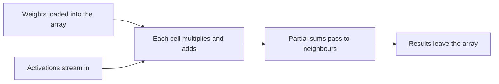
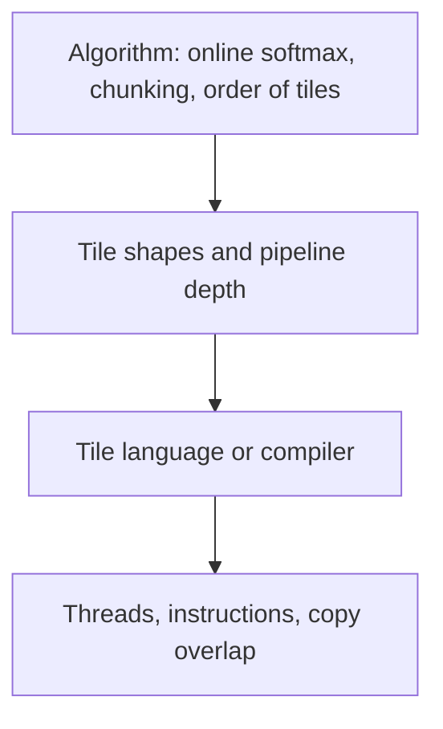
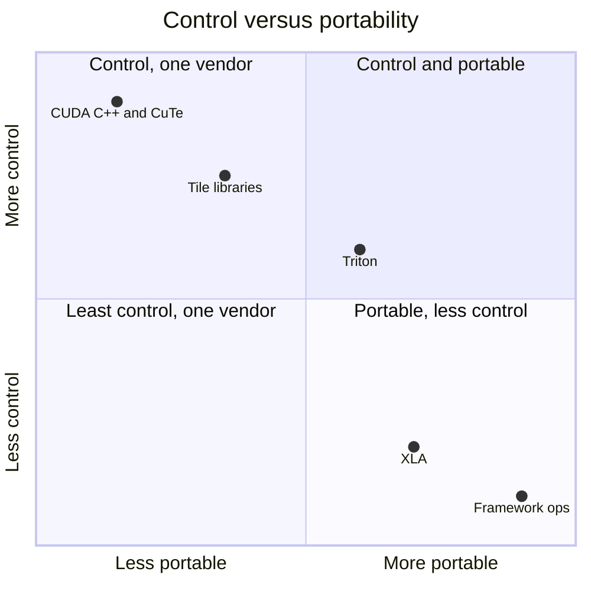

# Introduction

The question this chapter answers: what do you have to relearn when the GPU isn't an NVIDIA one?

Note:
Open by saying that every number in this talk is a vendor rating or arithmetic on one. We have measured exactly one machine in this course, the lab A100. So the talk is about what to look up, what to expect, and what to distrust.

### Why leave the A100 {#why-leave}

- Training clusters run on AMD Instinct GPUs and Google TPUs
- Local development often runs on an Apple chip
- A kernel written only in CUDA vocabulary is stuck at the first change

Note:
Ask who has run a model on something other than an NVIDIA card. The point is not that CUDA is going away. The point is that a reader who reasons from bytes and FLOP can move, and a reader who recites CUDA terms can't.

### The route through this deck {#roadmap}


Note:
Six stops. We start with the vocabulary map and the roofline on ten parts. Then three hardware families in turn, then the tile-language trend and a portability strategy, and we finish by compressing the whole course into three questions.

# What carries over

Every machine here has a big slow memory, a small fast one, and a matrix unit with a high ridge point.

Note:
This is the central claim of the section: the reasoning transfers because it is about memory, arithmetic, and parallelism, and none of those belongs to one vendor. What changes are constants.

### A vocabulary map {#vocab-map}

| Idea | NVIDIA | AMD | TPU | Apple |
|---|---|---|---|---|
| Core | SM | CU | TensorCore | GPU core |
| Lockstep group | Warp, 32 | Wavefront, 64 | none | SIMD-group, 32 |
| Scratchpad | Shared memory | LDS | compiler-managed | Threadgroup memory |
| Matrix unit | Tensor core | MFMA | MXU | simdgroup_matrix |

Note:
Read across a row. The AMD column is nearly a rename, which is why porting is plausible. The TPU column has no warp at all, because a TPU doesn't expose a thread-level model. Apple's vocabulary maps cleanly too. These are guides to the idea, not claims that the units are interchangeable.

### Four constants that change {#constants}

- Lockstep width: 32 or 64
- Scratchpad size: from 32 KB to 163 KB per block
- Matrix instruction shapes and formats
- The ratio of matrix rate to bandwidth

> [!QUESTION] Which of the four breaks a kernel silently?
> The lockstep width and the scratchpad size. A literal 32 gives a partial result with no error, and an oversized tile fails to launch or lowers occupancy.

Note:
Each constant is a way a kernel goes wrong. The width and scratchpad ones are the classic porting bugs, and we spend a slide or two on each. The format and ratio ones change what is worth doing, not whether the code runs.

## The roofline on ten parts

### Ridge point across accelerators {#ridge-table}

| Part | Peak BF16 (TFLOP/s) | HBM (GB/s) | Ridge (FLOP/B) |
|---|---|---|---|
| A100 PCIe | 312 | 1,935 | 161 |
| H100 SXM5 | 989.4 | 3,350 | 295 |
| MI300X | 1,307.4 | 5,300 | 247 |
| MI355X | 2,500 | 8,000 | 313 |
| TPU v6e | 918 | 1,638 | 560 |

Note:
Divide the peak dense rate by the bandwidth. For the MI300X, 1,307.4 over 5.3 is 246.7. The A100 is 161. Every part newer than the A100, apart from the TPU v5p at 166, asks for more reuse. Ratings, dense, from the vendors' pages in the chapter. They are not a measured ranking.

### The same data, interactive {#ridge-figure}

```viz
23-accelerator-ridge
```

Note:
Switch between ridge point, decode floor, and raw peak. The decode floor is 14 GB over the bandwidth: 7.24 ms on the A100 and 1.75 ms on a B200 or MI355X. These are predictions from ratings. Point out that the TPU v5e is rated in GiB per second, 800 GiB/s being 859 GB/s.

> [!QUESTION] Why does the ridge point keep rising?
> Vendors add arithmetic faster than bandwidth. A kernel balanced on an A100 is more memory bound on its successor.

# AMD Instinct

CDNA is the closest cousin: the same plan with different names and different constants.

Note:
AMD's data-center GPUs are built on the same plan as NVIDIA's. We take the machine first, then the wavefront trap, then the LDS, then the tools.

### The CDNA machine {#cdna-machine}

- MI300X: 304 CUs in 8 chiplets, wavefronts of 64
- 64 KB LDS per CU, 512 KiB vector registers per CU
- 256 MB Infinity Cache, 5.3 TB/s of HBM3
- MI355X (CDNA 4): 256 CUs, 160 KB LDS, 8 TB/s

Note:
Sources are the CDNA 3 and CDNA 4 whitepapers and the MI355X brochure. The Infinity Cache is 6.4 times the A100's 40 MB L2 by size. Between GPUs, Infinity Fabric links give 896 GB/s on the MI300X ring, and a quoted link figure must be checked for per-direction versus total.

### Peak is CU times rate times clock {#cdna-peak}

$$
304 \times 2048 \times 2.1\times10^{9} = 1.307\times10^{15}
$$

- 304 CUs, 2,048 FLOP per CU per clock, 2,100 MHz
- The data sheet says 1,307.4 TFLOP/s

Note:
This is the same derivation we did for the A100 in chapter 1. The per-CU matrix rate and the peak clock come from AMD's documentation. On the MI355X, 256 times 4,096 times 2.4 GHz is 2,517 TFLOP/s against a listed 2,500, a match to rounding. The peak is arithmetic, not a kernel result.

### Wavefronts of 64 {#wavefront}

- Same 2,048 threads per CU as an A100 SM
- Arranged as 32 wavefronts of 64, not 64 warps of 32
- Half as many instruction streams to switch among

> [!QUESTION] Does that change block size choices?
> It can. A 256-thread block is 8 warps on an A100 and 4 wavefronts on a CDNA 3 CU, so a warp-per-row softmax has half as many rows in flight.

Note:
The resident limits per CU on CDNA 3 are 32 blocks, 32 wavefronts, and 2,048 threads, from the HIP documentation. Latency hiding leans more on instruction-level parallelism inside a wavefront. Treat block sizes as parameters to re-tune.

### The literal 32 {#literal-32}

```cpp
for (int offset = 16; offset > 0; offset >>= 1)
    v += __shfl_down_sync(0xffffffff, v, offset);
```

- Correct on 32 lanes
- On 64 lanes, lane 0 never sees lanes 32 to 63

Note:
This reduction is right on an NVIDIA GPU and silently wrong on a 64-wide wavefront. A test that fills the input with a constant might not notice. The next slide shows which lanes reach lane 0.

### Which lanes reach lane 0 {#lanes-figure}

```viz
23-wavefront-width
```

Note:
Toggle the width and the first offset. With offset 16 the sum covers 32 lanes, complete on a warp and half a wavefront. Starting at 32 fixes it for 64 at the cost of one extra step. Better: take the start from warpSize divided by 2. Also mention that a ballot result is 64 bits on a 64-lane wavefront.

### The LDS and tile budgets {#lds}

- A100: up to 163 KB of shared memory per block
- MI300X: 64 KB LDS per CU; MI355X: 160 KB
- A 128 x 256 x 64 fp16 tile is 48 KiB per stage
- Three stages: 144 KiB

> [!QUESTION] Does the A100 pipeline fit an MI300X CU?
> No: 144 KiB against 64 KB. Shrink the tile or the pipeline. On the MI355X's 160 KB it fits again.

Note:
Work the arithmetic: 128 times 64 plus 64 times 256 is 24,576 elements, times 2 bytes is 49,152 bytes, 48 KiB per stage. This is a prediction about whether an allocation succeeds, not a measurement. The point: derive the tile from the scratchpad size, as in the Triton chapter.

### MFMA, HIP, and the tools {#hip-tools}

- MFMA is the analogue of `mma.sync`, with different shapes and operand layouts
- HIPIFY translates CUDA source to HIP
- rocWMMA, Composable Kernel, hipBLASLt replace familiar libraries
- No ROCm version number here: the release page's numbering is unclear

> [!QUESTION] If HIPIFY translates my code, am I done?
> No. You have a program that runs with CUDA-shaped block sizes and 32-wide assumptions. The tuning is the work of chapters 6 to 12 again.

Note:
Example mnemonics: V_MFMA_F32_32X32X8_F16 on CDNA 3 and V_MFMA_F32_16X16X32_F16 on CDNA 4. The register layouts differ from NVIDIA's, so hand-written tensor core kernels do not port by renaming. CDNA 4 has no TF32 matrix mode and adds MXFP6 and MXFP4.

### Triton and HipKittens on AMD {#triton-amd}

- Triton kernels carry over in source, not in tuning
- Re-tune `num_warps`, tile shape, `num_stages`
- HipKittens (arXiv 2511.08083): tile primitives on CDNA 3 and 4
- Authors report competitive with AMD assembly kernels

Note:
HipKittens' abstract says its GEMM and attention kernels are competitive with AMD's hand-optimized assembly kernels, and in some settings 1.2 to 2.4 times faster than the baselines, as reported by the authors. It also says the algorithms had to be rethought for AMD. The interface can be shared, the schedule is hardware-specific.

# Google TPUs

A compiler-first machine: large systolic arrays, and an XLA compiler that sees the whole program.

Note:
The bet is different from a GPU's. Fewer, much larger matrix units, fed by a compiler. We look at the array, the compiler, the Pallas escape hatch, and the generations.

### The systolic array {#systolic}



- Each value read from memory is used by a row or a column of cells

Note:
The first TPU, in Jouppi and colleagues' 2017 paper, had a matrix unit of 65,536 8-bit multiply-accumulates, a 256 by 256 grid, with a 92 TOPS peak and 28 MiB of on-chip memory. That is the first, inference-only chip. On current parts, the v5e and v5p MXUs are 128 by 128 and the v6e and TPU7x are 256 by 256, per the Cloud TPU documentation.

### Array size is a shape constraint {#mxu-shape}

- 256 by 256 array: 65,536 multiply-accumulates
- 131,072 FLOP per cycle at full occupancy
- A 128-wide tile on a 256-wide array uses a quarter of the cells

> [!QUESTION] What is the practical rule?
> Make matrix dimensions multiples of the array size, and confirm the exact requirement in the documentation for your generation.

Note:
Contrast with the GPU, where a tensor core multiplies a 16 by 8 by 16 tile and you assemble bigger products from many instructions. Here the operand fills the array, and a matrix that doesn't fill it wastes cells. This is reasoning from the array size, not a measured result.

### XLA sees the whole program {#xla}

```python
@jax.jit
def mlp(x, w1, w2):
    h = jax.nn.gelu(x @ w1)
    return h @ w2
```

- No tile, thread, or memory space is named
- XLA fuses and removes intermediate buffers

Note:
This is the job Inductor and Triton do in chapter 17, but compiler-driven fusion is the default path. You give up the control the course taught, and in return the compiler plans the layout and even the communication across chips. When the plan is good you write less code. When it isn't, you have fewer levers.

### Pallas: kernels for the gap {#pallas}

```python
def add_kernel(x_ref, y_ref, o_ref):
    o_ref[...] = x_ref[...] + y_ref[...]
```

- Refs are tiles in fast memory; a `BlockSpec` maps grid index to tile
- Pipelining is the framework's job
- Backends: TPU TensorCore and SparseCore; GPU Hopper and Blackwell

> [!QUESTION] When do I reach for Pallas?
> When XLA's plan falls short: a custom fusion, explicit memory movement and pipelining, or a hardware feature XLA doesn't use.

Note:
The Pallas documentation describes it as an extension to JAX for custom kernels on GPU and TPU, aimed at cases where XLA's automatic optimization falls short. It is under active development, so check the current API and block-shape constraints. The grid index plays the role of tl.program_id.

### The TPU generations {#tpu-gens}

| | v5e | v5p | v6e | TPU7x |
|---|---|---|---|---|
| BF16 per chip (TFLOP/s) | 197 | 459 | 918 | 2,307 |
| HBM bandwidth | 800 GiB/s | 2,765 GB/s | 1,638 GB/s | 7,380 GB/s |
| MXU | 128x128 | 128x128 | 256x256 | 256x256 |
| Pod (chips) | 256 | 8,960 | 256 | 9,216 |

Note:
The pod size has no counterpart in this course. A full Ironwood pod is 9,216 chips times 2,307 TFLOP/s, about 21.3 EFLOP/s of peak BF16. On a TPU, XLA compiles the collectives together with the matrix multiplications. FP8 figures for the v5p and v6e are not treated as separate hardware because the source doesn't confirm them. v5e bandwidth is in GiB per second.

# Apple silicon

Unified memory trades bandwidth for capacity and for the absence of a copy.

Note:
The audience for Apple silicon is mostly developers on laptops. The Mac's strengths are capacity and no PCIe, and its weakness is bandwidth.

### Bandwidth and capacity {#apple-table}

| Chip | Bandwidth | Max memory | Read 14 GB once |
|---|---|---|---|
| M4 Pro | 273 GB/s | 64 GB | 51.3 ms |
| M4 Max | 546 GB/s | 128 GB | 25.6 ms |
| M5 Max | 614 GB/s | 128 GB | 22.8 ms |
| A100 (lab) | 1,935 GB/s | 80 GB | 7.24 ms |

Note:
Sources are Apple's support pages and the M5 announcement. The last column is the same decode-floor arithmetic as before: 14 GB over the bandwidth. The M5 Max floor is about 3.2 times the A100's. What the Mac offers is room: 128 GB visible to the GPU. Apple states no FP32 TFLOP/s figure, so we can't give a ridge point.

### What unified memory removes {#unified}

- No host-to-device copy to hide
- The learn-inference lab measured about 21 GB/s over PCIe on the A100
- A decode step still reads every weight once

> [!QUESTION] Is decode faster on a Mac, then?
> No. The floor is still bytes over bandwidth, and 14 GB at 614 GB/s is 22.8 ms. The advantage is capacity, not speed per token.

Note:
The 21 GB/s is 67 percent of the Gen4 x16 per-direction ceiling, from the companion course. MLX arrays live in shared memory and an operation can run on the CPU or the GPU without moving the data. What is removed is the copy, not the bandwidth limit.

### Metal and MLX {#metal}

- Threadgroup is a block, SIMD-group is a warp (32 lanes)
- `simdgroup_matrix`: 8 by 8 half, bfloat, or float
- Threadgroup memory: 32 KB on Apple GPU families 4 and later
- Which chip is in which family is not confirmed here

Note:
Query threads_per_simdgroup rather than hard-coding 32, as the specification advises. 32 KB is a fifth of the A100's 163 KB per block, so tile budgets shrink again. For most readers the entry point is MLX or PyTorch's Metal backend, and a Metal kernel is written only when the framework's operations leave bytes on the table.

# Tile languages and portability

The tile is the unit of data that moves between the slow and the fast memory, so make it the unit of programming.

Note:
This section pulls the earlier ones together: what is converging in the tooling, and how to plan a project so most of it survives a hardware change.

### Many tools, one idea {#tile-tools}

| Tool | Targets |
|---|---|
| Triton | NVIDIA; AMD through a separate backend |
| CuTe DSL | NVIDIA (CUTLASS 4.8.1) |
| ThunderKittens | Hopper and Blackwell tested; Ampere not actively supported |
| TileLang | CUDA, AMD HIP, Apple Metal, Ascend |
| HipKittens | AMD CDNA 3 and 4 |
| Pallas | TPU; Hopper and Blackwell |

Note:
State of the projects on 2026-10-22, from their repositories and papers. Note the ThunderKittens row: an A100 is Ampere. Before adopting any tile language, check which hardware its maintainers test. Gluon, Triton's lower-level layer, is described only from its tutorial names here, so treat its details as unconfirmed. Mojo is outside the sources, so we say nothing about it.

### What a tile language leaves to you {#tile-leaves}



> [!QUESTION] Does a tile language make FlashAttention portable?
> The tile product, yes. The algorithm and the streaming order are still your design, and HipKittens says the schedule had to be rethought for AMD.

Note:
The top two boxes are yours, the bottom two belong to the tool. That is why tile languages are a good bet for portability: the part that transfers is the part you design.

### What to keep, what to isolate {#keep-isolate}

| Keep agnostic | Isolate per target |
|---|---|
| The algorithm | Lockstep width |
| Reference and awkward-shape tests | Matrix instruction and layout |
| FLOP and byte counts, ridge point as an input | Number formats |
| Tile shapes as parameters | Scratchpad byte budget |

Note:
Left column: what you write once. A pure PyTorch reference and tests over shapes that are not multiples of the block would have caught the 32-lane reduction. Right column: put each behind a small interface, one file per target. Read warpSize and never write 32 or 64 in a kernel body.

### How to choose {#choose}



Note:
A qualitative picture, not a measurement. One NVIDIA generation and one hot kernel: CUDA or CuTe. Two vendors and kernels that change often: Triton with per-vendor tuning. The last ten percent on a new part: a tile library. A TPU fleet: XLA first, Pallas for the gap. And before any of it, check whether the framework already has an operator.

# Summary

You can compress the course into three questions, and they are the same on every machine.

Note:
Close by returning to the A100 and saying that nothing in the questions names a vendor.

### What to remember {#summary}

- Ridge points run from 161 FLOP/B on the lab A100 to 560 on the TPU v6e, trending up
- CDNA renames the concepts; 64-wide wavefronts and a smaller LDS break assumptions
- A TPU is a systolic array compiled by XLA; Pallas is the gap
- Apple silicon removes the copy, offers capacity, and has modest bandwidth
- Tile languages abstract the schedule and leave the algorithm to you

Note:
Four numbers to carry: 161, the A100 ridge; 64, the CDNA wavefront; 64 KB, the MI300X LDS against the A100's 163 KB per block; 22.8 ms, the M5 Max floor for reading 14 GB. All are ratings or arithmetic on ratings.

### Three questions for any kernel {#three-questions}


- Count FLOP and bytes; compare to the ridge point
- Divide the floor by the measurement
- Match the gap to a mechanism

> [!QUESTION] What do I do next?
> Answer all three for a kernel you didn't write, on a machine you can reach.

Note:
The three questions are the habit that outlasts the details. On an MI355X the ridge point is 313, the wavefront is 64, and the LDS is 160 KB. On Ironwood the matrix unit is 256 by 256 and the compiler plans the schedule. On an M5 Max the bandwidth is 614 GB/s and there is no copy to hide. The questions are the same, only the answers change. Thank the audience, and point them to the chapter's further reading.
