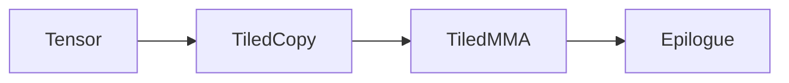
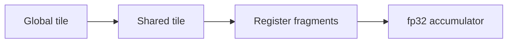
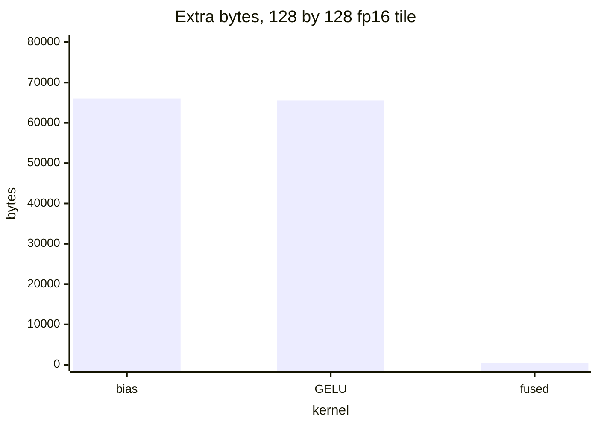

# Introduction

Chapter 13 taught the algebra. This chapter runs it.

Note:
Open by naming the gap. Everyone can read a shape and a stride, and the C++ sketch in chapter 13 was never compiled in that chapter. The package on the worker is nvidia-cutlass-dsl 4.8.1. Tell them the file is numbered 24 so chapters 00 through 23 keep their names, and that the part is still matrix multiplication.

### The algebra stayed on the page {#gap}

- Chapter 13: layouts, swizzle, the three-step sketch
- This chapter: a tensor, a TiledCopy, a TiledMMA
- The calls are `cute.copy` and `cute.gemm`
- The epilogue is bias, then erf GELU

> [!KEY] You compile the same three steps

Note:
Walk the four bullets. The sketch was tile, partition, copy and gemm. Those verbs become functions. Stress the key line: this is the chapter where the algebra becomes a kernel, on the same A100 as the rest of the labs. The next slide lists what they are allowed to reuse, so they do not rebuild chapter 11.

### What you already use {#prereqs}

- A layout, from chapter 13 and lab `13-layouts`
- `mma.sync.m16n8k16`, from chapter 11
- One `cp.async` stage, from chapter 12
- Triton tiling stays in chapter 14

Note:
Four dependencies, each one sentence. Layouts are the address map. The MMA atom is the 16 by 8 by 16 instruction they already simulated. Chapter 12's pipeline is real, and this kernel uses one stage so the calls stay readable. Chapter 14 owns the Triton GEMM. Say that out loud so nobody expects a second tiling lecture.

### The route {#route}



Note:
Four stops, in the order the lab asks for them. A tensor is a pointer plus a layout. A TiledCopy says who owns which elements. A TiledMMA repeats one mma.sync across four warps. The epilogue adds the bias and applies GELU before the store. Promise a worked number at each stop.

# A tensor

A tensor is a pointer plus the layout you already evaluate.

Note:
The divider. Remind them that two readers can share a pointer and disagree about every other address. The layout is the disagreement, resolved.

### One pointer, two strides {#strides}

| Layout | Offset of row 2, column 1 |
|---|---|
| `(4,3):(1,4)` | 6 |
| `(4,3):(3,1)` | 7 |

Integer coordinates 0 through 11 of the row-major layout:

$0, 3, 6, 9, 1, 4, 7, 10, 2, 5, 8, 11$

Note:
Same shape, two strides. Column-major puts row 2, column 1 at 2 plus 4, which is 6. Row-major puts it at 6 plus 1, which is 7. Then read the integer-coordinate list slowly. Coordinate 1 is row 1, column 0, offset 3. This list is the first lab check, and it passes once tensor_offsets exists.

### Build A as K-major {#make-tensor}

```python
layout = cute.make_layout((m, k), stride=(k, 1))
tensor = cute.make_tensor(ptr, layout)
```

- Shape `(M, K)`, stride `(K, 1)`
- The unit stride on K stays static
- B is transposed to contiguous `(N, K)`

> [!QUESTION] Why transpose B on the host?
> `mma.sync` wants B contiguous in K. A PyTorch `(K, N)` matrix is contiguous in N. A contiguous transpose makes the pointer `(N, K)` with stride `(K, 1)`.

Note:
The code is the whole construction. Dynamic M and K, static unit stride. That static 1 is what keeps the copy 16 bytes wide. Answer the question before they ask it: B's layout is a property of the atom, from the warp-level MMA guide, so the fix is a host transpose ahead of the timer. The kernel then sees the layout it was written for.

# A TiledCopy

The thread-value layout is who owns which elements.

Note:
Move from the matrix to one tile. The picture is 32 threads and an 8 by 32 half tile. Each thread wants 16 bytes, which is 8 halves.

### Eight contiguous halves {#eight}

- Tile `(8, 32):(32, 1)`, 256 fp16 values
- Thread mode `((4, 8))` with stride `((8, 32))`
- Value mode `8:1`
- Offset $8 t_0 + 32 t_1 + v$, with $t_0 = t \bmod 4$

Note:
Draw the split on the board if you have one. Thread index t breaks into t0 and t1, first mode fastest, which is the colex rule from chapter 13. The value mode is eight consecutive elements, so one thread's share is one 128-bit access. The next slide plugs in a thread where a careless map gets a different answer.

### Thread 1, value 0 {#thread-one}

$$
t_0 = 1,\ t_1 = 0 \implies \text{offset} = 8
$$

| Map | Offset |
|---|---|
| Thread-value layout | 8 |
| `thread + value * 32` | 1 |

> [!QUESTION] Both maps touch every element once. Why does the lab reject the second?
> The copy atom issues 8 contiguous halves. Offset 1 is a different thread's element. The check names this wrong map `striped_thread_partition`.

Note:
Do the arithmetic in place. t0 is 1, t1 is 0, v is 0, so 8 times 1 is 8. The striped map returns 1. Both are bijections of the 256 elements, and only one of them is a 16-byte vector. Tell them the test prints expected 8 and actual 1 for that wrong function. That is the predict-then-check against the lab 13 algebra.

### The call that uses the layout {#tiled-copy}

```python
atom = cute.make_copy_atom(
    cute.nvgpu.cpasync.CopyG2SOp(),
    cutlass.Float16,
    num_bits_per_copy=128,
)
tiled = cute.make_tiled_copy_tv(atom, thread, value)
```

`cute.copy` issues the atom on one thread's partition.

Note:
Three arguments: the hardware copy, the thread layout, the value layout. For the 128 by 64 tile the lab uses thread layout (16, 8) with stride (8, 1) and value layout (1, 8). get_slice then partition_S and partition_D, and cute.copy moves the elements. The CPU partition you print first is this same map. If it is wrong on the CPU, the generated copy is wrong in the same way.

# A TiledMMA

One `mma.sync` becomes a 128 by 128 tile by repetition.

Note:
The instruction is the one from chapter 11. The new object is the tiled form: an atom layout of warps, and a permutation that says how far one warp walks.

### Lane 1's four cells {#lane}

```viz
24-fragment-owners
```

Lane 1 holds $(0, 2)$, $(0, 3)$, $(8, 2)$, $(8, 3)$.

Offsets 32, 48, 40, 56.

Note:
Leave the figure on lane 1. Two columns, and the same two columns eight rows lower. That is the accumulator fragment of m16n8k16. The formula is m equals floor of lane over 4, plus 8 times floor of value over 2, and n equals 2 times lane mod 4, plus value mod 2. A guess of lane mod 16 by lane over 16 puts lane 1 at row 1, column 0. The lab calls that guess row_major_fragment.

### Lane 1, value 0 {#lane-value}

> [!QUESTION] What does lane 1, value 0 own?
> Row 0, column 2. In the column-major 16 by 8 tile the offset is $0 + 16 \cdot 2 = 32$.

Note:
The question is the figure, said as a number. If someone answers (1, 0), they used a row-major guess and ignored the value index. Correct them with the offset 32, which is also what the thread-value layout `((4,8),(2,2)):((32,1),(16,8))` evaluates to at lane 1, value 0. The figure and the algebra agree, which is the point of having both.

### Four warps, one CTA tile {#warps}

```python
op = cute.nvgpu.warp.MmaF16BF16Op(
    cutlass.Float16, cutlass.Float32, (16, 8, 16))
tiled_mma = cute.make_tiled_mma(
    op, (2, 2, 1), permutation_mnk=(32, 32, 16))
```

- 2 by 2 warps, 128 threads
- One warp walks a 32 by 32 tile
- The 128 by 128 CTA tile is the rest mode

Note:
Read the constructor slowly. The op is the instruction, fp16 in and fp32 out, shape 16 by 8 by 16, sm_80 and later. The atom layout places the warps. The permutation is one warp's tile, not the CTA tile. The K loop inside a 64-wide K tile runs four times because the instruction K is 16. cute.gemm reads the accumulator and writes it back.

# Copy, gemm, epilogue

The inner loop is two copies and one gemm. The epilogue is the activation.

Note:
They have the pieces. This section is the order. Global to shared, barrier, shared to registers, gemm, and only then the store.

### The three calls {#three-calls}



1. `cute.copy` with the `cp.async` TiledCopy
2. Wait, then the block barrier
3. `cute.copy` with `ldmatrix`, then `cute.gemm`

Note:
Left to right is one K tile. The first copy is 16 bytes per thread from global memory. The wait makes that shared memory valid, and the barrier makes it valid for the other warps. ldmatrix is the second copy, into the fragments the MMA atom reads. cute.gemm is synchronous. Four of those gemm calls cover a K tile of 64. Then the barrier again, so the next global copy can reuse the shared buffer.

### Add the bias, then GELU {#gelu}

$$
\mathrm{GELU}(x) = \tfrac{1}{2}\, x \left(1 + \mathrm{erf}\!\left(x / \sqrt{2}\right)\right)
$$

The fragment holds fp32. The store is fp16, after the activation.

> [!QUESTION] Input 1, bias 0.5. Which value is the epilogue?
> $\mathrm{GELU}(1.5) = 1.399789$. GELU of 1, then plus 0.5, is 1.341345. The lab calls the second function `gelu_then_bias`.

Note:
Write 1.5 on the board before you reveal the number. The erf form is what torch.nn.functional.gelu computes by default. The wrong order is a one-character bug and a silent numeric miss. The kernel applies cute.math.erf to the whole fragment after the add, then converts to fp16 for the store. The raw product never gets its own global write.

### Bytes the fusion removes {#bytes}



Unfused pair: 131,584 bytes. Fused extra read: 512. Ratio 257.

Note:
C is 32,768 bytes. The bias kernel reads C, reads 512 bytes of fp32 bias, and writes C, which is 66,048. GELU reads and writes C, which is 65,536. Together 131,584. The fused epilogue adds only the bias read, because the accumulator is already in registers. The GEMM still stores the activated C once. Say 257 as 131584 divided by 512, so the room can check it.

### The floor for 4096 cubed {#floor}

- FLOP: $2 \times 4096^3 = 1.374 \times 10^{11}$
- Bytes: $1.007 \times 10^{8}$
- Intensity: 1365.3 FLOP/byte, ridge 161.2
- Floor: 0.4405 ms at 312 TFLOP/s

> [!QUESTION] Is 0.4405 ms a measurement?
> It is $2 \times 4096^3$ divided by the rated 312 TFLOP/s of the A100 80GB PCIe. The lab measures the kernel and records `tflops`. A one-stage kernel can miss the floor and still pass.

Note:
Intensity first, so they see why the memory term drops out. 1365 is about eight times the ridge of 161.2, the same square GEMM chapter 1 uses. Then the division. Be explicit that you have not run the kernel. The prediction is the floor. The A100 printout is the result, and the lab stores it as a metric with no pass/fail threshold, because a threshold would be a number nobody has measured for this source.

# Beside the other GEMMs

Chapter 12 wrote the indexes. Chapter 14 lets the compiler pick the instruction. This chapter names the atom.

Note:
Two comparisons, each one slide, and then you stop. Do not reteach the pipeline and do not reteach Triton tiling.

### What chapter 12 wrote by hand {#chapter-12}

- The thread's row and the vector offset
- The `ldmatrix` address from the lane
- The `cp.async` group and the wait count
- Here: a TiledCopy, a TiledMMA, and the calls

One stage hides none of that copy latency. The stages go back around `cute.copy`.

Note:
The hand-written kernel is still the right way to see a wait group. The DSL kernel is the right way to stop rewriting the fragment table when the tile changes. One stage is a teaching choice, stated in the lab hints. A production version puts chapter 12's stages back in the loop, with the same atoms and the same epilogue. The correctness test does not care how many stages you use, as long as the epilogue matches.

### When the atom is allowed to move {#triton}

- Chapter 14: a tile program and `tl.dot`
- This chapter: `MmaF16BF16Op`, shape `(16, 8, 16)`
- You name the instruction when the epilogue has to sit on the fragment

> [!QUESTION] Which chapter owns Triton GEMM tiling?
> Chapter 14. Grouped order, autotune, and `tl.dot` stay there. Come here when the atom is part of the program.

Note:
Keep this short. Triton is the tool when the compiler may choose the instruction and you still want a fused epilogue in a day. The DSL is the tool when you came to name mma.sync and to keep GELU on the fp32 fragment. Both are in the course. They answer different questions, and the audience leaves knowing which question this deck answered.

# Summary

The algebra runs. The floor is a prediction. The lab measures.

Note:
Close on the five things you want remembered, then the lab, then the honest sentence about the measurement.

### Five things to keep {#remember}

- A tensor is a pointer plus a layout
- Thread 1, value 0 of the copy layout is offset 8
- Lane 1 holds accumulator cells $(0,2)$, $(0,3)$, $(8,2)$, $(8,3)$
- Bias, then erf GELU, on the fragment
- 131,584 extra bytes versus a 512-byte bias read

Note:
Read them as a checklist the lab implements in that order. The first bullet is tensor_offsets. The second is the TiledCopy partition. The third is accumulator_mn. The fourth is bias_gelu and the kernel epilogue. The fifth is epilogue_bytes. If they can say each one with its number, they can pass the CPU half of the lab on a laptop.

### What the lab asks {#lab}

- CPU: offsets, the partition, the lane table, GELU, the byte count, the floor
- GPU: `cute_gemm_bias_gelu` against `gelu(a @ b + bias)`
- Tile 128 by 128 by 64, zero padding past the edge
- Metric `tflops` on a 2048 cubed GEMM, recorded, not gated

Note:
The first check passes when tensor_offsets exists, even if every later function still raises. Say that, because it tells them where to start. The kernel needs the A100 and the DSL package the image already has. On a machine with no CUDA GPU the kernel checks print a skip line and the CPU checks still grade. The absolute tolerance on the GPU is 2e-2, which covers the fp16 store of an fp32 accumulation.

### What you can claim today {#claim}

> [!QUESTION] What number from this deck is safe to quote as a result?
> The layout offsets, the GELU values, the 131,584 and 512, and the 0.4405 ms floor, because each one is arithmetic. The TFLOP/s of the kernel is the lab's printout, on the A100, after you run it.

Note:
End on the accuracy rule. Layout numbers are evaluations. Byte numbers are products of 2 and 4. The floor divides by the rated 312 TFLOP/s from FACTS. None of those require a GPU. The speed of this particular kernel does. If someone asks whether one stage will hit 312, the answer is that the floor is a bound, and the measurement is the lab. Point them at chapter 12 if they want the overlap back.
