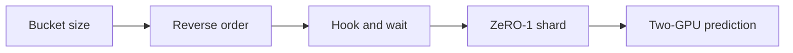
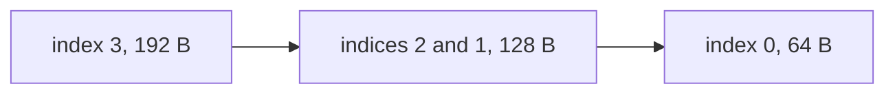
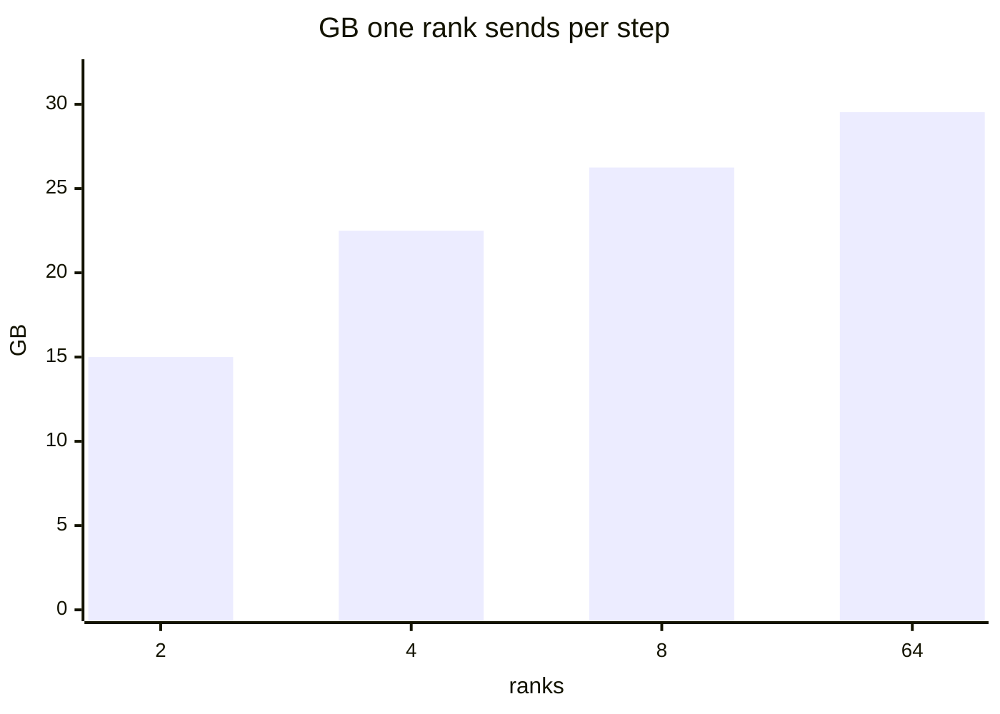

# Introduction

Every rank holds the same weights and a different slice of the batch. The mean gradient keeps them identical, and the bucket decides when that mean hits the link.

Note:
Say that chapter 21 priced the ring and chapter 22 named the strategies. This deck writes two of them. The first half is the all-reduce that starts during backward. The second half is ZeRO-1, which stores less state and moves the same bytes. The two-GPU measurement stays a prediction until the lab has two devices.

### The replicas only match on the mean {#replicas}

- Each rank computes a gradient on its own batch
- `all_reduce` sums those gradients
- Divide by the world size, and the result is the single-process mean
- Skip the division, and the step is $N$ times too large

> [!QUESTION] The two ranks see gradients 1 and 2. What belongs in `.grad`?
> The sum is 3. The mean is 1.5. A missing division leaves 3, and the weights still match across ranks, so an equality check misses it.

Note:
Stress the quiet failure. The replicas can agree with each other and still be wrong relative to one process. The lab's gradient check compares against 1.5, and a comment in the tests names the implementation that returns 3 as allreduce_no_divide. That is the first bug to keep in mind before any bucket talk.

### What chapters 21 and 22 already gave you {#already}

- The ring sends $2(p-1)/p$ of the array per rank
- One message costs $\alpha + n/B$, and NVLink 3 is 300 GB/s per direction
- Chapter 22 names 25 MiB buckets and the ZeRO memory table
- This chapter writes the hook, the bucket, and the shard

Note:
Point back rather than re-deriving the ring. The factor at 8 ranks is 1.75, and the assumed latency is 5 microseconds. Chapter 22 already printed the 16-psi memory table and the 82 millisecond bandwidth term. You use those results. You do not restate the tree algorithm, the streams, or FSDP.

### What you leave with {#leave-with}

- `assign_buckets` walks parameters from the last to the first
- `BucketedDDP` launches one asynchronous all-reduce per bucket
- `Zero1Adam` stores $1/N$ of the moments
- The gloo checks need no GPU, and the NCCL sweep needs two

Note:
Name the three functions, because the lab is those three. Say the gloo processes use CPU tensors, the same pattern as lab 21, so a laptop can grade the logic. The sweep is a separate check that skips with a clear message when the machine has fewer than two GPUs. A missing two-GPU endpoint does not send that job to the single A100.

### The road through this deck {#roadmap}



Note:
Five stops, and each one is a check in the lab. Bucket size is the latency trade. Reverse order is why the last layer leaves first. The hook is the overlap. The shard is the memory. The last stop is a prediction you can write down, and a measurement you do not invent. Tell the room the NCCL sweep was not run on this machine.

# Buckets

A bucket is the size between one all-reduce of the whole model and one all-reduce per parameter. The bytes stay fixed. The startups do not.

Note:
Section divider. Draw the picture before the formula: backward finishes the last layer while the first layer is still running, and a single all-reduce waits for the first layer. Then say a bucket is how much of that early gradient you are willing to send together.

## When the link turns on

### One buffer, two bad extremes {#extremes}

- One all-reduce starts after backward, and the link sits idle
- One all-reduce per parameter starts early and pays $\alpha$ every time
- A bucket groups parameters that share one collective
- Large enough to hide $\alpha$, small enough to leave during backward

> [!QUESTION] Why not all-reduce each parameter the moment its gradient exists?
> Each call pays $2(p-1)\alpha$. On eight ranks that is 70 microseconds of startup per parameter, and a model has thousands of them. The bytes do not shrink when you split them.

Note:
Make the two extremes concrete before the formula. The idle link is the one-bucket case, and the startup storm is the one-parameter case. The bucket is the knob between them. Promise a number on the next slides: 16 MiB, eight ranks, one bucket versus eight.

### The time is latency times buckets, plus one bandwidth term {#formula}

$$
T = N_b \cdot 2(p-1)\alpha + 2\frac{p-1}{p}\frac{n}{B}
$$

- $N_b$ is the bucket count, and only the first term grows with it
- $n$ is the whole gradient, in bytes, not the size of one bucket
- $B$ is the per-direction link rate from the fact sheet

Note:
Read the formula left to right. The first term is the ring's latency, paid once per bucket. The second term is the ring's bandwidth on the whole array, and splitting the array does not change it. The next slide plugs in 16 MiB, with the fact sheet's 300 GB/s and the assumed 5 microsecond latency.

### Sixteen mebibytes, one bucket or eight {#sixteen}

- Eight ranks, 300 GB/s per direction, $\alpha = 5$ µs
- One bucket: 70 µs of latency plus 97.867 µs of transfer, 167.867 µs
- Eight buckets: 560 µs of latency plus the same 97.867 µs, 657.867 µs
- The extra 490 µs is seven more copies of the 70 µs startup

Note:
These numbers come from the figure script, not from a GPU run. Walk the arithmetic: 2 times 7 times 5 is 70, and 1.75 times 16 MiB over 300 GB/s is 97.867 microseconds. Eight buckets multiply only the 70. Ask the room which term they would attack if the profile showed a long startup and a short transfer.

### Latency matches bandwidth at 12 MB {#crossover}

$$
n = \alpha \, p \, B
$$

- Set the two terms equal for one bucket and solve for $n$
- At 8 ranks, 5 µs, and 300 GB/s, that size is 12 MB
- A bucket much smaller than 12 MB is latency-bound on this link
- A bucket much larger is bandwidth-bound, and more splits mostly add startups

Note:
Derive it on the board if you have one. Cancel 2 and p minus 1, and n equals alpha times p times B. 5e-6 times 8 times 300e9 is 12e6 bytes, 12 MB. This is the one-bucket crossover, not the one-message half-bandwidth size from chapter 21, which was alpha times B, 1.5 MB. Say so if someone quotes 1.5.

## The 25 MiB cap

### The constructor's default sits above that crossover {#cap}

- `bucket_cap_mb` is in mebibytes, and a missing value uses 25 MiB
- 25 MiB is 26,214,400 bytes, about twice the 12 MB crossover
- One such bucket: 70 µs of latency and 152.9 µs of transfer
- A 14 GB gradient needs 535 of those buckets

Note:
Attribute 25 MiB to the DistributedDataParallel constructor page, not to a guess. The 14 GB figure is chapter 22's 2 bytes times 7 billion parameters. Divide by 26,214,400 and round up to 535. The next slide turns that bucket count into milliseconds. These sizes are predictions with the assumed 5 microsecond latency.

### Five hundred thirty-five buckets, run in series {#serialized}

- Latency: $535 \times 70$ µs $= 37.45$ ms
- Bandwidth: 81.67 ms, which chapter 22 rounds to 82 ms
- Serialized total: 119.12 ms
- Overlap leaves about the last bucket on the critical path

> [!QUESTION] Which of those times does overlap hide?
> The 37.45 ms of startups, except the last bucket. The 81.67 ms bandwidth term still moves the 14 GB.

Note:
The bandwidth term is 1.75 times 14 over 300. The latency term is 535 copies of the 70 microsecond ring startup. Say overlap does not delete the bandwidth term. It hides the startups of every bucket except the one that finishes last, about 70 microseconds plus 152.9 microseconds for a 25 MiB bucket.

# The wrapper

Fill buckets from the last parameter, launch in index order from the post-accumulate hook, and divide after the handle returns.

Note:
Section divider. The previous section chose a size. This section is the code: the order of the indices, the hook that fires when the gradient is ready, and the wait that writes the mean back. Say a wrong order can hang without raising.

## Reverse order

### Walk from the end, and close the bucket when the next parameter does not fit {#walk}



- Four float32 parameters: 16, 16, 16, and 48 elements
- Cap of 128 bytes
- The buckets are `[[3], [2, 1], [0]]`

Note:
Walk the indices out loud. Index 3 is 192 bytes, larger than the cap, so it is a bucket by itself. Indices 2 and 1 are 64 plus 64, which fills 128. Index 0 starts a new bucket. The first closed bucket holds the last parameters, and that is the one you launch first. The lab's first check is this list.

### An oversized parameter is a bucket by itself {#oversize}

- Sizes 10, 100, and 10 elements, cap of 40 bytes
- The middle parameter is 400 bytes and does not fit beside anything
- The result is `[[2], [1], [0]]`
- Filling in forward order ties the last layer to the first

> [!QUESTION] Why is forward order the wrong walk even when the bucket count matches?
> Backward produces the last gradient first. A bucket that also holds the first parameter cannot launch until backward ends. You kept the byte count and lost the overlap.

Note:
This is the second check, and it exists so a cap that refuses an oversized parameter still produces a bucket. Say the empty bucket accepts the oversized parameter, then closes. Then answer the question: the count can be right and the overlap can still be gone, because the last layer is waiting on the first.

## The hook

### The hook runs after `.grad` is written {#hook}

```python
def hook(param):
    mark_ready(param)
    launch_ready_buckets()  # async_op=True, in index order

param.register_post_accumulate_grad_hook(hook)
```

- One hook per leaf parameter
- The hook receives the parameter, not the gradient
- `async_op=True` returns a handle and lets backward continue

Note:
Point at register_post_accumulate_grad_hook and say a hook on the gradient tensor can see a partial contribution. This one runs after autograd has accumulated .grad. CS336's assignment 2 starts dist.all_reduce with async_op=True inside that hook and waits in finish_gradient_synchronization. The design notes call the same object a Reducer.

### Wait, then divide, then copy back {#divide}

```python
handle.wait()
flat.div_(world_size)
# copy the mean back into each parameter's .grad
```

- The collective summed the ranks
- The mean is that sum divided by $N$
- Divide before `wait` returns, and you scale the local gradient

> [!QUESTION] Why can the ranks match each other and still fail the gradient check?
> They all hold the sum. On the toy model that sum is 3, and the single-process mean is 1.5. Equality across ranks does not divide by the world size.

Note:
The order is the bug. The handle's buffer is the local gradient until the sum lands, so a division before wait scales the wrong tensor. After wait, divide, then copy into .grad. Name allreduce_no_divide again: it is the wrong implementation the gradient check rejects, 3 against 1.5.

### Launch in bucket-index order, not ready order {#order}

- If bucket 1 fills before bucket 0, it waits
- Every rank issues the same collectives in the same order
- A mismatch hangs or corrupts, and it does not raise
- The lab's timeout is that wait

Note:
The design notes launch in bucket-index order rather than whichever bucket becomes ready first. On this toy every rank sees the same graph, so the wait is short, and the order is identical. Say the failure mode is a hang, which the lab turns into a failed check instead of an infinite process. Do not demo a hang.

### Three buckets means three asynchronous all-reduces {#count}

- The call happens during `backward`, not after it
- Each call uses `async_op=True`
- The number of calls equals the number of buckets
- Rank 0 is broadcast first, so the replicas start equal

Note:
Tell the room what the counter wraps. It records dist.all_reduce, whether the call was asynchronous, and whether backward was on the stack. Three buckets and four calls means you reduced per parameter. Three buckets and one call means you flattened the model and waited until the end. An SGD step then checks that the ranks stayed equal.

# ZeRO-1

ZeRO-1 keeps a full copy of the weights and the gradients. It stores the optimizer state for $1/N$ of the parameters, and it moves the same bytes as data parallel.

Note:
Section divider. Separate memory from communication, because people mix them up. The memory win is the moments. The communication is a reduce-scatter plus an all-gather, which is the all-reduce you already priced, split into its two halves.

## The twelve bytes

### Mixed-precision Adam is 16 bytes, and 12 of them are the state {#sixteen-bytes}

- fp16 weights and fp16 gradients are 2 bytes each
- The fp32 master, the momentum, and the variance are 12 bytes
- $K = 12$, so the full footprint is $16\Psi$
- $P_{os}$ keeps $4\Psi + K\Psi/N$ on each rank

Note:
These counts are the ZeRO paper, and chapter 22 already printed the table. Repeat only the one row you need. K is 12 in mixed precision. The lab is the simpler fp32 case CS336 uses: two float32 moments, which is twice the bytes of the float32 weights, sharded the same way.

### At 64 ranks the paper's example is 31.40625 GB {#paper-row}

$$
4 \times 7.5 + \frac{12 \times 7.5}{64} = 31.40625\ \text{GB}
$$

- $\Psi = 7.5$ billion parameters, and $N = 64$
- The paper prints 31.4 GB
- The optimizer term is 1.40625 GB, down from 90 GB
- At large $N$ you are left near $4\Psi$

Note:
Do the arithmetic in the room: 4 times 7.5 is 30, and 90 divided by 64 is 1.40625, so 31.40625. The paper rounds that to 31.4. The 4-times reduction from 16 psi is the paper's claim for P_os, and it is a memory claim. The next slide is the communication, which does not get that factor.

## The two collectives

### Reduce-scatter, update the shard, all-gather {#schedule}


- Rank $r$ owns elements `[r * shard, (r + 1) * shard)`
- Divide the reduced shard by the world size before Adam
- One all-gather rebuilds the parameter vector
- An extra all-reduce on top of this would move a third copy

Note:
The paper says P_os adds no communication beyond data parallel. The schedule that stays there is this one: each rank receives the sum for its shard, updates, and the all-gather puts the parameters back. A full all-reduce followed by another all-gather moves a third psi. That is the volume the paper avoids. The lab uses the flat tensor collectives.

### The bytes match when the two arrays match {#bytes-match}

$$
C_{\mathrm{DP}} = C_{P_{os}} = 2\frac{p-1}{p}\, n
$$

- The fp16 array is 15 GB for the 7.5 billion parameter model
- Sends: 15, 22.5, 26.25, and 29.53125 GB at 2, 4, 8, and 64 ranks
- Data-parallel state stays 90 GB on every rank
- ZeRO-1 state: 45, 22.5, 11.25, and 1.40625 GB

Note:
The send column is both strategies, and that is the point of the figure. Read the four send values, then the four state values. At 64 ranks you still send 29.53125 GB and you store 1.40625 GB. The chart on the next slide is the same series. Do not round 29.53125 to 30 when you say it. The following question slide asks for the 4-rank row.

### Four ranks, one row of the table {#four-ranks}

- Ring factor $2 \times 3 / 4 = 1.5$
- One rank sends $1.5 \times 15 = 22.5$ GB
- ZeRO-1 stores $90 / 4 = 22.5$ GB of state
- Data parallel stores the full 90 GB on every rank

> [!QUESTION] Why is the send the same for both strategies?
> Reduce-scatter plus all-gather is the ring all-reduce. The factor $2(p-1)/p$ does not change when you store less optimizer state.

Note:
Do the two multiplications out loud so the matching 22.5 GB numbers do not look like a coincidence. One is communication, 1.5 times the 15 GB array. The other is memory, 90 divided by 4. ZeRO-1 changes the second and leaves the first alone. That is the whole claim of this section.

### The figure is that table {#chart}



- Data parallel and ZeRO-1 share this bar
- The optimizer-state bars are the other panel: 90 against $90/N$
- The script writes the SVG from the same formulas

Note:
The bar at 64 ranks is 29.53125 GB, drawn as 29.53. Say the exact value. The left panel of the SVG pairs two equal bars at every rank count, and the right panel holds data parallel at 90 GB while ZeRO-1 falls as 1 over N. If someone asks whether ZeRO-1 is faster, the answer from this chart is no: it is smaller.

### Ninety-six parameters, and the full state the test rejects {#ninety-six}

- The flat vector has 96 elements, so each of 2 ranks owns 48
- Two float32 moments on a shard: 384 bytes
- The same moments for every parameter: 768 bytes
- Two Adam steps, so a missing bias correction fails

> [!QUESTION] Why can the full state still match the weights?
> The update can be right while every rank stores 768 bytes. The byte check expects 384. The tests name that bug `full_state_on_every_rank`.

Note:
384 is 2 times 48 times 4. 768 is 2 times 96 times 4. The weight check is a different assertion: after two steps at learning rate 0.1, the max absolute error against torch.optim.Adam is about 2.4e-7, and the tolerance is 1e-5. One step hides a missing bias correction, because the first-step correction cancels.

# Summary

The bucket repeats latency and not bytes. ZeRO-1 repeats the data-parallel bytes and cuts the optimizer state by $N$. The bus bandwidth is a measurement you do not have yet.

Note:
Section divider. Close on three numbers the room can recompute, then the prediction the sweep is allowed to report, then the lab. Remind them that a skip is not a bandwidth.

### The numbers to recompute {#remember}

- 16 MiB, 8 ranks: 167.867 µs in one bucket, 657.867 µs in eight
- 25 MiB is the constructor default, and 14 GB needs 535 buckets
- Sends of 15, 22.5, 26.25, and 29.53125 GB at 2, 4, 8, and 64 ranks
- ZeRO-1 state of 45, 22.5, 11.25, and 1.40625 GB on that model

Note:
Pick one number and recompute it with the room so the list is not a recital. The 490 microsecond gap is the easiest. Then the 22.5 GB send at 4 ranks, which is 1.5 times 15. Then the state at 64 ranks, 90 divided by 64. All of these are in the figure script and in the chapter table.

### What two GPUs would measure {#sweep}

- 1 GiB, two ranks: the ring factor is 1
- NVLink 3: 3.579 ms of bandwidth plus 10 µs, so 3.589 ms
- PCIe Gen4: 34.087 ms plus 10 µs, so 34.097 ms
- The fit is printed only when the sweep runs

> [!QUESTION] No second GPU. Which times can you quote?
> Quote 3.589 ms and 34.097 ms. Leave out a bus bandwidth. A missing two-GPU endpoint does not use the single A100.

Note:
FACTS marks it unconfirmed whether a two-GPU lab endpoint is bridged. The fit is how you tell: t equals alpha plus n over B, the same least squares as lab 21. This deck does not report a fit, because the sweep was not run. Zero GPUs means the check passes as a skip.

### The lab, from one function to the whole step {#lab}

- First check: `assign_buckets` returns `[[3], [2, 1], [0]]`
- Then the broadcast, the mean 1.5, three asynchronous calls, and equal weights
- Then 384 state bytes, two reduce-scatters, two all-gathers, and matching Adam
- The NCCL check skips unless `cuda.device_count()` is at least 2

Note:
Tell them to start with assign_buckets, because that check needs one function and no processes. The distributed checks spawn two gloo ranks on CPU tensors. A starter that raises NotImplementedError fails inside the check and does not crash the harness. Allow about a minute for process startup. The slide deck's job ends at the prediction. The measurement is the lab's, on two GPUs.

### Build the wrapper before you reach for FSDP {#next}

- You can now overlap a mean gradient with backward, at a cap you chose
- You can store Adam's moments for one shard and gather the parameters
- ZeRO-3 and FSDP add all-gathers of the weights, which chapter 22 already counts
- The next measurement is the two-GPU fit, not another formula

Note:
Close by separating what they can build tonight from what chapter 22 already described. The wrapper and the sharded Adam are the new code. FSDP's three collectives are not this lab. If the room has two GPUs later, the sweep's fitted bandwidth is the number this chapter refused to invent. Until then, the predictions stand.
