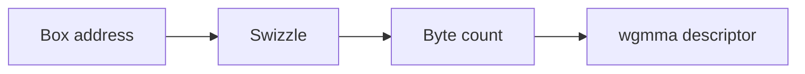
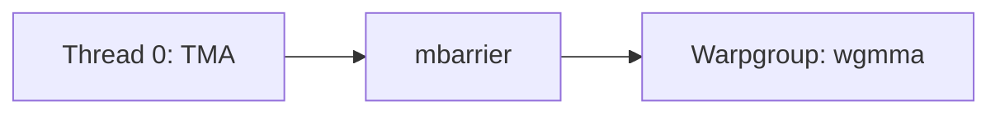

# Introduction

You already know the instruction names. Today you build the pieces.

Note:
Tell the room this file is numbered 26 so chapters 00 through 25 keep their names. The part is matrix multiplication, with chapters 10 to 14 and chapter 24. Prerequisites are chapter 12 and chapter 24.

### The pieces chapter 12 named {#gap}

- Chapter 12 names TMA, the mbarrier, and `wgmma`
- This chapter builds the box, the swizzle, and the descriptor
- The ring, the prologue, and the stage count stay in chapter 12
- The kernels compile for `sm_90a` and run on an H100

Note:
Chapter 12 already told you the instruction names and built the Ampere pipeline. Say that out loud so this hour does not become a second pipeline lecture. Today you compute one box address, one swizzle, one byte count, and one descriptor. The file is numbered 26. The part is still matrix multiplication.

### What you already use {#prereqs}

- A layout is an address, from chapters 13 and 24
- A swizzle is an XOR, from chapter 13
- The phase bit of a pipeline, from chapter 12
- `load_cuda(..., arch="sm_90a")` for the Hopper compile

Note:
Four tools, each one sentence. The layout is how you turn a column and a row into a byte. The XOR is the same idea as Swizzle of 3, 4, 3, written out as a table. Chapter 12 owns the ring. The arch argument is how the same helper that builds sm_80 kernels builds this one for sm_90a.

### Four stops {#route}



Note:
Four stops, in the order the lab asks for them. The address adds the box origin. The swizzle permutes 16-byte chunks. The byte count is what the mbarrier expects. The descriptor is what wgmma reads. Promise a worked number at each stop, and promise that the ring stays in chapter 12.

# The tensor map

A box is a rectangle that does not have to start at the origin.

Note:
Move from the instruction name to one rectangle drawn on a matrix. The corner of the rectangle is the part people drop.

### Add the origin, then scale {#origin}

- Dimension 0 is the contiguous column
- `globalStrides` holds rank minus 1 entries, in bytes
- Local (0, 0) is the corner, not element (0, 0) of the matrix

> [!KEY] The origin is part of the global coordinate

Note:
Draw a rectangle whose corner is not the top-left of the matrix. The copy engine needs the corner plus the local column and row. A load that uses the local index alone reads a different tile and still returns a rectangle, which is why the bug is easy to miss. The lab names that bug forgot_box_origin.

### Column 4, row 2 {#forty-eight}

bf16, row stride 20 bytes. Origin column 4, row 2.

| Local element | Byte |
|---|---|
| Column 0, row 0 | 48 |
| Column 3, row 1 | 74 |

> [!QUESTION] Why is a 20-byte stride illegal in the real encode?
> Each `globalStrides` entry is a multiple of 16 bytes. A bf16 matrix needs a column count that is a multiple of 8. The 48 and the 74 are the address rule.

Note:
Walk the arithmetic. Column 4 times 2 is 8, row 2 times 20 is 40, and the sum is 48. The second element is column 7 times 2, plus row 3 times 20, which is 14 plus 60, which is 74. Then answer the question. The example stride is for the address. The driver rejects it. Say that before anyone encodes a tensor with it.

### Zeros past the edge {#oob}

A 3 by 5 matrix. Box at column 3, row 1, 3 by 2.

| | Col 0 | Col 1 | Col 2 |
|---|---|---|---|
| Row 0 | 9 | 10 | 0 |
| Row 1 | 14 | 15 | 0 |

The 0 is the column that fell off the right edge. It still counts as a byte.

Note:
Read the matrix out loud if you have it on the board: row 0 is 1 through 5, row 1 is 6 through 10, row 2 is 11 through 15. The box starts at 9. The third column has nowhere to read, so the fill is 0. forgot_box_origin returns 1, 2, 3 on the first row. The check prints expected 9, actual 1.

# The swizzle

Sixteen-byte chunks, permuted by a XOR with the row.

Note:
The picture is eight rows of eight chunks. A chunk is 16 bytes, a row is 128 bytes, and eight rows are 1024 bytes.

### Row 1, chunk 1 is byte 128 {#map}

Unswizzled byte 144. Physical chunk $1 \oplus 1 = 0$, so the byte is 128.

```viz
26-swizzle-map
```

Note:
Leave the figure on row 1, chunk 1. The cell shows physical chunk 0, and the readout shows byte 128 against the unswizzled 144. Click one more cell so the room sees the XOR, then come back. The eight rows are the PTX table for the 128-byte mode with 16-byte atomicity. The figure is computed, not sketched.

### The span equals the inner width {#span}

| Inner bytes | Mode |
|---|---|
| 128 | 128B |
| 64 | 64B |
| 32 | 32B |
| 96, or 160 | none |
| 6 | illegal |

> [!QUESTION] A bf16 box is 48 columns wide. Which mode matches it?
> 48 times 2 is 96. That equals neither 32, 64, nor 128, and 96 is a multiple of 16, so the mode is none.

Note:
The driver allows a span at least as wide as the inner box. Matching, in this chapter, means the span equals the width. A 160-byte box is also none, because 160 is a multiple of 16 and wider than 128. A 6-byte width is illegal. Say the difference between none and illegal before the lab, because both are strings the check compares.

### The XOR hits bits 4 to 6 {#bits}

- A chunk is 16 bytes, and 16 is 2 to the 4th
- Row 1, chunk 1, correct byte: 128
- The same chunk with the XOR in bits 0 to 2: 145

> [!WARNING] 145 is a different map
> `xor_row_into_low_byte` computes $144 \oplus 1$. The chunk index stays 1. The byte inside the chunk changes.

Note:
Bits 4, 5, and 6 are the chunk index. Bits 0 to 3 are the byte inside the chunk. XORing the row into the low bits looks like a swizzle and moves the data by one byte, which splits an element in half. The lab checks all 64 cells and reports the first mismatch as expected 128, actual 145.

# The barrier

The phase flips when two counters are zero, not when the threads have arrived.

Note:
TMA is one thread's instruction. A thread-arrival count cannot see the bytes. That is the whole reason for the second counter.

### Arrivals and bytes {#phase}

- The producer arrives once and adds the byte count
- The copy engine subtracts bytes as it writes, including zeros
- The phase completes when both counters are zero
- A short count flips early. A long count never flips

Note:
Write the two counters on the board. expect_tx is the add. The bulk copy is the subtract. Waiting on the phase before the subtract finishes reads shared memory the engine has not filled. Waiting on a count larger than the box hangs the wait. The zeros past the edge of the tensor are part of the add, because the engine writes them.

### Two tiles, 49152 bytes {#tx}

$$
128 \times 64 \times 2 + 256 \times 64 \times 2 = 49152
$$

> [!QUESTION] Why does the count include elements that were out of bounds?
> The engine writes a zero for each of them. Those zeros occupy shared memory, so they are bytes the barrier has to retire.

Note:
16,384 plus 32,768 is 49,152. These are the two Hopper tiles from chapter 12. Say that chapter 12 reuses the phase bit inside its ring, and that this slide only fixes the number. Do not redraw the pipeline. If someone asks for the stage count, point them back at chapter 12.

# The descriptor

`wgmma` reads a 64-bit descriptor, not a pointer plus a leading dimension.

Note:
The warpgroup is four warps, 128 threads, and the first warp rank is a multiple of 4. M is 64. This instruction uses N of 8 and K of 16.

### Where the operands live {#operands}

- B always comes from a shared-memory descriptor
- A comes from registers or from a second descriptor
- The accumulator stays in registers
- Fence, issue, commit, then wait

Note:
The order is wgmma.fence, then mma_async, then commit_group, then wait_group. Reading the accumulator before the wait is undefined. Shared memory filled by ordinary stores needs fence.proxy.async before the wgmma fence, so the async proxy sees those stores. One m64n8k16 does 2 times 64 times 8 times 16, which is 16,384 FLOP.

### Layout type 1, not 3 {#layout}

Start 0, leading 128, stride 1024, 128-byte mode:

$$
\mathtt{0x4000004000080000}
$$

> [!QUESTION] Why is 3 the wrong value in bits 62 and 63?
> The driver enumerator 3 means 128B. The descriptor field stores the 128-byte mode as 1. Value 3 in those bits is the 32-byte mode.

Note:
Split the hex. Bit 62 is the 1 of layout type 1. Bits 16 to 29 hold 128 divided by 16, which is 8. Bits 32 to 45 hold 1024 divided by 16, which is 0x40. The lab calls the mix-up driver_enum_as_descriptor. The kernel's own descriptor is a different word: layout type 0, leading 128, stride 256, because that kernel fills the K-major core matrix with ordinary stores.

### Four registers cover the 64 by 8 tile {#fragment}

$$
\mathrm{row} = \lfloor \ell / 4 \rfloor + 16w + 8v_1, \quad \mathrm{col} = 2(\ell \bmod 4) + v_0
$$

$v = v_0 + 2v_1$ picks one of the four fp32 registers. The map is a bijection.

Note:
Lane ell, warp w inside the warpgroup, value index v. v0 is the fast half. Column is two times the lane mod 4, plus v0. Row is the lane divided by 4, plus 16 times the warp, plus 8 times v1. This is the column-major reading of the CUTLASS CLayout_64x8 strides. A product of row plus column, built from two columns of A and two rows of B, fails if the map is wrong.

# Producer and consumer

One thread copies. The warpgroup multiplies. The descriptor names the layout the copy wrote.

Note:
Keep this divider up. The next slide is the whole composition, and it is not the multistage ring.

### Thread 0 copies, the warpgroup waits {#roles}



> [!QUESTION] The copy used a 128-byte swizzle and the descriptor says none. What do you read?
> A different byte arrangement. Row 0 matches. Later rows are permuted. The layout type has to be the swizzle the copy used.

Note:
Thread 0 initializes the barrier, arrives with the byte count, and issues cp.async.bulk.tensor. The warpgroup waits, fences, and issues wgmma. The lab grades the two sides as two sm_90a kernels, because a TMA box and the K-major core matrix are not the same bytes. A fused GEMM uses this order and builds the layout the descriptor names. Chapter 12 repeats the pair across K.

### 0.1389 ms is a prediction {#floor}

| Shape | Intensity | Floor |
|---|---|---|
| 4096 cubed | 1365.3 FLOP/byte | 0.1389 ms |
| 128 by 128 by 64 | 32.0 FLOP/byte | 1.956e-5 ms |

> [!QUESTION] Does the lab fail a kernel that misses 0.1389 ms?
> No. That number is $2 \times 4096^3$ over the H100 SXM5 rating of 989.4 TFLOP/s. The lab records the measured rate and does not grade it.

Note:
The ratings are 989.4 TFLOP/s and 3350 GB/s, from the facts file. The ridge is 295.3 FLOP per byte. The cube sits above it, so the floor is the compute time. The small shape sits at 32 FLOP per byte, so its floor is the memory time, 65536 bytes over 3350 GB/s. There is no measured TFLOP/s in this deck. The kernel was not run on an H100.

# Summary

The box, the swizzle, the byte count, and the descriptor.

Note:
Close on the four numbers you can recompute without a GPU, and on the one fact about who issues what.

### What you can recompute {#carry}

- Byte 48 and byte 74, once the origin is included
- Byte 128 at row 1, chunk 1
- 49,152 bytes for the two bf16 tiles
- `0x4000004000080000` for the 128-byte descriptor

Note:
Offer to recompute any one of them if the room is ahead. The 74 is column 7 times 2 plus row 3 times 20. The 128 is physical chunk 0 on row 1. The 49,152 is 16,384 plus 32,768. The hex has layout type 1 in bit 62. These four are the CPU checks. The kernels are extra, and they wait for an H100.

### Who issues what {#issue}

- One elected thread issues the bulk tensor copy
- The warpgroup issues `wgmma.mma_async`
- B is a shared-memory descriptor. The accumulator is registers
- A missing H100 skips the kernels and does not use the A100 endpoint

Note:
Repeat the gate in one sentence. The lab sets the GPU to H100-80GB. A deployment without the H100 endpoint says it needs an H100 and is not configured, and the job is not sent to the A100. The CPU checks still run. Do not invent a TFLOP/s for a kernel you did not run. The floor stays a prediction.

### Where chapter 12 meets this one {#meet}

Chapter 12 overlaps several copies with the math. This chapter builds one copy and one `wgmma`. You put them together by matching the descriptor to the swizzle, then you return to chapter 12 for the ring.

Note:
End on the boundary between the chapters. If you have a minute, point at the producer and consumer slide and say the ring is that picture repeated, with the phase bit chapter 12 already taught. Then stop. The lab is the box address, the 64-cell swizzle, the descriptor word, and two kernels that skip without an H100.
