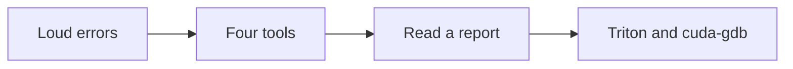
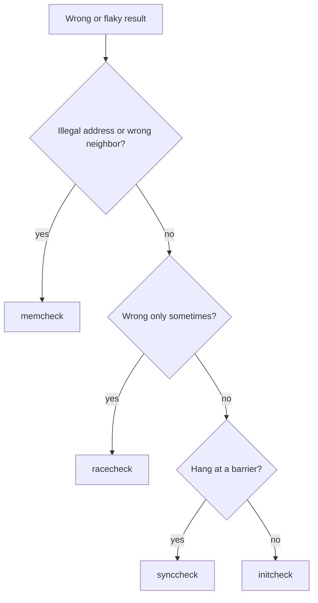
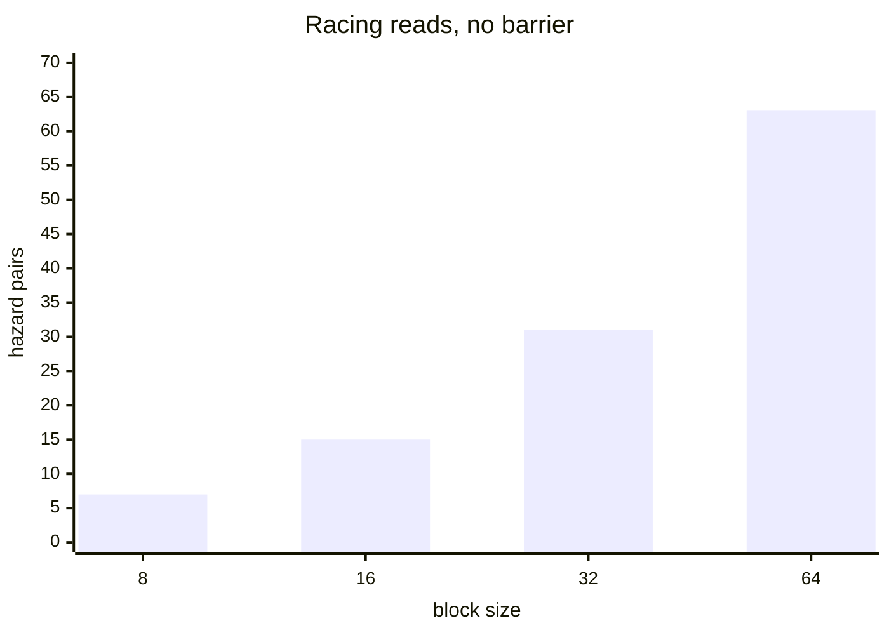
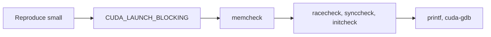

# Introduction

A GPU kernel can return the right answer and still be broken.

Note:
Open with the claim the whole hour defends: a correct output is not evidence of a correct kernel. The file is numbered 27 so chapters 00 through 26 keep their names. The part is the machine, next to profiling. The prerequisites are chapters 2, 5, 6, 8, and 14, and the lab needs a GPU only for two of its nine checks.

### Slow is visible, wrong is not {#slow-vs-wrong}

- Chapter 5: a slow kernel shows up on a timeline
- A wrong kernel can pass every test you wrote
- A write past the end often hits a neighbor, not a crash
- A race can be wrong on one run in ten

Note:
Chapter 5 gave you tools for slow code. Wrong code is different because the symptom hides. Memory is allocated in big blocks, so a stray write lands in padding or in another tensor. A race depends on scheduling, so the same binary passes and fails. Say that a test that compares outputs cannot see either of these reliably.

### The five bugs of the lab {#five-bugs}

| Bug | Tool |
|---|---|
| Write past the end | `memcheck` |
| Missing `__syncthreads` | `racecheck` |
| Missing `__syncwarp` | `racecheck` |
| Barrier part of a block skips | `synccheck` |
| Read of an unwritten cell | `initcheck` |

Note:
This table is the lab. Every row is a bug you will fix and a tool that finds it. Point out that racecheck appears twice: the block-level race and the warp-level race are the same tool with different severity. Promise the room that by the end they can match a symptom to a tool without guessing. The lab has two halves: five kernels that run under the real sanitizer on the A100, and a parser and two reasoning functions graded from recorded text on any machine. The recorded reports follow NVIDIA's documented format and are not captured from the lab card.

### The route {#route}



Note:
Four stops. First, make errors appear where they happen. Second, the four sanitizer tools and the bug each one owns. Third, how to read a report down to a thread and a line. Fourth, the Triton interpreter and the debugger for what the sanitizer leaves open.

# Loud errors

An error that arrives late points at the wrong line.

Note:
Section one is about timing, not tools. If the error shows up in the wrong place, nothing else helps. Keep this section short.

### Launches return early {#async}

- A launch queues work and returns
- A fault is reported at the next call that checks
- That call is often `.item()` or a copy, far from the bug
- After an illegal address, the context is unusable

Note:
This is chapter 2's asynchrony again, seen from the error side. The CPU has moved on by the time the GPU faults, so the runtime reports at the next synchronizing call. The traceback names that call. Sticky errors mean every later call fails too, so read the first error in a log, not the last.

### `CUDA_LAUNCH_BLOCKING` {#launch-blocking}

```bash
CUDA_LAUNCH_BLOCKING=1 python train.py
```

- Each launch runs to completion before the call returns
- The error lands on the line that launched the kernel
- It changes timing, so never benchmark with it

> [!QUESTION] Why not leave it on?
> It serializes launches, so it removes overlap and changes the timing of races. A race that needs two kernels in flight can vanish, and a benchmark measures the wrong thing.

Note:
One environment variable, no code change. PyTorch's own error message suggests it. Use it as the first move on any unexplained CUDA error. Then turn it off. In a plain CUDA program the same idea is a cudaGetLastError after the launch and a checked cudaDeviceSynchronize.

### `printf` and `assert` {#printf-assert}

```cuda
if (blockIdx.x == 3 && threadIdx.x == 232) {
    printf("i=%d n=%d\n", i, n);
}
assert(i < n);
```

- Print from one thread, with its coordinates
- Output appears at synchronization points

> [!QUESTION] Why does PyTorch keep failing after a device-side assert?
> The programming guide says a failed assert corrupts the CUDA context. Every later call returns `cudaErrorAssert`, so the process must restart.

Note:
Printf from every thread floods the buffer and you cannot tell the lines apart, so condition it on a block and a thread. Output is copied out at synchronization points, so call cudaDeviceSynchronize before you look. A failing assert stops the kernel and every later call returns cudaErrorAssert, so you restart the process. NDEBUG removes asserts, so keep the expression free of side effects.

# The four tools

One command, four questions.

Note:
Section two is the heart of the hour. Each tool owns one class of bug. A clean run of one says nothing about the others.

### compute-sanitizer {#tools}

| Tool | Watches |
|---|---|
| `memcheck` | Every load and store |
| `racecheck` | Shared-memory hazards |
| `synccheck` | Barriers |
| `initcheck` | Reads of unwritten memory |

```bash
compute-sanitizer --tool racecheck python run.py
```

Note:
It ships with the CUDA toolkit, so the course image already has it, and it replaced cuda-memcheck in CUDA 12. You choose a tool with the tool option, and you run one at a time. Racecheck covers shared memory only. Initcheck looks at global memory by default and at shared memory with an option, which the lab uses.

### Four habits for a readable report {#habits}

- Compile with `-lineinfo`, not `-G`
- Set `PYTORCH_NO_CUDA_MEMORY_CACHING=1`
- Use a small input
- Use `--error-exitcode` in a test suite

> [!QUESTION] Why the allocator variable?
> PyTorch hands out slices of large `cudaMalloc` blocks. A write past a tensor then lands inside the pool, and memcheck cannot see it. The variable gives each tensor its own allocation.

Note:
Line information is what turns an offset into a source line. G turns off optimizations and changes the code you are checking, so avoid it. The caching allocator is the one that surprises people: without the variable the out-of-bounds write in the lab can go unreported. The exit-code option is how the lab's tests decide pass or fail.

### Which tool for which symptom {#choose}



Note:
This is a first guess, not a rule, because the tools are cheap and you should run all four. Illegal address or a corrupted neighbor points at memcheck. Wrong on some runs points at racecheck. A kernel that never returns points at synccheck. Garbage that changes between runs, with no race, points at initcheck. Run them in that order and stop at the first finding.

# Bounds and barriers

Four bugs, each with one number you can compute.

Note:
Section three walks the four kernel bugs with arithmetic. Each has a number from the chapter that the sanitizer will reproduce. Keep returning to the index arithmetic: that is what makes a report readable.

## Out of bounds

### 1000 elements, 256 threads {#oob-count}

$$
\text{grid} = \left\lceil \frac{n}{B} \right\rceil = \left\lceil \frac{1000}{256} \right\rceil = 4
$$

- 4 blocks launch 1024 threads
- Threads 1000 to 1023 have no element
- Each reads and writes 4 bytes past the end

Note:
Ceiling division rounds the grid up, which is right, and it means the last block has threads with nothing to do. Twenty-four threads, 96 bytes past each tensor. The first 1000 outputs are correct, so a comparison against the reference passes. That is the whole point of the slide.

### The memcheck report {#oob-report}

```text
Invalid __global__ read of size 4 bytes
  at scale_shift_kernel(...)+0x70 in oob.cu:11
  by thread (232,0,0) in block (3,0,0)
  is 0 bytes after the nearest allocation
  of size 4,000 bytes
ERROR SUMMARY: 48 errors
```

Note:
Read from the top. What happened: an invalid read of four bytes in global memory. Where: the kernel and line eleven. Who: thread 232 of block 3. How far: zero bytes after a 4,000-byte allocation. The first finding is the read, not the write, because the kernel reads before it writes. The summary says 48 although two findings print: 24 threads times a read and a write.

### From coordinates to an element {#coords}

$$
i = \text{blockIdx} \times \text{blockDim} + \text{threadIdx} = 3 \times 256 + 232 = 1000
$$

- Thread 1000 is the first past a 1000-element array
- The bug is a missing guard, not a wrong offset
- Fix: `if (i < n)` around the read and the write

> [!QUESTION] The summary says 48 errors and I see two findings. Why?
> The tool prints only the first few. The count is failing accesses: 24 threads, each with one invalid read and one invalid write.

Note:
This is the habit to build: always convert coordinates to an index. If the access had been eight bytes after the allocation, the index would be 1002 and the bug the same. Guard both accesses, the read as well as the write, or memcheck reports the read.

## Shared-memory races

### The tree reduction {#tree}

```cuda
for (int d = 128; d > 0; d >>= 1) {
    if (t < d) {
        s[t] += s[t + d];
    }
    // no __syncthreads() here
}
```

- Thread `t` reads `s[t + d]`
- Thread `t + d` wrote it one step earlier

Note:
Chapter 6's tree reduction with one line removed. Walk it. Thread t reads the cell at t plus d. The previous step's stride was twice d, so thread t plus d was active and wrote that cell. Each active thread reads one value that a different thread wrote one step earlier. Nothing orders the write before the read.

### Count the hazards {#count}

$$
\sum_{k=1}^{\log_2 B} \frac{B}{2^{k}} = B - 1
$$



Note:
For eight threads: four reads in step one, two in step two, one in step three, so seven. In general B minus one. A barrier removes the pairs that cross it. One barrier after the load leaves three of the seven. A barrier after every step leaves none. These numbers come from a trace of the algorithm in the chapter's figure script, not from a measurement.

### Place the barriers {#race-figure}

```viz
27-race-trace
```

Note:
Let the room play with it. Set the block to eight, no barriers, independent lanes: seven rose cells. Switch to lockstep and they vanish, which is why this code worked before Volta. Set the block to 64 with lockstep and 32 remain, because two warps are never ordered without a barrier. Put a barrier after every step and the figure is clean.

### The racecheck report {#race-report}

```text
Error: Potential RAW hazard at __shared__ 0x100
  Write Thread (64,0,0) at race.cu:17
  Read Thread (0,0,0) at race.cu:17
RACECHECK SUMMARY: 2 hazards (2 errors, 0 warnings)
```

> [!KEY] Put the barrier outside the branch
> `__syncthreads()` goes after the `if (t < d)`, so every thread reaches it.

Note:
Two accesses, each with a thread and a line, and both are line seventeen because plus-equals reads and writes. Address 0x100 is byte 256, the float s[64]: thread 64 wrote it, thread 0 reads it. The fix is the missing line. Stress where it goes: outside the if. A barrier inside the branch is the next bug.

## Warp-level hazards

### Lockstep is gone {#lockstep}

- Pre-Volta: 32 lanes in lockstep, so no race inside a warp
- Volta and later: each lane has its own program counter
- `volatile` forces a memory access, not an order
- A statement `v[t] += v[t+16]` is load, load, add, store

> [!QUESTION] Is the A100 broken if old code now fails racecheck?
> No. Older GPUs hid the bug by keeping lanes in lockstep. Volta and later promise nothing between lanes except `__syncwarp`.

Note:
Chapter 2 introduced independent thread scheduling. Here is what it breaks. The classic last-warp unrolled reduction relied on lockstep and used volatile. Volatile does not order two lanes. Inside one warp the sanitizer finds both a read-after-write and a write-after-read. Tell them it is the hardware exposing an old bug.

### The fix, and the trap {#syncwarp-fix}

```cuda
float v = s[t] + s[t + 32];
for (int d = 16; d > 0; d >>= 1) {
    __syncwarp();
    s[t] = v;
    __syncwarp();
    v += s[t + d];
}
```

> [!WARNING] The summary can say 0 errors
> A warp-level hazard prints as a warning. Read the findings, not only the last line.

Note:
Keep the running value in a register so a statement has no load and store to interleave. The first syncwarp makes every lane finish reading before any lane writes. The second makes every write visible before the next read. A shuffle avoids shared memory and passes racecheck too. The trap is on the slide: the report says warning, the count says zero, and the kernel is racy.

## Barriers and uninitialized reads

### A barrier only part of a block reaches {#divergent}

```cuda
if (i >= n) {
    return;
}
tile[t] = x[i];
__syncthreads();
```

- 1000 elements, 128 threads: 8 blocks
- Block 7 holds elements 896 to 999: 104 threads arrive
- Warp 3 has 8 lanes arriving, 24 gone

Note:
The tail block of an array is where this hides. One thousand minus eight hundred ninety-six is 104 valid elements, so 104 threads reach the barrier and 24 do not. Warp three covers elements 992 to 1023, and only 992 to 999 exist, so eight lanes arrive and 24 return. The programming guide allows a barrier in conditional code only if the condition is uniform across the block.

### What synccheck says {#sync-report}

```text
Barrier error detected. Divergent thread(s) in warp
  at void tail_pair_sum_kernel<128>(...)+0x110
     in sync.cu:14
  by thread (96,0,0) in block (7,0,0)
ERROR SUMMARY: 1 error
```

> [!QUESTION] Does the kernel hang?
> It can, and the guide says the behavior is undefined. It can also appear to work while the last valid thread reads a cell nobody wrote. synccheck reports it either way.

Note:
The kernel name carries the template argument, so a parser cuts at the angle bracket. The answer to the question is deliberately vague because the guide is: it can hang, it can have unintended side effects, and on current hardware it can look fine. Do not rely on any of those. Run synccheck on a tiny input before waiting on a hang.

### Guard the work, not the barrier {#sync-fix}

```cuda
tile[t] = (i < n) ? x[i] : 0.0f;
__syncthreads();
if (i < n) {
    out[i] = tile[t] + ((t + 1 < B) ? tile[t + 1] : 0.0f);
}
```

> [!KEY] A `return` before a barrier is the same bug as an `if` around it
> Every thread reaches the barrier. Only the memory accesses are guarded.

Note:
A thread past the end loads a zero, waits, and does not store. That is the rule to carry out of the hour. Chapter 8 states it for the transpose tile. It also fixes the uninitialized read: the last valid thread now reads a zero that someone wrote.

### An unwritten halo {#halo}

- Stencil: `out[i] = x[i-1] + x[i] + x[i+1]`
- Tile of `B + 2` cells with one halo cell per side
- The buggy kernel fills `tile[1]` to `tile[B]` only
- `tile[0]` and `tile[B+1]` are read, never written

> [!QUESTION] How many bad reads for 1000 elements and 128 threads?
> 8 blocks times 2 halo reads each is 16. initcheck's summary says 16 errors.

Note:
Shared memory starts with whatever the last block left behind. Thread zero reads tile zero. Thread 127 reads tile 129, byte 516. The tool names the thread and the address, and the count is blocks times two. The fix loads each halo with a bounds check: thread zero loads the left, the last thread loads the right.

# Reading a report

Six steps turn any report into a diagnosis.

Note:
Section four pulls the pattern out. The lab's parser does the first four steps in code, so this is also the lab's specification. Take it slowly.

### Six steps {#six-steps}

1. Infer the tool from the header line
2. Find the kernel and the source line
3. Find the thread and the block
4. Compare the finding count with the error count
5. Turn coordinates into an element index
6. Ask which line that thread ran

Note:
Step one needs care: a report never names its tool. Invalid is memcheck, uninitialized is initcheck, barrier error is synccheck, a potential hazard is racecheck. Step two cuts the kernel name at the first parenthesis or angle bracket. Step four is the trap in the summary line. Step five is the arithmetic from earlier. Step six closes the loop.

### Tool and kind to bug {#table}

| Header | Bug |
|---|---|
| Invalid read or write | Missing guard or wrong index |
| RAW or WAR hazard, error | Missing `__syncthreads` |
| Hazard, warning, warp level | Missing `__syncwarp` |
| Divergent barrier | Barrier some threads skip |
| Uninitialized shared read | A cell nobody wrote |

Note:
This table is the lab's classify function. Two cases need care. A warp-level race is a warning and counts as the missing syncwarp. A memcheck read and write are the same bug with different words. Ask the room which row they would expect for a kernel that hangs.

### Two traps {#traps}

- A finding inside a library kernel usually means your call passed a bad pointer
- A clean `memcheck` says nothing about races
- Fix the first finding, then rerun: later ones are often consequences

> [!QUESTION] The kernel reports a warning and zero errors. Is it clean?
> No. A warning is not an error in the summary, and the kernel still races. Decide by the findings.

Note:
Library kernels first. If memcheck points inside cuBLAS, the bug is in the arguments you passed. Second, the four tools are independent. Third, fix in order: an out-of-bounds write can make a later read look uninitialized, and one barrier can remove a dozen hazards.

# Triton and cuda-gdb

For what the sanitizer leaves open.

Note:
Section five covers the Triton interpreter and the debugger. Keep cuda-gdb to prose: the lab does not run it, and the commands come from NVIDIA's documentation.

### `TRITON_INTERPRET` {#interpret}

```bash
TRITON_INTERPRET=1 python test_kernel.py
```

- Runs each program on the CPU, one at a time
- Use `print`, a debugger, and ordinary exceptions
- No `bfloat16`, and no indirect loads
- Cannot show a race, a layout, or a spill

> [!QUESTION] Right in the interpreter, wrong on the GPU. Now what?
> Something is device-specific: a dtype rounded differently, a 32-bit offset that overflows, or a race. Run `memcheck` and compare against a float32 reference.

Note:
The interpreter is the tool for index and mask bugs. It simulates the kernel with NumPy, so there is nothing to race. The Triton debugging guide lists the limits on the slide. Chapter 14 introduced it. Here you learn where it stops.

### Inside a Triton kernel {#triton-debug}

- `tl.device_print("offs", offs)` prints on the GPU
- `tl.static_print` prints at compile time
- `tl.device_assert(cond)` runs only if `TRITON_DEBUG=1`
- A compiled Triton kernel is still a CUDA kernel, so `memcheck` can watch it

Note:
Device print always works. Static print is for constexpr values at compile time. Device assert is gated by an environment variable, so it costs nothing until you turn it on. Because the compiled kernel is a CUDA kernel, memcheck catches a missing mask the same way it caught the first kernel. The line numbers may refer to generated code, so lean on the thread coordinates.

### `cuda-gdb` {#gdb}

```bash
nvcc -g -G -o prog prog.cu
cuda-gdb ./prog
```

- `break oob.cu:11 if threadIdx.x == 232`
- `cuda block 3 thread 232`, then `print i`
- `CUDA_DEVICE_WAITS_ON_EXCEPTION=1` waits at a fault
- Watchpoints on device code are not supported

Note:
Prose only. Debug build with minus g minus capital G, which turns off optimization and can hide a race. Conditional breakpoints stop in one thread of thousands. The cuda command moves focus. The environment variable lets you attach at a fault. Reach for the sanitizer first: it finds the thread and the line without a debug build, and the debugger answers the question the report leaves.

### A debugging order {#order}



Note:
Cheapest first. Reproduce on the smallest input and check against a float32 reference on shapes that are not multiples of the block. Make errors synchronous. Rule out out-of-bounds first, because it corrupts everything else. Then the three shared-memory and barrier tools. Printf and the debugger last. Stop at the first tool that names the bug.

# Summary

Five bugs, four tools, one routine.

Note:
Close with the routine and the numbers. The lab makes you do it.

### What to remember {#summary}

- A correct output is not evidence of a correct kernel
- `CUDA_LAUNCH_BLOCKING=1` moves an error to its launch
- Four tools, four questions: run all four
- A tree reduction of $B$ threads has $B - 1$ racing reads without a barrier
- Guard the work, never the barrier
- Read the findings, not only the error count

Note:
Six sentences, one per idea. The hazard formula is the one number to keep. Remind the room that the recorded reports follow NVIDIA's format and were not captured from the lab card, and that the lab grades the parser from them on any machine.

### The numbers {#numbers}

| Quantity | Value |
|---|---|
| Grid for 1000 elements, 256 threads | 4 blocks, 1024 threads |
| Threads past the end | 1000 to 1023, 24 in all |
| Thread (232) of block 3 | element 1000 |
| Block 7 of 1000 elements, 128 threads | 104 arrive |
| Hazards, 8 threads, no barrier | 7 |
| Halo reads, 8 blocks | 16 |

Note:
These are the numbers the lab's tests use, so they are worth remembering. Every one is arithmetic on the examples in the chapter, not a measurement. If you can reproduce all six on a whiteboard, you can do the CPU half of the lab.

### Next {#next}

- Chapter 5 found slow kernels; this chapter finds wrong ones
- Run the sanitizer in CI on a small input
- Every later kernel you write can be checked this way

> [!QUESTION] Should the sanitizer run on every test?
> Run it on the smallest shapes, in a separate job, with `--error-exitcode`. It slows the program too much to run on benchmarks.

Note:
End on practice. A sanitizer job in continuous integration on a tiny input catches the bugs that outputs do not. Do not run it on benchmarks. The lab's tests are an example: five small runs, each with its own tool and an exit code. The rest of the course builds kernels, and now you have the habit of checking them.
