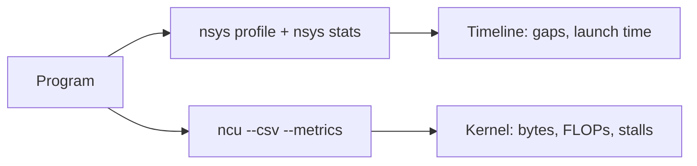
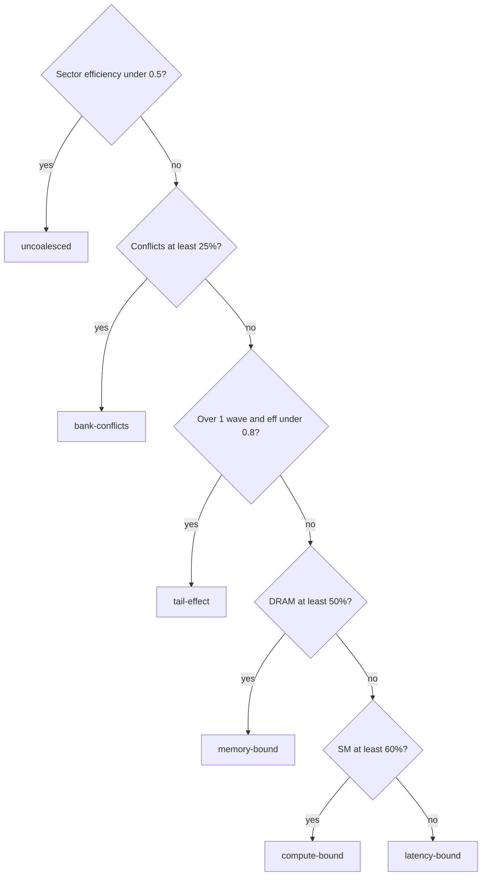
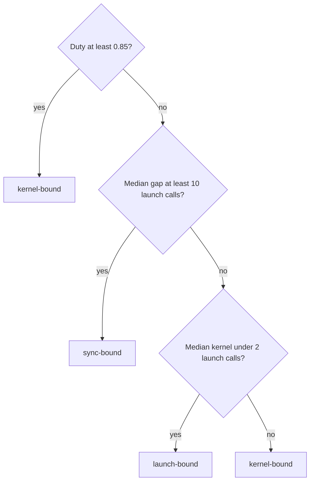

# Introduction

A profiler report is a table of counters, and every conclusion in it is arithmetic.

Note:
Open with the claim that the whole chapter defends. If every conclusion is arithmetic on counters, you can write the conclusion as a function and test it without a GPU. That is how you would also put a profile in CI. Promise two reports to read, an ncu CSV and an nsys stats export, and a classifier that has to survive kernels the audience has not seen.

### What chapter 5 left open {#gap}

- Chapter 5 graded one rule: memory-bound or latency-bound
- It never placed a kernel on the roofline
- It left occupancy, sectors, and bank conflicts as prose
- It never read an `nsys` export

Note:
Remind the room what they already have. Chapter 5 gave them the funnel, the section names, and a two-report classifier. Today is the skill after that: going from raw counters to a cause, and saying why. Chapter 4 supplied the roofline and the wave formula, and chapter 8 supplied the bank model. This deck reads all three from counters, and does not re-derive them.

### Two tools, two exports {#tools}



Note:
Two tools answer two questions. Nsight Systems asks whether the GPU is busy at all, and its stats command writes tables as CSV. Nsight Compute asks why one kernel is slow, and with csv and metrics it writes one row per kernel and metric. Both exports are text, and both are parsed in the lab.

# Counters as data

An ncu report is a long CSV. A parser that misses four details fails on the first row.

Note:
This section is the unglamorous one and it is where most of the lab's first failures happen. Set the expectation that the parser is a few lines and that each line exists because of a real trap.

### One row per kernel and metric {#long-layout}

```text
==PROF== Connected to process 4127
"ID","Kernel Name","Block Size", ... ,"Metric Name","Metric Unit","Metric Value"
"0","vec_add","(256, 1, 1)", ... ,"dram__bytes_read.sum","byte","536,870,912"
==PROF== Disconnected from process 4127
```

Note:
This is the shape of the recorded file, trimmed. Point at the banner lines at both ends, at the quotes around every cell, at the comma inside the block size, and at the thousands separators in the value. Four traps in four lines. The CLI documentation says that csv implies base units, so a byte value is bytes and a duration is nanoseconds.

### Four traps in the parser {#traps}

- Skip to the line that starts with `"ID"`
- Use the `csv` module, not `split(",")`
- Strip the commas before `float()`
- Drop `n/a`, and never turn it into 0

> [!QUESTION] Why not just split each line on commas?
> The Block Size cell holds `(256, 1, 1)` inside quotes. A split cuts it into three cells and shifts every column after it, so the metric name lands in the wrong field.

Note:
Walk the four rules. The last one matters later: a zero from a missing value looks like a measurement and quietly breaks a ratio. The question is the one the room asks first. The csv module handles the quotes, and the lab's first check fails with cells shifted if you split on commas.

# The roofline from counters

Three counter groups place a kernel: DRAM bytes, FP32 FLOPs, and the duration.

Note:
Everything in this section is division. The only part that needs care is the FLOP count, which is not one counter.

### Count the FLOPs {#flops}

| Counter | Counts | FLOPs each |
|---|---|---|
| `..._op_fadd_pred_on.sum` | adds | 1 |
| `..._op_fmul_pred_on.sum` | multiplies | 1 |
| `..._op_ffma_pred_on.sum` | fused multiply-adds | 2 |

> [!WARNING] An FFMA is two FLOPs
> Count it once and every GEMM reports half its work.

Note:
The names are shortened on the slide; the full prefix is smsp__sass_thread_inst_executed. They count thread-level instructions that ran with their predicate on. Tensor-core kernels use other counters and a 312 teraflop roof, which is why the lab's function takes the peak as an argument.

### Intensity and the roof {#formula}

$$
I = \frac{F}{B}, \qquad \text{roof}(I) = \min(P,\; I\,\beta)
$$

$F$ is FLOPs, $B$ is DRAM bytes, $P$ is 19.5 TFLOP/s, and $\beta$ is 1935 GB/s. The ridge is $P/\beta = 10.08$ FLOP per byte.

Note:
State it, then read it. Intensity places the point horizontally. The achieved rate, FLOPs over duration, places it vertically. The roof at that intensity is the best any kernel at that intensity could do. The ridge comes from chapter 4: 19.5 over 1.935 is 10.08.

### vec_add, counted {#vec-add}

- Bytes: 536,870,912 read + 268,435,456 written
- FLOPs: 67,108,864 adds
- Intensity: 0.0833 FLOP/B, which is 1/12
- Rate: 1280 GB/s in 629,146 ns
- That is 66.2% of the roof, and 100.4% of the 1275 GB/s copy ceiling

Note:
Work the numbers aloud. One add per twelve bytes is far below the ridge, so the kernel is memory-bound, and its roof is 0.0833 times 1935, 161 gigaflops. It achieved 107. The same 66 percent of the rating is the copy ceiling the course measured on this card in learn-inference. Remind everyone the fixture is synthesized.

### sgemm_tiled, counted {#sgemm}

- FLOPs: $2 \times 4096^3 + 4096^2 = 137{,}455{,}730{,}688$
- DRAM bytes: 134,217,728 read + 67,108,864 written
- Intensity: 683 FLOP/B, 68 times the ridge
- Rate: 16.2 TFLOP/s, 83.1% of the 19.5 peak

> [!QUESTION] The DRAM percent is 1.2. Is something wrong?
> No. A compute-bound kernel barely touches DRAM, because tiles are reused from shared memory and L2.

Note:
The other end of the roofline. The intensity says compute-bound before you look at a percentage, and the achieved rate says how close. The question is a common one: a tiny DRAM percent is expected for a good GEMM. Also say that the FFMA count here is exactly 4096 cubed.

### The kernel on the plot {#roofline-figure}

```viz
28-roofline-counters
```

> [!KEY] Near the roof does not mean no waste
> A kernel that fetches 8 times the data it uses can sit at 62% DRAM throughput.

Note:
Let the room pick kernels. Three have FLOPs and appear on the log axes. The other three have no FLOPs, so they have no place on a log axis, and the readout shows their bandwidth share instead. Ask them to find which point is far from the roof, and what that says and does not say.

# Stalls and occupancy

A stall reason is a symptom. Occupancy says how many warps are there to wait.

Note:
Cover the warp view in two slides before the structural counters. The stall taxonomy is in chapter 5; here we read it as data.

### Nine stall shares {#stalls}

| Reason | The warp waits for |
|---|---|
| Long scoreboard | A global or local load |
| Short scoreboard | Shared memory or a short unit |
| MIO throttle | The shared-memory and SFU queue |
| Barrier | Other warps at `__syncthreads()` |
| Math pipe throttle | A full arithmetic pipe |
| LG throttle | The global-memory instruction queue |

Note:
The metrics are smsp__pcsamp_warps_issue_stalled, then the reason, and the Profiling Guide lists the reasons. The fixtures keep nine shares that sum to 100, including selected, not selected, and wait. Not selected and selected are not stalls: the warp was ready or it issued. The lab's dominant stall function leaves them out.

### Two kernels, one stall {#same-stall}

- `vec_add`: long scoreboard 61%, at its memory ceiling
- `copy_strided`: long scoreboard 72%, fetching 8x the bytes
- `reduce_tail`: math pipe throttle 22%, half its SMs idle

> [!QUESTION] If the stall is the same, how do I tell them apart?
> You can't from the stall. It names a symptom. Sector efficiency names the cause for the strided copy, and the wave count names it for the tail.

Note:
This is the point of the section. Three kernels with the same kind of stall and three different causes. The stall tells you which counters to open next: long scoreboard sends you to sectors, MIO throttle sends you to bank conflicts, and a barrier sends you to the kernel's structure.

### Theoretical occupancy {#occupancy-formula}

$$
\text{occupancy} = \frac{\min(L_r, L_s, L_w, L_b)\cdot\lceil T/32\rceil}{64}
$$

$L$ values are the blocks per SM that registers, shared memory, warps, and the block limit allow. $T$ is the block size.

Note:
The four limits are launch occupancy limit registers, shared mem, warps, and blocks in the report. The smallest is the limiter. The 64 is the warps an A100 SM holds. Chapter 2 worked the calculator, and the lab reads its result from the counters.

### Three launches, three limiters {#limiters}

| Kernel | Block | Regs | Blocks/SM | Occupancy | Limiter |
|---|---|---|---|---|---|
| `sgemm_tiled` | 256 | 128 | 2 | 25% | registers |
| `scan_lookback` | 128 | 168 | 3 | 18.75% | registers |
| `reduce_tail` | 256 | 32 | 1 | 12.5% | shared memory |

Note:
Work the first row: 128 registers by 32 is 4096 per warp, 16 warps fit, which is two blocks of eight. The scan kernel is 5376 per warp, 12 warps, three blocks of four. Reduce tail asks for about 100 kilobytes of shared memory, so one block fits in 164. These match the report's theoretical occupancy column.

# Memory counters

Two ratios find the memory-system bugs that the roofline cannot see.

Note:
Sectors for global memory, wavefronts for shared memory. Both are fractions that do not depend on the access width, and that is the design constraint.

### Sector efficiency {#sector-efficiency}

$$
\eta_{\text{sector}} = \frac{U}{32\,S}
$$

$U$ is the bytes the instructions asked for. $S$ is the sectors fetched. 1 means no waste.

> [!QUESTION] Why not flag anything above 8 sectors per request?
> A coalesced `float4` warp load moves 512 bytes, 16 sectors, and wastes nothing. A raw-ratio threshold flags your fastest copy kernel.

Note:
Say the picture first: a warp load becomes 32-byte sectors, and you ask how many of the fetched bytes were used. A coalesced fp32 warp load is 128 bytes over 4 sectors, efficiency 1. A coalesced float4 load is 512 over 16, efficiency 1. A stride of 32 floats is 128 useful bytes over 32 sectors, 0.125.

### copy_strided, counted {#strided}

- 524,288 requests, 16,777,216 sectors: 32 per request
- Useful: 67,108,864 B. Fetched: 536,870,912 B
- Efficiency: 0.125
- DRAM read counter: 536,870,912 B, the fetched bytes
- DRAM throughput 62%, SM throughput 4%

Note:
The DRAM counter agrees with the sector count, which is the cross-check. The Speed of Light looks like vec_add's, which is the trap. A coalesced version moves 134 million bytes, and at the 1275 gigabyte copy ceiling that predicts 105 microseconds against 503 recorded. That is a prediction, and chapter 5's lab measures the real speedup.

### Wavefronts and conflicts {#wavefronts}

$$
f_{\text{conflict}} = \frac{C_{ld} + C_{st}}{W_{ld} + W_{st}}
$$

$W$ is wavefronts, the passes through the shared-memory pipe. $C$ is the wavefronts that bank conflicts added.

Note:
A column read of a 32 by 32 fp32 tile puts all 32 lanes in one bank, so it takes 32 wavefronts. The conflict counter already subtracts the minimum, so the fraction is width independent: a conflict-free 128-bit access takes four wavefronts and is not a conflict. Add loads and stores before you divide.

### transpose_naive_smem, counted {#transpose}

- Store: 2,097,152 wavefronts, 0 conflicts
- Load: 67,108,864 wavefronts, 65,011,712 conflicts
- Fraction: 0.939
- Stalls: MIO throttle 34%, short scoreboard 29%
- A padded tile needs 16.5 times fewer wavefronts

> [!QUESTION] sgemm_tiled has a few conflicts. Should I fix them?
> It has 0.9% conflicted wavefronts and runs at 83% of peak. Judge by the fraction against a threshold, not by whether the count is nonzero.

Note:
The load is a 32-way conflict, 31 extra wavefronts per access. Padding to 33 words puts consecutive rows in consecutive banks, and the total falls from about 69 million wavefronts to 4.2 million. The question covers the false positive the held-out set includes: a padded transpose with 0.4 percent.

# Waves and the label

The report counts waves. A tail effect is a wave count and a fill fraction.

Note:
Chapter 4 derived wave efficiency. Here we read it off the report, and then use it with the other tests in an order that matters.

### Waves from counters {#waves}

$$
\text{waves} = \frac{G}{108\,r}, \qquad \eta = \frac{\text{waves}}{\lceil\text{waves}\rceil}
$$

$G$ is `launch__grid_size`, and $r$ is the smallest occupancy limit.

Note:
The report also prints launch waves per multiprocessor, which should equal your computed waves. The lab checks that, so a wrong resident-block count shows. A grid under one wave is a different case: the machine is underfilled, which is latency-bound, and the tail label is for grids above one wave.

### reduce_tail: 120 blocks on 108 SMs {#reduce-tail}

- One block per SM resident, about 100 KB of shared memory
- Waves: 120 / 108 = 1.111
- Efficiency: 1.111 / 2 = 0.556
- SM active cycles over elapsed: 0.556
- SM throughput: 33%; achieved occupancy 6.9%

Note:
The second wave runs 12 blocks on 12 SMs while 96 SMs sit idle. The report shows it three ways. If the work could be split evenly across 108 SMs, the floor is 120 over 108 times the 1 millisecond block time, 1.11 milliseconds, against 2.0. That is arithmetic on the fixture, not a measurement.

### Sweep the grid {#wave-figure}

```viz
28-wave-sawtooth
```

Note:
Pick one resident block per SM, and drag the grid past 108. Efficiency drops to a sliver above each whole wave and recovers. Switch to 8 resident blocks and the wave is 864, so the dips are shallower. Vec add at 303 waves loses 0.2 percent, which nobody should fix.

### The order of the tests {#order}



Note:
Structural tests first, saturation tests after. Speed of Light says how busy the machine was and not whether it did the right work. A busy machine doing eight times the bytes looks like a busy machine doing the right work. Latency-bound is the fallback, and it is the weakest label: it says nothing structural was found.

### Six kernels, six labels {#labels}

| Kernel | DRAM % | SM % | Deciding evidence | Label |
|---|---|---|---|---|
| `vec_add` | 66.2 | 9.4 | Efficiency 1, 303 waves | memory-bound |
| `sgemm_tiled` | 1.2 | 83.5 | Conflicts 0.9% | compute-bound |
| `copy_strided` | 62.0 | 4.2 | Efficiency 0.125 | uncoalesced |
| `transpose_naive_smem` | 29.8 | 21.2 | Conflicts 0.939 | bank-conflicts |
| `reduce_tail` | 2.2 | 33.0 | Waves 1.111 | tail-effect |
| `scan_lookback` | 14.0 | 6.1 | Nothing structural | latency-bound |

Note:
Cover the last column and ask what a rule on the two percentages alone would say. Copy strided is memory-bound at 62. Transpose is latency-bound at 30 and 21. Reduce tail is latency-bound at 2 and 33. Three of six wrong, and each wrong label sends you to the wrong fix.

# Nsight Systems exports

The timeline as a table: how busy is the GPU, and who owns the gaps?

Note:
Switch tools. Everything so far was one kernel. Now the whole program, from the nsys stats command.

### Export, then read by header {#nsys-export}

```bash
nsys profile -o report python train_step.py
nsys stats --report cuda_gpu_trace --format csv report.nsys-rep
nsys stats --report cuda_api_sum   --format csv report.nsys-rep
```

Note:
The user guide lists cuda api sum among the default reports and csv among the formats. The column headers were not in the part of the guide read for this chapter, so the fixtures use a synthesized layout. Tell the room to run help reports on their version and to read columns by header, not by position. A progress line comes before the header, and kernel names hold quoted commas.

### Busy time is a union {#union}

$$
\text{duty} = \frac{\left|\bigcup_i [s_i,\ s_i + d_i]\right|}{\max_i (s_i + d_i) - \min_i s_i}
$$

Sort the intervals, merge the overlaps, add the merged lengths. The gaps are what lies between.

Note:
Picture intervals on a time axis. The GPU is busy where at least one covers the axis. The numerator is the length of the union, the denominator is the span. Adding the durations instead is the plausible wrong answer, and the overlap fixture is built to catch it.

### Two streams, busy twice {#overlap}

- Two streams, 10 kernels each, offset by 100 µs
- Durations sum to 4,027,997 ns
- The span is 2,127,008 ns
- Sum over span: 1.894
- The union is the whole span: duty 1.0

> [!QUESTION] How can a GPU be busy 189% of the time?
> It can't. The ratio is concurrency. Duty is the union, and it is 1.0 here.

Note:
Say it plainly: overlapped streams are busy once. Use the sum for how much work ran and the union for whether the GPU was idle. A trace like this is healthy, and a sum-based tool would report nonsense.

### Launch-bound: gaps of one launch {#launch-bound}

- 60 kernels, median 2.87 µs
- `cudaLaunchKernel` averages 5.12 µs
- Median gap: 4.69 µs
- Busy 176 µs of a 451 µs span: duty 0.39
- Fix: fuse, batch, or replay a graph

Note:
The kernels are shorter than a launch call, so the GPU drains its queue as fast as the host fills it. The gap is about a launch. The 5 microsecond host cost of a launch on this card is from learn-inference chapter 12, recorded in the fact sheet. Chapter 17 builds the graph replay. Remind the room the trace is synthesized.

### Sync-bound: gaps of a pause {#sync-bound}

- 12 kernels, median 358 µs: 66 launch calls long
- Median gap: 902 µs
- `cudaStreamSynchronize`: 12 calls, 905 µs average
- A 4-byte copy of the loss sits in each gap
- Duty 0.30. Fix: keep more kernels in flight

> [!QUESTION] Duty is low in both traces. Why are the fixes opposite?
> One has gaps of about a launch call, so fewer launches help. The other has gaps of hundreds of launch calls, so something blocks the host.

Note:
This is the contrast to land. Same duty, opposite causes, and the gap size against the launch call tells them apart. The cuda api sum names the culprit: a synchronize with an average near the gap. Chapter 5 showed how a dot-item hides in innocent code, and here is its signature in a table.

### The timeline rule {#timeline-rule}



> [!QUESTION] Why the median gap, not the mean?
> One 20 ms pause at the end of a launch-bound trace moves the mean to about 200 µs, 40 launch calls. The median stays at 4.5 µs.

Note:
Three tests over the kernel events, in order. Two details come from the data. Use kernels only, because the 4-byte copy sits inside the host's pause and would split each long gap into a sliver and a gap. And use the median gap: the held-out trace has one 20 millisecond gap at the end, and its mean looks like a host stall. The median is 4.5 microseconds.

# Summary

You read a report by writing the function that reads it.

Note:
Close by returning to the claim from the first slide. Each conclusion in this deck was a function of counters, and each function has a plausible wrong version that the lab catches.

### What to remember {#remember}

- Parse with `csv`, skip banners, strip commas, drop `n/a`
- Roofline: DRAM bytes, FP32 FLOPs as FADD + FMUL + 2 FFMA, duration
- A stall is a symptom. A counter pair is a cause
- Test structure first: sectors, conflicts, waves. Then the percentages
- Timelines: union for busy time, median for gaps, launch call as the yardstick

Note:
Five rules to carry. If the room remembers one, it should be that a Speed of Light percentage is not a diagnosis. The label comes from an ordered rule.

### Which report first {#decision}

| You see | Next step |
|---|---|
| Low duty, gaps of one launch | Fuse, batch, or capture a graph |
| Low duty, gaps of many launches | Find the synchronize |
| Efficiency under 0.5 | Fix the index map |
| Conflicts at least a quarter | Pad or swizzle |
| Waves above 1, efficiency under 0.8 | Reshape the grid |
| DRAM at least 50% | Move fewer bytes |

Note:
This is the decision guide the chapter ends on. The first two rows come from nsys and the rest from ncu, and the classifier encodes both. Suggest running the classifier before and after every change: when the label changes you fixed a cause, and when the time moves and the label does not you may have fixed a symptom.

