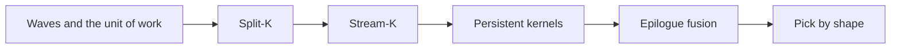
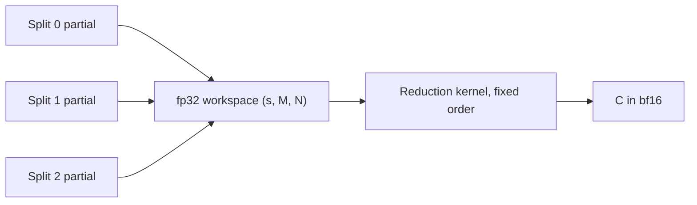
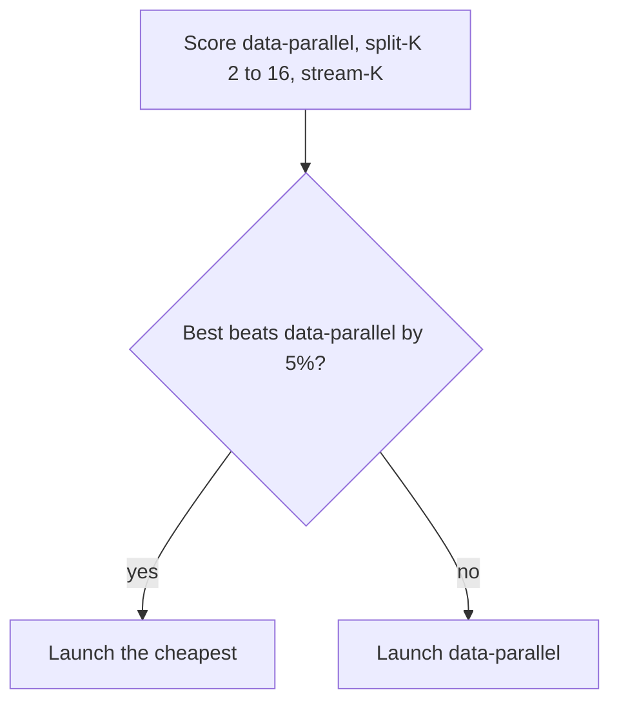

# Introduction

A GEMM that grows by eight columns can run at half speed. Today you find out why, and what to launch instead.

Note:
Open with the surprise from chapter 4. NVIDIA's example goes from 108 tiles to 117 tiles when N grows by 8, and the throughput roughly halves. Chapter 4 counted the waves and graded the counts. This chapter is the other half: what you do about them. The tile kernel is a given. We only ask which SM computes which slice.

### Where chapter 4 stopped {#gap}

- Chapter 4 counts the partial wave, the split-K grid, and the stream-K bounds
- It does not say when each one wins
- Chapter 14's kernel is the tile we schedule
- The skinny decode GEMM and W4A16 GEMV stay in learn-inference

Note:
Be explicit about ownership. The counts live in chapter 4 and the Triton tile lives in chapter 14, so neither is retaught. The decode kernels belong to the companion course, and here a decode-shaped GEMM is only a shape that stresses the schedule. The new content is the deal of work to SMs, the reduction, the epilogue, and the choice.

### Two shapes for the whole talk {#shapes}

| Shape | Tile | Tiles | SMs busy |
|---|---|---|---|
| 2304 x 1544 x 4096 | 256 x 128 | 117 | 108, then 9 |
| 64 x 4096 x 4096 | 64 x 128 | 32 | 32 of 108 |

Note:
Keep these two on the board. The first is NVIDIA's worked example, which chapter 4 uses. It has a bad tail. The second is a decode-shaped GEMM with a batch of 64. It has no tail at all, because it has too few tiles. Different problems, and the same cure: stop tying a CTA to a whole tile.

### The roadmap {#route}



Note:
Six stops. Each schedule gets a picture, a worked number, and a price from the same cost model. The lab mirrors the order: the CPU pieces first, then the Triton kernels on the A100.

# The unit of work

The tile is not the unit. The MAC-iteration is.

Note:
This section replaces the picture of a CTA owning a tile with the picture of a CTA owning a pile of identical K-steps. Everything later is a way of dealing that pile.

### One MAC-iteration {#iteration}

- One K-step of one output tile
- A $B_M \times B_N \times B_K$ multiply-accumulate
- K = 4096 and $B_K$ = 64 give 64 per tile
- 117 tiles are 7488 iterations; 32 tiles are 2048

Note:
It is the body of the for-k loop in chapter 14's kernel. All iterations cost the same, so a kernel's time is the number of iterations on its busiest SM. Do the multiplication on the board: 117 times 64 is 7488, 32 times 64 is 2048. Those two numbers come back in every section.

### The even share and the data-parallel deal {#even-share}

$$
\text{even share} = \frac{T\,I}{108}, \qquad \text{data-parallel} = \left\lceil \frac{T}{108} \right\rceil I
$$

- 117 tiles: 69.3 against 128 iterations, 54.2%
- 32 tiles: 19.0 against 64 iterations, 29.6%

Note:
T is tiles and I is iterations per tile. The even share is the best any schedule can reach. Data-parallel deals iterations in blocks of I, so it rounds the tile count up to a whole wave. The ratio is the wave efficiency from chapter 4. In time: one 256 by 128 by 64 iteration is 4.19 MFLOP, one SM's share of 312 TFLOP/s is 2.889, so an iteration takes 1.452 microseconds at the rating. 128 iterations are 185.8 microseconds and the even share is 100.6, both predictions from the ratings. For the decode shape there is no tail to trim, there are just 32 tiles for 108 SMs.

> [!QUESTION] Is 29.6% really the whole story for the decode shape?
> No. The kernel is also memory bound, with 62 FLOP per byte against a ridge of 244.7. A grid that fills 32 of 108 SMs pulls a smaller share of the bandwidth, so the memory side stretches too.

# The cost model

Four lines that price every schedule in this deck.

Note:
Introduce the model before the schedules, so each schedule ends with a number you can compare. It is deliberately small. A reader should be able to implement it in thirty lines, and the lab does.

### Compute side and memory side {#model}

$$
T = \max\left( c \cdot t_{\text{it}},\ \frac{\text{bytes}}{\beta}\cdot\frac{108}{a} \right) + T_{\text{extra}}
$$

- $c$: iterations on the busiest SM
- $a$: SMs that have work; $\beta$ = 1275 GB/s, the measured copy ceiling
- Bytes are the compulsory $2(MK + KN + MN)$

Note:
The first term is the critical path. The second term is the memory time, stretched by 108 over a when only a SMs run. Extra is whatever the schedule adds. Two caveats to say out loud. The linear bandwidth scale is an assumption that overstates the penalty, because one SM can have more in flight than its share. And the model gives every SM one resident CTA.

### The decode shape under the model {#decode-model}

- Bytes: 34.6 MB, so 27.1 microseconds at 1275 GB/s
- Arithmetic: 2.15 GFLOP, so 6.9 microseconds at 312 TFLOP/s
- 32 CTAs stretch the memory time by 108/32
- Data-parallel prediction: 91.6 microseconds

> [!QUESTION] Why 3.4 times the memory floor?
> Only 32 of 108 SMs pull data, so the model scales 27.1 microseconds by 108/32. One real SM can pull more than its share, so the measured gap is smaller.

Note:
Work the numbers. Compulsory bytes are two times the sum of A, B, and C, which is 34.6 million. Divide by 1275 gigabytes per second and you get 27.1 microseconds. The compute floor is 6.9 microseconds, so the GEMM is memory bound. Then the grid penalty multiplies the memory time by 3.375 to get 91.6. That is the number every other schedule has to beat.

# Split-K

Cut K so that one tile becomes several CTAs.

Note:
First fix. It is the simplest to implement because the CTAs of a tile never talk to each other while they compute. They talk at the end, through a workspace.

### Partition the K-iterations {#partition}

```python
def split_k_ranges(k_iters, splits):
    base, rem = divmod(k_iters, splits)
    out, start = [], 0
    for s in range(splits):
        size = base + (1 if s < rem else 0)
        out.append((start, start + size))
        start += size
    return out
```

Note:
Sizes differ by at most one, and the first rem splits take the extra. 16 iterations in 5 splits is 4, 3, 3, 3, 3. A wrong version uses k_iters floor-divided by splits for every split and drops the last iteration, which the lab's test catches. K usually does not divide evenly, so the last K-step can be a partial one, and the partition counts iterations, not columns.

### Workspace, then reduction {#workspace}



Note:
Each CTA writes its fp32 partial to a workspace. A second kernel adds the s slices in a fixed order and casts once. CUTLASS describes the same design: a partitioned-K GEMM followed by a batched reduction, with a workspace the caller allocates. The fixed order makes the output reproducible, and the cast happens once, on the fp32 sum.

### The price of the reduction {#reduction-price}

$$
T_{\text{extra}} = 5\ \mu\text{s} + \frac{2\,s\,M N \cdot 4}{\beta}
$$

- 5 microseconds: the second launch
- $2 s M N \cdot 4$: partials written, then read, in fp32
- It does not depend on K

Note:
The workspace is fp32 whatever the output dtype, so each split costs 4 M N bytes written and 4 M N read. K does not appear, which is why split-K wins on a small output with a long K and loses on a large output. The launch is the 5 microseconds chapter 4 quotes for this card.

### Where it wins and where it loses {#split-results}

| Shape | Data-parallel | Split-K | Model speedup |
|---|---|---|---|
| 64 x 4096 x 4096, s = 4 | 91.6 us | 38.7 us | 2.4x |
| 2304 x 1544 x 4096, s = 2 | 185.8 us | 189.0 us | 0.98x |

> [!QUESTION] Why is split-K not faster on 117 tiles?
> Its 56.9 MB of workspace traffic costs 44.6 microseconds plus the 5 microsecond launch, which cancels the saving. The workspace fits in the L2, so the model may be pessimistic.

Note:
Read the table. On the decode shape the output is tiny, 64 by 4096, so four splits are cheap and the extra SMs lift the memory side. On the big shape the output is 3.6 million elements and the reduction eats the gain. This is the first place the cost model changes a decision, and it is the one to trust least in absolute terms, because of the L2.

### Atomics: no workspace, no fixed order {#atomics}

- Zero the output in fp32, then `tl.atomic_add` each partial
- No second kernel, no workspace read
- fp32 addition is not associative
- The order is the arrival order, so runs differ in the last bits

> [!QUESTION] Can the order really matter that much?
> Take the partials 1e8, 1, -1e8, 1. Orders 0-1-2-3, 0-2-1-3, and 1-3-0-2 give 1.0, 2.0, and 0.0 in fp32. The true sum is 2. Real partials are tamer, but the bits still differ.

Note:
The fp32 spacing at 1e8 is 8, so one is absorbed. Show the three running sums on the board. The lab's reduce_partials takes an order and adds in fp32, and it fails an implementation that sums in float64, because float64 returns 2.0 for every order. In practice, if you need bit-reproducible results, use the workspace reduction or fix the library's schedule.

# Stream-K

Deal the iterations, not the tiles.

Note:
Split-K gives a multiple of the tile count in CTAs. Stream-K gives exactly as many CTAs as there are SMs and gives each one the same number of iterations, give or take one.

### Fixed-size ranges {#ranges}

- Number all $T \cdot I$ iterations in order
- CTA $c$ takes one contiguous range of $\lfloor TI/g \rfloor$ or one more
- A range is cut at tile edges into segments
- 7488 = 108 x 69 + 36: 36 CTAs run 70 iterations, 72 run 69

Note:
This is from Osama, Merrill, Cecka, Garland, and Owens. The paper writes the range as the ceiling of total over g, which leaves the last CTA short. The lab uses the balanced version so sizes differ by at most one and agree with chapter 4's stream_k_bounds. The critical path is 70 iterations against data-parallel's 128, so utilisation is 99.0%.

### The plan in code {#plan}

```python
total = tiles * iters_per_tile
base, rem = divmod(total, ctas)
start = c * base + min(c, rem)
end = start + base + (1 if c < rem else 0)
# cut [start, end) at multiples of iters_per_tile
```

> [!QUESTION] Why must a segment never cross a tile boundary?
> A segment is one tile's K range. A range that runs past the tile edge would read the next tile's rows of A and columns of B into the wrong accumulator.

Note:
The start offset is c times base plus min of c and rem, because the first rem CTAs are one longer. The cut at tile boundaries is what produces segments. The lab compares your plan with a simulation that walks the iterations one at a time. A version that returns one segment per CTA fails on the first case.

### The partial-tile fix-up {#fixup}

- The CTA that holds a tile's first iteration owns the tile
- Other contributors write fp32 partials and set a flag
- The owner waits, adds the partials, and stores once
- 117 x 64 on 108 CTAs: 105 of 117 tiles need a fix-up

Note:
The owner convention is the paper's: the CTA that performed the tile's k equals zero iteration. Bytes are small, one fp32 tile per straddling tile, but there is coordination, a flag handoff between SMs. The count is high because each CTA runs 69 or 70 iterations and a tile has 64. In the decode shape, all 32 tiles straddle a boundary.

> [!WARNING] Stream-K needs its CTAs resident together
> An owner that waits on a CTA that has not started can wait forever. Launch at most as many CTAs as fit at once, 108 for one per SM. Split-K has no such limit.

### Hybrids cut the fix-ups {#hybrid}

- Run 108 whole tiles data-parallel in one wave
- Stream-K the last 9 tiles: 576 iterations over 108 CTAs
- Critical path: 64 + 6 = 70 iterations, as before
- Fix-ups: 9 tiles, not 105

Note:
The paper's hybrids balance less on purpose. Plain stream-K has neighbouring CTAs start at different K offsets, which scatters their reads in the L2. Running full waves data-parallel and stream-K only on the leftover keeps most tiles whole. The paper also describes a two-tile variant that gives each stream-K CTA one to two tiles of work so an owner waits for at most one peer. The lab teaches the plain version, because its ranges are what you can check on a CPU.

### The four schedules on 108 SMs {#lanes}

```viz
29-schedule-lanes
```

Note:
Switch between the two shapes and the four schedules. On the 117-tile shape, data-parallel has nine tall bars of 128, and stream-K is flat at 69 and 70. On the decode shape, data-parallel leaves 76 SMs empty. The times come from the lab's model. Stress that the model prices the fix-up by its bytes and not by its waiting, so it is kinder to stream-K than the hardware will be.

# Persistent kernels

One CTA per SM, and a loop.

Note:
The word persistent is attached to several ideas. Separate them. The first is a launch shape, the second is what the loop buys, and the third is how the loop hands out work.

### The loop {#loop}

```python
for work in range(start, num_items, NUM_SMS):
    tile_id = work // SPLITS
    split = work % SPLITS
    # grouped map, then the K loop over the split's range
```

- Launch about one CTA per SM
- A work item is a tile, a (tile, split) pair, or a range

Note:
This is the shape of Triton's persistent-matmul tutorial: a grid sized to the multiprocessor count and a loop in steps of that count. The CTA does not exit between tiles, so it keeps its registers and its barriers. The lab's kernel uses (tile, split) pairs, so persistence and split-K combine.

### Static or dynamic counter {#counter}

| Counter | CTA 0 | CTA 1 | Makespan |
|---|---|---|---|
| Static round-robin | 5 + 1 + 1 | 1 + 1 + 1 | 7 |
| Dynamic | 5 | 1 + 1 + 1 + 1 + 1 | 5 |

> [!QUESTION] When is the dynamic counter worth an atomic?
> When item costs differ, as with ragged batches or causal masks. For a GEMM whose tiles all cost the same, static gives the same makespan for free.

Note:
Costs 5, 1, 1, 1, 1, 1 on two CTAs. Static gives CTA 0 the tiles 0, 2, and 4. A dynamic counter lets CTA 1 take every cheap tile while CTA 0 is busy. The lab's simulate_tile_counter reproduces the table, with the lowest free CTA first on a tie.

### What persistence does not fix {#not-tail}

- 108 CTAs over 117 equal tiles: 9 CTAs run two
- Critical path: 128 iterations, the same as data-parallel
- It does buy a setup you pay once, and control of the order
- And a place to overlap the epilogue with the next mainloop

Note:
This is the misconception to head off. A persistent kernel with a static counter has the same tail as data-parallel on equal tiles. What it gives you is amortised setup, the ability to choose the next tile, and room to overlap. CUTLASS's Hopper ping-pong kernel is built on a persistent CTA where one warp group's epilogue runs while the other's math does.

### Grouped order inside the loop {#grouped}

- CTA $c$ takes ids $c$, $c+g$, $c+2g$, and so on
- Each id maps through chapter 14's grouped order
- Take the position in the strip first: $w = \text{id} \bmod (G_M N_t)$
- Then row = $w \bmod h$ and column = $\lfloor w/h \rfloor$

> [!QUESTION] Chapter 14 writes `pid % group_size_m`. Is that wrong?
> Not for correctness. Both visit every tile once. They number the rows differently on a short last strip when the strip height does not divide the tiles before it. The lab uses the Triton tutorial's form.

Note:
The tutorial writes pid mod num_pid_in_group, then mod group_size_m. Chapter 14's kernel takes the global id mod the group size. They agree when the strip height divides the number of tiles before the strip, and otherwise only the order inside the last strip changes. The lab's test builds the expected order with nested loops, so it does not trust either formula.

# Epilogue fusion

What happens to the accumulator after the K loop.

Note:
The accumulator is an fp32 tile in registers. A plain GEMM casts and stores it. A transformer layer wants a bias, an activation, a residual, or a scale. Where those run decides how many bytes move.

### Registers or round trips {#bytes}

$$
B_{\text{fused}} = E + \text{operands}, \quad B_{\text{unfused}} = E + n_{\text{st}} \cdot 2E + \text{operands}
$$

- $E = 2MN$: the bf16 output
- Each unfused stage reads $E$ and writes $E$

Note:
Count only C-sized traffic. A fused epilogue writes C once and reads its operands, a bias row and maybe a residual tile. An unfused one writes C, then runs one kernel per stage, each reading and writing the whole output. The saving is two times the stage count times E, whatever the operands, because both versions read the same bias and residual.

### Six epilogues, one number {#six}

| Epilogue | Stages | Saved on 4096 x 4096 bf16 |
|---|---|---|
| `bias` | 1 | 67.1 MB |
| `bias_relu`, `bias_gelu`, `bias_silu` | 2 | 134.2 MB |
| `bias_residual`, `scale_residual` | 2 | 134.2 MB |

> [!QUESTION] How big is 134.2 MB against the matmul?
> It is 105 microseconds at 1275 GB/s. The 4096 cube's compute floor is 440 microseconds, so an unfused epilogue adds about 24 percent.

Note:
The output is 33.6 MB in bf16. Two unfused stages move that four more times, which is where 134.2 comes from. The scale-residual form is the BLAS alpha A B plus beta C. All five two-stage kinds save the same bytes, because the saving does not depend on the operands.

### Apply it to the fp32 accumulator {#fp32}

```python
u = 0.7978845608028654 * (x + 0.044715 * x * x * x)
out = x * tl.sigmoid(2.0 * u)      # gelu, tanh form
```

- Epilogue on the fp32 accumulator, cast once at the store
- After the reduction in split-K, never on a partial

Note:
Half of one plus tanh of u equals the sigmoid of two u, so the tanh GELU needs only tl.sigmoid. Casting before the epilogue rounds twice. With split-K the activation of a sum is not the sum of activations, so it runs once, after the reduction, or in the stream-K owner. Chapter 24 fuses the erf form in the CuTe DSL.

### Small shapes save launches, not bytes {#launches}

- Decode output: 64 x 4096 x 2 = 524 KB
- Two unfused stages: two extra launches, about 10 microseconds
- Stream-K GEMM in the model: 28.8 microseconds

> [!QUESTION] So is fusion a large-shape optimisation?
> For bytes, yes. For small outputs the saving is launches, which is more than a third of the GEMM here. Either way, measure, because a fused epilogue costs registers.

Note:
The bytes at the small end are negligible, which flips what the fusion saves. Each extra kernel costs a launch of about 5 microseconds on this card. Two of them are more than a third of a 28.8 microsecond GEMM. A fused epilogue can lower occupancy by holding more registers, so it is a hypothesis for the lab to test, not a guarantee.

# Picking a schedule

Score the candidates, then apply a margin.

Note:
Give the room a procedure, not a table to memorise. The lab implements it in choose_schedule.

### The chooser {#chooser}



Note:
The five percent margin is a modelling choice, not a hardware number. A prediction within a few percent of the baseline is inside the model's error, so the simpler schedule wins. If stream-K is not available, drop it from the candidates, which is the allow_stream_k flag in the lab.

### The model's picks {#picks}

| Shape | Tiles | Pick, with stream-K | Pick, without |
|---|---|---|---|
| 64 x 4096 x 4096 | 32 | stream-K, 28.8 us | split-K 4, 38.7 us |
| 256 x 4096 x 4096 | 64 | stream-K, 36.2 us | data-parallel, 50.0 us |
| 2304 x 1544 x 4096 | 117 | stream-K, 123.2 us | data-parallel, 185.8 us |
| 4096 x 4096 x 4096 | 1024 | data-parallel | data-parallel |

> [!QUESTION] Why does split-K lose at M = 256?
> At 64 tiles even two splits cost more workspace traffic than the iterations they save.

Note:
Model predictions on the A100's ratings, not measurements. The first row is the decode regime. Row two is the surprise. Row three is the quantization case. Row four is where data-parallel is already enough: the stream-K gain at 1024 tiles is 2.8 percent, under the margin. The model ignores the L2, so treat small differences as ties.

# Summary

Five ideas, five numbers, and what comes next.

Note:
Close the deck by restating the move from tiles to iterations, then give the numbers the lab's tests check.

### What to remember {#summary}

- The unit of work is the MAC-iteration, and the kernel ends with the busiest SM
- Split-K: a workspace and a reduction, $5\ \mu\text{s} + 2sMN \cdot 4/\beta$
- Stream-K: fixed ranges, 36 CTAs of 70 and 72 of 69, plus fix-ups
- A persistent loop does not fix a tail by itself
- A fused epilogue saves $2 n_{\text{st}} E$ bytes, 134.2 MB at 4096 by 4096

Note:
Five lines. If the room keeps one, it is the first: stop thinking about tiles and think about iterations. Then the pricing rule for each schedule, which is the part they can reuse on a new shape.

### Numbers to remember {#numbers}

| Quantity | Value |
|---|---|
| 117 tiles on 108 SMs | 2 waves, 54.2% |
| Even share, 7488 iterations | 69.3 per SM |
| Fix-ups, 117 x 64 on 108 CTAs | 105 tiles; 9 with a hybrid |
| Dynamic against static makespan | 5 against 7 |
| Unfused bias plus GELU, 4096 by 4096 | 167.8 MB against 33.6 MB |

Note:
These are the numbers the lab's tests check. The times in the deck are model predictions on the A100's ratings and the measured 1275 GB/s copy ceiling. The lab measures the Triton kernels on tall-skinny shapes and reports the speedup against a plain kernel.

### Next {#next}

- Chapter 15 starts Part 4: softmax and normalization, where the epilogue stops being elementwise
- Chapter 17 picks up fusion across kernels
- The decode kernels continue in learn-inference

> [!QUESTION] Which of today's schedules runs on the lab A100?
> The Triton split-K, persistent, and fused kernels run on the A100. They are checked against torch.matmul for M from 16 to 128. Stream-K is a CPU plan in the lab, because it needs cross-CTA flags.

Note:
Close the loop with the lab. The CPU checks cover the counts, the plan, the order, the bytes, and the chooser. The GPU checks cover split-K, the persistent kernel, and six fused epilogues. The measured speedup is a metric with a loose threshold, and the model's prediction is the number to compare it with.
