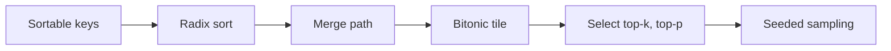
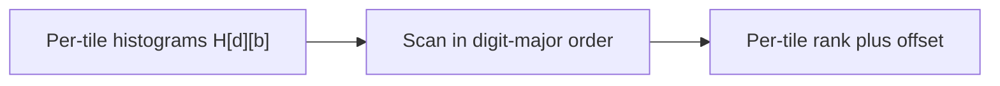
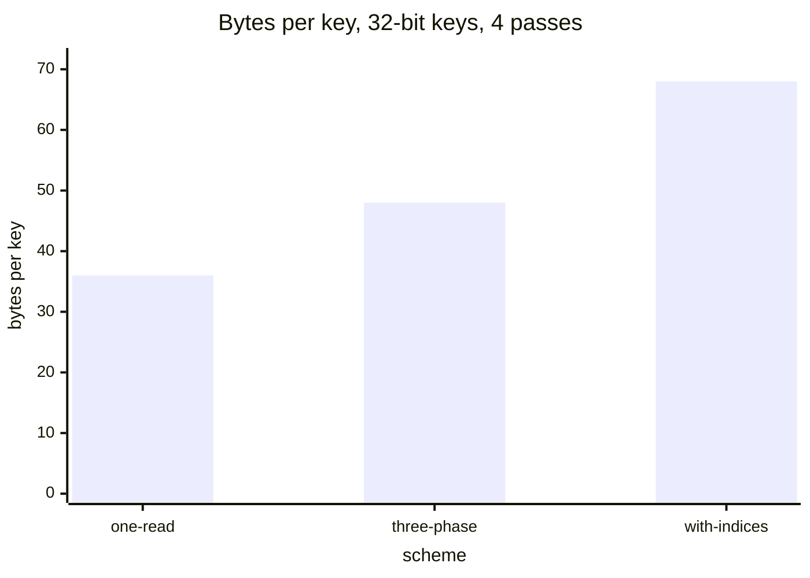
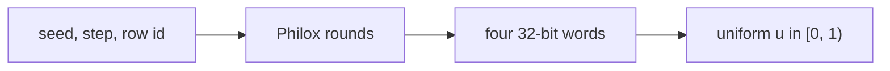

# Introduction

A model server sorts, selects, and samples at every decode step. The question is how to do each one without paying for more order than you need.

Note:
Open with the sampling step the audience already knows: the model returns logits, the server keeps some tokens, and draws one. Ask who has called torch.topk or torch.sort inside a decode loop. Today you build the pieces underneath those calls. The chapter owns the kernels. How the serving loop calls them, and speculative decoding, belong to learn-inference, and the deck links there.

### Where order shows up {#where}

- Top-k and top-p sampling over a vocabulary of about $10^5$
- Grouping tokens by expert in a mixture-of-experts layer
- Beam search and nearest-neighbor retrieval keep the best few
- Most of these need a threshold, not the whole order

Note:
Name four uses and point out that only the expert grouping needs a full order, and even that is a sort on a few bits. The others want a set. A set is defined by a threshold, and a threshold is cheaper than an order. That is the thread through the deck: pay for what you use.

### The route {#route}



Note:
Walk the arrow once. Keys come first because a radix sort sees bits, not values. Then the sort, the merge, and the bitonic network for a tile. Then the selection that skips the sort. The last stop is the random draw.

# Radix sort

A radix sort never compares two keys. It reads their bits one digit at a time, and every pass is a counting sort.

Note:
This section is the longest. Spend the time on stability, because it's the one property that makes the passes compose, and because the lab catches the wrong version.

## Keys

### Signed integers flip one bit {#int-keys}

$$
\text{key}(x) = x \oplus \texttt{0x80000000}
$$

- Two's complement puts the negatives above the positives as unsigned bits
- Flipping the sign bit swaps the halves
- $-1$ becomes `0x7FFFFFFF`, and $0$ becomes `0x80000000`

Note:
Minus one is all ones, the largest unsigned value, and zero is all zeros. Flipping the top bit moves the negatives to the bottom half. Inside each half two's complement is already monotone. The inverse is the same XOR. This is the easy case, and it's the first check in the lab.

### Floats need two rules {#float-keys}

| Value | Bits | Key |
|---|---|---|
| $-\infty$ | `0xFF800000` | `0x007FFFFF` |
| $-1.0$ | `0xBF800000` | `0x407FFFFF` |
| $+0.0$ | `0x00000000` | `0x80000000` |
| $1.0$ | `0x3F800000` | `0xBF800000` |

- Sign bit clear: flip the sign bit
- Sign bit set: invert all 32 bits

> [!QUESTION] What if I flip all bits of the positives and only the sign bit of the negatives?
> That is the transform reversed. It sends 1.0 to `0x407FFFFF` and puts every positive below every negative. The lab's float-key check hard-codes the table and catches it.

Note:
A float is sign and magnitude. A positive float already sorts as its bits, so setting the sign bit lifts it above the negatives. A negative float has the wrong order: more magnitude means a bigger pattern and a smaller value. Inverting every bit reverses it. Read the table downward and the keys increase.

### Zeros and NaNs need a sort key {#sort-key}

- $-0.0$ and $+0.0$ compare equal, so they need the same key
- A NaN with the sign bit set would sort below $-\infty$
- Rule: every NaN gets the key `0xFFFFFFFF`, after $+\infty$
- This matches `torch.sort`

> [!QUESTION] Can I invert a sort key to get my values back?
> No. The sort key merges the zeros and the NaNs, so it isn't invertible. Carry the indices through the sort and read the values from the original array.

Note:
The bit-exact key is a total order, so it separates the two zeros. A stable sort must keep an equal pair in input order, so the sort key merges them. NaN is the second trap: a positive NaN lands above infinity, but a negative NaN lands below minus infinity. One rule fixes both.

## One pass

### A pass is a stable counting sort {#pass}

```viz
30-radix-pass
```

Note:
Step the slider. Eight 4-bit keys, a 2-bit digit, two passes. The histogram of the first pass is 0, 4, 3, 1, the scan is 0, 0, 4, 7, and the destinations are 0, 4, 1, 2, 7, 5, 6, 3. Watch the two 6s, b and g. They keep their order through both passes.

### Why stability is the whole proof {#stable}

$$
\text{after pass } t: \quad \text{sorted by } (d_t, d_{t-1}, \ldots, d_0)
$$

- Pass $t$ sorts by $d_t$
- A stable pass leaves equal $d_t$ in the order pass $t-1$ gave
- That order is already sorted by the lower digits

> [!QUESTION] What does an unstable pass look like?
> It walks the input forward but fills each bin from its end, so equal digits come out reversed. On the digits 3, 1, 2, 1, 0, 3, 2, 1 the stable indices are 4, 1, 3, 7, 2, 6, 0, 5. The lab checks the indices, not only the keys.

Note:
This is an induction. After the last pass the order is by all digits. The base case is trivial, and the step uses stability: elements with equal digit d t stay in the order the previous pass left. Without stability the proof breaks at the first tie and the earlier passes are wasted.

## On a GPU

### Count, scan, scatter, across tiles {#tiles}



- Tile 0's digit 0 lands before tile 1's digit 0
- Within a tile, rank in input order

Note:
The CPU pass has one running offset per digit, which is a sequential chain. On a GPU you split into tiles. Each block counts its tile into a table. You scan the table in digit-major order, all tiles of digit zero first. Each block then ranks its keys among equal digits in its own tile and adds its starting offset.

### A worked table of offsets {#offset-table}

| | Tile 0 | Tile 1 |
|---|---|---|
| Digit 0 count | 1 | 3 |
| Digit 1 count | 3 | 1 |
| Start slot, digit 0 | 0 | 1 |
| Start slot, digit 1 | 4 | 7 |

> [!QUESTION] Why not scan tile by tile?
> Then the keys of digit 1 in tile 0 would not all land before the keys of digit 1 in tile 1, and a key could jump ahead of an equal key from an earlier tile. The sort is still correct by digit, but it is not stable.

Note:
Tile 0 holds the digits 1, 0, 1, 1 and tile 1 holds 0, 1, 0, 0. Flatten the counts in digit-major order: 1, 3, 3, 1. The exclusive scan is 0, 1, 4, 7. The total is 8, the array length. Digit zero fills slots zero to three, with the single tile 0 key first.

### The kernel you write {#hist-kernel}

```cuda
atomicAdd(&local[(keys[i] >> shift) & mask], 1);
```

- Chapter 7's privatized histogram, with one new bin index
- `keys` is `uint32_t`, so the shift is logical
- A signed shift copies the sign bit into the top digit

Note:
The lab's kernel is chapter 7's shared-memory histogram. Each block zeros its bins, counts with shared atomics, syncs, and merges once into global memory. The only new thing is the bin index. Cast the key to unsigned before the shift. An int shifted right by 24 fills the top with the sign bit, so a negative key lands in the wrong bin.

### What the sort moves {#traffic}



> [!QUESTION] Does the Onesweep paper beat that floor?
> It reports 29.4 giga-keys per second for 256 million random 32-bit keys on an A100, about 1.5 times CUB's earlier sort. That is the paper's A100, not the lab card, so don't compare it with the floor.

Note:
Count the bytes, then divide by 1275 GB/s. A scheme that reads each key once per pass, plus one up-front histogram, moves 36 bytes per key. The three-phase scheme reads each key twice per pass and moves 48. Carrying a 4-byte index moves 68. For 2 to the 26 keys, 36 bytes is 2.416 GB, a floor of 1.895 ms.

# Merge and bitonic sort

A radix sort needs digits. When you have only a comparator, or a small tile in shared memory, you merge and compare-exchange.

Note:
Two tools in one section. Merge path is how you merge in parallel. Bitonic sort is how you sort a tile with no data-dependent branches. They combine into a comparison-based GPU sort.

## Merge path

### Cut the output, not the inputs {#cut}

- A serial merge is a chain of $n - 1$ comparisons
- Slicing $a$ and $b$ unevenly gives unequal work
- Cut the output at diagonals instead: thread $t$ makes outputs $tL$ to $(t+1)L - 1$
- Each thread needs one number: how many came from $a$

Note:
The obvious cut gives each thread a slice of a and the matching slice of b. The values decide which slice matches, so one thread can get nothing and another half the list. Cut the output instead. Every thread merges exactly the same number of outputs. The cost is one search per thread to find where its slice starts in each list.

### The diagonal binary search {#search}

$$
a[m] \le b[d-1-m] \implies i > m
$$

```cuda
if (a[mid] <= b[diag - 1 - mid]) lo = mid + 1;
else                             hi = mid;
```

- Search $i$ in $[\max(0, d - |b|),\ \min(d, |a|)]$

Note:
A merge is a monotone path across a grid of a and b. It crosses each anti-diagonal once. Along the diagonal, the question whether a comes before b flips exactly once, so a binary search finds the crossing in log steps. Two loads per step. The bounds keep both i and j inside their lists, which handles empty lists and short lists.

### A worked cut {#cut-example}

| Diagonal | From $a$ | From $b$ |
|---|---|---|
| 0 | 0 | 0 |
| 3 | 2 | 1 |
| 6 | 3 | 3 |
| 9 | 5 | 4 |

- $a = [1, 3, 5, 7, 9]$, $b = [2, 3, 4, 8]$
- Every thread merges three outputs

> [!QUESTION] Why less-than-or-equal and not less-than?
> Less-than-or-equal sends ties to $a$, so equal elements from $a$ precede equal elements from $b$. That is the stable merge. With strict less-than, the cut at diagonal 3 takes one from $a$ and two from $b$, and $3_b$ lands ahead of $3_a$.

Note:
Nine outputs, three threads. The first three outputs are 1, 2, and the 3 from a, so diagonal three takes two from a and one from b. Thread one starts at two and one, reads 5 from a and 3 and 4 from b, and writes 3, 4, 5. Every thread has exactly three outputs, whatever the values.

## Bitonic network

### A sorting network has a fixed schedule {#network}

```viz
30-bitonic-network
```

Note:
Drag the stage slider. Eight values, six stages, four compare-exchanges per stage. Stage one compares neighbors with alternating directions. After stage three the left half rises and the right half falls, which is a bitonic sequence. The last three stages merge it. The pairs never depend on the values, so every thread in a warp runs the same instructions.

### Stages and compare-exchanges {#network-cost}

$$
\text{stages} = \frac{m(m+1)}{2}, \qquad \text{compare-exchanges} = \frac{n}{2} \cdot \frac{m(m+1)}{2}
$$

- $n = 8$: 6 stages, 24 compare-exchanges
- $n = 1024$: 55 stages, 27,648 compare-exchanges
- A comparison sort needs about 10,240 compares at $n = 1024$

> [!QUESTION] What if the tile isn't a power of two?
> Pad it with the largest key, `0xFFFFFFFF`, sort, and drop the padding. The network assumes $n = 2^m$.

Note:
Here n is 2 to the m. The network does about 2.7 times the comparisons of a comparison sort at 1024 elements. That is the price of a data-independent schedule, and it's a good price when the tile is in shared memory and a sync costs less than a divergent branch.

### The shared-memory kernel {#bitonic-kernel}

```cuda
const int i = 2 * t - (t & (j - 1));
const int p = i + j;
const bool up = (i & k) == 0;
if ((s[i] > s[p]) == up) swap(s[i], s[p]);
__syncthreads();
```

- Each thread owns one pair per stage
- 1024 keys is 4 KiB of shared memory

Note:
The index trick inserts a zero bit at the position of j into the thread index, so each thread gets a distinct pair. The direction is a bit of the index. A barrier ends every stage, because the next stage reads what this one wrote.

# Selection without a sort

Top-k and top-p ask for a set. A threshold defines the set, and a histogram finds the threshold.

Note:
This is the payoff of the chapter. The same histogram that drove the radix sort now eliminates candidates instead of moving them. The sort did four reads and four writes of every key. Selection reads every key at most four times and writes k of them.

## Top-k

### Radix select narrows the threshold {#select}

- Walk the digits from the highest to the lowest
- Histogram the digit over the candidates
- Scan from the top digit down, subtracting counts until a bin holds at least $r$
- Keep only that bin's candidates

Note:
Start with r equal to k. At each digit, scan the histogram from the largest digit. If a bin holds fewer than r candidates, all of them are in the top r, so subtract its count and keep going. The first bin that holds at least r contains the r-th largest. Keep only its candidates and move to the next digit.

### Top 4 of eight keys {#select-example}

| Pass | Digits of the candidates | Result |
|---|---|---|
| High | 5, 3, 5, 1, 5, 7, 5, 0 | $r$ becomes 3, keep digit 5 |
| Low | A, F, A, C | $r$ becomes 1, keep digit A |

- Keys `5A 3C 5F 12 5A 7B 5C 0E`, $k = 4$
- Threshold `5A`; above it `7B`, `5F`, `5C`

> [!QUESTION] Which of the two tied `5A` keys do I keep?
> The lowest index, 0. A tie rule is a decision, not an accident. It makes the result match a stable descending sort, so two runs return the same set.

Note:
Pass one: digit seven has one key, so r drops from four to three, and digit five has four, so the threshold is in digit five. Pass two looks at A, F, A, C. F has one, r drops to two. C has one, r drops to one. A has two, so the threshold is 5A. Three keys are above it.

### The tie rule decides the size {#ties}

- Keep every key above the threshold
- Add the lowest-index keys equal to it until $k$ are kept
- Returning all ties returns more than $k$ elements
- `torch.topk` doesn't promise an order for tied indices

Note:
The lab checks the values against torch.topk and the indices against a stable descending sort, which pins the tie rule. The wrong implementation keeps everything at or above the threshold. It's right on random data and wrong on data with ties at the boundary, such as rounded values or an all-zero vector.

### What select costs {#select-cost}

- Four passes over $4n$ bytes is $16n$ bytes
- At $n = 2^{26}$: 1.074 GB, a floor of 0.842 ms at 1275 GB/s
- The sort's floor for the same keys is 1.895 ms
- A vocabulary row of about $10^5$ floats is 0.4 MB, and fits on chip

Note:
Without compaction every pass reads every key, which is 16 bytes per key against 36 for the sort. With compaction after the first pass it's far less. For sampling the shape is different. One row of logits is a few hundred kilobytes, so a block pulls it on chip once and runs all four passes there.

## Top-p

### Search for the threshold probability {#top-p}

$$
t^{\ast} = \max \{\, t : M(t) \ge p \,\}, \qquad M(t) = \sum_{\pi_i \ge t} \pi_i
$$

- Non-negative float bits increase with value
- Binary-search the 31 low bits, and sum in float64
- Keep every token above $t^{\ast}$, then add ties in index order while the mass is below $p$

Note:
Top-p keeps a token when the mass before it is less than p. The kept set is a threshold set, so you search for the threshold. M of t is the mass at or above t. It never increases, so a binary search on the bit pattern finds the largest t with M at least p.

### Two examples {#top-p-examples}

| Probabilities | $p$ | Threshold | Kept |
|---|---|---|---|
| 0.25, 0.25, 0.25, 0.25 | 0.6 | 0.25 | tokens 0, 1, 2 |
| Chapter 7's seven | 0.85 | 0.08 | 4 tokens |

> [!QUESTION] What does the inclusive scan do on the second row?
> It keeps a token only when the mass through it is at most $p$, so it drops the token that crosses 0.85. It keeps three tokens, not four.

Note:
First row: the threshold is 0.25 because M of 0.25 is one. Nothing is strictly above it, so the tie fix-up takes tokens 0, 1, and 2 while the kept mass is under 0.6. Second row: the sorted masses before each token are 0, 0.50, 0.70, 0.82, 0.90.

### Rounding can break the search {#rounding}

- Float sums depend on the order of the additions
- Two runs can disagree on $M(t) \ge p$ near a boundary
- Sum in float64 or in a fixed tree order
- The lab uses multiples of $1/1024$, so sums are exact

> [!QUESTION] How does FlashInfer avoid the sort?
> It draws with inverse transform sampling above a pivot, raises the pivot to the drawn probability, and checks the remaining mass. It repeats inside one fused kernel.

Note:
Floating-point addition is not associative, which chapter 9 covered. A parallel masked sum adds in an order that depends on the thread layout. Near the boundary two runs can pick different thresholds, and the nucleus moves by a token. The FlashInfer team notes that parallel prefix sums may not be monotonic.

# Seeded sampling

The last step is a random choice. A counter-based generator makes it a function of a seed, a step, and a row id.

Note:
Stateful generators carry a state from call to call. On a GPU that couples the result to the thread layout. Counter-based generators remove the state, and that is the whole idea. Sampling inside the serving loop is learn-inference's topic. The draw is the kernel piece.

### Stateful against counter-based {#counter}



- No state to carry between calls
- Any position can be computed directly

Note:
A stateful generator updates a state on every call, so the numbers a row sees depend on which thread owns the state. Change the batch size or block shape and the result changes. A counter-based generator is a pure function of a counter and a key. Ask for any position directly.

### One Philox round {#philox}

$$
(c_0', c_1', c_2', c_3') = \big(\text{hi}(M_1 c_2) \oplus c_1 \oplus k_0,\ \text{lo}(M_1 c_2),\ \text{hi}(M_0 c_0) \oplus c_3 \oplus k_1,\ \text{lo}(M_0 c_0)\big)
$$

- Four 32-bit counter words, two key words, ten rounds
- Between rounds the key adds two fixed constants

Note:
Two multiplications, each giving a high and a low half, and some exclusive ors. Ten rounds, and the key moves between rounds. The name Philox 4 by 32 10 is the shape: four words, 32 bits, ten rounds. The whole function lives in registers.

### One draw by hand {#draw}

- First word for counter 0, key 0: `0x6627E8D5`
- $u = (\text{word} \gg 8) / 2^{24} = 0.399046$
- Distribution $[0.5, 0.25, 0.125, 0.125]$, cumulative $[0.5, 0.75, 0.875, 1]$
- First cumulative sum above $u$: index 0, so token 0

> [!QUESTION] Why 24 bits and not all 32?
> A `float32` has a 24-bit significand. Keeping the top 24 bits gives an exact uniform that never equals 1.0. Dividing a 32-bit word by $2^{32} - 1$ in `float32` rounds the largest words up to 1.0.

Note:
Shift out the low eight bits and divide by two to the 24. Twenty-four bits is a float32 significand, so every value is exact and u never reaches one. If you divide the whole word by two to the 32 minus one in float32, the largest words round up to one, and you pick a token past the end.

### What goes in the counter {#counter-layout}

- Counter `(row id, 0, step, 0)`, key the seed
- A draw depends on seed, step, and row id only
- Reorder the batch: each row keeps its token
- No step: the same draw at every step
- No row id: one draw shared by every row

> [!QUESTION] Does a fixed seed make my server reproducible?
> No. It fixes the random number, not the probabilities. A last-bit change in the logits can move a draw near a boundary to another token.

Note:
This is the design decision. The row id travels with the request, so moving it to another slot changes nothing. The step makes each decode step a fresh draw. The lab permutes the rows and requires the same tokens, requires 32 distinct tokens over 64 rows, and runs a chi-square test on 4000 draws from 0.5, 0.25, 0.125, 0.125.

# Summary

You paid for an order only where you needed one.

Note:
Close by returning to the opening question. For the full order, a radix sort of stable passes. For two sorted runs, merge path. For a tile, a bitonic network. For a set, radix select. For a mask, a threshold search. For the draw, a counter-based generator.

### What to remember {#carry}

- A radix sort is a counting sort per digit, and every pass is stable
- Float keys flip the sign bit, or every bit when negative. Zeros and NaNs need a sort key
- A GPU pass counts per tile, scans digit-major, and scatters with a rank
- Merge path cuts the output with a diagonal search
- Select finds a threshold in four histogram passes, and a tie rule fixes the size

Note:
Five lines. Ask the room to say the stability argument in one sentence. Then ask which of the five they would reach for first in a sampler. The answer is select and the threshold search. The sort is for jobs that need the whole order.

### Numbers to remember {#numbers}

| Quantity | Value |
|---|---|
| Radix sort, $2^{26}$ keys, one read per pass | 36 bytes per key, 1.895 ms floor |
| Radix select, same keys | 16 bytes per key, 0.842 ms floor |
| Bitonic, $n = 1024$ | 55 stages, 27,648 compare-exchanges |
| Philox | four 32-bit words, ten rounds |

Note:
Each floor is bytes over the 1275 GB/s copy ceiling measured in learn-inference on the lab A100. They're predictions from byte counts, not measurements. The bitonic counts are exact arithmetic. If asked about measured throughput, say the lab measures only the digit histogram, and it reports the GB/s.

### Which tool when {#decision}

| You need | Use |
|---|---|
| The whole order, 32-bit keys | Radix sort |
| The whole order, a comparator | Merge sort with merge path |
| Order within a tile of at most a few thousand | Bitonic network |
| The $k$ largest | Radix select |
| A top-p mask | Threshold search on the mass |

Note:
The decision guide, in one table. The same pieces recur: a histogram, a scan, and a stable scatter. Say that the next chapters use them again. Mixture-of-experts routing in chapter 20 is a counting sort on a few bits, and the sampler is where this chapter meets learn-inference.

### The lab {#lab}

- Nine checks run on the CPU with torch and pure Python
- The tenth is a CUDA digit histogram, checked against `torch.bincount`
- The starter fails on the CPU. The kernel check skips without a GPU
- Metric: histogram GB/s against the 1275 GB/s copy ceiling

Note:
The checks go from the smallest piece to the largest: the integer key, the float key, the sort key, one stable pass, the full sort, merge path, top-k, top-p, and Philox with the sampler. Each one names a plausible wrong implementation. The kernel is the privatized histogram from chapter 7 with a new bin index.
