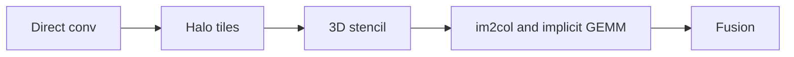
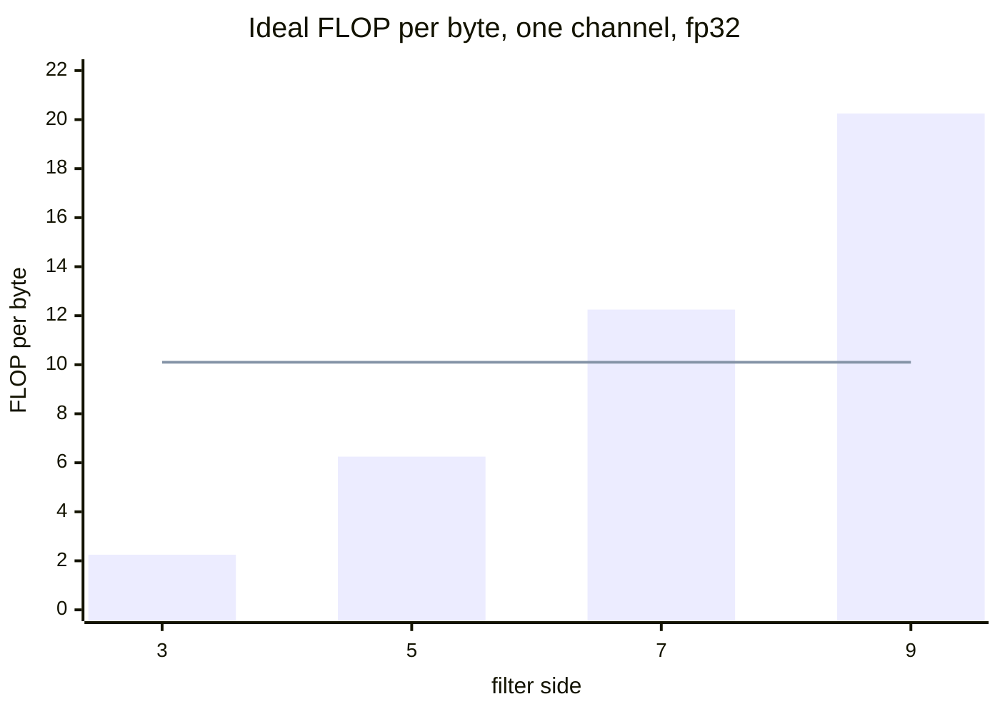
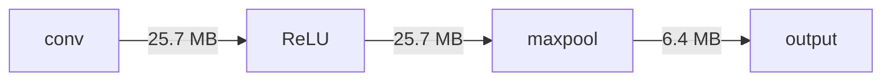

# Introduction

How do you make a convolution or a stencil run at the speed of memory, and when do you turn it into a GEMM?

Note:
Open with the question. Say that the course has been about transformers so far, and that convolutions are the other half of what a GPU runs: a patch embedding, the front end of a speech encoder, a short causal conv in a state-space layer, and every finite-difference stencil. Tell the room that the architecture of a convolutional network belongs to the ml course, and that this deck stays on kernels.

### Four stops {#route}



Note:
This is the route. Start with the arithmetic of a direct convolution, then the halo tile with a constant-memory filter, then a 3D stencil with registers and thread coarsening. Then lower the convolution to a GEMM, first with im2col and then without the matrix. End on fusing ReLU and a pool. At each stop there is a number you can recompute without a GPU.

# Direct convolution

A window slides over an image, and every output reads a small neighborhood.

Note:
Section divider. Go from the picture of the sliding window to the formula and then to the byte count. Make clear that PyTorch computes cross-correlation, because the whole lab has one test that depends on it.

### Cross-correlation, not convolution {#xcorr}

$$
y[p,q] = \sum_{r,s} \hla{w[r,s]}\; \hlb{x[p\sigma - \pi + r\delta,\; q\sigma - \pi + s\delta]}
$$

- No flip: the tap $(r, s)$ reads the pixel at $+r$, $+s$
- A pixel outside the image reads 0
- $\sigma$ is the stride, $\pi$ the padding, $\delta$ the dilation

Note:
Walk the formula. The green term is the filter tap and the blue term is the pixel it lands on. There is no minus sign on r or s. Textbook convolution flips the filter first, and PyTorch does not. A test with a symmetric filter, like a Gaussian blur, cannot tell the two apart. The lab uses a filter with one nonzero tap so a flip shows.

### The output size {#size}

$$
P = \left\lfloor \frac{H + 2\pi - \delta(R-1) - 1}{\sigma} \right\rfloor + 1
$$

- 224 input, 7 filter, stride 2, padding 3 gives 112
- Dilation 2 on a 7 filter spans 13 pixels

> [!QUESTION] Where does the floor come from?
> The last window must fit entirely, so a partial window at the end is dropped. PyTorch floors the division.

Note:
This is the first check in the lab and it passes with one function. Work the 224 example aloud: 224 plus 6 minus 6 minus 1 is 223, divided by 2 is 111.5, floored to 111, plus 1 is 112. Then dilation: a dilated 7 filter reaches over 13 pixels, so the numerator drops by 6 more. Check against torch with a one-line conv1d.

### Arithmetic intensity of one channel {#intensity}



Note:
Each output does 2 k squared FLOP and, with perfect reuse, moves 8 bytes. That gives k squared over 4. The line is the fp32 ridge, 19.5 TFLOP/s over 1935 GB/s, which is 10.1, or 15.3 against the 1275 GB/s copy ceiling. So 3 and 5 are memory bound, 7 crosses the rated ridge only, and 9 crosses both. Without reuse every filter sits near 0.45 to 0.49.

### Channels change the answer {#channels}

- $N=32$, $C=K=64$, $56 \times 56$, $3 \times 3$, fp32
- $7.40 \times 10^9$ FLOP over 51.5 MB: 143.6 FLOP per byte
- Compute floor on the CUDA cores: 0.379 ms

> [!KEY] One channel is a memory problem. Many channels are a compute problem.

Note:
Each loaded pixel feeds K filters and each filter reads C channels, so intensity climbs with channels. The numbers come from a ResNet-style layer in the figure script. The 0.379 ms is a prediction from the 19.5 TFLOP/s fp32 rating, not a measurement. That is why the second half of the deck lowers the layer to a GEMM, which tensor cores can run. The first half is for the single-channel case.

# Tiles, halos, and constant memory

Where do the filter and the input live, and what does the border cost?

Note:
Section divider. Two storage decisions: the filter goes in constant memory and the input goes in shared memory with a halo. Then count what the halo costs, as a function of tile and filter size.

### The filter is a broadcast {#constant}

- 64 KB of constant memory, cached
- All lanes read the same tap: as fast as a register
- Different addresses in a warp are serialized
- A $15 \times 15$ filter is 900 bytes

Note:
A warp computes 32 neighboring outputs. At each tap they all multiply by the same weight and by 32 different pixels, which is a broadcast. The Best Practices Guide says a read can be as fast as a register when the whole warp reads one address, and that different addresses serialize. A 15 by 15 filter is 900 bytes of 64 KB.

### A tile and its halo {#halo}

- A $16 \times 16$ output tile with a $3 \times 3$ filter needs an $18 \times 18$ patch
- The border belongs to the neighbors too
- Loads per output: $\left(\frac{T+k-1}{T}\right)^d$
- 324 loads for 256 outputs: 1.266

Note:
Draw the tile with its one-pixel border. The patch is 18 by 18, which is 324 elements, for 256 outputs. The ratio is 1.266. For a 5 by 5 filter it is 400 over 256, which is 1.5625. Small tiles and large filters pay the most: an 8 tile with a 7 filter loads 3.06 per output.

### Halo cost, by tile and filter {#halo-figure}

```viz
31-halo-overhead
```

Note:
Let the audience drag the filter size and flip between 2D and 3D. Point at the 3D bars: a tile of 4 with a 15-wide filter loads 91 elements per output. Point at the input-tile panel: a block of 8 can't hold a 9-wide filter, so no thread writes. The figure shows the same formulas as the slide before.

### Two ways to cover the patch {#strategies}

- Output tile: $T \times T$ threads, each loads several inputs
- Input tile: $B \times B$ threads, each loads one input
- Input tile writes only $\left(\frac{B-k+1}{B}\right)^2$ of its threads
- $16^2$ block, $3 \times 3$ filter: 76.6% write

> [!QUESTION] Which one should you pick?
> The output-tile strategy never idles a thread at compute time and has no cliff at large filters. The input-tile load is simpler. The lab's kernel uses the output tile.

Note:
The output tile has one thread per output and a loop to load the patch. The input tile has one thread per input, so the load is one line, but only the inner threads compute. At 16 with a 3 by 3 filter that is 14 squared over 16 squared. With a 7 by 7 it falls to 39 percent. These two formulas are the lab's second check.

### The border reads zeros {#border}

```cuda
tile[i][j] = (gr >= 0 && gr < H && gc >= 0 && gc < W)
           ? img[(size_t)gr * W + gc] : 0.0f;
```

- A halo cell outside the image is the zero padding
- In Python, `x[-1]` wraps to the last row

Note:
This ternary is the padding. The bug is a halo load that tests no lower bound. In Python and torch a negative index wraps, so a corner tile shows the bottom row above the top row. In CUDA it reads whatever precedes the buffer. The lab's halo_tile check uses a tile at minus one, minus one. The wrong version is called negative_index_wraps.

### The tiled kernel {#kernel}

1. Strided loop loads the patch, zeros outside
2. `__syncthreads()`, outside every `if`
3. Guard the output, loop over $a, b$ with `c_filter[a*K+b]`

Note:
Three steps. The load loop strides by the tile size, so one thread loads up to four elements. The barrier is outside every branch, which chapter 27 explains. The compute loop reads the filter with loop variables, so the reads are broadcasts. The lab compares against a float64 F.conv2d, because the cuDNN float32 path may use TF32.

# A 3D stencil

A convolution with fixed coefficients, and a third dimension that shared memory can't tile cheaply.

Note:
Section divider. A stencil is the cleanest setting for register tiling. The grid is 3D, so the halo is on six faces, and a full 3D shared tile is expensive. The trick is to tile two dimensions in shared memory and walk the third in registers.

### The 7-point stencil {#seven}

$$
\text{out} = \hla{c_0}\,\text{in}[z,y,x] + \hlb{c_1}\,(\text{six face neighbors})
$$

- 8 FLOP per interior cell, 8 bytes at ideal reuse
- Intensity 1.0: memory bound
- Boundary cells are copied

Note:
One multiply by c0, five adds for six neighbors, one multiply by c1, and one add: eight FLOP. At ideal reuse the kernel reads a cell once and writes it once, 8 bytes. That is 1 FLOP per byte, far under the ridge, so the copy ceiling sets the speed. The boundary convention matters: faces are copied, and the lab's reference leaves them unchanged.

### The floor for a $256^3$ grid {#floor}

- 16,777,216 cells, 134,217,728 bytes read plus written
- At 1275 GB/s: 0.1053 ms
- At the rated 1935 GB/s: 0.0694 ms
- Naive kernel: 7 global reads per output

> [!QUESTION] Which floor does the lab use?
> The copy ceiling, 1275 GB/s, measured on this card. The rating is a bound no kernel reaches.

Note:
These are predictions from the copy ceiling and from the rating. The lab measures the stencil and records the GB/s. The threshold is 30 percent of the copy ceiling, which is loose on purpose, since the lab authors could not run the GPU. The naive kernel issues 7 global reads per output and relies on the caches. How much they help is a measurement.

### Registers for z, shared memory for x and y {#registers}

- `prev`, `curr`, `next` in registers
- One x-y plane in shared memory
- Per plane: load `next`, store `curr`, compute, shift

> [!KEY] Each input element is read once per plane and used by three outputs.

Note:
Walk one iteration. The thread loads the plane above into next, stores curr into the shared plane, and waits at a barrier. It computes from the plane and from prev and next, waits again, then shifts: prev gets curr and curr gets next. The element is the center of one output, the next of the cell below, and the prev of the cell above.

### Thread coarsening {#coarsen}

- One thread owns a column of `ZC` = 16 cells
- Registers only work if a thread visits consecutive planes
- Grid for $256^3$: $9 \times 43 \times 16 = 6192$ blocks

> [!QUESTION] What does coarsening cost?
> Fewer blocks, and each thread does more serial work. With 6192 blocks for 108 SMs there is plenty of parallelism left.

Note:
Coarsening makes the register tile possible, because one thread must walk the z direction. It also cuts the grid by ZC. For the 256 cubed grid the block advances 30 by 6 cells in x and y, so the grid is 9 by 43 by 16, which is 6192 blocks for 108 SMs, and the tail effect is small.

### Reads per output, by arithmetic {#reads}

| Quantity | Value |
|---|---|
| Block $32 \times 8$, inner $30 \times 6$ write | 70.3% active |
| Reads per output, one plane | $256/180 = 1.42$ |
| Planes loaded per 16 outputs | $18/16 = 1.125$ |
| Global reads per output | 1.6 |

Note:
A block loads 256 elements per plane and 180 threads write, so 1.42 reads per output. A column of 16 outputs loads 18 planes, so 1.125. The product is 1.6, against 7 for the naive kernel. These count requests the block issues, not DRAM bytes. The overlapping halo reads are the ones the L2 is likely to serve.

# Lowering to a GEMM

How do you hand a convolution to the GEMM that tensor cores are good at?

Note:
Section divider. This is the bridge from the single-channel kernels to the multi-channel layer. First the explicit lowering, im2col, and its cost. Then the implicit one, which keeps the GEMM and drops the matrix.

### im2col by example {#im2col}

- $4 \times 4$ image, $2 \times 2$ filter, stride 1
- 9 output positions, 4 taps: a $4 \times 9$ matrix
- First column: pixels $(1, 2, 5, 6)$; second: $(2, 3, 6, 7)$
- 36 entries for 16 pixels: 2.25

Note:
Number the pixels 1 to 16. Each output position copies its window into a column. Pixel 6 appears in four columns. The matrix has 36 entries for 16 pixels. Then the convolution is the filter matrix, K rows by C R S columns, times this matrix. The ml course derives im2col in NumPy and its backward pass. Here the interest is the cost.

### The blow-up {#blowup}

$$
\frac{\text{im2col elements}}{\text{input elements}} = \frac{RS\,PQ}{HW}
$$

- $3 \times 3$ at stride 1: 9
- $7 \times 7$, stride 2, padding 3, on 224: 12.25

Note:
At stride 1 with same padding, PQ equals HW and the ratio is R S. Stride shrinks it by about sigma squared, which is why the 7 by 7 stride 2 stem layer of an image network gives 12.25 and not 49. Each of these is checked in the lab against F.unfold. The check also requires the entries to match one by one, not only the shapes.

### Blow-up, by filter and stride {#blowup-figure}

```viz
31-im2col-blowup
```

Note:
Slide the filter to 9 at stride 1 and read 81 times. Switch to stride 2 and read 20.25. The readout shows the bytes for a 64-channel 56 by 56 fp32 image: 802,816 bytes of input against 6.9 MiB of lowered matrix for a 3 by 3 filter. The next slide puts a whole layer on it.

### What it costs on a layer {#layer-cost}

- Input 25.7 MB; im2col matrix 231.2 MB
- Write plus read: 462.4 MB, 0.363 ms at 1275 GB/s
- Compute floor on CUDA cores: 0.379 ms

> [!QUESTION] Does tensor-core GEMM make this better or worse?
> Worse. The compute floor falls, and the traffic stays, so the lowering dominates.

Note:
These are predictions from the copy ceiling and the fp32 rating. The lowering takes as long as the arithmetic on the CUDA cores, and a tensor-core GEMM has a far lower compute floor, so the lowering becomes the bottleneck. There is a second cost in capacity: a network that keeps one matrix per layer for the backward pass multiplies the figure by its depth.

### Two conventions must match {#conventions}

- Row order is channel first: $c \cdot RS + r \cdot S + s$
- The filter is not flipped
- A tap-first order is right for an NHWC filter only

> [!WARNING] A flipped filter passes on a symmetric kernel and fails on a random one.

Note:
These are the two silent bugs of im2col. The row order of F.unfold is channel first. An im2col that puts taps first is a valid matrix for a different filter layout, and the lab calls it tap_major_rows. The GEMM is the filter, reshaped, times the matrix, with no flip. The check uses a filter with a single tap in the top-left corner so a flipped filter reads the wrong pixel.

### Implicit GEMM {#implicit}

- Keep the GEMM, gather the $A$ tile from the input
- $M = NPQ$, $K_{\text{out}} = K$, $K_g = CRS$
- The matrix is never created in memory
- Intensity uses the original tensor sizes

Note:
The A tile of a GEMM is a block of BM rows and BK columns of the im2col matrix. Every entry is some pixel of the input, and its address follows from the row and column, so the load computes the address and reads the pixel. The dimensions follow the cuDNN performance guide. This deck writes the output-channel size as K out to keep it apart from the reduction.

### The index map {#index-map}

$$
(n, p, q) = \text{divmod}(m;\, PQ,\, Q), \qquad (c, r, s) = \text{divmod}(k;\, RS,\, S)
$$

$$
h = p\sigma - \pi + r\delta, \qquad w = q\sigma - \pi + s\delta
$$

- If $h$ or $w$ is outside the image, the entry is 0

Note:
Two pairs of divisions. m splits into the image, the output row and the output column. k splits into the channel, the filter row and the filter column. The input coordinate is then the convolution formula. If it lands outside, the load produces zero and does not touch memory. The lab's implicit_gemm_coords returns None for a padding entry, and its check walks every entry of seven odd shapes against F.unfold.

### One entry with real numbers {#worked}

- $N=1$, $C=2$, $5 \times 5$ image, $3 \times 3$ filter, stride 1, padding 1
- $P = Q = 5$, $M = 25$, $K_g = 18$
- $(m, k) = (7, 11)$: $n=0, p=1, q=2$; $c=1, r=0, s=2$
- $h = 1 - 1 + 0 = 0$, $w = 2 - 1 + 2 = 3$: entry is $x[0,1,0,3]$

> [!QUESTION] And $(m, k) = (0, 0)$?
> $h = w = -1$, so it is a padding zero.

Note:
Work it at the board. 7 over 25 is image 0, and 7 over 5 is output row 1, remainder 2. For k, 11 over 9 is channel 1, and the remainder 2 splits into r 0 and s 2. The row is 0 and the column is 3. The corner entry has every coordinate zero, so the input coordinate is minus one in both, which is padding.

### NCHW and NHWC {#layout}

- NCHW filter: $k = (c \cdot R + r) \cdot S + s$
- NHWC filter: $k = (r \cdot S + s) \cdot C + c$
- NHWC: consecutive $k$ are consecutive channels, contiguous in memory
- Same $(m, k) = (7, 11)$: $x[0,1,0,3]$ in NCHW, $x[0,1,1,3]$ in NHWC

Note:
The reduction index decides the layout. In NHWC, a tile of BK consecutive k values is BK contiguous channels at one pixel, so vector loads work. The cuDNN guide recommends NHWC for tensor cores, and it asks for channel counts that are multiples of 8 for fp16 and 4 for TF32. The lab's index map takes a layout argument and checks both against F.unfold with the rows reordered.

# Fusion

How many bytes does a fused conv, ReLU, and maxpool avoid?

Note:
Section divider. This is the payoff of having the GEMM in your hands: the epilogue sees the accumulator before it is written, so a ReLU and a pool can go there.

### Three kernels, three trips to HBM {#unfused}



Note:
The layer is N 32, 64 output channels, 56 by 56, fp32. The conv output is 25.7 MB. The conv writes it, the ReLU reads and writes it, and the pool reads it and writes a quarter of it. Count the extra traffic: 25.69 plus 51.38 plus 25.69 plus 6.42 is 109.18 MB, against 6.42 MB for a fused kernel that writes only the pooled output.

### What fusion saves {#saves}

- Unfused extra traffic: 109.18 MB, 0.0856 ms at 1275 GB/s
- Fused: 6.42 MB, 0.0050 ms
- The conv's input and weight reads are the same in both

> [!QUESTION] Is that measured?
> No. It is a prediction from the copy ceiling. The lab checks the result, not the time.

Note:
Be clear about what is claimed. The numbers are arithmetic on the tensor sizes and the measured copy ceiling. The lab checks that the fused function equals the unfused torch operations. It does not time a fused GPU kernel. A fused CUDA kernel is not part of the lab, so no speedup is quoted.

### Why the fusion is legal {#legal}

$$
\text{maxpool}(\text{ReLU}(y + b)) = \text{ReLU}\left(\max_{\text{window}} y + b\right)
$$

- The bias is constant across a window
- ReLU is monotonic

Note:
The bias depends only on the output channel, so it is the same for every element of a window. ReLU is monotonic, so the max of the ReLUs is the ReLU of the max. The kernel keeps a running max of the raw conv outputs in a register and applies the bias and ReLU once. The output tile must be a multiple of the pool size.

### The CPU model {#cpu-fused}

- For each offset in the pool window, take the strided columns of im2col
- One GEMM per offset, running max
- Bias and ReLU once, after the max
- An odd edge drops the partial window

> [!QUESTION] What does `max_pool2d` do at an odd edge?
> It drops the partial window. A fused kernel that keeps it returns a larger shape.

Note:
This is the lab's conv_relu_maxpool. It never builds the full conv output, only a quarter of it per pool offset. The check uses four shapes, including conv outputs with an odd side, and compares with max_pool2d of relu of conv2d. The wrong version is called ceil_pool: it keeps the partial window and returns the wrong shape.

# Summary

A convolution is a memory problem until it has channels, and then it is a GEMM.

Note:
Close on the numbers you can recompute without a GPU and on the one decision the audience will make: direct kernel or GEMM.

### Numbers to remember {#numbers}

- 2.25, 6.25, 12.25, 20.25 FLOP per byte for 3, 5, 7, 9
- 1.266 and 1.5625 halo loads per output for $T = 16$, $k = 3$ and $5$
- 9 times: im2col for a $3 \times 3$ filter at stride 1
- 0.1053 ms: the $256^3$ stencil floor at 1275 GB/s
- 109.18 MB against 6.42 MB: unfused against fused

Note:
Offer to recompute any of them. The intensities are k squared over 4. The halo loads are the patch over the tile. The im2col ratio is R S P Q over H W. The stencil floor is 134 million bytes over 1275 GB/s. The fusion numbers come from the 32 by 64 by 56 by 56 layer. All of them are predictions or arithmetic, and the lab measures the kernels.

### Which kernel when {#decision}

| Case | Kernel |
|---|---|
| One channel, small filter | Direct tiled kernel, constant-memory filter |
| 3D stencil | Shared plane, z in registers, coarsened |
| Many channels | Implicit GEMM, NHWC, tensor cores |
| Conv followed by pointwise ops | Fuse in the epilogue |

> [!QUESTION] When is explicit im2col still fine?
> For a small layer, or a 1 by 1 filter, where the blow-up is 1 and the matrix is the input.

Note:
A single channel or a depthwise layer stays direct, because there is no reduction over channels to feed a GEMM. A stencil is a direct kernel with registers. A many-channel layer goes to implicit GEMM, in NHWC for tensor cores. Explicit im2col is a cost, not an error: with a 1 by 1 filter the blow-up is 1.

### What the lab checks {#lab}

- Part 1 runs on any machine: eight checks against torch and plain loops
- Part 2 is CUDA: tiled conv2d, then both stencils, against references
- Part 3 is an optional Triton implicit GEMM

Note:
Recall where the pieces came from: the tile and barrier from chapter 8, the GEMM from chapters 10 and 14, the epilogue from chapter 24, and fusion with compilers from chapter 17. The ml course has the layer arithmetic and the backward pass. The tests catch a flipped filter, a halo load that wraps, and a stencil that rolls. The CUDA checks skip without a GPU, and the stencil must reach 30 percent of the copy ceiling.
