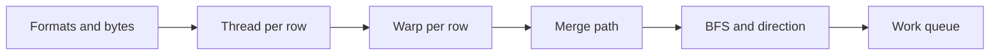
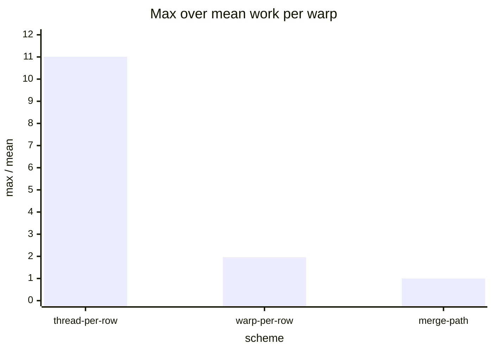
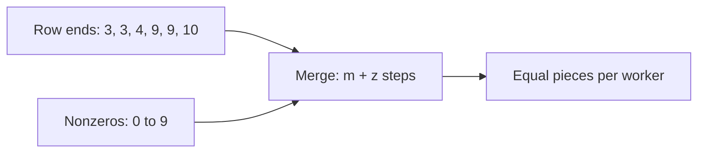

# Introduction

How do you split work evenly when the pieces are uneven, and how many bytes does the data cost to store?

Note:
This is the question for the whole talk. A sparse matrix, a graph, and a mixture-of-experts batch all have pieces of unpredictable size. The arithmetic is simple. The hard part is keeping 108 SMs busy until the last warp finishes, and that is a property of how you divide the work, not of the multiply-add.

### Where uneven work shows up in ML {#where}

- A graph neural network aggregates neighbors with an SpMV
- A recommender looks up a ragged set of embedding ids
- A mixture-of-experts layer routes a different token count to each expert
- A pruned model with a 2:4 pattern is a different problem, from chapter 20

Note:
Name the cases the audience recognizes. Chapter 20 already showed that experts get different batch sizes, and this chapter generalizes it. Say clearly that 2:4 structured sparsity is not what we study today. It has no row pointer and no gather, and chapter 20 owns it. Everything here runs on the CUDA cores and is limited by bandwidth.

### The road through this deck {#roadmap}



Note:
Six stops. The first is storage. The next three are SpMV kernels, each fixing the last one's weakness. Then a graph traversal, which has the same imbalance and one new problem, claiming a vertex. The last stop is a queue that balances work the code can't predict. Each stop is a lab check except the GPU kernels, which skip without a GPU.

# Sparse formats

Three ways to write down only the dots.

Note:
Section divider. We start with bytes, because the format decides both the memory cost and the kernel's access pattern.

## Storing the nonzeros

### COO, CSR, and ELL {#formats}

- COO stores a row, a column, and a value per nonzero
- CSR replaces the row indices with $m+1$ offsets
- ELL pads every row to the longest and stores two dense arrays
- Row $i$ of CSR owns `row_ptr[i]` up to, not including, `row_ptr[i+1]`

Note:
Walk the picture. COO repeats the row index for every entry in a row. CSR sorts by row then column and keeps only where each row starts. ELL gives up compactness for a regular shape by padding to the longest row. Stress the half-open range, because the off-by-one in the loop bound is the first bug the lab catches.

### Bytes, in float32 with 4-byte indices {#bytes}

$$
B_{\text{COO}} = 12z, \qquad B_{\text{CSR}} = 4(m+1) + 8z, \qquad B_{\text{ELL}} = 8mw
$$

The six-row example, rows of 3, 0, 1, 5, 0, and 1 entries, costs 120, 108, and 240 bytes.

Note:
Here $z$ is the nonzero count, $m$ the rows, and $w$ the longest row. For the six-row example $z$ is 10, so COO is 120 bytes and CSR is 7 offsets plus 10 pairs, 108. ELL pads to 5 entries per row for 240 bytes, 20 entries of it padding. Only ELL's cost depends on the single worst row, and that is its weakness on skewed data.

### One long row ruins ELL {#ell-breaks}

| Format | Bytes on the lab matrix | Against CSR |
|---|---|---|
| COO | 394,056 | 1.41x |
| CSR | 279,092 | 1.00x |
| ELL | 37,781,504 | 135.4x |
| Hybrid | 383,288 | 1.37x |

> [!QUESTION] Why does ELL cost 135 times more than CSR here?
> The matrix has 4,096 rows and a longest row of 1,153 entries. ELL gives every row 1,153 slots, so 4,095 rows carry padding for one row.

Note:
The lab matrix is seeded: 4,096 by 4,096, 32,838 nonzeros, a mean row of 8.02, a heavy-tailed Pareto row length. These are arithmetic on the formulas, not measurements. The hybrid keeps ELL at width 4 and spills the overflow to COO, which brings the cost back to 1.37 times CSR.

### The intensity is 0.217 {#intensity}

$$
B = 4(m+1) + 8z + 4n + 4m, \qquad I = \frac{2z}{B}
$$

For the lab's GPU matrix, $B = 47{,}757{,}548$ bytes and $I = 0.217$ FLOP per byte.

> [!QUESTION] How far below the ridge is that?
> The A100's float32 ridge is $19.5 / 1.935 = 10.1$ FLOP per byte, so SpMV sits about 46 times below it.

Note:
The matrix has 524,288 rows and 5,183,261 nonzeros with rows capped at 65,536. Each nonzero reads a 4-byte index, a 4-byte value, and a gathered element of x, and x is counted once because it fits in the L2. That gives 9.21 bytes per nonzero. The point is bandwidth: the floor is 0.0375 ms at the 1275 GB/s copy ceiling measured in learn-inference. It is a prediction, and the lab measures the real number.

### Thread per row {#tpr}

```cuda
int row = blockIdx.x * blockDim.x + threadIdx.x;
float acc = 0.0f;
for (int k = rp[row]; k < rp[row + 1]; ++k)
    acc += v[k] * x[ci[k]];
y[row] = acc;
```

Note:
The shortest kernel. Each lane owns one row and loops over its entries. In Bell and Garland's terms this is the scalar kernel. Read it aloud and ask the room what happens when the 32 lanes of a warp hold rows of length 3, 3, 3, and 1,153. The answer is the next slide.

### The longest row sets the warp's time {#tpr-cost}

- The 32 lanes run the loop in lockstep
- The warp runs as many iterations as its longest row
- Lane $l$ reads addresses one row length apart, so each lands in its own sector
- On the lab matrix a warp runs up to 1,153 iterations against a mean of 104.7

> [!QUESTION] Is that a flat 8 times the traffic?
> No. L1 can keep a sector for later iterations, so the cost is cache pressure.

Note:
The time cost is the bigger one. The work of a warp is its iteration count, and the warp with the 1,153-entry row runs about eleven times the mean. Lane use, useful lane-steps over lanes times iterations, is 0.077. About 8 percent of lane slots hold real work. The rest idle behind a longer row.

### Warp per row {#wpr}

```cuda
for (int k = rp[row] + lane; k < rp[row + 1]; k += 32)
    acc += v[k] * x[ci[k]];
for (int off = 16; off > 0; off >>= 1)
    acc += __shfl_down_sync(0xffffffff, acc, off);
if (lane == 0) y[row] = acc;
```

Note:
Give a whole warp one row. The lanes read 32 consecutive entries, which is a coalesced load, and then the shuffle tree from chapter 6 sums them. A grid-stride loop deals row i to warp i mod W. A row of 1,153 entries now takes 37 iterations instead of 1,153. Ask where this loses, and let the room answer before the next slide.

### Where warp per row loses {#wpr-cost}

- Short rows use a few lanes, then pay a five-step shuffle tree
- 97% of the lab matrix's rows have 32 or fewer entries
- Lane use is 0.228, three times better than thread per row
- One huge row is still one warp: 2,048 iterations for 65,536 entries

> [!KEY]
> A fixed assignment by row can't beat the row-length distribution.

Note:
Two losses. Short rows waste lanes, and a single enormous row is still serial across one warp's 32 lanes. On the lab matrix the work per warp ranges from 32 to 69. The cure for both is to stop assigning work by row at all.

# Measuring imbalance

One ratio says how much a kernel waits.

Note:
Section divider. We need a number before a fix, so we know when a fix works.

## Max over mean

### Imbalance is max over mean {#imbalance}

$$
\text{imbalance} = \frac{\max_w W_w}{\tfrac{1}{P}\sum_w W_w}
$$

Value 1 means no warp waits. Value 11 means 91% of warp-time is waiting.

> [!QUESTION] Why divide by the mean and not the median?
> Every warp starts together and the kernel ends with the last one. The mean is the time with perfect sharing, so the ratio is the slowdown from imbalance alone.

Note:
Define work as the iterations of a warp's loop. The ratio is a model, not a measurement. It is a lockstep count from the lab's warp_work function, so you can compute it before writing a kernel and decide whether imbalance is your problem. A value of 11 means the slowest warp does 11 times the average work.

### The three schemes on one matrix {#three-schemes}



Note:
The seeded 4,096-row matrix, 128 warps. Thread per row is 11.01, warp per row is 1.96, and merge path is 1.002. The absolute iteration counts across schemes are not comparable, because the iterations do different work. The ratios within a scheme are the point. The next slide lets the audience see all 128 warps.

### All 128 warps {#warp-work}

```viz
32-warp-work
```

Note:
Switch between the schemes. Thread per row is a few spikes over a floor, and every spike is a long row. Warp per row has a floor of 32, because each warp owns 32 rows and each costs at least one iteration. Merge path is flat. Turn on the shared scale to show merge path against thread per row on one axis.

# Merge path

Split the work, not the rows.

Note:
Section divider. This is the central idea of the chapter. It comes from Merrill and Garland's merge-based SpMV, and the chapter derives it from the picture.

## The idea

### Two lists, one path {#two-lists}

- List A: the row end offsets, `row_ptr[1:]`
- List B: the nonzero indices 0, 1, 2, and so on
- Take a row end when it is at most the next nonzero's index
- The path has $m + z$ steps, and a step is a row finished or a nonzero consumed



Note:
A step on this path is exactly the work to be done: write an output, or do one multiply-add. The path doesn't care how nonzeros group into rows. Cut it into P equal pieces and every worker has equal work by construction. For the six-row example, m plus z is 16, and four workers get 4 steps each.

### Where does each piece start? {#diagonal}

Cut points at diagonals 0, 4, 8, 12, and 16, as (rows finished, nonzeros consumed):

| Worker | From | To | Rows | Nonzeros |
|---|---|---|---|---|
| 0 | (0, 0) | (1, 3) | 1 | 3 |
| 1 | (1, 3) | (3, 5) | 2 | 2 |
| 2 | (3, 5) | (3, 9) | 0 | 4 |
| 3 | (3, 9) | (6, 10) | 3 | 1 |

Note:
Every piece covers 4 steps, though the nonzero counts are 3, 2, 4, and 1. Worker 2 finishes no row, and worker 3 finishes three, one of them empty. Row 3, at positions 4 to 8, spans workers 1, 2, and 3. Splitting two rows per worker would give nonzero counts 3, 6, 1, and 0.

### A binary search on the diagonal {#search}

$$
\text{row mid is behind } d \iff \texttt{row\_ptr}[\text{mid}+1] \le d - 1 - \text{mid}
$$

- Search between $\max(0, d - z)$ and $\min(d, m)$
- About 19 steps for half a million rows
- Each worker does two searches, one per end of its piece

> [!QUESTION] How do you know the search is right?
> The lab compares every boundary with a brute-force walk of the path, one step at a time.

Note:
Say what the comparison means. On diagonal d, row mid's end offset is paired against nonzero d minus 1 minus mid. If the row ends at or before that nonzero, the row is behind the diagonal and the search moves right. The brute-force check in the lab is the safety net, and it is also what catches a partition that splits by rows alone.

### Walking a piece and fixing the seam {#walk}

```cuda
if (i < n_rows && rp[i + 1] <= j) {
    atomicAdd(&y[i], running); running = 0.0f; ++i;
} else {
    running += v[j] * x[ci[j]]; ++j;
}
```

After the loop, `atomicAdd` any leftover running sum into `y[i]`.

Note:
Each step either ends a row or consumes a nonzero. A row that spans workers gets one atomic add from each, and y starts at zero. The cost is that float addition isn't associative, so a spanning row's last bits can vary between runs. A production kernel stores interior rows plainly and sends only the boundary carry-outs through an atomic or a second pass.

### Where merge path pays, and where it loses {#merge-cost}

- Balance is 1.002 on the lab matrix, whatever the rows look like
- It pays two binary searches per worker and an atomic per row end
- A stencil with uniform short rows might do better with ELL
- The last worker's piece is shorter when $m+z$ is not a multiple of $P$

> [!QUESTION] What is the plausible wrong merge path?
> Splitting by rows alone, or by nonzeros alone. Both equalize one count and leave the work uneven, and the lab's brute-force check fails them.

Note:
Be honest about the trade. Merge path buys balance and pays in searches, atomics, and a branchy inner loop. For regular matrices that trade is a loss. The decision table in the chapter pairs each matrix shape with a kernel. The wrong implementation named here is also in the test file's comments, so you can point readers there.

# Graph traversal

A graph in CSR is a matrix whose columns are neighbors.

Note:
Section divider. BFS has the same imbalance, plus one new problem: two threads can reach the same vertex.

## Top-down

### Levels and the frontier {#frontier}

- Level 0 is the source, and level $k+1$ is the unvisited neighbors of level $k$
- The set at the current level is the frontier
- Rounds are sequential, and the work inside a round is parallel
- The lab graph has 1,520 vertices, 20 of them detached, and 4 levels

Note:
Use the stone-in-water picture. The first ring is the source's neighbors. You can't expand ring 3 before ring 2 is complete, so each round is a kernel launch. Inside a round, every frontier vertex expands on its own. The lab graph is a seeded preferential-attachment graph, so a few hubs hold most edges and the diameter is small.

### Claiming a vertex with an atomic {#claim}

```cuda
if (atomicCAS(&level[v], -1, depth + 1) == -1)
    next[atomicAdd(next_size, 1)] = v;
```

> [!QUESTION] Why not just check `level[v] == -1` and write?
> Two frontier vertices can read $-1$ at once, and both would append $v$. The compare-and-swap lets exactly one thread see $-1$.

Note:
Two atomics, two jobs from chapter 7. The compare and swap decides the winner, and the add hands the winner a slot in the next frontier, like a histogram counter. The host launches one kernel per level, reads the next size, and swaps the two buffers. The same hubs that unbalance SpMV reappear: the thread that expands a hub does most of the round's work.

## Bottom-up

### Flip the question {#bottom-up}

- Every unvisited vertex scans its neighbors and stops at the first frontier vertex
- Each vertex writes only itself, so no atomics
- It needs both edge directions and a frontier bitmap
- Cost grows with unvisited vertices over frontier size

> [!QUESTION] Does bottom-up work on a directed graph?
> Only if the edges are stored in both directions, because a vertex looks for frontier vertices that point to it.

Note:
Bottom-up reverses the roles. Instead of the frontier pushing to its neighbors, each unvisited vertex pulls from the frontier. The technical report converts the frontier from a queue to a bitmap for a constant-time membership test. The wrong implementation to name is a round that labels vertices as it goes and accepts any labeled neighbor, which lets a chain of vertices join one round.

### Cost per level on the lab graph {#per-level}

| Level | Frontier | Top-down edges | Bottom-up edges |
|---|---|---|---|
| 0 | 1 | 85 | 8,028 |
| 1 | 85 | 992 | 4,659 |
| 2 | 605 | 4,282 | 1,094 |
| 3 | 766 | 3,479 | 81 |
| 4 | 43 | 144 | 38 |

Note:
Both columns are computed from the same state at each level, with a Python loop and no GPU. Top-down wins while the frontier is small, and bottom-up wins from level 2. The cheapest choice at every level totals 2,290 edges, against 8,982 for top-down alone. A rule has to pick without seeing the other column, and that is the next slide.

### The switch rule {#switch}

$$
\hla{\alpha\, m_f > m_u}: \text{ go bottom-up}, \qquad \hlb{\beta\, n_f < n}: \text{ go top-down}
$$

Here $m_f$ is the frontier's edges, $m_u$ the unvisited vertices' edges, and $n_f$ the frontier size.

Note:
Two thresholds that a BFS knows before it runs the round. Alpha asks whether the frontier's edges are a large share of everything left. Beta asks whether the frontier has shrunk to a small fraction of the vertices. These are the lab's rule, one simple form of the cutoffs that Beamer's report describes. The constants depend on the graph.

### The constants are not portable {#alpha}

```viz
32-bfs-directions
```

Note:
Drag alpha. For alpha up to 8 the rule picks the cheaper direction at four of the five levels and examines 2,396 edges, 3.75 times fewer than top-down. At alpha 15 it switches one level early and examines 6,063. The lab's default of 4 is a choice for this graph, not a constant from a paper. Tell the room to sweep alpha on their own graphs.

# Work queues

When the cost of a task is unknown, hand tasks out as workers become free.

Note:
Section divider. Merge path works because row lengths are known up front. This section is for the case where they aren't.

## A persistent kernel

### Static assignment fails on skew {#static}

- 64 tasks, every eighth costs 100, and the rest cost 1
- 8 workers, task $i$ goes to worker $i \bmod 8$
- Worker 0 gets all eight heavy tasks and finishes at 800
- The others finish at 8

> [!QUESTION] Is that contrived?
> The stride is, but any pattern that correlates task cost with index does the same, such as sorted inputs or periodic structure.

Note:
The checkout-lane picture. Eight lanes, 64 customers, and every eighth customer has a big cart. Assigning in advance puts all the big carts in one lane. The stride-8 pattern is built to make the point, but real inputs correlate cost with position more often than people expect, for example after a sort.

### A counter in global memory {#counter}

```cuda
if (threadIdx.x == 0) task = atomicAdd(&queue_head, 1);
__syncthreads();
if (task >= n_tasks) break;
run_task(task);
__syncthreads();
```

Launch only as many blocks as fit at once. Each block loops.

Note:
This is a persistent kernel. One thread per block fetches the task number and a barrier shares it, so a block of 256 threads does one atomic per task and not 256. The second barrier stops thread 0 overwriting the task before everyone has used it. Keep tasks independent, because a block that waits on another block can deadlock when not every block is resident.

### The queue has a bound {#bound}

$$
T \le \frac{\sum_i c_i}{W} + c_{\max}\left(1 - \frac{1}{W}\right)
$$

- Lab task set: the bound is 194.5
- Dynamic queue: 119
- Static assignment: 800

> [!QUESTION] What breaks the queue?
> Tasks so short that one counter in the L2 becomes the bottleneck. Take a chunk per fetch to trade a little tail imbalance for fewer atomics.

Note:
The first term is perfect sharing and the second is the price of the last task starting late. When the last task starts, every worker has been busy, so it starts by sum minus its own cost over W, and it then runs for its cost. The lab simulates this with a heap on the CPU. The result of 119 against 800 is a factor 6.7, and it sits under the bound.

# Summary

Equal shares, whatever the data looks like.

Note:
Section divider. We close with the decisions and the numbers to remember.

### What to remember {#remember}

- CSR costs $4(m+1) + 8z$ bytes, and ELL costs $8mw$
- SpMV does 2 FLOP per nonzero at 0.217 FLOP per byte, so it is bandwidth bound
- Imbalance is max over mean work per warp: 11.01, 1.96, and 1.002
- Merge path cuts $m+z$ steps into equal pieces by a binary search
- BFS claims with `atomicCAS`, and direction optimization cut 8,982 edges to 2,396
- An atomic queue finishes within perfect sharing plus almost one largest task

Note:
Read the six lines and tie each to a lab check. All the imbalance and edge numbers are from the seeded matrix and graph, computed by the reference solution on a CPU, not measured on a GPU. The roofline floor of 0.0375 ms is a prediction for the GPU matrix, and the lab measures the real figure on an A100.

### Which one to pick {#decision}

| Data | Row lengths | Choice |
|---|---|---|
| Stencil, bounded-degree mesh | Nearly equal | ELL, thread per row, column-major |
| Moderate rows of 32 or more | Some spread | CSR, warp per row |
| Power law, empty rows | Heavy tail | CSR with merge path, or a hybrid |
| Tasks of unknown cost | Unknown | Persistent kernel with an atomic counter |

Note:
Offer the table as a starting point and not a rule. The row-length histogram is cheap, using chapter 7's histogram, and a library can choose per matrix. The lab doesn't ask you to choose. It asks you to measure the cost of each choice on one matrix. Mention that ELL's column-major layout makes thread per row coalesced, which is why it works for regular matrices.

### What comes next {#next}

- Lab 32 builds CSR from COO, the merge-path split, and both BFS rules in Python
- On a GPU it checks three SpMV kernels against `torch.sparse`
- Chapter 20 owns 2:4 structured sparsity and the grouped GEMM scheduler
- Part 2's patterns, reduce, scan, and now balance, return in attention and MoE

> [!QUESTION] What is the one wrong implementation to watch for?
> A merge-path partition that splits by rows or by nonzeros alone, and an SpMV loop that ends at `row_ptr[i+1] - 1`.

Note:
Close by pointing at the lab. The CPU checks run anywhere, and the CUDA checks skip without a GPU, so nobody is blocked. The thread-per-row kernel is given, and the reader writes the warp-per-row and merge kernels. Tell them the first compile takes 30 to 60 seconds and that the thread-per-row time ratio is a loose check, not a gate.
