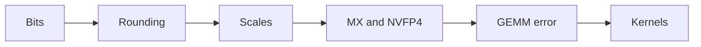
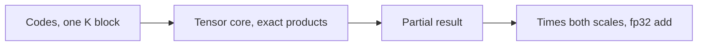
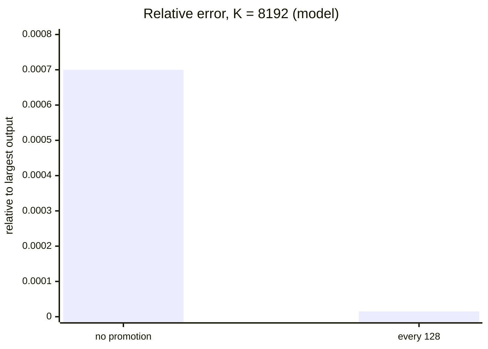

# Introduction

An 8-bit matmul is half the bytes and, on Hopper, twice the arithmetic. What does it cost in accuracy, and who pays?

Note:
Open with the promise people have heard: FP8 doubles throughput. Then say the price is in the numbers, and that the whole hour is about the three decisions that set the price: the scale, the rounding, and the accumulator. File number 33 sits in Part 4, after the training and MoE kernels. Prerequisites are chapters 9 and 18.

### What you already know {#known}

- Chapter 9: sign, exponent, mantissa, and the format table
- Chapter 18: a scale leaves the sum only inside its block
- The A100 has no FP8 or FP4 tensor core
- Serving methods such as GPTQ and AWQ live in learn-inference

Note:
Say what this deck does not repeat. The format table is in chapter 9, and where the scale sits in a GEMM is in chapter 18. Weight quantization for serving, including GPTQ, AWQ, and the KV cache, belongs to the companion course. New here: the bit-level encoder, four scale recipes, unbiased rounding, and the accumulator.

### Six stops {#route}



Note:
Six stops, each with one worked number. Bits is E4M3, E5M2, and E2M1. Rounding is ties to even, overflow, and stochastic rounding. Scales covers per-tensor, per-block, and delayed against current. Then the two 4-bit recipes. Then the error of the product, including the accumulator. Then the kernels you can and can't run on the lab A100.

# Reading the bits

A format is a layout and a rule for the top exponent.

Note:
Everything later depends on being able to decode a byte by hand. Spend the time here, because the lab asks for a bit-exact encoder.

### E4M3 and E5M2 {#fp8-table}

| | E4M3 (fn) | E5M2 |
|---|---|---|
| Bias | 7 | 15 |
| Infinity | none | `0x7C` |
| NaN | `0x7F` | `0x7D` to `0x7F` |
| Largest | 448 | 57,344 |
| Smallest subnormal | $2^{-9}$ | $2^{-16}$ |

Note:
The fn in E4M3fn means finite. The format gives up infinity so the top exponent holds the numbers from 256 to 448, and only the all-ones pattern is NaN. E5M2 keeps IEEE behavior. The same byte means different things in the two formats, so FP8 data is meaningless without its format.

### Decode `0x7E` and `0x01` {#decode}

- `0x7E` = `0 1111 110`: $2^{15-7} \times (1 + 6/8) = 448$
- `0x01` = `0 0000 001`: subnormal, $2^{-6} \times 1/8 = 2^{-9}$
- `0x7C` is infinity in E5M2 and $2^{8} \times 1.5 = 384$ in E4M3

> [!QUESTION] Why does E4M3 keep the top exponent?
> It trades infinity for range: 7 more finite values from 256 to 448. An 8-bit format can't afford to waste 6.25% of its codes on infinity and NaN.

Note:
Do the first decode on the board: exponent field 15, bias 7, scale 256, significand 1.75, value 448. The second shows a subnormal: exponent field zero, so no implicit one. The third bullet is the warning about types.

### Which format for what {#which}

- E4M3 range ratio: $448 / 2^{-9} = 229{,}376$
- E5M2 range ratio: $57{,}344 / 2^{-16} \approx 3.76 \times 10^{9}$
- Forward values: E4M3, for the extra mantissa bit
- Gradients: E5M2, for range
- DeepSeek-V3: E4M3 everywhere, with fine-grained scales

Note:
The ratio of largest to smallest is the dynamic range. A scaled weight fits the E4M3 ratio, and a gradient needs more. The FP8 formats paper recommends E4M3 forward and E5M2 for gradients. DeepSeek-V3 reports E4M3 for all tensors and credits the fine-grained scales for the range. The scales section explains why that works.

### The 4-bit element, E2M1 {#e2m1}

| Code | 000 | 001 | 010 | 011 | 100 | 101 | 110 | 111 |
|---|---|---|---|---|---|---|---|---|
| Value | 0 | 0.5 | 1 | 1.5 | 2 | 3 | 4 | 6 |

Bit 3 is the sign. Code 8 is negative zero.

> [!QUESTION] How do you store a tensor of these?
> Two codes per byte, the even index in the low nibble, as in chapter 18's int4 packing.

Note:
Eight positive values. No infinity and no NaN, so the top exponent is finite. The gaps are 0.5, then 1, then 2. With only these eight values, the block scale does almost all of the work of fitting the data, which is where the second half of the deck goes. Two codes make a byte, and the packing is the same as the int4 packing from chapter 18.

# Rounding

Every conversion lands on a ladder of rungs, and the tie rule decides the bias.

Note:
The encoder is a rounder plus a packer. Rounding is where most bugs live, and tie handling is where the bugs hide.

### Gap, divide, round, multiply {#rne}

$$
\operatorname{round}(x) = g \cdot \operatorname{RNE}\!\left(\frac{x}{g}\right), \qquad g = 2^{\max(\lfloor \log_2 |x| \rfloor,\, \text{emin}) - m}
$$

- $g$ is the gap in $x$'s binade
- Below the smallest normal, $g$ stops shrinking
- RNE sends an exact tie to the even integer

Note:
This is the whole algorithm. Find the binade with a frexp, take the gap two to the exponent minus mantissa bits, clamp the exponent at the smallest normal so subnormals share one gap, divide, round to nearest even, multiply back. Then pack the sign, exponent field, and mantissa field. The lab's round_minifloat does exactly this in float64.

### Ties in E4M3 {#ties}

- $17 / 2 = 8.5$ is a tie, and RNE picks 8, so 16
- Round-half-up gives 18
- $19 / 2 = 9.5$ is a tie, and RNE picks 10, so 20
- Half-up also gives 20

> [!QUESTION] Isn't a tie rare?
> No. Every midpoint of two FP8 values is exact in float32, and data that was quantized earlier lands on shared midpoints.

Note:
Two worked ties. In the first, half-up and RNE disagree. In the second they agree, so a test with a handful of ties can pass a wrong rounder. The lab builds every midpoint of both formats plus a value a hair either side. RNE alternates direction along the ladder, which removes the drift of half-up.

### Overflow: NaN, infinity, or clamp {#overflow}

- E4M3: 464 is a tie that goes to 448, and 465 becomes NaN
- E5M2: 61,440 is a tie that goes to infinity
- `satfinite` clamps both to the largest finite value
- Quantizers for training saturate

> [!WARNING] `torch.tensor(500.).to(torch.float8_e4m3fn)` is NaN in torch 2.11 and 448 in torch 2.15

Note:
Rounding runs as if the exponent had no limit, then compares with the maximum. In E4M3 the next rung above 448 would be 480, and 464 is the midpoint, which goes to 448's even mantissa. Above it a non-saturating conversion returns NaN. Torch changed its own cast between 2.11 and 2.15, so the lab checks the rule, not torch. In E5M2 the next rung is 65,536 and the tie goes to infinity. One NaN poisons the step, so a quantizer clamps.

### Stochastic rounding {#sr}

$$
P(\text{round up}) = \frac{x - \text{lo}}{\text{hi} - \text{lo}}, \qquad E[\text{result}] = x
$$

```viz
33-rounding-grid
```

Note:
Walk the proof: the expected value is lo times one minus p, plus hi times p, which is x. Then use the slider. At 0.3 on the E2M1 grid, round to nearest always returns 0.5. The stochastic rounder returns 0.5 six times in ten and zero four times in ten, and the mean is 0.3.

### The sum of 1000 copies of 0.3 {#sr-sum}

- Round to nearest: every copy is 0.5, so the sum is 500
- Stochastic: mean 300, standard deviation $0.245 \sqrt{1000} = 7.7$
- Error grows like $\sqrt{n}$, not $n$
- Cost: noise, up to $(\text{hi} - \text{lo})^2 / 4$ per value

> [!QUESTION] When should you not use it?
> When each value is used once. Round to nearest has lower mean squared error there.

Note:
Arithmetic from the chapter. One draw has mean 0.3 and variance 0.24 times 0.25, which is 0.06, so a standard deviation of 0.245. A thousand draws add in quadrature. Stochastic rounding matters where many roundings accumulate, such as gradients and small weight updates that would vanish under round to nearest. The generator is part of the kernel: a counter-based generator keyed by element index makes the result independent of thread assignment, and the lab seeds a torch generator to the same effect.

# Scales

A format covers a fixed range. A scale moves your data into it.

Note:
The scale is where recipes differ, and where most of the error comes from in practice.

### One outlier, one row {#outlier}

- Scale $s = \text{amax} / 448$, stored $q = \operatorname{round}(x / s)$
- Row with 1.0 and an outlier of $10^{5}$: $s = 223.2$
- $1.0 / 223.2 = 0.00448$ lands in the subnormals, 2.29 gaps of $2^{-9}$
- It rounds to 2 gaps and returns as 0.872, a 12.8% error
- With an outlier of $10^{3}$ it returns as 0.977, a 2.3% error

Note:
The outlier sets the scale. The small value is divided by a big scale and falls below the smallest normal number, where the gap is a fixed two to the minus nine. It rounds to two gaps and comes back as 0.872. With a smaller outlier it stays normal, and its error is 2.3 percent. The lab computes both numbers.

### How far one outlier reaches {#outliers-fig}

```viz
33-scale-outliers
```

Note:
Slide the outlier size. Per-tensor E4M3 holds near 2.6 percent through 10 to the 3, is 4.8 percent at 10 to the 4, 48 percent at 10 to the 5, and fails at 10 to the 6. A 1x128 tile stays at 2.6 percent. NVFP4's tensor-level scale fails at 10 to the 6. The numbers come from the chapter's figure script, using the lab's functions.

### Granularity {#granularity}

| Granularity | Values per scale | Overhead |
|---|---|---|
| Per tensor | all | negligible |
| Per channel | one row or column | $1/K$ per element |
| 1x128 tile | 128 | 32 bits per 128 |
| 128x128 block | 16,384 | 32 bits per 16,384 |
| MX block | 32 | 8 bits per 32 |
| NVFP4 block | 16 | 8 bits per 16, plus one fp32 |

Note:
Finer scales cost more storage and kernel work, and they reach less far when an outlier appears. 1x128 for activations is per token per 128 channels. 128x128 for weights is a block of the weight matrix. MX and NVFP4 push the block to 32 and 16, which is affordable only when hardware applies the scale inside the matrix instruction.

### Delayed against current scaling {#delayed}

- Current: amax of this tensor, exact, but an extra pass
- Delayed: amax of earlier steps, no extra pass
- History $[1, 0.9, 1]$, new amax 4: delayed scale $1/448$
- Largest element: $4 \times 448 = 1792$ saturates to 448, returns as 1.0
- Current scaling returns 4.0

> [!QUESTION] What does DeepSeek-V3 do?
> Current scaling, computed online for each 1x128 tile and each 128x128 block.

Note:
A scale needs an amax, and the amax is known only after the producing op. Delayed scaling reads the history and is cheap, but it clips when the tensor outgrows the window: an error of 3.0 on a value of 4.0. Current scaling pays a pass and is exact. With thousands of small blocks, a history per block is impractical. The lab asserts both numbers.

# MXFP4 and NVFP4

Eight positive values leave the scale to do the work.

Note:
Now the two 4-bit recipes. Both use E2M1 elements and differ only in the scale.

### MX: a power of two on 32 {#mx}

$$
X = 2^{\lfloor \log_2 \text{amax} \rfloor - e_{\max}}, \qquad e_{\max} = 2 \text{ for E2M1}
$$

- Stored as an E8M0 byte: $2^{c - 127}$, with 255 as NaN
- After scaling, the block's amax is in $[4, 8)$
- Values in $(6, 8)$ clamp to 6
- Worst error: a quarter of the block amax

Note:
The OCP conversion: take the block amax, floor its log, subtract the largest exponent of the element format, which is 2 for E2M1 because 6 is 1.5 times 2 squared. Divide, round, and clamp overflow. E8M0 is a bare exponent with bias 127. The clamp and the coarse top gap give a worst case of a quarter of the amax, which the lab asserts.

### A ceil is not a floor {#ceil}

- Block $[0.3, -1.7, 5.2, 0.05]$: amax 5.2, floor gives exponent 0
- Elements round to $0.5, -1.5, 6, 0$
- A ceil gives exponent 1, a scale of 2
- Nothing clamps, but the top binade of E2M1 goes unused

> [!WARNING] The bug runs, and the error is only slightly worse

Note:
Use the block from chapter 9. The floor is two, minus two, is zero: a scale of one, byte 127. The ceil is three, minus two, is one. The result looks plausible and the error is only a bit larger, because the grid is coarser relative to the block. Only a test that asserts the exponent of a known block finds it.

### NVFP4: an E4M3 scale on 16 {#nvfp4}

$$
s_T = \frac{\text{amax}_T}{448 \times 6}, \quad s_b = \operatorname{E4M3}\!\left(\frac{\text{amax}_b}{6\, s_T}\right), \quad q_i = \operatorname{E2M1}\!\left(\frac{x_i}{s_b\, s_T}\right)
$$

- $s_T$ is fp32, one per tensor
- $s_b$ is one E4M3 byte per 16 elements
- Cost: $4 + 8/16 = 4.5$ bits per element

Note:
The NVIDIA post describes 16-element blocks, E4M3 scales, and one fp32 scale per tensor. It doesn't print the formulas, so this is the common convention that the lab uses. The tensor scale sends the largest block scale to 448. The block scale has a mantissa, so it isn't limited to powers of two. Dropping the tensor scale when you save a tensor is a real bug.

### The same block in both formats {#same-block}

Block $[2.4, 0.9, -1.3, 0.2]$ in a tensor with amax 100.

| | Scale | Returns | Largest error |
|---|---|---|---|
| MXFP4 | 0.5 | $2.0, 1.0, -1.5, 0.25$ | 0.4 |
| NVFP4 | 0.4092 | $2.455, 0.818, -1.228, 0.205$ | 0.082 |

> [!QUESTION] Why is NVFP4 closer?
> The E4M3 scale has a mantissa, so it places the amax near 6. A power of two can't.

Note:
MXFP4: floor of log2 2.4 is 1, minus 2 is minus 1, a scale of 0.5. The 2.4 becomes 4.8, nearer 4 than 6, so it returns as 2.0. NVFP4: the tensor scale is 100 over 2688, 0.0372. The raw block scale is 10.75, which E4M3 rounds to 11. So 2.4 maps to 5.87 and rounds to 6. The lab's Gaussian test measures an MSE of 0.0089 against 0.0132.

### Where NVFP4 breaks {#nvfp4-breaks}

- Raw block scale $= 448 \times \text{amax}_b / \text{amax}_T$
- It enters E4M3's subnormals past a ratio of $448 \times 512 = 229{,}376$
- Outlier rows at $10^{5}$: NVFP4 error 14.1%
- At $10^{6}$: every normal block's scale underflows, error 100%
- MXFP4 and 1x128 tiles don't depend on a tensor-wide maximum

Note:
A second-level scale buys range for the first level, and the first level has a finite range too. The raw block scale is 448 times the block's amax over the tensor's amax. Once that ratio makes the raw scale smaller than the subnormal gap of E4M3, the scale loses its bits or flushes to zero. The figure shows it at 10 to the 6. Real tensors rarely have such an outlier inside one tensor, and recipes add their own measures. The mechanism is the lesson.

# The error of a GEMM

Two errors: one from the format, one from the sum.

Note:
Move from a single tensor to a product. The scale placement from chapter 18 tells us where each error enters.

### Scales leave the inner sum {#factored}

$$
C_{ij} = \sum_{b} s^A_{i,b}\, s^B_{b,c(j)} \sum_{k \in \text{block } b} Q^A_{ik}\, Q^B_{kj}
$$



Note:
The inner sum is a plain matrix product on codes, which is what a tensor core computes. The scales apply once per K block to the partial result, and the promotion into the fp32 total happens on the CUDA cores. That is why both shapes have the same 128 along K: one pair of scales covers exactly one inner sum.

### Quantization error {#quant-err}

$$
\left| \sum_k \hat{a}_k \hat{b}_k - \sum_k a_k b_k \right| \le (2u + u^2) \sum_k |a_k b_k|, \quad u = 2^{-4}
$$

- E4M3 in the normal range: $u = 6.25\%$, so a bound of 12.5%
- Random signs add like $\sqrt{K}$
- Lab, seeded Gaussian input: 3.4% with 1x128 and 128x128

Note:
The bound assumes a relative rounding error of at most u per element, which holds in the normal range. It is relative to the sum of absolute products, so cancellation makes the relative error of the result larger. With random signs the errors partly cancel. Outside the normal range the bound fails, which is the per-tensor case with an outlier.

### The narrow accumulator {#accumulator}

- DeepSeek-V3: H800 FP8 accumulation keeps "around 14 bits"
- Promote to fp32 on CUDA cores every $N_C = 128$ elements
- 128 elements are 4 `wgmma` instructions, so 32 per instruction
- The lab models it: round to 14 bits after each 32, restart each $N_C$

> [!QUESTION] Is the model the hardware?
> No. The report gives only "around 14 bits". The model shows the mechanism, not the exact rounding.

Note:
Products are exact, but the running sum lives in a register of limited width, so chapter 9's stall argument applies: low bits vanish once the sum is large next to the terms. The fix is to cut the run short. After 128 elements the partial result moves to fp32 and the accumulator restarts. The lab's accumulator is a model of that behavior.

### Worst case, then measured {#acc-numbers}

- $K = 8192$, products near 1, 32 per step, 256 steps
- No promotion: $2^{-14} \times 32 \times 32{,}896 = 64.2$, 0.78% of 8192
- Every 128: $64 \times 2^{-14} \times 320 = 1.25$, 0.015%
- Worst-case ratio: 51
- Lab measures $7 \times 10^{-4}$ and $1.5 \times 10^{-5}$, a ratio of 46

Note:
Do the arithmetic from the model. Each step errs by at most 2 to the minus 14 of the accumulator, which is about 32 times the step count. Summing the arithmetic series for 256 steps gives 64.2. With promotion, each chunk has four steps with accumulators 32, 64, 96, and 128, and there are 64 chunks. Both measured values sit under the bounds because the roundings partly cancel. The ratio is what matters: the error scales with how long the narrow accumulator runs.



# The kernels

The A100 can run the control flow, not the speed.

Note:
Be honest about the hardware: the lab card has no FP8 tensor cores. Say what still runs and what it proves.

### What runs on the A100 {#a100}

- `torch.float8_e4m3fn` as a storage dtype: the round trip a Hopper kernel sees
- Every E4M3 value is exact in fp16
- A Triton kernel multiplies fp16 codes with an fp32 accumulator
- It applies both scales once per 128 along $K$

> [!QUESTION] Does it prove FP8 speed?
> No. It proves the loop structure and the scale indexing. The lab compares it with the CPU emulation.

Note:
Because E4M3 is a subset of fp16, the kernel holds the quantized values in fp16 tensors, runs tl.dot into an fp32 partial, and adds partial times the two scales into an fp32 total. That is the DeepSeek loop. The lab checks it against the CPU emulation to a relative error of 1e-4. The Triton time says nothing about FP8 throughput.

### The Triton loop {#triton}

```python
for kb in range(0, tl.cdiv(K, 128)):
    a = tl.load(...)                      # fp16 codes
    b = tl.load(...)
    partial = tl.dot(a, b, out_dtype=tl.float32)
    sa = tl.load(sa_ptr + rm * s_am + kb * s_ak)
    sb = tl.load(sb_ptr + kb * s_bk + (rn // 128) * s_bn)
    total += partial * sa[:, None] * sb[None, :]
```

Note:
Walk the loop. The dot is the tensor-core part. The two scale loads index by K block, with the weight scale also indexed by which 128-wide column block holds the 64-wide output tile. Then the promotion line. If a tile straddled two column blocks it would need two weight scales. That is why the lab's tile width of 64 divides 128.

### On Hopper and Blackwell {#native}

- Hopper: `torch._scaled_mm(a, b.t(), scale_a, scale_b, out_dtype=...)`
- Needs compute capability 8.9 or higher, and column-major `b`
- The lab records the error only on an H100 and skips on the A100
- Blackwell: `tcgen05.mma` takes block scales as operands
- The promotion moves into the instruction

> [!QUESTION] Where can you read the finer scale layouts?
> In the documentation of your PyTorch and cuBLAS build. They depend on the version.

Note:
The native path is a one-line call, with per-tensor scalar scales in the lab. It isn't available on the A100, so the lab prints a skip message. On Blackwell, the block scale is an operand of the instruction, which removes the CUDA-core promotion from the loop and is what makes 16-element blocks affordable. Chapter 18 describes the hardware. Nothing in this lab runs it.

# Summary

Three decisions set the price of low precision: the scale, the rounding, and the accumulator.

Note:
Close the loop on the opening question. The cost of an 8-bit or 4-bit matmul is paid in those three places, and the lab lets you measure each one on a CPU.

### What to remember {#summary}

- E4M3 (fn): bias 7, one NaN, max 448. E5M2: max 57,344. E2M1: 0 to 6
- RNE: find the gap, divide, round ties to even. Saturate
- Stochastic rounding has mean $x$, with noise
- Scales: per-tensor breaks near $10^{4}$ outliers, 1x128 doesn't
- MX: floor exponent, E8M0 on 32. NVFP4: E4M3 on 16 plus fp32
- Promote to fp32 every 128 along $K$

Note:
Read the six lines and let them land. The format facts are what you check against torch. The rounding rule is what the tie tests catch. The scale recipes differ in what they can't survive. The accumulator rule is the one that is easy to forget in an emulation.

### Pick a scheme {#decision}

| You have | Use |
|---|---|
| Hopper, training | E4M3 with 1x128 and 128x128 scales, current scaling |
| Hopper, per-tensor kernel | E4M3 forward, E5M2 gradients, saturate |
| Blackwell, 4-bit | MXFP4 or NVFP4, scales in the instruction |
| A100 | Emulate, check against the CPU model |

Note:
A decision table for the room. On a Hopper training run, the DeepSeek recipe is the reference. A per-tensor kernel needs the E4M3 and E5M2 split and a saturating cast. On Blackwell the 4-bit formats are what the hardware is built for. On the lab A100, you emulate and compare with the CPU model.
