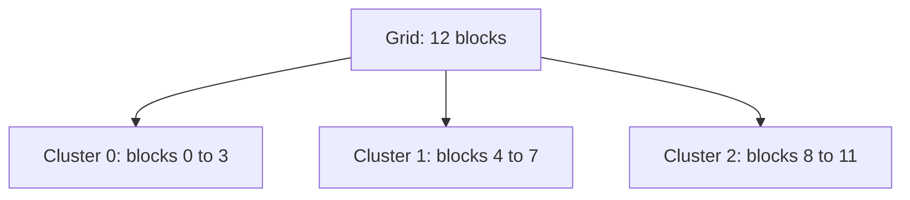
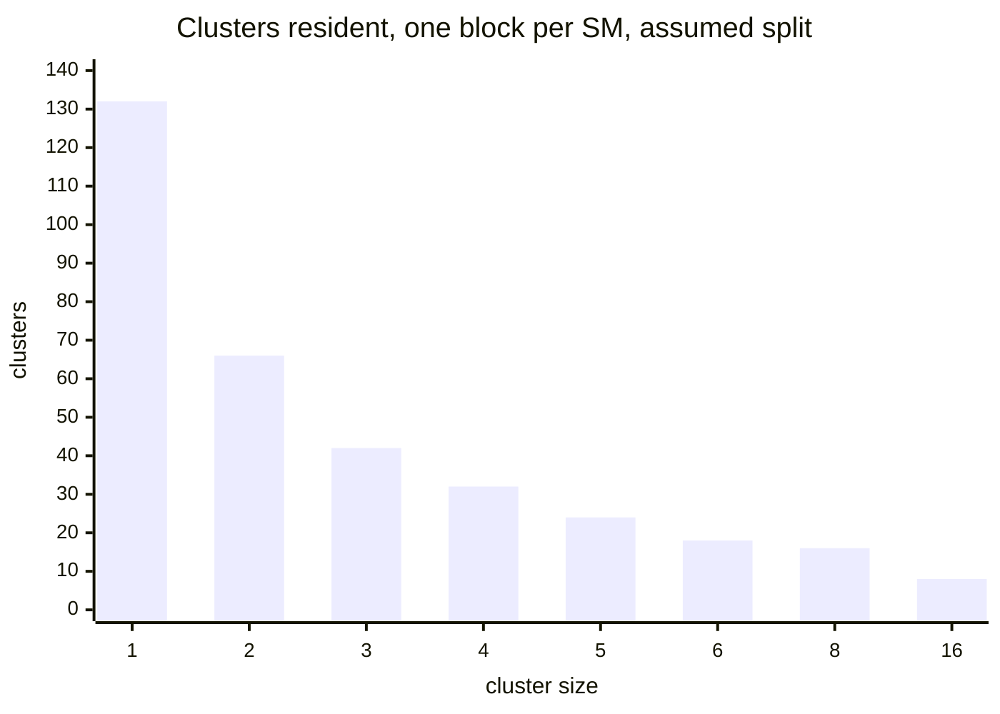
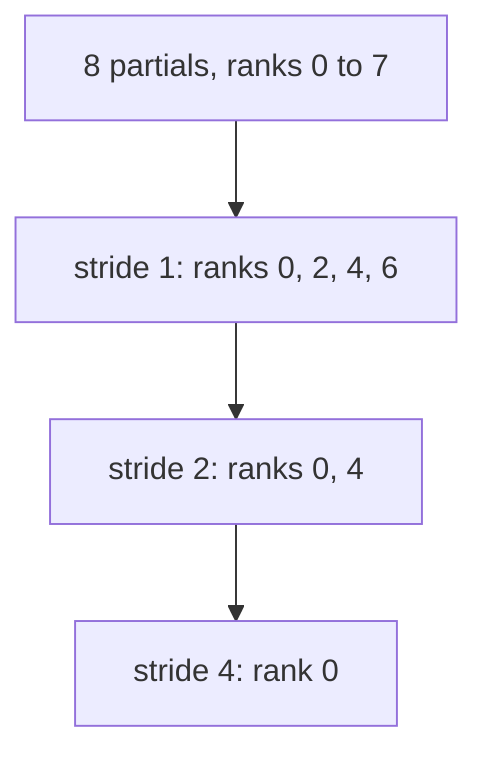

# Introduction

Two blocks want the same tile or the same counter. Until Hopper, they met in L2.

Note:
Open with the problem the audience already has. Chapter 7's histogram flushes one private copy per block into global atomics. Chapter 12's GEMM loads the same B tile from L2 once per block. A cluster lets neighbors share instead. This file is numbered 34. The part is matrix multiplication. Prerequisites are chapters 7, 12, and 26.

### The question {#question}

- Can blocks share shared memory?
- On Hopper, yes: blocks in a cluster can
- What does the hardware guarantee?
- What does it cost, and what does it save?

Note:
Four questions drive the hour. The answer to the first is yes, but only inside a cluster, which is a small group of blocks. The second gives the guarantee that makes barriers safe. The last two are the occupancy cost and the L2 bytes saved. Tell the room the kernels need an H100, and the Python simulator does not.

### What you already use {#prereqs}

- Private histograms with a global flush, from chapter 7
- TMA, the mbarrier, and multicast by name, from chapter 12
- The TMA box and byte count, from chapter 26
- Occupancy as a minimum of limits, from chapter 2

Note:
Four tools. The histogram and the occupancy count come back with a twist. Chapters 12 and 26 own TMA, so today you use multicast and do not rebuild the box or the barrier count.

# Launching a cluster

A cluster is a group of adjacent blocks that the hardware runs together.

Note:
This section answers what a cluster is and how you ask for one. Keep the focus on the guarantee, because everything later depends on it.

### A group of blocks on one GPC {#gpc}

- Blocks of a cluster run on SMs of one GPC
- They are scheduled simultaneously
- The H100 SXM5 has 8 GPCs and 132 SMs
- Hopper, compute capability 9.0, is where clusters begin

> [!KEY] Co-scheduled blocks can wait for each other safely
> All blocks of a cluster are resident before any runs.

Note:
Say what the Programming Guide says: all blocks of a cluster execute on a single GPC and are scheduled simultaneously. A GPC is a group of SMs that sit close together. The 8 and the 132 come from NVIDIA's Hopper in-depth blog. The key idea is the guarantee: without it, a barrier across blocks could deadlock.

### Grid, cluster, block {#levels}



Note:
A grid of 12 blocks with clusters of 4 along x. Each cluster is four adjacent blocks. Inside a cluster the blocks have ranks 0 to 3. Block 5 is rank 1 of cluster 1. Keep this picture on screen when you reach the addressing slides, because the rank and the grid index are the two numbers people confuse.

### Two ways to launch {#launch}

```cuda
__global__ void __cluster_dims__(4, 1, 1) kernel(float* x);
kernel<<<num_blocks, 256>>>(x);   // a multiple of 4
```

Or set it at launch with `cudaLaunchKernelEx` and a `cudaLaunchAttributeClusterDimension` attribute.

> [!QUESTION] What if the grid isn't a multiple of the cluster size?
> Round it up and guard the tail. The Programming Guide recommends a multiple, and Colfax reports that the kernel fails to launch otherwise. Treat it as a requirement.

Note:
The compile-time form puts the shape on the kernel. The runtime form fills a launch config and one attribute, then calls cudaLaunchKernelEx, which is the way to pick the size from a variable. Both take the grid in blocks. If the kernel has no compile-time shape, the launch must give one, or it fails.

### The limits {#limits}

- Portable maximum: 8 blocks
- H100 and B200: 16 with an opt-in
- Opt-in: `cudaFuncAttributeNonPortableClusterSizeAllowed`
- Ask the driver for residency: `cudaOccupancyMaxActiveClusters`

> [!QUESTION] Why is 8 the portable limit and not 16?
> A GPU with fewer SMs per GPC might not host 16 blocks together. The guide names 16 as H100 and B200 behavior behind an opt-in. Portable code stays at 8.

Note:
The 8 and 16 are from the Hopper tuning guide. Portable means valid on every GPU that supports clusters. The opt-in is a function attribute you set before launch. For how many clusters can be resident, do not guess. The tuning guide says to query. The next slides show why a formula is not enough.

# Fitting clusters on the GPU

A cluster never spans two GPCs, so leftovers in each GPC are idle.

Note:
This is the cost side. Occupancy was a minimum of limits. A cluster adds a packing limit, and it rounds down once per GPC.

### The floor is per GPC {#floor}

$$
N_{\text{clusters}} = \sum_{g=1}^{G} \left\lfloor \frac{\hla{S_g}\,\hlc{q}}{\hlb{c}} \right\rfloor
$$

$\hla{S_g}$ SMs in GPC $g$, $\hlc{q}$ blocks per SM, $\hlb{c}$ cluster size. NVIDIA publishes 8 GPCs and 132 SMs, not the SMs per GPC. This deck assumes six GPCs of 16 and two of 18.

Note:
Read the formula aloud. Each GPC has S times q block slots and holds floor of S q over c clusters. The floor sits inside the sum. Dividing the GPU's total slots by c is the wrong answer, and the lab has a test for it. The model also assumes blocks of one cluster may share an SM. The slide deck states that as an assumption.

### Clusters of 3, worked {#three}

> [!KEY] One block per SM
> A 16-SM GPC holds $\lfloor 16/3 \rfloor = 5$ clusters, using 15 SMs. An 18-SM GPC holds 6, using all 18.
> $6 \times 5 + 2 \times 6 = 42$ clusters, 126 blocks, 6 SMs idle. Dividing 132 by 3 gives 44, which is wrong.

Note:
Walk the numbers. Five clusters in a 16-SM GPC leaves one SM, which is less than a cluster. Six in an 18-SM GPC leaves none. The total is 42 clusters and 126 resident blocks. The naive division says 44. This is the plausible wrong implementation the lab catches.

### Residency by cluster size {#sizes}



Note:
Residency falls faster than one over c when c does not divide the GPC. Sizes 2 and 4 leave 0 and 4 SMs idle. Size 3 leaves 6. Size 6 leaves 24. Sizes 8 and 16 leave 4. Divisors of the GPC size lose little. Pick sizes by asking the driver, not by guessing.

### Try it {#fit-figure}

```viz
34-cluster-fit
```

> [!QUESTION] Can a cluster's blocks share an SM?
> The model assumes they can when resources allow. This deck did not confirm that in a source, so the count is a model.

Note:
Let the audience move the slider. Point at the idle squares. Then switch blocks per SM to 2 and show that clusters of 4 now fit 66 times. Remind them the split is assumed.

# Distributed shared memory

A pointer to a peer's shared memory, named by rank.

Note:
Now the addressing. The central point is that the rank is relative to your own cluster. Repeat it. Rank, not grid index.

### map_shared_rank {#map}

```cuda
cg::cluster_group cluster = cg::this_cluster();
unsigned rank = cluster.block_rank();
int* theirs = cluster.map_shared_rank(smem, 2);
```

The pointer reaches rank 2's copy of `smem`. Under the hood it is PTX `mapa`.

Note:
this_cluster returns the handle. block_rank is the block's index in its cluster, for a one-dimensional cluster it is blockIdx.x mod the cluster size. map_shared_rank returns a pointer you can load from, store to, or pass to atomicAdd. PTX mapa is the instruction underneath.

### Which block does it reach? {#peer}

$$
\boxed{\text{peer} = \bigl(\hla{b} - (\hla{b} \bmod \hlb{c})\bigr) + \hlc{r}}
$$

Block 5, clusters of 4, rank 2: $(5 - 1) + 2 = 6$.

> [!WARNING] The rank is not a grid index
> Using `target_rank` as the block index reaches block 2 from block 5, in another cluster.

Note:
First block of your cluster is b minus b mod c. Add the target rank. Block 5 is rank 1 in cluster 1, which starts at block 4. Rank 2 is block 6. In the kernel you never compute the grid index, you pass the rank. The lab asks for the grid index so the CPU can check your rank arithmetic.

### How fast is it? {#latency}

| Level | Latency (cycles) | Device |
|---|---|---|
| Shared memory | 29 | H800 PCIe |
| Peer shared memory | 180 | H800 PCIe |
| L2 | 263 | H800 PCIe |

Peak SM-to-SM throughput: 3.27 TB/s at cluster size 2, 2.65 TB/s at 4.

> [!QUESTION] Is the 7x claim a measurement?
> It is NVIDIA's claim in the Hopper blog. The independent measurement here is the 180 versus 263 cycles. Neither was taken on the lab hardware.

Note:
These are Luo and colleagues' measurements on an H800 PCIe, which has the same 114 SMs as the H100 PCIe. They are not H100 SXM5 numbers. A peer is 32 percent below L2 and far above your own shared memory. NVIDIA's blog claims about 7x over global memory. Treat all three as orders of magnitude.

### Barrier one: peers are ready {#sync1}

```cuda
init(smem);        // zero my slice
cluster.sync();    // every block started and initialized
```

Without it, a peer's add lands before the peer zeroes, and the zeroing erases it.

Note:
The first barrier covers the start. A remote access is safe only if the peer is alive and initialized. Every thread of every block must call cluster.sync. After it, shared-memory writes before the barrier are visible to the whole cluster.

### Barrier two: nobody exits early {#sync2}

```cuda
use_remote(cluster);
cluster.sync();    // all remote accesses finished
```

The Programming Guide: all distributed shared memory operations must happen before a block exits.

Note:
A block that returns frees its shared memory. A slower peer that writes there loses the update. The second barrier holds every block until the slowest arrives. Name the wrong implementation: forgot_final_sync lets every block exit at its own step.

### The lost update, with numbers {#lost}

- Finish: rank 0 at step 3, rank 2 at 5, rank 1 at 9
- Rank 1 writes to rank 0 at step 8, rank 2 at step 9
- No barrier: both writes hit exited blocks
- With the barrier: all exit at step 9, none lost

> [!QUESTION] Is there a cheaper barrier than sync?
> Yes. The split form barrier_arrive and barrier_wait lets a block do local work between the halves. It hides latency. It does not remove the barrier.

Note:
These are the lab's numbers. Rank 0 left at step 3 and rank 2 at step 5, so both late writes go nowhere. With a final cluster.sync, every block exits at step 9. A small test often passes because timing is kind, which is why the bug is nasty.

# A cluster histogram and a reduction

Use the barriers to build two kernels.

Note:
Two examples. The histogram shows capacity. The reduction shows fewer global atomics. Both use the same two barriers.

### The ownership rule {#owner}

$$
\hla{B_r} = \left\lceil \tfrac{N_{\text{bins}}}{\hlb{c}} \right\rceil,\quad
\text{owner}(i) = \lfloor i / \hla{B_r} \rfloor,\quad
\text{offset}(i) = i \bmod \hla{B_r}
$$

1,001 bins, clusters of 4: bin 1,000 is rank 3, offset 247.

Note:
Each rank owns a contiguous slice of bins in its own shared memory. B r is 251 here. Bin 1,000 divided by 251 is 3, and the offset is 1,000 minus 753, which is 247. Rank 3's slots 248 to 250 never hold a bin, so the flush guards on bin less than num_bins.

### The kernel {#hist-kernel}

```cuda
const unsigned owner = b / bins_per_rank;
const int offset = b - owner * bins_per_rank;
atomicAdd(cluster.map_shared_rank(smem, owner) + offset, 1);
```

`owner` is a rank. No grid index appears.

Note:
This is the heart of the kernel. Three lines. The owner is a rank in the cluster. The pointer comes from map_shared_rank. The atomic is a shared-memory atomic on a remote block. The lab's version has the two barriers and the guarded flush around it.

### What it saves {#hist-count}

- $2^{24}$ elements, 1,024 bins, 1,056 blocks
- Global atomics: 16,777,216
- Private copy per block: 1,081,344 flush atomics
- Clusters of 4: $264 \times 1024 = 270{,}336$

Note:
Count the global atomics. The pure global histogram does one per element. Chapter 7's private histogram does 1,056 times 1,024 at the flush. Clusters of 4 flush each bin once per cluster, 264 times 1,024, which is four times fewer. The updates themselves move to shared memory, local or remote.

### Bigger histograms fit {#capacity}

> [!KEY] Capacity
> A block holds $\lfloor 232{,}448 / 4 \rfloor = 58{,}112$ four-byte counters in 227 KiB. A cluster of 8 holds $8 \times 58{,}112 = 464{,}896$. A 64K-bin histogram needs 256 KiB and fits in a cluster of 2.

> [!QUESTION] What fraction of updates are remote?
> For uniform values, $(c-1)/c$. For clusters of 4 it is 75 percent. The lab's simulator counts local and remote updates.

Note:
This is the case where DSMEM changes what is possible, not just how fast. A single block can't hold a 64K-bin histogram. A cluster of 2 holds it at 128 KiB per block. The cost is that most updates are remote.

### Skew moves the hotspot {#skew}

- Values $\lfloor 1024\,u^4 \rfloor$ pile into low bins
- Rank 0 gets 70.7% of the updates
- Ranks 1, 2, 3 get 13.4%, 9.0%, 6.9%
- Interleaved ownership, `bin % c`, spreads it

> [!QUESTION] Does the cluster histogram always beat global atomics?
> No. With few bins and uniform data, a private histogram per block already wins. The lab reports the ratio as a metric on skewed data and doesn't grade it.

Note:
Show the arithmetic. The chance that u to the fourth is below one quarter is one quarter to the one-fourth, 0.7071. So rank 0 with the first 256 bins takes 70.7 percent. The contention moves from L2 atomic units to one block's shared memory. Interleaving is an experiment the lab leaves to you. This is a prediction, not a measurement.

### A cluster reduction {#reduce}



Note:
A tree over ranks. At stride s, rank r with r mod 2s equal to zero adds rank r plus s, if that rank exists. For a cluster of 8 that is three levels. For 5 it is still three, and the bounds check matters. One barrier publishes the partials and one follows each level, so the count is one plus the ceiling of log two c.

### One atomic per cluster {#reduce-kernel}

```cuda
cluster.sync();                    // publish
if (cluster.block_rank() == 0 && threadIdx.x == 0) {
    for (unsigned r = 0; r < cluster.num_blocks(); ++r)
        total += *cluster.map_shared_rank(&partial, r);
    atomicAdd(out, total);
}
cluster.sync();                    // peers stay alive
```

> [!QUESTION] Why does the checker use a tolerance for the reduction?
> Float atomics have no fixed order. The lab compares with an fp64 sum at a relative tolerance of $10^{-4}$. That catches a lost block and allows reordering.

Note:
The lab's kernel takes the loop for one number per block. Rank 0 reads seven peers and issues one global atomic. For 1,056 blocks that is 132 global atomics instead of 1,056. The final barrier is the exit barrier. The tree matters when each rank holds a vector, and the lab simulates it in Python but does not measure which wins.

# TMA multicast

One load fills the same tile in several blocks.

Note:
Last section. This is why Hopper GEMMs use clusters. The arithmetic extends chapter 12's per-block example to the whole grid.

### The tile grid {#grid}

- 4096 cubed bf16 GEMM, $128 \times 256$ tiles
- $32 \times 16 = 512$ blocks
- A slice: 1 MiB per block. B slice: 2 MiB per block
- Total from L2: 1,536 MiB

Note:
A block loads a 128 by 4096 slice of A, 1 MiB at two bytes per element, and a 4096 by 256 slice of B, 2 MiB. Three MiB times 512 blocks is 1,536 MiB. Neighbors along N load the same A slice. Neighbors along M load the same B slice. Today each fetches its own copy from L2.

### Share the slice {#share}

$$
\boxed{\text{saved} = A_{\text{tot}}\,\frac{c_n - 1}{c_n} + B_{\text{tot}}\,\frac{c_m - 1}{c_m}}
$$

$A_{\text{tot}} = 512$ MiB, $B_{\text{tot}} = 1024$ MiB.

Note:
In a cluster of c m by c n, the c n blocks in a row share an A slice and the c m blocks in a column share a B slice. With multicast each distinct slice loads once. The saving is the fraction c minus one over c of the shared operand only. Not the whole.

### The numbers {#mc-table}

| Cluster | Total loaded | Saved |
|---|---|---|
| 1 by 1 | 1536 MiB | 0 |
| 2 by 1 | 1024 MiB | 33.3% |
| 2 by 2 | 768 MiB | 50% |
| 4 by 2 | 512 MiB | 66.7% |

Note:
A 2 by 1 cluster shares only B. It halves B's 1,024 MiB and leaves A's 512, so the total drops a third. That matches chapter 12's 48 KiB to 32 KiB per block. 2 by 2 shares both and halves both. 4 by 2 cuts B to a quarter and A to a half.

### Try it {#mc-figure}

```viz
34-multicast-traffic
```

> [!QUESTION] Why isn't the saving $(c-1)/c$ of the total?
> It applies to the operand the cluster shares. A 2 by 1 cluster shares only B, half of B's 1024 MiB is 512 MiB, and that is a third of 1536.

Note:
Let the audience pick a shape. Point at which operand shrinks. A 2 by 1 shrinks only the B bar. A 1 by 2 shrinks only the A bar. Choose the shape that shares the larger operand first.

### Why it matters {#l2}

- One SM at full tensor rate pulls 48 B per clock for these tiles
- $132 \times 48 \times 1.83 \times 10^{9} = 11.6$ TB/s
- FlashAttention-3's table lists the L2 at 12 TB/s
- A 2 by 1 multicast: $132 \times 32 \times 1.83 \times 10^{9} = 7.7$ TB/s

Note:
Chapter 12 derived 48 bytes per clock. Multiply by 132 SMs and the implied 1.83 GHz tensor clock and the demand is 11.6 terabytes per second, close to the 12 in the FlashAttention-3 hardware table. Multicast brings it to 7.7. These are predictions from specs. The lab doesn't run a GEMM, so the deck claims no speedup.

### Who uses it {#users}

- CUTLASS 3 takes a cluster shape and a multicast mask
- Colfax's tutorial: `SM90_TMA_LOAD_MULTICAST`, `cluster_sync()`
- FlashAttention-3: clusters in its hierarchy table, no multicast in its text
- A Blackwell backward pass uses DSMEM for the dQ reduction

> [!QUESTION] Does multicast work across clusters?
> No. Only blocks in one cluster can take part in a multicast, per Colfax's tutorial.

Note:
Be careful about claims. The Colfax tutorial walks through a cluster of 2 with a multicast mask. The FlashAttention-3 paper lists clusters in a table but a text search finds no multicast or distributed shared memory, so this deck does not say FA3 uses them. The Blackwell item is from chapter 16.

# Summary

Five points to remember, and a rule for when to use a cluster.

Note:
Close the loop on the opening question. Blocks can share shared memory inside a cluster, at an occupancy cost, and the saving shows up as fewer global atomics and fewer L2 bytes.

### What to remember {#summary}

- A cluster is co-scheduled on one GPC. Portable maximum 8, opt-in 16
- Residency floors per GPC: clusters of 3 fit 42 times on the assumed split
- `map_shared_rank` takes a rank, not a grid index
- Two `cluster.sync()` calls: before remote access, before exit
- Multicast saves $(c-1)/c$ of the shared operand

Note:
Five points. The occupancy number depends on an assumed split, and the driver call gives the true count. The rank is relative to the cluster. The two barriers are the whole safety story. The multicast saving applies to the shared operand.

### When to use a cluster {#decision}

| Blocks share | Use | Cost |
|---|---|---|
| A GEMM operand | TMA multicast | Occupancy at the GPC edge |
| A big histogram | DSMEM bins | Remote atomics, hot ranks |
| A reduction | DSMEM tree or loop | Two barriers |
| Nothing | No cluster | None |

Note:
A decision guide. If blocks are independent, skip clusters. The occupancy cost is real and the benefit is zero. For shared operands, shared counters, and cluster-level reductions, a cluster is the tool. Ask the driver for residency before you choose a size.

### The lab and what is next {#next}

- CPU: rank, peer, bins, histogram, exit rule, reduction, fit, multicast
- H100 only: cluster histogram and reduction kernels
- Skipped cleanly on any other machine
- Next: more Hopper kernels build on these pieces

Note:
The first eight checks run anywhere and catch four plausible mistakes. The two kernel checks need an H100 and print a skip message elsewhere. The job is not sent to the A100. Close by pointing at chapter 26 for the TMA box that a multicast load builds on.
