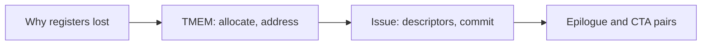
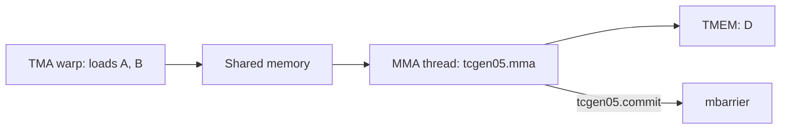
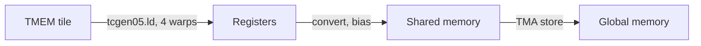

# Introduction

Where does a Blackwell MMA put its result, and who reads it back?

Note:
Open with the question, not the instruction names. The audience has seen wgmma, so the contrast is the hook: on Hopper the answer is registers, and on Blackwell it is a separate memory. Say that the file is numbered 35, that the part is matrix multiplication, and that prerequisites are chapters 12, 24, and 26. Say early that no B200 is attached to the lab pool, so most of the lab is Python.

### The pieces chapter 12 named {#gap}

- Chapter 12 names TMEM, `tcgen05.mma`, and 2-CTA MMA
- This chapter builds the allocator, the address, and the descriptors
- Clusters and distributed shared memory are chapter 34
- The lab runs on any machine, and one kernel needs a B200

Note:
Chapter 12 gave the vocabulary in one section. Today you compute with it. Say out loud what stays elsewhere: the Ampere ring is chapter 12, the Hopper descriptor is chapter 26, and clusters are chapter 34. The CPU checks run on a laptop. The kernel stub compiles for sm_100a and skips without a B200.

### Four stops {#route}



Note:
Four stops in the order the lab asks for them. First the register problem, which motivates everything. Then the memory itself. Then one thread issuing the MMA with two descriptors. Last, the path out and the pair of CTAs. Promise a worked number at every stop, and promise that every number is arithmetic you can reproduce.

# Why registers lost

A 128 by 256 fp32 tile is too big a guest for the register file.

Note:
Start from a number the room can check. Hopper keeps the accumulator in registers, and the tile size is bounded by what the register file can hold while the epilogue still has room to work.

### The tile is half the register file {#budget}

- 128 by 256 fp32 is 131,072 bytes, 128 KiB
- The register file is 64K registers, 256 KiB
- One `m64n256` accumulator is 128 registers per thread
- A thread holds at most 255 registers

> [!KEY] The accumulator and the epilogue compete for the same registers

Note:
Do the arithmetic aloud: 128 times 256 times 4 is 131,072. Half of 256 KiB. A thread can't hold the whole tile, so two consumer warpgroups hold 128 registers each per thread. Now ask what happens when you want to start the next tile's math while the epilogue drains this one. There is no register left for the second accumulator.

### Three costs of registers {#costs}

- The tile has a ceiling set by the register file
- The epilogue and the mainloop share registers
- Every math warp owns accumulator state

> [!QUESTION] Couldn't Hopper just spill the accumulator?
> A spill moves the accumulator through local memory, which is slower than the tensor cores that produce it. The accumulator is the hottest data in the kernel, so the fix is a memory the MMA writes directly, not a slower place to park it.

Note:
Name the three costs and move on quickly. The question is the one a systems engineer asks first. Spilling is not a design, because every K step would pay for it. Blackwell instead gives the MMA its own destination, and the next section is that destination.

# Tensor memory

A 128-lane array of 32-bit columns, next to the register file.

Note:
Introduce the object before the instruction. Tensor memory is a separate array, 256 KiB per SM. The lab builds its allocator in Python, so the rules matter to the checks.

### 128 lanes by 512 columns {#shape}

- 128 lanes, 512 columns, 32 bits per cell
- 128 x 512 x 4 bytes is 256 KiB per SM
- A separate array from registers and shared memory
- A column spans all 128 lanes

> [!QUESTION] Is TMEM addressable like shared memory?
> No. You reach it with `tcgen05.ld`, `tcgen05.st`, and `tcgen05.cp`, and with the MMA itself. A thread can't load from a TMEM address with an ordinary load.

Note:
Say the number twice: 128 lanes, 512 columns. The product is 262,144 bytes. Stress that a column is a vertical slice through all lanes, so an allocation is always a number of columns. The question checks that nobody pictures a pointer you can dereference. The data-movement instructions are the only doors.

### The address has two halves {#address}

$$
\boxed{\mathrm{address} = (\hla{\mathrm{lane}} \ll 16) \;|\; \hlb{\mathrm{column}}}
$$

Lane 32, column 5 is `0x200005`. Lane 127, column 511 is `0x7F01FF`.

Note:
Lane in the high half, column in the low half. Work lane 32, column 5 on the board: 32 times 65,536 is 2,097,152, which is 0x200000, plus 5. The wrong version, with the fields swapped, gives 0x50020. The lab names it swapped_lane_column, and the check prints expected 0x200005 so the swap is obvious.

### Allocation rounds up to a power of two {#alloc}

| Request | Reserved |
|---|---|
| 1 to 32 | 32 |
| 33 to 64 | 64 |
| 129 | 256 |
| 257 to 512 | 512 |

> [!WARNING] 160 columns takes 256

Note:
The rule is a power of two, at least 32, at most 512. A warp issues tcgen05.alloc and the instruction writes the base address into shared memory. Dwell on 129: a multiple of 32 would round it to 160, the hardware rounds it to 256. That mistake is the first wrong implementation the lab catches.

### Two ways to fill TMEM {#strategies}

```viz
35-tmem-map
```

Note:
Leave the figure on N equal 160. With one alloc per accumulator, two stages fit and 192 columns hold nothing. Switch to carve, and three fit. At N of 128 and 256 the strategies agree. That is one reason tile widths are powers of two. CUTLASS allocates all 512 columns once and carves, so the rounding rule matters less in its kernels and more in the ones you write by hand.

### A warp reaches 32 lanes {#lanes}

- Warp w of a warpgroup reaches lanes 32(w mod 4) to 32(w mod 4) + 31
- Warps 0 and 4 share a lane group
- Reading 128 lanes takes four warps

> [!QUESTION] What if warp 4 touches lane 128?
> There is no lane 128, and the correct warp 4 reaches lanes 0 to 31. The lab's `warp_id_without_mod_4` mistake multiplies the warp index by 32 and sends warp 4 off the end of the array.

Note:
Walk the four groups. The rule is the warp's index modulo four, so a CTA with eight warps has two warps per group. The practical consequence is that the epilogue is a warpgroup, because only four warps together cover 128 lanes. The source for this rule is the Colfax tutorial, and the PTX access-restrictions section is where to check it.

### A footprint is lanes by columns {#footprint}

$$
\mathrm{lanes} = M / g, \qquad \mathrm{columns} = N
$$

| M, N, g | Lanes, columns |
|---|---|
| 128, 256, 1 | 128, 256 |
| 256, 256, 2 | 128, 256 per CTA |
| 128, 256, 2 | 64, 256 per CTA |

Note:
The tile's row index is the lane and its column index is the column. A pair splits M, so each CTA of a 256 by 256 pair holds the same 128 by 256 accumulator that a single CTA would. Two of those fill TMEM exactly, which is the double buffering the epilogue needs. The lab function is accumulator_footprint, and it raises on a shape the instruction doesn't support.

# Issuing the MMA

One thread, two descriptors, and a barrier.

Note:
Move from where the data lives to how the math starts. The contrast with wgmma is the point: one thread, not a warpgroup.

### One thread issues it {#one-thread}



Note:
Trace the arrows. The loader fills shared memory. One elected thread in the MMA warp issues the instruction, which reads A and B from shared memory through descriptors and writes D into TMEM. Commit makes an mbarrier track the instruction, and the loader waits on that barrier before it overwrites a stage. The other threads of the MMA warp are free.

### Operands and shapes {#operands}

- D is always in TMEM
- B is in shared memory
- A is in shared memory or in TMEM, K-major
- 1 CTA: M of 64 or 128. A pair: M of 128 or 256
- N up to 256, K of 16 for bf16

Note:
List where each operand lives. If A is in TMEM it takes columns after the accumulator, which is why two big accumulator stages usually leave A in shared memory. The largest bf16 single-CTA instruction is 128 by 256 by 16, which is 1,048,576 FLOP. At the 8,192 per clock per SM that the FlashAttention-4 authors state, it takes 128 clocks.

### The instruction descriptor {#idesc}

| Field | Bits |
|---|---|
| C format, A format, B format | 4-5, 7-9, 10-12 |
| A major, B major | 15, 16 |
| N >> 3 | 17-22 |
| M >> 4 | 24-28 |

M = 128, N = 256, bf16 in, fp32 out: `0x8400490`.

Note:
Build the word with the room: 0x10 for the fp32 accumulator, 0x80 and 0x400 for the bf16 formats, N shifted right by 3 is 32 at bit 17, M shifted right by 4 is 8 at bit 24. The sum is 0x8400490. The wrong version swaps the two shifts. For a square-ish shape the numbers look plausible, which is why the check uses 128 by 256.

### The shared-memory descriptor {#sdesc}

| Field | Hopper | Blackwell |
|---|---|---|
| Version | none | bits 46-47, value 1 |
| Layout type | bits 62-63 | bits 61-63 |
| 128B, 64B, 32B | 1, 2, 3 | 2, 4, 6 |

> [!QUESTION] The 128-byte bit lands in the same place. Why is a Hopper packer wrong?
> It leaves the version at 0, and a Blackwell value shifted by 62 lands one bit too high. Start 0, leading 16, stride 1024, 128B is `0x4000404000010000`.

Note:
This is the slide to slow down on. Hopper's value 1 shifted by 62 and Blackwell's value 2 shifted by 61 are both bit 62, so the swizzle bit alone doesn't reveal the mistake. The version field does. The word is a valid 64-bit number either way, so the hardware doesn't complain: you get wrong math. The lab compares the whole word and names two mistakes, forgot_version_bit and layout_type_at_bit_62.

### The kernel stub {#stub}

```cuda
tcgen05.alloc.cta_group::1.sync.aligned.shared::cta.b32 [slot], 32;
// each warp: base + ((warp % 4) * 32 << 16) + column
tcgen05.st.sync.aligned.32x32b.x1.b32 [taddr], {r};
tcgen05.wait::st.sync.aligned;
tcgen05.ld.sync.aligned.32x32b.x1.b32 {r}, [taddr];
tcgen05.wait::ld.sync.aligned;
```

Note:
This is the whole lab kernel in six lines. Warp 0 allocates 32 columns. Each warp adds its lane group to the base, writes a value, waits, reads it back, and waits. The check compares 4,096 values. Be honest with the room: the author could not run this on a B200, so it is untested on hardware and the lab reports a skip, not a failure, without one. The fence and relinquish ordering should be checked against the PTX ISA.

# Epilogue and CTA pairs

The registers come back, and two SMs share one MMA.

Note:
Two ideas close the loop. The first is what the registers are for now. The second is how a pair of CTAs cuts operand traffic.

### From TMEM to global memory {#epilogue}



Note:
Four hops. tcgen05.ld moves values into registers, where the epilogue does its math. The result goes to shared memory and a TMA store writes it out. The MMA warp is not involved, and a barrier tells it the TMEM stage is free again. Four warps are needed because each reaches 32 lanes. Remind the room to wait on tcgen05.wait::ld before using the registers.

### Two stages overlap the epilogue {#pingpong}

- A 128 by 256 fp32 stage is 256 columns, so two fit
- The MMA warp fills stage 1 while the epilogue drains stage 0
- No accumulator registers in the MMA warp

> [!QUESTION] Why can Blackwell double-buffer when Hopper can't?
> Two 128 by 256 fp32 accumulators would be all 256 KiB of Hopper's register file. On Blackwell they are 512 columns of TMEM, a memory the registers don't share.

Note:
This is the payoff of the first section. The double buffering exists on Hopper in a weaker form, because the registers can't hold two. On Blackwell it costs nothing from the register file. The kernel now has four roles: a loader, an MMA issuer, an epilogue warpgroup, and sometimes a scheduler, and they meet at TMEM and mbarriers.

### A CTA pair is one MMA on two SMs {#pair}

- `cta_group::2`, M of 128 or 256
- The accumulator splits along M, one half in each CTA's TMEM
- One thread in the even CTA issues it
- The commit multicasts to both CTAs' barriers

Note:
Two CTAs in one cluster, adjacent by CTA id. A 256 by 256 tile gives each CTA a 128 by 256 accumulator. The leader is the even CTA according to the Colfax tutorial. Chapter 34 covers clusters and distributed shared memory. Here you only need the fact that a pair lives in one cluster.

### Each CTA stages half of B {#traffic}

```viz
35-pair-traffic
```

Note:
Leave N at 256. One CTA stages 16,384 bytes of A and 32,768 of B per K of 64, which is 48 KiB. In a pair, each CTA stages the same 16,384 bytes of A and half of B, 16,384, which is 32 KiB. B halves and the total is two thirds. The Colfax article says half of the operand data, and counting its own tile shapes gives two thirds, so say which you mean.

### What the saved bytes buy {#stages}

$$
\boxed{\mathrm{B\ bytes\ per\ CTA} = \frac{\hlb{N}}{\hla{g}} \cdot K \cdot b}
$$

- 227 KiB per block: 48 KiB stages fit 4 times, 32 KiB stages fit 7 times
- Epilogue buffers and barriers come out of the same budget

> [!QUESTION] Does the pair instruction run faster?
> No. A 256 by 256 by 16 bf16 pair instruction is 2,097,152 FLOP, and two SMs at 8,192 per clock take 128 clocks, the same as one 128 by 256 by 16 on one SM. The gain is operand traffic and stages in flight.

Note:
Say the formula in words: B per CTA is the tile width divided by the group size, times the slice depth, times the element size. Then the stage arithmetic: 227 divided by 48 is 4, 227 divided by 32 is 7. Both ignore the epilogue's buffers, so a real kernel has fewer. The question corrects a common misreading: the pair does not shorten the instruction, it feeds it more cheaply.

### The read side, as a model {#reads}

- 128 bytes per clock per SM of shared-memory reads, per the FlashAttention-4 authors
- 1 CTA: 12,288 bytes is 96 clocks against 128 of math
- Pair: 8,192 bytes per SM is 64 clocks

> [!WARNING] These are model numbers, assuming each byte is read once

Note:
Use this slide to show why FlashAttention-4 cares. If the tensor cores finish an instruction in 128 clocks and shared memory needs 96 to feed it, the kernel runs at 75 percent of shared-memory read bandwidth just to keep up. The pair cuts that to 50 percent. The caution is real: this is arithmetic under an assumption, not a measurement, and the lab measures nothing about shared-memory bandwidth.

# Beyond the GEMM

Scaled formats, the CuTe DSL, and a kernel that uses all of it.

Note:
Three short stops that connect the machinery to things readers will meet. Keep each one brief and link out. The block-scaled formats are the quantization chapters' topic.

### Block-scaled kinds {#block-scaled}

| Kind | Elements | Elements per scale | Scale type |
|---|---|---|---|
| `mxf8f6f4` | fp8, fp6, fp4 | 32 | `ue8m0` |
| `mxf4` | fp4 | 32 | `ue8m0` |
| `nvf4` | fp4 | 16 | `ue4m3` |

Scale factors live in TMEM, staged by `tcgen05.cp`.

Note:
One table. The hardware applies the scale inside the tensor core, so the kernel doesn't dequantize each block with extra instructions. The scales sit in TMEM too, copied from shared memory by tcgen05.cp. For what the formats do to accuracy and how weights are quantized, point at chapter 18. The lab packs only the dense kind f16 descriptor.

### The CuTe DSL names these {#cute-dsl}

- A TMEM allocator, with `CtaGroup.ONE` or `CtaGroup.TWO`
- An MMA operation whose A source is `SMEM` or `TMEM`
- `make_fragment_C` with two stages
- A TMEM-to-register copy atom for the epilogue

Note:
Connect to chapter 24. The TiledMMA and TiledCopy vocabulary is the same, with new operations for the new hardware. UMMA is CUTLASS's name for the instruction family, so you will see it in function names. The worker image's CuTe DSL targets the A100, so building a Blackwell GEMM needs a B200 and the guide's examples.

### FlashAttention-4 as a user {#fa4}

- S and P share TMEM, and P passes through TMEM, not registers
- Two output tiles ping-pong between softmax and tensor-core warps
- The backward pass uses CTA pairs, halving atomics on dQ
- Up to 1,613 TFLOP/s in bf16 on a B200-class part

> [!QUESTION] Is 1,613 TFLOP/s your GEMM's number?
> No. It is an attention result, up to 71% of peak. The paper's appendix names the part differently from its text.

Note:
Show how the chapter's pieces compose in a production kernel. The softmax warps read S from TMEM and write P back for the next MMA, so no accumulator registers sit in the MMA warp. The pair lets each CTA stage half of B and own half the rows of dQ. The question keeps the number honest: quote it with the hardware, and don't compare it to a GEMM.

### What goes wrong {#wrong}

- 160 columns requested, and the third allocation fails
- Lane and column swapped in the address
- A warp outside its lane group
- A Hopper descriptor on Blackwell
- Reading TMEM before `tcgen05.wait::ld`

> [!QUESTION] Will the kernel run on a consumer Blackwell GPU?
> No. `tcgen05` and TMEM are on data-center Blackwell, compute capability 10.0. Consumer parts, compute capability 12.x, have 99 KB of shared memory per block and no tcgen05 path.

Note:
These are the mistakes the lab's checks name. Each one produces a valid-looking number: the swapped address, the Hopper descriptor, the wrong rounding. None of them crashes on the CPU, which is why the tests compare exact words. The last bullet is a stale-data bug on hardware. The question closes the loop with chapter 12's warning about sm_100 and sm_120.

# Summary

Five ideas, five numbers, and what the lab grades.

Note:
Pull the thread back together. The accumulator moved because registers ran out. The memory has a shape, an allocation rule, and an address. One thread issues the math through two descriptors. A pair of CTAs halves the B each one stages. Everything on the next slides is arithmetic you can reproduce from the lab.

### What to remember {#summary}

- A 128 by 256 fp32 accumulator is 128 KiB, half the register file, so Blackwell moved it to TMEM
- TMEM is 128 lanes by 512 columns, and an allocation is a power of two from 32 to 512
- Address is `(lane << 16) | column`, and warp w reaches lanes 32(w mod 4) onward
- One thread issues `tcgen05.mma` with two descriptors, and commit signals an mbarrier
- A pair stages half of B per CTA: 32 KiB instead of 48 KiB per K = 64 slice

Note:
Five bullets, one per stop. If the room remembers one number, make it 129 becomes 256, because it exposes the power-of-two rule. If they remember a second, make it the version bit in the descriptor. Everything here is arithmetic on documented fields, and the one measurement-shaped claim, the kernel stub, is untested on hardware.

### Numbers to carry {#numbers}

| Quantity | Value |
|---|---|
| TMEM per SM | 256 KiB |
| Minimum allocation | 32 columns, 16 KiB |
| Descriptor, M=128, N=256, bf16 to fp32 | `0x8400490` |
| 128B descriptor, start 0, leading 16, stride 1024 | `0x4000404000010000` |
| Stages in 227 KiB, 1-CTA and pair | 4 and 7 |

Note:
A reference slide the room can photograph. Every row is either a documented field, or arithmetic on one. The stage counts ignore epilogue buffers and barriers, so a real kernel has fewer. The descriptor words are what the lab checks, and the starter fails until you write them.

### What the lab checks {#lab}

- The allocator rounds, tracks capacity, and fails when full
- Address, lane rule, footprint, and stages
- Both descriptors, as whole words
- Per-CTA bytes for 1-CTA and a pair
- A B200 kernel, skipped without one

> [!QUESTION] What if I have no B200?
> Nine checks run on any machine and the kernel check prints a skip message. The skipped kernel is not a failure, and the job is not sent to the A100.

Note:
Set expectations for the lab. The starter fails every check at first, and the first check needs only tmem_alloc_columns. The GPU check is gated by the lab's meta file, which names a B200, and the app reports that no endpoint is configured instead of falling back to the A100.

### Next {#next}

- Chapter 34 covers clusters and distributed shared memory
- Chapter 18 covers the formats behind the block-scaled kinds
- Chapter 26 is the Hopper descriptor this one is compared against

Note:
Close by pointing at the neighbors. Clusters are where the pair's two CTAs come from. Quantization is where the scale factors come from. Hopper is where the descriptor you packed last time came from. Thank the room, and remind them that the lab's first check passes with one function.
