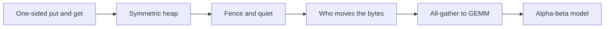
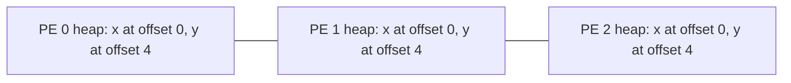
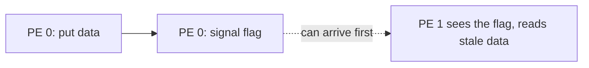

# Introduction

How does a kernel send a tile to a peer the moment the tile exists, and how does the peer know it can read it?

Note:
Chapter 22 ends with a short section on overlap inside a kernel. It says to cut the matmul into tiles and communicate each tile as it finishes. This talk is the how. Name the three ingredients up front: a shared layout, one-sided writes, and a signal. The first half builds the mechanism. The second half uses it on an all-gather plus GEMM and puts a number on when it pays.

### Why a stream cannot hide this {#why-streams}

- A tensor-parallel layer's all-reduce feeds the next matmul
- A stream hides work that is independent, and this work is not
- Cut the work into tiles, and tile $k$'s transfer overlaps tile $k+1$'s compute
- The transfer has to start from inside the kernel

> [!QUESTION] Why not give the all-reduce its own stream, as DDP does?
> DDP's all-reduce overlaps backward work that does not depend on it. The next layer's matmul needs this result, so no independent work exists to run beside it.

Note:
Recall chapter 22's table: DDP's communication is off the critical path, and tensor parallelism's is on it. That is why this chapter exists. Tiling gives you independent work after all, because tile k's data does not depend on tile k plus one. The catch is that the tiles are inside one kernel, so the stream mechanism cannot reach them.

### What you already have {#already}

- Chapter 21: a message costs $\alpha + n/B$, and the ring moves $(p-1)/p$ per rank
- Chapter 22: communication kernels take SMs, and copy engines do not
- Chapter 25: you priced buckets and wrote the gloo checks
- Not here: ring attention and context parallelism, which learn-inference owns

Note:
Point back instead of re-deriving. The model in this talk is chapter 21's model with a per-chunk signal latency added. Say plainly that ring attention uses the same send-a-chunk-while-computing schedule and that it belongs to the companion course, learn-inference, so this deck does not teach it.

### The road through this deck {#roadmap}



Note:
Six stops, and each is a check in the lab except the PyTorch and NVLS asides. The heap is the layout. Fence and quiet are the ordering. The all-gather to GEMM stop is the fused schedule, and the model decides when it pays. Say that the GPU check is separate and skips without two GPUs.

# One-sided communication

A put writes into a peer's memory. The peer runs no matching call.

Note:
This section is the vocabulary. Two-sided communication bundles the transfer with its notification. One-sided separates them. Everything hard in the rest of the talk is the notification you now write yourself.

### Two-sided against one-sided {#two-vs-one}

| | Send and receive | Put and get |
|---|---|---|
| Who calls | Both ranks | The initiator |
| Receiver learns of data | When the receive returns | Only if a flag says so |
| Typical hazard | A mismatched pair hangs | A flag before its data |

Note:
Walk the rows. In the two-sided column, a mismatch hangs, which you know from chapter 21. In the one-sided column, the hazard is quieter: the flag can arrive before the data. The NVSHMEM remote memory access documentation describes the interface as one-sided with a passive target and communication decoupled from synchronization.

### Put and get {#put-get}

- A put copies local bytes to a location on a remote PE
- A get copies a remote location into local memory
- The remote PE is passive and keeps running its kernel
- A PE, a processing element, is a rank

> [!QUESTION] When does a blocking put return?
> When the source has been read locally, so you may reuse your buffer. The data can arrive later. Only a quiet, or a signal you wait on, says it did.

Note:
This is the single most important sentence in the docs for this chapter. Blocking means the source is reusable, not that the data landed. The lab's simulator makes it concrete: a put appends to a pending list and returns, and nothing arrives until the network delivers it.

# The symmetric heap

Every PE has the same floor plan, so a pair of numbers names a place anywhere in the job.

Note:
The analogy is buildings with identical floor plans. Room 3 is in the same place in every building, and you know where each building starts. That is the whole idea of the symmetric heap.

### Same offset on every PE {#same-offset}



Note:
Each PE reserves a heap of the same size and lays it out the same way. When the program allocates x, it lands at the same offset on every PE. A put to x on PE 2 needs only PE 2's number and the offset. The sender never asks PE 2 where x is.

### Address translation {#translate}

$$
\mathrm{addr}(p, o) = \hla{\mathrm{base}_p} + \hlb{o}
$$

- $\hla{\mathrm{base}_p}$ is where PE $p$'s heap starts
- $\hlb{o}$ is the offset the allocator returned
- To reach the same object on another PE, keep the offset and swap the base

Note:
The lab's simulator puts PE p's base at 0x7F0000000000 plus p times 2 to the 32. Element 3 on PE 1 is at that base plus 2 to the 32 plus 12. On PE 3 it is the same offset with PE 3's base. Say that translate also has to reject an address outside the source heap, which the lab checks.

### nvshmem_malloc is collective {#malloc}

- Every PE calls it, with identical arguments
- It returns a block from the symmetric heap
- An implied barrier on exit
- Different sequences on different PEs break the symmetry

> [!QUESTION] What goes wrong if PE 0 allocates 4 KiB then 8 KiB and PE 1 allocates 8 KiB then 4 KiB?
> Offset 0 names a different object on each PE, so a put lands in the wrong object and raises no error. Symmetry is a contract on allocation order and size.

Note:
The NVSHMEM memory documentation says behavior is undefined if the arguments differ. PyTorch's symmetric memory has the same rule in its own words: every rank must call empty and rendezvous in the same order. The lab's malloc is a bump allocator that returns one offset for all PEs, and it raises when the heap is full.

# Ordering

A put returns early, so a flag behind it can overtake it.

Note:
This section is the center of the lab. Everything else is bookkeeping around the fence.

### The signal that overtakes its data {#overtake}



Note:
The mailroom picture: you drop off a parcel and then a note saying the parcel is ready. The mailroom may sort the note first. A real NVLink fabric usually keeps the order, so a program with no fence tends to pass its tests, and on another run it reads stale data. The lab's signals-first policy is the worst case the documentation allows.

### Fence and quiet {#fence-quiet}

- `nvshmem_fence` orders earlier operations to a PE before later ones to the same PE
- A fence does not wait for completion
- `nvshmem_quiet` waits until all your operations are complete and visible
- Neither one notifies another PE

> [!QUESTION] Which one goes between a put and its signal?
> A fence. The signal needs an order, not a completion. A quiet is also correct, and it stalls the issuer for the full round trip of every chunk.

Note:
The documentation is explicit that quiet is local and non-collective and that it does not notify other PEs. Fence is the cheap tool for ordering, and quiet is for completion, for example before you reuse a destination buffer. The pattern is put, fence, signal. The packaged put-with-signal call orders its own data against its own signal, and the documentation warns that it does not order your other puts.

### The epoch model in the lab {#epoch}

- Each operation carries its pair's epoch when it is issued
- A fence raises the epoch of every pair from the fencing PE
- The network holds an operation back while an earlier epoch to the same PE is in flight

> [!QUESTION] PE 0 puts, then signals, with no fence. Why does `signals_first` break it?
> Both operations have epoch 0, so nothing holds the signal back and the policy delivers it first. PE 1 sees the flag next to zeros.

Note:
Walk the three operations: put at epoch 0, fence raises the pair to epoch 1, signal at epoch 1. The signal is not deliverable while the epoch-0 put is in flight. The lab's check steps the network one operation at a time and fails if a visible signal ever sits beside stale data. It also runs a deliberately wrong sender, signal without fence, to show the check can tell right from wrong.

### The four sequences {#four-sequences}

| Sequence | Signal behind data? | Cost |
|---|---|---|
| put, signal | No | A stale read |
| put, fence, signal | Yes | No wait |
| put, quiet, signal | Yes | The issuer waits |
| put with signal | Yes, for its own data | No wait |

Note:
Use this as the summary of the section. The first row is the bug. The second is the pattern to remember. The third is correct and slow, which people reach for when they are unsure. The fourth is the packaged call. Remind them that a fence belongs to the issuer: a consumer that fences before it reads has ordered nothing.

# Who moves the bytes

A copy engine costs a launch. A kernel's own threads cost SMs.

Note:
This section is the trade behind the model's two parameters, the launch cost and the SM share. Neither choice dominates, and the slide that follows says which to use when.

### Copy engine or SM-driven {#engines}

| | Copy engine | SM-driven |
|---|---|---|
| Takes SMs | No | Yes |
| Launch per transfer | One per transfer | None inside a kernel |
| Starts inside a kernel | No | Yes |
| Efficient size | Large | Small, per tile |

> [!QUESTION] Is NCCL copy-engine or SM-driven?
> SM-driven. Chapter 22 says a collective is a kernel, so an all-reduce on a side stream takes SMs and HBM bandwidth from the GEMM.

Note:
The NVSHMEM block and warp variants are the SM-driven forms: a block or warp of a running kernel moves the bytes. The model gives the trade two numbers. A launch costs about 5 microseconds on the lab A100, from learn-inference. The SM share is an assumed 10 percent of the compute rate, which is an assumption and not a measurement.

### PyTorch symmetric memory {#pytorch}

- `torch.distributed._symmetric_memory`, in alpha, so API changes are possible
- `empty` and `rendezvous` allocate and establish the heap
- `get` copies from a peer; signal pads are the flags
- `torch.ops.symm_mem` has one-shot and two-shot all-reduce and MoE all-to-alls

Note:
Read the page for your version before you copy a name. The documentation lists these names. It does not list a fused all-gather plus matmul operator, so this deck does not name one. The page's multimem operators need NVLink SHARP on NVIDIA GPUs, which is the next topic. Chapter 22 cites PyTorch's async tensor parallelism post, which builds on this abstraction.

### In-switch reductions {#nvls}

- NVLink SHARP lets the switch add the incoming values
- NCCL's algorithm on it is NVLS
- The step count stops depending on $p$, and the SMs stop adding
- No speedup number here: none is cited

Note:
Keep this to a minute. Qualitative only: the step count that feeds the latency term stops growing with p, and the SMs are freed. The two-GPU lab cannot run it, because the A100 bridge has no switch and the switch systems are the 8-GPU HGX parts in the facts sheet. If someone asks for a speedup, say the course does not cite one and point at the PyTorch page.

# The fused all-gather

Each tile of the GEMM needs exactly one chunk of the gather.

Note:
This is the structure that makes fusing possible. Say it again: row block s of the product equals chunk s times the weight shard. One tile, one chunk.

### An all-gather from puts {#ag-puts}

```python
for src in range(n):
    for dst in range(n):
        if dst != src:
            heap.put(src, dst, buf + src * c, chunks[src])
            heap.fence(src)        # data ahead of the signal
            heap.signal(src, dst, sig + src, 1.0)
```

Note:
Four PEs with five floats each make twelve puts and twelve signals. Each put is 20 bytes, so each PE receives 60 bytes, three quarters of the 80-byte result, the same fraction the ring moves. The bytes match the ring. What differs is the schedule: direct puts have no dependent steps on a fabric where every pair can talk, and the ring pays a latency step per hop.

> [!QUESTION] What does the missing-wait version read?
> Under first-in first-out delivery nothing has arrived, so it reads zeros. The lab includes it as `all_gather_no_wait`, and the equality check against `torch.cat` fails it.

### Producer and consumer {#producer-consumer}


Note:
The producers are the puts. The consumers are the tile loop on each PE. Before it multiplies chunk s, the consumer waits on that chunk's flag. On a GPU, the consumer spins with an acquire load so the flag orders the data reads that follow. The inequality to state aloud: a tile's start is no earlier than its chunk's arrival.

### The order tiles become ready {#tile-order}

| PE | Tile order |
|---|---|
| 0 | 0, 1, 2, 3 |
| 1 | 1, 2, 3, 0 |
| 2 | 2, 3, 0, 1 |
| 3 | 3, 0, 1, 2 |

> [!QUESTION] Why start with your own chunk?
> It is in local memory at time zero, so its tile needs no wait. The rest follow in ring order, so each PE's first remote read comes from a different source.

Note:
Without the stagger, every receiver reads from PE 0 first and PE 0's outgoing link is the hot spot. The lab fixes the ring order. Production kernels choose it from the topology. The principle is to compute what is local and then what arrives next.

### The audit {#audit}

- The log holds `("wait", pe, chunk)` and `("compute", pe, chunk)` events
- A compute on a remote chunk with no earlier wait is a violation
- The correct run has none, and equals `A @ B` on every PE
- `eager_ag_gemm` reads unsignaled chunks and fails both

> [!WARNING] A wait you forgot raises no error
> The tile reads zeros or last iteration's data and the kernel finishes. Only a reference comparison, or an audit like this one, shows it.

Note:
This is the second plausible wrong implementation the lab catches. The eager version computes tiles in the same order and skips the waits, so its log has no waits, the audit flags it, and its output is wrong. Real hardware may hide the bug when data happens to arrive early, which is why the simulator's adversarial policies matter.

### Flux and the stream-level alternative {#flux}

- Flux maps each GEMM tile and its communication to one thread block of a fused kernel
- Its authors argue stream-level decomposition lacks precise timing control
- They argue it underuses the GPU when pieces are small

Note:
Chapter 22 cites Flux on CUTLASS. The claim to test is the second one, that small pieces hurt separate collectives. The model in the next section tests it on two cases. Ring attention applies the same schedule to key and value blocks, and learn-inference teaches it.

# The alpha-beta model

Fuse when the chunk must be small. Otherwise leave the collective alone.

Note:
The model's job is to rank strategies, not to predict a kernel's time. Every latency in it is an assumption except the launch figure from learn-inference, and the slides say so each time a number appears.

### Serial and pipelined time {#model}

$$
T_{\mathrm{serial}} = \hla{T_{\mathrm{comm}}} + \hlb{T_{\mathrm{comp}}}
$$

$$
T(c) = t_m + (c-1)\max(t_m, t_p) + t_p
$$

- $c$ chunks, per-chunk communication $t_m$ and compute $t_p$
- The bound is the larger of the two stages

Note:
The pipeline formula is chapter 22's, with two stages. Overlapped means separate collectives: each chunk pays the ring latency and a launch. Fused means one kernel: each chunk pays a signal latency and no launch. Both pay the SM share on compute. Say again that alpha is 5 microseconds from the facts sheet, signal is 2, the SM share is 0.10, and all three are assumed.

### A 128 MiB gather feeding a GEMM {#case-a}

| Eight GPUs, NVLink 3 | Time |
|---|---|
| All-gather | 426.468 µs |
| GEMM | 440.509 µs |
| Serial | 866.978 µs |
| Overlapped, 8 chunks | 737.038 µs |
| Fused, 8 chunks | 535.494 µs |

Note:
Derive the first two live. The gather is seven latency steps of 5 microseconds plus 0.875 of 128 MiB at 300 gigabytes per second. The GEMM is 1.374 times 10 to the 11 FLOPs at 312 teraflops. The two halves are nearly equal, which is where overlap pays most. Fused is 1.62 times faster than serial and 1.38 times faster than the separate version, under these assumptions.

> [!QUESTION] Why can nothing beat 440.509 µs here?
> Overlap hides the shorter stage behind the longer, and the GEMM is longer. The fused floor is higher, 484.560 µs, because communicating SMs slow the GEMM by the assumed 10 percent.

### Sweep the chunk count {#sweep}

```viz
36-overlap-sweep
```

Note:
Switch to case B, the 4 MiB gather. Separate collectives never beat the serial line, because four chunks pay 4 times 35 microseconds of ring latency and four launches against 13.8 microseconds of compute. Fused wins at a few chunks and loses at 64. In case A, the separate version is best at 4 chunks and triples the serial time at 64, while fused keeps improving to 32.

### When each style wins {#decision}

| Situation | Winner |
|---|---|
| Tiny problem, per-chunk costs exceed the work | Serial |
| Large collective, compute hides it, coarse chunks | Separate collectives |
| Fine-grained dependency, chunks must be small | Fused |

> [!QUESTION] Is the model a prediction of my kernel?
> No. The latencies are assumed and the model ranks strategies. A measurement on the target machine says how fast one is.

Note:
The third row has a price: the SM share and the engineering of a fused kernel. State the honesty rule from the style guide. The two-GPU check in the lab times a chunked NCCL gather plus matmul, which is the separate-collective style. No fused kernel ships with the lab, so the deck predicts no time for one.

# Summary

One-sided communication moves bytes, and you order the notification yourself.

Note:
Close the talk by repeating the two bugs the lab catches and the one habit that prevents each. Then give the numbers to remember and a decision guide.

### What to remember {#summary}

- One-sided: only the initiator calls, and a blocking put returns when its source is read
- Symmetric heap: the same offset on every PE, so remote address is base plus offset
- Put, fence, signal keeps a flag behind its data. Quiet waits
- A fused all-gather plus GEMM waits on each chunk's signal and starts with the local chunk
- Case A, 8 chunks: 866.978, 737.038, and 535.494 µs, with assumed latencies

Note:
Close on the two bugs the lab catches: a signal with no fence, and a tile that reads before its wait. Both pass on a friendly network and fail on an adversarial one. Remind the room that the GPU check is gated, that the model's latencies are assumptions, and that PyTorch's module is in alpha.

### Which tool when {#guide}

| Need | Reach for |
|---|---|
| Large transfer the GEMM does not depend on | Copy engine, off the SMs |
| Order a flag behind data | Fence |
| Reuse a buffer or exit | Quiet |
| A tile waits on a chunk | A signal and a wait |
| Pick a chunk count | Sweep it, keep the fastest |

Note:
This is the decision guide. The last row is the habit that the figure teaches: both overlapped styles have a best chunk count and then get worse, and the best count depends on the problem size.

### Next {#next}

- Chapter 22 names expert parallelism, and DeepEP is a motivating example, not a lesson here
- Ring attention and context parallelism live in learn-inference
- The lab: a simulated heap, an all-gather from puts, a signalled GEMM, and the model

Note:
Say where to go next. Expert dispatch is the same one-sided idea with sizes that depend on the router, and DeepEP's README says NVSHMEM is no longer a dependency, so use it as a motivation and not as an API reference. Then send them to the lab. Tell them the first check passes with one function, address.
