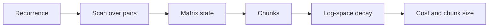
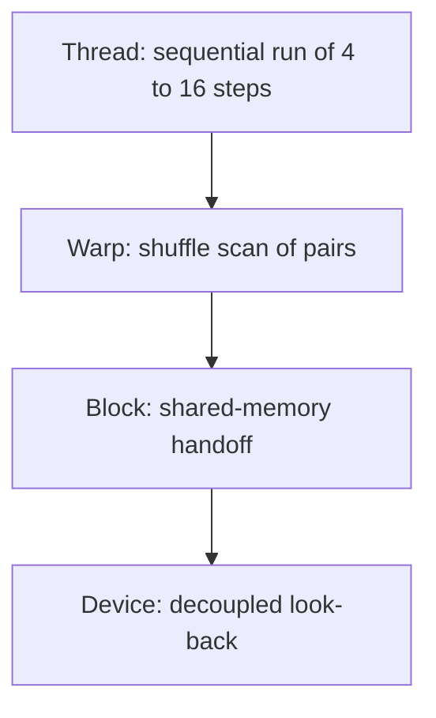
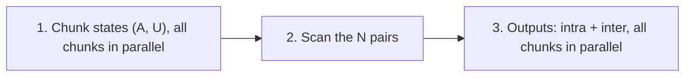
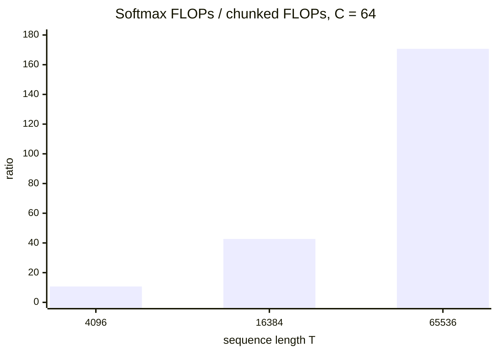

# Introduction

A decoder that keeps a fixed-size state is cheap to run. The question is how to train it quickly, when each token updates the state the next token reads.

Note:
Open with the contrast the audience knows. A softmax-attention decoder keeps a KV cache that grows with every token. A linear-attention or state-space layer keeps a state of fixed size. Decoding is cheap, and training is the problem, because the update looks like a loop over tokens. Today you turn that loop into a scan and then into matmuls. The model motivation is a short section, and the ml course's state-space models lesson owns it.

### What you already have {#have}

- Chapter 7: scan with `+`, work and depth, Kogge-Stone, look-back
- Chapter 14: Triton tiles and `tl.dot`
- Chapter 16: a causal attention tile that never reaches HBM
- Chapter 9: where a float32 or a float64 runs out of exponent

Note:
Name the four prerequisites and say what each contributes. The operator is new. The tile is the FlashAttention tile with a decay mask in place of a softmax. The exponent limits are the numerics section.

### The route {#route}



Note:
Walk the arrow once. The recurrence becomes a scan by a change of viewpoint: a step is a function. The matrix state is linear attention. Chunking makes it a matmul. Numerics keep it finite, and the cost model sizes the chunk. The lab follows the same order, with the first check needing only one function.

# A recurrence is a scan

The loop $h_t = a_t h_{t-1} + b_t$ looks sequential. Write each step as a function, and it composes in any grouping.

Note:
The key move is to stop thinking of h as the thing you scan. The thing you scan is the step, a small function of h. Two numbers describe it. Once you carry steps instead of values, composing two steps gives another step of the same kind, and that is all a parallel scan needs.

### A step is a function {#step}

$$
(a_1, b_1) \circ (a_2, b_2) = (a_1 a_2,\; a_2 b_1 + b_2)
$$

- Run $(a_1, b_1)$ first, then $(a_2, b_2)$
- The answer is one step of the same kind
- The identity is $(1, 0)$

Note:
Derive it on the board: a2 times a1 h plus b1, plus b2. Group the h terms and the constant terms. Stress the order. The earlier step is on the left. With a = 1 the operator is addition on b, which is exactly chapter 7's scan. A decay that depends on the token is what makes it new.

### Check it with numbers {#numbers}

| Step | $a$ | $b$ | $h$ |
|---|---|---|---|
| 1 | 0.5 | 1 | 1 |
| 2 | 0.5 | 2 | 2.5 |
| 3 | 2 | 1 | 6 |
| 4 | 1 | 3 | 9 |

$(0.5, 1) \circ (0.5, 2) = (0.25, 2.5)$, $(2, 1) \circ (1, 3) = (2, 4)$, and joining them gives $(0.5, 9)$.

Note:
Run the loop down the table to get 9. Then group the first two and the last two steps separately, which two threads could do, and join them. The second component of the result is 9. Same answer, different grouping. That is associativity at work, and it is what the next slide proves.

### Associative, not commutative {#assoc}

$$
(x \circ y) \circ z = x \circ (y \circ z) = (a_1 a_2 a_3,\; a_2 a_3 b_1 + a_3 b_2 + b_3)
$$

$(2, 3) \circ (4, 5) = (8, 17)$ but $(4, 5) \circ (2, 3) = (8, 13)$

> [!QUESTION] If the swapped operator is also associative, how would you catch it?
> Compare the scan with the sequential loop. An associativity test passes for both orders, because both are compositions of functions. Only the comparison with the loop, or a hand value such as $(8, 17)$, shows that the second operator runs the steps in the wrong order.

Note:
The proof is function composition, which is always associative. The point of the second line is that associativity gives you freedom to regroup and no freedom to reorder. A scan implementation that swaps the operands passes an associativity test and fails the equality with the sequential loop. The lab's first check uses the hand value for exactly this reason.

### Hillis-Steele over pairs {#hillis}

```python
d = 1
while d < T:
    na, nb = combine((A[:-d], B[:-d]), (A[d:], B[d:]))
    A = cat([A[:d], na]); B = cat([B[:d], nb])
    d *= 2
```

- $\lceil \log_2 T \rceil$ steps, about $T \log_2 T$ combines
- Reads the old arrays, writes new ones
- Works for any $T$

> [!QUESTION] Why is the first operand the earlier element?
> The recurrence runs earlier steps first, and the operator applies its left operand first. The earlier element must therefore be on the left, or the scan composes the steps in the wrong order.

Note:
This is chapter 7's Kogge-Stone with the operator swapped. Each pass combines element i minus d on the left with element i on the right. The b component is h. Blelloch also works, with twice T minus one combines in twice log T steps. The lab uses Hillis-Steele because it is short and handles any length.


### The scan in a kernel {#kernel}



Note:
The kernel has chapter 7's three levels with a pair as the element. Each thread runs a short sequential chain in registers, which is the cheapest part. A warp scans the thread totals with shuffles. Blocks publish their aggregate pair, and later blocks look back. The traffic is 12 bytes per fp32 element. For 2 to the 26 elements the floor at 1275 GB/s is 0.632 milliseconds, a prediction.

# Linear attention and the chunked algorithm

With a matrix for $b$, the same recurrence is linear attention. Chunks turn it into matmuls.

Note:
This section is the model in one slide and the algorithm in the rest. Say clearly that the reasons these layers exist belong to the ml course's lesson. Here, take the formula as given, and spend the time on how to run it fast.

### The matrix state {#state}

$$
S_t = g_t S_{t-1} + k_t v_t^{\top}, \qquad o_t = q_t^{\top} S_t
$$

- $S$ is $d_k \times d_v$: 64 KiB in fp32 at 128 by 128
- A KV cache at $T = 4096$ holds 2 MiB per head in bf16
- Scalar decay: RetNet, Mamba-2. Per-channel decay: GLA

Note:
The state is the sum of rank-one terms, decayed. The size does not depend on the sequence length. A KV cache for one head at 4096 tokens in bf16 is 2 MiB and growing. Name the two decay shapes and say the lab uses the scalar one. The per-channel form follows the same steps, with an extra dimension on the mask, and the numerics section says what changes.

### Why the token loop is slow {#slow}

- Per token: a rank-one update and a vector-matrix product
- About 2 FLOPs per element touched
- Storing every state: 256 MiB per head at $T = 4096$
- No tensor cores

> [!QUESTION] Why not unroll it into one big matmul?
> You can: $o = ((Q K^{\top}) \odot D) V$ with a decay mask $D$. It builds a $T \times T$ matrix, which is the quadratic cost these layers are meant to avoid. Chunking keeps the matmul and shrinks the matrix to $C \times C$.

Note:
Do the arithmetic on 256 MiB: 4096 states times 128 times 128 elements times 4 bytes. Then offer the parallel form as the obvious alternative and show why it fails at long T. The chunked algorithm is the middle path: the parallel form inside a block of C tokens, the recurrence between blocks.

### Two views of one chunk {#views}

$$
o_i = \underbrace{e^{b_i}\, q_i^{\top} S_{\text{in}}}_{\text{inter-chunk}} + \underbrace{\sum_{j \le i} e^{b_i - b_j} (q_i^{\top} k_j)\, v_j}_{\text{intra-chunk}}
$$

- $b_i$: cumulative log decay inside the chunk
- $S_{\text{in}}$: the state entering the chunk

Note:
The entering state already summarizes every earlier token, so one matmul with the chunk's queries covers all of them, decayed by b sub i. Tokens inside the chunk see each other through a small causal, decayed attention. The sum of the two views is the loop's output. Point at e to the b sub i: it includes the position's own step. The lab's boundary check catches a version that does not.

### The state leaves the chunk {#out}

$$
S_{\text{out}} = e^{b_C}\, S_{\text{in}} + \sum_{j \le C} e^{b_C - b_j}\, k_j v_j^{\top}
$$

- Same shape as $h \leftarrow a h + b$, per chunk
- $A = e^{b_C}$ is a scalar, $U$ is a matrix
- $U$ needs only the chunk's own $k$ and $v$

Note:
This is the first slide's recurrence again, with a scalar a and a matrix b, one step per chunk. Because U depends only on the chunk, every chunk can compute its pair at the same time. Then the same operator, in a scan, gives the state entering each chunk. That is the scan over chunk states.

### Three phases {#phases}



> [!KEY] The scan moved up a level
> A scan over $T$ tokens became a scan over $T / C$ chunks, and the work inside a chunk became matmuls.

Note:
Phase one and three are fully parallel across chunks and use tensor cores. Phase two is short: 64 pairs for T of 4096 and C of 64. In the lab these are chunk_states, entering_states over scan_parallel, and chunked_linear_attention. The lab's Triton kernel fuses all three into a loop per head, and the last section says what that costs.

### A worked chunk {#worked}

With $g = 0.5$, $T = 6$, $C = 3$, scalar state:

| | Chunk 1 | Chunk 2 |
|---|---|---|
| $S_{\text{in}}$ | 0 | 3.25 |
| inter | 0, 0, 0 | 1.625, 2.4375, 0.40625 |
| intra | 1, 5, 3.25 | 3, 7.5, 3.25 |
| $o$ | 1, 5, 3.25 | 4.625, 9.9375, 3.65625 |

Note:
The loop gives 1, 5, 3.25, 4.625, 9.9375, 3.65625. Chunk one enters with zero, so it is all intra. Its pair is A equal to 0.125 and U equal to 3.25. Chunk two enters with 3.25, and its inter terms use e to the b with the decays 0.5, 0.25, 0.125 times q times 3.25. Add the intra terms and the six outputs match.


### The boundary bug {#boundary}

The inter term of position $i$ uses $e^{b_i}$, which includes step $i$.

- Wrong: $e^{b_{i-1}}$, the decay before the position
- Chunk 1 hides it: it enters with zero state
- Test at least two chunks

> [!QUESTION] What would an off-by-one boundary decay do to this table?
> The first inter term would be 3.25 instead of 1.625, and the output 6.25 instead of 4.625.

Note:
This is the plausible wrong implementation the lab's boundary and chunked checks are built to catch. Because the first chunk enters with zero state, a test with one chunk passes. With the worked numbers, the first inter term becomes 3.25 instead of 1.625. The same shift on the state update, using b last minus b sub j minus one, corrupts the state that enters the next chunk, and the lab's state check shows it.

### What lands on tensor cores {#tc}

| Piece | FLOPs per chunk |
|---|---|
| $Q K^{\top}$ | $2 C^2 d_k$ |
| scores times $V$ | $2 C^2 d_v$ |
| $Q\, S_{\text{in}}$ | $2 C d_k d_v$ |
| $(K \odot w)^{\top} V$ | $2 C d_k d_v$ |

The mask $D$ is the only elementwise work.

Note:
These four rows are the whole FLOP count. The first two are chapter 16's attention tile with a fixed decay mask instead of a softmax, so there is no running max and no rescaling. The mask costs about C squared exponentials. The whole-sequence FLOPs are T times two C times d k plus d v, plus four d k d v.

# Keeping the decay finite

Every exponent in the algorithm should be at most zero. The obvious implementation breaks that rule.

Note:
This is the numerics section and the one the lab tests hardest. There are two ways to get NaN from the decay mask, and they fail in opposite directions. One underflows and one overflows. The fix for both is the same habit: work with the cumulative log decay and form only differences.

### The product underflows {#under}

```viz
37-decay-underflow
```

> [!QUESTION] Isn't float64 enough?
> It buys time, not safety. At $g = 0.5$ it lasts to step 1075 instead of 150, and at $g = 0.1$ to step 324. A stronger decay shortens the margin. The log form has no limit to hit.

Note:
Choose g equal to 0.1 and watch the float32 floor line. The cumulative product is below 1e-45 by step 46, and from there the product is exactly zero. The ratio P i over P j is then zero over zero. At 0.5 the break is at step 150 in float32 and 1075 in float64. These are torch cumprod results from the script behind the figure.


### The exponent overflows {#over}

- $e^{b_i - b_j}$ for $j > i$ has a positive exponent
- At $g = e^{-6}$ over 200 tokens the exponent reaches 1194
- $e^{1194} = \infty$, and $\infty \times 0 = \text{NaN}$
- Fix: replace the exponent with $-\infty$ above the diagonal, then `exp`

Note:
This is the version people write after fixing the cumulative product. Compute the whole exponent matrix, exp it, and multiply by the lower-triangular mask. The masked entries are infinite, and zero times infinity is not zero. Mask the exponent, not the result. The lab's log-space check uses exactly this input, and the cumulative-product ratio on the same input has 2926 NaN entries.

### The rule {#rule}

| Where | Exponent |
|---|---|
| Decay mask | $b_i - b_j$, $j \le i$ |
| Inter term | $b_i$ |
| State update | $b_C - b_j$ |
| Chunk decay | $b_C$ |

All are $\le 0$, so every factor is in $(0, 1]$.

> [!WARNING] The per-channel case
> Scaling queries by $e^{b_i}$ and keys by $e^{-b_j}$ brings back a positive exponent. Bound it with sub-chunks or a reference offset.

Note:
Walk the four rows. Every factor is a decay between two positions or from the chunk start, so it is at most one. Nothing can overflow. A factor that underflows to zero is the right answer, because that contribution really has decayed away. Keep the state and the decay in float32 even with bf16 inputs, since the state is a long decayed sum.


# Cost and the chunk size

Chunking trades FLOPs against state traffic. The model shows which way each knob moves. Only a sweep says where the minimum is.

Note:
This section is arithmetic from the specs, a prediction and not a measurement. The lab's cost model is graded on its formulas and its interior minimum. The lab's sweep is the measurement, and it measures one simple kernel.

### Chunked against softmax {#flops}

$$
F_{\text{chunk}} = T\,(2C(d_k + d_v) + 4 d_k d_v), \qquad F_{\text{softmax}} = T^2 (d_k + d_v)
$$

$$
T^{\ast} = 2C + \frac{4\, d_k d_v}{d_k + d_v} = 384 \text{ for } C = 64,\ d_k = d_v = 128
$$

Note:
Softmax counts the lower triangle only. The chunked count includes every full C by C block because a tensor-core tile cannot skip single elements. Divide by T and compare per-token costs to get the crossover. At 128 by 128 and a chunk of 64 the crossover is 384 tokens. The lab's crossover_length returns it.

### What the gap looks like {#gap}



> [!QUESTION] Does a 170 times FLOP gap mean a 170 times speedup?
> No. It's a ratio of operation counts. Both kernels have to keep tensor cores fed, and both move bytes. The chunked kernel's runtime depends on its state traffic, which the next slides count.

Note:
The ratios come from 4.295 over 0.403, 68.719 over 1.611, and 1099.512 over 6.442 gigaflops, per head, forward only. The ratio grows with T because one side is quadratic. Caution the audience that this is a FLOP ratio, not a time ratio: FlashAttention is not bound by its FLOPs alone, and chapter 16 showed why.


### Chunk size moves two things {#trade}

```viz
37-chunk-tradeoff
```

Note:
Drag the chunk slider. The green curve is FLOP time at 312 teraflops and it rises with C. The blue curve is byte time at 1275 gigabytes per second, and it falls with one over C, because there are fewer states to write and read. The modelled time is the larger of the two. At T of 16384 and C of 64 the byte time is 39.5 microseconds and the FLOP time is 5.2.

### State memory {#memory}

- Per head, fp32 state: 64 KiB, independent of $T$
- Chunk states at $T = 4096$: $C = 64$ gives 4 MiB, $C = 256$ gives 1 MiB
- Storing every token's state: 256 MiB
- A $C \times C$ fp32 score block at $C = 128$: 64 KiB

> [!QUESTION] Why not take the model's best chunk, 512?
> The model ignores shared memory and parallelism. A $512 \times 512$ fp32 score block is 1 MiB, far above the 164 KiB per SM, and $T / C$ falls, leaving fewer programs to fill 108 SMs. Measure the sweep.

Note:
Give the three memory numbers and the one that bounds the chunk from above. The model's minimum at 512 is a statement about the trade-off, not about the best kernel. Tell the audience what the model leaves out and send them to the sweep.

### The lab's kernel {#triton}

```python
s = tl.zeros((DK, DV), dtype=tl.float32)      # state, in registers
for start in range(0, T, C):
    b = tl.cumsum(lg, axis=0)
    diff = tl.where(causal, b[:, None] - b[None, :], -float("inf"))
    o = tl.dot(tl.dot(q, tl.trans(k), input_precision="ieee") * tl.exp(diff), v,
               input_precision="ieee")
    o += tl.exp(b)[:, None] * tl.dot(q, s, input_precision="ieee")
```

Note:
One program per head, the state in registers, and a loop over chunks. The masked exponent is the fix from the numerics section. The ieee precision keeps float32 dots at float32, because the default would use TF32 and miss the tolerance against the float64 reference. Padded tokens load zeros, so the ragged last chunk needs no special case. The state update, not shown, is s times e to b last plus the weighted K transpose V.

### What the lab kernel leaves out {#leaves}

- One program per head: 16 heads fill 16 of 108 SMs, about 15%
- The three-phase form launches $H \times N$ programs, 2048 at $T = 8192$, $C = 64$
- No backward pass: production kernels recompute the intra-chunk block

> [!QUESTION] Is the lab's sweep a benchmark of the technique?
> No. It measures this one-program-per-head kernel. A tuned three-phase kernel behaves differently, and the sweep's best chunk may differ from a production kernel's.

Note:
Be honest about the kernel. It is the simplest correct form, written to be read. It shows the arithmetic of a chunk and how the chunk size moves the time, but with only 16 programs it can't use the card. The decomposition from the algorithm section is the fix. The lab reports ms for chunk sizes 16 to 128 and the best chunk, all as measurements of this kernel.

# Summary

The recurrence is a scan, the chunk is a matmul, the decay lives in log space, and the chunk size is a measured trade-off.

Note:
Close the talk by replaying the route from the start: recurrence, scan, matrix state, chunks, log-space decay, cost. Each step answered one question, and the lab has a check for each one. Take the summary slides at a steady pace and leave time for questions on the numerics, because that is where the lab's wrong answers come from.

### What to remember {#summary}

- A step $(a, b)$ is a function, and $(a_1, b_1) \circ (a_2, b_2) = (a_1 a_2, a_2 b_1 + b_2)$ is associative and not commutative
- Chunked: intra masked matmul, chunk states through a scan, plus an inter term $e^{b_i} q_i^{\top} S_{\text{in}}$
- Work with the cumulative log decay and mask the exponent: every exponent $\le 0$
- Crossover $T^{\ast} = 2C + 4 d_k d_v / (d_k + d_v)$: 384 for $C = 64$ at 128 by 128
- $C$ trades FLOPs, rising with $C$, against state bytes, falling with $1/C$

Note:
Close on the five lines. The first is the scan from chapter 7 with a richer operator. The second is the algorithm. The third is the numerics rule, which is also the most common source of NaN. The fourth and fifth are the cost model. Remind the audience that the model is a prediction and the lab's sweep is a measurement of one simple kernel.

### Which form when {#guide}

| Situation | Form |
|---|---|
| Decoding one token | The recurrence: update $S$ once |
| Training, long $T$ | Chunked, three phases |
| Short $T$, below about 384 at $C = 64$ | Softmax attention costs fewer FLOPs |
| Per-channel decay | Chunked, with a bounded $e^{-b}$ |

Note:
A decision guide. At decode time you run the recurrence: one state update per token, no chunking needed. For training at long length, use the chunked form in three phases. Below the crossover the FLOP count favours softmax attention, though the real decision also depends on model quality, which is the ml course's subject. The per-channel decay needs extra care in the intra-chunk term.

### Next {#next}

- Revisit chapter 16 and compare its backward pass with a chunked backward
- The ml course's state-space models lesson explains the models

Note:
Point backward and sideways. The attention tile from chapter 16 and this chapter's chunk are cousins, and reading the flash-linear-attention kernels after the lab shows the three-phase form and the backward pass. For the models themselves, send the audience to the ml course. Then take questions.
