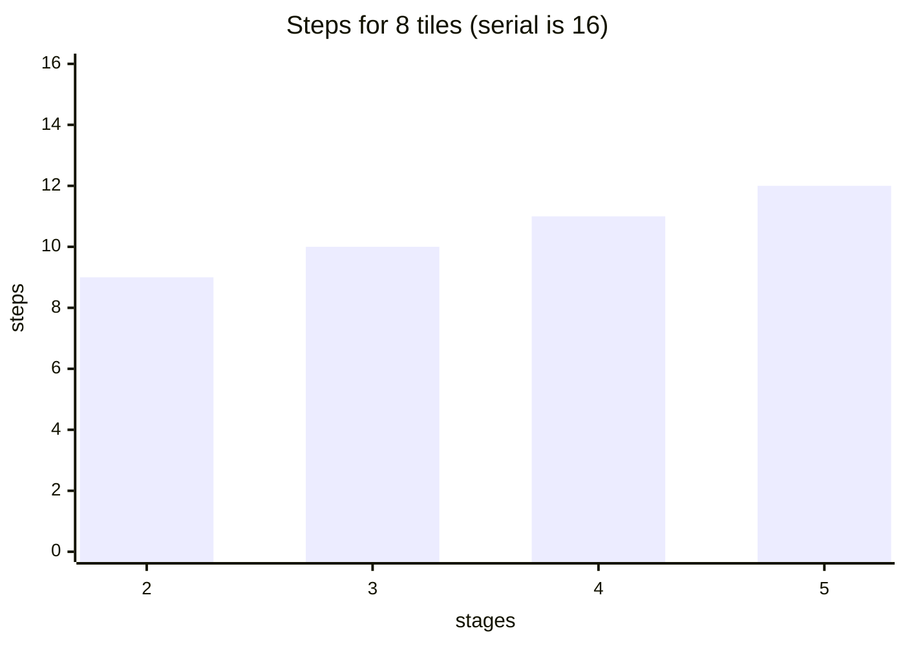
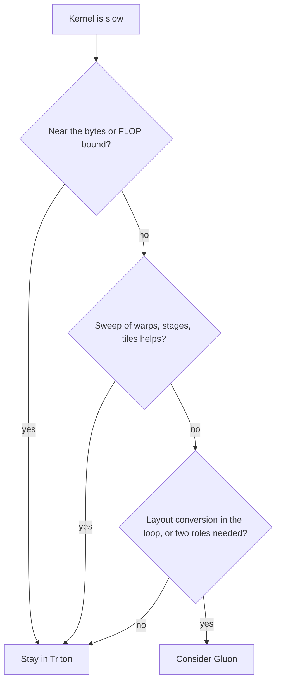

# Introduction

You can write a Triton kernel. Today you learn what Triton decided for you, and who decides it in the other tile languages.

Note:
Chapter 14 taught you to write Triton, and chapter 23 told you the other tools exist. Today is the middle: what is the same under all of them, what differs, and how to tell what one did to your kernel. Every code excerpt comes from a project's own documentation, and anything we could not verify is marked unconfirmed.

### One question for the hour {#question}

- A tile language says "the compiler handles it"
- Handles what, exactly?
- Which of those decisions can you take back?
- How do you check what the compiler chose?

Note:
This is the whole talk in four lines. The first is vocabulary, the second the map of languages, the third the decision to drop down a level, and the last the PTX. The answer to the first is four things, and the next section names them.

# The four decisions

Between "I want this tile product" and the instructions that run, four decisions are made.

Note:
Section divider. Everything in this section is the vocabulary for the rest of the hour. Keep it quick, because the audience has seen all four in earlier chapters, just not named as a set.

### The tile, the layout, the copy, the pipeline {#four}

- **Tile:** the block of data one group of threads owns
- **Layout:** which thread holds which element
- **Async copy:** how the tile reaches fast memory without a stall
- **Pipeline:** how many tiles are in flight

Note:
Name them and say what each replaces from CUDA C++. The tile is the shape you pick. The layout is the index arithmetic and the swizzle. The async copy is cp.async or TMA. The pipeline is the multistage loop of chapter 12. Say that you always choose the tile, because the compiler cannot know your problem, and that the other three are what differs between languages.

### One tile, real numbers {#numbers}

- A 128 by 128 fp16 tile is 16,384 elements, 32 KiB
- Four warps are 128 threads: 128 elements each, 256 bytes
- That is sixteen 16-byte vector loads per thread
- One stage of a 128 by 32 A slab and a 32 by 128 B slab is 16,384 bytes
- Three stages are 49,152 bytes

> [!QUESTION] Why doesn't the compiler pick the tile?
> It can't know your shapes or register budget. Autotuning measures, and you choose to run it.

Note:
Walk the arithmetic once. The layout decides which sixteen runs belong to which thread. The pipeline's price is the shared memory: 16 KiB per stage here, so three stages is 48 KiB, well inside the 163 KiB per block that an A100 allows. Every stage you add costs another 16 KiB. This is why num_stages is a tuning knob and not a free setting.

### Who decides what {#who}

| Tool | Layout | Async copy | Pipeline |
|---|---|---|---|
| Triton | Compiler | Compiler | `num_stages` |
| Gluon | You | You | You |
| TileLang | Inferred | `T.copy` | `T.Pipelined` |
| ThunderKittens | By tile type | `tma::load_async` | You, a constant |
| Pallas | Compiler | `BlockSpec` | Framework |

Note:
This is the table to remember. Read down the Triton and Gluon rows, which are the two ends. Triton hides all three and gives you one lever on the pipeline. Gluon hands all three back. The middle rows are where TileLang, ThunderKittens, and Pallas sit. cuTile is left out of this table because we could not read how it exposes the pipeline, and the chapter says so.

# The languages

Each tool has a different idea of what a tile is, and a different hardware list.

Note:
Section divider. For each tool, give the audience one sentence on what the unit is, and one sentence on where it runs. The A100 in the lab is the test: which of these can you run on it?

### Triton and Gluon {#triton-gluon}

- Triton: one program per tile, implicit layouts
- Gluon: a lower level inside the Triton repository
- Gluon exposes layouts, shared memory, and warp specialization
- Tutorials run from layouts to `tcgen05`

Note:
Gluon is imported as triton.experimental.gluon and its language module as gl. Its own intro describes it as lower level, with more control and more responsibility. Its tutorials are numbered by topic: layouts, async copy, TMA, wgmma, tcgen05, persistence, warp specialization. The warp-specialization tutorial says Hopper and newer, which rules out the lab A100 for that part.

### TileLang {#tilelang}

- A DSL built on top of TVM
- `T.Kernel`, `T.alloc_shared`, `T.alloc_fragment`
- `T.copy`, `T.gemm`, `T.Pipelined(num_stages=3)`
- CUDA primary, ROCm, Metal, and Ascend supported

Note:
The README lists NVIDIA CUDA from SM70 to SM120 as primary, so the A100 is in range, and HIP, Metal, and Ascend as supported. LLVM CPU, a CuTe DSL backend, and WebGPU are experimental. The pipeline is a loop type with a stage count.

### ThunderKittens {#tk}

- Header-only C++ with register and shared tiles
- `rt_bf`, `rt_fl`, `st_bf`, `st_hf`, row or column layout in the type
- Tiles are no smaller than 16 by 16
- Built and tested for Hopper and Blackwell

Note:
Operations take the destination first. The README says Ampere is no longer actively supported, so the lab A100 is outside the tested range. It requires CUDA 12.8 and C++20. Its matmul example splits producer and consumer warps and quotes about 855 TFLOP/s on an H100. That is an H100 number.

### cuTile and CUDA Tile {#cutile}

- CUDA Tile: the model. CUDA Tile IR: the virtual ISA
- cuTile: the language. cuTile Python imports as `cuda.tile`
- Compute capability 8.x to 12.x, driver r580 or later
- Release status: not stated on NVIDIA's pages (unconfirmed)

Note:
NVIDIA's pages use three names. The quickstart requires compute capability 8.x through 12.x, driver r580 or later, and either CUDA Toolkit 13.1 or the tileiras extra. The lab image has CUDA 13.0 and no cuda-tile, so the lab doesn't use it. We found no status label such as stable or beta, so say the status is unconfirmed.

### Pallas {#pallas}

- JAX extension, GPU and TPU backends
- A grid of programs, `pl.program_id`
- `BlockSpec`: a block shape and an index map
- GPU quickstart covers Hopper and Blackwell

> [!QUESTION] Which of these can I run on the lab A100?
> Triton, and the layout and async-copy parts of Gluon. TileLang's CUDA backend reaches back to SM70. cuTile lists compute capability 8.x but needs a toolkit the image lacks. ThunderKittens doesn't support Ampere. Pallas GPU covers Hopper and Blackwell.

Note:
Pallas is the one with a framework underneath. The BlockSpec replaces pointer arithmetic and the mask. On GPU the docs use the Mosaic GPU backend, imported as plgpu. On TPU it covers the TensorCore and the SparseCore. The shared ideas are refs, block specs, and pipelining.

# The same kernel, side by side

The tile is a row for softmax and an output block for GEMM. The rest is notation.

Note:
Section divider. The point of showing the same kernel several ways is that the structure is the same everywhere. If the audience sees eight lines in Triton and eight in Pallas, they stop thinking of these as different worlds.

### Row softmax in Triton {#softmax-triton}

```python
row = tl.program_id(0)
offs = tl.arange(0, BLOCK)          # the tile: one row
mask = offs < n_cols                # the tail
x = tl.load(x_ptr + row * stride + offs, mask=mask, other=-float("inf"))
x = x - tl.max(x, axis=0)
num = tl.exp(x)
tl.store(y_ptr + row * stride + offs, num / tl.sum(num, axis=0), mask=mask)
```

Note:
This is the fused-softmax tutorial reduced to one row per program. BLOCK is the next power of two of the width, so a row of 1,000 uses 1,024 and the mask turns off 24 lanes. Load the tail with minus infinity so it neither wins the max nor adds to the sum. Triton picks the layout, so no line names it.

### The same softmax in Gluon {#softmax-gluon}

```python
layout = gl.BlockedLayout([4], [32], [4], [0])   # you write this line
offs = gl.arange(0, BLOCK, layout=layout)
x = gl.load(x_ptr + row * stride + offs, mask=mask, other=-float("inf"))
```

- Four elements per thread, 32 lanes, 4 warps: 512 per pass
- A row of 1,024 repeats the layout twice
- `gl.max`, `gl.exp`, `gl.sum` are unconfirmed names

Note:
The only new idea is the layout. The names gluon.jit, BlockedLayout, arange with a layout, load with a mask, and store come from the Gluon tutorials. The reductions are written by analogy with Triton, and the tutorials the author read do not use them, so flag them as unconfirmed. In Triton the compiler writes the layout line. In Gluon you write it, and you can change it.

### The same softmax in Pallas {#softmax-pallas}

```python
def softmax_kernel(x_ref, o_ref):
    x = x_ref[...]                       # a (bm, n) block
    e = jnp.exp(x - x.max(axis=-1, keepdims=True))
    o_ref[...] = e / e.sum(axis=-1, keepdims=True)

spec = pl.BlockSpec((bm, n), lambda i: (i, 0))
```

> [!QUESTION] Does Triton's mask do the same job as Pallas padding?
> Not quite. The mask is yours and you choose the fill (`other`). Pallas pads for you with an unspecified value and discards the extra output. Safe for row-wise work, wrong for a reduction across rows.

Note:
The kernel sees a block of rows, so there is no pointer arithmetic and no mask. The BlockSpec carries the addressing: block i of rows, all columns. If M is not a multiple of bm, the documentation says the missing part is padded on input and discarded on output, with unspecified padding values. A row softmax is safe, because each row is independent. A column reduction over a padded block would not be.

### The bytes bound all of them {#softmax-floor}

- 4096 by 4096 fp32: 134,217,728 bytes moved
- Floor at 1935 GB/s: 69.4 microseconds
- Floor at the 1275 GB/s copy ceiling: 105.3 microseconds

Note:
A row softmax reads each element once and writes it once: 2 times 4096 squared times 4 bytes. The floors are predictions from specs, and the 1275 GB/s ceiling was measured in learn-inference on the lab card. Softmax is memory bound, so the four versions should land close together. If one is much slower, it is doing extra work such as a second pass or a layout conversion.

### The GEMM loop in Triton and TileLang {#gemm-two}

```python
# Triton
acc = tl.dot(a, b, acc)
# TileLang
for k in T.Pipelined(T.ceildiv(K, block_K), num_stages=3):
    T.copy(A[by * block_M, k * block_K], A_shared)
    T.gemm(A_shared, B_shared, C_local)
```

Note:
The TileLang loop is from the README's matmul-with-ReLU example. The three memory spaces are explicit: A_shared in shared memory, C_local a register fragment. The pipeline is the loop type, with a stage count of 3. In Triton the equivalent loop has no pipeline call, and num_stages on the launch builds it. The README's example does not show a mask on K, so we do not claim TileLang masks a ragged K.

### The GEMM loop in Pallas {#gemm-pallas}

```python
in_specs=[pl.BlockSpec((bm, bk), lambda i, j, k: (i, k)),
          pl.BlockSpec((bk, bn), lambda i, j, k: (k, j))],
out_specs=pl.BlockSpec((bm, bn), lambda i, j, k: (i, j)),
grid=(m // bm, n // bn, k // bk),
```

- The grid is the K loop
- A zeroed scratch accumulator, written out at the last K step

Note:
This is the TPU matmul from the JAX documentation. There is no loop in the kernel body. The third grid axis is K, marked arbitrary in dimension semantics, with the other two parallel. The two index maps are the whole addressing story, and the accumulator is explicit scratch. Because the grid is the loop, the framework can pipeline the block copies, and on GPU plgpu.emit_pipeline makes that loop explicit.

### The GEMM loop in ThunderKittens {#gemm-tk}

```cuda
tma::load_async(args.input.a[i], args.globals.A,
                {args.common.coord.x + i, args.iter}, args.inputs_arrived);
warpgroup::mma_AB(args.state.accum, args.input.a[warpgroup::groupid()], ...);
```

- Producer warps copy. Consumer warps multiply
- `INPUT_PIPE_STAGES=4` is a constant in the template

> [!QUESTION] Why does the ThunderKittens kernel look so different if it does the same thing?
> It spells out the roles that Triton and Pallas leave to the compiler. The copy and the multiply happen in the same rhythm, but you assign them to different warps and name the barrier between them.

Note:
The K loop is gone from view. The template calls load once per iteration on producer warps and compute on consumer warps. The copy is TMA with an arrival barrier, and the multiply is a warpgroup mma that issues wgmma. The README says the whole kernel is under 100 lines and reaches about 855 TFLOP/s on an H100. That is one H100 result and says nothing about the A100.

### The index map is a block index {#index-map}

- A 10 by 20 array in 4 by 8 blocks: a 3 by 3 grid
- Block (1, 2) starts at element (4, 16)
- Its slice is rows 4 to 8 and columns 16 to 20
- Treat it as an offset and you get rows 1 to 5 and columns 2 to 10

Note:
This is the first lab piece. The documentation is explicit that the index map returns block indices, and that each is multiplied by the block shape. The last block is clipped at the array edge, so block row 2 has only two real rows. The wrong implementation, which the lab catches, returns an element offset and gets the neighbors wrong.

# Layouts and pipelines

Two things you can compute: where an element lives, and when a tile arrives.

Note:
Section divider. These two are the lab's second and third pieces. Both are small functions with exact answers, which makes them good checks and good teaching.

### A layout is a function {#layout-fn}

- `size_per_thread`: a run of contiguous elements
- `threads_per_warp`: how 32 lanes tile the block
- `warps_per_cta`: how the warps tile it
- `order`: which dimension varies fastest

Note:
These are the four arguments of Gluon's BlockedLayout. A layout is a pure function from an element of the tile to a warp, a lane, and a register. Triton picks it. Gluon makes it an argument. The tutorial's definition is that a layout distributes a tensor's elements among the threads of a thread block.

### Worked example: element (9, 5) {#layout-example}

- Layout: `[1, 4]`, `[8, 4]`, `[1, 1]`, order `[1, 0]`
- One pass covers 8 rows by 16 columns, so the tile repeats twice
- Column 5: position 1 in a run, thread-column 1
- Row 9: thread-row 1, repeat 1
- Lane 5, register 5

Note:
Walk the digits slowly. Column 5 is position 1 in a run of 4, thread-column 1. Row 9 is row 1 plus one repeat. With the last dimension fastest, the lane is 1 plus 4 times 1, so 5. The register is 1 plus 4 per repeat, so 5. The register numbering is the lab's convention. Trust the warp and lane assignment.

### Pick a layout, pick an element {#layout-fig}

```viz
38-blocked-layout
```

> [!QUESTION] Why does the layout affect speed?
> It sets the bytes per lane. Four fp16 is 8 bytes. Eight fp16 is one 16-byte vector load.

Note:
Switch between the four layouts and watch the lane numbers change. The outlined cells are one thread's elements. Point out layout 3, which is column-major, and layout 2, where four warps share the tile and each thread holds two elements.

### The pipeline schedule {#schedule}

| Step | 0 | 1 | 2 | 3 | 4 | 5 | 6 |
|---|---|---|---|---|---|---|---|
| Copy | 0 | 1 | 2 | 3 | 4 | | |
| Multiply | | | 0 | 1 | 2 | 3 | 4 |

- 5 tiles, 3 stages: 7 steps against 10 serial

Note:
Step s copies tile s and multiplies tile s minus S minus 1. The first S minus 1 steps are the prologue, which only copy. The last S minus 1 are the drain, which only multiply. A tile sits in a buffer from its copy step through its multiply step, so at most S tiles are resident.

### Steps and stages {#steps}

$$
T_{\text{pipe}} = n + S - 1 \qquad T_{\text{serial}} = 2n
$$



Note:
The chart is the output of the figure script for 8 tiles. More stages cost more steps in the prologue and the drain, and the gain comes from the overlap in the middle. This model assumes a copy and a multiply take equally long, so one step is one unit. It is an idealization, and the lab does not time it. The shared-memory cost grows with S: 16 KiB per stage in the earlier example.

### Explore the schedule {#schedule-fig}

```viz
38-pipeline-schedule
```

> [!QUESTION] What if step s copies tile s + 1?
> One more tile is resident than you have buffers: 64 KiB, not 48 KiB, in the earlier example.

Note:
Move both sliders. The resident tiles at the chosen step are at most S. For 8 tiles and 3 stages the readout shows 10 steps against 16 serial, a ratio of 1.6. As the tile count grows the ratio tends toward 2, the most overlap can give when copy and multiply take equally long.

# Gluon and the PTX

Leave Triton for a reason you can see. Then check what the compiler emitted.

Note:
Section divider. Two practical skills to close the technical content: when to drop down a level, and how to read the output so you know what you got.

### When to leave Triton for Gluon {#when}



> [!QUESTION] My softmax is 5% under the bytes floor. Should I rewrite it in Gluon?
> No. A memory-bound kernel near its floor has nothing for Gluon to add, and you would take on a per-architecture kernel to save a few percent.

Note:
Go down the diagram. Acceptable roofline fraction: stop. Sweep helps: stop. Only if the IR shows a layout conversion in the hot loop, or you need a producer warp and a consumer warp group with different register budgets, does Gluon pay. Remind the audience that a Gluon kernel is longer and tied to one architecture's features. For warp specialization the tutorial says Hopper and newer.

### Getting the PTX {#getting-ptx}

- `TRITON_KERNEL_DUMP=1` dumps every stage and the final PTX
- `TRITON_DUMP_DIR` names the directory
- `MLIR_ENABLE_DUMP=kernelName` dumps IR before each pass
- `TRITON_ALWAYS_COMPILE=1` skips the cache

Note:
These variables are in the Triton README. Use always-compile when the dump is empty because the kernel was cached. The stages are Triton IR, Triton GPU IR where the layouts are attached, LLVM IR, and PTX. For ThunderKittens use nvcc with the ptx flag. For Pallas, cuTile, and TileLang the exact dump options were not verified, so check each project's documentation.

### What to search for {#grep}

| Look for | It means |
|---|---|
| `cp.async.commit_group`, `wait_group` | Ampere pipelined copy |
| `cp.async.bulk.tensor` | TMA copy |
| `mma.sync...m16n8k16` or `wgmma` | The matrix instruction |
| `ld.global.v4` | Vectorized load |
| `st.shared`, `bar.sync`, `ld.shared` in the loop | A layout conversion |
| `ld.local`, `st.local` | Register spills |

> [!QUESTION] My kernel has num_stages=3 but its loop shows `wait_group 0`. What does that mean?
> The loop waits for every outstanding copy group each iteration, so the next tile's copy cannot overlap the current multiply. The pipeline you asked for isn't there.

Note:
Six searches answer most questions. The first two read the pipeline. The third reads the math. The fourth reads the layout's vector width. The fifth is the signature of a layout conversion. The sixth is a spill. Do not read the whole file. Chapter 5 teaches the habit and chapters 11, 12, and 26 explain each instruction.

# Summary

The four decisions, the six tools, and the checks that tell you which one you need.

Note:
Section divider for the close. Recap the yardstick, then give a short guide to choosing a tool, and then the lab.

### What to remember {#summary}

- Four decisions: tile, layout, async copy, pipeline
- You always pick the tile. Languages differ on the other three
- A Pallas index map returns block indices
- An S-stage pipeline: $n + S - 1$ steps, S tiles resident
- Leave Triton for a reason visible in the IR

Note:
Five lines. The first is the yardstick. The second says where the languages differ. The third is the most common Pallas mistake. The fourth is arithmetic the audience can reproduce. The fifth is the discipline: do not rewrite for taste, rewrite for evidence in the IR.

### Choosing a tool {#choose}

| Situation | Reach for |
|---|---|
| Memory-bound kernel on the A100 | Triton |
| Layout or producer-consumer control, Hopper or newer | Gluon |
| Portable tile kernel with explicit memory spaces | TileLang |
| Hand-tuned Hopper or Blackwell kernel in C++ | ThunderKittens |
| TPU, or JAX on GPU | Pallas |
| NVIDIA's own tile model | cuTile, after checking its status |

Note:
This is a guide, not a ranking. The A100 row is the one that applies to the lab. For each of the others, check the project's tested hardware before you start. The cuTile row has a caveat because we could not confirm its release status on NVIDIA's pages. Every row's benchmark charts name their hardware, so do not carry one across cards.

### The lab and what comes next {#lab}

- Block index map, `pallas_call` emulator, masked tile GEMM
- Online softmax, blocked layout, pipeline schedule
- The checks run on a CPU. The Triton softmax is optional and needs the A100
- The three questions of chapter 23 still apply to every kernel

Note:
The lab models each abstraction in plain Python with a tiny tile API that raises an error when a load or a store touches memory outside the array without a mask. The wrong implementations the checks catch include an index map that returns offsets, a tile loop with no mask on the last tile, and an online softmax that does not rescale the running sum. Close with the three questions from chapter 23, which apply to every kernel: what bounds it, how far is it, and what moves it.

