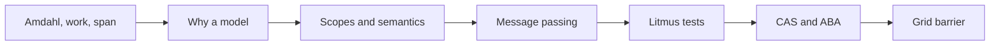
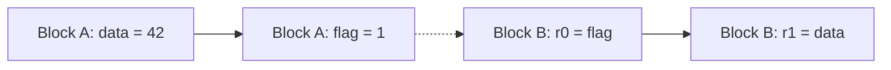
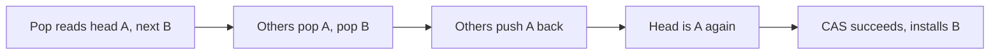
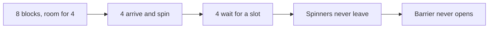

# Introduction

Which of your writes does another block see, and in what order? The answer decides whether a flag, a counter, or a barrier is correct.

Note:
Say that chapter 6 and chapter 7 both used the answer without proving it. This talk gives the proof in the smallest form that still fits a GPU: scopes, semantics, three litmus tests, and a grid barrier. It also opens with the CPU-course pair that CMU 15-418 and CS149 start from, Amdahl and work and span, because it gives you a way to say how fast before you worry about how correct.

### A pattern you copied without a proof {#copied}

- Chapter 6: write the partial sum, `__threadfence()`, then bump a counter
- Chapter 7: a block waits inside a kernel for another block's flag
- Both assume the data is visible when the flag is
- Neither chapter said why that holds

> [!QUESTION] Does the test suite catch a missing fence?
> Rarely. A missing release passes on a quiet GPU and returns a stale value once in millions of launches. The model decides what is correct, and a run can only look for a counterexample.

Note:
Point at the two earlier chapters by name. The last-block reduction fences before it increments, and the look-back reads a status slot through a volatile pointer. Ask who has tested a flag and seen it pass. Then say that passing is weak evidence here, because a weak outcome is allowed to be rare. That sets up the model.

### The road through this talk {#roadmap}



Note:
Seven stops, and the lab has a check at most of them. The first is arithmetic and runs on a CPU. The middle ones build the model and a Python enumerator that decides which outcomes it allows. The last two are lock-free structures and the barrier, with the residency rule that decides whether the barrier can work at all. Say that two checks need a GPU and skip cleanly without one.

# How much can p processors give?

Before correctness, speed: an upper bound you can compute from the algorithm.

Note:
This section is short and uses numbers from chapters 6 and 7. The point is a bound with two terms, one that shrinks with processors and one that doesn't, and a way to choose between two scans before writing either.

### Amdahl's law {#amdahl}

$$
\text{speedup} = \frac{1}{(1-\hla{f}) + \hla{f}/\hlb{p}}
$$

- $\hla{f}$ is the parallel fraction, $\hlb{p}$ the processor count
- The limit is $1/(1-f)$, however large $p$ gets

> [!QUESTION] What does a 90% parallel program reach on 108 processors?
> $1/(0.1 + 0.9/108) = 9.231$, against a limit of 10.

Note:
Walk the formula once. The serial part stays and the parallel part shrinks by p. The 90 percent case reaches 92 percent of its limit on 108 processors, so the 109th processor is nearly worthless. The next slide uses a 95 percent program to show how fast the returns fall.

### A 95% parallel program {#amdahl-example}

| Processors | Speedup |
|---|---|
| 8 | 5.926 |
| 108, one per SM | 17.01 |
| 221,184, resident threads | 19.998 |
| Limit | 20 |

Note:
The 221,184 is 864 resident blocks of 256 threads from chapter 2, which is 108 times 2048. The last three points of speedup cost over two hundred thousand processors. A 99 percent parallel program on 108 processors reaches 52.17, not 99. Say that Amdahl's law treats the serial fraction as a given, and that for an algorithm you can count it, which is the next slide.

### Work and span {#work-span}

- *Work* $W$: the number of operations
- *Span* $S$: the longest chain of dependent operations
- One processor takes $W$ steps, and unlimited processors take $S$
- A greedy schedule never leaves a processor idle while work is ready

$$
\max\!\left(\tfrac{W}{p},\, S\right) \le T_p \le \frac{W}{p} + S
$$

Note:
Chapter 7 defined work and depth. The new fact is the sandwich. No schedule beats the left side, and a greedy one meets the right side, so the bound is within a factor of two of the best possible. Compare it to Amdahl: the serial fraction becomes the span, which you can count from the algorithm instead of guessing.

### Counting a reduction and two scans {#counts}

| For $2^{20}$ values | Work $W$ | Span $S$ |
|---|---|---|
| Tree reduction | 1,048,575 | 20 |
| Kogge-Stone scan | 19,922,945 | 20 |
| Blelloch scan | 2,097,150 | 40 |

Note:
The reduction is n minus one additions in log n steps. Kogge-Stone does n minus 2 to the k additions at step k, which sums to 19,922,945, and Blelloch does 2 times n minus 1 in twice the steps. Kogge-Stone does 9.5 times the work for half the span. Ask the room which wins, and then show the figure.

### Where Kogge-Stone's bound wins {#brent-figure}

```viz
39-brent-bound
```

Note:
Drag p. At 1,024 processors the bounds are 1,044, 19,476, and 2,088, so Blelloch wins by nine times. They cross near 891,290 processors. At the A100's 221,184 resident threads the bounds are 24.74 steps for the reduction, 110.07 for Kogge-Stone, and 49.48 for Blelloch. These are step counts, not times, and chapter 7 found the same crossover inside one block.

### What the bound leaves out {#leaves-out}

- It counts operations and ignores memory traffic
- A $2^{26}$-float reduction is limited by its 0.2105 ms read, not by its span
- Use work and span to pick between algorithms that move the same bytes
- It assumes communication is free

> [!QUESTION] Then why did chapter 7 care about depth at all?
> Inside a block, steps cost barriers and shared-memory round trips, which the roofline doesn't count. There span decides.

Note:
Link back to chapter 4 for the roofline and chapter 6 for the 0.2105 millisecond floor. The last bullet is the bridge to the rest of the talk: communication is free in the bound, and on a GPU the price is paid in correctness, which the next section starts with.

# Why a GPU needs a memory model

A plain store followed by a plain store can become visible in either order.

Note:
This section is the heart of the talk. Spend time on the two reasons and on the vocabulary, because the lab's enumerator encodes exactly this vocabulary.

### Two blocks, a flag, and data {#two-blocks}



Note:
In a single thread that order is a guarantee. Across two SMs it isn't. The dotted edge is the only link between the blocks, and it says nothing about when the data store becomes visible. Block B can see the flag as 1 and still read the old data. The next slide gives the two sources of that freedom.

### The compiler and the hardware both reorder {#both-reorder}

- The compiler hoists a plain load out of a spin loop, so the loop never ends
- It can swap two stores to different addresses
- Each SM has its own L1, and a store can wait in a buffer
- A fence changes order, and `volatile` makes an access happen

Note:
The compiler reasons about one thread, so these transformations are legal for it. The hardware reorders for speed. The programming guide describes the visible effect: a fence changes the order of memory operations, and volatile is what makes a load or store reach memory. The PTX chapter doesn't describe caches, so treat the cache picture as an explanation of why the contract is weak, and not as a way to predict a result.

### Scope: which threads {#scopes}

| PTX scope | Threads | libcu++ |
|---|---|---|
| `.cta` | One block | `thread_scope_block` |
| `.cluster` | One cluster, Hopper on | `thread_scope_cluster` |
| `.gpu` | One device | `thread_scope_device` |
| `.sys` | Host and all devices | `thread_scope_system` |

Note:
The warp is not a scope. The A100 has no clusters, and libcu++ widens cluster to device before sm_90, so the lab uses device scope. A wider scope costs more, so choose the narrowest one that includes every thread that communicates. The next slide shows what happens when you choose too narrow a scope.

### Semantics: which order {#semantics}

| Semantics | Orders |
|---|---|
| `relaxed` | Atomic at its scope, nothing else |
| `acquire` | Nothing later moves before this load |
| `release` | Nothing earlier moves after this store |
| `acq_rel` | Both, for a read-modify-write or a fence |
| `fence.sc` | Also one total order of all such fences |

> [!QUESTION] Why list `fence.sc` separately?
> Store buffering needs the total order. A `fence.acq_rel` doesn't guarantee it.

Note:
Relaxed looks like synchronization because it is atomic and visible, and it orders nothing, which is the most common flag bug. Acquire and release are one-directional: a release orders what came before it, an acquire orders what comes after. The fence.sc row is the preview of store buffering, which the lab's enumerator checks.

### When a release meets an acquire {#meets}

- An acquire that reads the release's value synchronizes with it
- Then every write before the release is visible after the acquire
- Each operation's scope must include the other's thread
- A block-scoped release read from another block is a data race

Note:
PTX builds this from morally strong operations: each is strong, each scope includes the other thread, and they cover the same bytes. Say the scope rule plainly because it is silent. libcu++ calls a block-scoped release read by a device-scoped acquire in another block undefined behavior. Both halves must exist, and the lab makes you prove that with the enumerator.

### The C++ spelling {#cpp}

```cuda
cuda::atomic_ref<int, cuda::thread_scope_device> f(*flag);
data[0] = value;
f.store(1, cuda::std::memory_order_release);
// consumer
while (f.load(cuda::std::memory_order_acquire) == 0) {}
int r = data[0];
```

Note:
atomic_ref comes from cuda/atomic and wraps an existing object. The scope defaults to system, so name device scope when you mean it. The type must be at most 16 bytes and aligned to its size, and the device must be Pascal or newer. Types under four bytes are emulated and much slower. Which SASS instruction each pairing becomes on the A100 isn't claimed here. Read the SASS from chapter 5 when it matters.

### Fences and `volatile` {#fences}

| You write | You get |
|---|---|
| Plain access | No order, and a data race |
| `volatile` | The access happens. Nothing else is ordered |
| `atomic_ref`, `relaxed` | Atomic. Nothing else is ordered |
| `release` or `acquire` | The ordering of the previous slides |
| `__threadfence()` | A device-scope fence |

Note:
The programming guide recommends cuda atomic_thread_fence with the matching scope over the older intrinsics. This chapter relies only on the ordering the guide describes for threadfence, and doesn't claim which PTX fence it compiles to. Chapter 7's look-back sketch reads its slot through volatile to stop the spin collapsing into one load, and says that production code handles ordering with more care.

# Message passing and litmus tests

Store the data, then the flag. Read the flag, then the data. What can the reader see?

Note:
This section turns the vocabulary into an answer. First the pattern with real values, then the three standard tests, then what a release and an acquire fix and what they don't.

### Message passing with release and acquire {#mp}

```cuda
// Producer
data[i] = 42;
flag.store(1, cuda::std::memory_order_release);
// Consumer
int r0 = flag.load(cuda::std::memory_order_acquire);
int r1 = (r0 == 1) ? data[i] : -1;
```

Note:
The final pair r0, r1 can be 0 0, 0 1, or 1 1, and never 1 0. The producer's release can't move before the data store, and the consumer's acquire can't move after the data load. When the consumer's load returns the value the producer wrote, the release synchronizes with the acquire. This is the whole contract for a flag.

### Each half alone fails {#half}

| Flag store | Flag load | Allows $(r_0, r_1) = (1, 0)$ |
|---|---|---|
| relaxed | relaxed | Yes |
| release | relaxed | Yes, the loads reorder |
| relaxed | acquire | Yes, the stores reorder |
| release | acquire | No |

> [!QUESTION] The consumer acquires, the producer stores relaxed. Stale data?
> Yes. The acquire orders the consumer. Nothing orders the producer's two stores.

Note:
This table is a check in the lab, and your enumerator has to produce it. The half-sided cases are the wrong implementations the tests catch: a rule that orders only the store side lets the weak outcome through. The most common real-world version is a relaxed flag store with an acquire load, because both look correct on a read.

### The same pattern with fences {#fence-mp}

```cuda
// Writer                  // Reader
data[i] = 42;              int r0 = flag_v;
__threadfence();           __threadfence();
flag_v = 1;                int r1 = (r0 == 1) ? data[i] : -1;
```

Note:
This is the shape in the PTX specification, with fence.sys and relaxed sys accesses, and in the programming guide's X and Y example. Both fences are needed. The writer's orders its stores, the reader's orders its loads. A fence orders every access around it, not only the data, so a release store usually states the intent better.

### Three litmus tests {#three-tests}

| Test | Thread 0 | Thread 1 | Weak outcome |
|---|---|---|---|
| MP | `x=1; y=1` | `r0=y; r1=x` | $(1, 0)$ |
| SB | `x=1; r0=y` | `y=1; r1=x` | $(0, 0)$ |
| LB | `r0=x; y=1` | `r1=y; x=1` | $(1, 1)$ |

Note:
Each test pits one reordering: stores swap in MP or loads swap, a load passes a store in SB, and a store passes a load in LB. Under sequential consistency each weak outcome is impossible. SB is the easiest to see: one store comes first in the global order, so the other thread's load sees it, and at least one register is 1.

### What each model allows {#litmus-figure}

```viz
39-litmus
```

Note:
Switch the model and watch the amber square. Relaxed allows every pair. Release and acquire remove the weak outcome from MP and from LB. Fences remove it from SB. The sets come from the lab's enumerator, which is a simplified model with one shared memory and only reordering. It is not the PTX axiomatic model, and it omits scopes and dependencies.

### Release and acquire don't fix store buffering {#sb}

- A release orders what is before it
- An acquire orders what is after it
- In SB the load follows the store, and the load may still move first
- It takes `fence.sc`, or sequentially consistent accesses

> [!QUESTION] Does PTX allow load buffering?
> Yes, deliberately, when no data dependency links each load to its store. With true dependencies it forbids it.

Note:
The PTX specification says that replacing fence.sc with fence.acq_rel in its store buffering test leaves the both-zero outcome not guaranteed. For load buffering it permits the outcome without dependencies, and forbids it with them so that values can't appear from nowhere. The lab's model has no dependencies, so it allows the outcome for relaxed accesses.

# Atomics and barriers

Compare-and-swap builds structures without locks, and a counter builds a barrier, until the structure outgrows the hardware's guarantee.

Note:
Two applications of the same release and acquire rules. The first is a stack, which shows the retry loop and ABA. The second is the grid barrier, whose correctness depends on a rule about residency that no memory order can fix.

### A lock-free push {#cas-push}

```cuda
int old = head.load(cuda::std::memory_order_relaxed);
do {
  s->next[node] = old;
} while (!head.compare_exchange_weak(old, node,
           cuda::std::memory_order_release,
           cuda::std::memory_order_relaxed));
```

Note:
The head holds the index of the top node. Push writes next of node, then swings the head to the node. A failed compare exchange writes the value it found into old, so the loop needs no reload, and weak may fail spuriously, which is why it loops. The release on success is message passing again: the data is next of node and the flag is the head. A matching acquire on pop makes it visible.

### ABA {#aba}



> [!QUESTION] How do you stop it?
> Pack a version into the same 64-bit word and bump it on every change, or never recycle a node.

Note:
The compare exchange compares a value, and the value went from A to B to A. No memory order fixes this, because every access is correctly ordered. The version tag works because an 8-byte atomic_ref is supported at any scope. Also say that a GPU rarely wants this structure: thousands of threads retry on one head and it serializes. One atomicAdd on a counter gives every thread a distinct slot.

### A reusable grid barrier {#gen-barrier}

```cuda
unsigned my_gen = g.load(acquire);        // 1. before arriving
if (c.fetch_add(1, acq_rel) == n - 1) {
  c.store(0, relaxed);                    // 2. reset
  g.fetch_add(1, release);                // 3. release all
} else while (g.load(acquire) == my_gen) {}
```

Note:
Read the generation before you arrive, so a stale release can't satisfy you. The last block resets the counter and then bumps the generation. Waiters spin on the generation, never on the counter. The fetch add is acq_rel so the last block acquires every earlier block's writes, and its release publishes them with the reset. This is the algorithm the lab's Python generator implements.

### Two ways to break the second round {#reuse}

- Spin on `count == 0`: a fast block re-arrives, a slow waiter sees 1 forever, and round 2 hangs
- Release with a flag nothing clears: round 2 passes at once, with stale data
- Compare against a generation read before arriving, and neither happens

> [!QUESTION] Why does the simulator need a seeded scheduler?
> The bugs depend on one block running ahead. Many seeds find the interleaving that does it.

Note:
The lab runs 480 seeded interleavings of 2, 3, 5, and 8 blocks through three rounds. One wrong barrier deadlocks and the other lets a block pass early, and the checker reports which. Each simulated block yields one atomic operation at a time, so the seed picks the order, and the same seed reproduces a failure.

### Why every block must be resident {#residency}



> [!QUESTION] Could the hardware preempt a spinning block?
> It doesn't. A resident block stays until it exits, so the barrier can't open.

Note:
Chapter 2's rule again: a block is never paused to make room. The simulator reports 8 blocks with room for 4 as a deadlock. This is why a hand-built barrier is only safe on a grid you know is resident, and why decoupled look-back avoids the problem by numbering tiles from an atomic counter, so it waits only for tiles that already started.

### Cooperative launch {#coop}

```cuda
cudaOccupancyMaxActiveBlocksPerMultiprocessor(&per_sm, kernel, 256, 0);
int max_blocks = per_sm * sms;   // 8 * 108 = 864
void* args[] = {&count, &gen, &flags};
cudaLaunchCooperativeKernel((void*)kernel, max_blocks, 256, args, 0, s);
```

Note:
The programming guide says synchronizing the entire grid requires cudaLaunchCooperativeKernel, and that the launch is atomic: if the call succeeds, every requested block launches. A grid that can't be placed whole fails the call. For chapter 2's kernel of 256 threads and 32 registers that is 864 blocks. Check cudaDevAttrCooperativeLaunch for support. The lab computes whether 864 fit and 865 don't.

### The lab {#lab}

- CPU: Amdahl, Brent, work and span of a reduction and three scans
- CPU: a litmus enumerator under two models, checked on MP, SB, LB
- CPU: a generation barrier in a seeded simulator, and a deadlock at 4 of 8
- GPU: MP kernel for 13.1 million trials, then atomic and cooperative barriers

Note:
Every CPU check runs without CUDA, and the starter fails them until you write each piece. The GPU checks skip with a message on a machine without a GPU. The kernel check requires zero forbidden outcomes with your orders, and reports the relaxed run's weak count as a metric only, because it can be zero. The first compile takes 30 to 60 seconds.

# Summary

One rule carries the chapter: order and visibility exist only where you ask for them, at a scope that includes every thread involved.

Note:
Close the talk by returning to the opening question. You now know which of your writes another block sees: the ones before a release that an acquire in a thread inside the scope reads. Everything else in the chapter is that sentence applied to a flag, a stack, and a barrier.

### What to remember {#summary}

- Amdahl caps speedup at $1/(1-f)$, and $T_p \le W/p + S$ sharpens it
- A plain access has no cross-thread order, and `volatile` only forces the access
- A release store read by an acquire load synchronizes, and each half alone doesn't
- MP and LB need release and acquire, and SB needs `fence.sc`
- A generation barrier needs every block resident, which a cooperative launch guarantees

Note:
Recap in order. The first bullet is the speed bound, and the rest are correctness. Stress that a run can find a counterexample and never proves an outcome impossible. The most common bug in practice is a relaxed flag store, followed by a scope narrower than the threads that communicate.

### Which tool for which job {#decision}

| Need | Use |
|---|---|
| Hand data to another block | Release store, acquire load, device scope |
| Both threads store then load | `fence.sc` or sequentially consistent atomics |
| A distinct slot per thread | One `atomicAdd` |
| A shared structure with retries | CAS with release and acquire, and a version tag |
| Every block waits for every block | Cooperative launch and `grid.sync()` |

Note:
Use this table as the decision guide. The third row is the one people miss: when every thread needs a slot, a CAS loop serializes and an atomic add doesn't. The last row has a cost, a grid no larger than the co-resident maximum, and the alternative is another kernel launch at about 5 microseconds on the lab card. Chapter 6's last-block reduction and chapter 7's look-back are the two earlier patterns this chapter now justifies.
