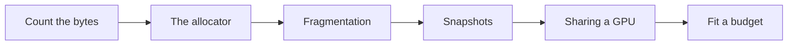
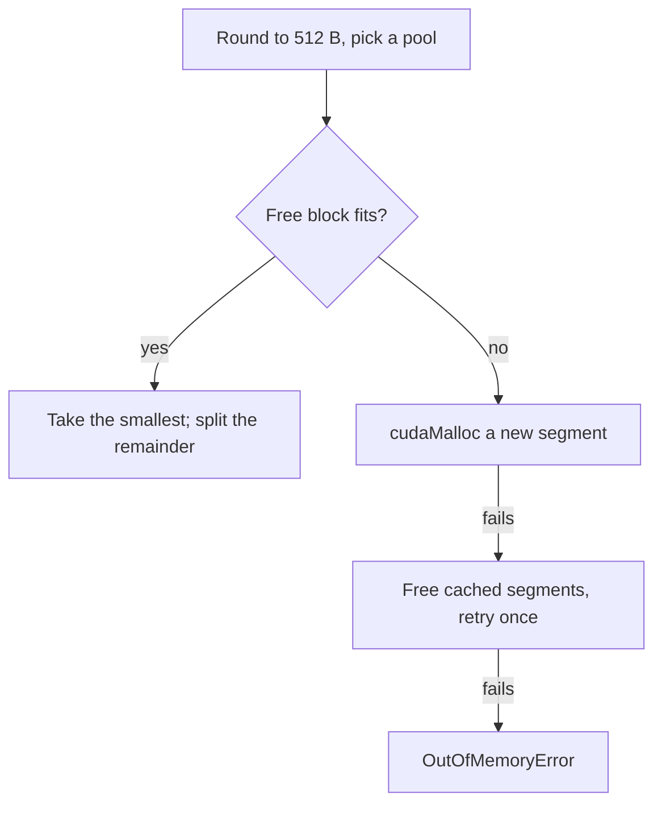
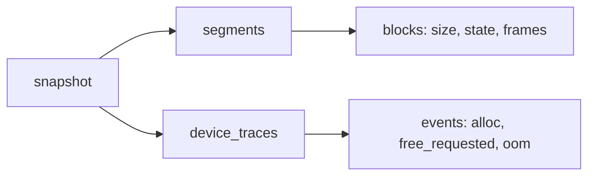
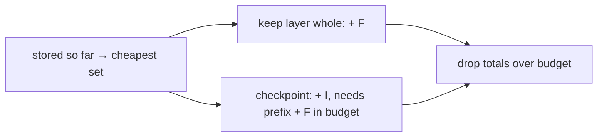
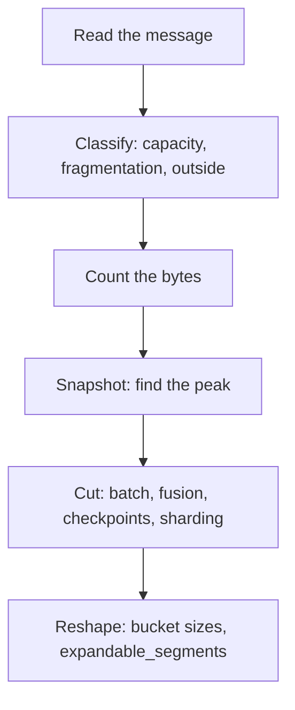

# Introduction

An OOM message names the size of the allocation that failed. It doesn't say whether the model, the batch, a leak, or the allocator is at fault.

Note:
Open by asking who has restarted a job after an OOM and changed something at random. The point of the next hour is to replace the guess with a procedure. Each cause has a different fix, so naming the cause first saves restarts.


### Four causes, four fixes {#causes}

- **Capacity:** the model or batch needs more bytes than the card has
- **Fragmentation:** free memory exists, in blocks too small
- **A leak:** something keeps a reference alive
- **Outside PyTorch:** another process, the context, a library

Note:
Say these four and tell the audience that the message looks identical for all of them. The fixes are different. Capacity needs fewer bytes. Fragmentation needs different shapes or allocator settings. A leak needs a code change. The outside case needs a look at the driver's numbers.


### The route {#route}



Note:
Walk the arrow. First the arithmetic of what a step holds. Then the allocator that hands it out, and the way it fragments. Then the snapshot, which shows you a particular run. Then a short look at sharing a GPU with MPS and MIG.


# What sits in GPU memory

A training step holds six kinds of memory. Three scale with the parameter count, one with the batch, and two are overheads.

Note:
This section is arithmetic you can do on a napkin. Do the example with the audience: it is the floor that every later number sits on. The lab's first check is the 16 bytes per parameter, and its wrong version is the one people write on a napkin.

## Bytes per parameter

### The six items {#six-items}

| Item | Bytes | Scales with |
|---|---|---|
| Weights | $b_w N$ | Parameters |
| Gradients | $b_g N$ | Parameters |
| Optimizer state | $(b_m + 8) N$ | Parameters |
| Activations | $\sum_i A_i$ | Batch, sequence |
| Workspace | kernel scratch | Kernels chosen |
| CUDA context | fixed | Driver, libraries |

Note:
Read down the table. Weights, gradients, optimizer state are fixed by the model. Activations are the term you control with batch size and checkpointing. Workspace is borrowed by kernels and is short-lived, but it counts toward the peak when it overlaps the biggest activations. The context is paid once per process. Measure the last two.


### Adam holds two states {#adam-two}

$$
M_{\text{state}} = (b_w + b_g + b_m + 8)\,N
$$

- fp32: $4 + 4 + 0 + 8 = 16$ bytes per parameter
- Mixed: $2 + 2 + 4 + 8 = 16$ bytes per parameter
- The 8 is two fp32 moments, $m$ and $v$

> [!QUESTION] Why does the first check in the lab fail if you count Adam's state once?
> You get 12 bytes per parameter for fp32, not 16. The optimizer keeps a running mean of the gradient and a running mean of its square, both fp32, so the state is 8 bytes per parameter. The error is the commonest slip in a hand estimate.

Note:
Both recipes cost 16, which surprises people who expect mixed precision to halve the footprint. It halves the weights the GEMMs read and the activations they save. The optimizer's share doesn't change, because the master copy replaces what the smaller weights saved.


### An example you can check {#example-1b}

- $h = 2048$, 24 layers: $N = 12 h^{2} \times 24 = 1{,}207{,}959{,}552$
- State: $N \times 16 = 19{,}327{,}352{,}832$ bytes, which is 18.00 GiB
- That is 22.5% of an 80 GiB card, before an activation exists

Note:
A layer holds about twelve h squared parameters, from the attention projections and a four-times MLP. Multiply by 24 layers, then by 16 bytes. The result is exactly 18 GiB. The embedding table adds to it and the example leaves it out. The figure script prints this number, so the audience can reproduce it.

## Activations and the rest

### Activations decide whether it fits {#act-fit}

```viz
40-budget-bar
```

Note:
Drag the batch to 12 and the checkpointed layers to 0: the bar passes the 80 GiB line. State is 18 GiB. Fused attention saves 3264 MiB per layer at that batch, 76.5 GiB for 24 layers. Slide the checkpoint count up to 7 and the bar fits.


### Why the first step under-reports {#first-step}

- Gradients appear at the first backward pass
- Optimizer state appears at the first `optimizer.step()`
- A first-step reading misses up to 12 of the 16 bytes per parameter
- Survive one full step before you trust a number

> [!QUESTION] Where does the CUDA context fit, and how big is it?
> A fixed per-process cost. The chapter marks its size unconfirmed, so measure it once on your stack, before you allocate a tensor.

Note:
This is why an OOM often arrives at step two. The forward and backward of step one ran without the optimizer's state. The first step with Adam is the first time the run shows its real floor. If you are sizing a job, measure after the optimizer has stepped at least once.

# The caching allocator

`cudaMalloc` is slow, so PyTorch asks the driver for large pieces and hands out parts of them. It keeps what it is given.

Note:
The allocator exists because a step makes thousands of allocations and a driver call each time would dominate. Everything in this section follows from one design choice: ask for big segments, cut them into blocks, and reuse blocks. The constants come from the PyTorch source, and the chapter marks the ones the user documentation doesn't state.

## Blocks, segments, pools

### Two pools, three segment sizes {#pools}

| Request, rounded | Pool | Segment from `cudaMalloc` |
|---|---|---|
| up to 1 MiB | small | 2 MiB |
| above 1 MiB, under 10 MiB | large | 20 MiB |
| 10 MiB and up | large | request rounded up to 2 MiB |

Note:
Every request first rounds up to a multiple of 512 bytes, and never below 512. Then the rounded size picks the pool. The table gives the segment the allocator asks the driver for when no free block fits. A 1 MiB request goes to the small pool.


### Rounding in numbers {#rounding}

- 1 byte takes a 512-byte block
- 1000 bytes takes 1024
- 1,000,000 bytes takes $1954 \times 512 = 1{,}000{,}448$
- 1 MiB + 512 bytes leaves the small pool for a 20 MiB segment

Note:
Work two of these on the board. The rounding is why memory_allocated is a little larger than the sum of your tensors' sizes.


### A request, step by step {#request}



> [!QUESTION] What happens to a block when you free a tensor?
> It goes back to its pool at once, and merges with free neighbors in the same segment. The segment stays reserved. That is why `del x` doesn't change what `nvidia-smi` shows.

Note:
Follow the yes branch first: it is the fast path and it is most requests. A split happens when the leftover is at least 512 bytes in the small pool, or more than 1 MiB in the large pool. The no branch is where reserved grows.


## Allocated and reserved

### Watch reserved climb {#watch}

```viz
40-allocator-steps
```

Note:
Press play and stop at "free c". Twenty-four MiB is cached, but in two segments, so a 16 MiB request doesn't fit and a new segment appears. Step to the end. Forty-eight MiB is live, 84 MiB is reserved, and the largest free block is 16 MiB. This is the lab's recorded trace.


### Two numbers, one gap {#gap}

$$
\text{cached} = \text{reserved} - \text{allocated}
$$

- `memory_allocated`: bytes in live blocks
- `memory_reserved`: bytes in all segments
- `nvidia-smi` shows reserved plus the context

> [!QUESTION] Reserved stayed at 60 GiB after allocated fell to 20 GiB. Do I call `empty_cache`?
> Only if another process needs the memory. The allocator is keeping segments for reuse. Calling `empty_cache` every step makes the next allocation pay `cudaMalloc` again, with its synchronization, for nothing.

Note:
The gap is the cache and it is normal. After a spike, reserved stays where it peaked. That isn't a leak. Read memory_allocated to learn what your code holds, and max_memory_reserved to learn what the run needed. A gap that is large at the moment of an OOM is the signature of fragmentation, which is next.

## Fragmentation

### Why free memory fails {#frag-why}

- A request needs one block at least as large as itself
- Changing sizes strand blocks of the old size
- A long-lived tensor between two short ones stops them merging
- A side stream's pool isn't available to the compute stream

Note:
Free memory isn't one pool of bytes. It's a set of blocks, and a request needs one block that fits. Three common sources. Variable shapes, such as a changing batch or sequence length. Interleaved lifetimes, where one long-lived tensor pins a segment. And per-stream pools, which chapter 22 explained for FSDP's all-gather stream.

### One number for it {#frag-ratio}

$$
\text{fragmentation} = 1 - \frac{L}{F}
$$

- $F$: free bytes across all inactive blocks
- $L$: the largest free block
- A request of size $r$ fits when $r \le L$

Note:
If all free memory is one block, L equals F and the ratio is zero. If it is scattered in equal pieces, the ratio approaches one. The ratio doesn't say whether you will fail. That depends on the next request. An OOM with the request below F and above L is the fragmentation failure.

### The fixture, in numbers {#frag-fixture}

- Reserved 106 MiB, live 55 MiB, free 51 MiB
- Largest free block: 24 MiB
- Fragmentation: $1 - 24/51 = 0.529$
- A 30 MiB request is below 51 and above 24, so it fails

> [!QUESTION] Could the same 51 MiB serve a 24 MiB request?
> Yes. The 24 MiB request is at most the largest free block, so the allocator takes that block and doesn't need a new segment. The failure depends on the request, not on the ratio alone.

Note:
The lab's snapshot is synthesized and labeled so in its file. It has four segments of 2, 20, 20, and 64 MiB. The inactive blocks are 1, 4, 6, 8, 8, and 24 MiB. Add them to get 51. Take the largest to get 24.


## Tuning

### Three options, three failures {#tuning}

| Option | Use it when |
|---|---|
| `expandable_segments:True` | Reserved-but-unallocated is large and sizes vary |
| `max_split_size_mb:N` | Many oversized blocks sit inactive; last resort |
| `garbage_collection_threshold:F` | Throughput drops from repeated `cudaMalloc` retries |

> [!QUESTION] How do I know an option helped?
> Record a snapshot before and after, and compare the fragmentation ratio and peak reserved. An option that doesn't move either number isn't helping, however good the theory sounded.

Note:
Set these through PYTORCH_CUDA_ALLOC_CONF, which is an alias for PYTORCH_ALLOC_CONF, as comma-separated option-colon-value pairs. Expandable segments is experimental and defaults off. Max split size keeps big blocks whole, at the price of internal waste. The garbage collection threshold is about speed, not about the most a step can hold. None of them replaces finding the cause.

# Memory snapshots

A snapshot records every segment and block, and the call stack of every allocation. It answers where the memory went.

Note:
This is the tool to reach for after the arithmetic. The arithmetic gives you a floor. The snapshot gives you what a particular run actually did, including the allocation you didn't know about. The API is underscored but documented, and the lab's fixture has its shape.

## Record and read

### Record, dump, stop {#record}

```python
torch.cuda.memory._record_memory_history(max_entries=100_000)
run_a_few_steps()
torch.cuda.memory._dump_snapshot("snapshot.pickle")
torch.cuda.memory._record_memory_history(enabled=None)
```

- `max_entries` is a ring buffer: set it for long jobs
- Drag the pickle onto `pytorch.org/memory_viz`; it runs locally

Note:
Call the first line before the code you want to watch. The enabled argument defaults to all, which keeps both the current state and the history. Context and stacks control how much of the call stack each event keeps.


### What a snapshot holds {#shape}



Note:
Two halves. Segments hold the state: each segment's address, size, type, and its blocks. A block's state is active-allocated, active-awaiting-free, or inactive. Device traces hold the history: one list of events per device. You read the first half for fragmentation and the second half for the peak.

### The reading order {#reading}

- Plateau: weights and optimizer state; match your formula
- Sawtooth: one step's activations; a rising peak is a leak
- Peak: hover the widest block and read its stack
- OOM event: compare the request with the largest inactive block

Note:
Four things to look for in the viewer, in this order. The plateau should match your arithmetic. A sawtooth whose peaks creep upward is a leak, often a loss appended to a list without item. The peak's stack names the allocation to attack.


## Replay in code

### The peak is in the history {#peak}

- Add `size` on every `alloc`
- Subtract it on `free_requested`
- Ignore `free_completed`
- The fixture peaks at 79 MiB, at `loss.py:31`; its final state holds 55

> [!QUESTION] Why isn't the peak allocation the biggest tensor in the model?
> It is the allocation that arrived last, on top of everything already live. In the fixture, the 40 MiB logits are bigger than the 24 MiB buffer, and the peak is at the buffer. The question to ask is what was alive when it arrived.

Note:
The viewer is for looking. For a number you can track or test, replay the history. The tensor stops existing at the request, so that is where you subtract. Counting free completed too subtracts every block twice, and undercounts. The fixture's peak is the 24 MiB log-softmax buffer arriving on top of 55 MiB.


### Classify the OOM {#classify}

| Free bytes | Largest free block | Verdict |
|---|---|---|
| below the request | any | Capacity: use fewer bytes |
| at least the request | below the request | Fragmentation: reshape |
| at least the request | at least the request | Look elsewhere |

Note:
This is the rule the lab's classify function implements. Compare the failed request with the total free bytes in cached blocks, then with the largest block. The first row is not the allocator's fault. The second is.


# Beyond one process

The native allocator is one design. The CUDA driver offers a stream-ordered one, and a GPU can be shared by several jobs.

Note:
Keep this section short. It answers three questions the audience will ask: what cudaMallocAsync changes, how pinned and unified memory affect a budget, and what MPS and MIG do to it. Each is a trade against the native allocator.

## Other allocators

### `cudaMallocAsync` and pools {#async}

- Allocate and free are ordered within a stream, with no device-wide sync
- A pool's release threshold sets how much it keeps
- Select it with `backend:cudaMallocAsync`
- The native tuning options don't apply

> [!QUESTION] Why not switch every job to `cudaMallocAsync`?
> It replaces PyTorch's blocks with the driver's pool, so `max_split_size_mb` and `garbage_collection_threshold` are ignored, and your debugging flow changes. Switch when you want one allocator across libraries in a process, and test the snapshot tooling first.

Note:
CUDA's stream-ordered allocator uses memory pools. Memory freed in a stream can be reused at once in that stream, and after a host sync by any stream. The release threshold at its maximum means the pool never shrinks, like the native allocator. You gain the driver's pool.


### Pinned and unified memory {#pinned}

- Pinned host memory is page-locked, which allows asynchronous copies
- Too much pinned memory starves the host
- Managed memory migrates by page fault, and can exceed GPU memory
- Use managed memory to make a job fit, not to make it fast

Note:
Pinned memory is covered with the copy engines in chapter 22. For the budget, it comes out of host RAM that can't be paged out. Managed memory is one address space for CPU and GPU. On systems with full support an array can exceed GPU memory, at the cost of page faults.


## Sharing a GPU

### MPS and MIG {#mps-mig}

| Property | MPS | MIG |
|---|---|---|
| Memory | Separate address spaces; optional limits | Dedicated per instance |
| Faults | A fatal fault reaches all clients | Instances are isolated |
| Granularity | Many clients | Fixed profiles |

> [!QUESTION] What does an OOM mean inside a MIG instance?
> Your budget is the instance's memory. A 1g.10gb instance runs out at 10 GB however much of the card is free, and the OOM message reports that size. An 18 GiB model state doesn't fit it at all.

Note:
MPS lets kernels from different processes run concurrently under a server that arbitrates. Clients have isolated address spaces and can have device memory limits, and an allocation over the limit returns an out-of-memory error. MIG partitions the card into instances with dedicated compute and memory.


# Fitting a budget

When the step doesn't fit, choose which layers to checkpoint. Each one frees bytes and costs a second forward pass through that layer.

Note:
Chapter 19 explained recomputation and its cost. This section assumes that and asks a planning question: given a byte budget, which layers do you checkpoint, and where? The answer isn't just a count, because the peak depends on position.

## The peak

### Two moments set the peak {#two-moments}

$$
\text{peak}(C) = \max\Big(\sum_j s_j,\ \max_{i \in C}\big(\sum_{j \le i} s_j + F_i\big)\Big)
$$

- $s_j = I_j$ if checkpointed, $F_j$ otherwise
- First term: everything stored after the forward pass
- Second: a rebuild on top of its stored prefix

Note:
After the forward pass every layer's stored bytes are held. Then the backward pass runs from the last layer to the first. When it reaches a checkpointed layer i, layers above have released theirs, layers up to i are still stored, and the rebuild brings back F i.


### Position matters {#position}

| Checkpointed | Stored | Peak |
|---|---|---|
| none | 40 | 40 |
| layers 0, 1 | 24 | 24 |
| layers 2, 3 | 24 | 34 |
| all four | 8 | 18 |

> [!QUESTION] If I checkpoint every layer, is the peak just the boundaries?
> No. The peak adds the rebuild of one layer on top of the stored prefix. For the 24-layer example at batch 12, all-checkpointed is $24 \times 192$ MiB plus one 3264 MiB layer, about 7.69 GiB, not 4.5 GiB.

Note:
Four layers of 10 units, boundary 2. The two middle rows store the same 24, and peak differently. Rebuilding layer 3 puts 10 more units on top of a stored prefix of 24. Rebuilding layer 1 puts 10 on a prefix of 4. Early checkpoints are cheaper in peak than late ones.


## Choosing the set

### Equal layers: a count {#equal}

- Card leaves $80 - 18 - 4 = 58$ GiB
- Each checkpoint frees $3264 - 192 = 3072$ MiB, which is 3 GiB
- Peak is $76.50 - 3k$ GiB: 58.50 at $k = 6$, 55.50 at $k = 7$
- Cost: 7 of 24 layers rebuilt, about 9.7% of a step

Note:
The 4 GiB of headroom is the chapter's assumption. At k equals six the peak is 58.5 and misses by half a GiB. At seven it fits. A step costs three forward-equivalents, so rebuilding seven twenty-fourths of a forward adds about ten percent.


### Unequal layers need a search {#unequal}

| Budget (MiB) | Checkpoint | Cost |
|---|---|---|
| 5400 | none | 0 |
| 4200 | 1, 3 | 15 |
| 3000 | 1, 3, 4 | 27 |
| 2200 | 0, 1, 3, 4 | 36 |
| 1500 | not feasible | |

Note:
Six layers with full sizes of 900, 900, 600, 600, 1200, and 1200 MiB, boundary 100 each, costs 9, 9, 6, 6, 12, and 12. A greedy rule by bytes freed per cost picks layer 4 first for budget 4200. It needs more, adds a cheap layer, and ends at 18.


### The dynamic program {#dp}



> [!QUESTION] What breaks if the chooser only checks the stored total?
> It accepts a set whose rebuild overflows. The plan fits the forward pass, then fails in the backward pass. The lab asks for the true peak of the returned set.

Note:
Walk the layers in order. Keep a table from stored bytes so far to the cheapest set that reaches it. Each layer has two moves. Keep it whole and add F. Checkpoint it and add I, but only if the new prefix plus F fits, which checks the rebuild term. Drop totals over the budget.


# Summary

Five ideas carry the chapter, and one order of steps puts them to work on a real OOM.

Note:
Close the talk by returning to the opening question: the message names a size and nothing else. The next two slides give the five ideas and the order of steps that turn that message into a cause.

### What to remember {#summary}

- State costs $(b_w + b_g + b_m + 8)N$: 16 bytes per parameter for Adam
- The allocator rounds to 512 B, caches blocks, and keeps segments
- Fragmentation is a request above the largest free block
- A snapshot's history holds the peak; its final state doesn't
- The checkpoint peak has two terms: stored total and biggest rebuild

Note:
Say each in one sentence. The first is the arithmetic that catches a one-copy Adam error. The second explains why reserved doesn't fall. The third gives you the classification rule. The fourth tells you where to look for the peak. The fifth is the formula behind the chooser.


### The OOM order {#order}



> [!QUESTION] Where does the course go from here?
> The memory you cut here pays for the larger batches that chapter 25's data parallelism and ZeRO-1 scale across GPUs. The state term from this chapter is what ZeRO divides by the number of ranks.

Note:
Steps one to three take a minute and fix a large share of failures. The snapshot is next. Allocator options come last, because they treat a symptom you have already named. If the answer is capacity, no setting will help: you need fewer bytes, and the cut step lists them in order of cost.
