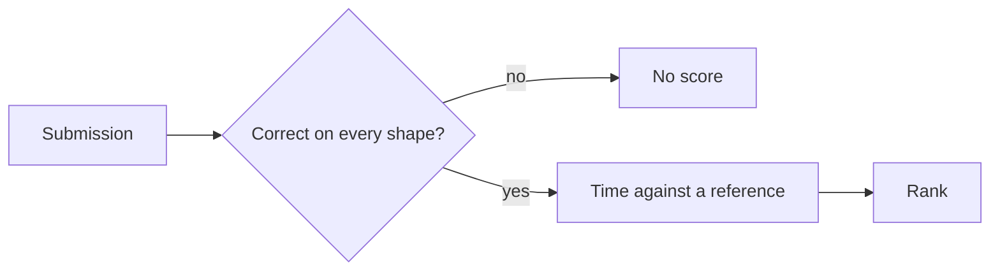
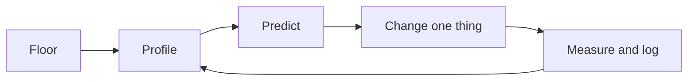

# Introduction

How do you make a kernel as fast as the hardware allows, and prove it without fooling yourself?

Note:
Open with the question. The audience has written kernels in earlier chapters, each with a hint about what to do. Here there is no hint: a correct slow function, a grader, and a clock. Say that the deck is about method, and that every number is a prediction from specs until the lab measures it.

### What a leaderboard does {#leaderboard}



- Correctness is a gate, not a term in the score
- Several shapes stop a kernel tuned for one size from winning

Note:
A task has an input generator, a reference, and test shapes. A wrong answer scores nothing, however fast. After the gate, the grader times the kernel. Say that the exact ranking rule differs by problem, and that this chapter's score is the lab's own design.

### What the public leaderboards say {#public}

- GPU MODE: a PyTorch `reference.py`, a `task.yml` of shapes, and a `task.py` schema per problem
- CS149 assignment 5: PyTorch baselines, `test` and `benchmark` modes, a leaderboard per kernel
- CS149 says no performance bar sets the grade: a work log carries most of it

> [!QUESTION] Does the GPU MODE leaderboard rank by a geometric mean?
> The pages read for this chapter don't say. Read a problem's own files and leaderboard page for its rule. The lab's geometric mean is its own design.

Note:
Cite only what was read. The reference-kernels repository describes problem structure and not the ranking rule. The CS149 page puts weight on the work log, which is the reason this chapter teaches a log.

### Where the lab's data lives {#sqlite}

- Each lab run stores its metrics in the app's SQLite database
- Those rows are the leaderboard's data
- A view that sorts them would be a small frontend addition
- This chapter produces the numbers and defines the score

Note:
Be clear about scope. There is no leaderboard UI in this chapter. The metrics that a leaderboard would sort already exist: `gray_ms`, `mlp_tflops`, and the scores.

### The route {#route}



Note:
This is the loop and the roadmap. First the floor and the loop, then the traps in measurement, then the score, then three starting points with their floors. The loop returns to the profile every time.

# The floor

A kernel can't finish before memory delivers its bytes or the arithmetic units do their work.

Note:
Section divider. The floor is the first thing you write, before the kernel.

### The speed-of-light time {#sol}

$$
\hla{t_{\text{floor}}} = \max\left(\frac{\hlb{F}}{\pi},\ \frac{\hlc{B}}{\beta}\right)
$$

- $\hlb{F}$: the FLOPs the kernel must do
- $\hlc{B}$: the bytes it must move
- Memory bound if $B/\beta$ is larger, compute bound otherwise

Note:
Walk the formula. It is chapter 4's roofline as a time. The slower resource sets the floor and the faster one hides behind it. Stress that it tells you which resource to chase.

### Count the ideal bytes {#ideal}

- Read every input once, write every output once
- Nothing for intermediates: a fused kernel doesn't write them
- Count the baseline's bytes and you get the baseline's floor

> [!QUESTION] Why count ideal bytes and not the baseline's?
> The floor measures headroom. The baseline's own bytes would show a baseline at its floor, with nothing to win.

Note:
This is where most floors go wrong. The unfused grayscale program moves 24 bytes per pixel, and the fused one moves 16. The floor uses 16.

### Which bandwidth {#bandwidth}

| Figure | Value | Meaning |
|---|---|---|
| Rating | 1935 GB/s | A ceiling no kernel reaches |
| Copy ceiling | 1275 GB/s | Measured, device-to-device copy, learn-inference chapter 10 |
| bf16 tensor peak | 312 TFLOP/s | Dense |
| fp32 peak | 19.5 TFLOP/s | CUDA cores |

Note:
Judge memory-bound kernels against the measured copy, and say so when you quote a floor. Pick the compute peak that the arithmetic can use: an fp32 kernel can't reach the tensor-core peak.

### The three floors {#three-floors}

| Task | Ideal bytes | FLOPs | Floor |
|---|---|---|---|
| Grayscale and blur | 268,435,456 | 369,098,752 | 0.2105 ms |
| Top-8 | 524,681,216 | 0 | 0.4115 ms |
| Fused MLP | 33,564,672 | 68,719,476,736 | 0.2203 ms |

> [!QUESTION] Which of these are compute bound?
> Only the MLP: 2047 FLOP per byte against a ridge of 244.7. The other two are memory bound by a wide margin.

Note:
All three are predictions. The first two are set by bytes over 1275 GB/s, and the third by FLOPs over 312 TFLOP/s. The lab measures the gaps.

### The loop in practice {#loop}

1. Predict: "fusing removes 134 MB, so about 0.1 ms"
2. Change one thing
3. Measure with the discipline in the next section
4. Log the prediction, the measurement, and the verdict

> [!QUESTION] Why change only one thing at a time?
> Two changes together hide which one helped, and a regression can hide inside a gain.

Note:
A row where the prediction held says the model is right. A row where it didn't says where to look. That's the only way to find the next bottleneck.

### When to stop {#stop}

- Within the noise of the floor
- A limit you can't move without leaving the task
- The next change is predicted to gain less than the run-to-run spread

Note:
A kernel at 85% of the floor has 15% of headroom, and a 1% change is below the noise of one run. Measure more times, with the discipline, before you guess.

# Measuring honestly

Most fast results come from a broken benchmark, and most of them favor you by accident.

Note:
Section divider. Go through the traps in the order a reader is likely to meet them.

### Trap one: no synchronize {#sync}

- A launch returns in microseconds, and the kernel runs later
- A host clock around a launch measures the queue
- Use CUDA events on the stream, or synchronize first

> [!QUESTION] Can a 2 ms kernel look like 5 microseconds?
> Yes. The host clock stops when the launch returns, not when the kernel ends.

Note:
This is chapter 0's lesson. `cuda_time` records events around the call, so it measures the GPU's own time between two points in the stream. If you use the host clock, call synchronize before you read it, or the number is the queueing time.

### Trap two: the cache remembers {#cache}

- The A100's L2 is 40 MiB
- A 16 MiB input read again comes from the cache
- Flush: write a buffer of twice the L2 size before each timed call

Note:
The lab's image is 201 MB and the logits are 524 MB, so the flush is a habit there. The MLP's inputs are 25 MB and fit, so it matters.

### Traps three and four {#shape-first}

- Round shapes hide missing masks: test $1 \times 1$, a row, and $1023 \times 1025$
- The first launch compiles: seconds for Triton, 30 to 60 s for `nvcc`
- Warm up, and drop the warmup times

> [!QUESTION] Why test a $1 \times 1$ image?
> Every tile is ragged and every mask matters. A kernel with no masking reads and writes out of bounds.

Note:
Time the shape the task names, and test correctness on the odd ones. A time that includes compilation measures the compiler.

### Trap five: the mean {#median}


- `[50, 9, 1.2, 1.0, 1.1, 1.0, 30, 1.05]` ms, two warmup
- Median of the six that remain: 1.075 ms
- Their mean: 5.9 ms

Note:
One outlier of 30 ms moves a mean by a factor of five here. This is the `robust_time` function in the lab.

### Trap six: an impossible number {#impossible}

- 524 MB in 0.2 ms is 2.6 TB/s, above the 1935 GB/s rating
- The timer, the cache, or skipped work is the cause

> [!WARNING] A result above the roofline is a bug report
> Find out why before you submit it. The lab fails a time below 95% of the rated-hardware floor.

Note:
The guard uses the rated bandwidth and peak with no allowance for what a kernel reaches. A correct kernel can't beat the hardware's rating.

# From a time to a score

A score compares your time with a reference and with the floor, so tasks become comparable.

Note:
Section divider. The score is the lab's design, and the slides show why it is a log.

### The score {#score}

$$
\text{score} = \operatorname{clip}\left(\frac{\ln(\hla{t_{\text{ref}}} / \hlb{t})}{\ln(\hla{t_{\text{ref}}} / \hlc{t_{\text{floor}}})},\ 0,\ 1\right)
$$

- As slow as the reference: 0
- At the floor: 1

Note:
The numerator is how many times faster than the reference you are, as a logarithm. The denominator is how many times faster the floor is.

### Log against linear {#log-linear}

```viz
41-score-curve
```

Note:
Move the reference to 4 times the floor and your time to 2 times. The log score is 0.5 and the linear score is 0.667. They agree only at the ends. Both floors and the shape of the curves come from the script in `scripts/figures`.

### Why a log {#why-log}

> [!QUESTION] Why isn't a halving worth the same on a linear scale?
> From 8 ms to 4 ms gains 4 ms of a 7 ms range. From 4 to 2 gains 2 ms. On a log scale each halving scores the same.

- Speedups are ratios
- The last changes give small ratios, and the log keeps them visible

Note:
Use the 8, 4, 2 example. A log score is flat in the ratio, so the last twenty percent of effort stays visible in the number. A linear score gives the first speedup twice the credit of the second and hides the late work.

### Geometric mean {#geomean}

$$
\text{geomean}(s_1, \ldots, s_n) = \exp\left(\frac{1}{n}\sum_i \ln s_i\right)
$$

- 0.5, 0.8, 0.2 gives 0.431, and the arithmetic mean is 0.5
- A zero anywhere gives a zero

> [!QUESTION] Why does a leaderboard use it?
> No strong shape covers for a weak one, and the result doesn't depend on units or on which implementation is the reference.

Note:
`capstone_score` is the geometric mean of the three task scores. A task you don't improve zeroes it, and a task raised from 0.1 to 0.3 moves the mean more than one raised from 0.8 to 0.9. Raise the weakest task first.

# Three starting points

Each task has a baseline that is correct and slow, a floor, and three first moves.

Note:
Section divider. For each task say what the floor is, what the baseline does, and what the first three changes should be.

## Grayscale and blur

### The task and its floor {#gray}

- Float32 $(H, W, 3)$ to $(H, W)$: luma, then a $3 \times 3$ blur with zero padding
- 16 bytes per pixel and 22 FLOP, so 268,435,456 bytes at $4096^2$
- Floor: 0.2105 ms at 1275 GB/s. Compute alone is 0.0189 ms

> [!QUESTION] Why is the border rule a correctness trap?
> Clamping coordinates returns 1.0 at the corner of an all-ones image. Zero padding gives 9/16.

Note:
Memory bound by a factor of 11. The rated bandwidth would give 0.1387 ms, which no kernel reaches. The correctness shapes include a single pixel, a row, a column, and 1023 by 1025, so the masks matter.

### Fusing removes an image {#gray-fuse}


- Unfused: 24 bytes per pixel, 402,653,184 bytes, 0.3158 ms
- Fused: 16 bytes per pixel, 0.2105 ms
- The difference is one image: 134,217,728 bytes

Note:
The prediction for the first move is a speedup of at most 1.5 over the baseline's own floor. A library convolution may move more than the lower bound.

### Moves two and three {#gray-moves}

- Reuse the luma with a halo tile: $(18/16)^2 = 1.266$ lumas per output at $16 \times 16$
- Load the row as a flat array of $3W$ floats, then split the channels in registers
- Skip the separable blur: the kernel is 11 times memory bound

Note:
Nine neighbor loads cost issue slots and L1 bandwidth, not DRAM bytes. The profile decides whether the second move is worth it.

## Row-wise top-k

### The task and its floor {#topk}

- Float32 $(4096, 32000)$, the 8 largest per row, lowest index wins a tie
- 524,288,000 bytes in, 393,216 out
- Floor: 0.4115 ms at 1275 GB/s

> [!QUESTION] Why is the stable sort the baseline?
> It satisfies the tie rule by construction, and it does far more than selecting 8 of 32,000 needs.

Note:
The output is tiny, so the floor is the read of the logits. The baseline is a full stable sort per row, kept because it meets the tie rule by construction. The gap between it and the floor is the lesson: selecting k of n doesn't need the order of the rest.

### One block per row {#topk-block}


- 8 rounds of two block reductions: 16 per row
- DRAM is read once, so the bytes meet the floor
- The cost is the reductions, not memory

Note:
4096 rows is about 38 blocks per SM, so there's no need to split a row. The risk is latency from the reductions.

### Moves two and three {#topk-moves}

- A thread-local sorted top 8, then one merge tree
- Compare (value, minus index) so the lower tied index wins
- Pick block size from the occupancy arithmetic

> [!QUESTION] Why does the grader compare indices as sets?
> A kernel may return its 8 indices in any order. Comparing in order rejects a correct kernel.

Note:
A new element enters the list only if it beats the 8th, which is rare after the start of a random row. `torch.topk` doesn't promise the tie order, so the lab reports it as a metric only.

## Fused MLP

### The task and its floor {#mlp}

$$
y = \operatorname{gelu}(x W_1 + b_1)\, W_2 + b_2
$$

- bf16 inputs, fp32 accumulation, $M = 4096$, $d = 1024$, $h = 4096$
- 68,719,476,736 FLOP, so 0.2203 ms at 312 TFLOP/s
- 33,564,672 bytes: 0.0263 ms

Note:
Compute bound by a factor of 8. The floor assumes the tensor cores run at the rated peak, which no real GEMM does, so the lab also reports the fraction of peak.

### What fusion can save {#mlp-fuse}

- Eager: the hidden layer moves four times, 134 MB, 0.1053 ms
- GELU in the first epilogue removes two: 67 MB, 0.0526 ms
- The lab's solution keeps two kernels and writes the hidden layer once

> [!QUESTION] Why not fuse the whole block?
> A 128-row output tile needs 524,288 bytes of fp32 accumulator, twice an SM's 262,144-byte register file. Smaller tiles re-read the weights: 16 rows means 4.3 GB.

Note:
Count the bytes you remove against the bytes the fusion makes you re-read. At $d = 1024$ the epilogue is the right fusion.

### Waves in the second GEMM {#mlp-waves}

| Tiles | Count | Waves on 108 SMs | Efficiency |
|---|---|---|---|
| $128 \times 128$, second GEMM | 256 | 2.37, runs as 3 | 79% |
| $128 \times 64$, second GEMM | 512 | 4.74, runs as 5 | 95% |
| $128 \times 128$, first GEMM | 1024 | 9.48, runs as 10 | 95% |

> [!QUESTION] What if the kernel beats cuBLAS by nothing?
> The score is 0, and the log says so. The baseline's GEMMs are cuBLAS's, so a score above 0 is a result.

Note:
These are predictions from tile counts with one tile per SM at a time. Chapter 4 introduced wave quantization and chapter 29 schedules around it.

# Summary

The method matters more than any one kernel.

Note:
Section divider. Return to the opening question and then give the four rules and the three floors.

### What to remember {#recap}

- Floor first: $\max(F/\pi, B/\beta)$ for the ideal fused kernel
- Predict, change one thing, measure, log
- Events, warmup, a flushed L2, odd shapes, the median
- Correctness gates, then time over shapes, then a log score and a geometric mean

Note:
Four lines. The method is the point, and the three kernels are practice for it. If the audience remembers one thing, it is that a number above the roofline is a bug in the measurement.

### The numbers to carry {#numbers}

| Task | Floor | Roof |
|---|---|---|
| Grayscale and blur | 0.2105 ms | Memory, 1275 GB/s |
| Top-8 of 32,000 | 0.4115 ms | Memory, 1275 GB/s |
| Fused MLP | 0.2203 ms | Compute, 312 TFLOP/s |

Note:
All predictions on the A100 80GB PCIe, from the 1275 GB/s copy ceiling and the rated compute peaks. The lab prints the measurements, and the interesting part of the exercise is the gap between each floor and the measured time.

### What comes next {#next}

- Write the six CPU functions, then the three kernels
- Keep a log: prediction, measurement, verdict, profile
- The lab runs the whole method on the A100

> [!QUESTION] How do you know you're done?
> You're within noise of the floor, the profile shows a limit you can't move, or the next change can't beat the spread.

Note:
Close by returning to the opening question. Fast means close to the floor, and proven means a log and an honest clock.
