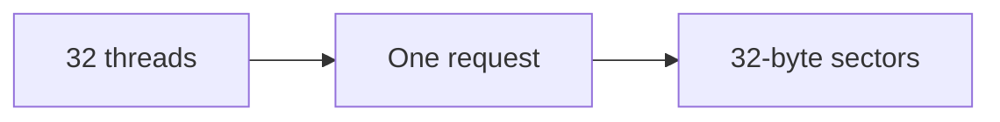
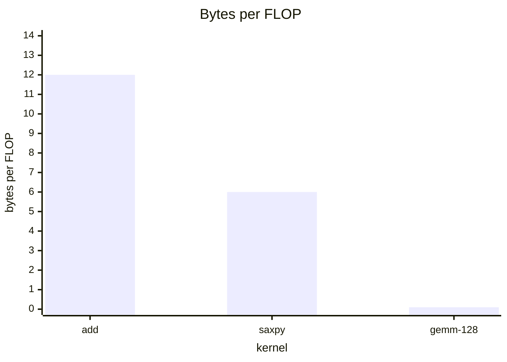

# Slide decks

Each chapter has one authored slide deck at `content/slides/<slug>.md`, where
`<slug>` is the chapter's slug, for example
`content/slides/03-memory-and-bandwidth.md`. A deck is what a speaker presents
for that chapter, with speaker notes. Any signed-in user can open it from the
chapter page or from the **Slides** page. There are no tiers, no teacher and
student views, and no video: one chapter has one deck.

The deck teaches the chapter in `content/chapters/<slug>.md`. It follows the
chapter's order and uses its numbers, and it adds pictures, anticipated
questions, and the spoken bridge between ideas. It doesn't state results that
the chapter doesn't.

To check a deck while you write it, run the following commands:

```bash
.venv/bin/python scripts/check_slides.py 03-memory-and-bandwidth
cd frontend && npm run check:mermaid -- 03-memory-and-bandwidth.md
```

## What a deck is for

The audience is a working engineer who writes PyTorch and asks a lot of
questions. A deck tells one story, from the problem the engineer recognizes to
the kernel that solves it, and it answers the questions that audience asks
before they ask them.

- **Narrative first.** Every slide follows from the one before it. Start from
  something the audience already knows or a problem they recognize, build the
  idea, then push it to where it breaks. The speaker notes carry the spoken
  bridge from one slide to the next.
- **One idea per slide.** If a slide needs a second idea, it's two slides. The
  checker enforces hard limits, but aim well under them.
- **Answer the questions.** Use `[!QUESTION]` callouts for the questions a sharp
  audience member asks at that moment: "Why 128 bits per thread and not 64?",
  "Does this still hold on an H100?", "What if the array isn't a multiple of the
  block size?"
- **Show, don't list.** Use a Mermaid diagram, a `viz` figure, a table, or a
  short code excerpt wherever a picture explains faster than words.
- **Concise but informative.** Bullets are short phrases or single sentences.
  Mathematics carries the precision; the bullets carry the meaning.
- **Every number is accountable.** A number on a slide is arithmetic from
  `docs/FACTS.md`, cited, or measured on the lab A100, exactly as in the
  chapters. Slide authors can't run the GPU either, so a value that would come
  from a measurement is a prediction derived from specs, or a quotation from a
  cited source that names its hardware. For the full rule, see the "Accuracy"
  section of [content/STYLE.md](../content/STYLE.md).

The prose style follows `content/STYLE.md` and the Google developer
documentation style guide.

## The required shape

Every deck has the following structure:

1. A title slide, generated from the front matter.
2. An `# Introduction` section: the question the chapter answers, why it matters
   for training or serving a model, what the audience already knows, and a
   roadmap of the sections ahead.
3. Two or more content sections, each with `##` subsections where the section
   has more than three slides. Basics come first; advanced material comes last.
4. A `# Summary` section (the heading starts with `Summary`): the key ideas, the
   numbers to remember, a decision guide or comparison where one fits, and what
   the next chapter picks up.

| Requirement | Value |
|---|---|
| Slides, title and dividers included | 22 to 40 |
| `[!QUESTION]` callouts | at least 6 |
| Diagrams (`mermaid` or `viz` fences) | at least 3 |
| Sections, Introduction and Summary included | at least 4 |

## The syntax

The following example is a complete deck, shortened to show every part. A real
deck has at least 22 slides.

````markdown
---
title: Memory and bandwidth
subtitle: Why most kernels wait for DRAM
notes: |
  Spoken over the title slide. One or two sentences that open the talk.
---

# Introduction

What this chapter answers, in a sentence. This text is the divider's body.

Note:
What you say as the section begins.

### Why a copy is not free {#why-a-copy}

- A kernel that adds two vectors does one FLOP per 12 bytes
- The arithmetic units are nearly idle; the memory system is not

> [!QUESTION] Isn't the GPU's bandwidth huge?
> It is: 1935 GB/s rated on the A100 80GB PCIe. A kernel that moves 12 bytes
> per FLOP still can't use more than a sliver of the 312 TFLOP/s.

Note:
The speaker notes. Say what the slide shows, what to stress, and how it leads
to the next slide.

# Coalescing

## Reading memory a warp at a time

### The warp's request becomes sectors {#sectors}

$$\text{sectors} = \left\lceil \frac{\text{bytes touched}}{32} \right\rceil$$



Note:
...

### Strided against coalesced {#strided}

```viz
03-coalescing
```

Note:
...

# Summary

### What to remember {#summary}

...
````

The parts work as follows:

- **Front matter.** `title` is required. `subtitle` and `notes` (the title
  slide's speaker notes) are optional, but write the notes.
- **`# Section`.** Starts a section and makes a divider slide titled with the
  section's name. Text under the heading, before the first `##` or `###`,
  becomes the divider's body. A divider must have speaker notes.
- **`## Subsection`.** Labels the slides that follow it. It makes no slide.
- **`### Slide title {#id}`.** Starts one slide. The `{#id}` attribute is
  optional; it gives the slide a stable id. Without one, the id is the title's
  slug. Ids are lowercase letters, digits, and hyphens, and they're unique in a
  deck. The slide's address is `/slides/<slug>#<number>`, so ids are for your
  own cross-checking; don't rename one that a note refers to.
- **`Note:`** on a line of its own ends the slide's body. Everything after it,
  up to the next heading, is the speaker notes. A content slide needs 20 to 220
  words of notes. Notes are Markdown, so they can hold maths. Put callouts,
  including `[!QUESTION]`, in the body before `Note:`: the checker counts only
  callouts in the body, and the slide shows only the body.

Headings inside a slide body aren't allowed; use bold text instead. Any other
attribute in the braces, such as `video=` or `book=`, is an error: this course
has no lecture videos.

## Slide content

A slide body is the site's Markdown, with KaTeX mathematics (including the
`\hla{}` to `\hld{}` colour macros), GitHub tables, callouts, code fences,
Mermaid diagrams, and `viz` figures. One slide holds at most the following:

| Limit | Value |
|---|---|
| Words of prose, mathematics and fences excluded | 80, or 50 with a diagram or figure |
| List items | 6 |
| Display formulas (`$$ ... $$`) | 2 |
| Non-blank lines, each fence counted as four | 16 |
| Diagrams or figures | 1 |

The presenter shrinks a slide's type to fit its 16:9 stage, down to 62% of the
normal size, and scrolls past that. A slide that needs the scroll is too full.

### Callouts

A callout is a blockquote that starts with a marker:

| Marker | Label | Use it for |
|---|---|---|
| `> [!QUESTION] The question?` | You might ask | An anticipated question, with its answer on the following lines |
| `> [!KEY]` | Key idea | The one sentence to take away |
| `> [!TIP]` | Tip | A practical shortcut or habit |
| `> [!WARNING]` | Watch out | A common mistake |

A question starts closed in the presenter, so you can pose it and click to show
the answer. The print layout and the slides PDF show every answer.

### Diagrams

A fenced `mermaid` block draws a diagram. The allowed types are `flowchart` (or
`graph`), `xychart-beta` (bar and line charts), `pie`, `timeline`, and
`quadrantChart`. Mermaid labels can't render KaTeX, so write mathematics in them
with Unicode: μ, σ, ≤, ≥, ≈, ², √. Quote any label that holds punctuation, such
as `A["T = 2N / BW"]`. The following block draws a bar chart:

````markdown

````

To check every Mermaid block, run `npm run check:mermaid` in `frontend/`. It
parses each block with the same Mermaid the site draws with.

### Figures

A fenced `viz` block holds the name of a registered chapter figure and renders
it, as in a chapter:

````markdown
```viz
03-coalescing
```
````

The name is a key in some chapter's `frontend/src/components/viz/<NN>/index.ts`.
A deck usually reuses a figure from its own chapter, but it can use any. The
checker reports a name that no registry holds. A figure's controls work in the
presenter; the slides PDF prints it in its initial state.

## The views

| Address | What it is |
|---|---|
| `/slides` | The index: every chapter's deck, with a link to the slides PDF when the server has one. |
| `/slides/<slug>` | The presenter view: the slide, the next slide, and the speaker notes. |
| `/slides/<slug>/present` | Present mode: the slide alone, as large as the window allows. |
| `/slides/<slug>/print` | The print layout: one slide per 16:9 page. |

In the presenter and in present mode, the keys are:

| Key | Action |
|---|---|
| Right arrow, Down arrow, Page Down, Space | Next slide |
| Left arrow, Up arrow, Page Up, Backspace, Shift+Space | Previous slide |
| Home, End | First slide, last slide |
| **N** | Show or hide the speaker notes (presenter view) |
| **P** | Switch between the presenter view and present mode |
| **F** | Full screen |
| **B** or **.** | Black out the screen |
| Esc | Leave present mode, or leave the deck |

A click on the slide moves on, and a click on its left quarter goes back.

## The slides PDF

`node frontend/scripts/build-slides.mjs` prints every deck into one PDF,
`book/gpu-programming-for-ml-slides.pdf`: one 16:9 page per slide, with a
bookmark for each deck and each of its sections. It uses headless Chrome, as the
book does, and `scripts/deploy.sh` builds and ships it beside the book. The
build fails on mathematics that KaTeX can't render, on a figure that fails to
draw, and when the page count doesn't equal the slide count. To print one deck
instead, open `/slides/<slug>/print` and use the browser's print dialog.
